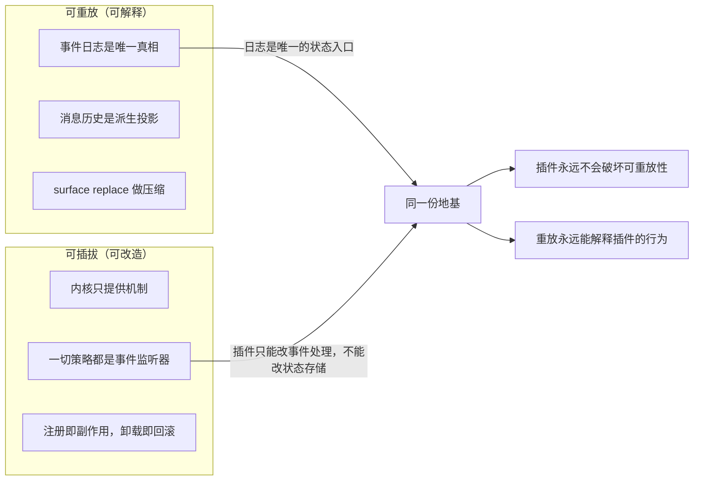
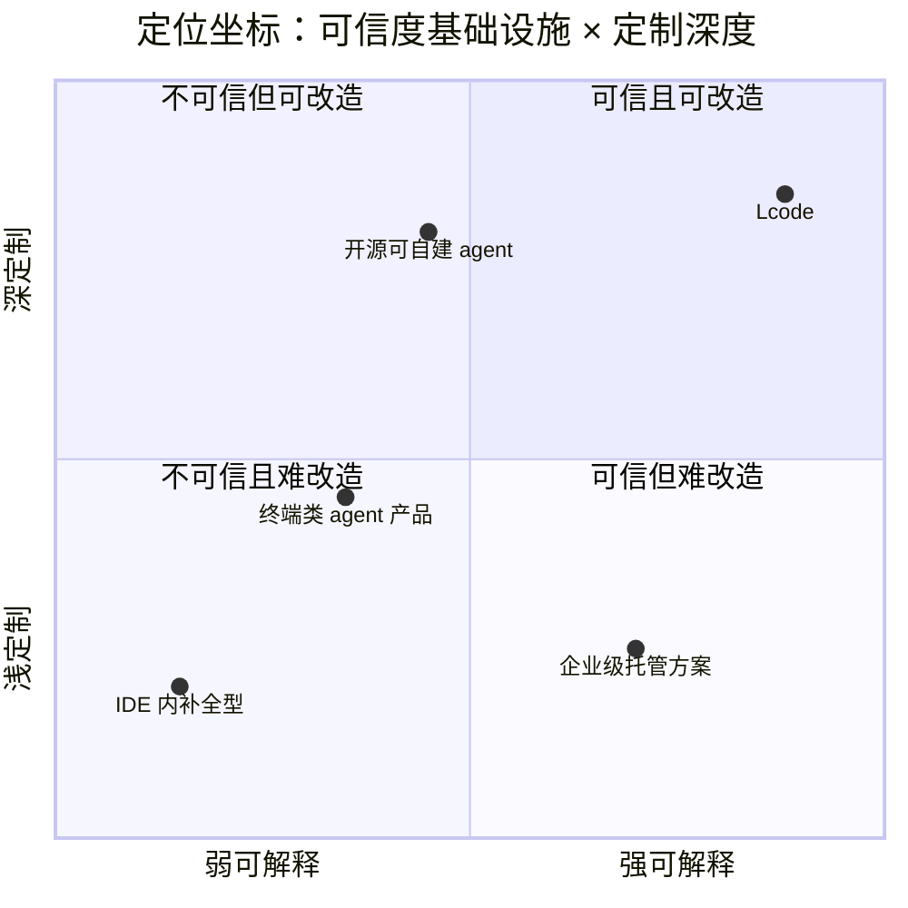

# 01 · 产品愿景与定位

> 这篇文档回答：**Lcode 为什么存在、为谁存在、凭什么赢、以及我们主动放弃了什么。**
> 它不描述功能（那是 [03-PRD-需求规格说明.md](./03-PRD-需求规格说明.md) 的事），只描述判断。

| 项 | 值 |
|---|---|
| 状态 | 草案 |
| 负责人 | 产品负责人 |
| 上游依赖 | [00-文档总览与全局约定.md](./00-文档总览与全局约定.md) |
| 下游被引 | [02-竞品与市场分析.md](./02-竞品与市场分析.md)、[03-PRD-需求规格说明.md](./03-PRD-需求规格说明.md)、[04-MVP范围与验收标准.md](./04-MVP范围与验收标准.md)、[14-产品路线图与里程碑.md](./14-产品路线图与里程碑.md) |
| 文档版本 | v0.1（2026-09-10） |

---

## 目录

- [1. 问题陈述](#1-问题陈述)
- [2. 愿景与使命](#2-愿景与使命)
- [3. 定位声明](#3-定位声明)
- [4. 目标用户与画像](#4-目标用户与画像)
- [5. 核心价值主张](#5-核心价值主张)
- [6. 差异化：为什么押注"可重放 + 可插拔"](#6-差异化为什么押注可重放--可插拔)
- [7. 定位坐标](#7-定位坐标)
- [8. 产品原则](#8-产品原则)
- [9. 成功指标](#9-成功指标)
- [10. 非目标（我们明确不做什么）](#10-非目标我们明确不做什么)
- [11. 商业模式假设](#11-商业模式假设)
- [未决问题](#未决问题)
- [变更记录](#变更记录)

---

## 1. 问题陈述

### 1.1 今天的 AI 编程 agent 已经"能用"，但还"不敢用"

2026 年的开发者已经习惯了让 agent 改代码。但当我们把真实项目交给它时，四类不信任反复出现：

| 不信任 | 具体表现 | 用户的实际反应 |
|---|---|---|
| **看不见** | 它改了三处文件，但只有一句"我已经完成了" | 打开 `git diff` 逐个核对，比自己写还慢 |
| **说不清** | 它执行了一条 `rm -rf` 或者装了新依赖，我不知道它为什么这么决定 | 关掉权限、改成每次确认，然后被弹窗烦死 |
| **断不了** | 跑到第 40 分钟崩了 / 上下文爆了，只能从头再来 | 只敢让它做 5 分钟以内的小任务 |
| **改不动** | 我想让它遵守我们团队的规范，或者接我们内部的代码检查服务 | 提 issue，等官方排期，或者放弃 |

这四件事的共同点是：**它们都不是"模型不够聪明"的问题，而是"系统不够诚实"的问题。**

模型能力在按季度提升，但上面这四条在过去两年里**几乎没有改善**——因为它们不是模型问题，是架构问题。

### 1.2 现有的解法都在"更聪明"这条路上挤

主流产品（无论是 IDE 内还是终端里）的竞争焦点高度集中在：

- 更强的模型、更长的上下文
- 更准的代码检索、更大的仓库索引
- 更花哨的多文件编辑与行内补全

这些方向都值得做，但它们都在回答**"让它更能干"**，而开发者的信任缺口在**"让它更可查"**。

> **我们的判断：下一个差异化的战场不在模型能力，在"可信度基础设施"。**

---

## 2. 愿景与使命

### 2.1 愿景

> **让开发者敢把真正重要的工作交给 AI —— 因为任何时候他们都能问出"为什么"，并且得到答案。**

### 2.2 使命

构建一个**可被追问、可被复原、可被改造**的 AI 编程工作台：

- **可被追问**：每一次模型请求、每一次工具调用、每一次权限决策，都能追溯到具体的事件记录。
- **可被复原**：任意历史时刻的完整上下文都可以重放；任意一个检查点都可以分叉出新的探索。
- **可被改造**：内核只提供机制，一切策略都是可替换的插件；用户不必等官方排期。

### 2.3 一段话的自证

> 如果我们做对了，用户会在遇到 agent 行为异常时的第一反应是**"让我打开时间轴看看它当时看到了什么"**，而不是**"算了，我自己写"。**

这句话是 Lcode 所有设计的最终验收标准。

---

## 3. 定位声明

> **对** 在本地做真实项目的 **个人开发者与小团队**，
> **他们** 已经用过 AI 编程工具，但因为在关键任务上无法确认 agent 到底做了什么、为什么这么做，
> **而** 始终把 AI 限制在"边缘任务"上，
> **Lcode 是一个** 桌面级 AI 编程工作台，
> **它提供** 全链路可重放（时间轴回放 + 从任意点分叉）与可插拔内核（策略、工具、上下文全部可替换），
> **不同于** 只追求"更聪明 / 更大上下文"的现有 agent 产品，
> **Lcode** 把"可解释"当作一等约束，而不是事后补的一个日志面板。

### 3.1 一句更短的版本

当有人问"Lcode 是什么"，标准回答是：

> **一个可以随时倒带、并且随便你改的 AI 编程工作台。**

---

## 4. 目标用户与画像

> 详细的用户定义见 [00-文档总览与全局约定.md §3](./00-文档总览与全局约定.md#3-用户定义)。本节给出可用来做设计判断的画像。

### 4.1 主画像：老陈 · 独立开发者（MVP 的核心用户）

| 维度 | 描述 |
|---|---|
| 背景 | 8 年经验，一个人维护 2 个项目（一个商业 SaaS + 一个开源库），同时接零散外包 |
| 日常 | 用 git 管理一切；习惯读 diff；终端与编辑器切换频繁 |
| 已经在用的 | 某 IDE 内 AI + 某终端 agent；每月为两个 AI 服务付费约 $40 |
| 关键场景 | ① 给老项目补测试；② 把一处业务逻辑重构到新模块；③ 排查一个只在生产出现的 bug |
| 他现在的做法 | 用 AI 做"前半段"（找文件、写草稿），然后**自己接手**，因为他不敢让 AI 直接改核心模块 |
| 他最想要 | "如果我让它干这件事，我事后能 100% 确认它没乱来" |
| 他会被什么劝退 | 需要注册账号、需要上传代码、安装包 800MB、每次操作弹三次确认 |

**设计含义（重要）**：老陈的瓶颈不是"AI 不够强"，是"**验证成本太高**"。因此 Lcode 的第一优先级是**降低验证成本**（时间轴、diff 审阅、为什么面板），而不是提升生成质量。

### 4.2 次画像：小林 · 小团队技术负责人（v1.0 起）

| 维度 | 描述 |
|---|---|
| 背景 | 12 人研发团队的技术负责人，管代码规范与工程效率 |
| 痛点 | 团队里 6 个人在用 AI，各有各的 prompt、各有各的用法，新人上手没有参考 |
| 他想要 | 把"我们团队怎么用 AI"固化成一份可共享的东西，并能审计关键操作 |
| 他会为什么付费 | 团队配置共享 + 关键操作审计（"这次重构是谁批准的、依据是什么"） |
| 边界 | 他**不要求** SSO / 合规认证 / 云端管理后台——他们团队自己有 git 和 NAS |

**设计含义**：团队能力必须是**本地能力的同构叠加**（共享 preset 文件、共享技能包、导出可分享的会话），而不是另起一套云服务。

### 4.3 反面画像（明确不服务）

| 画像 | 为什么不服务 |
|---|---|
| 完全托管的云 IDE 用户 | 与"代码留在本地"的第一原则冲突 |
| 企业合规官 | 我们提供证据（可导出、可审计的日志），但不提供认证 |
| 完全不懂代码的"氛围编程"用户 | Lcode 默认用户看得懂 git diff 与终端输出；我们不做"零代码"叙事 |
| 只想"一键生成整个 App"的用户 | 我们优化的是**在真实项目里安全地干活**，不是从零生成 |

---

## 5. 核心价值主张

三条价值主张，一一对应 [00-产品宪法](./00-文档总览与全局约定.md#2-产品宪法不可妥协的三条)。

### 5.1 可解释优先于聪明 —— "你能问出它为什么这么做"

**用户语言**：*"我可以把它任何一步的输入输出翻出来看。"*

**具体能力**：

| 能力 | 用户体验 |
|---|---|
| 时间轴回放 | 拖动时间轴回到第 12 步，看到当时**确切**的上下文（而不是事后重算的近似） |
| 完整调用链 | 点开任意一次工具调用，看到它经过了哪些策略、谁批准的、依据是哪条规则 |
| 请求快照 | 每一次模型请求的 system prompt、工具列表、消息历史都能逐字查看 |
| 导出可读会话 | 一键导出为 Markdown / JSONL，可以贴进 PR 描述或 issue |

**我们不做**：不为了"显得流畅"而隐藏中间步骤；不做"不可追溯的内部推理"。

### 5.2 用户拥有自己的数据与算力 —— "代码不出我的机器"

**用户语言**：*"我不需要注册账号，我的代码不会经过你们的服务器。"*

**具体能力**：

| 能力 | 用户体验 |
|---|---|
| 无强制账号 | 下载即用；不登录也能完整使用核心能力 |
| 本地优先存储 | 会话、索引、缓存、凭据全部在本机；Lcode 没有自己的数据服务器 |
| BYOK | 自带模型 key；也支持本地模型（Ollama / LM Studio） |
| 一键导出 / 一键清空 | 数据是可携带的，也是可彻底删除的 |
| 遥测默认关闭 | 开启前可先查看"到底会发什么" |

**不做的澄清**：本地优先 ≠ 离线可用。调用云端模型当然要联网。判断标准是**数据流向谁**，不是**是否使用网络**。

### 5.3 内核只提供机制 —— "它不够好，我自己改"

**用户语言**：*"你们的某个策略我不喜欢，我可以自己换掉，不用等你们发版。"*

**具体能力**：

| 层次 | 形态 | 门槛 |
|---|---|---|
| ① 配置 | 配置档 / 预设（yml） | 零代码，改装配与参数 |
| ② 技能 | `SKILL.md` + 可选脚本 | 写文档 |
| ③ 插件 | TypeScript 包，可注册服务 / 工具 / 事件监听 / 提示词段落 | 写代码 |

**三层递进的意义**：绝大多数定制需求在第 ① ② 层就满足了，只有真正深度的需求才需要写插件。这与"要么改配置、要么 fork 整个项目"的现状形成对比。

---

## 6. 差异化：为什么押注"可重放 + 可插拔"

### 6.1 两个候选方向与我们的判断

| 候选差异化 | 我们的判断 | 理由 |
|---|---|---|
| 更强的代码理解 / 更大仓库索引 | ❌ 不做主打 | 这是模型能力与检索技术的赛道，会被模型厂商的下一代模型直接吃掉；投入产出比逐年下降 |
| 更花哨的多文件编辑 / 行内补全 | ❌ 不做主打 | IDE 厂商的主场，我们做不过；且用户对"自动改代码"的接受度受信任缺口限制 |
| **全链路可重放** | ✅ **主打** | 是架构能力不是模型能力，**模型越强越值钱**；且直接命中"验证成本高"这个真实瓶颈 |
| **可插拔内核** | ✅ **主打** | 是架构能力；解决"等官方排期"的确定性痛点；且越是被深度使用的团队越需要 |

### 6.2 为什么这两件事天然是一对

> **这张图想让你看到什么**：可重放要求"状态只有一个入口"，可插拔要求"策略全部外挂"。这两个约束共享同一个地基——**只要日志是唯一真相、插件只能挂在事件上，那么"可插拔"就永远不会破坏"可重放"**。反过来，很多产品想加插件时发现做不到，正是因为它们的状态是散落在各处的可变对象。

### 6.3 这是一个"护城河"还是"临时优势"？

诚实地回答：

| 维度 | 评估 |
|---|---|
| 大厂能否复制？ | **技术上能，但动机弱。** 事件溯源 + 插件化会显著增加它们的架构复杂度与迁移成本，而它们的用户（尤其是轻度用户）感知不到这个价值。 |
| 我们能守住多久？ | 如果我们做对了，护城河不是"这个架构"，而是**围绕它长出来的生态**（插件、技能、预设、社区约定）。架构可以被抄，生态不能。 |
| 最可能的被侵蚀方式？ | 它们把"可重放"简化成"一个日志面板"（80% 的观感，20% 的成本），然后在营销上说"我们也有"。 |
| 我们的应对？ | **把"精确"做成可验证的差异。** 例如：公开我们的不变量测试（"任意一次请求都能从日志逐字节重建"），把"看起来可查"和"真的可查"区分开。 |

### 6.4 定位辨析：我们是 harness，但不是一个"通用 harness"

> 本节回答一个极易被误读的问题：**既然 Lcode 的内核是通用的，那它和通用 agent 平台（DSH / WorkBuddy / Codex）有什么区别？**

#### 6.4.1 形态 ≠ 定位

"agent harness" 描述的是**架构形态**（模型 + 工具 + 循环 + 上下文管理 + 插件机制）。在这个维度上，**所有严肃的 agent 产品都是同一类东西**。

> **"我们是一个 harness" 不是差异化，是入场券。** 把它写进定位，等于把"我们有 HTTP 服务器"写进卖点。

真正的区分需要**两个正交的轴**：

| 轴 | 一端 | 另一端 | Lcode 的位置 |
|---|---|---|---|
| **能力边界** | 专做代码 | 完全通用 | **极左（代码垂直）** |
| **交付形态** | 开箱即用成品 | 可组装平台 | 中（成品 + 插件 SDN） |

| 产品 | 能力边界 | 交付形态 | 它的定位主张 |
|---|---|---|---|
| **Codex** | 代码垂直 | 成品 | 模型 + 代码能力 |
| **DSH** | 通用 | **平台 / 底座** | 一切皆插件，给别人当底座 |
| **WorkBuddy** | **完全通用** | 成品 | 通用生产力 + 连接器生态（其自我定义明确写着：*Code is a means, not the point*——代码是手段不是重点） |
| **Lcode** | **代码垂直** | 成品 + 插件 | **可信、可查、可倒带的代码执行** |

**关键观察**：Codex 是 Lcode 真正的同格邻居；DSH 是**潜在的底座供应商**（不是竞品）；WorkBuddy **主动放弃了**"代码垂直"这一格。

#### 6.4.2 为什么"可重放"只在垂直场景里值钱

这是本节最重要的一条论证。定义一个粗略的价值函数：

> **可重放的价值 ≈ 副作用的不可逆性 × 决策的不透明性**

| 场景 | 副作用不可逆性 | 我们对决策的不透明感 | 可重放的价值 |
|---|---|---|---|
| 写一篇分析报告 | 接近零（改改就行） | 中 | **玩具** |
| 整理一份表格 | 低 | 低 | 低 |
| **改生产代码** | **高**（可能上线出事） | **高**（"它为什么删了这一行？"） | **刚需** |
| **执行不可逆命令**（`git reset --hard`、迁移脚本） | **极高** | **高** | **刚需** |
| **装依赖 / 改配置** | 中高（三个月后才发作） | 极高 | **刚需** |

**推论（反直觉但重要）**：

> **Lcode 的通用内核是"顺带的红利"，不是"通往通用的船票"。**
>
> 如果 Lcode 去抢通用市场，它最核心的能力（可重放）在那里的价值会**急剧下降**——等于主动缴了自己的械。而它在通用市场上要面对的对手（WorkBuddy）拥有它没有的连接器生态。

**所以：内核通用是手段，垂直定位是身份。两者不可互换。**

#### 6.4.3 由此推出的三条纪律

| # | 纪律 | 具体含义 |
|---|---|---|
| **1** | **对外话术里不提"可插拔"** | 一号卖点只说三件事：**能查**（为什么面板 / 请求快照）、**能倒带**（时间轴回放）、**能恢复**（崩溃不丢工作）。"可插拔"是发烧友的加分项，不做首页文案。 |
| **2** | **内核保持小，复杂度投在垂直场景** | 内核包只做机制（见 [05 §4.1](./05-系统架构设计.md)，当前 6 个包）。任何"为了让内核更通用"而增加的抽象，都必须先回答"它服务哪条垂直用户旅程"。 |
| **3** | **护城河压在生态，不压在架构** | 架构可抄（抄的代价是重写状态层），生态抄不走。v0.3 就要开始降低插件与预设的编写门槛，**即使那时还没有市场**——因为生态是时间函数（见 [02 §7.2](./02-竞品与市场分析.md)）。 |

#### 6.4.4 一条警戒线

如果未来出现下面任何一种情况，说明定位正在漂移，需要回到本节重新校准：

- 首页文案开始出现"不止写代码"、"通用 AI 工作台"这类表述；
- 需求评审里出现"为了吸引非开发者用户，我们把 X 做得更通用一点"；
- 内核包的抽象层数增加，但**没有任何一条垂直用户旅程因此变好**；
- 团队开始用"我们的插件系统比 DSH 更灵活"作为对外论据——**这是在同一格和开源平台比拼，必输**。

---

## 7. 定位坐标

> **这张图想让你看到什么**：右上角是"既不缺信任、又不缺改造能力"的空位。开源自建方案有改造深度但缺少内建的可解释基础设施（你得自己造）；企业托管方案有审计但改不动；终端 agent 两头都不强。**Lcode 抢的是右上角。**

---

## 8. 产品原则

当两个方案冲突时，用这些原则裁决。**排序即优先级。**

| # | 原则 | 含义 | 反例（我们不做） |
|---|---|---|---|
| P1 | **可解释 > 流畅** | 宁可多一个步骤让用户看懂，也不要为了顺滑而隐藏 | 不隐藏工具调用；不做"黑盒式"的一个按钮完成一切 |
| P2 | **可逆 > 强大** | 一个能被撤销的能力，比一个更强但不可撤销的能力更值得做 | 不做没有日志的批量文件操作 |
| P3 | **显式 > 隐式** | 状态变化要有明确的事件、明确的边界、明确的提示 | 不做"悄悄帮你改了配置" |
| P4 | **本地 > 云** | 能在本机做的绝不上云 | 不做需要登录才能用的核心功能 |
| P5 | **机制 > 策略** | 内核只提供机制，具体规则交给插件与用户 | 不把某个团队的规范硬编码进内核 |
| P6 | **诚实 > 讨好** | 能力边界、失败原因、残留风险都要说清楚 | 不宣导"稳赚不赔"式的可用性承诺 |
| P7 | **少而深 > 多而浅** | 宁可少做两个功能，也要把核心链路做透 | 不做功能清单式的堆砌 |

### 8.1 一条容易违反的原则

**P1 与"用户体验"的张力**：产品评审里一定会有人提出"能不能把这几步合并成一个更顺滑的操作"。这时候要问一句：**合并之后，用户还能不能查到中间发生了什么？** 如果不能，就拆回去。

---

## 9. 成功指标

### 9.1 北极星指标

> **北极星：每周被"回放查看"的会话占比（Replay Engagement Rate）**

定义：一周内，用户**打开过时间轴并至少停留在某一步 ≥ 3 秒**的会话数 ÷ 该周有活动的会话数。

**为什么是它**：它是唯一同时验证"我们解决了真问题"（用户确实在查证）与"产品没白做"（他们查得到）的指标。如果用户从不回放，说明要么他们不在乎（价值主张错了），要么回放不好用（产品错了）。

目标：**v1.0 达到 25%**。

### 9.2 一级指标

| 指标 | 定义 | v0.1 目标 | v1.0 目标 |
|---|---|---|---|
| 信任转移率 | 用户让 agent 直接改"核心模块"（非边缘任务）的会话占比 | 观测 | ≥ 40% |
| 分叉使用率 | 使用过"从任意点分叉"的用户占比 | — | ≥ 15% |
| 中断恢复成功率 | 崩溃 / 取消后能从日志完整恢复的会话占比 | 100% | 100% |
| 重放准确率 | 重放重建的历史与实时历史逐字节一致的会话占比 | 100% | 100% |
| 插件装载量 | 平均每个活跃用户安装的第三方插件数 | 0（MVP 无生态） | ≥ 1.5 |
| 周留存（W4） | 第 4 周仍活跃的用户占比 | ≥ 35% | ≥ 50% |

### 9.3 反向指标（变坏就是出问题）

| 指标 | 含义 | 警戒线 |
|---|---|---|
| 平均审批弹窗数 / 会话 | 弹太多说明策略太保守或体验太差 | > 8 次要复盘 |
| 平均验证耗时 | 用户为确认一次 agent 改动所花的时间 | 不得随会话长度线性增长 |
| 崩溃与恢复失败数 | 任何一次恢复失败都是 P0 | 必须为 0 |
| 包体与内存 | Electron 的固有成本 | 安装包 ≤ 150MB，稳态内存 ≤ 600MB |

### 9.4 一个诚实的提醒

上面这些指标有一个共同的风险：**我们可能做出一个"指标好看但没人用"的产品**。因此每个版本必须同时回答一个定性问题：

> 有没有至少 5 个真实用户，在我们面前用它做真实的工作，并且**主动**打开了时间轴？

---

## 10. 非目标（我们明确不做什么）

这一节和第 9 节一样重要。**说清楚不做什么，才能让做什么变得可信。**

| # | 非目标 | 为什么现在不做 | 何时可能重议 |
|---|---|---|---|
| N1 | 自建云端协作服务 | 与 P4（本地 > 云）冲突；且团队需求可以被"文件共享"满足 | 出现大量付费企业客户要求时 |
| N2 | 插件市场（审核 / 分发 / 计费） | 冷启动问题：没有用户就没有插件作者，先做官方集 + 本地插件 | v1.0 后，且插件数 > 50 时 |
| N3 | 内置代码托管（git server / PR 平台） | 用户已有 git；重复造轮子且违法我们的"少而深" | 不做 |
| N4 | 自动化"无人值守"整项目开发 | 与 P1（可解释）冲突：无人值守意味着无人审查 | 不做 |
| N5 | 模型训练 / 微调 | 我们是 agent 产品不是模型公司 | 不做 |
| N6 | 移动端 / 平板客户端 | 目标场景是本地开发，移动端无真实需求 | 出现明确场景时 |
| N7 | 非 TypeScript 的插件运行时 | 一套类型化 RPC 已经足够复杂；多语言运行时会撕裂类型安全 | 出现强需求且生态成熟时 |
| N8 | "一键生成完整应用" | 目标用户是在真实项目里干活的人，不是从零起步的人 | 不做 |
| N9 | 文件级"无限撤销"进 MVP | 需要完整的快照机制（存储成本高）；MVP 只承诺**可重放**不承诺**可撤销** | v0.3 |
| N10 | 自建模型推理集群 | 与 BYOK 原则冲突 | 不做 |

---

## 11. 商业模式假设

> 明确标注为**假设**，需要真实数据验证。

| 假设 | 内容 | 验证方式 |
|---|---|---|
| H1 | 个人开发者愿意为"省心的可审计工作台"一次性买断或年付，而不是按 token 订阅 | 内测期定价页 A/B |
| H2 | 团队版的付费点是"共享配置 + 审计"，不是"更多席位" | 团队内测访谈 |
| H3 | BYOK 不会成为转化障碍（用户已有 key） | 漏斗分析：安装 → 配置 key → 首次成功会话 |
| H4 | 插件生态可以后置到 v1.0 之后再变现 | 观测官方插件 vs 第三方插件的使用占比 |

**初步定价骨架（仅供讨论）**：

| 版本 | 价格假设 | 内容 |
|---|---|---|
| Free | ¥0 | 全部核心能力、无账号、BYOK、本地存储 |
| Pro | 年付买断 | 团队预设共享、会话分享包、优先支持 |
| 不做 | — | 按 token 抽成、按席位收费的企业版（**明确排除**） |

**一条重要约束**：Free 版本**不得**阉割核心能力（尤其是重放与插件）。这两样是我们的差异化，把它们关进付费墙等于自废武功。

---

## 未决问题

- [ ] **北极星指标的阈值**：25% 的回放率是估算，需要内测数据校准。卡在产品负责人。
- [ ] **"验证耗时"的度量方式**：目前没有可自动采集的口径，可能只能靠用户访谈定性。卡在数据与产品。
- [ ] **H1 与产品原则的张力**：如果用户明确表示"我只想更快，不在乎可审计"，我们是否调整定位？需要一个决策截止点（建议 v0.5 前）。卡在创始团队。
- [ ] **团队版的边界**：共享会话时，接收方能否看到发送方的模型凭据信息？需要与 [12-安全权限与沙箱模型.md](./12-安全权限与沙箱模型.md) 对齐后定论。
- [ ] **"核心模块"的操作化定义**（用于计算信任转移率）：目前靠用户自述，不可靠。

---

## 变更记录

| 日期 | 版本 | 变更 | 说明 |
|---|---|---|---|
| 2026-09-10 | v0.1 | 初稿 | 建立问题陈述、定位、画像、价值主张、北极星指标与 10 条非目标 |
| 2026-09-10 | v0.2 | 新增 §6.4 定位辨析 | 明确"形态 ≠ 定位"：Lcode 是 harness 但不是通用 harness；补充"可重放只在有不可逆副作用的场景里值钱"的论证、三条纪律与四条定位漂移警戒线 |
