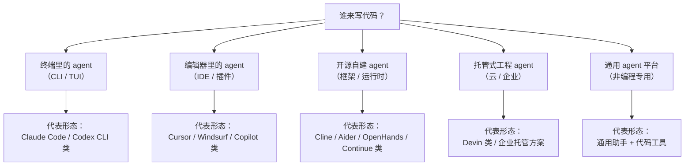
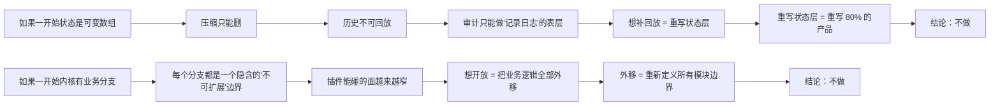

# 02 · 竞品与市场分析

> 这篇文档回答：**我们和谁在抢同一件事、他们都做对了什么、共同盲点在哪、我们的空位还在不在。**
> 结论会直接喂给 [01-产品愿景与定位.md](./01-产品愿景与定位.md) 的定位判断与 [03-PRD-需求规格说明.md](./03-PRD-需求规格说明.md) 的功能取舍。

| 项 | 值 |
|---|---|
| 状态 | 草案 |
| 负责人 | 产品负责人 |
| 上游依赖 | [01-产品愿景与定位.md](./01-产品愿景与定位.md) |
| 下游被引 | [03-PRD-需求规格说明.md](./03-PRD-需求规格说明.md)、[04-MVP范围与验收标准.md](./04-MVP范围与验收标准.md)、[16-风险登记册.md](./16-风险登记册.md) |
| 文档版本 | v0.1（2026-09-10） |

> ⚠️ **数据口径声明**：本文对竞品的描述基于**类别特征与公开可见的产品形态**，不引用未经验证的定价、用户量或内部路线图。任何要写进对外材料的竞品对比，必须在发布前由产品负责人复核当时的实际情况。文中所有"某产品支持 X"的表述，应按 **"截至本文写作时的公开认知"** 理解。

---

## 目录

- [1. 分析框架](#1-分析框架)
- [2. 竞争格局地图](#2-竞争格局地图)
- [3. 五类竞争者的逐类分析](#3-五类竞争者的逐类分析)
- [4. 能力矩阵](#4-能力矩阵)
- [5. 共同盲点：他们都在同一件事上留了空](#5-共同盲点他们都在同一件事上留了空)
- [6. 我们的空位与切入点](#6-我们的空位与切入点)
- [7. 大厂跟进时的应对策略](#7-大厂跟进时的应对策略)
- [8. 明确不对标](#8-明确不对标)
- [未决问题](#未决问题)
- [变更记录](#变更记录)

---

## 1. 分析框架

### 1.1 我们只看七个维度

竞品分析最常见的毛病是"比功能清单"，结论是"我们多了三个功能"。这对定位毫无帮助。我们改用**架构能力维度**，因为它们才决定产品能长成什么样：

| 维度 | 问题 | 为什么重要 |
|---|---|---|
| **A. 状态模型** | 会话历史是可变数组还是不可变日志？ | 决定能否压缩、分叉、恢复、审计 |
| **B. 可回放性** | 能否重建"当时模型确切的输入"？ | 决定"验证成本"能否降下来 |
| **C. 权限模型** | 有没有真正的沙箱？审批是一次性还是永久？ | 决定能否在真实项目上放开手脚 |
| **D. 扩展深度** | 用户能改到哪一层？（配置 / 提示词 / 代码） | 决定"等官方排期"这个痛点的深浅 |
| **E. 部署形态** | 本地 / 云 / 混合？代码流向哪里？ | 决定能进入哪些团队 |
| **F. 上下文治理** | 长会话怎么处理？压缩是否可逆？ | 决定能否干"长活" |
| **G. 生态位** | 它抢的是谁的岗位？编辑器？终端？平台？ | 决定会不会被正面碾过 |

### 1.2 我们复盘的三个问题

对每一类竞争者，我们只回答三件事：

1. **它做对了什么？**（我们要学的）
2. **它的结构性约束是什么？**（它为什么不能轻易做我们要做的事）
3. **它的用户会在什么时刻想找替代品？**（我们的入场时机）

---

## 2. 竞争格局地图

> **这张图想让你看到什么**：五类竞争者的**入口形态**完全不同，这决定了他们各自的架构重心。**没有一类的重心是"可回放"**——这是我们的全部机会。

---

## 3. 五类竞争者的逐类分析

### 3.1 类 A · 终端里的 agent

**形态**：在终端里跑一个 agent，直接读写文件、执行命令。近年最活跃的一类。

| 项 | 内容 |
|---|---|
| **做对了什么** | ① **零上下文切换成本**：开发者本来就在终端里；② **能力最强**：能跑命令、能装依赖、能操作 git；③ **产品化克制**：不试图替代编辑器 |
| **结构性约束** | ① **终端是流式输出模型**：它的天然投影是"一行行滚过去"，而"可回放"需要的是"可索引的结构化事件"，两者张力很大；② **面向单次会话**：会话管理薄（列表 + 恢复），缺少"检查点 / 分叉"这类一等概念；③ **扩展点通常较浅**（配置 + 提示词 + 少量 hook），深度定制仍然要 fork |
| **用户在什么时刻想找替代** | ① 跑了 40 分钟崩了，要从头来；② 想知道"它为什么删了那个文件"但只能翻滚动历史；③ 想让它遵守团队规范但改不动 |
| **对我们的意义** | **这是我们要抢的主战场**。它的用户已经接受了"agent 直接改代码"，只是缺少信任基础设施。我们不需要教育用户"agent 能做什么"，只需要给他们**一个可以倒带的版本** |

**我们的差异化落点**：**"终端的能力 + 可倒带的结构化历史"**。注意：Lcode 是桌面客户端，但**必须提供等价的 CLI 入口**（见 [14-产品路线图与里程碑.md](./14-产品路线图与里程碑.md)），否则会在"零上下文切换"这一条上吃亏。

### 3.2 类 B · 编辑器里的 agent

**形态**：IDE 或编辑器插件，天然拿到诊断、补全、跳转、引用等语言服务能力。

| 项 | 内容 |
|---|---|
| **做对了什么** | ① **行内体验极佳**：diff 直接在编辑器里，接受/拒绝一格一格；② **天然拿到 LSP 能力**（类型、引用、重命名）；③ 补全与 chat 融合，学习成本低 |
| **结构性约束** | ① **受宿主 API 限制**：能做什么取决于宿主暴露了什么，深度功能（子代理、后台任务、自定义工具）常常做不了；② **宿主是黑盒**：agent 的执行细节要藏在宿主的 UI 里，很难做"完整调用链"这种自家人才能造的视图；③ **状态归宿主**：会话与编辑状态在宿主的进程里，我们无法定义自己的持久化契约；④ **商业上受制于宿主** |
| **用户在什么时刻想找替代** | ① 需要跨项目 / 跨仓库的长任务；② 需要自定义工具接内部服务；③ 觉得弹窗/内联 diff 的审核方式不够，想要一个"完整审计视图" |
| **对我们的意义** | **不是正面对手，而是能力对照系**。Lcode 是桌面应用，可以自带编辑器级体验，但**必须在 LSP 能力上不落下风**（这是最容易输的地方，见 [03-PRD-需求规格说明.md](./03-PRD-需求规格说明.md) 中 `FR-LSP-*`） |

### 3.3 类 C · 开源自建 agent

**形态**：开源框架 / 运行时，用户自己搭、自己部署、自己接模型。

| 项 | 内容 |
|---|---|
| **做对了什么** | ① **扩展性最强**：源码就在那，想怎么改怎么改；② **数据完全自控**；③ **社区插件与玩法丰富** |
| **结构性约束** | ① **可解释性要自己造**：框架给你的是"循环 + 工具"，不是"可回放的历史 + 审计视图"；② **体验需要自己补**：配置、界面、安装、更新、沙箱全是用户的事；③ **质量参差**：一个能跑的 demo 和一个能在真实项目上跑一整天的产品，差距是数量级的；④ **多数是"单进程 + 可变状态"**：想加可重放时发现要重写地基 |
| **用户在什么时刻想找替代** | ① 配置太麻烦、维护成本高；② 想要能直接用的成品而不是脚手架；③ 自己做不出"时间轴"这种体验 |
| **对我们的意义** | **这是"可插拔"这条主张最强的对手**——因为它扩展性更好（源码级）。我们必须回答：**为什么用户不直接用它？**   答案必须是三条：**① 开箱可用（不为配置付费）；② 内建可重放基础设施（不用自己造）；③ 跨平台沙箱与更新是官方维护的（不用自己修）**。如果这三条任何一条不成立，类 C 会吃掉我们最硬核的用户 |

### 3.4 类 D · 托管式工程 agent

**形态**：云端托管的"能独立完成工单的工程 agent"，通常绑定 git 平台或自建云环境。

| 项 | 内容 |
|---|---|
| **做对了什么** | ① **端到端交付**：从工单到 PR，用户只需要 review；② **规模化的并行**：可以同时跑多个任务；③ **企业治理**：SSO、审计、配额 |
| **结构性约束** | ① **代码必须上云**：这一条直接排除了大量团队（金融、医疗、政企、以及大量中小团队的合规顾虑）；② **反馈环路长**：本地开发者的"边写边试"节奏被拉长；③ **交互感受弱**：打磨不到本地的细腻度；④ **成本结构重** |
| **用户在什么时刻想找替代** | ① 代码不能出内网；② 需要本地实时的交互节奏；③ 云端跑一天的成本超过预期 |
| **对我们的意义** | **不是替代关系，是互补关系**。我们的用户是"想在本地把活干完"的人；它的用户是"想外包整个工单"的人。**但它的"审计能力"是我们要学的**（企业客户认这个），而它的"必须上云"是我们要利用的 |

### 3.5 类 E · 通用 agent 平台（非编程专用）

**形态**：通用助手 + 代码能力，或通用 agent 编排平台。

| 项 | 内容 |
|---|---|
| **做对了什么** | ① 用户基数大、习惯已建立；② 通用能力（写作、检索、数据处理）与代码能力打通 |
| **结构性约束** | ① **不做深度的工程工具链**：不理解 LSP、不跑测试、不懂构建系统；② 没有本地环境；③ 交互是对话式的，不是工程式的 |
| **用户在什么时刻想找替代** | 一旦进入真实项目（多文件、要跑命令、要过 CI），就会撞墙 |
| **对我们的意义** | **不是对手**。但它们会不断说"我们也能写代码"，这会影响**轻度用户**的认知。我们不做针对轻度用户的营销——这恰好是我们的用户筛选机制 |

---

## 4. 能力矩阵

> 评分含义：● 强 / ◐ 中 / ○ 弱 / — 不具备。**这是架构能力评估，不是功能数量比较。**

| 维度 | 类A 终端 agent | 类B IDE agent | 类C 开源自建 | 类D 托管 agent | **Lcode（目标）** |
|---|---|---|---|---|---|
| **A. 状态模型** | 消息数组（推测） | 宿主托管 | 多为一进程内可变状态 | 云端存储 | **不可变事件日志** |
| **B. 可回放性** | ○ 有滚动历史，无可回放快照 | ○ 有 diff 历史 | ○ 需自己造 | ◐ 有审计日志（企业向） | **● 逐字节可回放（不变量保障）** |
| **C. 权限模型** | ◐ 有审批，沙箱能力因平台而异 | ◐ 依赖宿主 | ○ 需自己接 | ● 云端天然隔离 | **● 三平台 OS 原生沙箱 + 单调守卫** |
| **D. 扩展深度** | ◐ 配置 / 提示词 / 少量 hook | ○ 受宿主限制 | ● 源码级 | ○ 平台内 | **● 服务/工具/事件/提示词四类注册** |
| **E. 部署形态** | ● 本地 | ● 本地 | ● 本地或自建 | ○ 云端 | **● 本地优先，无自建服务器** |
| **F. 上下文治理** | ◐ 有压缩，通常不可逆 | ◐ 依赖宿主 | ○ 需自己造 | ● 云端可扩展 | **● 可逆（surface replace）+ 轻量优先** |
| **G. 时间轴 / 分叉** | ○ 无 | ○ 无 | ○ 无 | ◐ 有任务历史，无分叉 | **● 一等公民** |
| **H. 开箱可用** | ● 好 | ● 最好 | ○ 差 | ● 好 | **● 目标：最好** |
| **I. LSP 能力** | ○ 弱 | ● 强 | ○ 需自己接 | ◐ 中 | **◐→●（v0.3 补齐）** |

### 4.1 矩阵的三个读法

1. **B / D / G 三行是我们的全套差异。** 单独看每一行都不算独门（都有人强），但**三行同时强**的组合目前没人占。
2. **I 行是我们的最大短板。** LSP 能力上我们起步晚。这必须在 [14-产品路线图与里程碑.md](./14-产品路线图与里程碑.md) 里有明确的补齐计划，否则会成为"不如 IDE 好用"的持续攻击点。
3. **H 行是准入门槛。** 开箱体验做不到"最好"，前面所有差异都会被"懒得装"这三个字抵消。

---

## 5. 共同盲点：他们都在同一件事上留了空

### 5.1 三个盲点

把五类放在一起看，会出现三个反复出现的缺口：

#### 盲点一：**"历史"被当成 UI 问题，而不是数据结构问题**

几乎所有人都把"能往回看"实现成一个**滚动区域**或一个**日志面板**。滚动区域能回答"刚才显示了什么"，但回答不了：

- 模型在第 12 步**确切**看到了什么（包括当时的 system prompt、工具列表、被注入的上下文）
- 第 12 步那次工具调用经过了哪些策略
- 如果第 12 步换一个决定，后面会怎样

**根因**：他们把历史存在 UI 里（或存在一个扁平的消息数组里），而不是存在一份**可索引、可投影、可作为请求输入的结构化事件流**里。

#### 盲点二：**压缩是"销毁"而不是"遮蔽"**

上下文管理普遍是"删掉旧消息"或"用摘要替换旧消息"。这在功能上是够的，在信任上是**致命的**——一旦销毁，你就永远无法回答"它当时到底看到了什么"。

**根因**：状态是可变数组，删除是最省事的实现。而一旦选择"追加一条声明替换区间的记录"（surface replace），所有销毁性操作的代价都变成"一段区间标记"，可逆性几乎是免费的。

#### 盲点三：**扩展点是"给我们的功能留的口子"，不是"给用户的机制"**

大多数产品的扩展点是"我们发现用户需要 X，于是开一个 X 的配置项"。这是**特性扩展**，不是**机制扩展**。用户真正的痛点是"我想做的事你们没想到"，而特性扩展永远追不上这个需求。

**根因**：内核里有业务逻辑。有业务逻辑的内核，就必然有"这个逻辑不该被插件改"的边界；边界越多，能外挂的东西越少。

### 5.2 为什么这三个盲点长期存在？

不是因为他们看不见，而是因为**修复成本极高且不可逆**：

> **这张图想让你看到什么**：这三个盲点的根因是**架构选择的路径依赖**。这不是"他们偷懒"，而是"他们的地基不允许"。**这正是后来者唯一的机会窗口：我们可以在第一天就把地基打对。**

### 5.3 一个反面提醒

**不要假设对手不会补。** 他们完全可以在 **UI 层**做一个"看起来很像"的回放面板（把消息数组渲染成时间轴）。这就是 [16-风险登记册.md](./16-风险登记册.md) 里 R-MKT-01 描述的风险。

我们的应对不是营销话术，而是**可验证的精度差异**：

| 场景 | 表层实现（可变数组 + UI 回放） | Lcode（事件日志 + 派生） |
|---|---|---|
| 查看历史某步的消息 | ✅ 能显示 | ✅ 能显示 |
| 查看**当时的 system prompt 与工具列表** | ❌ 无法重建（事后重算会不一致） | ✅ 请求头快照逐字可查 |
| 查看**被压缩掉的内容** | ❌ 已销毁 | ✅ 原始事件仍在日志中 |
| **分叉**出另一条路线 | ❌ 无历史边界概念 | ✅ 按事件序号切前缀 |
| 崩溃恢复到"最后一条完整记录" | ❌ 只能恢复到上次保存点 | ✅ 保留完整中断轮并合成收尾 |
| 证明"重放 == 实时" | ❌ 无法证明 | ✅ 有可执行的不变量测试 |

**这张表是我们对外沟通的核心资产。**

---

## 6. 我们的空位与切入点

### 6.1 空位

> **同时满足"像终端 agent 一样能干"、"像 IDE agent 一样好用"、"像开源自建一样可改造"、"像企业方案一样可审计"的本地桌面产品。**

目前没有人在这个交集上。

### 6.2 切入点（Go-to-Market）

| 阶段 | 切入点 | 目标人群 | 话术 |
|---|---|---|---|
| v0.1 | **"能倒带的 agent"** | 类 A 的现有用户中，被"崩了要从头来"折磨过的人 | "它也一样能干活。区别是你可以倒回去看。" |
| v0.3 | **"你可以改的 agent"** | 类 C 的用户中，被配置与维护成本劝退的人 | "开箱可用，但内核是敞开的。" |
| v1.0 | **"团队可以对齐的 agent"** | 类 D 的用户中，代码不能上云的团队 | "审计能力不一定要上云。" |

### 6.3 三个必须打的证明仗

| # | 证明 | 用什么证明 | 什么时候 |
|---|---|---|---|
| 1 | 我们真的能逐字节重放 | 公开不变量测试的通过报告 | v0.1 |
| 2 | 我们真的可扩展 | 用"写一个插件接内部服务"的完整视频，20 分钟内完成 | v0.3 |
| 3 | 我们真的能干活 | 三个真实项目的完整会话导出（含失败与恢复） | v0.5 |

---

## 7. 大厂跟进时的应对策略

### 7.1 最可能的三种攻击

| 攻击 | 形态 | 我们的应对 |
|---|---|---|
| **"我们也有日志面板"** | 表层回放 | 用 §5.3 的精度对比表；公开不变量测试 |
| **"我们也能装插件"** | 特性扩展（配置项 + 少量 hook） | 用"20 分钟接内部服务"的实操对比；强调内核无业务分支这条可检验的判据 |
| **"本地也能跑"** | 托管产品的本地模式 | 强调"无账号 + 无自建服务器 + 数据可携"，这是托管厂商的结构性冲突 |

### 7.2 我们唯一真正的护城河

**不是架构，是围绕架构长出来的生态与约定。**

| 层级 | 是否可被抄 | 说明 |
|---|---|---|
| 事件日志 + surface replace | ✅ 可被抄 | 技术上没有秘密，抄的成本是重写状态层 |
| 三层扩展模型（配置 / 技能 / 插件） | ◐ 半可抄 | 概念可抄，但需要内核真的可外挂 |
| **插件与技能的生态** | ❌ 抄不走 | 网络效应 |
| **社区约定（团队预设的共享方式、审计格式）** | ❌ 抄不走 | 一旦成为事实标准，迁移成本极高 |

**战略含义**：v0.3 就要开始**把插件与预设的编写门槛压到最低**，即使那时还没有市场。因为生态是**时间函数**，早一年开始就早一年积累。

### 7.3 一个不舒服但必须承认的判断

> 如果我们最终失败，最可能的原因**不是**被大厂抄了，而是**用户根本不想要可审计**——他们只是想要更快，而"可审计"是我们的一厢情愿。

这个风险已经在 [16-风险登记册.md](./16-风险登记册.md) 的 R-MKT-02 登记，并设有明确的验证节点（v0.5 前）。**不要用"用户现在不懂，以后会懂"来搪塞这个风险。**

---

## 8. 明确不对标

| 对象 | 为什么不 |
|---|---|
| 通用 AI 助手 | 不同品类，比较无意义 |
| 云端托管 agent | 部署形态根本冲突，比较会让我们不自觉地上云 |
| 纯补全工具 | 我们的价值在"多步任务"，不在"下一行" |
| 企业级平台 | 我们先做 C 端，比较会让我们过早引入治理复杂度 |
| 其他 agent 框架（作为竞争对手） | 它们是**可共存的**（用户的 agent 可以用 Lcode 的协议），作为竞争者分析不如作为**潜在集成对象**分析 |

---

## 未决问题

- [ ] **类 C 的"自己造可重放"成本需要量化**：如果我们说"不用自己造"，得能说清"自己造要多久"。建议做一次内部实验：用某开源框架实现最小可回放，记录工时。卡在研发。
- [ ] **LSP 能力的补齐时机**：如果 v0.1 不做 LSP，会不会在第一印象上就输给类 B？需要用户测试验证。卡在 v0.1 内测。
- [ ] **是否需要"导入现有配置"**：如果用户已经在用某类 A 产品，能否导入它的会话或配置降低迁移成本？需要调研可行性。卡在产品。
- [ ] **本文所有竞品描述的有效期**：建议每季度强制复核一次，过期未复核的条目要在文中标注"待更新"。

---

## 变更记录

| 日期 | 版本 | 变更 | 说明 |
|---|---|---|---|
| 2026-09-10 | v0.1 | 初稿 | 建立七维分析框架、五类竞争者分析、能力矩阵、三个共同盲点、应对策略 |
