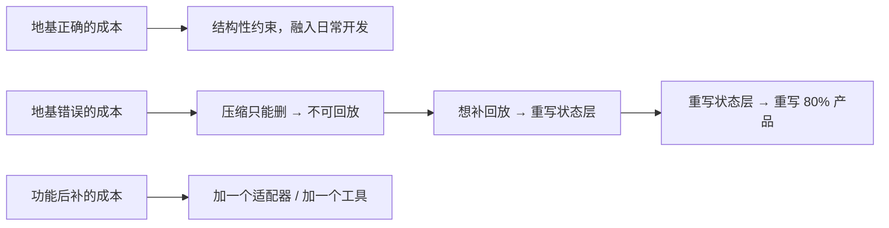
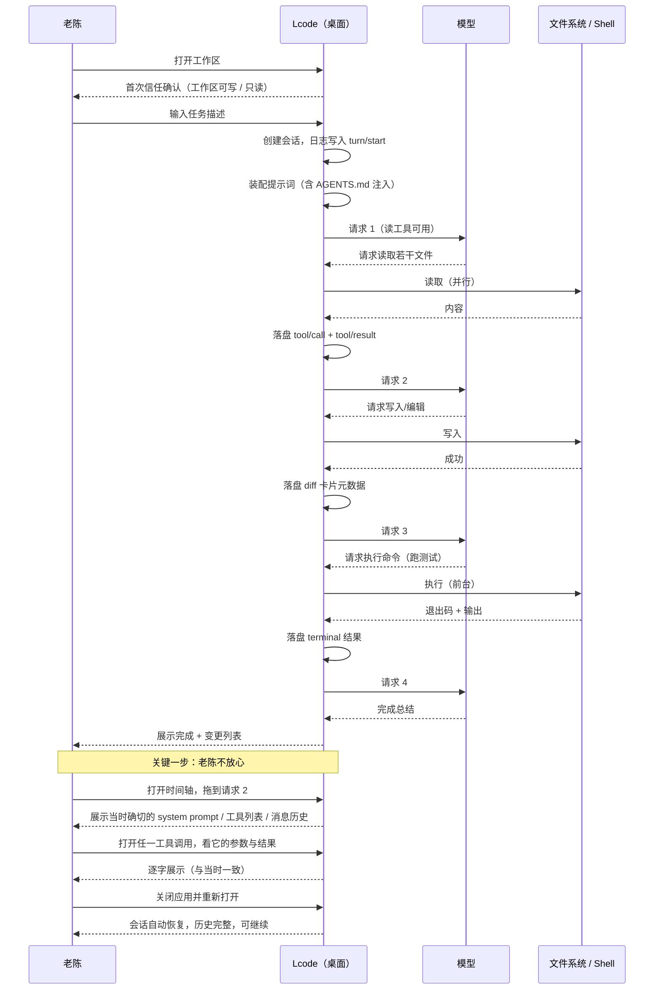

# 04 · MVP 范围与验收标准

> 这篇文档回答：**v0.1 到底做什么、不做什么、怎么算做完了。**
> 它是 MVP 期间唯一的"范围裁判"——任何新增诉求都要先在这里被接受或拒绝，才能进入 [14-产品路线图与里程碑.md](./14-产品路线图与里程碑.md) 的排期。

| 项 | 值 |
|---|---|
| 状态 | 草案 |
| 负责人 | 产品负责人 |
| 上游依赖 | [03-PRD-需求规格说明.md](./03-PRD-需求规格说明.md)（需求权威来源）、[01-产品愿景与定位.md](./01-产品愿景与定位.md) |
| 下游被引 | [14-产品路线图与里程碑.md](./14-产品路线图与里程碑.md)、[15-测试策略与质量门禁.md](./15-测试策略与质量门禁.md) |
| 文档版本 | v0.1（2026-09-10） |
| 目标版本 | **v0.1** |

---

## 目录

- [1. MVP 的判定原则](#1-mvp-的判定原则)
- [2. 一句话 MVP](#2-一句话-mvp)
- [3. 范围：In / Out](#3-范围in--out)
- [4. MVP 端到端旅程](#4-mvp-端到端旅程)
- [5. MVP 验收清单](#5-mvp-验收清单)
- [6. MVP 明确不做](#6-mvp-明确不做)
- [7. MVP 质量门禁](#7-mvp-质量门禁)
- [8. 可演示脚本](#8-可演示脚本)
- [9. MVP 成败判定](#9-mvp-成败判定)
- [未决问题](#未决问题)
- [变更记录](#变更记录)

---

## 1. MVP 的判定原则

### 1.1 三条准入规则

任何一个需求要进 MVP，必须**同时**满足：

| # | 规则 | 反例（不能进） |
|---|---|---|
| **R1** | **它是"骨架"而不是"肌肉"** —— 它定义一个不可后续追加的基础结构 | "支持第 5 家模型供应商"（可以以后加） |
| **R2** | **没有它，主线旅程会断裂** —— 用户走不完 J1 | "审批弹窗美化"（不做也能走完） |
| **R3** | **它的地基错误无法在后期修正** —— 或者修正成本 ≈ 重写 | "事件日志格式"（必须一开始就对） |

### 1.2 为什么 MVP 特别在意 R3

Lcode 的差异化全部建立在**地基**上（可重放、可插拔）。这类能力的特点是：**早期正确几乎免费，后期补上等于重写。**

> **这张图想让你看到什么**：MVP 的取舍不能按"用户价值 ÷ 工作量"排序，而要额外乘以一个 **"地基系数"**——地基类需求即使当下用户价值不明显，也必须进 MVP。

### 1.3 一条反向规则

**R4：任何可以由插件实现的功能，都不进 MVP 的 Must。**
它应该进 v0.3 的插件集，或者作为官方插件。这条规则保护内核的"无业务分支"约束（见 [00-产品宪法第三条](./00-文档总览与全局约定.md#第三条--内核只提供机制策略全部外挂)）。

---

## 2. 一句话 MVP

> **一个能在真实项目里干活、并且你可以随时倒带查看的桌面 agent。**

拆成三个必须成立的能力：

| # | 能力 | 为什么它必须在 MVP |
|---|---|---|
| 1 | **能干活**：读、改、跑命令 | 不能干活就没有"值得审计"的工作 |
| 2 | **能倒带**：时间轴回放到底层请求 | 这是全部差异化；后补等于重写 |
| 3 | **能改**：配置层与插件层可用 | 这是护城河的地基；后补等于重写 |

**MVP 不追求**：好用、快、漂亮、功能多。**MVP 追求**：地基正确 + 主线旅程闭合。

---

## 3. 范围：In / Out

### 3.1 In（MVP 包含）

| 模块 | 包含内容 | 对应需求 |
|---|---|---|
| **会话内核** | append-only 事件日志、派生历史、恢复、导出原始日志 | `FR-SESSION-001/002/003/007`、`FR-DATA-001/003` |
| **模型接入** | 2 家云端适配器 + 1 个本地运行时；统一流协议 | `FR-MODEL-001/002/005` |
| **工具系统** | 文件读取/写入/编辑、grep、glob、shell（前台+后台） | `FR-TOOL-001/002/003/006/008` |
| **工具卡片** | `generic` / `terminal` / `diff` / `read` 四种 | `FR-TOOL-007`、`UX-CARD-001/002` |
| **上下文装配** | 分段提示词、工作区指令注入（变化才注入）、包裹转义 | `FR-CTX-001/002/004/005` |
| **时间轴与回放** | 任意步定位、查看确切请求（system / tools / messages） | `FR-REPLAY-001`、`UX-TIMELINE-001`（只读版） |
| **工作区信任** | 首次打开显式确认；未信任时保守 | `FR-PERM-007`、`SEC-TRUST-001` |
| **装配可观测** | 可打印当前生效的完整插件树 | `FR-PRESET-003/004` |
| **扩展地基** | 服务/事件/副作用三类机制 + 注册即撤销 | `EXT-EVENT-001/002`、`EXT-EFFECT-001`、`EXT-SERVICE-001/002` |
| **插件最小闭环** | 一个官方示例插件：注册工具 + 提示词段落 + 事件监听 | `EXT-TOOL-001`、`EXT-PROMPT-001`、`EXT-PLUGIN-001` |
| **崩溃恢复** | 保留中断轮 + 合成收尾 + 只丢撕裂尾记录 | `NFR-REL-001/003`、`NFR-COMPAT-004` |
| **首启引导** | 选模型 → 填凭据 → 开示例工作区 | `UX-ONBOARD-001` |
| **CLI 入口** | 无 GUI 的 headless 跑一条任务（与桌面共用内核） | 支撑 `FR-PRESET-004`、CI 与快照测试 |

### 3.2 Out（MVP 不含，但地基已就位）

| 不含内容 | 推迟到 | 为什么可以推 |
|---|---|---|
| 审批弹窗与权限三轴 | v0.2 | 地基是"策略挂在事件上"，MVP 用"默认保守 + 只读工具"过渡 |
| 计划模式 | v0.2 | 纯策略，可后加 |
| "为什么"面板 | v0.2 | 数据（策略链日志）MVP 已落盘，只是没做视图 |
| 从任意点分叉 | v0.3 | surface 与 seq 机制 MVP 已有，缺 UI 与边界校验 |
| 压缩（剪枝 / spill / 摘要） | v0.3 / v0.5 | 日志格式已为 replace 预留，后加不破坏兼容 |
| 插件体系完整版 + 技能 | v0.3 | 地基（服务/事件/副作用）MVP 必须有，功能可后加 |
| 预设编辑器 | v0.3 | yml 手写可用 |
| 终端（持久 PTY） | v0.3 | shell 工具已覆盖 90% 场景 |
| LSP | v0.3 | 不影响 J1 主线 |
| 子代理 / 后台作业 | v0.5 | shell 后台已覆盖"长命令" |
| 网页搜索 / 抓取 | v0.2 | 抓取对排查 bug 有帮助但非必需 |
| 团队协作 | v1.0 | 需要预设与导出先成熟 |

### 3.3 范围的"红线"

下面这些**任何情况下都不进 MVP**，出现时要直接拒绝并记录理由：

| 拒绝项 | 理由 |
|---|---|
| 任何形式的云端账号或同步 | 原则冲突 |
| 任何形式的插件市场 | 冷启动 |
| 任何"让 agent 自己跑一整天不需要人"的功能 | 原则冲突 |
| 任何为了演示效果而牺牲可重放性的"快捷通道" | 地基破坏 |
| 任何写在 `agent-loop` 里的具体能力分支 | 契约破坏 |

---

## 4. MVP 端到端旅程

MVP 必须能跑通这一条（是 [03 旅程 J1](./03-PRD-需求规格说明.md#21-旅程-j1--老陈重构一个模块主线旅程) 的 MVP 版本）：

> **这张图想让你看到什么**：MVP 的价值不在前 90%（能干活），在**最后 10%**——用户能倒带、能验证、能恢复。如果只能交付前 90%，MVP 就失败了。

---

## 5. MVP 验收清单

> **规则**：每一条都必须能在真机上被一个不了解实现的人复现通过。验收项编号格式 `M-<模块>-NN`。
> 状态列：⬜ 未开始 / 🟨 进行中 / ✅ 通过 / ❌ 失败。

### 5.1 会话与恢复（`M-SESS`）

| 编号 | 验收项 | 对应需求 | 状态 |
|---|---|---|---|
| `M-SESS-01` | 创建一个新会话，日志首条为 `turn/start`，事件序号从 0 连续无空洞 | `FR-SESSION-001` | ⬜ |
| `M-SESS-02` | 会话 id 在 UI、导出文件、日志中三处一致 | `FR-SESSION-001` | ⬜ |
| `M-SESS-03` | 列表展示、重命名、删除会话；删除有二次确认 | `FR-SESSION-002` | ⬜ |
| `M-SESS-04` | **关闭应用再打开，会话自动恢复，可直接继续对话且不发散** | `FR-SESSION-003` | ⬜ |
| `M-SESS-05` | 恢复后的派生历史与关闭前**逐字节一致**（导出对比） | `NFR-REL-002` | ⬜ |
| `M-SESS-06` | 日志中不存在任何未配对的 `tool/call` | `NFR-REL-003` | ⬜ |
| `M-SESS-07` | 同会话内切换模型，下一步请求头可见新配置，历史不出错 | `FR-SESSION-007` | ⬜ |

### 5.2 崩溃恢复（`M-REC`）

| 编号 | 验收项 | 对应需求 | 状态 |
|---|---|---|---|
| `M-REC-01` | 在写入过程中强杀进程（`kill -9` / 任务管理器），重启后只丢撕裂的最后一条记录 | `NFR-REL-001` | ⬜ |
| `M-REC-02` | 在工具正在执行时强杀进程，重启后该中断轮被**保留**，并为未派发的工具调用补上错误结果 | `NFR-REL-001` | ⬜ |
| `M-REC-03` | 恢复后立刻发一条新消息，请求**被模型接受**（不因配对缺失被拒绝） | `NFR-REL-003` | ⬜ |
| `M-REC-04` | 手工把日志尾部的最后一条记录截断一半，重启后应用仍能加载并给出恢复提示 | `NFR-REL-001` | ⬜ |
| `M-REC-05` | 把日志的格式版本号改成未来的值，应用**拒绝加载并提示升级**，不静默降级 | `NFR-REL-008` | ⬜ |
| `M-REC-06` | 渲染进程崩溃后，会话与 agent 状态可恢复，未丢失已落盘事件 | `NFR-REL-004` | ⬜ |

### 5.3 工具（`M-TOOL`）

| 编号 | 验收项 | 对应需求 | 状态 |
|---|---|---|---|
| `M-TOOL-01` | 文件读取支持行窗口（offset/limit），返回带行号的窗口 | `FR-TOOL-001` | ⬜ |
| `M-TOOL-02` | 编辑默认要求唯一匹配；不给唯一匹配时**报错而不是猜** | `FR-TOOL-001` | ⬜ |
| `M-TOOL-03` | grep 结果按文件分组；被截断时**明确标注不完整** | `FR-TOOL-002`、`UX-CARD-003` | ⬜ |
| `M-TOOL-04` | shell 前台执行返回结构化结果：退出码 / 信号 / 是否超时 / stdout / stderr | `FR-TOOL-003` | ⬜ |
| `M-TOOL-05` | shell 后台执行返回作业 id，且不阻塞后续步骤 | `FR-TOOL-003` | ⬜ |
| `M-TOOL-06` | 非法参数（如缺必填字段、类型错误）产生**结构化错误**，会话继续，模型能自我纠正 | `FR-TOOL-008` | ⬜ |
| `M-TOOL-07` | 未知工具名产生 `UNKNOWN_TOOL` 结构化错误，不中断会话 | `FR-TOOL-008` | ⬜ |
| `M-TOOL-08` | 四种卡片（generic / terminal / diff / read）在实时态与重放态**渲染一致** | `FR-TOOL-007`、`UX-CARD-001` | ⬜ |
| `M-TOOL-09` | 工具返回的规范值可被程序读取（不经解析散文），且有测试证明 | `FR-TOOL-006` | ⬜ |
| `M-TOOL-10` | 大 diff 不撑爆布局（可折叠） | `UX-CARD-001` | ⬜ |

### 5.4 上下文与提示词（`M-CTX`）

| 编号 | 验收项 | 对应需求 | 状态 |
|---|---|---|---|
| `M-CTX-01` | 多个来源分段装配，按声明顺序拼接；同名时作用域内覆盖全局 | `FR-CTX-001` | ⬜ |
| `M-CTX-02` | 工作区指令文件被注入；**文件未变时下一步不重复注入** | `FR-CTX-002` | ⬜ |
| `M-CTX-03` | 指令文件内容变更后，下一步请求能看到新内容 | `FR-CTX-002` | ⬜ |
| `M-CTX-04` | 指令内容里若出现包裹结束标记，被正确转义（不可逃逸） | `FR-CTX-005`、`SEC-INJECT-001` | ⬜ |
| `M-CTX-05` | 动态上下文只在变化时物化；未变化时请求前缀保持稳定 | `FR-CTX-004` | ⬜ |

### 5.5 时间轴与回放（`M-REPLAY`）—— **MVP 的核心验收**

| 编号 | 验收项 | 对应需求 | 状态 |
|---|---|---|---|
| `M-REPLAY-01` | 时间轴列出会话内全部步骤，可拖动定位 | `FR-REPLAY-001` | ⬜ |
| `M-REPLAY-02` | 定位到第 N 步时，展示的 **system prompt 与当时请求逐字节一致** | `FR-REPLAY-001` | ⬜ |
| `M-REPLAY-03` | 展示的**工具列表**与当时请求逐字节一致 | `FR-REPLAY-001` | ⬜ |
| `M-REPLAY-04` | 展示的**消息历史**与 `deriveMessages()` 结果一致（由不变量测试强制） | `NFR-REL-002` | ⬜ |
| `M-REPLAY-05` | 展开任一工具调用，能看到它的**原始参数与结果** | `FR-REPLAY-001` | ⬜ |
| `M-REPLAY-06` | **重放 100 个真实录制的会话，全部通过"重放 == 实时"断言** | `NFR-REL-002` | ⬜ |
| `M-REPLAY-07` | 回放态有明确视觉区分，且输入区禁用并解释原因 | `UX-TIMELINE-002` | ⬜ |

### 5.6 权限与信任（`M-PERM`）

| 编号 | 验收项 | 对应需求 | 状态 |
|---|---|---|---|
| `M-PERM-01` | 首次打开新工作区弹出信任确认（可写 / 只读） | `FR-PERM-007` | ⬜ |
| `M-PERM-02` | 选择只读时，任何写文件操作被**实际拦截**（三平台各验一次） | `SEC-TRUST-001` | ⬜ |
| `M-PERM-03` | 未信任工作区默认不执行任何 shell 命令 | `FR-PERM-007` | ⬜ |
| `M-PERM-04` | 工作区外的路径访问被拒绝，并给出明确错误 | `SEC-TRUST-001` | ⬜ |
| `M-PERM-05` | 策略钩子已就位（MVP 可只挂一条默认策略），且能拒绝调用 | `EXT-POLICY-001` | ⬜ |

### 5.7 扩展地基（`M-EXT`）—— **MVP 的第二核心验收**

| 编号 | 验收项 | 对应需求 | 状态 |
|---|---|---|---|
| `M-EXT-01` | 四种事件派发模式（emit / waterfall / parallel / serial）均可用，且有测试覆盖 | `EXT-EVENT-001` | ⬜ |
| `M-EXT-02` | 一个示例插件能通过声明合并新增一种事件类型，**不改内核源码** | `EXT-EVENT-002` | ⬜ |
| `M-EXT-03` | **装载插件 → 注册 3 个工具 + 1 个提示词段落 + 2 个事件监听 → 卸载后，状态与装载前逐项一致** | `EXT-EFFECT-001` | ⬜ |
| `M-EXT-04` | 服务可被作用域隔离：为 agent A 注册的服务对 agent B 不可见 | `EXT-SERVICE-002` | ⬜ |
| `M-EXT-05` | 插件只 import 接口包即可工作；把实现包从依赖中移除后仍能编译通过（依赖方向检查） | `EXT-SERVICE-001` | ⬜ |
| `M-EXT-06` | 示例插件注册的工具在下一步请求中**立即对模型可见** | `EXT-TOOL-001` | ⬜ |
| `M-EXT-07` | 有静态检查断言核心循环源码中不存在针对具体能力的条件分支 | [00 宪法第三条](./00-文档总览与全局约定.md#第三条--内核只提供机制策略全部外挂) | ⬜ |
| `M-EXT-08` | 可打印当前生效的完整插件树（层级 + 配置），并导出为文件 | `FR-PRESET-004` | ⬜ |

### 5.8 模型接入（`M-MODEL`）

> 设计见 [18-模型接入与供应商配置.md](./18-模型接入与供应商配置.md)。

| 编号 | 验收项 | 对应需求 | 状态 |
|---|---|---|---|
| `M-MODEL-01` | 至少 2 家云端适配器 + 1 个本地运行时可用，流式输出正常 | `FR-MODEL-001/002` | ⬜ |
| `M-MODEL-02` | 流协议统一：文本 / 推理 / 工具片段 / 用量 / 结束原因 | `FR-MODEL-002` | ⬜ |
| `M-MODEL-03` | 换适配器不需要修改任何调用方代码 | `FR-MODEL-001` | ⬜ |
| `M-MODEL-04` | 凭据（API key）不出现在日志、导出文件、错误提示中（有 golden test） | `FR-MODEL-005`、`SEC-CRED-001` | ⬜ |
| `M-MODEL-05` | 模型请求失败时给出可读错误 + 可手动重试；重试不产生重复可见消息 | `UX-ERR-001/002` | ⬜ |
| `M-MODEL-06` | **不注册账号**；模型配置在「设置 → 模型」内完成（首页不出现配置引导）；本地模型无需密钥 | `FR-MODEL-000` | ⬜ |
| `M-MODEL-07` | **逐字段合并**：只改用户设置里的 `baseUrl`，适配器提供的模型清单**仍然可见** | `FR-MODEL-008` | ⬜ |
| `M-MODEL-08` | 分层优先级可验证：预设里的 provider/model 覆盖用户设置；会话内切换覆盖预设 | `FR-MODEL-008` | ⬜ |
| `M-MODEL-09` | 设置页显示每个配置项的**生效来源（人类语言）**；`lcode doctor --model` 结论与之一致 | `FR-MODEL-009` | ⬜ |
| `M-MODEL-10` | 保存配置后自动自检；六类失败（密钥无效 / 地址不通 / 模型不存在 / 超时 / 本地未运行 / 未配置）各有独立可读文案 | `FR-MODEL-010` | ⬜ |
| `M-MODEL-11` | 设置页可添加 / 删除供应商、检测连接、设默认；密钥**只显示掩码**，值永不显示 | `FR-MODEL-011`、`SEC-CRED-002` | ⬜ |

### 5.9 数据与导出（`M-DATA`）

| 编号 | 验收项 | 对应需求 | 状态 |
|---|---|---|---|
| `M-DATA-01` | 全部数据在用户可见的本地目录，结构与本文件所述一致 | `FR-DATA-001` | ⬜ |
| `M-DATA-02` | 会话可导出为 JSONL（原始事件）并可被重新导入 | `FR-DATA-002` | ⬜ |
| `M-DATA-03` | 一键清空全部本地数据，应用回到初始状态 | `FR-DATA-003` | ⬜ |
| `M-DATA-04` | 存储占用可视化（至少显示总会话大小与缓存大小） | `FR-DATA-004`（部分） | ⬜ |

### 5.10 交互与体验（`M-UX`）

| 编号 | 验收项 | 对应需求 | 状态 |
|---|---|---|---|
| `M-UX-01` | **首次启动直接进首页**，全流程不出现任何模型配置步骤；新用户 1 分钟内可发出第一条消息 | `UX-ONBOARD-001` | ⬜ |
| `M-UX-02` | 支持多行输入、粘贴大段代码、拖拽文件 | `UX-INPUT-001` | ⬜ |
| `M-UX-03` | 全局状态（空闲 / 运行中 / 等待确认 / 已取消）切换无闪烁 | `UX-STATUS-001` | ⬜ |
| `M-UX-04` | 错误提示只说"发生了什么 + 能做什么"，堆栈收在"详情"里 | `UX-ERR-001` | ⬜ |
| `M-UX-05` | 浅色与深色主题均可正常使用，跟随系统 | `NFR-A11Y-001` | ⬜ |
| `M-UX-06` | **术语扫描通过**：界面文案常量表命中 §[19 §6.2](./19-原型与交互规格.md#62-术语黑名单硬性ux-copy-001) 黑名单关键词数 = 0 | `UX-COPY-001` | ⬜ |
| `M-UX-07` | 首页四张能力卡片存在且点击可填入输入框；卡片措辞不含内部功能名 | `UX-HOME-001` | ⬜ |
| `M-UX-08` | 桌面惯例结构齐备：菜单栏 4 项 + 左侧栏（新对话/项目分组会话树/底部设置入口） | `UX-SHELL-001` | ⬜ |
| `M-UX-09` | 抽查 5 条工具卡片，标题均为**动词**（读取文件 / 修改文件 / 运行命令），无内部工具名 | `UX-COPY-001` | ⬜ |
| `M-UX-10` | **结构身份检测全部通过**（见 [10 §6.7](./10-桌面客户端设计.md#67-检测怎么知道我们的身份结构被磨掉了v04-修订)）：脊柱默认可见；已完成工具调用无默认展开；每轮以总结卡收尾；总结卡有产物入口；回放为当时快照；「详情」逃生舱存在 | `UX-VISUAL-001` | ⬜ |
| `M-UX-11` | **常驻时间轴脊柱**在默认视图中可见且不可折叠；点击节点可跳到对应步骤；点击「恢复时补记」节点给出拒绝提示 | `UX-VISUAL-002` | ⬜ |
| `M-UX-12` | **过程折叠**：任务进行中过程流自动展开且当前动作高亮；子任务完成时流内出现一句阶段小结（非卡片）；**任务完成后过程默认收起为一行**；展开为紧凑行、行详情需再点击；折叠状态不出现在会话日志中 | `UX-FOLD-001` | ⬜ |
| `M-UX-13` | **最终总结不可折叠**：任务完成后产出，头部为静态的「✓ 任务完成 · 用时 N」（**无折叠箭头**）；含三段式正文与底栏；出现后屏幕上不残留展开的过程；用量数字与日志派生值一致 | `UX-SUMMARY-001` | ⬜ |
| `M-UX-14` | **产物入口**：点击「查看本轮所有变更」后右栏聚焦并显示范围 chip「本轮 · 第 N 轮」，文件条数与总结卡标注的 (N) 一致；可切回"全部会话" | `UX-ARTIFACT-001` | ⬜ |
| `M-UX-15` | **输入框不跨栏**：三栏并排（窗口宽度 ≥ 1280px）时，composer 只占中间会话栏宽度，不进入左侧工作区与右侧变更栏的横向区域 | `UX-INPUT-002` | ⬜ |

### 5.11 非功能（`M-NFR`）

| 编号 | 验收项 | 阈值 | 状态 |
|---|---|---|---|
| `M-NFR-01` | 冷启动到主窗口可交互 | ≤ 2.5s | ⬜ |
| `M-NFR-02` | 首 token 渲染延迟（不含模型） | ≤ 100ms | ⬜ |
| `M-NFR-03` | 事件列表滚动（构造 10 万事件） | 稳定 60fps | ⬜ |
| `M-NFR-04` | 时间轴拖动定位（10 万事件） | ≤ 100ms | ⬜ |
| `M-NFR-05` | 稳态内存（1 万事件会话） | ≤ 600MB | ⬜ |
| `M-NFR-06` | 安装包体积 | ≤ 150MB | ⬜ |
| `M-NFR-07` | 恢复 1 万事件会话耗时 | ≤ 800ms | ⬜ |
| `M-NFR-08` | 三平台均可完成 5.1–5.10 的全部验收 | — | ⬜ |
| `M-NFR-09` | **热启动**（进程常驻，关窗后再打开）到窗口可交互 | ≤ 300ms | ⬜ |
| `M-NFR-10` | **渲染进程重载**（手动重载或崩溃恢复）到重新可交互，且会话内容不丢 | ≤ 600ms | ⬜ |

### 5.12 工程与质量（`M-ENG`）

| 编号 | 验收项 | 状态 |
|---|---|---|
| `M-ENG-01` | 核心包（`packages/core/*/src`）逐文件测试覆盖率 100% | ⬜ |
| `M-ENG-02` | 不变量 I1–I7 全部实现并在 CI 中强制 | ⬜ |
| `M-ENG-03` | 快照重放测试可在**无密钥**环境运行并通过 | ⬜ |
| `M-ENG-04` | 全部质量门禁在 CI 中为阻断级 | ⬜ |
| `M-ENG-05` | 存在一条 CLI 命令能无 GUI 跑通一个完整任务（用于 CI 与快照） | ⬜ |
| `M-ENG-06` | 文档完备：本套文档中 00/03/04/05/06 已与实现对齐 | ⬜ |

---

## 6. MVP 明确不做

> 这一节与第 3 节 Out 的区别：第 3 节是"延期"，这一节是"明确拒绝"。

| 不做的事 | 理由 | 如果有人坚持，怎么回应 |
|---|---|---|
| 云账号 / 云同步 | 与第一条产品原则冲突 | 走 ADR，需要创始团队一致同意改变定位 |
| 插件市场 | 冷启动 | v1.0 之后再议 |
| 自动更新 | v0.1 是内测，手动装包即可 | 排进 v0.2 |
| 性能极致优化 | MVP 只保证阈值达标，不做超规格优化 | 记录到性能待办 |
| 漂亮的空状态 / 插画 | 内测用户不看这个 | 设计资源投到回放体验上 |
| 多语言界面 | 内测是中文用户 | v1.0 前不做 |
| 撤销 / 回滚文件 | 需要快照机制，MVP 只承诺可重放 | 明确写进产品说明，避免误导 |
| 任何"一键完成整个功能"的魔法按钮 | 与可解释原则冲突 | 拒绝 |
| 企业部署 / 私有化 | 用户定位是 C 端 | 拒绝 |

---

## 7. MVP 质量门禁

MVP 不是"降低了质量标准"，而是"缩小了范围但提高了标准"。**以下门禁全部为阻断级。**

| 门禁 | 命令 | 通过条件 |
|---|---|---|
| 类型检查 | `pnpm typecheck` | 0 错误 |
| Lint | `pnpm lint` | 0 错误 |
| 单元测试 | `pnpm test` | 全绿 |
| 覆盖率 | `pnpm test:coverage` | `packages/core/*/src` 逐文件 100% |
| 不变量 | `pnpm test:invariants` | I1–I7 全部通过 |
| 快照重放 | `pnpm test:replay` | 100 个 fixture 全部一致 |
| 核心循环纯净性 | `pnpm check:loop-purity` | 无业务分支 |
| 构建 | `pnpm build` | 三平台产物均成功 |
| 依赖方向 | `pnpm check:deps` | 无插件依赖实现包 |
| 凭据泄漏 | `pnpm test:credentials` | golden test 通过 |

> 完整门禁定义见 [15-测试策略与质量门禁.md](./15-测试策略与质量门禁.md)。

---

## 8. 可演示脚本

> MVP 的 Demo 必须在 **8 分钟**内完成，且**不能有任何"这里我们跳一下"**。这份脚本同时是内测的验收剧本。

| 分钟 | 动作 | 展示什么 |
|---|---|---|
| 0:00–0:40 | 打开应用，选择一个真实的小项目（约 30 个文件） | 冷启动速度、首启信任确认 |
| 0:40–1:30 | 输入任务："把 `utils/parse.ts` 里的手写 JSON 解析替换成结构化解析，并补一个测试" | 会话创建、上下文注入（展示注入的指令文件） |
| 1:30–4:00 | 观看 agent 工作：读文件 → 编辑 → 跑测试 | 四种工具卡片、diff 卡片、terminal 卡片与退出状态 |
| 4:00–4:30 | 中途插入一句："测试用例再加一个边界值" | 转向（steer）在步边界生效 |
| 4:30–5:30 | **打开时间轴，拖到第 3 步** | 展示当时的 system prompt / 工具列表 / 消息历史；强调"这是当时的，不是事后算的" |
| 5:30–6:30 | 展开一次编辑调用，展示原始参数与结果 | 完整调用链 |
| 6:30–7:00 | **强杀进程（任务管理器 / `kill -9`）** | 崩溃 |
| 7:00–7:40 | 重新打开应用 | 会话完整恢复，含中断轮与合成的收尾结果 |
| 7:40–8:00 | 导出会话为 Markdown | 数据可携 |

**演示的"钉子"**：第 4:30–5:30 与第 6:30–7:40 这两段是**只有 Lcode 能演**的部分。其余部分是对手也能演的。

---

## 9. MVP 成败判定

### 9.1 成功的三个信号

| 信号 | 判据 |
|---|---|
| **S1 可用** | 至少 5 名真实开发者用它在一周内完成了**至少 3 个真实任务**（不是 demo） |
| **S2 被追问** | 至少 3 名用户主动打开时间轴，并且问出"这里为什么这么做？" |
| **S3 被改造** | 至少 1 名用户写出了自己的插件（哪怕是极简的） |

### 9.2 失败的三个信号

| 信号 | 判据 | 意味着什么 |
|---|---|---|
| **F1 没人倒带** | 时间轴打开率 < 5% | 价值主张可能错了（见 [02 §7.3](./02-竞品与市场分析.md#73-一个不舒服但必须承认的判断)） |
| **F2 装完就走** | 首启引导完成率 < 50% | 准入门槛太高（`NFR-*` 与 `UX-ONBOARD` 出问题） |
| **F3 只做玩具任务** | 用户只用它做 < 2 分钟的任务 | 地基对了但"能干活"没做到 |

### 9.3 从失败中怎么判断是"地基错了"还是"产品错了"

| 现象 | 归因 | 应对 |
|---|---|---|
| 能倒带但用户不关心 | **产品错了**（价值主张） | 回到 [01](./01-产品愿景与定位.md) 重新定位，不要在功能上加码 |
| 用户关心但倒带不好用 | **体验错了** | 投设计资源，不改架构 |
| 用户关心但恢复偶尔失败 | **地基错了** | 停下所有功能，修地基（这是最严肃的情况） |
| 用户表示"还是不如某竞品好用" | **能力覆盖不够** | 补 LSP / 终端 / 计划模式，不要改定位 |

---

## 未决问题

- [ ] **`M-REPLAY-06` 的 100 个 fixture 从哪来**：需要在内测期持续录制真实会话。谁负责收集、如何脱敏？卡在研发 + 法务（数据授权）。
- [ ] **`M-TOOL-08` "渲染一致"的判定方式**：看截图对比还是结构化属性对比？建议后者（可自动化），需要设计确认属性清单。卡在设计与研发。
- [ ] **MVP 是否需要网页抓取**：J2（排查 bug）里"读一个 issue 链接"很常见。当前列为 Out（v0.2），但如果内测用户高频提出，需要提前。决策点：内测第 2 周。
- [ ] **`M-ENG-05` CLI 入口的范围**：是"能跑一条任务"还是"完整功能对等"？当前按前者，需确认快照测试是否够用。
- [ ] **自动更新是否真的能推到 v0.2**：内测期手动装包的体验可能严重影响迭代速度。需要评估最小可行的自动更新。

---

## 变更记录

| 日期 | 版本 | 变更 | 说明 |
|---|---|---|---|
| 2026-09-10 | v0.1 | 初稿 | 建立 MVP 判定规则、范围 In/Out、端到端旅程、12 组共 60+ 条验收项、质量门禁与 8 分钟演示脚本 |
| 2026-09-11 | v0.2 | 5.8 段新增 5 条验收项 | 承接 `03` 新增的 `FR-MODEL-000/008/009/010`：免账号配置、逐字段合并、分层优先级可验证、来源可见、保存自检（`M-MODEL-06`–`10`） |
| 2026-09-11 | **v0.3** | **首启不配模型 + 文案验收** | ① `M-UX-01` 改为「首次启动直接进首页，无配置步骤」；② 新增 `M-UX-06`（术语扫描）、`M-UX-07`（能力卡片）、`M-UX-08`（桌面惯例结构）、`M-UX-09`（工具卡片用动词）；③ `M-MODEL-06/09/10/11` 同步为「设置在设置内、来源用人类语言、六类归因、密钥只显示掩码」 |
| 2026-09-11 | **v0.4** | **视觉身份验收** | 新增 `M-UX-10`（视觉身份六条检测：首页构图 / 输入框形态 / 强调色色相 / 圆角上限 / 脊柱可见 / 分类命名）与 `M-UX-11`（常驻时间轴脊柱可点可跳、拒绝"补的"节点） |
| 2026-09-11 | **v0.5** | **对话流密度验收** | ① `M-UX-10` 修订为「结构身份检测」（观感不再设防，身份 = 脊柱/折叠组/总结卡/产物入口）；② 新增 `M-UX-12`（工作过程折叠）、`M-UX-13`（轮总结卡）、`M-UX-14`（产物入口过滤到本轮），对应 03 新增的 `UX-FOLD-001` / `UX-SUMMARY-001` / `UX-ARTIFACT-001` |
| 2026-09-11 | **v0.6** | **过程/结果语义修正** | ① `M-UX-12` 修订为「过程折叠」（过程中展开、阶段小结在流内、任务完成后整体收起）；② `M-UX-13` 修订为「**最终总结不可折叠**」（头部无折叠箭头、不残留展开过程）；③ 新增 `M-UX-15`（输入框不跨栏），对应 03 新增的 `UX-INPUT-002` |
| 2026-09-11 | v0.7 | 新增热启动验收 | 新增 `M-NFR-09`（热启动 ≤300ms）与 `M-NFR-10`（渲染进程重载 ≤600ms 且会话不丢），对应 03 新增的 `NFR-PERF-011/012` |
