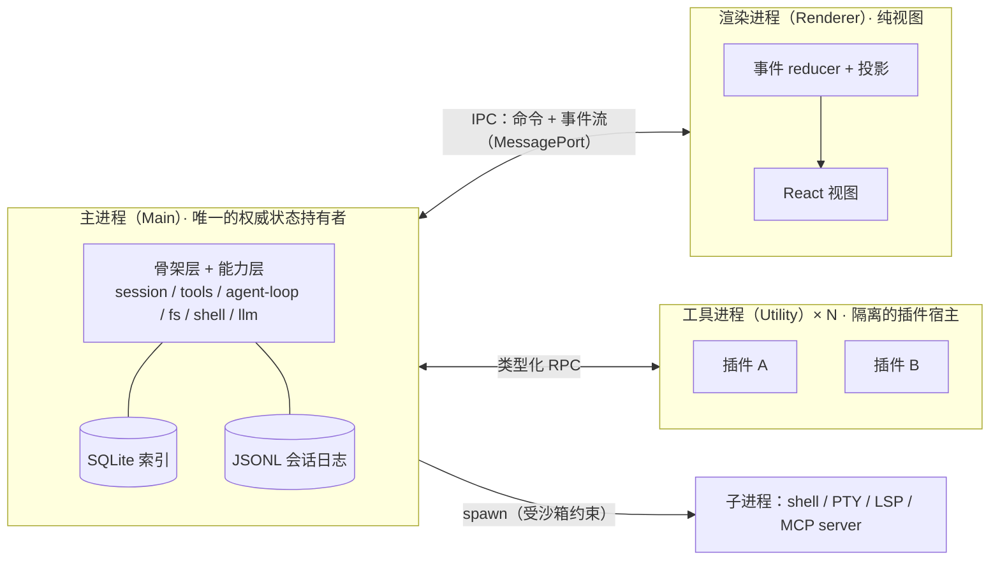
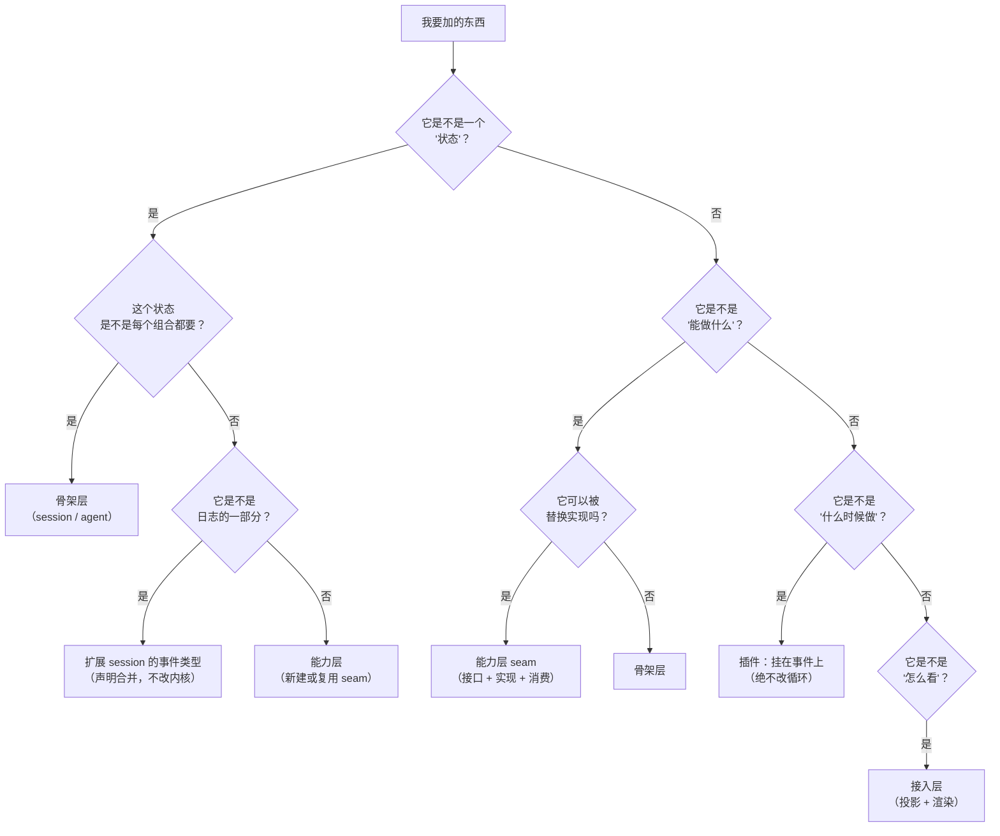
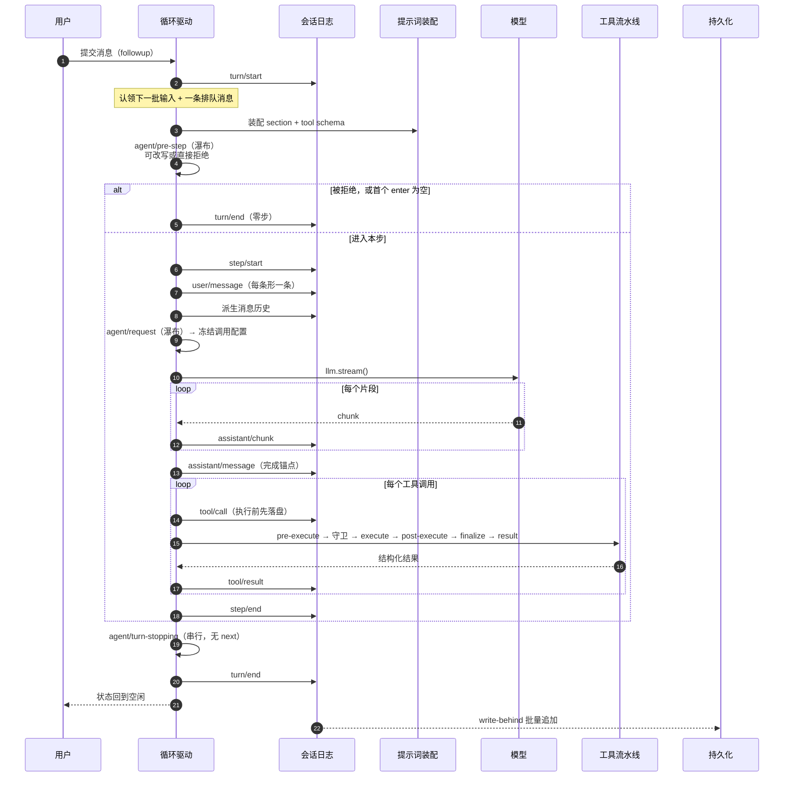
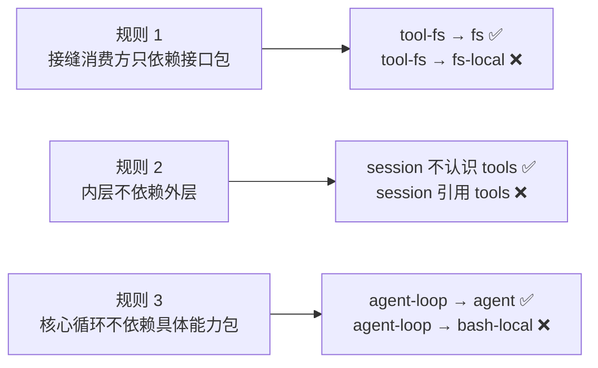

# 05 · 系统架构设计

> 这篇文档回答：**Lcode 由哪些部分组成、它们怎么协作、边界画在哪里、为什么这么画。**
> 它是研发的总纲；每个子系统的深入设计在 [06](./06-会话事件日志与可重放设计.md)–[13](./13-插件SDK与协议设计.md)。

| 项 | 值 |
|---|---|
| 状态 | 草案 |
| 负责人 | 架构负责人 |
| 上游依赖 | [00-文档总览与全局约定.md](./00-文档总览与全局约定.md)、[03-PRD-需求规格说明.md](./03-PRD-需求规格说明.md)、[04-MVP范围与验收标准.md](./04-MVP范围与验收标准.md) |
| 下游被引 | [06](./06-会话事件日志与可重放设计.md)、[07](./07-插件内核与扩展点设计.md)、[08](./08-工具系统与执行流水线.md)、[09](./09-上下文工程与压缩策略.md)、[10](./10-桌面客户端设计.md)、[11](./11-数据模型与持久化设计.md)、[12](./12-安全权限与沙箱模型.md)、[13](./13-插件SDK与协议设计.md)、[17](./17-架构决策记录ADR.md) |
| 文档版本 | v0.1（2026-09-10） |

---

## 目录

- [1. 架构目标与约束](#1-架构目标与约束)
- [2. 分层总览](#2-分层总览)
- [3. 进程模型](#3-进程模型)
- [4. 模块分解](#4-模块分解)
- [5. 启动与装配](#5-启动与装配)
- [6. 数据流：一个完整的轮](#6-数据流一个完整的轮)
- [7. 事件分类与派发模式](#7-事件分类与派发模式)
- [8. 核心不变量](#8-核心不变量)
- [9. 依赖规则](#9-依赖规则)
- [10. 关键取舍索引](#10-关键取舍索引)
- [11. 技术栈清单](#11-技术栈清单)
- [12. 构建与分发](#12-构建与分发)
- [未决问题](#未决问题)
- [变更记录](#变更记录)

---

## 1. 架构目标与约束

### 1.1 架构要服务的三件事

架构不是目的。Lcode 的架构只需要服务三件事（与 [01 §5 核心价值主张](./01-产品愿景与定位.md#5-核心价值主张) 一一对应）：

| 目标 | 架构上的含义 |
|---|---|
| **可解释** | 状态必须**只有一个入口**（事件日志）；任何投影都是纯函数 |
| **可改造** | 内核不能有业务逻辑；一切策略必须是可卸载的注册 |
| **本地优先** | 不依赖任何自有服务端；全部能力可在单机闭环 |

### 1.2 五条架构约束（不可违反）

| # | 约束 | 违反后果 |
|---|---|---|
| **C1** | 模型可见即可重放：任何进入模型请求的内容必须能从日志重建 | 可解释性失效；回放变成"事后重算的近似" |
| **C2** | 核心循环不含业务判断 | 可改造性失效；插件面会随功能增长而收窄 |
| **C3** | 每次注册都有撤销器 | 插件热重载/卸载会残留状态；作用域隔离失效 |
| **C4** | 能力消费方只依赖接口，不依赖实现 | 替换 provider 需要改调用方；seam 失效 |
| **C5** | 内核永不把"实时状态"暴露为可变引用 | 日志不再是唯一真相；重放不可信 |

### 1.3 明确接受的代价

| 代价 | 说明 | 见 |
|---|---|---|
| 日志膨胀 | 原始流式片段也落盘，日志比模型可见内容大 | [11 §8](./11-数据模型与持久化设计.md) |
| 抽象层数多 | 一个"读文件"横跨接口包 + 实现包 + 工具包 | [07 §2](./07-插件内核与扩展点设计.md) |
| 早期开发慢 | 接口先行、测试要求高 | [14](./14-产品路线图与里程碑.md) |
| 插件 RPC 开销 | 插件在独立进程，跨进程调用有延迟 | [13 §3](./13-插件SDK与协议设计.md) |

---

## 2. 分层总览

```mermaid
flowchart TD
  subgraph L5["⑤ 接入层 · 用户与外部程序怎么用"]
    UI["桌面 UI<br/>（渲染进程）"]
    CLI["CLI / headless"]
    RPC["JSON-RPC stdio<br/>（外部程序 / SDK）"]
    MCP["MCP 双向<br/>（客户端 + 服务端）"]
  end

  subgraph L4["④ 组合层 · 怎么拼出一个 agent"]
    Profile["配置档 Profile"]
    Bundle["集束 Bundle"]
    Patch["补丁 patch"]
    Preset["预设 agent.cordis.yml"]
  end

  subgraph L3["③ 能力层 · 可替换的接缝（seam）"]
    LLM["llm"]
    FS["fs"]
    Shell["shell / subprocess"]
    Sandbox["sandbox"]
    Terminal["terminal"]
    CtxP["context / compaction / spill"]
    Sub["subagent / jobs"]
    Web["web / lsp / skill"]
    Inter["approval / commands / ask-user"]
    Pers["session-persistence / settings / credentials"]
  end

  subgraph L2["② 骨架层 · 每个组合都启动"]
    Sess["session<br/>事件日志 + 派生"]
    SP["system-prompt<br/>提示词与 schema 装配"]
    Tools["tools<br/>注册表 + 执行流水线"]
    Agent["agent<br/>Agent 契约 + 活体注册表"]
    Loop["agent-loop<br/>唯一的具体循环"]
    Scope["scope<br/>作用域原语"]
  end

  subgraph L1["① 内核层 · 插件框架"]
    Core["Context / Service / Event / Effect"]
  end

  L5 --> L4
  L4 --> L3
  L3 --> L2
  L2 --> L1
```



> **这张图想让你看到什么**：**依赖只能向下**。接入层不知道任何具体能力；能力层只知道骨架层；骨架层只知道内核。这条单向性是"可改造"的物理保障——任何一层换实现，上面的层不必改。

### 2.1 每层的职责边界

| 层 | 负责 | **不负责** |
|---|---|---|
| ① 内核 | 插件生命周期、服务查找、事件派发、副作用撤销、作用域 | 任何与 agent 有关的概念 |
| ② 骨架 | 会话状态、提示词装配、工具执行、循环驱动 | 任何具体工具、任何具体模型、任何策略 |
| ③ 能力 | 提供可替换的能力实现（模型、文件、shell、沙箱…） | 决定"什么时候用"（那是策略，属于插件） |
| ④ 组合 | 把插件按层装配成一个可运行的系统 | 定义任何新能力 |
| ⑤ 接入 | 把内核能力呈现给人或外部程序 | 持有状态（状态只在骨架层） |

---

## 3. 进程模型

> 详细设计见 [10-桌面客户端设计.md](./10-桌面客户端设计.md)。本节只给出架构层面的决定。

### 3.1 三进程



> **这张图想让你看到什么**：**所有状态在主进程**，渲染进程只是投影，插件只是被隔离的能力提供者。这个分配让"渲染进程崩溃不影响会话""插件崩溃可整体杀掉"成为架构性质而不是补丁。

### 3.2 三个分配决定与理由

| 决定 | 理由 | 代价 |
|---|---|---|
| **agent 循环在主进程** | 它需要 fs / 子进程 / PTY / 数据库；放渲染进程等于放弃 Node 能力，放 utility 进程会引入每步的跨进程往返 | 主进程内存占用较高（`NFR-PERF-007` 预算 ≤600MB） |
| **插件在独立 utility 进程** | Node 同进程**无法**构成安全边界；进程是唯一诚实的隔离单位 | 跨进程 RPC 开销（见 [13 §3](./13-插件SDK与协议设计.md)） |
| **UI 是纯投影** | 保证"同一份日志可以渲染出完全相同的历史" | 需要为每种卡片设计可重放的投影元数据 |

### 3.3 崩溃语义

| 崩溃对象 | 影响 | 恢复 |
|---|---|---|
| 渲染进程 | UI 消失，会话继续（模型请求不中断） | UI 重连后从事件流重建投影 |
| utility 进程（插件） | 该插件提供的工具变得不可用 | 自动重启（≤2 次），失败后标记该插件为故障 |
| 主进程 | 一切停止 | 从 JSONL 日志恢复（见 [11 §5](./11-数据模型与持久化设计.md)） |
| 子进程（shell / LSP） | 单次工具调用失败 | 进程树级联终止，结果映射为结构化错误 |

---

## 4. 模块分解

### 4.1 骨架层（七个包，全部在产品 API 稳定性承诺内）

| 包 | ctx key | 拥有什么 | 关键接口 |
|---|---|---|---|
| `core/session` | `ctx.sessions` | append-only 事件日志 + 派生投影 + 内存实例管理 | `append()` / `events` / `deriveMessages()` / `fork()` |
| `core/system-prompt` | `ctx.systemPrompt` | 提示词段落、动态上下文、工具 schema 的装配 | `section()` / `context()` / `tools()` / `variable()` / `assemble()` |
| `core/tools` | `ctx.tools` | 作用域工具注册表 + 受守卫的执行流水线 | `register()` / `schemas()` / `restrict()` / `guard()` / `execute()` |
| `core/agent` | `ctx.agents` | Agent 契约、活体注册表、创建/恢复工厂接缝 | `create()` / `resume()` / `get()` / `withInitiator()` |
| `core/agent-default-model` | `ctx.agentDefaultModel` | **"当前用哪个模型"的唯一权威**（见 [18 §3](./18-模型接入与供应商配置.md#3-入口模块)） | `get()` / `set()` / `watch()` |
| `core/agent-loop` | `ctx.agentLoop` | **唯一的具体循环** | `create()` / `resume()` |
| `core/scope` | 无（库） | 作用域键与分层注册原语 | `ScopeKey` / `Scoped<T>` / `ScopedLayers<L>` |

### 4.2 能力层（按能力族分组）

| 能力族 | 接口包 | 实现包 | 消费包（模型可见） |
|---|---|---|---|
| 模型 | `llm` | `llm-anthropic` / `llm-openai` / `llm-deepseek` / `llm-ollama` / `llm-gateway` / `llm-replay` | 循环直接调用（不是工具）；配置见 [18](./18-模型接入与供应商配置.md) |
| 文件 | `fs` | `fs-local` / `fs-sandbox` | `tool-fs` |
| Shell | `shell` | `shell-local` / `shell-sandbox` | `tool-shell` |
| 子进程 | `subprocess` | `subprocess-local` | shell / terminal / lsp / mcp |
| 沙箱 | `sandbox` | `sandbox-macos` / `sandbox-linux` / `sandbox-win32` | shell-sandbox / fs-sandbox / terminal |
| 终端 | `terminal` | `terminal-pty` | `tool-terminal` |
| 上下文 | — | `context-instructions` / `context-time` / `context-repo-map` / `file-reference` | 循环（非工具） |
| 压缩 | `compaction` | `compaction-prune` / `compaction-summary` | 循环（非工具） |
| 溢出存储 | `spill` | `spill-local` | 结果后处理策略 |
| 技能 | `skill` | `skill-filesystem` | `tool-skill` |
| 子代理 | `subagent` | `subagent-inprocess` | `tool-subagent` |
| 作业 | `jobs` | `jobs-local` | `tool-jobs` + 后台 shell/终端 |
| 网页 | `web` | `web-search-*` / `web-fetch` | `tool-web` |
| 语言服务 | `lsp` | `lsp-stdio` | `tool-lsp` |
| 持久化 | `session-persistence` | `-jsonl` / `-sqlite` | 循环（write-behind） |
| 交互 | `approval` / `user-questions` / `commands` | 由接入层提供应答者 | `tool-ask-user` / `tool-todo` / `plan-mode` |
| 凭据与设置 | `credentials` / `settings` | `credentials-local` / `settings-file` | llm 适配器 |
| 扩展 | `plugin-host` / `plugin-manifest` / `plugin-registry` / `plugin-sdk` | — | 接入层 |

### 4.3 一个模块该放哪一层？判断流程



> **这张图想让你看到什么**：加东西时的第一个问题永远是"**它是状态、能力、策略，还是视图？**"。答错这个问题的代价，比答错后面所有问题加起来都大。

---

## 5. 启动与装配

### 5.1 四层装配


> **这张图想让你看到什么**：进程级装配（①–④）与**会话级装配**（⑤）是两个层次。前者决定"这个应用有什么"，后者决定"这个 agent 有什么"。

### 5.2 声明方式

```jsonc
// 配置档：package.json
{ "lcode": { "profile": { "bundles": ["lcode-base", "lcode-desktop"] } } }

// 集束：package.json
{ "lcode": { "bundle":  { "patch":  "./cordis.patch.yml" } } }
```

```yaml
# cordis.patch.yml —— 顶层是数组
- id: existing-row                 # 按 id 定位已有行
  config: { ... }                  # ⚠️ 替换整段配置，不是深合并
- insert:                          # 或插入新行
    - id: my-plugin
      name: '@lcode/my-plugin'
      config: { ... }
      disabled: !!js process.platform === 'win32'   # 表达式只允许出现在 config 与 disabled
```

### 5.3 三条必须记住的语义

| 语义 | 说明 | 为什么 |
|---|---|---|
| **替换而非合并** | patch 覆盖目标行的**整段** `config` | 语义唯一、可预测；避免"合并顺序导致的隐式结果" |
| **表达式位置受限** | `!!js` 只允许在 plugin `config` 与 entry `disabled` | 条件化组合应该用 overlay，不该散落在元数据里 |
| **禁用而非删除** | 上层集束用 `disabled: true` 关掉下层的能力，**不删行** | 基础集束是共享的，删除会影响其它配置档 |

### 5.4 可观测性（MVP 验收项）

```
lcode --profile desktop --dump-config     # 打印最终装配（含层级与来源）
lcode --profile desktop --dump-config --json > wiring.json
```

任何一行打印出来的配置都能被上层 patch 覆盖。**一个无法被观察的装配系统是不可能被调试的。**

---

## 6. 数据流：一个完整的轮



> **这张图想让你看到什么**：**模型看到的一切都先经过日志**。注意 `tool/call` 在执行**之前**落盘——这样"模型要求调用但还没执行"这个事实也是可重放的。

### 6.1 轮（turn）与步（step）的定义

| 概念 | 定义 | 边界 |
|---|---|---|
| **轮** | 零或多个步。在第一个输入被认领之前开启，在"没有欠账"时关闭 | `turn/start` → `turn/end` |
| **步** | 一次模型请求 + 它请求的工具执行 | `step/start` → `step/end` |

**一个容易被忽略的规则**：被拒绝或被改写成空的**首次认领**，仍然会关闭一个"花了零个步"的持久轮。**日志记录这次尝试。**

> 理由：日志是完整的行为记录。"用户点了发送但被策略拦下了"本身是可审计事实，不能因为"模型没被调用"就不记。

---

## 7. 事件分类与派发模式

### 7.1 三个事件域

| 域 | 例子 | 判定标准 | 生命周期 |
|---|---|---|---|
| **会话事件** | `turn/start`、`tool/result`、`assistant/chunk` | 事实必须**活过重载**（会被持久化） | 持久 |
| **Agent 事件** | `agent/pre-step`、`agent/status`、`agent/turn-stopping` | 观察或拦截**在途**的工作 | 进程内 |
| **能力事件** | `tools/*`、`fs/*`、`llm/*` | 给某个接缝挂策略，而不 import 循环 | 进程内 |

**选择规则（写代码前先问）**：

```
这个事实需要活过重启吗？
├── 需要 → 会话事件（扩展 SessionEventMap）
└── 不需要 → 它是"在途工作"的观察/拦截，还是"给某个能力挂策略"？
    ├── 在途工作 → agent/* 事件
    └── 能力策略 → 该能力的 */* 事件
```

### 7.2 四种派发模式

| 模式 | 是否等待 | 顺序 | 有返回值 | 语义 | 典型用途 |
|---|---|---|---|---|---|
| `emit` | 否 | 注册序 | 无 | 纯观察 | 状态通知、UI 投影 |
| `waterfall` | 否 | 注册序 | 有 | 洋葱中间件，可包可短路 | 所有可重排策略 |
| `parallel` | 是 | 并行 | 无 | 广播并等待全部完成 | 多观察者需要完成信号 |
| `serial` | 是 | 注册序 | 有 | 顺序执行、可累积 | 终局检查点（如轮停止） |

**模式属于事件的公开契约**，写在类型声明里，并有静态检查保证声明与派发点一致（`EXT-EVENT-001`）。

### 7.3 waterfall 的两种写法

```ts
// ① 观察者：必须委托，否则会吞掉下游决策
ctx.on('tools/pre-execute', async (exec, next) => {
  recordMetric(exec)
  return next()                     // ← 关键
})

// ② 决策者：拥有决策时直接返回，短路下游
ctx.on('tools/pre-execute', async (exec, next) => {
  if (isForbidden(exec)) return { kind: 'deny', reason: '...' }
  return next()
})
```

> **常见 bug**：观察者忘了 `next()`。这会让后面所有策略静默失效。建议在开发期加一条检查：**如果监听器声明为观察者（不返回决策类型）却没有调用 `next()`，则告警**。

---

## 8. 核心不变量

这七条不变量是架构的"物理定律"。它们**全部在 CI 中被强制执行**（详见 [15-测试策略与质量门禁.md](./15-测试策略与质量门禁.md)）。

| # | 不变量 | 表述 | 违反的后果 |
|---|---|---|---|
| **I1** | **模型可见即可重放** | 对任意一次循环构建的请求：`request.system === assembleFromLog(log)` 且 `deepEqual(request.messages, deriveMessages(log))` | 回放变成近似；可解释性归零 |
| **I2** | **序号连续** | 日志追加后，序号必须是无空洞的 `0..n-1` | 按序号切前缀（分叉）失效 |
| **I3** | **配对完整** | 任何 `tool/call` 必有配对 `tool/result`；表面上任何工具调用块必有配对结果 | 请求被模型 API 拒绝 |
| **I4** | **替换不越界** | surface replace 的区间必须在当前表面范围内 | 压缩破坏历史 |
| **I5** | **事件无损 JSON** | 所有事件数据必须可无损序列化（拒绝 `BigInt` / 函数 / 循环引用 / `NaN` / `undefined` / 稀疏数组） | 持久化损坏 |
| **I6** | **核心循环无业务分支** | `packages/core/agent-loop/src` 中不出现针对具体能力的条件判断 | 可改造性失效 |
| **I7** | **凭据不泄漏** | 已注册的凭据值不出现在日志 / 遥测 / 错误信息 / 导出包中 | 安全事故 |

### 8.1 I1 的为什么值得单独说

I1 是本架构最重要的不变量。它把"请求是日志的纯函数"从**口号**变成**可执行的断言**。

```
任何插件偷偷往请求里塞了没落盘的东西 → I1 在测试里立刻变红
```

**实现方式（简述）**：给循环构建的每个请求打一个进程内身份标记；不变量插件识别到这个标记后，独立地从日志重建消息边界与折叠后的请求头，然后逐字段比对。直接一次性调用（非循环构建）不在契约内。

---

## 9. 依赖规则

### 9.1 三条硬规则



> **这张图想让你看到什么**：这三条规则合起来保证了"换一个 provider 就换掉整个产品行为，而不用改调用方"。

### 9.2 检查方式

| 规则 | 检查 | 门禁 |
|---|---|---|
| 依赖方向（消费方 → 接口，不 → 实现） | 静态依赖图分析 | `pnpm check:deps` |
| 分层方向（内层不引外层） | 包级依赖图 + 分层白名单 | `pnpm check:deps` |
| 循环依赖 | 依赖图拓扑检查 | `pnpm check:deps` |
| 核心循环纯净性 | AST 扫描 + 关键词黑名单 | `pnpm check:loop-purity` |

### 9.3 一个例外

**组合包（集束 / 示例）可以依赖具体实现包**。因为它们的职责就是"把实现装配起来"。`lcode-base` 可以依赖 `fs-local`，但 `tool-fs` 不行。

---

## 10. 关键取舍索引

每个决定都有代价。这里只列表，完整分析在 [17-架构决策记录ADR.md](./17-架构决策记录ADR.md)。

| 决定 | 选了什么 | 主要代价 | ADR |
|---|---|---|---|
| 语言与运行时 | TypeScript + Node 22+，ESM only | 性能天花板低于原生；ESM 生态摩擦 | ADR-0001 |
| 桌面外壳 | Electron | 包体与内存占用 | ADR-0002 |
| UI | React + Vite | 会引入组件生态决策 | ADR-0003 |
| 状态模型 | append-only 事件日志 | 日志膨胀；学习曲线 | ADR-0004 |
| 压缩原语 | surface replace，不删除 | 日志永不长回来；需要额外的可观测性 | ADR-0005 |
| 扩展模型 | 服务 + 事件 + 副作用 | 抽象层多 | ADR-0006 |
| 事件模式 | 四种派发模式 | 概念开销；"忘了 next()" 这类 bug | ADR-0007 |
| 工具模型 | 结构化规范值 + 纯投影 | 工具作者要多写一个 schema | ADR-0008 |
| 参数不可改写 | 类型上禁止 | 失去"中间件修正参数"的便利 | ADR-0009 |
| 策略双轨 | 可重排 waterfall + 单调 guard | 两套概念，需要文档讲清分工 | ADR-0010 |
| 权限缺省 | fail-closed | 可能出现"该放行的被拦" | ADR-0011 |
| 持久化 | SQLite + JSONL 双轨 | 需要解释"谁是真相" | ADR-0012 |
| 沙箱 | OS 原生，不引入 VM | 三平台能力不等价 | ADR-0013 |
| 插件隔离 | 独立 utility 进程 | RPC 延迟 | ADR-0014 |
| 内部协议 | 类型图生成描述符 | 构建复杂度 | ADR-0015 |
| 外部协议 | JSON-RPC over stdio | 需要严格的 stdout 纪律 | ADR-0016 |
| 会话标识 | agent 与会话共享 id | 创建事务需要仲裁 | ADR-0017 |
| 时间处理 | 持久用 epoch ms | 展示层需转换 | ADR-0018 |

---

## 11. 技术栈清单

### 11.1 运行时与语言

| 项 | 选择 | 版本约束 |
|---|---|---|
| 语言 | TypeScript | `strict: true`，ESM only |
| 运行时 | Node.js | `^22.19 \|\| >=24` |
| 包管理 | pnpm workspaces | — |
| 构建 | tsdown（打包）+ tsc（类型） | — |
| 测试 | Vitest | — |
| Lint | oxlint | — |

### 11.2 桌面与前端

| 项 | 选择 | 理由 |
|---|---|---|
| 桌面外壳 | Electron | 见 ADR-0002 |
| 前端框架 | React | 见 ADR-0003 |
| 构建 | Vite | 与 React 生态契合 |
| 状态 | 事件 reducer + 选择器 | 状态是日志的投影，不引入可变全局 store 作为真相 |
| 样式 | CSS 变量 + 自建基础组件 | 主题需浅/深切换；避免重型组件库的样式锁定 |
| 虚拟列表 | 自建或轻量库 | 十万级事件必须虚拟化 |

### 11.3 存储与系统

| 项 | 选择 | 理由 |
|---|---|---|
| 会话日志 | JSONL（可选 zstd） | 人类可读、追加友好、易 diff |
| 索引 | SQLite（WAL） | 查询、全文搜索、会话元数据 |
| 凭据 | OS 钥匙串（回退 0600 文件） | 见 [12](./12-安全权限与沙箱模型.md) |
| 沙箱 | macOS SBPL / Linux Landlock+seccomp / Windows AppContainer | 见 ADR-0013 |
| PTY | node-pty | 终端能力 |
| 进程树管理 | 平台原生 + Job Object | 保证子进程级联终止 |

### 11.4 明确不引入的技术

| 不引入 | 为什么 |
|---|---|
| Rust 原生模块（除 PTY 等必需） | 构建复杂度；跨平台分发成本 |
| 重型状态管理库（作为真相源） | 真相必须是日志，不是 store |
| 重型 UI 组件库 | 样式锁定与主题困难 |
| ORM | SQLite 用法简单，ORM 会掩盖查询语义 |
| 云 SDK（自有服务） | 与本地优先冲突 |

---

## 12. 构建与分发

### 12.1 构建产物

| 产物 | 说明 |
|---|---|
| `apps/desktop` | Electron 应用（三平台安装包） |
| `apps/cli` | 无 GUI 的 CLI（用于 CI、脚本化、快照测试） |
| `packages/*/lib` | 各包的 JS + 类型声明 |
| 插件 SDK 类型包 | 供第三方插件作者依赖 |

### 12.2 分发渠道

| 渠道 | 版本 | 说明 |
|---|---|---|
| 内测直装 | v0.1–v0.2 | 手动下载安装包，无自动更新 |
| 自动更新 | v0.2+ | 静态源 + 语义化版本；灰度与回退见 [14 §6](./14-产品路线图与里程碑.md) |
| 插件分发 | v0.3+ | 本地插件优先，市场后置 |

### 12.3 一条分发纪律

> **遥测默认关闭。** 如果用户开启，必须先在 UI 里展示"到底会发送什么"，并提供 `lcode doctor --telemetry` 逐项检查。这条纪律优先于任何增长目标。

---

## 未决问题

- [ ] **`NFR-PERF-007` 主进程内存 ≤600MB 是否可信**：需要原型实测（1 万事件 + 3 个插件进程）。如果超标，可能的缓解是"把历史事件从内存卸载到磁盘 + 按需加载"，但那会影响回放性能（`M-REPLAY-07`）。卡在研发。
- [ ] **插件进程的数量策略**：一个插件一个进程（强隔离、高内存）还是多个插件共享一个进程（省内存、弱隔离）？倾向后者 + 可配置，但需要实测。卡在架构。
- [ ] **`lcode-replay` 适配器的定位**：它既是测试工具，也可能对用户有用（"不花 token 重放一次"）。需要在 [13](./13-插件SDK与协议设计.md) 里明确它是否对用户可见。
- [ ] **会话级预设与进程级装配的边界**：预设里若需要一个新的**服务**（而不是工具），必须走隔离域，这会带来限制。是否需要在 v0.3 放宽？需要真实插件案例来驱动。
- [ ] **三平台沙箱的能力矩阵**：哪些操作在某平台无法拦截，需要在 [12](./12-安全权限与沙箱模型.md) 里给出明确的"不等价"清单，并决定是否允许差异化体验。

---

## 变更记录

| 日期 | 版本 | 变更 | 说明 |
|---|---|---|---|
| 2026-09-10 | v0.1 | 初稿 | 建立五层架构、三进程模型、模块分解、四层装配、轮/步数据流、七条核心不变量与依赖规则 |
| 2026-09-11 | v0.2 | 骨架层补第七个包 | 增加 `core/agent-default-model`（`ctx.agentDefaultModel`）—— 模型配置的入口模块原先遗漏，详见 [18-模型接入与供应商配置.md](./18-模型接入与供应商配置.md)；能力层模型族补 `llm-gateway` |
