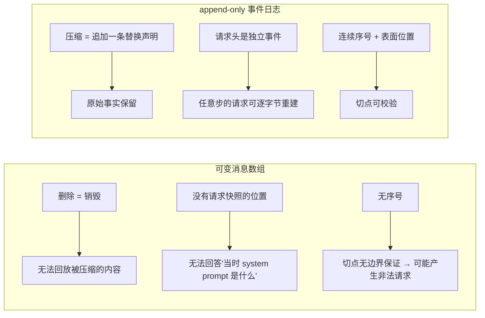
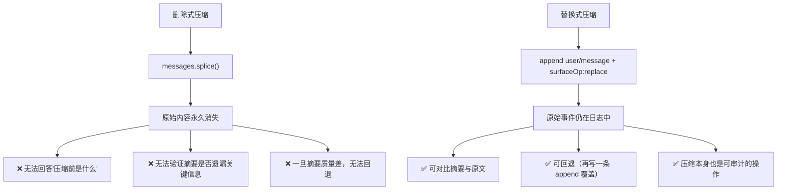
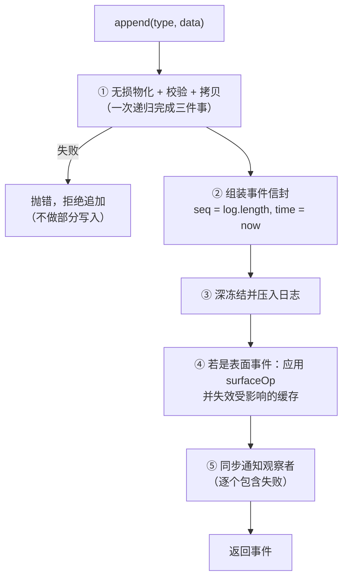
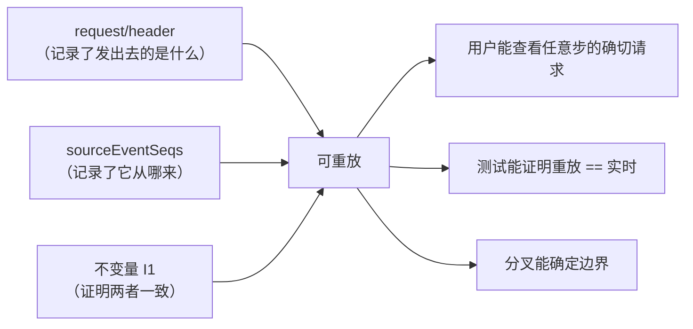
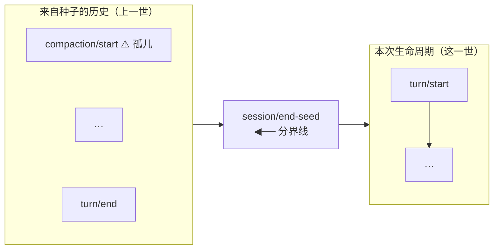
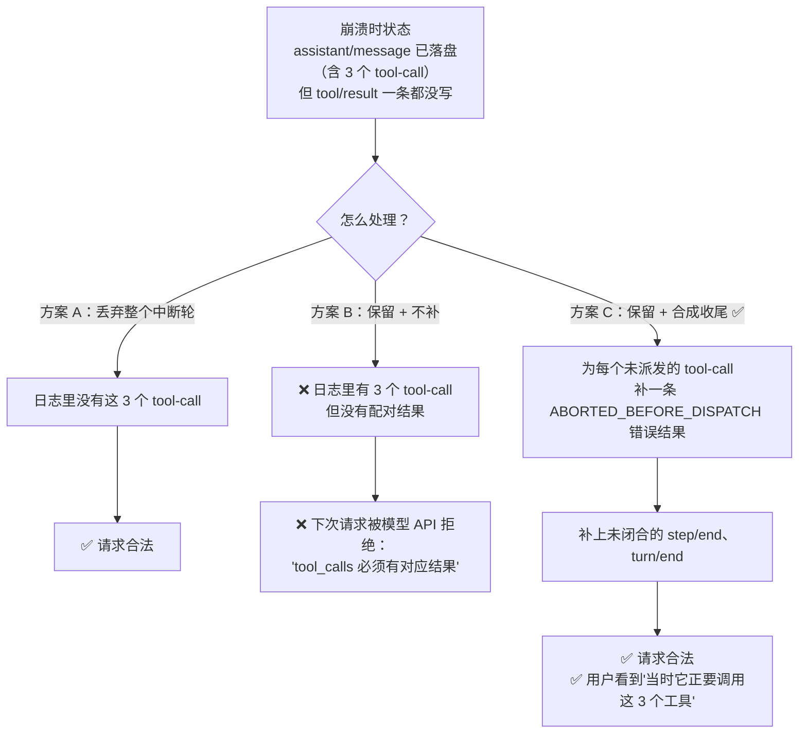

# 06 · 会话事件日志与可重放设计

> 这篇文档回答：**Lcode 的"可重放"到底是怎么实现的、边界在哪、有哪些坑。**
> 它是全部差异化的技术地基。**改动这个子系统前必须读完本文 + [17 ADR-0004/0005](./17-架构决策记录ADR.md)。**

| 项 | 值 |
|---|---|
| 状态 | 草案 |
| 负责人 | 架构负责人 |
| 上游依赖 | [05-系统架构设计.md](./05-系统架构设计.md) |
| 下游被引 | [07](./07-插件内核与扩展点设计.md)、[08](./08-工具系统与执行流水线.md)、[09](./09-上下文工程与压缩策略.md)、[11](./11-数据模型与持久化设计.md)、[15](./15-测试策略与质量门禁.md) |
| 文档版本 | v0.1（2026-09-10） |

---

## 目录

- [1. 为什么必须是事件日志](#1-为什么必须是事件日志)
- [2. 事件模型](#2-事件模型)
- [3. 表面机制：压缩与分叉的唯一原语](#3-表面机制压缩与分叉的唯一原语)
- [4. 派生投影](#4-派生投影)
- [5. 追加路径](#5-追加路径)
- [6. 可重放的三条保障](#6-可重放的三条保障)
- [7. 分叉](#7-分叉)
- [8. 生命周期分界线](#8-生命周期分界线)
- [9. 崩溃恢复契约](#9-崩溃恢复契约)
- [10. 时间轴回放的数据基础](#10-时间轴回放的数据基础)
- [11. 一个完整的示例事件流](#11-一个完整的示例事件流)
- [12. 实现者的检查清单](#12-实现者的检查清单)
- [未决问题](#未决问题)
- [变更记录](#变更记录)

---

## 1. 为什么必须是事件日志

### 1.1 从三条需求反推数据结构

| 需求 | 对数据结构的要求 |
|---|---|
| **回放**：能看到"第 12 步时模型确切看到了什么" | 必须保存**当时的输入快照**，而不是"现在能重算出的近似" |
| **压缩**：上下文变长后要能变小 | 必须有一个**不销毁原始事实**的压缩原语 |
| **分叉**：从第 8 步换一条路走 | 历史必须有**可切分的边界**（不是一条不可分割的消息数组） |

三个需求指向同一个答案：**append-only、带序号、可投影的事件日志。**

### 1.2 反面推演：如果状态是一张表

```ts
// 常见实现
interface Conversation {
  messages: Message[]
}
```

| 需求 | 在这个结构下会发生什么 |
|---|---|
| 回放 | 只能看到"当前的消息数组"。想知道第 12 步的 system prompt？重建不出来——因为 `Conversation` 里**根本没有** system prompt 的位置。 |
| 压缩 | 只能 `messages.splice(...)`。**删掉就永远回不来。** |
| 分叉 | 可以 `messages.slice(0, 12)`，但切点可能落在**工具调用与结果之间**，产生一个非法请求。 |
| 崩溃恢复 | 进程内数组，崩溃即全丢。 |



> **这张图想让你看到什么**：这不是"两种设计风格"，而是"三个需求能不能被满足"。可变数组在这三件事上是**结构性不可行**，不是"实现得不够好"。

---

## 2. 事件模型

### 2.1 事件信封

```ts
interface SessionEventEnvelope<K extends SessionEventType> {
  /** 判别字段：事件类型 */
  readonly type: K
  /** 单调递增、连续、无空洞。恒等于追加前的日志长度 */
  readonly seq: number
  /** epoch 毫秒。持久层只存数字，展示层才本地化 */
  readonly time: number
  /** 载荷。进入日志的那一刻深冻结 */
  readonly data: SessionEventMap[K]
  /**
   * 向前兼容标记。
   * 读到「不认识的类型」且该字段不为 true 时，读方必须拒绝重建会话。
   */
  readonly ignorable?: true
}
```

**三条设计细节**：

| 细节 | 说明 |
|---|---|
| `seq = log.length` | 这不是巧合而是**不变量 I2**。它让"按序号切前缀"在语义上等价于"按时间切"，并让持久层可以用 `seq` 直接做偏移 |
| `time` 是 `number` | 时区不属于事实（[ADR-0018](./17-架构决策记录ADR.md)） |
| `ignorable` 默认**不忽略** | ⚠️ 关键决策：读到不认识的必需事件类型时，**拒绝重建会话**，而不是静默跳过。理由：一个不认识的必需事件可能会改变日志其余部分的解释方式。**宁可多拒绝（用户麻烦），也不要静默恢复出一个被掏空的会话（用户被骗）。** |

### 2.2 事件词汇表

```ts
/** 可被插件通过声明合并扩展 */
interface SessionEventMap {
  // ─────────── 结构边界 ───────────
  'turn/start':  { turn: number }
  'turn/end':    { turn: number; reason: TurnEndReason }
  'step/start':  { turn: number; step: number }
  'step/end':    { turn: number; step: number }

  // ─────────── 表面事件（会产生模型可见消息）───────────
  'user/message':      UserMessage
  'assistant/message': {
    turn: number
    step: number
    message: AssistantMessage
    usage?: TokenUsage
    /** 流式被打断但有可见内容时为 true */
    interrupted?: true
  }
  'tool/result': {
    turn: number
    step: number
    message: ToolResultMessage
    error?: { name: string; code: string }
    /** 可重放的 UI 元数据（如 diff 的 hunk） */
    meta?: JsonValue
  }

  // ─────────── 日志事件（不进模型历史）───────────
  'assistant/chunk':  { turn: number; step: number; chunk: StreamChunk }
  'tool/call':        {
    turn: number; step: number
    callId: CallId; name: string
    /** ⚠️ 未解析的原始 JSON 字符串，不是对象 */
    arguments: string
  }
  'request/header':   { header: EpochHeader; reason: RequestHeaderReason }
  'request/context':  RequestContext
  'session/end-seed': Record<string, never>          // 空载荷，靠位置表达含义
  'session/imported': {                               // 导入来源，先于被导入事件
    source: { file: string; sha256: string; bytes: number; sourceSessionId: string; sourceCreatedAt: EpochMs; importedAt: EpochMs }
  }
  'todo/write':       { todos: TodoItem[] }          // 整表快照，last-write-wins
  'plan/mode':        { active: boolean }            // 整值替换
  'approval/asked':   { callId: CallId; action: string; basis: string; impact: Impact; askedAt: EpochMs }
  'approval/decided': {
    callId: CallId
    result: 'allowed-once' | 'rejected' | 'cancelled' | 'unavailable'
    decidedBy: 'human' | 'auto-denied' | 'cancelled'
    decidedAt: EpochMs
  }
  'compaction/start': { compactionId: string }
  'compaction/summary': { compactionId: string; summary: string }
  'compaction/end':   { compactionId: string }
}
```

**扩展方式（插件新增事件）**：

```ts
declare module '@lcode/session' {
  interface SessionEventMap {
    'myplugin/custom': { foo: string }
  }
}
```

### 2.3 为什么 map 是"开放"的而流协议是"闭合"的

| 结构 | 开放性 | 理由 |
|---|---|---|
| `SessionEventMap` | **开放**（声明合并） | 插件必须能新增日志事件而不改内核 |
| `MessageSourceMap` | **开放** | 同上 |
| `StreamChunk`（流协议） | **闭合** | 流协议是 provider 与内核之间的**严格契约**；加一个变体必须让所有处理者编译失败，而不是静默漏处理 |

**实现含义**：因为 `SessionEventMap` 是开放的，`switch (event.type)` **不能用 `assertNever`** —— 插件新增的变体在编译期是合法的未知值。必须写 `default` 兜底。

```ts
// ❌ 错误：会因为插件的扩展而编译失败，或者被迫穷举
switch (event.type) { /* ... */ default: assertNever(event) }

// ✅ 正确
switch (event.type) {
  case 'user/message': /* ... */ break
  default: /* 未知类型：跳过（若它标了 ignorable）或已在加载时被拒绝 */ break
}
```

---

## 3. 表面机制：压缩与分叉的唯一原语

### 3.1 表面的定义

> **表面（surface）** = 事件日志中会产生模型可见消息的有序投影。它**只包含**三类事件：`user/message`、`assistant/message`、`tool/result`。

其余的（`turn/*`、`step/*`、`assistant/chunk`、请求头、审批记录…）都在日志里，但**不进表面**。

```
原始日志（raw log）        表面（surface）           模型看到的消息
─────────────────────      ──────────────────       ────────────────
seq 0  turn/start ──────┐
seq 1  user/message ────┼──→ surface[0] ─────────→ user 消息
seq 2  step/start ──────┤
seq 3  assistant/chunk ─┤   （不进表面：原始流）
seq 4  assistant/chunk ─┤
seq 5  assistant/message┼──→ surface[1] ─────────→ assistant 消息
seq 6  tool/call ───────┤   （不进表面）
seq 7  tool/result ─────┼──→ surface[2] ─────────→ tool 结果消息
seq 8  step/end ────────┤
```

### 3.2 表面操作（surfaceOp）

```ts
type SurfaceOp =
  | 'append'
  | { op: 'replace'; start: number; end: number }   // 遮蔽 surface[start..end]（闭区间）
```

**关键规则**：

| 规则 | 说明 |
|---|---|
| `start` / `end` 是**表面位置**，不是 `seq` | 混淆它们是本子系统最容易犯的错 |
| replace 后表面位置的 **seq 不再单调** | 任何"靠 seq 单调性"的假设都会失效 |
| **被遮蔽的原始事件仍然留在日志里** | 这是可重放性的全部来源 |

### 3.3 replace 的三种用途

| 用途 | 谁发起 | 版本 |
|---|---|---|
| **压缩**：用一条摘要替换一段历史 | 压缩插件 | v0.5 |
| **裁剪**：把超大工具结果替换为预览 + 定位符 | 结果剪枝插件 | v0.3 |
| **溢出落盘**：把超过阈值的文本替换为摘要 + 引用 | spill 插件 | v0.3 |

### 3.4 为什么"追加替换"比"删除"好



> **这张图想让你看到什么**：替换式压缩的全部价值在于**原始事实的保留**。一旦接受这个前提，压缩就从"销毁操作"变成"一种可审计的历史操作"。

**代价（必须承认）**：日志**永远不会变小**。用户会看到"我压缩了，但磁盘占用没降"。应对方式见 [11 §8](./11-数据模型与持久化设计.md)：把日志分成"权威归档"与"工作集"，只对前者做保留策略。

---

## 4. 派生投影

### 4.1 投影规则表

| 事件 | 是否进表面 | 派生消息 |
|---|---|---|
| `user/message` | ✅ | user 消息，逐字取内容 |
| `assistant/message` | ✅ | assistant 消息（含 provider/model 来源）；**内容为空则跳过** |
| `tool/result` | ✅ | user 角色消息，内含一个工具结果块 |
| `assistant/chunk` | ❌ | 跳过（原始流仅供重放与 UI 保真；组装后的消息才是权威） |
| `tool/call` | ❌ | 跳过（工具调用块已包含在 `assistant/message` 里） |
| `turn/*` `step/*` | ❌ | 结构性，不投影 |
| `request/header` | ❌ | 供回放读取，不投影 |

**一条重要的不对称**：`assistant/message` 记录**每一次**到达成功的 provider 调用——**包括内容为空的调用**和因为达到输出上限而结束的调用。但**空内容不进派生历史**。

> **为什么这个不对称是对的**：
> - **持久记录**要完整：用量需要落盘（失败的尝试没有 assistant 消息，它的用量块就是唯一的账目）；"模型调用了但什么都没说"本身也是事实。
> - **派生历史**要可用：一条空的 assistant 消息会破坏某些模型的请求格式。
>
> **"派生历史"与"持久记录"是两个概念**——这是本文档反复出现的思想。

### 4.2 投影是纯函数

```ts
/** 由单个表面事件投影出一条消息；不依赖任何外部状态 */
export function deriveEventMessage(event: SessionEvent): Message | null
```

**为什么必须导出为独立纯函数**：这样外部重建器（比如不变量校验、离线分析工具、UI 的重放渲染）可以用**完全相同的规则**投影日志前缀，不可能与内部缓存结果产生分歧。

```ts
class Session {
  readonly events: readonly SessionEvent[]
  private surface: number[] = []                    // 当前表面的 seq 列表
  private messageCache = new Map<number, Message>() // 每个表面节点只投影一次

  deriveMessages(): Message[] {
    return this.surface.map(seq => {
      let m = this.messageCache.get(seq)
      if (!m) {
        m = deriveEventMessage(this.events[seq])!
        this.messageCache.set(seq, m)
      }
      return m
    })
  }
}
```

### 4.3 两个工程细节

| 细节 | 做法 | 收益 |
|---|---|---|
| **增量投影** | 每个表面节点只投影一次，复杂度 O(新增节点)；只有表面被重写时才整体重建 | 长会话下 `deriveMessages()` 不是瓶颈 |
| **共享 + 深冻结** | 返回的**数组**每次新建（调用者拿不到会变的数组），但里面的 **`Message` 对象共享且深冻结** | 既安全，又不用二次深拷贝 |

---

## 5. 追加路径

### 5.1 一次追加要做的四件事

```ts
append<T extends SessionEventType>(
  type: T,
  data: SessionEventMap[T],
  opts?: SurfaceIntent,
): SessionEvent<T>
```



### 5.2 无损物化：一次递归做三件事

**要求**：所有 `data` 必须能被**无损 JSON 序列化**。拒绝：

| 拒绝对象 | 原因 |
|---|---|
| `BigInt` | JSON 无法表示 |
| 函数 / Symbol | 不可序列化 |
| `undefined` | 会静默变成"键消失" |
| `NaN` / `Infinity` / `-0` | JSON 往返会失真 |
| 循环引用 | 无限递归 |
| 稀疏数组 | 往返后变成 `null` |
| `Map` / `Set` / `Date` / 类实例 | 往返后丢失类型 |

**实现要点**：**一次递归**同时完成读取、校验、拷贝。

> **为什么必须一次性完成**：如果先校验再拷贝（或反之），一个带**有状态 getter** 的对象可以在两次遍历之间返回不同的值，从而绕过校验或产生不一致的存储。这是一类很隐蔽的漏洞。

### 5.3 热路径纪律

| 纪律 | 说明 |
|---|---|
| **`append()` 同步返回** | 绝不 `await` 磁盘 I/O。持久化插件自己在后台缓冲（见 [11 §4](./11-数据模型与持久化设计.md)） |
| **观察者失败被逐个包含** | 一个观察者抛错不影响返回值，也不影响后续观察者看到同一事件 |
| **冻结在入口完成** | 事件进入日志那一刻即深冻结；之后任何 cast 都改不了历史 |

> **性能含义**：如果 `append()` 开始 `await` 磁盘，整个循环的延迟就被磁盘绑死了。这是"日志系统"最常见的性能错误。

### 5.4 surfaceOp 的校验

| 校验 | 失败处理 |
|---|---|
| `start <= end` | 抛错 |
| `end < surface.length` | 抛错（不越界，**不变量 I4**） |
| 非表面事件携带 `surfaceOp` | 抛错 |
| 表面事件缺少 `surfaceOp`（默认 `append`） | 允许，按 `append` 处理 |

---

## 6. 可重放的三条保障

"可重放"不是一句话，是三个机制的合称。

### 6.1 保障一：请求快照（`request/header`）

```ts
interface EpochHeader {
  config: LlmCallConfig                    // provider / model / 推理强度 / 采样 / 输出上限 / 停止序列
  adapterDefaults?: LlmCallConfigAdapterDefaults   // 哪些字段来自适配器默认值
  system?: string                          // 渲染好的系统提示词（无则缺失）
  tools?: ToolSchema[]                     // 装配好的工具 schema（无则缺失）
}
```

**关键性质**：**一个完整的 `request/header` 快照 + 派生历史 = 可以逐字节重建任意一次模型请求。**

**为什么需要 `adapterDefaults` 标记**：解决一个真实的问题——用户设了 `maxTokens: 4096`，然后换了模型，此时应该按新模型重新算默认值，还是沿用 4096？

答案是"**看你这个值是不是我们自己填的默认值**"：

| 情形 | 行为 |
|---|---|
| 字段被标记为适配器默认 | 每步之前**从提案中移除**，让当前路由重新物化 |
| 字段是用户显式设置的 | 跨步、跨路由变化**保留** |

### 6.2 保障二：血缘（`sourceEventSeqs`）

表面事件可以引用更早的事件：

```ts
'user/message': { ... , sourceEventSeqs?: number[], surfaceOp?: SurfaceOp }
```

| 用途 | 例子 |
|---|---|
| **压缩**：摘要引用它遮蔽的区间 | 摘要消息的 `sourceEventSeqs` 指向被替换的原始事件 |
| **取消**：打断的流式响应引用它包含的片段 | `interrupted: true` 的 assistant 消息引用它渲染的 `assistant/chunk` 序号 |
| **完成锚点**：引用构成它的事件的 chunk | 空 chunk 流记为 `[]`（**显式空列表，而不是缺失**） |

> **`[]` 与缺失的区别很重要**：`[]` 表示"我知道这次调用没有任何 chunk"，缺失表示"我没记录"。两者在重放时语义不同。

### 6.3 保障三：不变量 I1（可执行的断言）

```
对任意一次「循环构建」的请求：
  request.system  === assembleFromLog(log)
  request.messages === deriveMessages(log)      // 深比较
```

**实现机制**：

1. 循环在构建请求时，把请求对象注册进一个**进程内身份集合**（`dsh-llm` 等价物持有）。
2. 不变量校验器识别到"这是循环构建的请求"，于是**独立地**从日志重建消息边界与折叠后的请求头。
3. 逐字段比对。

**不在契约内的情形**：直接的一次性调用（非循环构建），即使调用方自己冻结了对象或附加了会话 id。

> **这条不变量的价值**：它把"请求是日志的纯函数"从**口头约定**变成**编译期之外的可执行约束**。任何插件偷偷往请求里塞了没落盘的内容，测试立刻变红。

### 6.4 三条保障的关系



> **这张图想让你看到什么**：`request/header` 提供**材料**，`sourceEventSeqs` 提供**追溯**，I1 提供**证明**。缺任何一条，"可重放"都会退化成"看起来可重放"。

---

## 7. 分叉

### 7.1 语义

```ts
function fork(source: Session, boundary: number, childId: SessionId): Session
```

| 参数 | 含义 |
|---|---|
| `boundary` | 以 `seq` 表示的前缀边界（默认 = 最后一个已关闭轮的 `turn/end`） |
| 结果 | 新会话，其日志 = 源日志 `[0, boundary]` 的深拷贝 |

### 7.2 三条硬约束

| 约束 | 原因 | 违反处理 |
|---|---|---|
| 切点**不能落在未关闭的轮内** | 否则新会话一开始就处于"半个轮"的状态 | **抛错**（`FORK_BOUNDARY_INSIDE_OPEN_TURN`），而不是静默裁剪 |
| 切点之后的内容**不继承** | 分叉的语义是"从这一刻起换一条路" | 新会话的日志里没有后续事件 |
| **权限与策略不继承**（若用于子代理） | 见 [05 §9](./05-系统架构设计.md) 与 [12](./12-安全权限与沙箱模型.md) | 委派边界冻结策略 |

### 7.3 为什么"报错"比"自动前移到最近的安全点"好

一个自然的诱惑是"如果切点在轮内，就自动往前挪到最近的轮边界"。**我们拒绝这么做。**

| 方案 | 问题 |
|---|---|
| 自动前移 | 用户以为切在第 12 步，实际切在第 9 步。**静默的语义偏移是信任的杀手。** |
| 报错 + 提示最近的安全点 | 用户明确知道会发生什么，可自行决定 |

**规则**：**宁可失败，也不要静默地给一个"不一样的答案"。** 这条规则在本项目里反复出现。

### 7.4 分叉的元数据

```ts
interface SessionHeader {
  id: SessionId
  cwd: string
  createdAt: number
  /** 分叉来源（若有） */
  parentSession?: SessionId
  /** 从父会话继承了前多少条事件 */
  seedLength?: number
  /** 委派深度（单调下限，用于子代理） */
  delegationDepth?: number
}
```

---

## 8. 生命周期分界线

### 8.1 问题

从一个已有日志恢复 / 分叉 / 重放时，前面那段历史与"本次生命周期的写入"在**字节上完全一样**。

于是一个拥有"开/关括号"的插件（比如压缩的 `compaction/start` … `compaction/end`）**无法判断**：

> 那个未配对的 `compaction/start`，是上一次运行崩溃留下的残骸，还是此刻正在进行的压缩？

### 8.2 解法

**带种子恢复的会话，在注入种子之后立刻追加一条 `session/end-seed`（空载荷）。**

```ts
// 构造带种子的会话
const session = Session.resume(childId, { seed: parentEvents.slice(0, boundary + 1) })
// 内部：注入种子后立刻 append
session.append('session/end-seed', {})
```

**含义**：**位于 `session/end-seed` 之前的事件属于"上一世"，之后的事件属于"这一世"。**



> **这张图想让你看到什么**：那个孤立的 `compaction/start` 位于分界线**之前**，因此可以安全判定为"上一世的残骸"，直接忽略配对检查。没有这条分界线，任何括号型插件都无法区分两种情形。

### 8.3 可迁移的经验

> **只要你的系统同时满足这两个条件：(a) 支持从历史恢复；(b) 有跨事件的"括号"操作，你就需要这样一条生命周期分界线。**

这是一个非常容易被忽略、但一旦踩到就要重构的设计点。

---

## 9. 崩溃恢复契约

### 9.1 三条规则

```
① 只丢弃「撕裂的最后一条记录」（写到一半的那条）
② 保留完整的「中断轮」，并合成收尾事件把它补成合法的
③ 未知格式版本 → 拒绝加载并提示升级（绝不静默降级解析）
```

### 9.2 为什么要"合成收尾"而不是"丢弃中断轮"

这是本子系统最容易被做错的地方。



> **这张图想让你看到什么**：方案 A 会**丢失真实发生过的事实**（模型确实请求了这 3 个调用），方案 B 会产生非法请求。**方案 C 是唯一同时保住"事实完整"与"请求合法"的做法。**

### 9.3 恢复流程

```ts
interface RecoveryResult {
  events: SessionEvent[]
  repaired: boolean
  /** 修复时提示用户"本次恢复补齐了 N 条收尾事件" */
  closers: SessionEvent[]
}

function recover(raw: SessionEvent[]): RecoveryResult {
  // ① 检测撕裂尾记录
  const tornIndex = detectTornTail(raw)
  const clean = tornIndex >= 0 ? raw.slice(0, tornIndex) : raw

  // ② 找出未闭合的结构
  const open = findUnclosed(clean)   // 未闭合的轮 / 步 / 未配对的工具调用

  // ③ 合成收尾
  const closers: SessionEvent[] = []
  for (const call of open.unpairedToolCalls) {
    closers.push(mk('tool/result', {
      ...,
      error: { name: 'AbortedBeforeDispatch', code: 'ABORTED_BEFORE_DISPATCH' },
      message: { content: [{ type: 'text', text: 'Error: tool call aborted before dispatch' }] },
    }))
  }
  if (open.stepOpen) closers.push(mk('step/end', ...))
  if (open.turnOpen) closers.push(mk('turn/end', { reason: { kind: 'aborted' } }))

  return { events: [...clean, ...closers], repaired: closers.length > 0, closers }
}
```

### 9.4 恢复的用户可见性

| 情形 | UI 表现 |
|---|---|
| 正常恢复 | 静默 |
| 修复了撕裂尾记录 | 一条提示："上次写入未完成，已恢复到最后一个完整状态" |
| 合成了收尾事件 | 提示 + 在时间轴上标注"此处为恢复时补全"（**不要伪装成真实发生的事件**） |

> **最后一条很重要**：合成的收尾事件必须**可区分**。否则用户会以为"agent 当时真的调用了这些工具然后失败了"，而事实是"agent 请求了，但我们没来得及执行"。**诚实优先于整洁。**

---

## 10. 时间轴回放的数据基础

### 10.1 时间轴的三个层级

| 层级 | 数据来源 | 展示 |
|---|---|---|
| **轮 / 步骨架** | `turn/*`、`step/*` | 时间轴的主刻度 |
| **表面事件** | `user/message`、`assistant/message`、`tool/result` | 可点开的节点 |
| **底层细节** | `assistant/chunk`、`request/header`、`tool/call`、审批事件、压缩事件 | 展开后可见 |

### 10.2 回放一次"第 N 步"需要什么

```ts
interface ReplaySnapshot {
  /** 该步的请求头（system prompt + 工具列表 + 配置） */
  header: EpochHeader
  /** 该步派生出的消息历史（恰好是请求里发出去的那份） */
  messages: Message[]
  /** 该步的流式片段（用于逐字重现"当时打字的过程"） */
  chunks: StreamChunk[]
  /** 该步请求的工具调用与结果 */
  toolCalls: Array<{ call: ToolCallBlock; result?: ToolExecutionResult }>
  /** 该步涉及的策略决策（用于"为什么"面板） */
  decisions: Array<{ kind: string; basis: string; at: number }>
}
```

**关键保证**：`messages` 必须**就是**当时发出去的那份（由不变量 I1 保证），而不是"从当前日志重算出来的"。这两者在有压缩、有动态上下文注入的情况下**会不一样**。

### 10.3 回放态的用户约束

| 约束 | 理由 |
|---|---|
| 回放态**不允许发消息** | 否则会产生"在过去的分支上继续"的歧义；要这么做必须显式**分叉** |
| 回放态有明确的视觉区分 | 避免用户误以为自己在最新状态 |
| 「复制这一步的完整请求」要**脱敏凭据** | 用于反馈问题时的便利性与安全性 |

---

## 11. 一个完整的示例事件流

下面是一次真实形状的会话（简化，省略部分 chunk）：

```jsonl
{"type":"turn/start","seq":0,"time":1757520000000,"data":{"turn":1}}
{"type":"user/message","seq":1,"time":1757520000010,"data":{"id":"m1","role":"user","source":{"kind":"user"},"content":[{"type":"text","text":"把 utils/parse.ts 的 JSON 解析换成结构化解析"}]},"surfaceOp":"append"}
{"type":"step/start","seq":2,"time":1757520000011,"data":{"turn":1,"step":1}}
{"type":"request/header","seq":3,"time":1757520000020,"data":{"reason":"new-epoch","header":{"config":{"provider":"openai","model":"gpt-x","maxTokens":8192},"system":"You are Lcode...\n<workspace-instructions>...</workspace-instructions>","tools":[{"name":"read"},{"name":"edit"},{"name":"shell"}]}}}
{"type":"assistant/chunk","seq":4,"time":1757520000400,"data":{"turn":1,"step":1,"chunk":{"type":"text-delta","index":0,"text":"我先读一下"}}}
{"type":"assistant/chunk","seq":5,"time":1757520000450,"data":{"turn":1,"step":1,"chunk":{"type":"tool-call-delta","index":1,"id":"c1","name":"read","argumentsDelta":"{\"path\":\"utils/"}}}
{"type":"assistant/chunk","seq":6,"time":1757520000470,"data":{"turn":1,"step":1,"chunk":{"type":"block-end","index":1,"block":{"type":"tool-call","id":"c1","name":"read","arguments":"{\"path\":\"utils/parse.ts\"}"}}}}
{"type":"assistant/chunk","seq":7,"time":1757520000480,"data":{"turn":1,"step":1,"chunk":{"type":"usage","usage":{"inputTokens":12000,"outputTokens":60,"cacheReadTokens":8000}}}}
{"type":"assistant/chunk","seq":8,"time":1757520000490,"data":{"turn":1,"step":1,"chunk":{"type":"finish","reason":{"kind":"tool-use"}}}}
{"type":"assistant/message","seq":9,"time":1757520000500,"data":{"turn":1,"step":1,"message":{"id":"a1","role":"assistant","source":{"kind":"model","provider":"openai","model":"gpt-x"},"content":[{"type":"text","text":"我先读一下"},{"type":"tool-call","id":"c1","name":"read","arguments":"{\"path\":\"utils/parse.ts\"}"}]},"usage":{"inputTokens":12000,"outputTokens":60}},"sourceEventSeqs":[4,5,6,7,8],"surfaceOp":"append"}
{"type":"tool/call","seq":10,"time":1757520000510,"data":{"turn":1,"step":1,"callId":"c1","name":"read","arguments":"{\"path\":\"utils/parse.ts\"}"}}
{"type":"tool/result","seq":11,"time":1757520000530,"data":{"turn":1,"step":1,"message":{"role":"user","content":[{"type":"tool-result","toolCallId":"c1","content":[{"type":"text","text":"  1|import ..."}]}]}},"surfaceOp":"append"}
{"type":"step/end","seq":12,"time":1757520000531,"data":{"turn":1,"step":1}}
{"type":"step/start","seq":13,"time":1757520000540,"data":{"turn":1,"step":2}}
{"type":"request/header","seq":14,"time":1757520000550,"data":{"reason":"continuation","header":{"config":{"provider":"openai","model":"gpt-x"},"system":"You are Lcode...","tools":[{"name":"read"},{"name":"edit"},{"name":"shell"}]}}}
{"type":"assistant/message","seq":15,"time":1757520001200,"data":{"turn":1,"step":2,"message":{"id":"a2","role":"assistant","source":{"kind":"model","provider":"openai","model":"gpt-x"},"content":[{"type":"tool-call","id":"c2","name":"edit","arguments":"{\"path\":\"utils/parse.ts\",\"old\":\"...\",\"new\":\"...\"}"}]}},"sourceEventSeqs":[16],"surfaceOp":"append"}
{"type":"assistant/chunk","seq":16,"time":1757520001190,"data":{"turn":1,"step":2,"chunk":{"type":"finish","reason":{"kind":"tool-use"}}}}
{"type":"tool/call","seq":17,"time":1757520001210,"data":{"turn":1,"step":2,"callId":"c2","name":"edit","arguments":"{\"path\":\"utils/parse.ts\",\"old\":\"...\",\"new\":\"...\"}"}}
{"type":"tool/result","seq":18,"time":1757520001240,"data":{"turn":1,"step":2,"message":{"role":"user","content":[{"type":"tool-result","toolCallId":"c2","content":[{"type":"text","text":"Applied 1 edit to utils/parse.ts"}]}]},"meta":{"hunks":[{"start":12,"end":15,"oldLines":["  const parsed = JSON.parse(raw)"],"newLines":["  const parsed = parseStructured(raw)"]}]}},"surfaceOp":"append"}
{"type":"step/end","seq":19,"time":1757520001241,"data":{"turn":1,"step":2}}
{"type":"turn/end","seq":20,"time":1757520001300,"data":{"turn":1,"reason":{"kind":"completed"}}}
```

**注意几个点**：

| 观察 | 说明 |
|---|---|
| `seq` 从 0 连续到 20 | 不变量 I2 |
| `assistant/chunk` 与 `assistant/message` 都在 | 前者供 UI 保真与重放，后者是权威 |
| `sourceEventSeqs: [4,5,6,7,8]` | 完成锚点显式引用它包含的 chunk |
| `tool/call` 在 `tool/result` 之前 | 执行前落盘 |
| `tool/result` 带 `meta.hunks` | 让 diff 卡片在重放时能重建 |
| `request/header` 出现两次（步 1 与步 2） | 每次请求都有快照；system 与 tools 略有不同（步 2 可能因上下文变化） |
| `surfaceOp: "append"` 都显式写出 | 便于人类阅读日志 |

---

## 12. 实现者的检查清单

在动手写这个子系统前，逐条确认：

- [ ] 我是否接受"**日志永远不变小**"这个代价？（如果不接受，需要另设计保留策略）
- [ ] 我是否把 `seq` 实现为 `log.length`（连续无空洞）？
- [ ] 我是否在**入口一次性**完成物化 + 校验 + 拷贝？（防有状态 getter）
- [ ] 我是否在**入口**深冻结？（而不是在读取时）
- [ ] 我的 `append` 是否**同步返回**、不 await 磁盘？
- [ ] 我是否区分了"表面位置"与"序号"？
- [ ] 我是否实现了 `ignorable` 的"默认拒绝"语义？
- [ ] 我是否把 `deriveEventMessage` 导出为独立纯函数？
- [ ] 我是否处理了"空内容不进派生历史，但持久记录要留"这个不对称？
- [ ] 我是否有 `session/end-seed` 这类生命周期分界线？
- [ ] 我的崩溃恢复是**合成收尾**还是**丢弃中断轮**？（必须是前者）
- [ ] 合成的收尾事件在 UI 上是否**可区分**？
- [ ] 我的分叉遇到"切点在未关闭轮内"时是**报错**还是静默前移？（必须报错）
- [ ] 我是否有不变量 I1 的可执行断言？

---

## 未决问题

- [ ] **`tool/call.arguments` 存原始字符串还是解析后对象**：当前选字符串（保真、可审计）。但这意味着每个消费方都要自己解析。需要在 [08](./08-工具系统与执行流水线.md) 里明确"谁负责解析、解析失败怎么处理"。
- [ ] **`meta` 的大小上限**：`tool/result.meta` 存 UI 元数据（如 diff hunk）。如果一次编辑涉及 5000 行变更，`meta` 会很大。需要设定上限与降级策略（超出则只存统计信息，不回放 diff）。
- [ ] **`request/context` 事件的职责**：它与 `request/header` 的边界需要明确。当前设想：header 是"发出去的请求"，context 是"这一轮生效的外部上下文来源清单"（供 UX-CTX-001 展示）。需要与 [09](./09-上下文工程与压缩策略.md) 对齐。
- [ ] **`assistant/chunk` 的压缩存储**：日志膨胀率 ≤2.5× 依赖 chunk 打包（见 [11 §3](./11-数据模型与持久化设计.md)）。如果打包效果不达预期，是否允许对"很旧的 chunk"做有损处理？当前答案是否（破坏可重放），但需要实测数据支撑这个决定。
- [ ] **跨会话引用（`FR-SESSION-005`）在日志中的表示**：是一个新事件类型，还是复用 `user/message` + 特殊 source？倾向前者（更清晰），但会增加事件类型数量。需要与 [09](./09-上下文工程与压缩策略.md) 一起定。

---

## 变更记录

| 日期 | 版本 | 变更 | 说明 |
|---|---|---|---|
| 2026-09-10 | v0.1 | 初稿 | 建立事件信封与词汇表、表面机制、派生投影、追加路径、可重放三保障、分叉、生命周期分界线、崩溃恢复契约与完整示例日志 |
