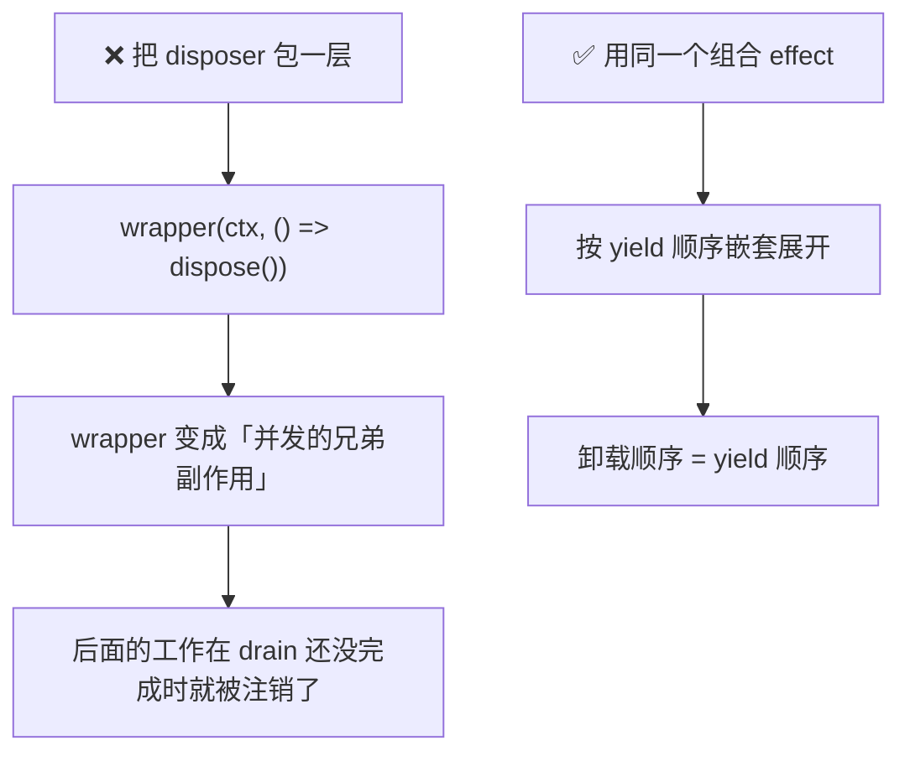
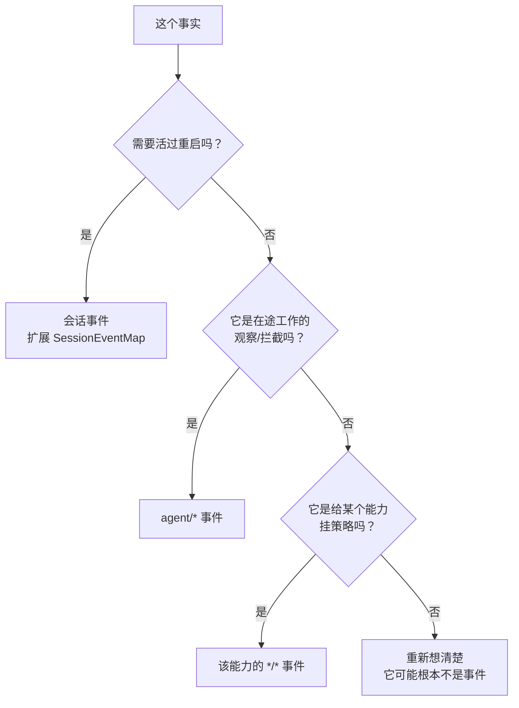
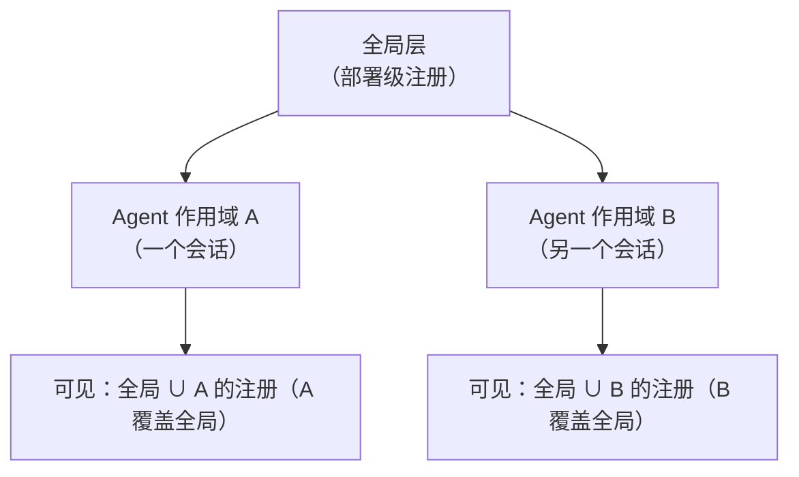
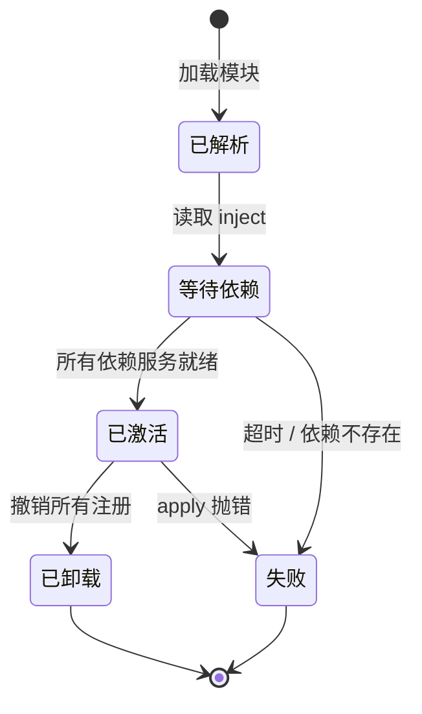

# 07 · 插件内核与扩展点设计

> 这篇文档回答：**"可插拔"到底怎么落地、扩展点在哪、怎么写一个插件、以及内核凭什么保证不被插件搞坏。**
> 它是 [00 产品宪法第三条](./00-文档总览与全局约定.md#第三条--内核只提供机制策略全部外挂)的技术实现说明。

| 项 | 值 |
|---|---|
| 状态 | 草案 |
| 负责人 | 架构负责人 |
| 上游依赖 | [05-系统架构设计.md](./05-系统架构设计.md)、[06-会话事件日志与可重放设计.md](./06-会话事件日志与可重放设计.md) |
| 下游被引 | [08-工具系统与执行流水线.md](./08-工具系统与执行流水线.md)、[09-上下文工程与压缩策略.md](./09-上下文工程与压缩策略.md)、[12-安全权限与沙箱模型.md](./12-安全权限与沙箱模型.md)、[13-插件SDK与协议设计.md](./13-插件SDK与协议设计.md) |
| 文档版本 | v0.1（2026-09-10） |

---

## 目录

- [1. 为什么是微内核](#1-为什么是微内核)
- [2. 四个核心概念](#2-四个核心概念)
- [3. 事件模型](#3-事件模型)
- [4. 作用域](#4-作用域)
- [5. 扩展点全景](#5-扩展点全景)
- [6. 设计一个新扩展点的规范](#6-设计一个新扩展点的规范)
- [7. 生命周期与卸载](#7-生命周期与卸载)
- [8. 核心循环的纯净性](#8-核心循环的纯净性)
- [9. 完整示例：写一个插件](#9-完整示例写一个插件)
- [10. 常见错误](#10-常见错误)
- [未决问题](#未决问题)
- [变更记录](#变更记录)

---

## 1. 为什么是微内核

### 1.1 两种扩展思路

| 思路 | 做法 | 用户能改到哪 | 谁决定能改什么 |
|---|---|---|---|
| **特性扩展** | 我们发现用户需要 X，就加一个 X 的配置项 | 配置项覆盖的范围 | 我们（产品团队） |
| **机制扩展** | 内核只提供机制，一切策略是可注册的 | 理论上无限 | 用户 |

特性扩展的问题不是"不够好"，而是**追不上需求**：

```
用户想做 X
  ├─ 我们做了 X 的配置项 → 用户想做 Y → 我们做 Y 的配置项 → 用户想做 Z → ...
  └─ 永远滞后一到两个版本，而用户的真实需求是长尾的
```

**Lcode 选择机制扩展。** 代价是我们必须非常克制地定义内核，并且要能回答"内核里到底允许有什么"。

### 1.2 内核的三条准入规则

一个东西要进内核，必须同时满足：

| # | 规则 | 例子 |
|---|---|---|
| **K1** | **每个组合都需要它** | `session`、`tools`、`agent-loop` ✅；`plan-mode` ❌ |
| **K2** | **它是机制而不是策略** | "提供事件派发" ✅；"超过 N 轮就停止" ❌ |
| **K3** | **没有它，其它能力无法表达** | `scope`（作用域原语）✅；`compaction` ❌ |

**当前内核的完整清单**（就是 [05 §4.1](./05-系统架构设计.md#41-骨架层六个包全部在产品-api-稳定性承诺内) 那六个包）。这个清单**只允许在 ADR 中变更**。

### 1.3 一个可检验的判据

> 核心循环包（`packages/core/agent-loop/src`）的源码中，条件判断**不得涉及任何具体能力**。

```ts
// ❌ 违规：循环里出现了具体能力的判断
if (await needsApproval(toolCall)) { await askUser(toolCall) }
if (estimatedTokens > model.contextWindow) { await compact() }

// ✅ 正确：循环只问"机制层"的问题
const decision = await this.ctx.waterfall('tools/pre-execute', exec, () => ({ kind: 'allow' }))
if (decision.kind === 'deny') return deniedResult(decision.reason)
```

这条由 `pnpm check:loop-purity` 用 AST 扫描 + 关键词黑名单强制（见 [15 §2 不变量 I6](./15-测试策略与质量门禁.md)）。

---

## 2. 四个核心概念

### 2.1 插件（Plugin）

一个插件就是一个导出 `apply` 的模块。三种形态：

```ts
// ── 形态 1：函数（最常用）──
export const name = 'lcode-plugin-git-guard'
export const inject = ['tools', 'fs']
export function apply(ctx: Context) {
  // ctx.tools 与 ctx.fs 在 apply 执行时已就绪
}

// ── 形态 2：对象 ──
export default {
  name: 'lcode-plugin-git-guard',
  inject: ['tools'],
  apply(ctx: Context) { /* ... */ },
}

// ── 形态 3：类（当你要对外提供一个服务时）──
export default class CoverageService extends Service {
  static inject = ['tools', 'fs']
  constructor(ctx: Context) {
    super(ctx, 'coverage')          // ← 声明 ctx key
  }
}
```

### 2.2 服务（Service）与上下文（Context）

`Context` 是服务的仓库。服务通过**稳定的 key** 被查找：

```ts
ctx.sessions        // 会话日志
ctx.tools           // 工具注册表
ctx.systemPrompt    // 提示词装配
ctx.agents          // 活体 Agent
ctx.agentLoop       // 具体循环
ctx.fs              // 文件系统（接缝）
ctx.llm             // 模型适配器注册表（接缝）
```

**硬性规则**：

> **扩展插件只依赖接口包，绝不依赖具体实现包。**

```ts
// ✅ 正确
import type { FileSystem } from '@lcode/fs'
ctx.get('fs')

// ❌ 错误（会在依赖方向检查里失败）
import { LocalFs } from '@lcode/fs-local'
```

**这条规则的收益**：换一个 `fs` 实现（本地 → 沙箱 → 远程），所有依赖 `ctx.fs` 的消费者**一行都不用改**。

### 2.3 事件（Event）

见 [第 3 节](#3-事件模型)。

### 2.4 副作用（Effect）

**每一次注册都必须返回撤销器。**

```ts
export function apply(ctx: Context) {
  // ① ctx.on() —— 事件监听，卸载时自动解除
  ctx.on('tools/pre-execute', handler)

  // ② ctx.effect() —— 任意带清理的东西
  ctx.effect(() => {
    const watcher = fs.watch(dir, onchange)
    return () => watcher.close()          // ← 卸载时执行
  })

  // ③ 注册 API 本身返回撤销器
  const disposeTool = ctx.tools.register(myTool)
  const disposeSection = ctx.systemPrompt.section(mySection)

  // ④ 组合：需要按顺序清理时，放进同一个 effect
  ctx.effect(function* () {
    const a = startA()
    yield () => a.stop()
    const b = startB()                    // b 依赖 a
    yield () => b.stop()
  })
}
```

### 2.5 卸载顺序属于契约

如果 teardown 有顺序要求（"先停循环，再注销 agent，最后关会话"），把这些工作放进**同一个组合副作用**，让框架按 yield 顺序嵌套展开。



> **这张图想让你看到什么**：把 disposer 包一层看起来无害，实际会把"顺序清理"变成"并发清理"。这类 bug 只在卸载路径上出现，测试很容易漏掉。**建议对每个插件都写一条"装载 → 卸载 → 状态等价"的测试。**

---

## 3. 事件模型

### 3.1 三个事件域

| 域 | 例子 | 判定标准 | 是否持久 |
|---|---|---|---|
| **会话事件** | `turn/start`、`tool/result`、`assistant/chunk` | 事实必须**活过重载** | ✅ |
| **Agent 事件** | `agent/pre-step`、`agent/status`、`agent/turn-stopping` | 观察或拦截**在途**的工作 | ❌ |
| **能力事件** | `tools/*`、`fs/*`、`llm/*` | 给某个接缝挂策略，而不 import 循环 | ❌ |

**选择流程**：



> **这张图想让你看到什么**：**不要为了"方便"把本该持久的事实做成进程内事件。** 一旦漏了持久化，回放就会出现"这一步当时发生了什么，日志里没有"的空洞，而这是不可逆的。

### 3.2 四种派发模式

| 模式 | 是否等待 | 顺序 | 有返回值 | 语义 | 典型用途 |
|---|---|---|---|---|---|
| `emit` | 否 | 注册序 | 无 | 纯观察 | 状态通知、UI 投影、审计 |
| `waterfall` | 否 | 注册序 | 有 | 洋葱中间件 | **所有可重排策略** |
| `parallel` | 是 | 并行 | 无 | 广播并等待 | 多观察者需要完成信号 |
| `serial` | 是 | 注册序 | 有 | 顺序执行可累积 | 终局检查点 |

**规则**：模式是事件的**公开契约**，写在类型声明里，并由静态检查保证声明与派发点一致。

### 3.3 waterfall 的语义

```ts
ctx.on('tools/pre-execute', async (exec, next) => {
  // next() 表示"交给下游，我同意"
  // 直接 return 表示"我接管，短路"
  return next()
})
```

| 写法 | 效果 |
|---|---|
| `return next()` | 委托；下游的决策成为结果 |
| `return { kind: 'deny', ... }` | 短路；下游不再被调用 |
| 先改对象再 `next()` | 协作式修改（共享对象上的字段） |
| 调 `next()` 但**忽略返回值** | ⚠️ **bug**：把下游决策吞掉了 |

### 3.4 类型化事件（声明合并）

事件的类型通过**声明合并**扩展，插件可以给事件总线加成员而不改内核：

```ts
declare module '@lcode/session' {
  interface SessionEventMap {
    'coverage/gap-detected': { file: string; lines: number[] }
  }
}

declare module '@lcode/tools' {
  interface ToolEvents {
    'coverage/report': (report: CoverageReport) => void
  }
}
```

**核心模式（Map → 派生联合）**：

```ts
interface ThingMap {
  a: { kind: 'a' /* ... */ }
  b: { kind: 'b' /* ... */ }
}
type ThingKind = keyof ThingMap                    // 'a' | 'b'
type Thing     = ThingMap[keyof ThingMap]          // 判别联合
```

这个模式在 Lcode 里出现 6 次：

| Map | 所属包 | 派生类型 | 开放性 |
|---|---|---|---|
| `SessionEventMap` | `session` | `SessionEvent` | **开放** |
| `ContentBlockMap` | `llm` | `ContentBlock` | **开放** |
| `MessageSourceMap` | `llm` | `MessageSource` | **开放** |
| `FinishReasonMap` | `llm` | `FinishReason` | 半开放 |
| `TurnEndReasonMap` | `session` | `TurnEndReason` | **开放** |
| `TurnTriggerMap` | `session` | `TurnTrigger` | **开放** |

**开放性对照原则**：

| 结构 | 开放？ | 理由 |
|---|---|---|
| 事件 / 消息来源 / 内容块 | **开放** | 插件必须能扩展它们 |
| 流协议（`StreamChunk`） | **闭合** | provider 与内核之间的严格契约；加变体必须让所有处理者编译失败 |

---

## 4. 作用域

### 4.1 三种作用域层级



> **这张图想让你看到什么**：作用域让"同一份代码，不同会话看到不同的工具集 / 提示词 / 服务"成为**结构性保证**，而不是运行时条件判断。

### 4.2 作用域原语

```ts
/** 不透明、按身份比较的作用域键。Lcode 用活体 Agent 对象充当 */
type ScopeKey = object

/** 编译期的路由标记（不暴露真实类型） */
type Scoped<T extends object> = object & { readonly [ScopedBrand]: T }

interface Scope {
  ctx: Context                                  // 通过它做作用域内的注册
  rawDispose: () => Promise<void> | void        // 精确的撤销器（用于有序嵌套）
  dispose(): Promise<void>                      // 公开的静默边界（竞态调用 await 同一个完成）
}

/** 一个注册表在某层级上的完整贡献 */
interface ScopeLayer {
  isEmpty(): boolean
}
```

### 4.3 分层注册表的语义

`ScopedLayers<L>` 的规则（**三个注册表共用同一套底座**：`tools`、`systemPrompt`、`skill`）：

| 规则 | 说明 |
|---|---|
| 全局层 eagerness | 全局层是急切实例；scoped 层**惰性创建** |
| **读不创建层** | `peek(undefined)` 表示"无覆盖"，不物化层 |
| 合并顺序 | 插入序的全局具名条目 → 再叠加 scoped 覆盖 |
| 注册即所有权 | 一次注册**同时**表达可见性与副作用所有权 |
| 层回收 | 一个 scoped 层只在**整个 `ScopeLayer` 为空**时被回收（不会因为删掉一张表就丢掉兄弟表） |

### 4.4 作用域的三个实际用途

| 用途 | 例子 |
|---|---|
| **每会话不同的工具集** | 会话 A 装了"公司内部 API 工具"，会话 B 没有 |
| **每会话不同的提示词** | 项目 X 用规范 A，项目 Y 用规范 B |
| **每会话不同的服务实例** | 终端会话按 agent 隔离，不可跨 agent 操作 |

---

## 5. 扩展点全景

> 这张表是"我该挂哪"的权威索引。**新行为必须挂到已有扩展点；找不到合适的说明需要**先在这个表里新增一行**（走 [第 6 节](#6-设计一个新扩展点的规范)的流程）。

### 5.1 循环相关

| 想做的事 | 扩展点 | 模式 | 说明 |
|---|---|---|---|
| 在会话开始时播种上下文 | `agent/session-start` | emit | 用 `agent.inject()` 追加内容 |
| **决定模型看到什么**（改写消息 / 拒绝） | `agent/pre-step` | waterfall | 可 `enter(messages)` 或 `reject` |
| 替换冻结的调用配置 | `agent/request` | waterfall | 可改 provider/model/采样；**不能改消息** |
| 请求失败后接管恢复 | `agent/request-error` | waterfall | 返回 `{ kind: 'retry' }` 表示接管 |
| 轮即将停止时表态 | `agent/turn-stopping` | **serial** | ⚠️ **没有 `next()`**；用 `agent.steer()` 表达"别停" |
| 观察状态变化 | `agent/status` | emit | `idle ⇄ running` |
| 观察会话/agent 生命周期 | `agent/created` / `agent/disposed` | emit | 同步监听器抛错可**否决**创建 |

### 5.2 工具相关

| 想做的事 | 扩展点 | 说明 |
|---|---|---|
| 注册一个模型可见的工具 | `ctx.tools.register()` | schema 自动进入提示词装配 |
| 可重排的 allow / deny / ask 策略 | `tools/pre-execute` | waterfall |
| **不可被撤销的**终局拒绝 | `ctx.tools.guard()` | 单调：**类型上没有 allow** |
| 包裹 dispatch 生命周期（超时 / 重试 / 指标） | `tools/execute` | around-dispatch；只能换 `exec.signal` |
| 显式改造结果、或给结果附加上下文 | `tools/post-execute` | 可 accept / block / 替换 |
| 只观察最终权威结果（审计、采集） | `tools/result` | 不可变、失败被包含；**不能改结果** |
| 末道"只能改内容"的闸门 | `ToolDefinition.finalizeContent` | 连流水线失败也会经过它 |
| 裁剪某个作用域可见的工具 | `ctx.tools.restrict()` | 只影响**继承来的**工具 |

### 5.3 上下文与提示词

| 想做的事 | 扩展点 | 说明 |
|---|---|---|
| 加一段系统提示词 | `ctx.systemPrompt.section()` | 有排序与作用域覆盖 |
| 加动态上下文（变化时才发） | `ctx.systemPrompt.context()` | 物化为持久的 user 角色快照 |
| 贡献工具 schema | `ctx.systemPrompt.tools()` | 通常不直接用（用 `ctx.tools.register`） |
| 加一个模板变量 | `ctx.systemPrompt.variable()` | 在 `text` 里用 `{{name}}` 引用 |
| 向下一步注入上下文 | `agent.inject()` | 落盘、可去重、不唤醒 |
| 在步中间插话 | `agent.steer()` | 最近的步边界生效 |

### 5.4 能力与策略

| 想做的事 | 扩展点 |
|---|---|
| 加一个模型供应商 | 在 `ctx.llm` 注册适配器 |
| 加一个文件系统实现 | 实现 `ctx.fs` 接缝 |
| 加一个 shell 执行器 | 实现 `ctx.shell` 接缝 |
| 约束子进程 | 实现 `ctx.sandbox` 接缝 |
| 加一个人工命令（不过模型） | `ctx.commands.register()` |
| 加后台作业 | `ctx.jobs.start()` |
| 加一个人工审批应答者 | `approval/request` waterfall 监听器 |
| 加一个提问通道 | `ctx.userQuestions.registerProvider()` |
| 加一种压缩策略 | 实现 `ctx.compaction` 接缝 |
| 加一个子代理类型 | 注册 `ctx.subagents` provider |
| 加一个技能来源 | 注册 `ctx.skills` provider |

### 5.5 视图与协议

| 想做的事 | 扩展点 |
|---|---|
| 加一个 UI 面板 | 订阅 `session/event`（数据）+ `agent/*`（控制状态） |
| 加一个工具卡片类型 | 在 `ToolDefinition` 上实现 `presentCall` / `presentResult` 返回新卡片 |
| 把 Lcode 接到外部程序 | 实现 JSON-RPC stdio 服务端（见 [13](./13-插件SDK与协议设计.md)） |
| 把 Lcode 作为 MCP 客户端 | 一个 server 一个插件，发现工具后注册 |
| 把 Lcode 作为 MCP 服务端 | 暴露能力（见 [13](./13-插件SDK与协议设计.md)） |

---

## 6. 设计一个新扩展点的规范

当现有扩展点不够用时，**先别改循环**。按下面的流程走。

### 6.1 五步流程

```mermaid
flowchart TD
  S1["① 能不能用现有扩展点表达？"] -->|能| E1["用它"]
  S1 -->|不能| S2["② 它是状态、能力、还是策略？"]
  S2 -->|状态| S3["扩展 SessionEventMap\n（声明合并，不改内核）"]
  S2 -->|能力| S4["设计新接缝：接口 + 实现 + 消费"]
  S2 -->|策略| S5["③ 它需要返回值吗？"]
  S5 -->|需要可重排决策| S6["设计 waterfall + 决策联合"]
  S5 -->|需要不可撤销| S7["设计单调 guard"]
  S5 -->|只观察| S8["设计 emit"]
  S5 -->|需要"投票"| S9["⚠️ 别用投票\n改成『塞数据 + 机器重读』"]
  S4 --> S10["④ 写 ADR 记录取舍"]
  S6 --> S10
  S7 --> S10
  S8 --> S10
  S9 --> S10
  S3 --> S11["⑤ 补文档 + 不变量"]
  S10 --> S11
```

> **这张图想让你看到什么**：新增扩展点的第一问永远不是"怎么做"，而是"**它属于哪一类**"。分类错了，后面全错。

### 6.2 一个扩展点的契约清单

任何新扩展点必须写明：

| 项 | 说明 |
|---|---|
| **名称** | `域/动作`，如 `tools/pre-execute` |
| **域** | 会话 / Agent / 能力 |
| **模式** | emit / waterfall / parallel / serial |
| **是否有返回值** | 有的话，决策联合的类型是什么 |
| **参数** | 每个参数的含义与是否可变 |
| **失败语义** | 监听器抛错会怎样（被包含 / 中断 / 忽略） |
| **作用域过滤** | 是否按 agent 过滤 |
| **顺序语义** | 结果是否依赖注册顺序（**强烈建议不依赖**） |

### 6.3 决策类型的设计规范

**用带 tag 的联合，不用 boolean。**

```ts
// ❌ 两个问题：第三态无处安放；多个监听器互相覆盖
type Decision = boolean

// ✅ 可穷举、可审计、可表达第三态
type PreToolDecision =
  | { kind: 'allow' }
  | { kind: 'deny'; reason: string }
  | { kind: 'ask'; reason?: string }
```

**给"不可撤销"的部分一个类型上无法表达 allow 的类型**：

```ts
// 返回值只有两种含义：拒绝（返回 reason）或弃权（返回 undefined）
// 「允许」在类型上不可能出现 → 顺序无关的单调性
type ToolGuard = (execution: Readonly<ToolExecution>) => string | undefined
```

---

## 7. 生命周期与卸载

### 7.1 插件的三个阶段



> **这张图想让你看到什么**：`apply` **只在所有 `inject` 声明的服务就绪后才被调用**。你不需要手写 `await initX(); await initY();` 这类脆弱的启动序列——启动顺序是**声明式**的。

### 7.2 卸载的精确性要求

**"卸载后状态与装载前逐项一致"是可测试的**：

```ts
it('装载并卸载插件后，状态与装载前一致', async () => {
  const before = snapshotRuntimeState(ctx)   // 工具集 / 提示词段落 / 监听器数 / 定时器数 / 服务集
  const disposable = await ctx.load(pluginPath)
  expect(snapshotRuntimeState(ctx)).not.toEqual(before)   // 确认真的装载了
  await disposable.dispose()
  expect(snapshotRuntimeState(ctx)).toEqual(before)        // 精确回滚
})
```

这条测试对应 MVP 验收项 `M-EXT-03`。

### 7.3 哪些东西容易漏掉

| 容易漏的 | 后果 |
|---|---|
| `setInterval` / `setTimeout` | 卸载后仍在跑 |
| 文件监听器 | 句柄泄漏 |
| 子进程 | 卸载后变孤儿进程 |
| 未返回的 Promise | 卸载后才 resolve，访问已失效状态 |
| 全局 map 里的注册 | 内存泄漏 |
| 通过非 ctx API 注册的东西 | 框架不知道它存在 |

**纪律**：**一切注册都走 `ctx`**。如果某个 API 不返回撤销器，用 `ctx.effect()` 包起来。

### 7.4 卸载顺序

| 原则 | 说明 |
|---|---|
| 后注册先卸载 | 内层依赖先于外层清理（由组合副作用的嵌套顺序保证） |
| 有依赖关系的放同一个 effect | 不要把 wrapper 套在 disposer 外面（见 §2.5） |
| 卸载必须能等 | 撤销器可以返回 Promise；框架会 await |

---

## 8. 核心循环的纯净性

### 8.1 循环允许做与不允许做的事

| 允许 | 不允许 |
|---|---|
| 认领输入、开轮、开步 | 判断"是否需要审批" |
| 装配提示词与工具 schema（通过接缝） | 计算"token 是否超限" |
| 发请求（通过 `ctx.llm`） | 决定"用哪个模型"（除非配置明确） |
| 落盘事件 | 决定"要不要压缩" |
| 派发工具调用（通过 `ctx.tools`） | 判断"这个工具是不是危险" |
| 派发事件 | 任何与具体能力相关的分支 |

### 8.2 循环的伪代码（完整）

```ts
async function runTurn(agent: Agent): Promise<void> {
  const session = agent.session
  const turn = session.nextTurnNumber()

  session.append('turn/start', { turn })

  while (true) {
    // ── 认领输入 ──
    const claimed = agent.inbox.claim(turn)       // 首次：next-step + 一条 next-turn；之后：仅 next-step
    if (claimed.length === 0 && !toolsOweAnotherRequest) break
    for (const m of claimed) session.emit('agent/inbox/claimed', { message: m, turn })

    // ── 决定这一步做什么（策略在这里，不在循环里）──
    const decision = await ctx.waterfall('agent/pre-step', { agent, messages: claimed },
                                         () => ({ kind: 'enter', messages: claimed }))
    if (decision.kind === 'reject') continue        // 不花步；轮仍会关闭

    const step = session.nextStepNumber(turn)
    session.append('step/start', { turn, step })
    for (const m of decision.messages) session.append('user/message', m, { surfaceOp: 'append' })

    // ── 装配请求 ──
    const assembly = await ctx.systemPrompt.assemble(assembleContextFor(agent))
    const proposed = { config: agent.options, system: assembly.text, tools: assembly.tools,
                       messages: session.deriveMessages() }
    const request = await ctx.waterfall('agent/request', proposed, () => proposed)
    session.append('request/header', { header: toHeader(request, assembly), reason: ... })

    // ── 发请求 ──
    let assembled = new BlockAssembler()
    try {
      for await (const chunk of ctx.llm.stream(request)) {
        session.append('assistant/chunk', { turn, step, chunk })
        assembled.push(chunk)
      }
    } catch (err) {
      session.append('step/end', { turn, step })
      const action = await ctx.waterfall('agent/request-error', { agent, err, ... }, () => ({ kind: 'terminal' }))
      if (action.kind === 'retry') continue
      throw err
    }
    const message = assembled.message()
    session.append('assistant/message', { turn, step, message, usage: assembled.usage },
                   { surfaceOp: 'append', sourceEventSeqs: assembled.chunkSeqs })

    // ── 跑工具 ──
    const calls = message.content.filter(isToolCall)
    toolsOweAnotherRequest = calls.length > 0
    for (const call of calls) {
      session.append('tool/call', { turn, step, callId: call.id, name: call.name, arguments: call.arguments })
      const result = await ctx.tools.execute({ ...call, agent, signal: turnSignal })
      session.append('tool/result', { turn, step, message: toResultMessage(result),
                                      error: result.error, meta: result.meta }, { surfaceOp: 'append' })
    }
    session.append('step/end', { turn, step })
  }

  await ctx.serial('agent/turn-stopping', { agent })
  session.append('turn/end', { turn, reason: { kind: 'completed' } })
}
```

**注意这段代码里没有什么**：没有审批、没有压缩、没有沙箱、没有模型选择、没有重试策略、没有计划模式。**它们全部在事件监听器里。**

### 8.3 一个反例：为什么"提前结束轮"要做成数据

很多系统会提供一个 `agent/before-turn-end` 事件让插件"否决结束"。这有问题：多个插件互相否决时，结果取决于注册顺序。

**Lcode 的做法**：工具可以在成功结果上标记 `concludesTurn`，**这是数据**，不是否决权。

```ts
interface ToolExecutionSuccess {
  isError: false
  value: JsonValue
  content: ContentBlock[]
  /** 循环在提交这批结果后停止 */
  concludesTurn?: true
}
```

> **原则**：**数据决定结果，所以监听器顺序无法改变结果。** 这条原则在 `agent/turn-stopping` 上体现为"监听器不是投票，而是往队列里塞数据，机器重新读"。

---

## 9. 完整示例：写一个插件

**目标**：一个"变更守卫"插件——当 agent 要修改受保护目录（如 `migrations/`）时，要求审批；并且把所有写操作记录到一个审计日志。

```ts
// my-guard/src/index.ts
import type { Context } from '@lcode/plugin-sdk'
import type { PreToolDecision, ToolExecution } from '@lcode/tools'

export const name = 'lcode-plugin-migration-guard'
export const inject = ['tools', 'fs'] as const

const PROTECTED = /^migrations\//

export function apply(ctx: Context) {
  // ── 1) 可重排策略：受保护路径需要审批 ──
  ctx.on('tools/pre-execute', async (exec: ToolExecution, next): Promise<PreToolDecision> => {
    const target = extractPath(exec)              // 从参数里取路径
    if (!target || !PROTECTED.test(target)) return next()
    return {
      kind: 'ask',
      reason: `修改受保护目录 ${target} 需要确认`,
    }
  })

  // ── 2) 单调守卫：迁移文件禁止通过 shell 删除 ──
  ctx.tools.guard(exec => {
    if (exec.name !== 'shell') return undefined
    const cmd = String((exec.arguments as { command?: string }).command ?? '')
    if (/\brm\b[\s\S]*\bmigrations\//.test(cmd)) {
      return '禁止通过 shell 删除迁移文件（部署方红线）'
    }
    return undefined                            // 注意：只能拒绝或弃权
  })

  // ── 3) 审计：只观察最终权威结果 ──
  ctx.on('tools/result', (exec, result) => {
    if (!isMutating(exec.name)) return
    ctx.get('auditStore')?.record({            // 用可选查找，避免硬依赖
      at: Date.now(),
      tool: exec.name,
      ok: !result.isError,
      agent: exec.agent?.id,
    })
  })

  // ── 4) 注册一个模型可见的查询工具 ──
  ctx.tools.register(defineTool({
    name: 'list_protected_paths',
    description: '列出受保护的目录，修改它们需要人工确认。',
    parameters: {},
    output: {
      schema: { type: 'array', items: { type: 'string' } },
      render: (_args, value) => [{ type: 'text', text: value.join('\n') }],
    },
    async execute(_args, exec) {
      return ['migrations/', 'secrets/']
    },
  }))
}
```

### 9.1 这个示例展示了什么

| 用到的机制 | 位置 | 为什么这么用 |
|---|---|---|
| `inject` 声明依赖 | 顶部 | 不手写启动顺序 |
| 可重排策略（waterfall） | ① | 允许部署方在更上层加更严的策略，或覆盖它 |
| **单调守卫** | ② | 部署方的红线，不可被其它插件翻回允许 |
| **只观察不改**（`tools/result`） | ③ | 审计不应有能力影响执行结果 |
| 可选服务查找（`ctx.get(...)?`） | ③ | 没有审计服务时优雅降级 |
| 工具注册 | ④ | schema 自动进入提示词装配 |
| 规范值 + 纯投影 | ④ | 返回数组（程序可读），渲染成文本（模型可读） |

### 9.2 插件清单

```jsonc
// lcode.json
{
  "id": "lcode-plugin-migration-guard",
  "version": "1.0.0",
  "entry": "./lib/index.js",
  "engines": { "lcode": ">=0.3.0" },
  "permissions": {
    "fs": { "read": ["**"], "write": [] },        // 它本身不写文件
    "network": [],
    "spawn": false,
    "env": []
  },
  "contributes": {
    "tools": ["list_protected_paths"]
  },
  "config": {
    "protectedPatterns": { "type": "array", "default": ["migrations/", "secrets/"] }
  }
}
```

> **注意 `permissions`**：这个插件声明了"可读全部文件、不可写、无网络、不可 spawn、不读环境变量"。安装时用户会看到这份声明并确认（`SEC-PLUGIN-001/003`）。**未声明的能力在运行时会被拒绝，不只是"警告"。**

---

## 10. 常见错误

| # | 错误 | 症状 | 修正 |
|---|---|---|---|
| 1 | 观察者忘了 `next()` | 下游所有策略静默失效 | 开发期加检查：声明为观察者却未调用 `next()` 则告警 |
| 2 | 把 disposer 包一层 | 卸载时并发清理，状态残留 | 用同一个组合 effect |
| 3 | 在 `switch` 里用 `assertNever` 处理开放 map | 插件扩展时编译失败 | 用 `default` 兜底 |
| 4 | 用 boolean 表达决策 | 第三态无处安放；监听器互相覆盖 | 用带 tag 的联合 |
| 5 | 用注册顺序表达优先级 | 顺序一变行为就变；测试偶发失败 | 需要单调性 → guard；需要投票 → 塞数据 + 重读 |
| 6 | 把持久事实做成进程内事件 | 回放出现空洞，不可逆 | 扩展 `SessionEventMap` |
| 7 | `ctx.on` 里直接 `import` 具体实现包 | 依赖方向检查失败；换 provider 要改调用方 | 只依赖接口包 |
| 8 | 在 `presentCall` 里做 I/O | 重放时崩溃或显示错误 | 保持纯函数；需要状态就持久化到 `meta` |
| 9 | 在核心循环里加业务分支 | `check:loop-purity` 失败 | 挂到事件上 |
| 10 | 注册了但没返回撤销器 | 热重载后残留 | 一切注册都走 `ctx` |

---

## 未决问题

- [ ] **插件跨进程后，`ctx` 对象的哪些能力可用**：当前设想是插件在 utility 进程中拿到一个"代理 ctx"，其中本地可用的部分（注册工具、订阅事件）走 RPC，不可用的部分（直接访问 `session`）被移除。需要 [13](./13-插件SDK与协议设计.md) 给出完整的可用面清单。**这是 v0.3 的最大技术风险。**
- [ ] **`ctx.on` 的监听器是否允许 async**：waterfall 允许（注册序、不等待）；serial 允许（顺序、等待）；emit 若允许 async 会产生"未捕获拒绝"。倾向"emit 的监听器必须同步或自己 catch"，需要明确。
- [ ] **作用域与插件进程的关系**：一个插件进程如何服务多个 agent 作用域的注册？需要设计（可能每个作用域一个轻量 proxy）。
- [ ] **`check:loop-purity` 的关键词黑名单**：靠黑名单容易漏。是否有更本质的检查方式（如"循环包只能 import 特定的几个包"）？需要在 [15](./15-测试策略与质量门禁.md) 里定方案。
- [ ] **插件配置 schema 到 UI 的自动映射**：`EXT-PLUGIN-002` 要求自动生成配置界面。JSON Schema → 表单的映射对复杂 schema 会退化，需要确定支持的子集。

---

## 变更记录

| 日期 | 版本 | 变更 | 说明 |
|---|---|---|---|
| 2026-09-10 | v0.1 | 初稿 | 建立微内核准入规则、四核心概念、三事件域与四派发模式、作用域语义、扩展点全景表、新扩展点设计流程、卸载精确性、循环纯净性与完整插件示例 |
