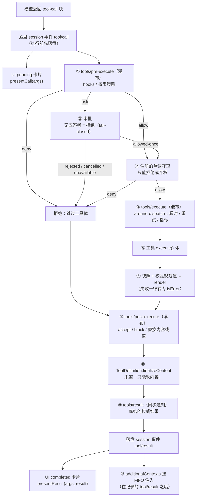
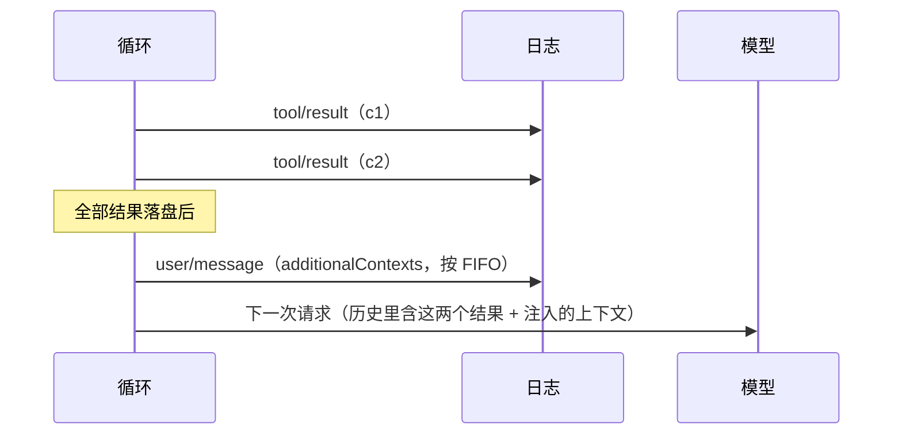
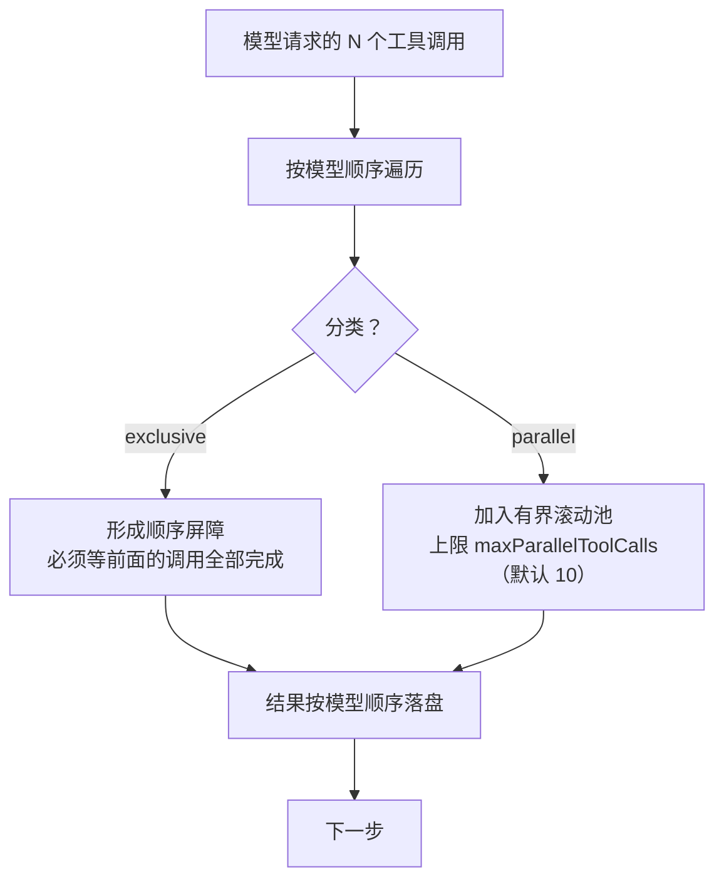
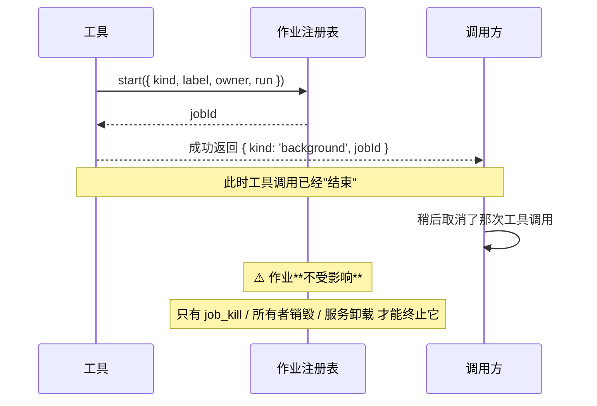

# 08 · 工具系统与执行流水线

> 这篇文档回答：**一个工具要满足什么契约、它执行时经过哪些关卡、结果怎么变成模型能看和 UI 能画的东西。**
> 写工具前必读；改流水线前必读 [17 ADR-0008/0009/0010](./17-架构决策记录ADR.md)。

| 项 | 值 |
|---|---|
| 状态 | 草案 |
| 负责人 | 架构负责人 |
| 上游依赖 | [06-会话事件日志与可重放设计.md](./06-会话事件日志与可重放设计.md)、[07-插件内核与扩展点设计.md](./07-插件内核与扩展点设计.md) |
| 下游被引 | [09](./09-上下文工程与压缩策略.md)、[10](./10-桌面客户端设计.md)、[12](./12-安全权限与沙箱模型.md)、[13](./13-插件SDK与协议设计.md) |
| 文档版本 | v0.1（2026-09-10） |

---

## 目录

- [1. 设计目标](#1-设计目标)
- [2. 工具契约](#2-工具契约)
- [3. Schema DSL](#3-schema-dsl)
- [4. 执行流水线](#4-执行流水线)
- [5. 决策类型](#5-决策类型)
- [6. 并行调度](#6-并行调度)
- [7. 结果契约](#7-结果契约)
- [8. UI 卡片](#8-ui-卡片)
- [9. 内置工具规格](#9-内置工具规格)
- [10. 长任务与后台](#10-长任务与后台)
- [11. 反模式](#11-反模式)
- [未决问题](#未决问题)
- [变更记录](#变更记录)

---

## 1. 设计目标

### 1.1 从三个消费者反推

工具的输出有**三个**消费者，它们的需求不同：

| 消费者 | 需要什么 |
|---|---|
| **模型** | 人类可读的文本（带足够上下文，不啰嗦） |
| **程序**（代码模式 / 编排 / 子代理的结构化输出） | 结构化、可索引的字段（不要解析散文） |
| **UI** | 可重放的渲染意图（pending 态与 completed 态） |

**如果工具直接返回一段文本**，后两个消费者就只能去解析散文——这是绝大多数 agent 框架的脆弱点。

**Lcode 的解法**：

```
工具 execute() 返回「结构化规范值」
        │
        ├──→ render(args, value)         ──→ 模型可见的 ContentBlock[]
        ├──→ 直接交给程序（代码模式拿到 value） 
        └──→ presentationMeta(args, value) ──→ 可重放的 UI 元数据
```

### 1.2 五个设计约束

| # | 约束 | 理由 |
|---|---|---|
| **T1** | 工具返回**结构化的规范值**，不返回文本 | 三个消费者必须一致 |
| **T2** | 参数**不可被中间件改写** | 历史 / 审计 / UI / 执行必须一致 |
| **T3** | **展示策略 ≠ 保密策略** | 内容替换是"展示"，真要藏值必须 block 或替换值 |
| **T4** | 参数校验在 `execute` **之前**完成 | 非法输入变成结构化错误而不是异常 |
| **T5** | 展示函数必须是**纯函数** | 它会在实时流与日志重放两种场景下被调用 |

---

## 2. 工具契约

### 2.1 完整类型

```ts
interface ToolSchema {
  name: string
  description: string                          // 模型看到的说明
  parameters: JsonSchemaNode                   // 参数 schema
}

interface ToolOutputDefinition {
  /** 规范值的 schema（原始 JSON Schema 子集） */
  schema: JsonSchemaNode
  /** 纯投影：值 → 模型可见内容 */
  render(args: unknown, value: JsonValue): ContentBlock[]
  /** 纯投影：值 → 可重放的 UI 元数据（可选） */
  presentationMeta?(args: unknown, value: JsonValue): JsonValue
}

interface ToolDefinition extends ToolSchema {
  /** 必填：规范输出声明 */
  readonly output: ToolOutputDefinition

  /** 运行一次调用，只返回规范值 */
  execute(args: unknown, exec: ToolRunContext): Promise<unknown>

  /** 末道「只能改内容」的闸门（可选） */
  finalizeContent?(
    exec: Readonly<ToolExecution>,
    result: Readonly<ToolExecutionResult>,
  ): ContentBlock[] | undefined

  /** 协作式超时预算（毫秒）。永不发给模型 */
  timeoutMs?: number

  /** 纯同步的并发安全分类器。只有精确返回 true 才并行 */
  isConcurrencySafe?(args: unknown): boolean

  /** pending 态卡片（可选） */
  presentCall?(args: unknown): ToolCallView | undefined

  /** completed 态卡片（可选） */
  presentResult?(args: unknown, result: ToolResult): ToolResultView | undefined
}
```

### 2.2 六个必须理解的规则

| # | 规则 | 说明 |
|---|---|---|
| 1 | **`output` 是必填的** | 没有它，工具就只能返回文本，三个消费者立刻分叉 |
| 2 | **模型只看到白名单字段** | `output` / `execute` / `finalizeContent` / `timeoutMs` / `isConcurrencySafe` / `presentCall` / `presentResult` **绝不泄漏**到模型请求。实现必须用**白名单**投影，不用黑名单 |
| 3 | **参数是只读的** | 注册表会把参数做一次无损物化并深冻结；任何 `cast` 都改不了 |
| 4 | **抛错 = `isError`** | 基础设施失败用抛错表示；**领域上的非理想结果应该放进规范值**（例如"命令退出码 1"是一个成功的工具调用） |
| 5 | **必须观察 `exec.signal`** | 取消时停止在途工作 |
| 6 | **必须能到达静止态** | 声明 `timeoutMs` 就是在承诺"我可以被中断并且能收敛" |

### 2.3 规则 4 的展开：什么时候该抛错

| 情形 | 做法 | 理由 |
|---|---|---|
| 文件不存在 | **返回成功值**（`{ found: false }`）或抛 `FS_NOT_FOUND` | 取决于语义。若"文件不存在"是预期结果（如 glob），返回成功值 |
| 命令退出码非 0 | **返回成功值**（含 `exitCode: 1`） | 命令跑了，只是结果不理想 |
| 命令超时 | **返回成功值**（含 `timedOut: true`）或结构化错误 | 倾向结构化错误，因为语义上"没跑完" |
| 磁盘写入失败 | **抛错** | 基础设施失败 |
| 参数非法 | 注册表在 `execute` 之前就处理了 | 工具本身不用管 |

> **判据**：**"这件事发生了但结果不理想" → 放进值；"这件事没能发生" → 抛错。**

---

## 3. Schema DSL

### 3.1 为什么需要 DSL

手写 `args: unknown` + 自己校验，会导致每个工具都写一遍同样的样板代码，而且类型推断断裂。Lcode 提供一个统一的 schema DSL，同时驱动**编译期类型推断**与**运行期校验**。

### 3.2 规格

```ts
type ValueSchemaSpec =
  | { type: 'string';  enum?: string[];  const?: string;  description?: string }
  | { type: 'number';  enum?: number[];  const?: number;  description?: string }
  | { type: 'integer'; enum?: number[];  const?: number;  description?: string }
  | { type: 'boolean'; const?: boolean;  description?: string }
  | { type: 'null' }
  | { type: 'array'; items?: ValueSchemaSpec; description?: string }
  | { type: 'object'; properties?: Record<string, ValuePropertySpec>;
      additionalProperties: boolean; description?: string }
  | { type: 'json' }                                  // 作者专用：任意无损 JSON
  | { type: 'oneOf'; oneOf: ValueSchemaSpec[] }        // 恰好匹配一个分支

type ValuePropertySpec = ValueSchemaSpec & { required?: true }
type ParameterSchemaSpec = Record<string, ValuePropertySpec>
```

### 3.3 三条约定

| 约定 | 说明 |
|---|---|
| **参数根是隐式开放对象** | 必填性靠每个属性上的 `required: true` |
| **显式对象节点必须声明 `additionalProperties`** | 避免"默认行为"带来的歧义 |
| **`oneOf` 至少两个分支，值必须恰好匹配一个** | 支持"两种完全不同的成功形态"（见 shell 工具） |

### 3.4 类型推断

```ts
type InferArgs<P>  = /* 从 ParameterSchemaSpec 推断出 { required: T; optional?: T } */
type InferValue<S> = /* 从 ValueSchemaSpec 推断出对应的 TS 值类型 */
```

**一个实现细节**：`InferValue` 只精确推断到 **16 层容器深度**，再深就退化成 `JsonValue` —— 这是为了避免耗尽 TypeScript 的类型实例化栈。**但运行时校验仍然走完整 schema。**

> **可迁移的取舍**：编译期近似 + 运行期精确。在类型系统密集的项目里，这比"编译期爆炸"实用得多。

### 3.5 使用示例

```ts
ctx.tools.register(defineTool({
  name: 'read',
  description: '读取文件的指定行窗口。',
  parameters: {
    path:   { type: 'string', required: true, description: '绝对路径或工作区相对路径' },
    offset: { type: 'integer', description: '起始行（从 1 开始）' },
    limit:  { type: 'integer', description: '最多读取多少行' },
  },
  output: {
    schema: {
      type: 'object',
      additionalProperties: false,
      properties: {
        path:       { type: 'string' },
        offset:     { type: 'integer' },
        lines:      { type: 'array', items: { type: 'object', additionalProperties: false,
                       properties: { number: { type: 'integer' }, text: { type: 'string' },
                                     required: true } } },
        totalLines: { type: 'integer' },
      },
    },
    render: (args, value) => [{
      type: 'text',
      text: value.lines.map(l => `${String(l.number).padStart(6)}|${l.text}`).join('\n'),
    }],
    presentationMeta: (_args, value) => ({ totalLines: value.totalLines }),
  },
  isConcurrencySafe: () => true,          // 读是并行的
  async execute(args, exec) {
    // args 已经是 { path: string; offset?: number; limit?: number }
    const { lines, totalLines } = await readWindow(args.path, args.offset, args.limit, exec.signal)
    return { path: args.path, offset: args.offset ?? 1, lines, totalLines }
  },
  presentCall: (args) => ({ card: 'generic', kind: 'read', title: `Read ${args.path}` }),
  presentResult: (args, result) => ({
    card: 'read',
    path: args.path,
    offset: args.offset ?? 1,
    lines: result.meta?.lines ?? [],
    totalLines: result.meta?.totalLines ?? 0,
  }),
}))
```

---

## 4. 执行流水线

### 4.1 全景



> **这张图想让你看到什么**：策略在**执行之前**（①②③），包裹在**执行周围**（④），修正在**执行之后**（⑦⑧），观察在**最后**（⑨）。每一步的位置都是刻意的——放错位置会导致"策略管不到"或"观察者能改结果"。

### 4.2 每一步的职责与约束

| 步 | 名称 | 能做什么 | **不能做什么** |
|---|---|---|---|
| ① | `tools/pre-execute` | allow / deny / ask | **改写参数** |
| ② | 单调守卫 | 拒绝或弃权 | **允许**（类型上不可能） |
| ③ | 审批 | 一次性放行 | 永久放行 |
| ④ | `tools/execute` | 换 `exec.signal`（超时）、包裹、观测 | 改身份字段 |
| ⑤ | 工具体 | 干活 | 返回非规范值 |
| ⑥ | 归一化 | 快照、校验、渲染 | 抛错到外面 |
| ⑦ | `tools/post-execute` | accept / block / 替换**内容**或**值**（二选一） | 同时替换两者 |
| ⑧ | `finalizeContent` | 只改 `content` | 改值 / 改错误状态 |
| ⑨ | `tools/result` | 观察 | 改结果（拿走的是冻结副本） |
| ⑩ | 上下文注入 | 追加 `user/message` | 在流式中途插入 |

### 4.3 身份保护

```ts
type ToolExecutionToken = symbol & { readonly [brand]: true }

interface ToolExecution {
  readonly callId: CallId
  readonly rootCallId: CallId          // 根调用（嵌套派发时指向最外层）
  readonly name: string
  readonly arguments: unknown          // 已物化 + 深冻结
  readonly agent?: Agent
  readonly parent?: ToolExecutionToken // 嵌套派发时的父令牌
  readonly token: ToolExecutionToken   // 注册表分配
}
```

**规则**：

| 字段 | 可变性 |
|---|---|
| `callId` / `name` / `arguments` / `agent` / `token` / `rootCallId` | **只读** |
| `signal` | 在 `tools/execute` 里**可替换但不可移除**；注册表在调用工具体之前会把调用方的 signal **重新融合**回去 |

> **"重新融合"的重要性**：如果没有这一步，一个恶意或有 bug 的 wrapper 可以通过替换 signal 让调用方**永远无法取消**这次调用。重新融合保证了"替换 signal 只能加强限制（如加超时），不能脱离调用方的取消"。

### 4.4 失败包含

| 谁抛错 | 结果 |
|---|---|
| 工具体 | 归一化为 `isError`，**不中断轮** |
| 流水线的任何监听器 | 归一化为 `isError`，**仍会走到 `finalizeContent`** |
| `tools/result` 的观察者 | **被包含**，不影响结果与其它观察者 |
| 未知工具名 | `UNKNOWN_TOOL` 结构化错误 |
| 参数校验失败 | `INVALID_ARGS` 结构化错误（在 `execute` 之前） |
| 规范值校验失败 | `INVALID_TOOL_OUTPUT` |

**统一原则**：**工具调用的失败永远不终结轮。** 模型看到错误，自行决定下一步（换参数、换工具、放弃）。

---

## 5. 决策类型

### 5.1 三组决策

```ts
/** ① 执行前（可重排） */
type PreToolDecision =
  | { kind: 'allow' }
  | { kind: 'deny'; reason: string }
  | { kind: 'ask'; reason?: string }

/** ② 单调守卫：没有 allow */
type ToolGuard = (execution: Readonly<ToolExecution>) => string | undefined

/** ③ 执行后 */
type PostToolDecision =
  | { kind: 'accept'; content?: ContentBlock[]; additionalContexts?: UserMessage[] }
  | { kind: 'accept'; value: JsonValue;          additionalContexts?: UserMessage[] }
  | { kind: 'block';  feedback: ContentBlock[];  additionalContexts?: UserMessage[] }
```

### 5.2 "内容替换 vs 值替换"的语义差别（重要）

| 操作 | 保留规范值？ | 适用场景 | **不是**用来做什么 |
|---|---|---|---|
| `accept` + `content` | ✅ 保留 | 展示策略：把长输出截断、去掉噪音、加个前缀 | ❌ **不是保密策略** |
| `accept` + `value` | ❌ 重算 | 修正：从结果里提取更精确的值 | — |
| `block` + `feedback` | ❌ 移除 | 阻断：把纠正反馈变成错误结果 | — |

> **必须写进文档的一条**：内容替换是**展示策略，不是保密策略**。如果监听器需要隐藏程序可见的值，**必须 `block` 或替换 `value`**。
>
> 理由：代码模式（程序消费者）拿到的是 `value`。只替换 `content` 会让程序仍然能看到原值。**这个区分如果不说清，一定会有人用它来做"脱敏"然后出事。**

### 5.3 `additionalContexts` 的注入时机



> **这张图想让你看到什么**：注入的上下文**在记录的 tool result 之后**，不在中途。这保证了"工具调用与结果成对相邻"，某些模型对这点有格式要求。

---

## 6. 并行调度

### 6.1 分类

```ts
type ToolExecutionMode = { kind: 'parallel' } | { kind: 'exclusive' }

// 分类规则：只有精确返回 true 才并行
const mode = def.isConcurrencySafe?.(args) === true ? 'parallel' : 'exclusive'
```

**Fail-closed 分类**：省略、抛错、返回非 `true`、参数非法 —— **全部视为独占**。

### 6.2 调度策略



> **这张图想让你看到什么**：**只有 dispatch 与工具体允许重叠。** 策略、结果落盘、上下文注入仍然按模型顺序。这让"并行"不会污染可重放性。

### 6.3 三条约束

| 约束 | 说明 |
|---|---|
| **独占构成屏障** | 独占调用必须等前面的（无论并行还是独占）全部结束 |
| **并行调用不得修改父级拥有的状态** | 共享状态必须容忍并发；竞态只允许在"可交换或 fail-closed"时存在 |
| **分类是单参数的** | 无法表达"这两个调用互相冲突"这种依赖兄弟的判断 —— 这类工具必须声明为独占 |

> **最后一条是个已知局限**（与参考架构一致的取舍）：单参数分类器无法表达资源级互斥。例如两个 `edit` 同一文件，单看参数无法判断冲突。**因此所有写工具默认独占。**

### 6.4 并行的可观测性

并行执行时，**开始顺序**可能与**落盘顺序**不同。日志里体现为：

```
tool/call(c1) → tool/call(c2) → tool/call(c3)     ← 按模型顺序落盘
tool/result(c2) → tool/result(c1) → tool/result(c3) ← 按完成顺序落盘
```

**回放时必须按落盘顺序重建**，而不是按 callId 排序。

---

## 7. 结果契约

### 7.1 判别联合

```ts
interface ToolExecutionSuccess {
  readonly isError: false
  /** 执行局部的规范值。刻意**不**进持久事件 */
  readonly value: JsonValue
  readonly content: ContentBlock[]
  readonly error?: never
  readonly meta?: JsonValue
  readonly additionalContexts?: UserMessage[]
  /** 循环在提交这批结果后停止 */
  readonly concludesTurn?: true
}

interface ToolExecutionFailure {
  readonly isError: true
  readonly error: { message: string; info?: ToolErrorInfo }
  readonly value?: never
  readonly content: ContentBlock[]
  readonly meta?: JsonValue
  readonly additionalContexts?: UserMessage[]
  readonly concludesTurn?: never
}

type ToolExecutionResult = ToolExecutionSuccess | ToolExecutionFailure
```

### 7.2 三个刻意的"缺失"

| 缺失 | 为什么 |
|---|---|
| 结果里**没有** `callId` / `name` | 身份在不可变的 `ToolExecution` 与持久事件上；避免"出现第二个、互相矛盾的身份" |
| **规范值不进持久事件** | 只持久化 `content` / `error` / `meta`。重放能重建展示，但**无法重建中间值** |
| `concludesTurn` 只存在于成功分支 | 只有权威的成功才能结束轮 |

### 7.3 标准错误码

| 码 | 含义 | 产生位置 |
|---|---|---|
| `INVALID_ARGS` | 参数不满足 schema | 校验 |
| `INVALID_TOOL_OUTPUT` | 返回的值不满足 `output.schema` | 归一化 |
| `UNKNOWN_TOOL` | 工具不可见 | 查找 |
| `DENIED` | 被策略拒绝 | ① 或 ② |
| `APPROVAL_UNAVAILABLE` | 无审批应答者 | ③ |
| `TOOL_TIMEOUT` | 超时 | ④ |
| `ABORTED` | 调用方取消（已开始执行） | ④ |
| `ABORTED_BEFORE_DISPATCH` | 取消发生在派发之前 | 归一化 |
| `TOOL_ERROR` | 工具体抛错（未分类） | ⑤ |

---

## 8. UI 卡片

### 8.1 六种卡片

| 卡片 | 何时用 | pending 态 | completed 态 |
|---|---|---|---|
| `generic` | 默认 | 标题 + 原始参数 | 标题 + 内容 |
| `terminal` | 是 shell 命令 | 命令 + 描述 + cwd | 输出 + 退出状态 |
| `diff` | 创建/修改文件 | 文件 + 变更预览（`oldText: null` 表示新建） | 应用的变更块 |
| `search` | 检索 | 保持 generic | 按文件分组的匹配 / 路径列表 + **是否被截断** |
| `read` | 读取文件 | 保持 generic | 带行号的窗口 |
| `web` | 网页抓取 | 保持 generic | 来源 / 状态码 |

### 8.2 三条硬规则

| 规则 | 说明 |
|---|---|
| **纯函数** | `presentCall` / `presentResult` 在**实时流**与**日志重放**两种场景下被调用 → 不许 I/O、不许读会话状态、不许读时钟/随机数 |
| **展示格式化不进模型结果** | 代码围栏、相对化路径、diff 装饰**不该**塞进规范值或模型内容里 |
| **软校验** | 参数格式非法或版本较旧时返回 `undefined`（回退到通用卡片），而不是抛错 —— **展示路径绝不能弄崩重放** |

### 8.3 一个经典陷阱

> `write` 工具的 `presentCall` 必须用 `oldText: null`，因为**调用时刻还不知道旧文件内容**。
>
> 如果你发现自己在 `presentCall` 里想读文件或读 cwd —— 打住。那属于**持久化的结果元数据**（`presentationMeta`）或 UI 适配器的职责。

### 8.4 diff 卡片的可重放

```ts
// execute 里计算变更块
output: {
  presentationMeta: (_args, value) => ({
    hunks: value.hunks,             // { start, end, oldLines, newLines }[]
  }),
}

// presentResult 从持久化的 meta 重建（而不是重新读文件）
presentResult: (args, result) => ({
  card: 'diff',
  title: `Edit ${args.path}`,
  diffs: result.meta?.hunks ?? [],
})
```

**关键**：`hunks` 被持久化在 `tool/result` 事件的 `meta` 里，所以重放时**不需要重新读文件**就能画出正确的 diff。

---

## 9. 内置工具规格

### 9.1 `read`

| 项 | 值 |
|---|---|
| 参数 | `path`（必填）、`offset`、`limit` |
| 规范值 | `{ path, offset, lines: [{ number, text }], totalLines }` |
| 卡片 | `read` |
| 并行安全 | ✅ `true` |
| 关键行为 | 按行窗口返回；单行与总字节都有上限；超限时截断并**标注** |

**一个细节**：`read` 工具**跳过 spill**（溢出落盘），避免 `read → spill → read` 的死循环（见 [09 §4](./09-上下文工程与压缩策略.md)）。

### 9.2 `write`

| 项 | 值 |
|---|---|
| 参数 | `path`、`content` |
| 规范值 | `{ path, bytesWritten, created: boolean }` |
| 卡片 | `diff`（`oldText: null` 表示新建） |
| 并行安全 | ❌ 独占 |
| 关键行为 | 写入前经过 `fs/write-intent` 事件门（沙箱与观察策略挂在这里）；写成功后发 `fs/observed` |

### 9.3 `edit`

| 项 | 值 |
|---|---|
| 参数 | `path`、`old`、`new`、`replaceAll`（默认 false） |
| 规范值 | `{ path, applied: number, hunks: [...] }` |
| 卡片 | `diff`（completed 态用持久化的 hunks） |
| 并行安全 | ❌ 独占 |
| 关键行为 | **默认要求唯一匹配**；不唯一时报错而不是猜 |

> **"不唯一时报错"是一个产品级决定**：自动猜测（比如替换第一处）在长会话里会累积出难以发现的错误。宁可让模型再读一次文件、给一个更精确的片段。

### 9.4 `grep` / `glob`

| 项 | 值 |
|---|---|
| 参数 | `pattern`、`path`（可选）、`include`（可选）、`maxResults` |
| 规范值 | `{ matches: [...] }` 或 `{ paths: [...] }`，附 `truncated` / `total` |
| 卡片 | `search` |
| 并行安全 | ✅ `true` |
| 关键行为 | **绝不把被截断的结果展示为完整**；有结果上限 |

### 9.5 `shell`

| 项 | 值 |
|---|---|
| 参数 | `command`、`description`、`timeoutMs`、`workdir`、`runInBackground`、`sandboxPermissions`（动态）、`justification`（动态） |
| 规范值 | `oneOf`：`{ kind: 'background', jobId }` 或 `{ kind: 'foreground', exitCode, signal, timedOut, aborted, timeoutMs, stdout, stderr, sandbox }` |
| 卡片 | pending：前台 `terminal` / 后台 `generic`；completed：`terminal`（带退出状态） |
| 并行安全 | ❌ 独占 |
| 关键行为 | 前后台两分支；`oneOf` 表达两种成功形态 |

**两个设计细节**：

1. **`sandboxPermissions` / `justification` 是动态字段**：只有当沙箱受限时才追加到 schema。**不广告就要拒绝对应的输入**（避免模型瞎填）。
2. **禁止从散文里解析 id**：规范值里已经有结构化的 `jobId` 或 `exitCode`。渲染文本可以是 `started background job bash-1`，但**任何程序消费者必须读规范值，不得解析这句话**。

---

## 10. 长任务与后台

### 10.1 两条路径

| 路径 | 何时用 | 生命周期 |
|---|---|---|
| **前台** | 预期在秒级完成 | 与 `exec.signal` 耦合；调用方取消即终止 |
| **后台** | 预期长时间运行（构建、测试、watch） | **发布即脱离**：拿到作业 id 后使用作业自己的取消信号 |

### 10.2 "发布即脱离"的语义



> **这张图想让你看到什么**：如果外层取消 signal 一路传下去，调用方的一次超时就会杀掉一个已经启动的十分钟构建。**发布即脱离**是长任务的正确语义。

### 10.3 作业契约

```ts
interface JobStart {
  kind: string
  label: string
  owner?: Agent
  outputLimitBytes?: number
  run(): JobHooks
}

interface JobHooks {
  cancel(): void
  done: Promise<void>              // 非拒绝；资源清理完成后才 settle
  readOutput?(): string
}

type JobStatus = 'running' | 'stopping' | 'completed' | 'killed' | 'failed'
```

| 规则 | 说明 |
|---|---|
| **所有者隔离** | 作业快照按所属会话做围栏；跨会话访问被拒 |
| **结算 first-wins** | 第一个终态胜出 |
| **快照非活引用** | 返回给模型的是快照，不是活对象 |
| **通知要限流** | 防止"作业完成 → 唤醒 agent → agent 又起作业"的自激循环 |
| **预先取消的调用是失败** | 因为没有作业 id 能满足成功输出 schema |

---

## 11. 反模式

| # | 反模式 | 问题 | 修正 |
|---|---|---|---|
| 1 | 工具返回一段文本 | 代码模式与 UI 被迫解析散文 | 返回规范值 + `render` |
| 2 | 用 `content` 替换做脱敏 | 程序仍能看到 `value` | `block` 或替换 `value` |
| 3 | `presentCall` 里读文件 | 重放崩溃 / 显示错误 | 用 `presentationMeta` 持久化 |
| 4 | 让中间件改写参数 | 日志、审计、UI、执行四者分叉 | 类型上禁止 |
| 5 | 写工具声明 `isConcurrencySafe: true` | 并发写同一文件产生竞态 | 写工具默认独占 |
| 6 | 把 `timeoutMs` 发给模型 | 泄漏实现细节；模型会以为可以调 | 白名单投影 |
| 7 | 工具体抛"领域错误" | 正常业务结果变成 `isError`，模型开始"修 bug" | 领域结果放进值 |
| 8 | 忘了观察 `exec.signal` | 取消后仍在跑；资源泄漏 | 必须传递 signal |
| 9 | 用 `deleted` 管理工具集 | 子代理失去"回话"工具 | 用 `restrict`，只影响继承的工具 |
| 10 | 观察者挂在 `tools/post-execute` 上"只看不改" | 观察者写错会改变 agent 行为 | 纯观察用 `tools/result` |

---

## 未决问题

- [ ] **`cache_control` / 提示缓存的工具标记**：某些 provider 支持在工具 schema 上标记缓存断点。这属于"请求签名"还是"工具定义"？倾向放在适配器的 `prepareCall` 里（因为它是 provider 私有概念），但需要 [09](./09-上下文工程与压缩策略.md) 与 llm 适配器文档对齐。
- [ ] **`oneOf` 的 UI 卡片选择**：shell 工具的两种成功形态对应不同卡片（terminal vs generic）。卡片选择逻辑放在 `presentResult` 里还是由结果形状驱动？需要设计确认。
- [ ] **嵌套派发（代码模式）的深度上限**：`parent` 令牌可以无限嵌套吗？需要一个上限防止栈爆。
- [ ] **`meta` 大小上限**：见 [06 未决问题](./06-会话事件日志与可重放设计.md)。需要与本文的 diff hunks 需求一起定。
- [ ] **`read` 工具的行号前缀是否属于模型内容**：当前设计是（模型看到带行号的文本，因为这对 edit 的唯一匹配有帮助）。需要确认是否会影响某些模型的复制行为。

---

## 变更记录

| 日期 | 版本 | 变更 | 说明 |
|---|---|---|---|
| 2026-09-10 | v0.1 | 初稿 | 建立工具契约、Schema DSL、九步执行流水线、三组决策类型、并行调度、结果契约、六种 UI 卡片、五个内置工具规格与后台作业语义 |
