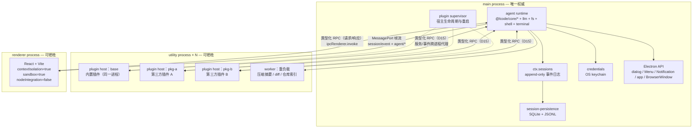
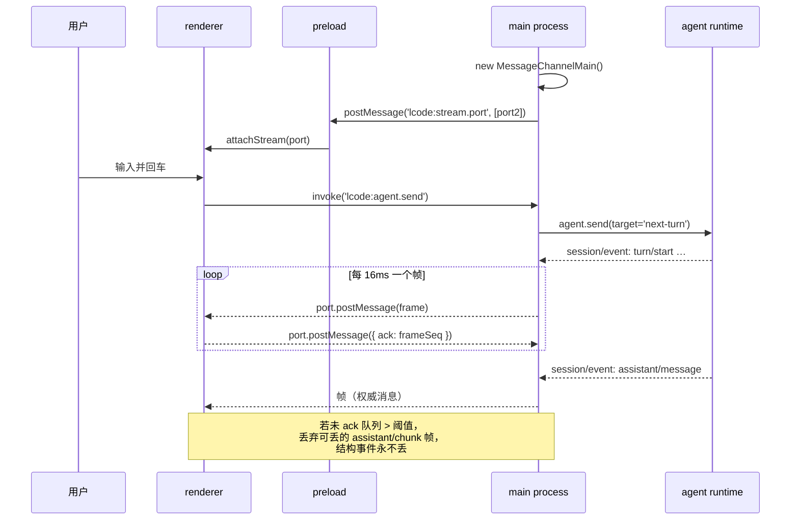
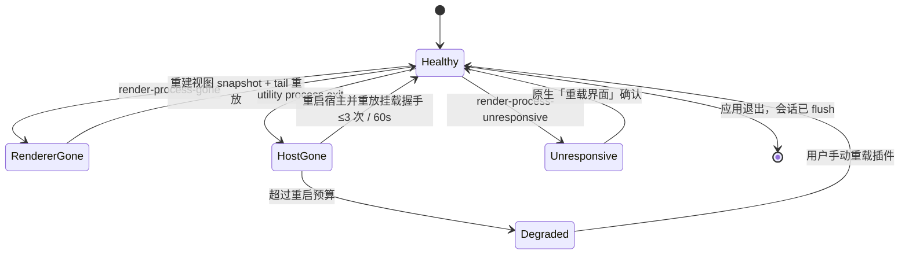
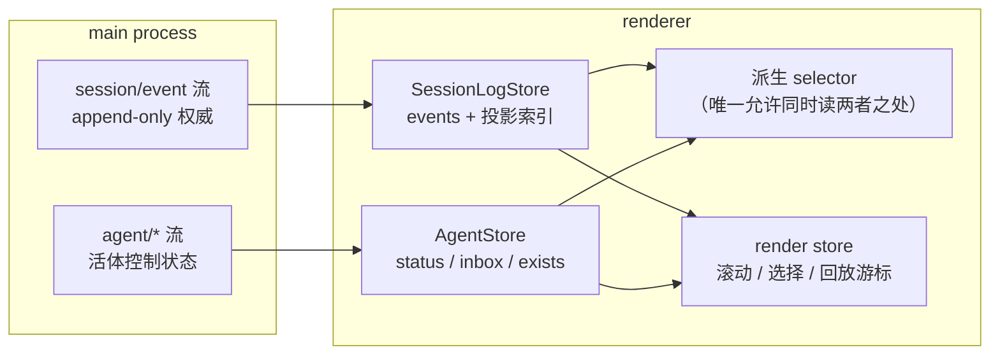
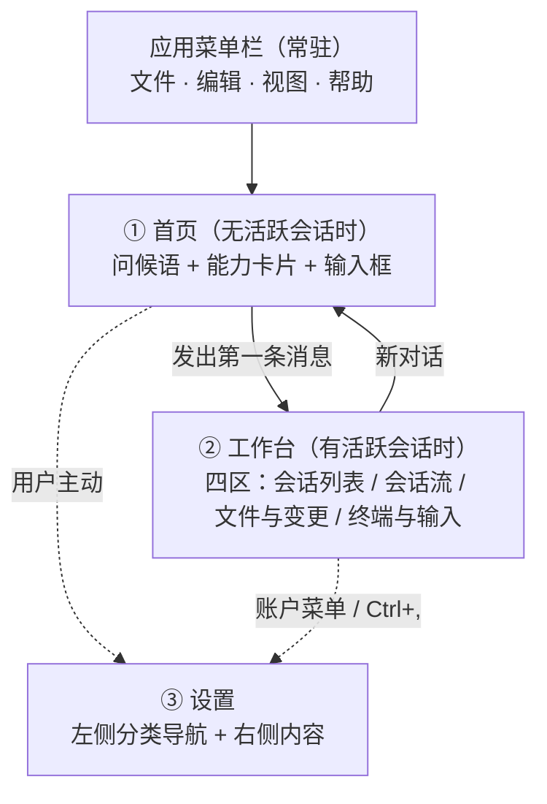
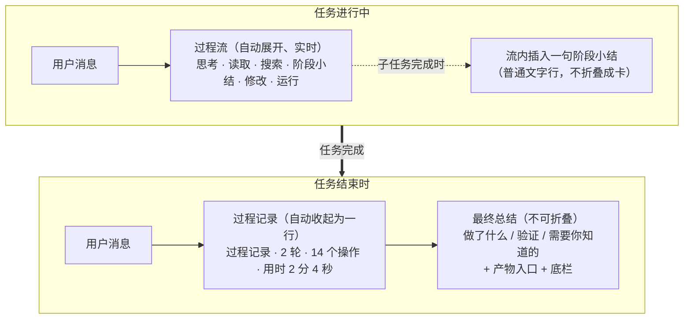
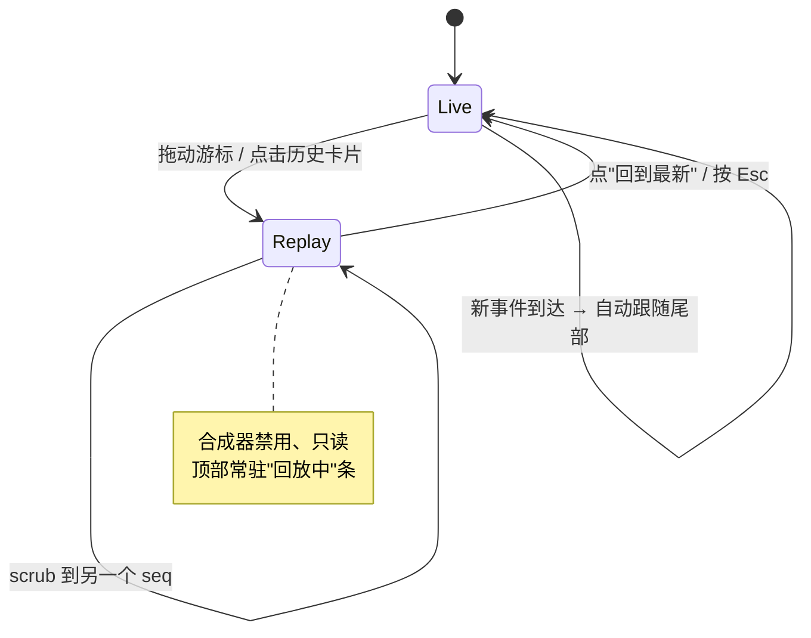
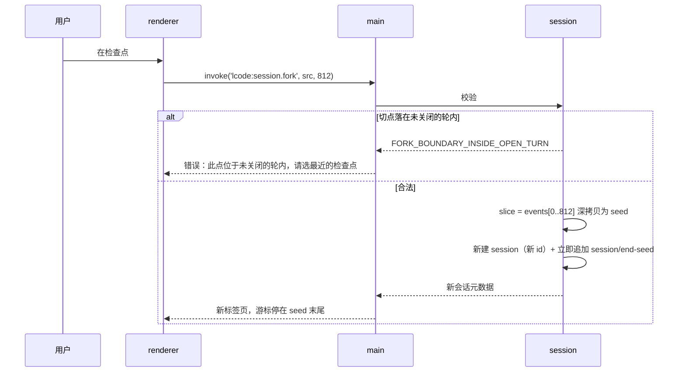
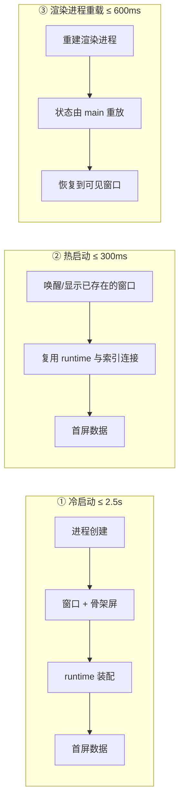

# 10 · 桌面客户端设计

> 本文回答：Lcode 的桌面客户端如何划分进程、如何在渲染进程消费事件、界面长什么样、时间轴回放与分叉怎么交互、性能预算怎么定。给客户端研发与交互设计看。

| 项 | 值 |
|---|---|
| 状态 | 草案 |
| 负责人 | 客户端研发 / 交互设计 |
| 上游依赖 | [00-文档总览与全局约定.md](./00-文档总览与全局约定.md)（D2/D3/D12/D14/D15/D16）· [05-系统架构设计.md](./05-系统架构设计.md) · [06-会话事件日志与可重放设计.md](./06-会话事件日志与可重放设计.md) · [07-插件内核与扩展点设计.md](./07-插件内核与扩展点设计.md) · [12-安全权限与沙箱模型.md](./12-安全权限与沙箱模型.md) |
| 下游被引 | [11-数据模型与持久化设计.md](./11-数据模型与持久化设计.md) · [13-插件SDK与协议设计.md](./13-插件SDK与协议设计.md) · [15-测试策略与质量门禁.md](./15-测试策略与质量门禁.md) |

## 目录

- [1. 范围与非目标](#1-范围与非目标)
- [2. 进程模型](#2-进程模型)
  - [2.1 三进程总览](#21-三进程总览)
  - [2.2 为什么 agent runtime 在 main process](#22-为什么-agent-runtime-在-main-process)
  - [2.3 为什么插件在独立 utility process](#23-为什么插件在独立-utility-process)
  - [2.4 IPC 通道设计](#24-ipc-通道设计)
  - [2.5 崩溃隔离与恢复](#25-崩溃隔离与恢复)
- [3. 状态管理](#3-状态管理)
- [4. UI 信息架构](#4-ui-信息架构)
- [5. 核心交互设计](#5-核心交互设计)
- [6. 设计系统](#6-设计系统)
- [7. 性能预算](#7-性能预算)
- [8. 无渲染降级：CLI 与协议模式](#8-无渲染降级cli-与协议模式)
- [未决问题](#未决问题)
- [变更记录](#变更记录)

---

## 1. 范围与非目标

本文覆盖：Electron 进程模型与 IPC、渲染进程状态管理、界面信息架构、六类**卡片**、审批、**时间轴**回放、分叉、计划模式、"为什么"面板、设计系统与性能预算。

**本文不覆盖**（由其它文档负责）：会话日志的物理格式与恢复契约（[11-数据模型与持久化设计.md](./11-数据模型与持久化设计.md)）；插件的加载与 RPC 描述符生成（[13-插件SDK与协议设计.md](./13-插件SDK与协议设计.md)）；沙箱实现（[12-安全权限与沙箱模型.md](./12-安全权限与沙箱模型.md)）。

**明确不做（本文范围内）**：

| 不做的事 | 为什么现在不做 |
|---|---|
| 文件系统级撤销 / revert | 见 [00-文档总览与全局约定.md §8.1](./00-文档总览与全局约定.md#81-可重放不等于能撤销)。可重放 ≠ 可撤销，MVP 只承诺前者 |
| 在渲染进程运行任何插件代码 | 与 D14 冲突；渲染进程必须假定它渲染的每个字节都是不可信内容 |
| 渲染进程直连模型 API | 所有模型流量必须经过 main process，否则凭据、审计、重放全部失守 |
| 远程 / 云端工作区 | 见 [00-文档总览与全局约定.md §3.3](./00-文档总览与全局约定.md#33-明确不是我们的用户v10) |
| 应用内插件市场 UI | v1.0 之后，见 [14-产品路线图与里程碑.md](./14-产品路线图与里程碑.md) |
| 多窗口共享同一会话（协同编辑式） | 单会话单窗口，开新窗口即分叉或 resume |

---

## 2. 进程模型

### 2.1 三进程总览

Lcode 桌面端使用 Electron 的三种进程角色：**main process**（唯一权威）、**renderer process**（视图）、**utility process**（插件宿主与重负载隔离）。



*这张图想让你看到：**唯一权威在 main process**；渲染进程与插件宿主都是可牺牲的；两者都不直接接触会话日志与凭据。*

| 进程 | 承载 | 生命周期 | 崩溃后果 |
|---|---|---|---|
| main process | 内核全部包、会话日志、持久化、凭据、窗口与原生 API、插件监督 | 与应用同生共死 | 会话从 JSONL 恢复（见 [11](./11-数据模型与持久化设计.md#6-崩溃恢复契约)） |
| renderer process | 仅 UI | 可重载 / 可崩溃 | 会话不受影响，UI 重建视图 |
| utility process（插件宿主） | 一个或多个**插件** | 可重启、可降级 | 该宿主的能力暂时消失，会话继续 |

### 2.2 为什么 agent runtime 在 main process

D2 明确「主进程承载 agent runtime」。这里给出它**必须**在 main，而不是 renderer、也不是 utility process 的理由。

**为什么不放 renderer process**

| 理由 | 说明 |
|---|---|
| 能力缺失 | 渲染进程启用 `contextIsolation: true` + `sandbox: true` + `nodeIntegration: false`，没有 `fs`、`child_process`、PTY、原生套接字。内核要 spawn 子进程（`ctx.subprocess`）、开 PTY（`ctx.terminals`）、读写文件（`ctx.fs`），这些能力在渲染进程里**不存在**，不是配置问题 |
| 安全模型冲突 | 渲染进程的输入是不可信的：模型输出、文件内容、网页抓取结果都会被渲染。把"能 spawn 进程"的运行时放进同一个 realm，等于把沙箱逃逸做成了架构默认值 |
| 视图必须是可丢弃的 | 渲染进程崩溃（OOM、GPU 驱动、React 未捕获异常）是常态。若会话运行在渲染进程内，一次 UI 崩溃 = 一次会话死亡，直接违反"长任务跑到一半崩了要能续"的产品诉求 |

**为什么不放 utility process**

| 理由 | 说明 |
|---|---|
| utility process 的设计意图就是"可牺牲" | 它是 Chromium 式的服务进程，我们把它留给**插件隔离**与**重负载卸载**，其恢复故事是"杀掉了重启"。会话权威的恢复故事完全不同——它持有日志，必须**存活**，不该放在一个我们计划随时杀掉的进程里 |
| Electron API 只在 main | `dialog`（审批原生弹窗、打开工作区）、`Menu`、`Notification`、`powerMonitor`、`app`、`BrowserWindow` 都只在 main 可用。审批与工作区选择是交互必需路径 |
| 凭据与持久化的落点 | OS keychain 访问与持久化协调器在 main；runtime 若在别处，每一次 append 都要多一跳 IPC |
| 单一权威 | 一个进程拥有 `ctx.sessions` 和"世界"，utility process 全部从属。避免"谁是真相"的二义 |

**这个选择的代价**：main process 的 event loop 被窗口管理、原生 API 与 runtime 共用。**硬性约束**：`agent/request`、`tools/*`、`session/event` 这些路径上**禁止同步阻塞**（同步 `fs`、大对象 `JSON.parse`、CPU 密集计算）。压缩摘要、diff 计算、仓库索引等重负载**必须**卸载到 worker / utility process，main 只做编排。压缩的完整语义见 [09-上下文工程与压缩策略.md](./09-上下文工程与压缩策略.md)。

### 2.3 为什么插件在独立 utility process

D14 的结论：**插件运行在独立 utility process，通过类型化 RPC 与内核通信**。理由是"Node 同进程无法做安全边界"——这不是性能偏好，是诚实性问题。

| 同进程方案 | 为什么不足以构成边界 |
|---|---|
| `Worker` thread | 共享 `process`、共享原生模块、共享内存可被原型污染；`worker_threads` 提供的是隔离而非安全 |
| `vm` / `vm2` | 已知逃逸路径众多；上游架构文档也明确"worker/vm 不是安全边界" |
| `require` 白名单 | 同一模块注册表；插件能拿到内核对象的引用，直接改内核状态 |

**唯一诚实的方案**：插件拿到它自己的 OS 进程、自己的堆、自己的模块注册表。内核与插件之间只存在**类型化 RPC**（D15，见 [13-插件SDK与协议设计.md](./13-插件SDK与协议设计.md)）。插件注册的**服务**、**事件**监听、**副作用**，全部作为跨进程代理挂到内核的 `ctx` 上；插件卸载 = 撤销器被调用 + RPC 通道关闭 + 进程（若无其它插件）退出。

**宿主分配策略**：

| 插件来源 | 宿主 | 理由 |
|---|---|---|
| 内置插件（`@lcode/*`） | 共享宿主 `plugin-host:base` | 减少进程数与冷启动开销；内置插件与内核同版本发布，信任级别等同 |
| 第三方已安装插件 | 默认每包一个宿主 | 一个插件崩溃/内存泄漏不影响其它插件 |
| 同作者插件组（用户显式 opt-in） | 可合并进一个宿主 | 用户自担风险，换取更少的内存与启动时间 |
| 同一**预设**的一次挂载 | 复用已有宿主 | 预设的 scope 只是 RPC 的路由维度，不产生新进程 |

代价要讲清楚：每个 utility process 约 30–50MB 常驻内存、冷启动 50–150ms。因此**默认不加载未使用的插件**，宿主按需 lazy 启动。

### 2.4 IPC 通道设计

IPC 分两类：**低频控制**走请求/响应，**高频事件流**走 `MessagePort`。**不能混用同一通道**。

#### 通道 A：控制类（请求/响应）

用 `ipcRenderer.invoke` / `ipcMain.handle`。这类调用频率低（用户点击级，< 10 次/秒），用默认通道足够。

`preload` 通过 `contextBridge.exposeInMainWorld` 暴露**白名单** API，renderer 拿到的只是一个冻结的普通对象，**拿不到 `ipcRenderer` 本身**：

```ts
// apps/desktop/src/preload/index.ts（示意）
import { contextBridge, ipcRenderer } from 'electron'

const api = {
  // 只读查询
  listSessions: () => ipcRenderer.invoke('lcode:session.list'),
  getSessionMeta: (id: string) => ipcRenderer.invoke('lcode:session.meta', id),
  // 一次性的 body 拉取：万级事件场景下渲染进程只持有元数据
  getEventBody: (id: string, seq: number) => ipcRenderer.invoke('lcode:event.body', id, seq),
  // 控制
  createSession: (req: CreateSessionReq) => ipcRenderer.invoke('lcode:session.create', req),
  send: (id: string, text: string, target: 'next-turn' | 'next-step') =>
    ipcRenderer.invoke('lcode:agent.send', id, text, target),
  cancel: (id: string, cause: 'user') => ipcRenderer.invoke('lcode:agent.cancel', id, cause),
  approve: (reqId: string, result: ApprovalResult) =>
    ipcRenderer.invoke('lcode:approval.answer', reqId, result),
  fork: (id: string, boundary: number) => ipcRenderer.invoke('lcode:session.fork', id, boundary),
  why: (id: string, callSeq: number) => ipcRenderer.invoke('lcode:trace.why', id, callSeq),
  openWorkspace: () => ipcRenderer.invoke('lcode:workspace.open'),
  // 事件流端口（见通道 B）
  attachStream: (cb: (port: MessagePort) => void) => {
    ipcRenderer.on('lcode:stream.port', (e) => cb(e.ports[0]))
  },
} as const

contextBridge.exposeInMainWorld('lcode', Object.freeze(api))
```

**白名单纪律**：主进程侧每个 `handle` 都必须校验 `sessionId` 与调用方 `webContents`，并且**只接受结构化可序列化参数**。任何形如 `invoke('lcode:raw', channel, ...)` 的通用转发一律禁止——那就是把 `ipcRenderer` 又漏回去了。

#### 通道 B：事件流（`MessagePort`）

`session/event` 与 `agent/*` 在流式输出时可达**每秒数百条**（每个 `assistant/chunk` 一条）。若用 `ipcRenderer.on` 逐条直连：

- 每条事件都是独立的跨进程结构化克隆消息，序列化与调度开销按条计费；
- 与控制类 `invoke` 抢占同一条 IPC 队列，用户点击"取消"会被 token 流挤到后面；
- 无法施加背压：渲染进程卡住时，主进程只能堆积或阻塞。

因此改为：main 建 `MessageChannelMain`，把 `port2` 通过 `webContents.postMessage('lcode:stream.port', null, [port2])` 转移给渲染进程（`preload` 收到后交给 UI 层），此后所有事件帧走这条**专属**通道。



*这张图想让你看到：控制与服务流走两条独立通道；token 帧按 16ms 批量；背压靠 ack 与"只丢可丢帧"实现。*

**帧格式与批量策略**：

| 项 | 值 |
|---|---|
| 帧频率 | 每 16ms 一个帧（对齐 60fps 的渲染节奏） |
| 帧上限 | 64KB；超出则拆为多帧，或在超过 256KB 时改为"送元数据 + 惰性拉取 body" |
| 事件排序 | 帧内保持 `seq` 升序；帧间严格递增 |
| 大 payload | `tool/result` 的 body 不进帧，只送 `{ seq, size, kind }`；渲染进程按需 `invoke('lcode:event.body')` |

**背压与丢帧规则**（关键）：

- 渲染进程每收到一个帧回一个 `ack`。main 维护"未 ack 字节数"。
- 未 ack 超过阈值（默认 4MB 或 500 帧）时，**只允许丢弃 `assistant/chunk` 帧**——它是纯日志事件，权威的 `assistant/message` 随后必到，丢帧只影响"逐字动画"的平滑度，不影响最终正确性。
- `turn/*`、`step/*`、`tool/call`、`tool/result`、`user/message`、`assistant/message`、`todo/write` 等**结构与表面事件永不丢弃**；队列对它们无界（它们天然低频）。
- 未 ack 超过硬上限（默认 32MB）视为渲染进程失联，走 §2.5 的渲染进程恢复路径。

规则与 [06-会话事件日志与可重放设计.md](./06-会话事件日志与可重放设计.md) 一致：**渲染进程的"缺帧"永远可以从日志按 `seq` 补齐**，因为日志才是真相。

### 2.5 崩溃隔离与恢复



*这张图想让你看到：渲染进程与插件宿主的任何异常都不会进入"会话失败"状态；唯一的终局是应用退出。*

**渲染进程崩溃不杀死会话**

会话由 main process 持有，渲染进程只是**其中一个视图**。崩溃时：

1. main 收到 `render-process-gone`，**不做任何会话侧动作**；runtime、日志、正在跑的**轮**照常。
2. UI 重载后，渲染进程走"冷启动拉取"：`invoke('lcode:session.meta')` 拿到 `{ lastSeq, header }`，再 `invoke('lcode:session.history', { from: lastSeq - N })` 拉最近窗口，然后重新 `attachStream` 接上 tail。
3. 若崩溃发生在回放态，回放游标（一个 `seq`）本身是 UI 状态，丢失后回到实时态——**这是可接受的**，因为回放只是观察。

**渲染进程无响应（hang）**：用 `render-process-unresponsive` 事件弹**原生**提示（此时页面已无法渲染提示），提供"等待 / 重载界面"。重载 = 同上冷启动拉取。

**utility process 崩溃要能重启并恢复**

宿主由 main 里的 `plugin supervisor` 管理：

1. 监听 `utilityProcess` 的 `exit`。
2. 在**同一次会话**内重启宿主（退避：0ms / 500ms / 2000ms，60 秒窗口内最多 3 次）。
3. 重启后**重放挂载握手**：把该预设下这个宿主负责的插件重新挂载、重注册服务与工具、重订阅事件。由于挂载是幂等的（每个**预设**只挂载一次），重复握手不会产生重复注册。
4. 该宿主崩溃时**正在执行**的工具调用，由内核**合成失败结果**：写入一条带错误码 `PLUGIN_HOST_UNAVAILABLE` 的 `tool/result`。这保证了 tool-call / result **配对完整**，与 [11-数据模型与持久化设计.md §6](./11-数据模型与持久化设计.md#6-崩溃恢复契约) 的恢复契约同源。
5. 超过重启预算 → 该挂载标记为 **degraded**：UI 在状态栏显示"某插件不可用（已重试 3 次）"，其余能力继续工作；会话**不中断**。
6. 每次崩溃与重启都写一条诊断事件，进"为什么"面板与系统日志，**不清零、不静默**。

**main process 崩溃**：这是唯一需要磁盘恢复的场景，契约见 [11-数据模型与持久化设计.md](./11-数据模型与持久化设计.md#6-崩溃恢复契约)。客户端侧只负责：崩溃后重启、提示"上次会话已恢复至最后一次 flush"、把用户带回原会话。

---

## 3. 状态管理

### 3.1 两类数据源，不要混

渲染进程消费**两类语义完全不同**的数据：

| 数据源 | 事件 | 性质 | 是否持久 | 用途 |
|---|---|---|---|---|
| **数据** | `session/event` 流：`turn/*`、`step/*`、`user/message`、`assistant/chunk`、`assistant/message`、`tool/call`、`tool/result`、`todo/write` | append-only、有序、权威、可重放 | 是 | 渲染"发生过什么"：token 流、**轮**/**步**边界、工具活动、待办、计划 |
| **控制状态** | `agent/*`：`agent/created`、`agent/disposed`、`agent/status`、`agent/inbox/inserted`/`claimed`/`discarded`/`spliced` | 活体、可合并、非持久 | 否 | 渲染"此刻在做什么"：`idle` / `running`、inbox、存在性 |

**为什么不要混**：它们是两个不同的时间语义。

- 从 `session/event` **推不出**"现在是否 running"。日志是事实的编年史；崩溃后日志里会留下一个没有 `turn/end` 的**轮**，但那个 agent 早已不在。用日志算状态，崩溃后必然显示"假装还在跑"。
- 从 `agent/*` **重建不出历史**。它不进日志、会被合并（比如 `agent/status` 连续 `idle→running→idle` 只保证最后一个可见）、且进程重启后清零。用控制状态画历史，就是幻觉。



*这张图想让你看到：两个 store 各自只接一条数据源；只有 selector 层被允许同时读它们，且 selector 是纯函数、不写回。*

**硬性规则**：

- `SessionLogStore` 的 reducer **不读** `AgentStore`；反之亦然。
- 任何同时依赖两者的值（例如"当前这一轮还在跑"）只在 selector 里计算，**不落库**。
- 不存在"从日志推断 agent 状态"或"从 agent 状态造历史"的代码路径；CI 用 grep 守这条线（禁止 `AgentStore` 出现在日志 reducer 文件里）。

### 3.2 Store 设计

用 **Zustand**（轻量、无 Provider、selector 订阅天然适合虚拟列表），配一个自建**事件 reducer**。

```ts
// --- 1) 日志 store：分块向量，避免每帧 O(n) 复制 ---
const BLOCK = 1024

interface SessionLogStore {
  blocks: SessionEvent[][]          // blocks[i][j] = 第 i*BLOCK+j 个事件，seq 连续
  count: number
  surfaceGeneration: number         // surfaceOp 改写过 surface 时自增（压缩会改）
  append(events: SessionEvent[]): void
}

// 追加是 O(1)：写最后一个 block，满了才 push 新 block
function append(store: SessionLogStore, evs: SessionEvent[]) {
  for (const e of evs) {
    const b = store.blocks[store.blocks.length - 1]
    if (b.length === BLOCK) store.blocks.push([e])
    else b.push(e)
    store.count++
    if (e.surfaceOp && e.surfaceOp !== 'append') store.surfaceGeneration++
  }
}
```

分块向量解决三个问题：**追加 O(1)**（不是每帧复制 10 万元素的数组）、**随机访问 O(1)**（`blocks[seq >> 10][seq & 1023]`）、**订阅粒度到块**（某块变了只通知订阅该块的组件）。

派生投影（消息历史、待办、计划、工具卡片状态、检查点列表）是**纯函数 + 记忆化**：

```ts
// 只依赖事件与 surfaceGeneration；surface 未改写时增量投影
const selectMessages = memo1((log: SessionLogStore) =>
  deriveMessages(log.blocks.flat(), log.surfaceGeneration))

// 工具卡片：tool/call 建 pending 卡片，tool/result 以同一 callId 收口
const selectToolCards = memo1((log: SessionLogStore) =>
  foldToolCards(log.blocks.flat()))
```

**流式更新的性能要点**：`assistant/chunk` 只影响"最后一行"。用 `useStore(s => lastChunk(sessionId))` 订阅最后一个 chunk 的引用；追加 chunk **不改变**任何已渲染行的引用，React 只重渲那一行。

```ts
interface AgentStore {
  byId: Record<SessionId, {
    status: 'idle' | 'running'
    inbox: { nextTurn: UserMessage[]; nextStep: UserMessage[] }
    exists: boolean
    lastEventTime: number          // 用于"运行中但 30s 无事件"的超时提示
  }>
}
```

`agent/status` 与 `agent/inbox/*` 都是**可合并**通知：连续的状态变更只保留最后一个，inbox 用 `agent/inbox/spliced` 的归一化增删改坐标**直接重建列表**（这正是该事件存在的意义），不用逐条 `inserted/claimed/discarded` 重放。

### 3.3 虚拟列表（万级事件）

**目标：10 万事件下滚动 60fps，同时渲染的 DOM 节点 ≤ 40 个。**

| 决策 | 做法 | 理由 |
|---|---|---|
| 行模型 | 一行 = 一个渲染单元（一条消息 / 一张**卡片** / 一个**轮**分隔 / 一个**步**分隔 / 一条压缩标记） | 事件到行是多对一（一个 step 的 N 个 chunk 合成一个流式行） |
| 虚拟化 | 自建窗口化（或 `@tanstack/virtualize`），按"行高度估算 + 实测缓存" | 行高差异极大：一行代码 diff 可能 800px，一个分隔 24px |
| 高度缓存 | `Map<eventSeq, { height, widthBucket }>`，`ResizeObserver` 实测后写回 | 宽度变化（窗口缩放、右栏开合）会让换行数变，必须按宽度分桶 |
| 键 | 一律用 `seq`，**绝不用 index** | append-only 下 index 会因插入分隔行而漂移 |
| 反向滚动稳定性 | 记录首个可见行的 `seq` 作锚点，前面插入内容时按锚点补偿 `scrollTop` | 流式追加在底部，但**回放**会改变渲染范围，锚点必须有 |
| overscan | 上下各 8 行 | 兼顾滚动空白与渲染成本 |
| 大 body 惰性化 | 会话超过 5 万事件后，渲染进程只保留元数据 + `bodyRef`；正文按需 `invoke('lcode:event.body')` | 10 万事件的 `tool/result` 正文可轻易超过 1GB，不能全进渲染进程内存 |
| 长行保护 | 单个 diff / terminal 卡片超过 2000 行时默认折叠，展示前 200 行 + "展开全部" | 防止一张卡片拖垮布局与测量 |

**流式渲染节流**：`assistant/chunk` 帧到齐后不立刻 setState，而是累积到下一次 `requestAnimationFrame` 统一提交；即"每帧一次提交"。这保证了首 token 延迟与滚动流畅度都达标（见 §7）。

---

## 4. UI 信息架构

### 4.0 三个视图：首页 / 工作台 / 设置（v0.2 新增）

主窗口有三个互斥视图，外加一层常驻的应用菜单栏：



> **这张图想让你看到什么**：**首页是默认视图，设置是旁路。** 系统绝不主动把用户推向设置——尤其是首次启动时。这与"先让人用起来，再让人配置"的取向一致（[19 §1.3](./19-原型与交互规格.md#13-三条界面设计取向v02-新增)）。

**三条结构规则**：

| # | 规则 | 理由 |
|---|---|---|
| 1 | 侧栏（新对话 + 项目分组的会话树 + 底部账户与设置入口）在首页与工作台**共用**，位置与内容不变 | 视图切换时用户的空间记忆不被打断 |
| 2 | 应用菜单栏**常驻**，四个菜单的项沿用桌面惯例命名 | 用户不用学新的导航方式 |
| 3 | **首次启动直接进首页**，不做任何配置引导 | 见 [19 §3.1](./19-原型与交互规格.md#31-p1--首页新对话) |

### 4.1 主窗口布局（工作台视图）

```
┌───────────────┬───────────────────────────────────────────────┬──────────────────────┐
│ 会话列表       │  agent 流（时间轴主视图）                        │ 文件与变更            │
│ (Session List)│                                               │ ┌──────┬──────┐       │
│               │  ┌── 轮 #3 ──────────────────────────────┐     │ │ 变更 │ 文件 │       │
│ ▸ ws: web-app │  │ ⬤ 你  把这个函数改成 async             │     │ └──────┴──────┘       │
│   ● 修登录态   │  │                                        │     │  src/auth.ts    +12 -4│
│     2 分钟前   │  │ ⬤ Lcode  好的，我先读一下文件          │     │  src/api.ts     +3  -0│
│   ○ 加单元测试 │  │   ┌────────────────────────────┐       │     │  pkg.json       +1  -1│
│     1 小时前   │  │   │ read  src/auth.ts  ✓ 42ms  │       │     │                       │
│               │  │   └────────────────────────────┘       │     │ ── 预览 ──            │
│ ── 归档 ──     │  │   ┌────────────────────────────┐       │     │ @@ -12,6 +12,9 @@    │
│   ...         │  │   │ diff  src/auth.ts  ✓ 8ms   │       │     │ -async function …    │
│               │  │   │ @@ -12,6 +12,9 @@          │       │     │ +async function …    │
│ [+ 新建会话]   │  │   └────────────────────────────┘       │     │                       │
│               │  │ ⬤ Lcode  已完成修改                     │     │                       │
│               │  └────────────────────────────────────────┘     │                       │
├───────────────┼───────────────────────────────────────────────┼──────────────────────┤
│               │ ▸ 终端（2） bash npm run dev · running   ▸ 后台任务（1） job #7      │
│               ├───────────────────────────────────────────────┤                      │
│               │ [计划模式]  输入消息…            [模型: ds-v4] [发送 ⏎]             │
└───────────────┴───────────────────────────────────────────────┴──────────────────────┘
```

*这张图想让你看到：四区各司其职；底部终端抽屉与输入框都**只在中间会话栏内**，不与左栏、右栏抢横向空间（见 §4.3 规则 4）。*

> **v0.5 修正**：v0.4 的输入框横跨整个窗口宽度，视觉上压到左右两栏之上。现在输入框与终端抽屉都属于**中间会话栏**（`.mid`），左栏（会话列表）与右栏（变更/文件）各自占满纵向高度。
>
> **v0.10 补充**：会话区与输入框之间新增常驻状态条（`.turnstrip`，高 28px、下滑一半压住输入框上缘，上边缘 20px 渐隐）。状态条放本轮任务清单与修改文件芯片（默认一行，悬停浮出列表）；上翻离开底部时「回到底部」箭头排在芯片右侧，没有芯片时居中。

### 4.2 四区职责

**左 · 会话列表**

| 项 | 说明 |
|---|---|
| 内容 | 按工作区分组；每项显示标题（首条消息摘要或手动命名）、相对时间、状态点、预设名 |
| 操作 | 新建 / 重命名 / 归档 / 删除（软删，见 [11](./11-数据模型与持久化设计.md#9-数据规模与保留)）/ 搜索 / 按工作区筛选 |
| 状态点 | ● 运行中（蓝）/ ○ 空闲（灰）/ ⚠ 降级（琥珀，插件不可用）/ ✕ 失败（红） |
| 硬性 | 列表项的状态点**只**来自 `AgentStore`，不来自日志 |

**中 · agent 流（主视图）**

| 项 | 说明 |
|---|---|
| 内容 | **轮**分隔、用户消息、assistant 消息（含流式）、六类**卡片**、审批条、计划卡片、压缩标记、错误条 |
| 交互 | 滚动 / 回放到任意**检查点** / 从任意点分叉 / 点击卡片打开**为什么**面板 / 点 diff 卡片跳到右栏文件 |
| 硬性 | 主视图是**只读渲染**；所有"改状态"的动作都走底部输入栏或卡片上的显式按钮 |

**右 · 文件与变更**

| 项 | 说明 |
|---|---|
| 变更页 · 本轮改动 | 本会话累计的文件变更树（来自各 diff **卡片**的 `presentationMeta`，**不是**文件系统扫描），按文件聚合 +/− 行数 |
| 变更页 · Git 工作区 | `git status` 的当前工作区状态：staged / unstaged / untracked / 冲突，可手动刷新；与“本轮改动”分开显示，避免把磁盘现状混进可回放历史 |
| 文件页 | 工作区文件树：Git 仓库用 `git ls-files -co --exclude-standard` 产出清单（由 git 解释 `.gitignore`，不会出现 node_modules/构建产物），非仓库退化为目录遍历（只过滤 `.git`/`node_modules`）；目录懒展开、文件行带 Git 状态字母、目录行用圆点聚合子孙改动（按冲突 > 修改 > 重命名 > 新增/未跟踪 > 删除取色）；点击文件就地展开只读预览（256KB 截断、二进制识别，路径经 realpath 校验必须落在工作区内） |
| 联动 | 双向：点变更 → 流内对应 diff 卡片高亮并滚动到位；点流内 diff → 右栏定位该文件 |

关于"本轮改动来自卡片而非文件系统"这一点要说清：这是"**模型可见即可重放**"在 UI 上的直接体现——回放一个历史**检查点**时，本轮改动显示的是**当时**的变更集合，而不是磁盘现在的状态。Git 工作区是**实时磁盘状态**，不属于回放内容；回放/历史视图不得用它替代当时的 diff 卡片。

底部状态栏的分支名是**可交互入口**：点击列出本地分支并切换。切换前做 dirty-tree 预检，有未提交文件时用应用内确认；Agent 运行中禁止切换，未信任工作区也会拒绝。分支切换不会自动 stash 或丢弃改动，冲突时由 git 拒绝。

Git 工作区的文件行可点击展开文本 diff：显示旧/新行号、+/− 行和 hunk 头；暂存与未暂存同时存在时分两段，未跟踪文件按“新文件”展示，二进制或超大 diff 给出明确提示。它与本会话改动一样只是**查看**，不提供暂存/丢弃/提交按钮。

三栏宽度可拖动调整：左栏 180px 起、右栏 220px 起，二者最大均为窗口宽度的 1/3；拖过最小值直接收起（顶部按钮可重新展开，宽度回到最小值）。拖动时显示当前宽度和最小/最大范围，宽度存本机 localStorage，中央会话区随 flex 自动调整。

**底 · 终端抽屉**

| 项 | 说明 |
|---|---|
| 内容 | 本会话拥有的持久 PTY 标签页（`ctx.terminals`，**作用域**是 owner agent）+ 后台任务输出标签页（`ctx.jobs`） |
| 交互 | 展开 / 折叠 / 切换标签 / 关闭 / 全屏；抽屉折叠时显示"运行中的终端数与耗时" |
| 与流的关系 | 流里的 `terminal` **卡片**是一次性的前台调用；抽屉里的是长期存在的会话。两者不共享缓冲区 |
| 硬性 | 抽屉里的输入只发往 PTY，**不经过模型**；要交给模型必须显式复制/引用 |

### 4.3 对话流的密度规则（v0.4 新增，v0.5 修订）

工作台会话流是用户停留最久的界面。目标是"**过程可查，结论清爽**"——任务结束时，屏幕上应该只剩"提问 + 最终总结"。



> **这张图想让你看到什么**：**折叠是过程态的特征，不是结果态的特征。** 任务是"活"的时候过程展开；任务"结束"之后过程整体收起，最终总结成为唯一正文。

| # | 规则 | 规格 |
|---|---|---|
| 1 | **折叠只发生在过程里** | 思考、读取、搜索、修改、运行这些中间动作全部收在**过程流**这一个容器内。**任务进行中**：过程流自动展开、当前动作行高亮（shimmer 文本）。**子任务完成时**：在流内插入一句**阶段小结**（普通文字行，如"改完了，测试也过了；但类型定义在工作区外面，需要你确认。"），不单独成卡。**任务结束时**：过程流整体收起为**一行**（`过程记录 · 2 轮 · 14 个操作 · 用时 2 分 4 秒`），随时可展开回看全部细节 |
| 2 | **最终总结不可折叠** | 任务完成时产出，是这一轮的**唯一正文**；出现即**覆盖前面全部折叠**（过程收进第 1 条那一行）。头部是静态的 `✓ 任务完成 · 用时 N`（**没有折叠箭头**，因为它不是可折叠项）。正文三段式：**做了什么** / **验证** / **需要你知道的** |
| 3 | **产物一键可达** | 总结卡底部固定两个入口：`查看本轮所有产物 (N)` / `查看本轮所有变更 (N)`，点击聚焦右栏并把变更页**过滤到本轮**。变更数据来自各工具结果的 `presentationMeta`，**不是**文件系统扫描（回放时显示当时状态） |
| 4 | **输入区属于会话栏** | 输入框（composer）只位于**中间会话栏底部**，宽度与内容列对齐。**不跨到左侧工作区与右侧变更栏上方、不遮挡它们**。理由：三栏是三个独立工作面，一条横跨全窗的输入条会让人误以为"输入作用于整个窗口"，并在窄屏下压掉右栏可读区域 |

**三级密度**（过程流内部，逐级深入）：

| 层级 | 形态 | 何时出现 |
|---|---|---|
| L1 收起 | 一行摘要（耗时 + 操作数） | 任务结束后的默认态 |
| L2 紧凑行 | 每行：图标 + 动词 + 目标 + 耗时/结果摘要 | 展开过程流时 |
| L3 行详情 | 该次调用的完整卡片（正文 / 搜索结果 / diff） | 再点单行才出现 |

**反模式**：① 任务结束后过程仍展开（对话流变成日志墙）；② 最终总结做成可折叠（用户点一次就看不到结论了）；③ 阶段小结单独做成卡片（过程里应该只有"行"这一种粒度）；④ 总结里复述每一个操作（那是过程流的职责）；⑤ 产物入口跳到文件管理器而不是"本轮变更"视图；⑥ 折叠状态写进日志（它是纯 UI 状态）；⑦ 输入框横跨整个窗口宽度。

---

## 5. 核心交互设计

### 5.1 工具调用卡片

**卡片**是工具调用的 UI 渲染意图（术语见 [00 §6](./00-文档总览与全局约定.md#6-术语表)）。由 D8，卡片是**规范值**的纯投影：同一份值同时服务模型与 UI，二者不可能分叉。

> **v0.4 密度修订**：卡片不再以完整形态直接出现在对话流里——它们被收进**工作过程折叠组**（§4.3 规则 1）：组收起时只有一行摘要；展开时每次调用是**一个紧凑行**；本节的完整卡片形态只在"单行再展开"的详情位、以及"为什么"面板中出现。卡片的**数据结构不变**，变的是默认展示层级。

| 类型 | 触发 | pending 态展示 | completed 态展示 |
|---|---|---|---|
| `generic` | 无专用渲染器的工具 | 工具名 + 参数摘要（折叠的 JSON）+ 运行指示 | 规范化 JSON（树形可折叠）+ 耗时 + 错误码（若有） |
| `terminal` | 前台 shell 调用 | 命令行（等宽、语法高亮）+ cwd + 计时器 + 取消按钮 | stdout/stderr（ANSI 转 span）+ `[exit code: N]` 胶囊 + 耗时；后台变体显示 `jobId` |
| `diff` | `write` / `edit` | 文件路径 + "将新建/将修改"（**无内容**，因为此刻还不知道旧内容） | 统一 diff + 双行号 + 语法高亮 + 行内词级高亮 + 折叠控件 |
| `search` | 代码/文本搜索 | 查询词 + 范围 glob + 扫描指示 | 结果数 + 按文件分组 + 命中行与列高亮，点击跳转到对应 `read` 卡片或编辑器 |
| `read` | 文件读取 | 路径 + 行范围 | 等宽正文 + 行号 + 截断提示（`+N 行`）+ 展开（按 `seq` 拉全文）；若被 spill 截断则标注 locator |
| `web` | 搜索 / 抓取 | 查询词或 URL + 取回指示 | 搜索：标题/URL/摘要/域名胶囊；抓取：页面标题 + 抽取正文节选 + 域名 + 抓取时间 |

**pending 与 completed 的核心差异**（三条，必须一致）：

1. **可用信息不同**。pending 只有参数，completed 才有**规范值**。因此 `write` 的 pending 卡片**不能**显示 diff——调用时刻尚无旧内容。这直接来自工具定义：pending 用 `oldText: null` 构造，completed 才从 `presentationMeta` 里的 hunks 重建。
2. **视觉状态不同**。pending 是**不确定进度**（动画条 / 计时器），completed 是**确定结果**（耗时 + 结果体 + 成功/失败色）。
3. **可操作性不同**。pending 有"取消"；completed 有"复制"/"在编辑器中打开"/"为什么"。

**diff 卡片的行内折叠**：

```
┌ src/auth.ts ────────────────────────── +12 −4 ── [展开 3 行 ▾] [⋯] ┐
│ 10  10 │ import { sign } from '../jwt'                              │
│ 11  11 │                                                           │
│ 12  12 │ export function login(user: User) {                       │
│    ⋯   │ ⋯ 隐藏 8 行相同内容（点击展开）                             │
│ 21  13 │-async function verify(token: string) {                    │
│    14 │+async function verify(token: string, opts?: VerifyOpts) {   │
│ 22  15 │   return jwt.verify(token, SECRET)                          │
│ 23  16 │ }                                                           │
└──────────────────────────────────────────────────────────────────────┘
```

| 规则 | 值 |
|---|---|
| 默认上下文 | 每个 hunk 前后各保留 3 行 |
| 折叠阈值 | 连续未变更 > 6 行 → 折叠为 `⋯ 隐藏 N 行`，提供"展开 3 / 展开 10 / 展开全部" |
| 大文件默认 | 单文件变更 > 40 行时**默认整体折叠**，只显示文件名 + `+/−` 摘要条 |
| 词级高亮 | 同一行成对增删时，只高亮改动的词，而非整行 |
| 折叠状态 | 存于 render store（纯 UI 状态），**不进日志** |
| 复制 | 复制的是**原始 diff 文本**，不是带行号的渲染结果 |

### 5.2 审批弹窗

**什么触发**：内核的 `tools/pre-execute` **瀑布**返回 `{ kind: 'ask' }`，工具流水线调用 `ctx.approval.request(...)`。应答者是 `approval/request` 的监听器；**缺应答者即 `unavailable`（fail-closed，D11）**。

**展示什么**（三段，缺一不可）：

| 段 | 内容 | 例子 |
|---|---|---|
| **操作** | 工具名 + 规范值的意图化渲染（不是原始 JSON） | `bash`："将执行：`rm -rf node_modules && npm ci`"，cwd 与作用域 |
| **依据** | 哪条策略要求审批，以及为什么没有自动放行 | "当前预设 = 标准；`bash/write` 类操作在标准预设下一律询问" |
| **影响面** | 会被触碰的资源：工作区外路径、网络域名、进程范围、沙箱是否被放宽及放宽到哪一档 | "写入 `~/.npmrc`（**工作区外**）；联网：`registry.npmjs.org`；沙箱：放宽为『允许网络』" |

**四个结果**（与 `ctx.approval.request` 的类型一致）：

| 结果 | 语义 | 何时产生 | 工具侧后果 |
|---|---|---|---|
| `allowed-once` | 仅本次允许 | 用户点了"允许这一次" | 执行，写一条带审批凭据的 `tool/result.meta` |
| `rejected` | 用户明确拒绝 | 用户点了"拒绝" | 不执行，写一条**类型化拒绝结果**（不是 `isError` 崩溃） |
| `cancelled` | 问题作废 | **轮**被中止、会话被取消、用户点了"全部取消" | 不执行，结果标记为已取消 |
| `unavailable` | 无人应答 | 无监听器 / headless 无 TTY / 子代理尝试提问 | **拒绝**（fail-closed） |

**为什么是"一次性批准"而不是"记住选择"**：

1. **权限是每次执行的能力，不是存储的布尔值**。"记住"把一次策略决策坍缩成一个**隐藏授予**，它可能跨**轮**、跨**步**甚至跨会话泄漏，直接违反"可解释优先于聪明"。
2. **"记住"需要一个稳定的动作身份，而它在一般情况下不可判定**。同一条 `rm -rf` 配不同 cwd、不同路径、不同沙箱档位，影响面完全不同。为"记住"造一个指纹，就是在造一个会被绕过的指纹。
3. **要"永久"就显式换预设**。用户真要长期放行，切换 `permission-presets` 预设即可——它写一条持久的 `permissionPresets/preset` 事件，**有作用域、可审计、可撤销**。用户看到的是一个概念，底层是"沙箱档位 + 审批策略"两个轴。
4. **不阻塞整个会话**。审批只阻塞**受影响的那次工具调用**；其它**步**、其它工具、其它会话照常。若同一时刻有多个待审批，弹窗排队并显示"还有 N 个等待"，提供"全部拒绝"。

### 5.3 时间轴回放（Timeline Replay）

这是 Lcode 的拳头功能（产品宪法第一条）。

**用户如何 scrub 到任意一步**：**时间轴**是一条以 `seq` 为横轴的轨道，拖动游标即选中一个 `seq`；UI 用该 `seq` 的**前缀**重新**派生**整个世界。轨道上的**检查点**（通常是**轮**边界）是可吸附的稳定点，`⌥←` / `⌥→` 在检查点间跳转。



*这张图想让你看到：只有两个状态，且从回放回实时是**显式**动作；回放态下新事件不会把视图拖走。*

**看到当时确切的输入输出**：给定游标 `seq = S`，回放重建：

| 维度 | 来源 |
|---|---|
| 消息**表面** | 对 `events[0..S]` 跑 `deriveMessages()`，含 `surfaceOp: replace`（所以能回放**压缩前还是压缩后**两种历史） |
| 每张卡片的 pending/completed | 在该前缀里找 `tool/call` 与配对的 `tool/result`；没有 result 就是 pending |
| 待办快照 | 该前缀里最后一条 `todo/write` |
| 计划 | 该前缀里的计划卡片事件 |
| 右栏变更集合 | 该前缀里各 diff 卡片的累积 |
| **chunk 级细节** | 实时态把 chunk 折叠成最终消息；**回放态**可以展开看 `assistant/chunk` 的原始序列——这是实时态看不到的保真度 |

**回放态与实时态的视觉区分**：

| 元素 | 实时态 | 回放态 |
|---|---|---|
| 顶部 | 无 | 常驻**琥珀色**"回放中"条：`回放 @ #1234 · 2026-09-10 14:03:22` |
| 合成器 | 可用 | **禁用**，占位文案"回放中不可发送，如需从此处继续请分叉" |
| 时间轴 | 贴底、随新事件增长 | 常驻为轨道，游标可见，显示"距最新 N 条" |
| 背景 | 正常 | 页面轻度降饱和（`filter: saturate(.85)`），提示"这不是现在" |
| 状态点 | 跟随 `AgentStore` | 冻结在游标处（显示当时的 pending 态） |

**回放态为什么不允许发消息**：

1. 发送是**对尾部**的追加操作。在游标处于 `S` 时发送，语义上二义：这条消息的逻辑位置是 `S` 之后，还是日志尾部？两种解释都自洽，因此**两种都错**。
2. 回放是**观察**能力，不是**变更**能力（[00 §8.1](./00-文档总览与全局约定.md#81-可重放不等于能撤销)）。允许在游标处写入，会把"观察"偷换成"编辑历史"，直接违反产品宪法第一条与第四条。
3. 从过去某点继续，是一个**不同的、更有力的操作**：**分叉**。它产生新会话、有新 id、走种子机制、全程可审计。把两者混在一个按钮里，用户就分不清"我只是看看"和"我要改历史"。

**回放遇到读不懂的事件**：若前缀里存在**不认识且未标 `ignorable`** 的事件类型，回放**拒绝渲染**并提示"此会话由更新版本的 Lcode 写入，请升级"，而不是尽力渲染出一段错误历史。宁可拒绝，不要欺骗。

### 5.4 从任意点分叉（Fork）

**交互流程**：



*这张图想让你看到：分叉是"按 seq 切前缀 + 追加分界线"，源会话完全不动；非法切点是**报错**而非静默裁剪。*

**后端语义**（契约，细节见 [06-会话事件日志与可重放设计.md](./06-会话事件日志与可重放设计.md)）：

- 切点 = `seq`，取闭区间 `[0, boundary]` 作为**种子**（`seed`），深拷贝事件。
- 校验：切点**不得落在未关闭的**轮**内**——具体是"该前缀的最后一个**步**若已 `tool/call` 但无配对 `tool/result`，或**轮**已 `turn/start` 但无 `turn/end`"，返回 `FORK_BOUNDARY_INSIDE_OPEN_TURN`。
- 子会话 `header` 记录 `{ parentSession, seedLength, cwd }`；种子之后**立刻追加 `session/end-seed`**（见 [11 §7](./11-数据模型与持久化设计.md#7-生命周期分界线-sessionend-seed)）。
- 子会话与父会话此后**独立演进**，互不影响；父会话的后续写入**不**回流到子会话。

**分叉不复制文件系统**。这一点必须在 UI 上说清：分叉的是**对话**，不是工作区。想要文件级快照属于 v0.3 的 checkpoint / revert 能力（[14-产品路线图与里程碑.md](./14-产品路线图与里程碑.md)）。

**resume 与 fork 不要混**：resume 是**打开同一个会话**继续；fork 是**新建一个会话**。UI 用两个不同措辞的入口，且 fork 结果永远出现在**新标签页**。

### 5.5 计划模式

**流程**：只读探索 → 产出计划 → 用户批准 → 执行。计划模式由 `plan-mode` **插件**实现（`packages/core/interaction`），**不写进循环**——这是产品宪法第三条"内核只提供机制，策略全部外挂"的直接要求。


*这张图想让你看到：计划模式的约束来自**策略插件**，不是循环里的 `if`；批准后并不是"全放行"，危险操作仍然逐次审批。*

**UI 如何体现**：

| 元素 | 体现 |
|---|---|
| 输入栏 | 边框换为强调色；"计划模式"胶囊可点击切换；占位文案提示"此模式下只读探索" |
| 探索中 | 主视图顶部出现"**只读探索中**"色带，被拦截的写操作**仍作为卡片显示**（状态 = 已拦截），不是消失 |
| 计划卡片 | 有序步骤清单 + 每步状态（未开始/进行中/完成）+ 预计影响文件；步骤状态随 `todo/write` 更新 |
| 批准条 | 卡片底部常驻"批准并执行 / 再改改 / 取消"三按钮 |
| 可解释 | 每个"已拦截"的卡片带"为什么"入口，说明是哪条策略、凭哪条依据拦的 |

**计划模式与审批的关系**：计划模式是**更严**的一层（拦掉所有变更类操作），批准退出后回到常规审批（只拦高风险）。二者不是替代关系。

### 5.6 "为什么"面板

给定一次工具调用，展示它**经过了哪些策略、谁批准的、依据是什么**。面板是一个纯投影，数据来自日志（`tool/call`、`tool/result.meta`、审批事件、策略决策事件）——**不做实时内省**，因此对历史**检查点**同样有效。

```
┌ 为什么 · tool/call #803  bash ────────────────────────── [在流中定位] [复制] ┐
│ 操作     rm -rf node_modules && npm ci      cwd=/repo/web   沙箱=放宽(允许网络) │
│                                                                              │
│ 决策链                                                                        │
│ 阶段              策略                  决策        依据              耗时    │
│ ────────────────  ────────────────────  ──────────  ────────────────  ─────  │
│ tools/pre-execute sandbox-policy        ask         变更类操作+工作区外  2ms   │
│ tools/pre-execute permission-presets    （弃权）    ——                 1ms   │
│ guard             no-rm-root            （通过）    ——                 0ms   │
│ approval          user(desktop)         allowed-once  14:03:22 用户点击  ——   │
│ sandbox.resolve   ——                    放宽→网络   预设=标准          3ms   │
│ tools/execute     shell-local           完成        exit=0, 4.2s      4200ms │
│                                                                              │
│ 未生效策略：compaction-prune（未触发）· hook-bridge（无匹配 hook）            │
│ 血缘：结果引用 sourceEventSeqs [seg 799, 803]                                 │
└──────────────────────────────────────────────────────────────────────────────┘
```

*这张图想让你看到：一次调用的完整决策链是**可枚举**的——每行都是一条日志事实，不是事后推测。*

**硬性规则**：

- 任何**能拒绝或能询问**的策略，**必须**把"决策 + 依据"写进日志（一条事件或进 `tool/result.meta`）。否则面板只能显示"该策略未记录依据"，这会被视为缺陷。
- 面板列出**弃权**（`next()` 委托）的策略，因为"哪些策略看过但没拦"本身是重要信息。
- 面板对**回放**态同样可用，且展示的是**当时**的决策链。

---

## 6. 设计系统

### 6.1 色彩与主题

用 **CSS 变量**做主题（D3：不引入重型组件库）。变量定义在 `:root`（浅色）与 `[data-theme="dark"]`（深色），组件里**只写 `var(--token)`，绝不写颜色字面量**。

```css
:root {
  /* 基础面 —— v0.4：柔和、干净、低存在感；层次 = 浅灰面 + 细边框 + 极轻阴影 */
  --bg-canvas:      #FFFFFF;
  --bg-panel:       #F7F7F8;
  --bg-elevated:    #FFFFFF;
  --bg-inset:       #F1F1F3;
  --border-subtle:  #E7E7EA;
  --border-strong:  #D9D9DE;
  --text-primary:   #1B1B1F;
  --text-secondary: #5A5A62;
  --text-muted:     #9A9AA2;
  --accent:         #2563EB;   /* 链接与选中态 */
  --accent-weak:    #EEF4FE;
  --accent-fg:      #FFFFFF;
  --ink:            #1B1B1F;   /* 主按钮：近黑（发送、保存、确认） */
  --ink-fg:         #FFFFFF;

  /* 语义状态 */
  --state-running:  #2563EB;
  --state-success:  #16A34A;
  --state-error:    #DC2626;
  --state-waiting:  #D97706;   /* 等待确认 */
  --state-idle:     #8B8B93;

  /* diff */
  --diff-add-bg:    #E7F6EC;
  --diff-add-fg:    #15803D;
  --diff-del-bg:    #FDECEC;
  --diff-del-fg:    #B91C1C;
  --diff-context-fg:#5A5A62;

  /* 阴影（三级，都极轻） */
  --sh-1:           0 1px 2px rgba(16,16,20,.05);
  --sh-2:           0 4px 16px rgba(16,16,20,.08);
  --sh-modal:       0 16px 48px rgba(16,16,20,.16);
}

[data-theme="dark"] {
  --bg-canvas:      #101012;
  --bg-panel:       #161618;
  --bg-elevated:    #1C1C1F;
  --bg-inset:       #131315;
  --border-subtle:  #26262B;
  --border-strong:  #37373E;
  --text-primary:   #F2F2F4;
  --text-secondary: #A6A6AE;
  --text-muted:     #6E6E76;
  --accent:         #60A5FA;
  --accent-weak:    #16233B;
  --accent-fg:      #101012;
  --ink:            #F2F2F4;
  --ink-fg:         #101012;

  --state-running:  #60A5FA;
  --state-success:  #4ADE80;
  --state-error:    #F87171;
  --state-waiting:  #FBBF24;
  --state-idle:     #6E6E76;

  --diff-add-bg:    #10291A;
  --diff-add-fg:    #6EE7A0;
  --diff-del-bg:    #2B1416;
  --diff-del-fg:    #FCA5A5;
  --diff-context-fg:#A6A6AE;

  --sh-1:           0 1px 2px rgba(0,0,0,.4);
  --sh-2:           0 4px 16px rgba(0,0,0,.5);
  --sh-modal:       0 16px 48px rgba(0,0,0,.6);
}
```

**主题切换**：跟随系统 + 手动覆盖三态（`system` / `light` / `dark`），存在本地设置。切换**不重载页面**，只改 `document.documentElement.dataset.theme`。

### 6.2 字体

| 用途 | 字体栈 |
|---|---|
| UI | `system-ui, -apple-system, "Segoe UI", "PingFang SC", "Microsoft YaHei", sans-serif` |
| 代码 / diff / 终端 | `ui-monospace, SFMono-Regular, "JetBrains Mono", Menlo, Consolas, "Liberation Mono", monospace` |
| 数值 / 时间戳（对齐用） | 与代码同栈，启用 `font-variant-numeric: tabular-nums` |

字号刻度（px）：`11 / 12 / 13 / 14 / 16 / 20 / 24`。行高刻度：`16 / 18 / 20 / 22 / 28 / 32`。正文默认 14px / 22px。**代码行固定行高**（虚拟列表的高度测量依赖它）。

### 6.3 间距与形状

**形状语言（v0.4 修订）：柔和、克制、低存在感。** 界面不该抢戏——用户的注意力应该在代码和对话上。

| 刻度 | 值（px） |
|---|---|
| 间距 | 2 / 4 / 6 / 8 / 12 / 16 / 24 / 32 |
| 圆角 | `--r1: 6px`（控件、徽章）· `--r2: 8px`（按钮、输入框）· `--r3: 10px`（卡片、弹窗）· `--r4: 14px`（大卡片、输入区）· `--r5: 18px`（用户消息气泡） |
| **层次** | 浅灰面（`--bg-panel` / `--bg-inset`）+ 1px 细边框 + **三级极轻阴影**（`--sh-1/2/modal`）；阴影只用于浮起感，不用于装饰 |
| 边框 | 1px，只用 `--border-subtle` / `--border-strong` |
| 选中态 | `--accent-weak` 浅底（必要时配 2px 左侧强调边） |
| 主按钮 | **近黑底白字**（`--ink` / `--ink-fg`），圆角 8px；发送钮为圆形近黑 |
| 焦点环 | 2px `--accent` + 2px offset，**键盘可达性必备**，不因主题而消失 |

> **v0.4 为什么从"锐角工程仪器"退回柔和风格**：v0.3 曾用 3–4px 锐角 + 零阴影来建立差异，但代价是界面生硬、信息密度高、长时间使用疲劳。v0.4 的决定是——**观感服从易用性，身份由结构承载**（见 §6.6：签名元素是时间轴脊柱、工作过程折叠组、轮总结卡与产物入口，而不是颜色和圆角）。柔和的中性风格是整个行业的公共语言，不构成对任何单一产品的模仿。

### 6.4 状态色

| 状态 | 令牌 | 视觉 | 动效 |
|---|---|---|---|
| 运行中 | `--state-running` | 强调色圆点 | 呼吸/脉冲（尊重 `prefers-reduced-motion`） |
| 成功 | `--state-success` | 绿色对勾 | 无 |
| 失败 | `--state-error` | 红色叹号 + 1px 红边 | 无 |
| 等待确认 | `--state-waiting` | 琥珀色时钟 | 微弱脉冲 |
| 空闲 / 已中断 | `--state-idle` | 灰色圆点 | 无 |

### 6.5 "语义色不等于视觉色"

这是设计系统的**核心纪律**：

- 令牌名描述**含义**（`--state-error`），不描述**外观**。没有 `--red`、`--green`。
- 同一个语义令牌在浅色/深色、在**色盲友好模式**下可以映射到**不同色相**，而组件代码一行都不用改。
- **色盲友好模式**（设置项）：diff 的增/删从"绿/红"切到"蓝/橙"（`--diff-add-fg: #1D4ED8` / `--diff-del-fg: #C2410C`），并叠加 `+` / `−` 前缀符号**双编码**，不单靠颜色传达信息。
- **状态色不得用于装饰**。强调色（`--accent`）与状态色互不挪用；否则用户看到红色会误以为出错。
- 高对比度需求走 `prefers-contrast: more`，只调整令牌值，不动布局。

### 6.6 视觉身份：身份由结构承载，不由颜色承载（v0.4 修订）

> 演变：v0.2 曾把"形状语言（锐角/无阴影）+ 主色（靛紫）"列为身份的一部分；v0.4 放弃了这条路——**视觉风格服务于易用性，身份全部由信息结构承载**。理由：靠颜色和圆角建立的"差异"既容易被抄回去、又伤害可用性；而结构性的差异（别人没有的信息组织方式）既难抄、又直接对应产品能力。

**两栏划分**：

| 可以共用（行业惯例，谁都不拥有） | 必须差异（我们自己的身份） |
|---|---|
| 柔和的中性风格（圆角、浅灰面、细边框、轻阴影）／ 菜单栏 / 左侧栏放列表 / 底部输入框 | **工作过程折叠组**（工具调用默认收成一行，不铺开 diff） |
| 设置页左分类右内容 / 卡片 / 徽章 / 快捷键 | **轮总结卡**（每轮以"做了什么 / 验证 / 需要你知道的"收尾） |
| 近黑主按钮 / 蓝色链接 / `Ctrl+,` 打开设置 | **产物入口**（「查看本轮所有产物 / 所有变更」直达变更栏） |
| 居中问候 + 能力卡片的首页 | **回放态的三段快照**（system prompt / 工具 / 消息历史，逐字节一致） |

> **判据**：把我们和同类产品并排截图，遮住 logo，用户应该能通过**结构**认出 Lcode——"那个 AI 干活的过程收起来、每轮结尾有总结和产物入口的"。认不出颜色没关系，颜色本来就不该是身份。

### 6.7 检测：怎么知道我们的"身份结构"被磨掉了（v0.4 修订）

视觉风格不再设防（柔和中性风格是公共语言），但**结构身份**必须设防。以下任何一条发生，都是产品在被磨平：

| 症状 | 判据 | 处理 |
|---|---|---|
| 任务结束后过程仍铺开 | 任务完成态下，过程流默认展开（占满正文高度） | 收起为一行「过程记录」（§4.3 规则 1） |
| 最终总结被做成可折叠 | 最终总结的头部有折叠箭头 | 不可接受——用户点一次就看不到结论了（§4.3 规则 2） |
| 产物入口消失 | 最终总结上没有「查看本轮所有产物 / 所有变更」 | 不可接受——它是"可查证"承诺的入口 |
| 输入框跨栏 | composer 宽度越过中间会话栏（压到左栏或右栏之上） | 收进中间栏（§4.3 规则 4） |
| 回放变成"近似重放" | 回放展示的是事后重算的内容而非当时的快照 | 违反 I1，按 bug 处理 |
| 详情逃生舱被删 | 界面精简时把「详情」折叠区一并删除 | 保留——简明与可查证靠它共存 |

---

## 7. 性能预算

基准机：macOS M1 / 16GB（与 [00 §8.5 数字口径](./00-文档总览与全局约定.md#85-数字口径约定) 一致）。

### 7.1 启动性能：三种口径分开报数

桌面应用的"启动"其实是三件不同的事，混在一起谈必然失焦。



> **这张图想让你看到什么**：**热启动比冷启动少走两段**——跳过了进程创建与 runtime 装配，这正是它能做到 300ms 的原因；而重载之所以快，是因为**状态从来不在渲染进程里**（崩溃隔离的直接红利）。

| 口径 | 预算 | 关键手段 |
|---|---|---|
| **冷启动**（进程不存在 → 可交互） | **≤ 2.5s** | ① Vite 产物预编译，关键 CSS 内联；② 先出**骨架屏**（侧栏 + 输入框可交互），runtime 与插件**异步**就绪；③ 内置插件同步挂、**第三方插件延迟到首个空闲帧**；④ 启动路径**不做网络请求**（模型清单与能力探测延后到打开相关界面或空闲时）；⑤ 会话列表走 SQLite 索引**分页**（首屏 50 条），历史正文惰性拉取 |
| **热启动**（进程常驻，关窗后再打开） | **≤ 300ms** | ① 主进程与 runtime **常驻**，不复建；② 窗口用 `show:false` **预创建**，`ready-to-show` 后再显示（消灭白屏）；③ SQLite 连接**复用**，不重开；④ 只渲染首屏可见窗口，滚动位置与草稿从本地状态恢复 |
| **渲染进程重载**（崩溃恢复 / HMR） | **≤ 600ms** | ① 渲染进程只持**元数据 + 可见窗口**，重建成本与事件总量无关；② 状态由 main 侧**重放**（`agent/*` + `session/event` 投影），不从磁盘重读全量；③ 崩溃后自动重建视图并恢复到原滚动位置 |

**一条必须说清的取舍**：热启动快，代价是**常驻内存**（与 [16 R-TEC-01](./16-风险登记册.md) 的 Electron 内存问题叠加）。因此"关闭窗口是否退出应用"必须是**用户可选项**（设置 → 个人 → 常规），而不是写死的产品行为：

| 选项 | 热启动 | 常驻内存 | 适合谁 |
|---|---|---|---|
| 关闭窗口后保留在后台（默认待定，见未决问题） | ≤ 300ms | 保持（约一个中等会话的内存占用） | 每天高频使用 |
| 关闭窗口即退出应用 | 退化为冷启动 ≤ 2.5s | 归零 | 偶尔使用 / 内存紧张 |

### 7.2 其余预算

| 指标 | 预算 | 如何达成 |
|---|---|---|
| 窗口可交互（冷启动过程中） | **≤ 1.5s** | 骨骼屏在 runtime 就绪前即可交互：可切主题、可开设置、可新建会话（入队） |
| 首 token 渲染延迟 | **≤ 100ms**（从回车到 UI 出现第一个字符，不含模型排队） | 乐观回显用户消息（本地立即渲染 `user/message`）；chunk 帧按 rAF 单帧提交；不等待磁盘 |
| 工具调用本地开销 | **≤ 30ms**（不含工具自身耗时） | 流水线各段不做磁盘同步写；事件落盘走有界批写 |
| 列表滚动 | **60fps @ 10 万事件** | 虚拟列表（同时 DOM ≤ 40 节点）+ 分块向量 + 高度缓存；大 body 惰性拉取 |
| 主进程内存 | **≤ 600MB**（含 1 万事件会话） | 事件对象深冻结但共享；chunk 打包落盘后可从内存淘汰；重负载进程外置 |
| 渲染进程内存 | **≤ 400MB** | 只持元数据 + 可见窗口正文；> 5 万事件启用 body 惰性化 |
| IPC 帧延迟 p95 | **≤ 16ms** | 专属 `MessagePort` + 16ms 批量 |
| 审批弹窗出现 | **≤ 100ms** | 原生模态（`dialog`）或在窗口 sheet，无网络等待 |
| 回放 scrub 更新 | **≤ 50ms @ 10 万事件前缀** | 前缀**派生**增量化：投影按 surface 节点记忆化，`replace` 才整段重建 |
| 分叉 5 万事件会话 | **≤ 300ms** | 切片 + 深拷贝为线性操作；`session/end-seed` 立即追加，不预写索引 |
| 恢复 1 万事件会话 | **≤ 800ms** | 只重放"事件 → 视图"最小投影；索引库已就绪，不重建 |
| 空闲 CPU | **≤ 1%** | 无轮询；事件驱动；动画只在不违反 `prefers-reduced-motion` 时运行 |

**这些数字不是目标而是门禁**：CI 里用基准脚本跑（`pnpm bench`），判定规则见 [15 §7](./15-测试策略与质量门禁.md#7-性能回归测试)。

---

## 8. 无渲染降级：CLI 与协议模式

内核是一套库，桌面端只是**三种前端之一**。三者复用**同一套内核**（`packages/core/*`）与同一套事件流。

| 前端 | 入口 | 界面 | 审批应答 |
|---|---|---|---|
| 桌面 | `apps/desktop` | Electron + React | 原生弹窗 / 窗口内 sheet |
| CLI | `apps/cli` | 终端文本 | TTY 交互提示；或由预设声明为 `never` / 自动策略 |
| 协议 | `apps/cli --protocol` | 无界面 | 通过 JSON-RPC 的 `session-request_permission` 由外部客户端应答 |

**CLI 不是"简化版"，而是"另一个前端"**：

- 它跑的是**同一个** `deriveMessages()`、**同一个**持久化、**同一套**策略流水线（`tools/pre-execute` **瀑布** + **守卫**）。CLI 与桌面端渲染的是**同一条日志的同一份投影**。
- 唯一的差异是**能力提供者**与**审批应答者**（例如：桌面端有原生弹窗，CLI 有 TTY 提示；桌面端有 OS 通知，CLI 没有）。
- 因此有一条**设计红线**：任何"只在 GUI 里能用"的功能都是设计缺陷，必须被建模成"一种 CLI 也能提供的能力"。如果做不到，说明它不该是内核功能，而应该是桌面 bundle 层的增强。

**协议模式**（D16）：JSON-RPC 2.0 over stdio（ndjson），**stdout 即协议，日志全部走 stderr**，接入方式见 [13-插件SDK与协议设计.md](./13-插件SDK与协议设计.md)。

一条容易踩的契约：`prompt` **只返回入队回执**，不等结果。等待某个区间是调用方自己的语义（自动化客户端可以"回执 → 下一次 idle"并明确声明那是它拥有的区间；UI 则持续观察事件流）。把"消息 id ↔ **轮**结束"当请求-响应关联，一旦出现取消、插话、多**轮**就必然错乱。

**bundle 层的差异**（术语见 [00 §6](./00-文档总览与全局约定.md#6-术语表)）：

| 集束 / 配置档 | 内容 | 使用者 |
|---|---|---|
| `lcode-base` | 内核 + 本地能力提供者 + 审批的"无应答者=拒绝"缺省 | 所有前端 |
| `lcode-desktop` | 在 base 之上叠加：原生弹窗应答者、OS 通知、窗口菜单、桌面专属 UI 平面插件 | 仅桌面 |

桌面端的原生平面插件**不得**在 base 里；反过来 base 也不得假设存在 GUI。这与上游架构"base 是共享的，删掉会影响 headless"的取向一致。

---

## 未决问题

- [ ] **多窗口**：是否允许同工作区开两个窗口？默认倾向"是，但两个窗口各看不同会话，不共享同一会话"。卡在客户端研发。
- [ ] **回放的默认精度**：进入回放时默认停在"最近一个**检查点**"还是"用户点的那张卡片所在**步**"？倾向后者。卡在交互设计。
- [ ] **审批弹窗是否可非模态**：希望允许"边看 diff 边决定"，但非模态可能被忽略。倾向模态 + 可展开预览。卡在安全（[12](./12-安全权限与沙箱模型.md)）。
- [ ] **终端抽屉与流内 terminal 卡片是否可互转**（把抽屉里的会话引用进上下文）。涉及 [09-上下文工程与压缩策略.md](./09-上下文工程与压缩策略.md)。
- [ ] **`web` 卡片是否内嵌浏览器视图**还是只显示抽取正文。内嵌需引入 `<webview>`/`BrowserView`，与渲染进程沙箱策略相关。卡在安全。
- [ ] **10 万事件以上的"检查点 + 窗口"模式阈值**是否需要按设备内存动态调整。

## 变更记录

| 日期 | 版本 | 变更 | 说明 |
|---|---|---|---|
| 2026-09-10 | v0.1 | 初稿 | 建立进程模型、IPC、状态管理、信息架构、核心交互、设计系统与性能预算 |
| 2026-09-11 | v0.2 | 新增 §4.0 三视图结构 | 补齐常驻菜单栏与三个互斥视图（首页 / 工作台 / 设置）；明确"首页是默认视图、设置是旁路、首次启动不做配置引导"。配合 [19-原型与交互规格.md](./19-原型与交互规格.md) 与 [03 PRD](./03-PRD-需求规格说明.md) 的 `UX-ONBOARD-001` / `UX-SHELL-001` 变更 |
| 2026-09-11 | **v0.3** | **设计系统改版 + 视觉身份纪律** | 起因：v0.2 的视觉语言与参照产品过于接近。① §6.1 令牌全量替换（强调色由蓝改靛紫、中性色偏冷、新增 `--bg-spine`、`--state-cancelled` → `--state-idle`）；② §6.3 形状语言改为「3–4px 锐角 + 边框分层、**取消阴影**」；③ §6.4 状态色同步；④ §6.5 补"强调色选靛紫是为了与三个状态色拉开色相"；⑤ **新增 §6.6 视觉身份：什么可以像别人、什么不能**（两栏边界表 + 签名元素）；⑥ **新增 §6.7 六条"像别人了"的检测清单** |
| 2026-09-11 | **v0.4** | **观感回归柔和 + 对话流密度规则** | 起因：用户反馈 v0.3 的锐角工程感牺牲了简洁美观；且工具调用铺满对话流过于臃肿。① **新增 §4.3 对话流密度规则**：工作过程默认折叠成组 / 每轮以总结卡收尾 / 总结卡带产物入口；② §5.1 注明卡片收进折叠组，完整形态只在详情位与"为什么"面板出现；③ §6.1 令牌回归柔和中性风（圆角 6–18px、恢复三级轻阴影、强调色回到蓝、主按钮近黑）；④ §6.3 形状语言修订；⑤ **§6.6 修订：身份由结构承载（脊柱 / 折叠组 / 总结卡 / 产物入口），不再由颜色与圆角承载**；⑥ §6.7 检测清单改为"结构身份磨损"六条 |
| 2026-09-11 | **v0.5** | **过程/结果语义修正 + 输入区归位** | 起因：用户指出折叠只应属于「思考与执行过程」，任务完成后的总结不该折叠；且输入框不应压到左右两栏。① **§4.3 重写**：折叠只发生在过程里（过程中自动展开 + 实时高亮，子任务完成时在流内插一句**阶段小结**，任务结束时过程**整体收起为一行**）；**最终总结不可折叠**且出现即覆盖前面全部折叠；新增**规则 4「输入区属于会话栏」**；新增**三级密度**表；② §4.1 布局图修正——输入框与终端抽屉只在中间会话栏内；③ §6.7 检测清单更新（过程未收起 / 总结被做成可折叠 / 输入框跨栏） |
| 2026-09-11 | **v0.6** | **启动性能三种口径 + 热启动设计** | 起因：用户问"冷启动和热启动快不快"，发现全库**只定义了冷启动**、且 `15 §7` 的性能阈值与本文/`03/04` **互相矛盾**。① §7 拆为 §7.1 **启动性能**（冷启动 ≤2.5s / 热启动 ≤300ms / 渲染进程重载 ≤600ms 三种口径 + 各自的关键手段 + mermaid 时间线）与 §7.2 其余预算；② 明确"热启动快 = 常驻内存"的取舍，并把"关窗是否退出"定为**用户可选项**；③ 修正与 `03 §4.1` 的全部数字口径（工具调用本地开销、恢复耗时等） |
| 2026-10-27 | **v0.9** | **左右侧栏可调宽** | 左/右栏支持拖动和键盘调宽，最小 180/220、最大各 1/3 窗口；拖过最小值收起，宽度本地持久化，中央会话区自动调整 |
| 2026-10-27 | **v0.8** | **Git 分支交互与工作区状态** | 底部 Git 分支名改为可点击菜单：列本地分支、`git switch`、脏工作区确认、运行中/未信任禁止；右栏变更页拆为「本轮改动（会话投影）」与「Git 工作区（实时 status）」，后者不属于回放内容 |
| 2026-09-14 | **v0.7** | **结构身份由四件套改为三件套** | 起因：审计发现"常驻时间轴脊柱"这个签名元素**从未落入原型与实现**，`app.css` 里其样式已被删除（P2 按原型 1:1 重写时丢失）。① §6.6 身份表去掉"常驻时间轴脊柱"，并把"柔和的中性风格"并入首行；② §6.6 判据去掉"左边有一列步骤节点"；③ §6.7 检测清单去掉"时间轴被折叠成按钮"一条；④ §4.1 布局描述去掉"左栏（会话列表 + 脊柱）"中的脊柱。决策与代价见 [ADR-0106](./17-架构决策记录ADR.md#adr-0106) |
