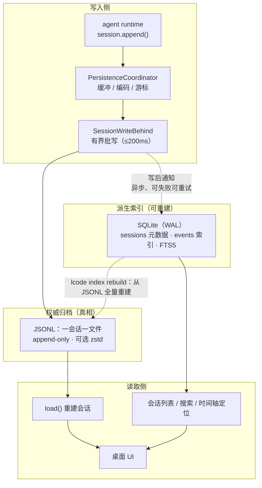
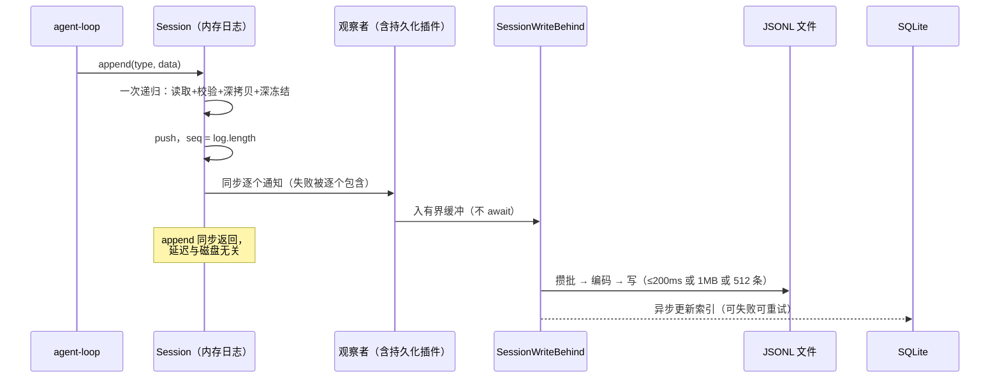
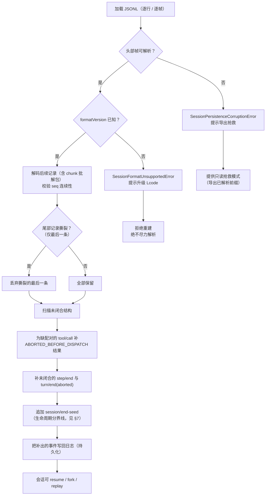
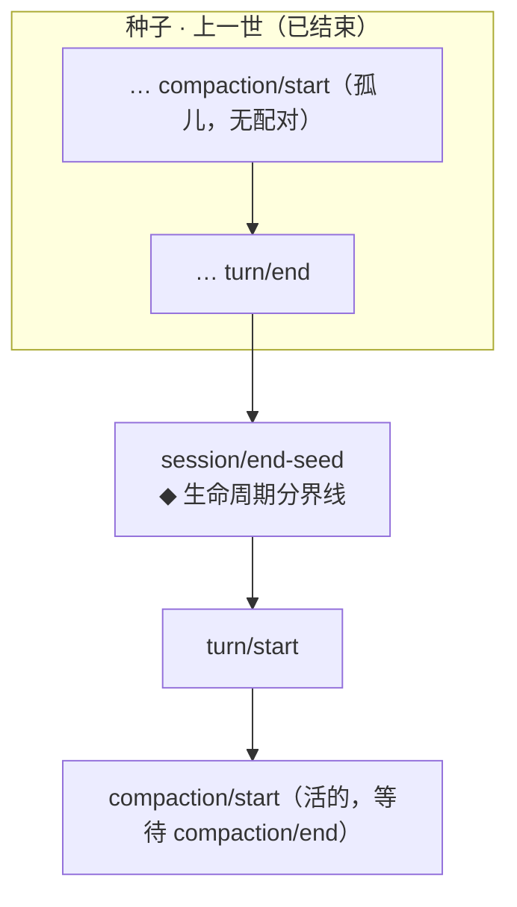
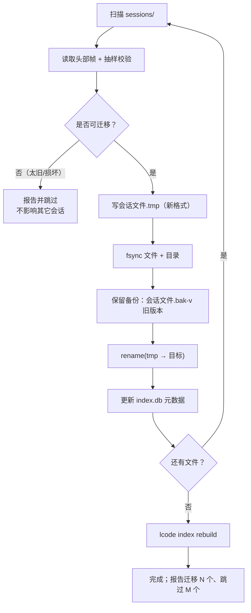

# 11 · 数据模型与持久化设计

> 本文回答：Lcode 把会话存在哪、用什么格式、怎么保证崩溃后能恢复、格式怎么演进。给内核 / 持久化研发看。

| 项 | 值 |
|---|---|
| 状态 | 草案 |
| 负责人 | 内核研发（持久化方向） |
| 上游依赖 | [00-文档总览与全局约定.md](./00-文档总览与全局约定.md)（D4/D5/D12/D18）· [05-系统架构设计.md](./05-系统架构设计.md) · [06-会话事件日志与可重放设计.md](./06-会话事件日志与可重放设计.md) · [12-安全权限与沙箱模型.md](./12-安全权限与沙箱模型.md) |
| 下游被引 | [10-桌面客户端设计.md](./10-桌面客户端设计.md) · [13-插件SDK与协议设计.md](./13-插件SDK与协议设计.md) · [15-测试策略与质量门禁.md](./15-测试策略与质量门禁.md) |

## 目录

- [1. 范围与非目标](#1-范围与非目标)
- [2. 存储分层](#2-存储分层)
- [3. 本地目录布局](#3-本地目录布局)
- [4. 会话日志格式](#4-会话日志格式)
- [5. 写入路径](#5-写入路径)
- [6. 崩溃恢复契约](#6-崩溃恢复契约)
- [7. 生命周期分界线：`session/end-seed`](#7-生命周期分界线sessionend-seed)
- [8. 兼容性与迁移](#8-兼容性与迁移)
- [9. 数据规模与保留](#9-数据规模与保留)
- [10. 可选加密](#10-可选加密)
- [未决问题](#未决问题)
- [变更记录](#变更记录)

---

## 1. 范围与非目标

本文覆盖：`Lcode Home` 的目录布局、SQLite 与 JSONL 的分工、会话日志的物理编码、写入路径与批写、**崩溃恢复契约**、`session/end-seed` **生命周期分界线**、格式版本与迁移、数据规模与保留策略、可选静态加密。

**本文不覆盖**：事件词汇表与**表面**（`surface`）语义的完整定义（[06-会话事件日志与可重放设计.md](./06-会话事件日志与可重放设计.md)）；压缩算法（[09-上下文工程与压缩策略.md](./09-上下文工程与压缩策略.md)）；凭据存储的实现（[12-安全权限与沙箱模型.md](./12-安全权限与沙箱模型.md)）。

**明确不做（本文范围内）**：

| 不做的事 | 为什么现在不做 |
|---|---|
| 把 SQLite 当权威 | 与 D12 冲突。SQLite 管"找到它"，JSONL 管"完整保存它"；一旦 SQLite 成为权威，"可导出为人类可读格式"就成了一句空话 |
| 让持久化在热路径上 `await` 磁盘 | 会把每一步的延迟绑死在磁盘上；见 §5.1 |
| 恢复时丢弃中断的**轮** | 会让下一轮请求因 `tool_calls` 无配对结果被模型 API 拒绝；见 §6.2 |
| 对未知格式版本做"尽力解析" | 宁可拒绝（用户麻烦），不要静默恢复出一个被掏空的会话（用户被骗）；见 §8.1 |
| 会话日志**默认**静态加密 | 会破坏 grep / cat / 纯文本导出，并制造"看起来很安全"的错觉；见 §10 |
| 自动删除用户会话 | 违反"用户拥有自己的数据"；保留策略只做"压缩归档"，删除必须是用户显式动作 |
| 跨设备同步 / 云备份 | 见 [00-文档总览与全局约定.md §8.4](./00-文档总览与全局约定.md#84-团队协作不等于云端-saas) |

---

## 2. 存储分层

D12 的结论：**SQLite（索引 / 查询 / 会话元数据）+ JSONL（会话日志的权威归档）**。两者职责**不重叠**。



*这张图想让你看到：**唯一的箭头从 JSONL 指向 SQLite**；SQLite 永远可以从 JSONL 重建，反向不成立。*

| 维度 | SQLite（`index.db`） | JSONL（`sessions/**/*.jsonl`） |
|---|---|---|
| 角色 | 索引、元数据、查询、全文搜索 | 会话日志的**权威归档** |
| 谁写 | `session-persistence-sqlite` | `session-persistence-jsonl` |
| 写入时机 | write-behind，异步、可重试、可丢 | 批写提交，持久屏障后视为权威 |
| 数据模型 | 关系表（`sessions` / `events` / `fts_events`） | 有序事件记录的追加流 |
| 能重建吗 | **能**：`lcode index rebuild` 扫全部 JSONL 重建 | **不能**：丢了就是丢了（所以要有备份/导出习惯） |
| 一致性 | 最终一致（允许落后于 JSONL） | 会话内强一致（`seq` 连续） |
| 用途 | "有标题含『登录』的会话吗" | "把会话 #42 完整重放出来" |
| 损坏后果 | 重建索引，会话数据毫发无损 | 数据损失，仅按 §6 的契约抢救 |

**谁是真相**：**JSONL 是权威**。任何"SQLite 与会话进度不一致"的场景（索引写失败、DB 被删、崩溃在写索引途中）都以 JSONL 为准，并触发对应会话的索引重建。

**SQLite 侧要点**：

- WAL 模式；`synchronous = NORMAL`（索引可丢，会话不可丢）。
- 表 `sessions(session_id PK, workspace, title, created_at, updated_at, last_seq, preset, archived_at, deleted_at, log_path, log_revision)`。
- 表 `events(session_id, seq, type, time, PRIMARY KEY(session_id, seq))`，只索引**结构性 / 表面事件**，**不索引** `assistant/chunk`（否则索引体积会反超日志）。
- 虚表 `fts_events`（FTS5）：对 `user/message` 与 `assistant/message` 的可见文本建全文索引。**只有模型可见文本进 FTS**——避免把工具原始输出（可能是二进制噪声）塞进搜索。
- `supportsRawArtifacts = false`：SQLite 后端**不**保存原始流式 chunk，只保证"能定位"。原始保真度只有 JSONL 有。

**索引重建**：`lcode index rebuild [--session <id>] [--workspace <ws>]`。它是一个**纯函数**：JSONL → 索引。因此可以随时无条件删掉 `index.db` 重建，这也是"SQLite 可丢"这条性质的可检验判据。

---

## 3. 本地目录布局

`Lcode Home` 默认位于 `~/.lcode`（POSIX）/ `%USERPROFILE%\.lcode`（Windows），可用环境变量 `LCODE_HOME` 覆盖（CI 与测试依赖这一点）。

```
Lcode Home/
├── sessions/                     # 会话日志（权威归档），按工作区分桶
│   ├── <workspace-key>/          # workspace-key = 规范化 cwd 的短哈希（16 hex）
│   │   ├── <session-id>.jsonl        # 未压缩：活跃或近期会话
│   │   └── <session-id>.jsonl.zst    # 压缩归档：空闲 ≥ 30 天的会话
│   └── _unknown/                 # 没有 cwd 的会话（纯协议模式等）
│
├── index.db                      # SQLite 索引（可重建，可随时删除）
├── index.db-wal                  # WAL
├── index.db-shm                  # 共享内存
│
├── plugins/                      # 已安装插件（第三方）
│   └── <name>/<version>/         # 含 package.json、已构建产物、可选 cordis.patch.yml
│
├── presets/                      # 预设（agent.cordis.yml）与配置档
│   ├── user/                     # 用户级预设
│   └── profiles/                 # 命名配置档
│
├── skills/                       # 技能目录（SKILL.md + 可选脚本）
│   └── <skill-name>/SKILL.md
│
├── cache/                        # 一切可重建、可清空的派生数据
│   ├── repo-map/                 # 仓库结构索引
│   ├── lsp/                      # LSP 会话缓存
│   ├── web/                      # 网页抓取缓存
│   └── spill/                    # 超大工具结果的落盘内容（spill store）
│
├── logs/                         # 应用自身日志（不是会话日志）
│   ├── main.log                  # 滚动：10MB × 5
│   └── host-<pid>.log            # 每个插件宿主的日志
│
├── credentials/                  # 凭据的**引用与记录**，值在 OS keychain（见 §10）
│   └── refs.json                 # { "<scope>/<id>": { kind, envName, descriptor } }
│
└── trash/                        # 删除后的暂存区（保留 7 天）
    └── <session-id>.jsonl.<ts>
```

*这张图想让你看到：**只有 `sessions/` 是不可重建的**；其余目录（索引、缓存、插件、预设、技能）删掉都能重建或重装——这决定了备份与保留策略的优先级。*

| 目录 | 用途 | 保留策略 | 可删除 |
|---|---|---|---|
| `sessions/` | 会话日志权威归档 | 默认**永不自动删除**；空闲 ≥ 30 天压缩为 zstd | 否（仅用户显式删除） |
| `index.db*` | 索引与元数据 | 随会话增长；`VACUUM` 在空闲时执行 | 是（重建） |
| `plugins/` | 第三方插件 | 随安装/卸载 | 是（重装） |
| `presets/` | 预设与配置档 | 用户文件，同 git 管理 | 是（重写） |
| `skills/` | 技能 | 用户文件 | 是（重写） |
| `cache/` | 派生缓存 | `repo-map` 7 天 / `lsp` 进程退出即清 / `web` 7 天 / `spill` 随会话；总上限 2GB，LRU 淘汰 | **是**（可清空，绝不影响正确性） |
| `logs/` | 应用诊断日志 | 10MB × 5 滚动 | 是 |
| `credentials/refs.json` | 凭据**引用**（值永不落此文件） | 随凭据管理 | 是（需重配） |
| `trash/` | 软删暂存 | 7 天后硬删 | 是 |

**硬性约定**：`Lcode Home` 下**不允许**出现会话正文的明文副本（除了 `sessions/` 与 `cache/spill/`）。任何"顺手缓存一份到别处"的做法都会破坏"本地优先 + 可导出"的语义。

---

## 4. 会话日志格式

### 4.1 物理编码

一会话一文件，**一行一帧**（ndjson）。文件第 0 帧是**头部帧**，其后全是**事件记录**。所有 `time` 都是 epoch ms 数字（D18）。

**头部帧**（仅一帧，位于文件开头）：

```json
{"kind":"file-header","formatVersion":1,"sessionId":"01J8FZ6Q2M4T0V7K9W3C5B8NDP","createdAt":1757491200000,"cwd":"/repo/web","parentSession":null,"seedLength":0,"codec":"zstd","keyId":null}
```

| 字段 | 含义 |
|---|---|
| `formatVersion` | 日志格式版本，整数；见 §8 |
| `sessionId` | 会话 id，全局唯一；**agent 与会话共享同一 id**（D17） |
| `cwd` | 会话启动时的工作区根 |
| `parentSession` | 分叉来源；非分叉为 `null` |
| `seedLength` | **种子**长度（分叉/恢复时继承的事件条数）；非分叉为 `0` |
| `codec` | `none` 或 `zstd` |
| `keyId` | 静态加密的密钥标识；`null` 表示未加密 |

**事件记录**（字段与内核 `SessionEvent` 一一对应）：

```json
{"type":"turn/start","seq":0,"time":1757491200100,"data":{"turn":1}}
{"type":"step/start","seq":1,"time":1757491200110,"data":{"turn":1,"step":1}}
{"type":"user/message","seq":2,"time":1757491200120,"data":{"role":"user","content":[{"type":"text","text":"把 login 改成 async"}]},"surfaceOp":"append"}
{"type":"assistant/message","seq":5,"time":1757491201400,"data":{"turn":1,"step":1,"message":{"role":"assistant","content":[{"type":"tool-call","id":"call_a1","name":"read","arguments":"{\"path\":\"src/auth.ts\"}"}]},"usage":{"input":1200,"output":48}},"surfaceOp":"append"}
{"type":"tool/call","seq":6,"time":1757491201405,"data":{"turn":1,"step":1,"callId":"call_a1","name":"read","arguments":"{\"path\":\"src/auth.ts\"}"}}
{"type":"tool/result","seq":7,"time":1757491201450,"data":{"turn":1,"step":1,"message":{"toolCallId":"call_a1","content":[{"type":"text","text":"…"}],"isError":false},"meta":{"card":"read","path":"src/auth.ts","totalLines":42}},"surfaceOp":"append"}
```

| 字段 | 强制 | 说明 |
|---|---|---|
| `type` | 是 | 事件类型；判别联合的判别式 |
| `seq` | 是 | 单调序号，**等于 `log.length`，连续不可跳号**（关键不变量） |
| `time` | 是 | epoch ms（D18）；展示层才本地化 |
| `data` | 是 | 事件负载；必须**无损 JSON**（拒绝 BigInt/undefined/NaN/循环引用/Map/Set/Date/类实例） |
| `surfaceOp` | 仅**表面**事件 | `"append"` 或 `{"op":"replace","start":N,"end":M}`；**压缩的唯一原语**（D5） |
| `sourceEventSeqs` | 否 | 血缘：本事件引用了哪些更早的事件 |
| `ignorable` | 否 | 读方遇到不认识的事件类型时是否可安全跳过；**缺省即不可跳过** |

**两条不可妥协的编码规则**：

1. **`seq` 必须连续**。持久化后端可以自定义物理编码（如下面的 chunk 打包），但 `load()` 必须还原出**完全相同的追加序列**。
2. **工具参数存原始 JSON 字符串**，不存"已解析对象"。保真、可审计，且不会因解析器差异改变历史（与 D9"参数不可被中间件改写"同源）。

### 4.2 连续 chunk 打包

`assistant/chunk` 是**纯日志事件**，数量最大（可达全部事件的 60–80%）。对**同一 `(turn, step)` 的极大连续 chunk 段**做打包，编码为一条记录：

```json
{"type":"assistant/chunk/batch","seqFirst":3,"seqLast":4,"time":1757491201000,"data":{"turn":1,"step":1,"chunks":[{"dt":0,"c":{"type":"reasoning-delta","text":"用户想"}},{"dt":20,"c":{"type":"reasoning-delta","text":"改签名"}}]}}
```

还原是**纯函数**：`seq = seqFirst + i`，`time = 批首 time + dt[i]`。因此 `load()` 得到的追加序列与逐条写入完全一致。

**为什么能省约 60% 体积**——省的是**每记录的固定键开销**，不是内容：

| 形态 | 单条（8 字节文本） | 100 条合计 |
|---|---|---|
| 逐条记录 | `{"type":"assistant/chunk","seq":12345,"time":1757491201020,"data":{"turn":1,"step":1,"chunk":{"type":"text-delta","text":"XXXXXXXX"}}}` ≈ **125 B** | ≈ **12,500 B** |
| 打包后每条 | `{"dt":0,"c":{"type":"text-delta","text":"XXXXXXXX"}}` ≈ **47 B** | ≈ 4,700 B |
| 打包批头 | （一次） | ≈ **130 B** |
| **合计** | — | **≈ 4,830 B** |

压缩比 ≈ **61%**。原因很直白：外层键 `"type"`/`"seq"`/`"time"`/`"data"`/`"turn"`/`"step"`/`"chunk"` 在逐条编码下**每条都重复一次**（约 78 B/条的纯开销），而真实负载（流式增量文本）往往只有 5–30 B。打包让固定开销在**整段**只付一次。

**预期区间 45%–65%**，取决于 chunk 的平均大小：增量越小（逐字流）省得越多，一次性大块（比如整段代码）省得越少。**注意：打包不丢任何信息**——原始流式 chunk 全部保留，只是换了物理排布。这是"重放保真度不可永久丢失"的必要条件。

**打包的边界规则**：

- 只打包**极大连续段**：遇到任何非 `assistant/chunk` 事件即封口。
- 段长上限 4096 条（避免单条记录过大、便于随机 seek）。
- `dt` 用相对批首的整数毫秒差；同一毫秒内多条则 `dt = 0`。
- 被打包的事件**不携带** `surfaceOp`（chunk 不是**表面**事件）。

### 4.3 原子物化

日志文件的**创建与压缩归档**（把 `.jsonl` 转成 `.jsonl.zst`，或写备份）走原子物化，避免"半写文件"被误认成完好日志：

```
1. 写临时文件   <target>.tmp-<pid>-<rand>
2. fsync(文件)  刷数据
3. fsync(父目录) 刷目录项（POSIX）
4. rename(<tmp>, <target>)   原子替换
```

**平台注意**：POSIX 上 `rename` 覆盖已存在文件是原子的；**Windows 上 `rename` 不覆盖已存在文件**，需走 `ReplaceFile`（或 `Remove` + `Rename` 的退化路径，并在退化路径上持锁 + 保留备份）。此差异必须在实现里显式分支，不能靠"应该一样"糊过去。

**滚动追加（append）不走物化**：append 是就地扩展文件（`O_APPEND`），物化只用于"整文件重写"类操作。

### 4.4 revision 计算

`revision` 是一个**廉价的变更检测令牌**（不是内容哈希），用于：判断"文件是否被外部改动"、检测陈旧游标、决定是否需要重新索引。

```
revision = `${dev}:${ino}:${size}:${mtimeNs}:${ctimeNs}`
```

| 平台差异 | 处理 |
|---|---|
| Windows 无稳定 inode | 用 `dev:fileIndex:size:mtimeNs:ctimeNs` 替代；`fileIndex` 来自 `GetFileInformationByHandle` |
| 时间戳精度 | 按纳秒取；不足则退到系统最高精度，并**记录实际精度** |
| 内容完整性 | `revision` **不**用于完整性校验。导出/迁移时另算一个 SHA-256（见 §9.3） |

`index.db` 的 `sessions.log_revision` 保存上次索引时的 revision；不一致即触发增量重索引。这个设计让"索引落后"变成一次 O(1) 的比对，而不是每次启动全量扫盘。

---

## 5. 写入路径

### 5.1 热路径：同步提交，绝不阻塞 I/O



*这张图想让你看到：**append 的返回时间与磁盘无关**；磁盘延迟只出现在后台批写里；观察者失败不影响 `append` 的返回值，也不影响后续观察者看到同一事件。*

| 规则 | 说明 |
|---|---|
| `append()` 同步返回 | 只做内存操作：校验、深冻结、入数组、同步通知 |
| 观察者失败被**包含** | 一个观察者抛错，不影响返回值，也不影响其它观察者 |
| 热路径禁止 | 同步 `fs`、`await fsync`、大对象 `JSON.parse`、CPU 密集计算 |
| 事件不可变 | 事件在**进入日志的那一刻**深冻结；之后任何 cast 都改不了历史 |

### 5.2 write-behind 有界批写

`SessionWriteBehind` 把缓冲的事件攒批落盘，**三个触发条件任一满足即提交**：

| 条件 | 默认值 | 理由 |
|---|---|---|
| 最大延迟 | **200ms** | 崩溃时最多丢 200ms 的写入（且只丢撕裂的一条记录，见 §6） |
| 批大小（字节） | 1MB | 防止一次性写爆 |
| 批大小（条数） | 512 条 | 防止大量小事件积压 |

**为什么是 200ms**：它是"崩溃损失窗口"与"写放大"的平衡点。更小（如 20ms）会让每个 token 都触发一次 `write` 系统调用，写放大严重且拖累主进程；更大（如 2s）会让崩溃后的可见损失变长。用户能感觉到的是"崩溃后最多丢最后 200ms 的对话"，且因为 `assistant/message` 是权威消息、chunk 只是过程，实际感知损失更小。

### 5.3 `flush()` 是静默屏障

`session/flush` 是一个**静默屏障**：它等到"此前所有 append 的事件都已持久化"才 resolve，**不产生任何用户可见事件**（不计入日志，不触发 UI 提示）。

**必须 flush 的时机**：

| 场景 | 理由 |
|---|---|
| 分叉（fork）前 | 切前缀必须基于已落盘的稳定前缀 |
| 恢复（resume）后、开新**轮**前 | 保证内存日志与磁盘一致，避免"两条真相" |
| 导出会话前 | 导出的必须是完整内容 |
| 应用退出前 | 最后一道保险 |
| 切换工作区 / 关闭会话前 | 同上 |

`flush()` 失败**不静默**：必须向 UI 报"未能写入磁盘"，并保留内存事件（见 §5.4）。

### 5.4 写失败：回滚与退避

写入失败（磁盘满、权限、I/O 错误）的处理：

1. **回滚到 previous size**。文件在本次批写前记录 `size`；写失败则 `ftruncate` 回退，保证文件尾部没有"写了一半的批"。
2. **保留内存事件**。失败的事件**不丢**，仍在 `Session` 内存日志与缓冲里。
3. **退避重试**：`50ms → 100ms → 200ms → 400ms → 800ms → 1600ms → 3200ms`（上限 5s），指数退避。连续失败 6 次进入下一状态。
4. **降级为 `write-degraded`**：会话继续可交互（内存里一切正常），但 UI 常驻**琥珀色**横幅"会话未能写入磁盘（磁盘可能已满）"，并提供"重试 / 导出到其它位置"。**绝不静默**，也绝不因此中止 agent。
5. **旁路落盘**（可选，尽力而为）：若主路径持续失败，尝试写入 `cache/spill/wal-<session>.ndjson` 作为临时补救，成功后合并回主日志。旁路失败不改变"degraded"状态。

**原则**：写失败是**基础设施失败**，不是**领域失败**——它不该把一次成功的对话变成失败。

---

## 6. 崩溃恢复契约

这是本文最重要的一节，**逐条为准**。

### 6.1 四条规则

| # | 规则 | 具体行为 |
|---|---|---|
| R1 | **只丢弃撕裂的最后一条记录** | 仅当**最后一条**记录 JSON 解析失败 / zstd 帧不完整 / 尾部截断时，丢弃它。**非最后一条**记录不可解析 = `SessionPersistenceCorruptionError`（报错，不猜） |
| R2 | **保留完整的中断轮** | 不删任何已完整写入的 `turn/start` / `step/start` / `tool/call` |
| R3 | **合成收尾事件** | 为未 dispatch 的工具调用补 `ABORTED_BEFORE_DISPATCH` 错误结果；补未闭合的 `step`/`turn` 边界 |
| R4 | 版本/损坏分流 | 未知 `formatVersion` → `SessionFormatUnsupportedError`（提示升级）；结构损坏 → `SessionPersistenceCorruptionError` |

**R3 具体补什么**：

| 缺失 | 合成的收尾事件 |
|---|---|
| `tool/call` 无配对 `tool/result` | 追加 `tool/result`，`isError: true`，错误码 **`ABORTED_BEFORE_DISPATCH`**（语义：该调用在派发前就被中断，因此**不能**假设它有副作用） |
| `step/start` 无配对 `step/end` | 追加 `step/end` |
| `turn/start` 无配对 `turn/end` | 追加 `turn/end`，`reason: "aborted"` |
| 插件的"开括号"无配对"关括号"（如 `compaction/start`） | **内核不补**。由 §7 的 `session/end-seed` 判定它是"上一世的残骸" |

补出的收尾事件**要写回日志**（它们是持久的、被审计的），而不是只在内存里拼一个假象。

### 6.2 为什么不能直接丢弃中断的轮

模型 API 的硬约束：**一条 assistant 消息里的每个 `tool_call` 都必须有对应的 `tool_result`**，否则下一次请求直接 400。

假设崩溃时日志尾部是：

```
turn/start → step/start → user/message → assistant/message(含 tool_call read)
          → tool/call read → ✂ 崩溃
```

若"丢弃中断的轮"，历史里就只剩到 `assistant/message` 为止——一条**带 tool_call 却没有 tool_result** 的消息。下一轮请求必被拒。

因此正确做法是：**保留这个轮，并补一条 `tool/result`（`ABORTED_BEFORE_DISPATCH`）**。这样：

- 历史是**连续且合法**的（每个 call 都有配对 result）；
- 用户**看得见**发生了什么（"那次 read 在派发前被中断"是可审计事实）；
- **不撒谎**：`ABORTED_BEFORE_DISPATCH` 明确表示"未派发"，因此不会误导模型认为文件已经被读过了。

> 这条"**宁可补一条诚实的收尾，也不裁剪出漂亮但断裂的历史**"是恢复契约的核心精神。

### 6.3 恢复流程



*这张图想让你看到：恢复只有**一个**丢弃点（撕裂的最后一条），之后全是**补齐**动作；两条错误路径都拒绝静默降级。*

**关键顺序**：先补 `tool/result`，再补 `step/end`，最后补 `turn/end`。因为闭合是有层次的——工具结果先配对，步才能关，轮才能关。

**恢复必须幂等**：对同一个已经恢复过的日志再跑一次恢复，`session/end-seed` 之后不应再补出任何事件（所有结构都已闭合）。这是可测试的不变量。

---

## 7. 生命周期分界线：`session/end-seed`

### 7.1 为什么需要它

`resume` / `fork` / `replay` 出来的会话，**种子**部分的事件与"本次生命周期的写入"在字节上**完全一样**。于是任何使用"开/关括号"的插件（例如压缩的 `compaction/start` … `compaction/end`）会陷入一个无法判断的困境：

> 日志里有一个**未配对**的 `compaction/start`——它是**上一次生命周期崩溃时留下的残骸**，还是**此刻正在进行的压缩**？

- 如果误判为"正在进行"，插件会一直等一个永不到来的 `compaction/end` → 会话卡死。
- 如果误判为"残骸"予以清理，而它其实正在进行 → 破坏一次真实的压缩。

内存锁解决不了：崩溃后内存锁早已消失。

### 7.2 解决方案

**带种子的会话在 seed 之后立刻追加一条 `session/end-seed`**（空 payload，含义完全由**位置与时间**表达）：

```json
{"type":"session/end-seed","seq":813,"time":1757491209999,"data":{}}
```

**语义**：位于 `session/end-seed` **之前**的事件来自**种子**，属于**已经结束的生命周期**；位于它**之后**的事件属于**本次生命周期**。

判定规则（插件必须遵守）：

| 括号位置 | 判定 | 处理 |
|---|---|---|
| 未配对的开括号在**最近一条** `session/end-seed` **之前** | 上一世的残骸 | 视为已死，幂等地重新开始或清理 |
| 未配对的开括号在**之后** | 本次生命周期 | 视为**正在进行**，正常等待/推进 |



*这张图想让你看到：分界线之前那个孤儿 `compaction/start` 是**残骸**，之后那个才是**活的**——同一种事件、同一份字节，靠分界线区分。*

### 7.3 其它用途

| 用途 | 说明 |
|---|---|
| 孤儿括号判定 | 上述核心用途 |
| 计算"本次生命周期的写入" | 保留策略、增量索引、导出"仅本次新增"都以它为界 |
| 分叉语义 | `parentSession` + `seedLength` + `session/end-seed` 三者共同声明"前缀继承自谁、到哪为止" |
| 恢复幂等性断言 | 恢复后再恢复，分界线之后不得再出现合成事件 |

**一般化经验**：只要系统同时支持"从历史恢复"与"跨事件的括号操作"，就**必须**有一个这样的生命周期分界线。这是可迁移的架构教训，不是 Lcode 的特例。

**谁写**：由 `session` 核心（不是插件）在 seed 完成后**立刻**追加。放在核心而非插件，是因为它是所有括号型插件的共同地基。

---

## 8. 兼容性与迁移

### 8.1 格式版本策略：未知版本**报错**，不尽力解析

| 场景 | 行为 |
|---|---|
| `formatVersion` 在已知范围内 | 正常加载 |
| `formatVersion` **高于**本机已知最高版本 | `SessionFormatUnsupportedError`，提示"此会话由更新版本的 Lcode 写入，请升级" |
| `formatVersion` 低于支持窗口 | 提示运行 `lcode migrate`（见 §8.3） |
| 遇到**不认识**且**未标 `ignorable`** 的事件类型 | **拒绝重建会话**（`SessionFormatUnsupportedError`） |
| 遇到不认识但标了 `ignorable: true` 的事件 | 安全跳过，其余照常 |

**为什么"未知即拒绝"而不是"尽力解析"**：一个不认识的**必需**事件可能改变日志其余部分的解释方式（比如它是某种新的**表面操作**，或改变了 `seq` 的含义）。静默跳过它，恢复出的会是一个**被掏空却看起来很完整**的会话——用户被骗，这比报错严重得多。

> 宁可多拒绝（用户麻烦一次），也不要静默恢复出一个错误的会话（用户被骗且不自知）。

### 8.2 不做向后兼容的窗口期

Lcode **不为旧格式维护兼容读路径**。理由：

- 兼容读路径是"永久的技术债"，且**几乎从不被执行**，一旦执行就是 bug 温床；
- 正确做法是把旧格式**前向迁移**，而不是让**新读方**去兼容**旧写方**。

**支持窗口**：本机最多能迁移**往前 2 个次版本**的日志（如 v1 读方能迁移 v0.x）。更旧的格式：报错并给出手工指引。

### 8.3 迁移工具 `lcode migrate`

`lcode migrate` 是一个**纯前向变换**：把旧日志重写为新格式，**不重新派生历史**（历史是事实，不能重算）。

```
lcode migrate --check                 # 只扫描、只报告，不写
lcode migrate <path|--all>            # 执行迁移
lcode migrate <path> --dry-run        # 输出将发生的变化摘要
lcode migrate --resume                # 续跑上次中断的迁移
lcode index rebuild                   # 迁移后重建索引
```



*这张图想让你看到：迁移是**逐文件、可续跑、必留备份**的；单个文件失败不会污染其它会话。*

**硬性规则**：

- **迁移前必有备份**（`.bak-v<旧版本>`），保留至用户确认后手动清理；工具输出备份路径。
- **不原地不可逆改写**：写 tmp → fsync → rename 的原子路径。
- **可续跑**：每个文件独立处理，中断后 `--resume` 跳过已完成的。
- **迁移不改语义**：只做字段重命名、默认值补齐、必要的编码换形（如把逐条 chunk 打包）。任何需要"重新解释"的迁移都要走 ADR（[17-架构决策记录ADR.md](./17-架构决策记录ADR.md)）。
- 迁移是**用户显式动作**，不在启动时自动跑（自动迁移会在用户不知情时改写其唯一权威数据，不可接受）。

---

## 9. 数据规模与保留

### 9.1 单会话日志的预期体量

以一个"中等强度"的编码会话为基准（约 **60 个步**、**40 次工具调用**、其中 8 次产生较大输出）：

| 组成 | 原始 JSONL | 说明 |
|---|---|---|
| 结构性事件（turn/step/boundary） | 30–80 KB | 条数多，单条小 |
| `assistant/chunk`（含思考） | **3–20 MB** | 主要体量来源；打包后降 45–65% |
| `assistant/message` + `tool/call` | 200 KB–1 MB | 参数存原始 JSON 字符串 |
| `tool/result` | **2–25 MB** | 读大文件、跑测试、diff 的输出是大头 |
| **合计（打包前）** | **≈ 5–45 MB** | — |
| **合计（`codec=zstd`）** | **≈ 1.5–12 MB** | 文本冗余度高，压缩比通常 3–4× |

**参考口径**（与 [00 §8.5](./00-文档总览与全局约定.md#85-数字口径约定) 一致）：**日志膨胀率 = 会话日志字节数 ÷ 模型可见内容的字节数**。由于要完整保存流式 chunk 与原始工具输出，膨胀率预期落在 **1.5×–4×**。这是"可重放"的**代价**，我们显式接受它，并用打包 + zstd 把代价压到可接受区间。

### 9.2 自动保留策略

| 对象 | 策略 | 默认值 |
|---|---|---|
| 会话日志 | **不自动删除**；空闲压缩 | 空闲 ≥ **30 天** → `.jsonl` 转 `.jsonl.zst`（内存中解压成本可接受） |
| 开放中的会话 | 永不压缩 | 会话被 resume 时先解压回 `.jsonl` |
| `cache/repo-map` | TTL + LRU | 7 天 / 单项 ≥ 50MB |
| `cache/web` | TTL | 7 天 |
| `cache/lsp` | 进程退出即清 | — |
| `cache/spill` | 随所属会话 | 会话硬删时一并清除 |
| `cache/` 总上限 | 全局 LRU | **2 GB** |
| `logs/` | 滚动 | 10 MB × 5 |
| `trash/` | 定时硬删 | 7 天 |

**总磁盘预算**（默认，可在设置中调整）：`sessions/` 无硬上限（用户数据，不设帽）；除 `sessions/` 外全部内容的合计上限 **5 GB**，超出时按 LRU 清 `cache/`，仍超出则提示用户而非静默删会话。

### 9.3 删除语义：软删 vs 硬删

| 操作 | 语义 | 实现 |
|---|---|---|
| **软删**（归档 / 删除） | 从列表隐藏，数据保留 | SQLite 写 `deleted_at`；文件**不动** |
| **恢复** | 撤销软删 | 清空 `deleted_at` |
| **硬删** | 真正移除 | 文件移入 `trash/`（保留 7 天）→ 到期删除文件 + `index.db` 相关行 + `cache/spill` 对应条目 |
| **清空回收站** | 立即硬删 | 跳过 7 天窗口 |

**"可导出"原则**（产品宪法第二条）：**删除在任何情况下都先提示导出**。导出是一等能力，不是"高级功能"：

```
lcode export <session-id> --format jsonl|md      # 单会话
lcode export --all --format jsonl --out ./backup # 全量
```

| 格式 | 内容 |
|---|---|
| `jsonl` | 逐帧原样（含头部帧），**可被 Lcode 重新导入** |
| `md` | 人类可读：按**轮**渲染消息、**卡片**摘要、**检查点**目录；**不含** chunk 级细节（那属于 jsonl） |

导出时对每个文件计算 SHA-256 并写入清单（`manifest.json`），供用户自行校验完整性——这是"revision 不用于完整性"的补充（见 §4.4）。

---

## 10. 可选加密

### 10.1 设计

**静态加密**（at-rest）会话日志，**按会话文件**加密：

| 项 | 设计 |
|---|---|
| 算法 | XChaCha20-Poly1305（AEAD），逐**记录块**加密，块间用 `seq` 作附加认证数据（AAD），防止块重排/裁剪 |
| 密钥 | 存 OS keychain（macOS Keychain / Windows DPAPI via `safeStorage` / Linux Secret Service）；`credentials/` 只存**引用与 `keyId`**，值永不落文件 |
| 头部帧 | 含 `keyId`；`keyId: null` 表示未加密 |
| 粒度 | **每会话可选**，也可按工作区/配置档整体开启 |
| 与压缩 | 先 zstd 再加密（压缩在密文上无效） |

### 10.2 为什么不默认开启

| 理由 | 说明 |
|---|---|
| 破坏"可导出为人类可读格式" | grep / cat / 手工查看 / 用第三方工具分析全部失效，与产品宪法第二条"可导出"直接张力 |
| 增加密钥管理失败面 | headless CI、无 keyring 的 Linux、keychain 被锁——任一情况下"打不开自己的会话"是灾难级体验 |
| 制造虚假安全感 | 明文早已存在于：模型服务商侧、终端 scrollback、工作区文件、系统 swap。只加密日志属于"防最不影响的那一环" |
| 拖累崩溃恢复 | §6 的恢复需要**逐行**判断撕裂记录；密文下一行撕裂的判定与抢救更复杂，可视性下降 |
| 性能与复杂度 | 每次 append 的加密 + 每次 load 的解密都增加延迟与实现风险，而这个风险换来的边际安全有限 |

**结论**：默认**不加密**，但把它做成显式、可发现的能力。开启后：

- `lcode doctor --crypto` 展示"哪些文件被加密、用哪个 `keyId`、密钥在哪个 keychain"；
- 未加密的旧会话**不自动改写**；用户可显式 `lcode secure <session|--all>`；
- 关闭加密（解密）同样显式，且要求确认。

### 10.3 一个例外：凭据**永远**加密

会话日志是否加密是可选项；但**凭据**（API key、token）**无条件**只存 OS keychain，日志、配置、遥测、UI 中**永远**只出现**引用**。这不是可配置项，是架构约束（[12-安全权限与沙箱模型.md](./12-安全权限与沙箱模型.md)）。

---

## 未决问题

- [ ] **chunk 打包与 zstd 的关系**：先打包再整体 zstd，还是 zstd 分帧后逐帧打包？倾向"先打包再整体 zstd"（简单、seek 粒度到批即可）。卡在内核研发。
- [ ] **`codec` 是否支持 per-record 混用**（活跃会话不压缩、历史记录压缩）。倾向不支持，保持一文件一 codec。卡在内核研发。
- [ ] **FTS 是否索引 `web` 卡片抓回的正文**。索引会让搜索更强，但会把外部内容引入本地索引。卡在安全（[12](./12-安全权限与沙箱模型.md)）。
- [ ] **软删的会话是否仍参与 FTS**。倾向不参与，避免"已删除还能搜到"的困惑。
- [ ] **加密块粒度的 AAD 选择**：用 `seq` 是否足够，是否需要绑定 `sessionId` 防跨文件拼接。倾向绑定两者。卡在内核研发。
- [ ] **`lcode migrate` 是否要把 `.bak` 备份纳入 `trash/` 的 7 天策略**，还是无限保留直到用户手动清。
- [ ] **spill 内容是否算"会话正文"**——若是，硬删时必须同步清理；当前按"随会话删除"实现，需与保留策略对齐口径。

## 变更记录

| 日期 | 版本 | 变更 | 说明 |
|---|---|---|---|
| 2026-09-10 | v0.1 | 初稿 | 建立存储分层、目录布局、日志格式、写入路径、恢复契约、生命周期分界线、迁移、保留与可选加密 |
