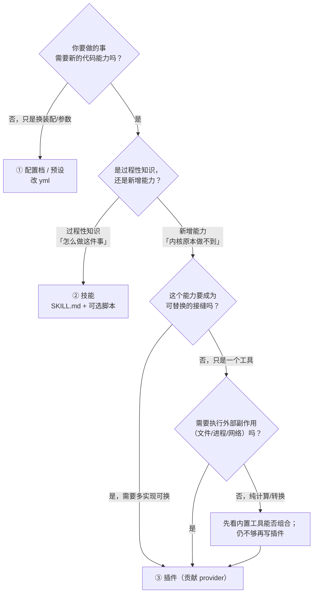
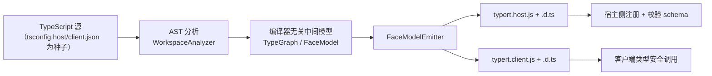
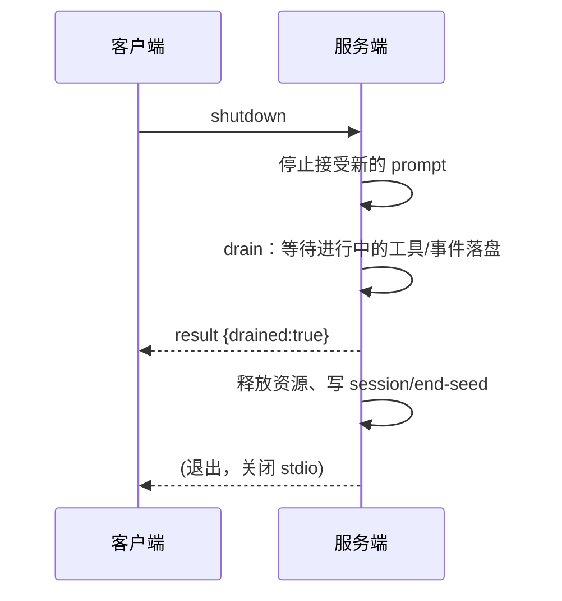
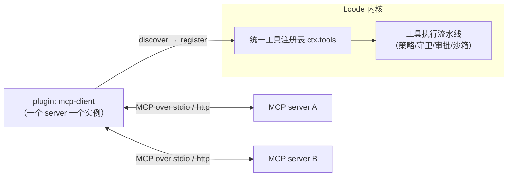
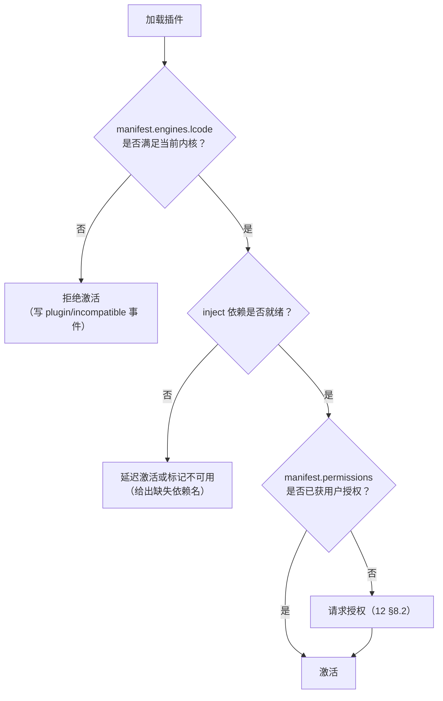

# 13 · 插件 SDK 与协议设计

> 本文回答：Lcode 怎么对外暴露能力——用户如何零代码定制、开发者如何写插件、内核与插件之间用什么协议、如何被别的 agent 接入。给研发与生态/插件作者看。

| 项 | 值 |
|---|---|
| 状态 | 草案 |
| 负责人 | 内核研发 / 生态 |
| 上游依赖 | [00-文档总览与全局约定.md](./00-文档总览与全局约定.md)（D6/D7/D14/D15/D16、§8.2）· [05-系统架构设计.md](./05-系统架构设计.md) · [07-插件内核与扩展点设计.md](./07-插件内核与扩展点设计.md) · [08-工具系统与执行流水线.md](./08-工具系统与执行流水线.md) |
| 下游被引 | [12-安全权限与沙箱模型.md](./12-安全权限与沙箱模型.md) · [14-产品路线图与里程碑.md](./14-产品路线图与里程碑.md) · [15-测试策略与质量门禁.md](./15-测试策略与质量门禁.md) |

## 目录

- [1. 范围与非目标](#1-范围与非目标)
- [2. 三层扩展模型](#2-三层扩展模型)（三层定义 · 对比表 · 决策树 · 如何协同）
- [3. 插件 SDK（`@lcode/plugin-sdk`）](#3-插件-sdklcodeplugin-sdk)（三形态 · inject · disposer · 完整示例 · manifest）
- [4. 内部类型化 RPC](#4-内部类型化-rpc)（生成管线 · 描述符 · lookup · 为什么 · opt-in）
- [5. 外部协议（JSON-RPC 2.0 over stdio）](#5-外部协议json-rpc-20-over-stdio)（传输 · 方法 · 通知 · 入队回执 · 生命周期 · 完整会话）
- [6. MCP 兼容](#6-mcp-兼容)（作为客户端 · 作为服务端 · 安全）
- [7. 插件分发与生态](#7-插件分发与生态)（打包 · 本地 vs 市场 · 冷启动 · 版本兼容）
- [未决问题](#未决问题)
- [变更记录](#变更记录)

---

## 1. 范围与非目标

**本文定义**：

- 三层扩展模型（配置档 / 预设 → 技能 → 插件）的边界与选择标准。
- 插件 SDK（`@lcode/plugin-sdk`）的编程模型：三种插件形态、`inject`、`disposer`、清单格式。
- 内核 ↔ 插件的内部类型化 RPC（描述符生成、`lookup`、opt-in）。
- 对外协议：JSON-RPC 2.0 over stdio 的方法/通知集合与核心约定（**`prompt` 只返回入队回执**）。
- MCP 双向兼容（客户端 / 服务端）与安全约束。
- 插件的打包、分发与版本兼容策略。

**明确不做（Won't，本期）**：

| 不做的事 | 为什么现在不做 |
|---|---|
| 插件市场（含在线安装、评分、计费） | MVP 阶段不建市场，先做"官方插件集 + 本地插件"（§7.3）。建市场需要审核、签名基础设施与运营，过早投产会把精力从内核挪走。 |
| 让插件与内核**同进程**运行 | 违反 D14。同进程无法提供稳定隔离（崩溃会带走内核）与可整体杀掉的能力。 |
| 让插件直接用**未包装的** spawn / fs / net | 违反 [12-安全权限与沙箱模型.md](./12-安全权限与沙箱模型.md) 的安全不变量：所有外部副作用必须过流水线。 |
| 远程插件（代码不在本机） | 违反"用户拥有自己的数据与算力"（00 §2 第二条）。远程执行是 future 的 provider，不是默认形态。 |
| 强制所有内部业务包都走类型化 RPC | 生成管线是 **opt-in** 的（§4.5）；同进程内部直接调用更有性价比。 |
| 为 SDK 提供"任意 UI 注入" | 插件的 UI 呈现通过**规范值 + 卡片投影**（00 §6 "卡片"）表达，不直接操作 React 树。 |

> 一句话：**Lcode 的扩展是"内核最小、能力最大可替换"（D6）**。插件是这套哲学的最高层，也是最贵的一层——所以本文先讲清"什么时候不该用插件"。

---

## 2. 三层扩展模型

### 2.1 三层定义

严格对应 00 §8.2 的三层，字面量不得改动：

```
① 配置档 / 预设（yml，改装配与参数）      ← 零代码
② 技能（SKILL.md + 可选脚本）             ← 写文档
③ 插件（TypeScript 包）                   ← 写代码
```

| 层 | 载体 | 能力 | 例 |
|---|---|---|---|
| ① **配置档 / 预设** | `yml`（`cordis.patch.yml` / `agent.cordis.yml`） | 增删/替换插件、改参数、选 provider、设定权限预设 | "这个项目用 `llm-deepseek`，关掉 `web-*`，预设=只读" |
| ② **技能** | `SKILL.md`（+ 可选脚本） | 注入一段可被按需加载的过程性知识；脚本可作为工具被调用 | "发布前检查清单"、"这个仓库的测试约定" |
| ③ **插件** | TypeScript 包（`@lcode/p-*` 或第三方） | 注册服务 / 工具 / 事件监听 / 提示词段落；拥有完整生命周期 | "接一个自研代码索引"、"接一个新模型 provider" |

> **注意术语**：配置档（profile）与预设（preset）是**装配层**概念（00 §6），不是一个可编程的扩展形态。技能（skill）是**文档+可选脚本**。只有插件（plugin）是**代码**。

### 2.2 三层对比

| 维度 | ① 配置档 / 预设 | ② 技能 | ③ 插件 |
|---|---|---|---|
| 能力上限 | 只能重组**已有**能力 | 只能**描述**过程，或调用已有工具 | 可**新增**服务与工具，改变内核行为 |
| 学习成本 | 改 yml（分钟级） | 写 Markdown（小时级） | 写 TS + 理解生命周期（天级） |
| 分发方式 | 复制文件 / 随仓库提交 | 复制目录 / 技能包 | npm 包 / 本地目录 / 市场（v1.0 后） |
| 安全边界 | 无代码，**不产生新的执行面** | 脚本按普通 spawn 走权限流水线 | manifest 权限 + OS 沙箱（12 §8） |
| 运行位置 | 内核进程内（装配期） | 内核读文档；脚本为子进程 | **独立 utility process**（D14） |
| 卸载回滚 | 重读 yml | 移除目录 | 调用所有 **disposer** + 终结进程 |
| 可重放影响 | 装配变化写事件 | 技能加载写事件 | 所有注册写事件，可追溯 |

### 2.3 决策树



**这张图想让你看到什么**：从①到③是"能力上限"逐级升高、成本也逐级升高的阶梯；每一层都先问"下一层真的必要吗"，避免用插件解决本该用配置或文档解决的问题。

### 2.4 三层如何协同

一个真实场景："团队希望新人在本仓库按统一方式跑迁移脚本，并在执行 destructive 迁移时要求审批"。

| 诉求 | 用哪层 |
|---|---|
| 固定这个仓库使用哪套 provider 与权限预设 | ① 配置档 / 预设（提交一个 `agent.cordis.yml`） |
| 描述"迁移前先备份、先 dry-run、失败如何回滚"的过程知识 | ② 技能（`SKILL.md`） |
| 提供一个真正执行迁移的 `migrate` 工具，并接上审批与沙箱 | ③ 插件 |

三层不是三选一，而是**同一份意图在不同粒度上的表达**。

---

## 3. 插件 SDK（`@lcode/plugin-sdk`）

插件是**完整的 Cordis 插件**（00 §8.2）：可注册服务、工具、事件监听、提示词段落，有完整生命周期。

### 3.1 三种插件形态

| 形态 | 写法 | 适用 | 生命周期 |
|---|---|---|---|
| **函数插件** | `export default (ctx, config) => { ... }`（或返回 disposer） | 最简单的"注册几样东西" | 同步执行
| **对象插件** | `export default { name, inject, apply(ctx, config) {...} }` | 需要声明依赖 `inject`、名字、可选 `Config` schema | 由内核按依赖序调用 `apply` |
| **Service 子类** | `class MySvc extends Service { static inject = [...]; start() {...} }` | 提供一个可被 `ctx.<key>` 查找的服务 | `start/stop` 钩子 |

**选择**：只是注册工具/监听 → 函数或对象插件；要**被别的插件依赖**（提供 `ctx.something`）→ Service 子类。

### 3.2 `inject`：声明式启动顺序

> **`inject` 声明"我需要谁先就绪"，而不是手写 init 序列。**

```ts
export const inject = ['tools', 'sessions']   // 我要用 ctx.tools 与 ctx.sessions
```

- 内核据此构造**依赖图**，拓扑排序启动；依赖缺失时插件**不激活**（并给出可读原因），而不是在运行时 `undefined` 崩。
- 这消除了"插件作者写 `await ctx.tools.ready()`"这类隐式时序约定，也让**卸载顺序**可推导（反向拓扑）。

### 3.3 每一次注册都必须返回 disposer

> **注册即副作用（effect）；副作用必须可逆（00 §6）。**

```ts
const dispose = ctx.tools.register(tool)
// 卸载插件时：
dispose()   // 工具从注册表消失，世界回到注册前
```

**硬性要求（`EXT-PLUGIN-001`）**：SDK 暴露的**每一个**注册函数都返回一个 `disposer`；插件不需要自己记账，内核在卸载时按**注册的逆序**统一调用。若插件忘了保存 disposer，SDK 内部仍会跟踪（**注册即登记**），保证"世界精确回滚"（00 §2 第三条）。

### 3.4 完整示例

一个可运行的最小插件：注册一个工具、一段提示词、一个事件监听、一个服务，并演示 disposer。

```ts
// packages/p-my-plugin/src/index.ts
import { Service, type Context, type PluginConfig } from '@lcode/plugin-sdk'

export interface Config {
  readonly maxBytes: number
}

export const name = 'p-my-plugin'
export const inject = ['tools', 'systemPrompt', 'sessions']

// ① Service 子类：提供 ctx.lineCounter，可被别的插件依赖
export class LineCounter extends Service {
  constructor(ctx: Context, private readonly config: Config) { super(ctx, 'lineCounter') }

  count(text: string): number {
    return text.split('\n').length
  }
  async start() { this.ctx.logger.info('lineCounter 就绪') }   // 生命周期钩子
}

export const apply = (ctx: Context, config: Config) => {
  // ② 注册服务（返回 disposer；插件卸载时自动撤销）
  ctx.plugin(LineCounter, config)

  // ③ 注册工具：返回规范值（D8），不直接产文本
  ctx.tools.register({
    name: 'count_lines',
    description: '统计一段文本或工作区内某文件的行数',
    parameters: {
      type: 'object',
      properties: { path: { type: 'string' }, text: { type: 'string' } },
      additionalProperties: false,
    },
    async execute(args, exec) {
      let content: string
      if (args.path) {
        const { readText } = await ctx.fs.read(                   // 经 fs 接缝，受沙箱约束
          ctx.fs.resolve(exec.workspaceRoot, args.path),
        )
        content = readText
      } else {
        content = args.text ?? ''
      }
      return { lines: ctx.lineCounter.count(content), bytes: content.length }   // 规范值
    },
  })

  // ④ 注册一段提示词（参与装配 waterfall）
  ctx.systemPrompt.section({
    id: 'my-plugin/hint',
    order: 500,
    render: () => '统计行数时优先用 count_lines 工具。',
  })

  // ⑤ 订阅事件（纯观察：emit）
  ctx.on('tool/result', (event) => {
    ctx.logger.debug(`tool ${event.tool} 完成`)
  })

  // 函数插件也可显式返回 disposer；对象/Service 形态由内核统一管理
  return () => ctx.logger.info('p-my-plugin 已卸载')
}
```

**要点**：

- 工具返回的是**规范值**（`{ lines, bytes }`），不是格式化文本；UI 卡片是独立投影（00 §6、D8）。
- 工具里读文件走 `ctx.fs`，因此**继承沙箱约束**；插件不能绕开（12 §2.4）。
- 提示词段落通过 `order` 参与装配 waterfall，可被上层重排。

### 3.5 插件清单：`lcode.json`

清单文件 `lcode.json` 位于插件包根目录，**必须**在激活前被读取与校验。

```jsonc
{
  "$schema": "https://lcode.dev/schema/plugin-1.json",
  "id": "com.example.line-tools",          // 全局唯一（反向域名）
  "name": "Line Tools",                     // 展示名
  "version": "1.2.0",                       // semver
  "engines": { "lcode": ">=1.0.0 <2.0.0" }, // 内核版本诉求（§7.4）
  "entry": "./dist/index.js",               // ESM 入口（"type":"module"）
  "activation": {                           // 激活条件：默认懒激活
    "events": ["tool/result"],              // 听到这些事件才激活
    "languages": ["typescript"],            // 工作区语言包含时激活
    "workspaceTrust": "trusted"             // 仅在受信任工作区激活（12 §10）
  },
  "permissions": {                          // 权限声明（12 §8.1）；未声明=不可用
    "fs": { "read": ["${workspace}/**"], "write": [] },
    "network": { "domains": ["api.example.com"] },
    "spawn": { "allow": ["git"] },
    "env": { "read": ["CI", "GIT_BRANCH"] }
  },
  "configSchema": {                         // 用户可配项的 JSON Schema（§3.5.1）
    "type": "object",
    "properties": { "maxBytes": { "type": "integer", "default": 1048576, "minimum": 1024 } },
    "additionalProperties": false
  },
  "contributes": {                          // 声明它注册了哪些扩展点（可审计）
    "tools": ["count_lines"],
    "services": ["lineCounter"],
    "promptSections": ["my-plugin/hint"]
  }
}
```

#### 3.5.1 manifest 字段约定

| 字段 | 必填 | 说明 |
|---|---|---|
| `id` | 是 | 全局唯一，稳定不可变；用于权限记录与日志归属 |
| `version` | 是 | semver；内容变化必须升版本（配合哈希固定，12 §8.2） |
| `engines.lcode` | 是 | 内核版本范围；不满足则**拒绝激活**而非"尽力尝试" |
| `entry` | 是 | ESM 入口；内核用 `import()` 加载 |
| `activation` | 否 | 懒激活条件；省略=内核启动即激活 |
| `permissions` | 是 | 若省略，视为**零权限**（只能注册纯计算工具） |
| `configSchema` | 否 | 有则可被用户在配置档里安全覆盖 |
| `contributes` | 否 | 自陈清单，用于"为什么"面板与卸载核对 |

> **`contributes` 与运行时注册必须一致**：若插件运行时注册了清单未声明的工具/服务，内核记一条 `plugin/undeclared` 事件并按策略拒绝该注册。这让"插件到底做了什么"可在安装前被审查。

---

## 4. 内部类型化 RPC

> **D15：从 TypeScript 类型图生成 RPC 描述符。类型是单一真相来源，描述符是派生产物。**

内核与插件进程之间**没有直接对象传递**，只有 RPC。为了不手写桩（stub），Lcode 从 TS 类型自动生成描述符与运行时校验。

### 4.1 生成管线



**这张图想让你看到什么**：TS 类型只写一次，经过一个**编译器无关的中间模型**，同时生成宿主与客户端两侧产物；两侧的参数/返回值类型由同一份描述符保证一致。

### 4.2 描述符结构

```ts
interface InvocationDescriptor {
  id: string                                  // 稳定标识（用于日志与错误归属）
  service: string                             // 如 'sessions'
  namespace?: string                          // 如 'session'
  method: string                              // 如 'prompt'
  parameters: ParameterDescriptor[]
  invocation: 'direct' | 'context'            // 是否需要注入 ctx（不暴露给 wire）
  cancellation: { parameter: 'signal' }       // 约定用哪个参数承载取消
  result: TypeDescriptor
}

interface ParameterDescriptor {
  name: string
  wire: string                                // 线上字段名（可能被规范化为 snake_case）
  source: 'json' | 'lookup'                   // 见 §4.3
  codec: string                               // 运行时校验/编解码标识（生成自类型）
}
```

**示例：`sessions/prompt` 的生成产物（截取）**

```json
{
  "id": "sessions.prompt",
  "service": "sessions",
  "namespace": "session",
  "method": "prompt",
  "parameters": [
    { "name": "sessionId", "wire": "session_id", "source": "json", "codec": "string" },
    { "name": "content",   "wire": "content",    "source": "json", "codec": "ContentBlock[]" },
    { "name": "signal",    "wire": "—",           "source": "json", "codec": "AbortSignal" }
  ],
  "invocation": "context",
  "cancellation": { "parameter": "signal" },
  "result": { "codec": "EnqueueReceipt" }
}
```

> **`signal` 不出现在 wire 上**：它由插件的 `AbortSignal` 映射而来，宿主侧还原为同一个取消语义（§5.4 强调 `prompt` 不等结果，取消是独立通道）。

### 4.3 `lookup` 机制

> **把"宿主侧的对象参数"降级成 wire 上的 id（依赖反转）。**

有些 RPC 的参数在宿主侧是**活体对象**（如 `Agent`、`Session`），无法序列化。`source: 'lookup'` 的做法是：

1. 宿主侧把对象**注册**进一个 lookup 表，得到一个短 id（`lookupId`）。
2. 客户端侧拿到的**不是**对象，而是 `lookupId`。
3. 调用时客户端传 `lookupId`；宿主侧用注册的 lookup **还原**成对象，再调用方法。

```ts
// 宿主侧：注册活体对象，得到 id
const agentId = ctx.lookup.register(agent)        // → "ag_7f3a"

// 客户端侧（插件）：只有 id，只能把它当不透明句柄传递
await rpc.call('agents.getName', { scope: agentId })

// 宿主侧：还原
const agent = ctx.lookup.resolve(agentId)          // 还原成活体 Agent
```

**收益**：

- **不把对象图序列化**：不复制状态、不产生"两份真相"。
- **类型安全**：客户端侧的类型是"不透明句柄"，用错会在编译期报错，而不是运行期传了个残影。
- **生命周期明确**：lookup 表随对象销毁而清理（disposer 语义），悬空 id 得到结构化错误而不是崩溃。

**对应 00 §6 的"作用域（scope）"**：Lcode 用**活体 `Agent` 对象充当 scope**；跨进程时，它正是一个 `lookupId`。

### 4.4 为什么这样做

| 手写桩 / 手写 JSON 协议 | 类型图生成描述符 |
|---|---|
| 类型在两处维护，必然漂移 | 类型是**单一真相来源**，描述符派生 |
| 忘改一处 → 运行期才炸 | 不一致在**生成期/编译期**暴露 |
| wire 格式无校验 | 生成 **runtime 校验 schema**，边界一处收口 |
| 新方法要写三处 | 写一处 TS，产物自动更新 |

**代价**：需要维护 AST 分析器与生成器，且对类型写法有约束（如避免过于动态的类型）。这是"用工具成本换长期一致性"，符合 00 §2 第一条"可解释优先"。

### 4.5 业务包如何 opt-in

生成管线**不强制所有包**使用：

- 标注 `@face`（或 tsconfig 里的生成入口）才会被 `WorkspaceAnalyzer` 纳入类型图。
- 未被纳入的包在同进程内直接调用，不生成描述符，零额外成本。
- **跨进程边界（插件 ↔ 内核）必须走 RPC**；因此凡是需要被插件调用的服务，必须 opt-in。

> 一句话：**同进程直接调，跨进程必须走类型化 RPC**；是否生成描述符由包的 opt-in 决定。

---

## 5. 外部协议（JSON-RPC 2.0 over stdio）

> **D16：JSON-RPC 2.0 over stdio（ndjson）；stdout 即协议，日志走 stderr。** 选它是因为最容易接入、也最容易用 shell 调试。

### 5.1 传输：ndjson，stdout 即协议

| 约定 | 规则 |
|---|---|
| 分帧 | **ndjson**：一行一个 JSON 对象，`\n` 分隔；行内不得有裸换行 |
| stdout | **只放协议消息**。任何日志、进度、`console.log` 一律走 **stderr** |
| 编码 | UTF-8；JSON-RPC 字段名遵循规范（`jsonrpc` / `id` / `method` / `params` / `result` / `error`） |
| 版本 | `"jsonrpc": "2.0"` 必填 |
| 关闭梯度 | 客户端关闭：**stdin EOF → SIGTERM → SIGKILL**（给进程 drain 的机会） |

> **为什么 stdout 必须干净**：把 stdout 当作协议通道，才能让 `lcode --stdio | jq`、`echo '...' | lcode --stdio` 这样的调试直观可用。日志混进 stdout 会直接破坏协议——这是最常见的接入事故。

### 5.2 方法（请求 → 响应）

| 方法 | 用途 | 是否等结果 |
|---|---|---|
| `initialize` | 握手：协商协议版本、能力、工作区 | 是（**就绪边界**） |
| `session/prompt` | 提交一次用户输入 | **否**，仅返回**入队回执**（§5.4） |
| `session/cancel` | 取消某会话当前进行中的活动 | 是（回执式） |
| `session/load` | 装载/恢复既有会话（种子） | 是 |
| `shutdown` | 优雅退出：先 drain 再退出 | 是 |

### 5.3 通知（服务端 → 客户端，无 `id`）

| 通知 | 载荷要点 | 语义 |
|---|---|---|
| `session.event` | 一条会话事件（如 `tool/call`、`assistant/message`） | 事件流主通道 |
| `session.status` | `idle` / `busy` / `error` 等状态迁移 | 供客户端判断"是否还在忙" |
| `approval.requested` | `requestId`、action/basis/impact（12 §5.4） | 请求一次性审批 |
| `subagent.started` | 子代理作用域 id、父作用域 | 子代理生命周期 |
| `subagent.finished` | 子代理结论摘要 | 子代理生命周期 |

> **`approval.requested` 是通知，不是请求**：服务端不阻塞等待某个 RPC 响应；客户端的批准结果通过 `session/prompt`-系（或专门的结果方法）回传，最终落为 `approval/decided` 事件（12 §5.5）。

### 5.4 核心约定：`prompt` 只返回入队回执

> **`session/prompt` 返回的是"durable enqueue receipt"，不是本轮的结果。**

**请求**

```json
{"jsonrpc":"2.0","id":7,"method":"session/prompt",
 "params":{"session_id":"s_01H...","content":[{"type":"text","text":"重构 auth 模块"}]}}
```

**响应（立即，不等模型跑完）**

```json
{"jsonrpc":"2.0","id":7,
 "result":{"receipt":{"accepted":true,"session_id":"s_01H...",
   "seq":128,"enqueued_at":1757491200123}}}
```

**为什么不能把 `prompt` 做成"请求-响应"**：

1. **取消**：用户可以在模型跑到一半时取消。若 `prompt` 与"轮结束"绑定，取消时这个"响应"要如何交付？它会变成一个既非成功也非失败的第四态。
2. **插话 / 多轮**：一次 `prompt` 可能触发**多个轮**（工具循环、用户中途追加输入）。"消息 id ↔ 轮结束"的关联会在一有插入时错位。
3. **并发**：同一会话可能连续提交多条输入；若每条都等"自己的轮结束"，客户端的并发模型被迫串行化。
4. **失败粒度**：模型错误、工具错误、取消，发生在**什么时候**、影响**哪一段**，不是"一条响应"能表达的——它们天然是**事件**。

**结论**：`prompt` 只回答"我收到了、已持久化入队、这是回执"。**等待某个区间是调用方自己的事。**

**调用方如何界定要等的区间**：

| 调用方 | 它拥有的区间 | 如何界定 |
|---|---|---|
| 交互式 UI | 无（持续观察） | 一直消费 `session.event` 与 `session.status`；UI 按状态渲染，从不"等一个响应" |
| 自动化客户端 | `receipt → 下一次 idle` | 记住回执的 `seq`；持续消费事件直到收到 `session.status = idle` **且** `seq >= receipt.seq`，**并明确声明这是它自己拥有并已界定的区间** |
| 批处理 | `receipt → session 关闭` | 到 `shutdown` 为止 |

> **一句话**：协议不承诺"这条消息什么时候结束"；它承诺"你的消息被可靠接住了"。

### 5.5 `initialize` 是就绪边界；`shutdown` 先 drain 再退出

**`initialize`**

```json
{"jsonrpc":"2.0","id":1,"method":"initialize",
 "params":{"protocol":"lcode.rpc/1","capabilities":{"approvals":true},
           "client":{"name":"my-tool","version":"0.3.1"},
           "workspace":{"root":"/Users/me/proj","trust":"trusted"}}}
```

- 在 `initialize` 返回之前，服务端**不得**发出任何 `session.event`（否则客户端在没准备好的情况下收到通知）。
- 返回里给出服务端能力（proto 版本、是否支持审批、可用工具集摘要）。
- 版本不兼容 → 返回错误并**不进入就绪**，客户端不应继续。

**`shutdown`**



**这张图想让你看到什么**：`shutdown` 不是"立刻杀死"，而是"先停止接受新活、把欠账落盘、再退出"；这保证了可重放（00 §2 第一条）。

### 5.6 一个完整会话的示例序列

```jsonc
// 1) 握手
→ {"jsonrpc":"2.0","id":1,"method":"initialize","params":{"protocol":"lcode.rpc/1","workspace":{"root":"/Users/me/proj","trust":"trusted"}}}
← {"jsonrpc":"2.0","id":1,"result":{"server":{"name":"lcode","version":"1.0.0"},"capabilities":{"approvals":true}}}
// 2) 装载会话
→ {"jsonrpc":"2.0","id":2,"method":"session/load","params":{"session_id":"s_01H"}}
← {"jsonrpc":"2.0","id":2,"result":{"session_id":"s_01H","last_seq":127}}
// 3) 提交输入：只拿到入队回执
→ {"jsonrpc":"2.0","id":3,"method":"session/prompt","params":{"session_id":"s_01H","content":[{"type":"text","text":"修复 login 的测试"}]}}
← {"jsonrpc":"2.0","id":3,"result":{"receipt":{"accepted":true,"seq":128,"enqueued_at":1757491200123}}}
// 4) 事件流（通知，无 id）
← {"jsonrpc":"2.0","method":"session.status","params":{"session_id":"s_01H","status":"busy","since_seq":128}}
← {"jsonrpc":"2.0","method":"session.event","params":{"session_id":"s_01H","seq":129,"type":"assistant/message","payload":{"text":"我先看看测试文件。"}}}
← {"jsonrpc":"2.0","method":"session.event","params":{"session_id":"s_01H","seq":130,"type":"tool/call","payload":{"tool":"read","args":{"path":"test/login.test.ts"}}}}
← {"jsonrpc":"2.0","method":"session.event","params":{"session_id":"s_01H","seq":131,"type":"tool/result","payload":{"tool":"read","ok":true}}}
// 5) 需要审批：通知 + 客户端回传决定
← {"jsonrpc":"2.0","method":"approval.requested","params":{"request_id":"ap_9","action":{"tool":"shell","summary":"npm test -- login"},"basis":{"source":"preset","reason":"标准预设下 shell 需询问"},"impact":{"sandboxChange":{"from":"workspace-write","to":"workspace-write"},"network":{"domains":[]}}}}
→ {"jsonrpc":"2.0","id":4,"method":"session/prompt","params":{"session_id":"s_01H","approval_result":{"request_id":"ap_9","decision":"allowed-once"}}}
← {"jsonrpc":"2.0","id":4,"result":{"receipt":{"accepted":true,"seq":132}}}
// 6) 子代理
← {"jsonrpc":"2.0","method":"subagent.started","params":{"scope":"ag_7f3a","parent":"s_01H"}}
← {"jsonrpc":"2.0","method":"subagent.finished","params":{"scope":"ag_7f3a","summary":"定位到 mock 未重置"}}
// 7) 回到空闲
← {"jsonrpc":"2.0","method":"session.status","params":{"session_id":"s_01H","status":"idle","idle_at_seq":150}}
// 8) 优雅退出
→ {"jsonrpc":"2.0","id":5,"method":"shutdown","params":{}}
← {"jsonrpc":"2.0","id":5,"result":{"drained":true}}
```

> 注意第 3 步与第 7 步的关系：调用方若要"等这次输入跑完"，等的不是第 3 步的响应，而是第 7 步的 `idle`（且 `idle_at_seq >= 128`）。

---

## 6. MCP（Model Context Protocol）兼容

MCP 是"给模型提供工具与资源"的外部协议。Lcode **双向**兼容。

### 6.1 作为 MCP 客户端

> **每个 MCP server 一个插件**：发现工具 → 注册进统一工具注册表。对模型来说，MCP 工具与内置工具**无差别**。



**这张图想让你看到什么**：MCP server 的工具被"平化"注册进同一注册表，因此自动获得审批、守卫、沙箱与日志能力——**不是旁路**。

**实现要点**：

- 一个 MCP server 对应一个插件实例，所以它的**权限、崩溃隔离、可整体杀掉**与普通插件一致（12 §8）。
- 发现（discover）到的工具在注册时**按内置工具同等对待**：参数校验、规范值投影、卡片渲染走同一套（08）。
- server 断开 → 该 plugin 的 disposer 撤销其全部工具注册。

### 6.2 作为 MCP 服务端

> **把 Lcode 的能力（工具、会话、子代理）暴露给别的 agent。**

**价值**：

- 让"别的 agent"（或别的 IDE/工具）把 Lcode 当**工具提供方**使用，例如让一个编排器调用 Lcode 的 `read` / `edit` / `shell`（都已在 Lcode 内被策略与沙箱约束）。
- Lcode 已有的**审批与沙箱**成为对外暴露能力的**安全底座**——这是自建一个裸工具服务器做不到的。

**实现方式**：

- 复用同一套工具注册表：MCP 服务端暴露的是 `ctx.tools` 的一个**只读视图**（受 manifest/权限预设筛选）。
- 每个入站调用同样进入**工具执行流水线**（§6.3）。
- 会话归属：入站调用带一个 `client_id`，映射到一个 lookup 作用域，避免"外部调用者冒充本机会话"。

### 6.3 安全：MCP 一律过权限流水线

> **MCP server 的工具不能绕过审批**（直接对应 12 的 T4 供应链威胁）。

| 约束 | 说明 |
|---|---|
| 不走旁路 | MCP 工具调用与内置工具调用**使用同一条**策略 → 守卫 → 审批 → 沙箱链路（12 §6.4） |
| 权限声明 | MCP server 作为一个插件，必须在 `lcode.json` 里声明 `permissions`（fs/network/spawn/env） |
| 描述不可信 | MCP server 提供的**工具描述文本**是不可信数据，进入模型前需框架包裹（12 §9.2） |
| 出网限制 | MCP server 自己的网络访问受其 manifest `network.domains` 约束 |
| 可整体杀掉 | server 行为异常时，杀掉它的插件进程，不影响内核 |

---

## 7. 插件分发与生态

### 7.1 打包格式与安装路径

| 项 | 约定 |
|---|---|
| 包格式 | npm 包（`"type":"module"`，ESM only）；根目录含 `lcode.json` |
| 构建产物 | `dist/index.js`（入口）+ 必要资源；`package.json` 的 `exports` 指向入口 |
| 开发态 | 本地目录，路径写在配置档里（`plugins: ['./plugins/my-plugin']`），热重载 |
| 安装态 | `~/.lcode/plugins/<id>/<version>/`，同 id 多版本共存，激活时按 `engines` 选 |
| 记录 | 安装记录（id/version/hash/permissions/grantedAt）落盘，供审计（12 §8.2） |

### 7.2 本地插件（开发态）vs 市场插件（分发态）

| 维度 | 本地插件 | 市场插件 |
|---|---|---|
| 来源 | 用户本机路径 / 仓库内 | 市场条目（v1.0 后） |
| 校验 | 哈希固定（内容变化提示重新确认权限） | 哈希固定 + 可选作者签名 |
| 更新 | 用户手动（git pull / 改路径） | 市场版本化更新 |
| 分发 | 复制目录 / 随仓库提交 | 在线安装 |
| 审计 | 记录到本地安装记录 | 同左，外加市场来源标识 |

**两者共用同一套 manifest 与权限模型**——市场只是"多一层来源与签名"，不是另一套运行时。

### 7.3 冷启动问题：MVP 不建市场

> **决策：MVP 阶段不建市场，先做"官方插件集 + 本地插件"。**

**理由**：

1. **生态的冷启动是双向的**：没有用户，作者不来；没有插件，用户不来。在市场本身没有价值之前投入它，是在解决错误的问题。
2. **市场是高成本基础设施**：审核流程、签名链、版本兼容、内容治理、计费——这些都不会让内核变好，却会占用大量工程与运营资源。
3. **本地插件已能验证需求**：真正的第一批插件（官方插件集：`llm-*`、`web-*`、`lsp-*`、`mcp-client` 等）会暴露 SDK 的不足；先让 SDK 稳定，比先建市场更重要。
4. **构建市场的前提已经就绪**：manifest 权限 + 哈希固定 + 签名位（12 §8.2）为未来的市场**预留了接口**，将来接入不需要改运行时。

**MVP 交付的"生态三件套"**：官方插件集（`lcode-base` / `lcode-desktop` bundle）+ 本地插件 + 完整的 manifest/权限模型。

### 7.4 插件版本与内核版本兼容性



**这张图想让你看到什么**：激活是一道**四重闸门**（内核版本 → 依赖 → 权限 → 激活），任一不满足都不会"尽力尝试"，而是明确拒绝或延迟。

| 兼容性维度 | 策略 |
|---|---|
| 内核版本 | `engines.lcode` 用 semver range；不满足 = 拒绝激活（不猜） |
| SDK（`@lcode/plugin-sdk`） | 与内核**同版本发布**；SDK 的大版本 = 内核的大版本 |
| 描述符格式 | `typert` 产物带格式版本；不兼容时重新生成或拒绝 |
| manifest schema | `$schema` 带版本；未知版本**报错**，不尽力解析（与 11 §8.1 一致） |
| 卸载回滚 | 即使激活失败，已产生的注册也要按 disposer 逆序回滚（半激活不留痕） |

**明确不做**：不做"猜测式兼容"（尽力加载老插件并吞掉错误）。宁可明确拒绝并给出原因——这是 00 §2 第一条在生态上的体现。

---

## 未决问题

- [ ] **`session/cancel` 的粒度**未定：只支持"取消整个会话当前活动"，还是支持"取消某一轮/某一步"？后者对交互体验更好，但会引入更复杂的关联（卡在：内核研发 + 需要与 [06-会话事件日志与可重放设计.md](./06-会话事件日志与可重放设计.md) 对齐）。
- [ ] **审批结果回传走哪个方法**未定：示例里复用了 `session/prompt`（带 `approval_result`），也可以独立成 `session/approve`。需要定一个并写进协议（卡在：协议设计）。
- [ ] **`lookup` 表的生命周期边界**未定：`lookupId` 在对象销毁后立即失效，还是保留一个短暂宽限期以容忍在途消息？（卡在：内核研发）。
- [ ] **MCP 服务端的会话归属模型**未定：`client_id → 作用域` 的映射是否需要持久化，以及是否允许外部调用者看到本机会话历史（安全上倾向"否"）（卡在：安全 + 生态）。
- [ ] **插件的 SDK 版本与内核解耦**未定：目前要求同版本发布，长期可能需要"SDK 独立版本 + 兼容矩阵"（卡在：生态）。
- [ ] **技能（②层）的脚本执行权限**未定：技能脚本是否需要一个更轻的"声明式权限"（比插件 manifest 更简单），还是完全按普通 spawn 处理（卡在：安全，见 [12-安全权限与沙箱模型.md](./12-安全权限与沙箱模型.md)）。
- [ ] **`contributes` 与运行时注册不一致时的处置**未定：只记事件+拒绝该注册，还是整插件拒绝激活？（卡在：内核研发）。
- [ ] **市场签名的信任根**未定（与 12 §未决问题同源）：需要与"无强制账号"（00 §2 第二条）权衡（卡在：产品）。

## 变更记录

| 日期 | 版本 | 变更 | 说明 |
|---|---|---|---|
| 2026-09-10 | v0.1 | 初稿 | 建立三层扩展模型、插件 SDK、类型化 RPC、外部 JSON-RPC 协议（含"入队回执"约定）、MCP 双向兼容、分发与版本兼容策略 |
