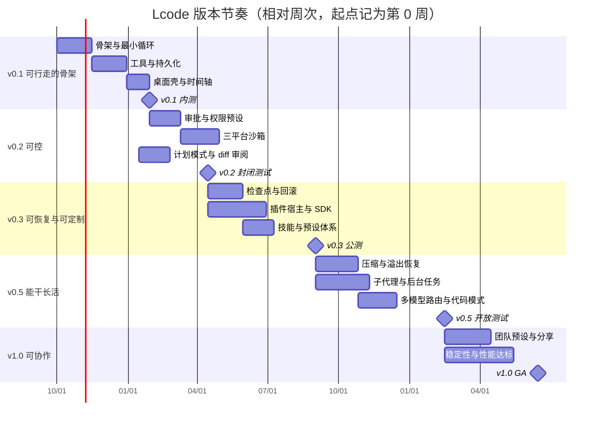
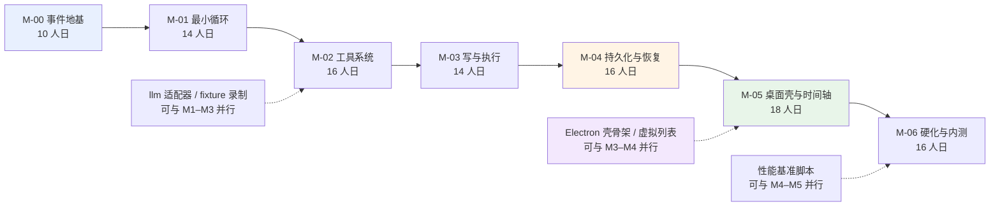
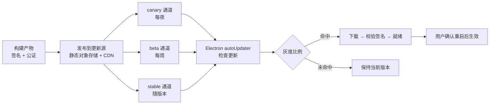

# 14 · 产品路线图与里程碑

> 这篇文档回答"Lcode 分几期、每期交付什么、怎么算做完了、排期最大的坑在哪"。给所有人看：产品用它排优先级，研发用它做技术地基，测试用它定质量门禁。

| 项 | 值 |
|---|---|
| 状态 | 草案 |
| 负责人 | 交付负责人 |
| 上游依赖 | [00-文档总览与全局约定.md](./00-文档总览与全局约定.md)（技术宪法 D1–D18、术语表、§8.5 数字口径）、[01-产品愿景与定位.md](./01-产品愿景与定位.md)、[03-PRD-需求规格说明.md](./03-PRD-需求规格说明.md)、[04-MVP范围与验收标准.md](./04-MVP范围与验收标准.md) |
| 下游被引 | [15-测试策略与质量门禁.md](./15-测试策略与质量门禁.md)、[16-风险登记册.md](./16-风险登记册.md) |

---

## 目录

- [1. 版本节奏总览](#1-版本节奏总览)
- [2. v0.1 · 可行走的骨架](#2-v01--可行走的骨架)
- [3. v0.2 · 可控](#3-v02--可控)
- [4. v0.3 · 可恢复与可定制](#4-v03--可恢复与可定制)
- [5. v0.5 · 能干长活](#5-v05--能干长活)
- [6. v1.0 · 可协作](#6-v10--可协作)
- [7. MVP（v0.1）详细拆解](#7-mvpv01详细拆解)
- [8. 关键路径分析](#8-关键路径分析)
- [9. 里程碑验收矩阵](#9-里程碑验收矩阵)
- [10. 发布策略](#10-发布策略)
- [11. 跨期切分原则与"我们不做什么"](#11-跨期切分原则与我们不做什么)
- [未决问题](#未决问题)
- [变更记录](#变更记录)

---

## 1. 版本节奏总览

Lcode 的版本号**故意跳号**（v0.1 → v0.2 → v0.3 → v0.5 → v1.0）：每个数字对应一次**产品命题的跃迁**，而不是一次功能批次的堆积。v0.4 被保留给"v0.3 与 v0.5 之间出现重大插入需求"的应急通道，不预填内容。

### 1.1 五个阶段的主题与一句话目标

| 版本 | 主题 | 一句话目标 | 对应产品宪法 |
|---|---|---|---|
| **v0.1** | 可行走的骨架 | 用户能开一个会话、让 agent 读写文件并跑命令、在时间轴上回放到每一步。 | 第一条（可解释优先） |
| **v0.2** | 可控 | 每一次危险动作都能被拦下，拦截结果可解释、可重放；沙箱在三大平台真实生效。 | 第一条 + 第二条 |
| **v0.3** | 可恢复与可定制 | 用户能回到任意检查点，能装插件、写技能、存预设，且卸载插件后世界精确回滚。 | 第二条 + 第三条 |
| **v0.5** | 能干长活 | agent 连续工作数十轮不"变傻"、不烧穿预算，能委托子代理、能把长命令放后台。 | 第一条 + 第三条 |
| **v1.0** | 可协作 | 团队共享同一套预设与技能，会话可分享，稳定性与性能达标，可日常依赖。 | 三条同时 |

**这张表想让你看到什么**：版本号的跳跃不是营销，每次跨越都绑定到一条不可妥协的产品宪法，因此 v0.1 到 v0.2 的距离远大于"加一个功能批次"。

### 1.2 时间节奏（甘特）

**这张图想让你看到什么**：v0.2 之后的每个大版本内部，能力层（沙箱、插件、子代理）与体验层（计划模式、预设、分享）是可以并行的两条泳道，真正的串行瓶颈集中在每期开头的内核改动。

### 1.3 通道与命名约定

| 概念 | 约定 |
|---|---|
| 版本号 | `MAJOR.MINOR.PATCH`，本文的 v0.1/v0.2 指 MINOR |
| 发布通道 | `canary`（每夜）→ `beta`（每周）→ `stable`（随版本） |
| 里程碑编号 | `M-<版本>-<序号>`，如 `M-v0.1-03` |
| 验收项编号 | `M-<域>-<序号>`，遵循 [00 §7.4](./00-文档总览与全局约定.md#74-需求编号规范) |
| 需求引用 | `FR-<域>-<序号>`；正式编号以 [03-PRD-需求规格说明.md](./03-PRD-需求规格说明.md) 为准，本文为暂定 |

---

## 2. v0.1 · 可行走的骨架

### 2.1 目标用户旅程

> 用户打开 Lcode，选择一个本地仓库目录，说"给这个仓库补一个 `.editorconfig` 并把缩进统一成 2 空格"。agent 读了目录、写了文件、跑了一次命令验证；随后用户拖动时间轴回到第 3 步，看到**那一刻模型确切收到了什么**、`tool/call` 的原始参数、以及 `tool/result` 的卡片。关闭应用，第二天重开，会话完好、可以直接继续对话。

完成这件事之前做不到的能力：**"能追问 agent 为什么这么做"**。这是 Lcode 与"只会吐文本的聊天框"的第一道分界线。

### 2.2 交付功能清单

| 编号（暂定） | 功能 | 优先级 |
|---|---|---|
| `FR-SESSION-001` | 会话创建 / 列表 / 打开（一枚会话 id，agent 与会话同 id，见 D17） | Must |
| `FR-SESSION-002` | append-only 事件日志（`SessionEvent` 判别联合，`seq = log.length`） | Must |
| `FR-SESSION-005` | 事件 data 的无损 JSON 校验与深冻结（拒绝 BigInt / 函数 / NaN / 循环引用） | Must |
| `FR-SESSION-010` | `deriveMessages()` 派生投影 + 投影缓存 | Must |
| `FR-SESSION-020` | JSONL 持久化后端 + write-behind 批写 | Must |
| `FR-SESSION-025` | 崩溃恢复：保留完整中断 turn、合成收尾事件、只丢撕裂尾记录 | Must |
| `FR-PROMPT-001` | 系统提示装配（section / context / tools 三段） | Must |
| `FR-PROMPT-005` | `request/header` + `request/context` 事件落盘（请求可重建的凭证） | Must |
| `FR-LLM-001` | `llm` 接口 + `llm-deepseek` 适配器 | Must |
| `FR-LLM-005` | `llm-replay` 适配器（从 fixture 读 chunk） | Must |
| `FR-TOOL-001` | 工具注册表 + `defineTool` | Must |
| `FR-TOOL-002` | 工具执行流水线（pre → guard → execute → post → finalize） | Must |
| `FR-TOOL-010` | `tool-fs`：`read` / `write` / `edit` / `glob` / `grep` | Must |
| `FR-TOOL-020` | `tool-shell`：前台命令执行 + 结构化 exit | Must |
| `FR-TOOL-030` | 工具返回**规范值** + 纯投影渲染（`card`：`read` / `diff` / `terminal`） | Must |
| `FR-AGENT-001` | `@lcode/agent-loop`：唯一的具体循环（调模型 / 跑工具 / 重复） | Must |
| `FR-AGENT-005` | turn / step 边界事件与状态收敛（取消后回到 idle） | Must |
| `FR-TIMELINE-001` | 时间轴：按 `seq` 回放，展示当时的 system / messages / tools | Must |
| `FR-TIMELINE-005` | 时间轴：工具调用"为什么"面板（经过哪些策略） | Should |
| `FR-UI-001` | Electron 外壳 + IPC + 会话流虚拟列表 | Must |
| `FR-CLI-001` | headless CLI（JSONL 到 stdout） | Should |

### 2.3 本期**不做**清单

| 不做的事 | 为什么现在不做 |
|---|---|
| 权限 / 审批 / 沙箱 | 没有沙箱时只允许用户显式选择的工作目录；把安全边界留给 v0.2 一次性做对（见 D11、D13）。 |
| 检查点 / 文件级回滚 | 可重放 ≠ 可撤销（[00 §8.1](./00-文档总览与全局约定.md#81-可重放不等于能撤销)）。v0.1 只承诺可重放。 |
| 插件系统（utility process） | 内核接口未稳定前放插件进来会锁死契约；v0.1 用编译期集束（`lcode-base`）组装。 |
| 技能（`SKILL.md`） | 依赖稳定的上下文注入点，属于 v0.3。 |
| 子代理 / 后台任务 | 依赖所有权与深度控制，属于 v0.5。 |
| 上下文压缩 | 没有压缩也能跑通骨架；压缩的正确性依赖 surface replace 已被充分测试，属于 v0.5。 |
| 多模型路由 | v0.1 先跑通单一适配器的流式保真度。 |
| 代码模式（code mode） | 依赖结构化规范值稳定，属于 v0.5。 |
| 团队协作 / 会话分享 | 属于 v1.0，依赖文件系统同步而非自建服务。 |

### 2.4 出口标准（Exit Criteria）

| 编号 | 判据 | 验证方式 |
|---|---|---|
| `M-BOOT-01` | 全新机器安装后启动到主窗口可交互 ≤ 3.0s（[00 §8.5](./00-文档总览与全局约定.md#85-数字口径约定) 口径） | 基准脚本 + 手动 |
| `M-BOOT-02` | 完成 2.1 的完整旅程，全程无崩溃 | 手动清单（见 15 号文档 §8） |
| `M-CORE-01` | 任意一次 loop 构建的请求满足 `request.system === assembleFromLog(log)` 且 `deepEqual(request.messages, deriveMessages(log))` | 不变量 I1，见 [15-测试策略与质量门禁.md](./15-测试策略与质量门禁.md#3-核心不变量测试) |
| `M-CORE-02` | 日志 `seq` 无空洞（0..n-1） | 不变量 I2 |
| `M-CORE-03` | 任何 `tool/call` 都有配对 `tool/result` | 不变量 I3 |
| `M-RECV-01` | 写入过程中杀进程，恢复后历史合法、可直接发下一轮请求 | 崩溃恢复 e2e |
| `M-RECV-02` | 重放重建的历史与实时历史逐字节一致的会话占比 = 100%（样本 ≥ 30） | 重放测试 |
| `M-DEMO-01` | 时间轴可回放到任意步，展示当时确切输入 / 输出 | 手动 + 截图 |
| `M-QA-01` | `packages/core/*/src` 逐文件覆盖率 100%，全部质量门禁为绿 | CI（见 15 号文档 §6） |

### 2.5 风险与前置依赖

- **前置依赖**：D4（append-only 日志）、D5（surface replace 原语）、D8（规范值）、D18（epoch ms）必须在动工前冻结，见 [17-架构决策记录ADR.md](./17-架构决策记录ADR.md)。
- **风险**：崩溃恢复的"合成收尾"若设计返工，会反向修改 `session` 与 `session-persistence` 两个包（见 §8.3 R1）。
- **风险**：`deriveMessages()` 若与实时内存路径产生第二套投影规则，不变量 I1 会形同虚设。缓解：投影函数唯一化，缓存只是加速。

---

## 3. v0.2 · 可控

### 3.1 目标用户旅程

> agent 要执行 `rm -rf build/`，用户看到一个审批卡片，写明**它经过了哪些策略、为什么被判定为需要确认**；用户点"仅本次允许"，命令执行；如果用户点"拒绝"，agent 收到结构化的拒绝，换一条安全路径继续。整个决策在时间轴上可回放：谁批准的、依据是哪条策略、当时的工作目录与 argv。

之前做不到的能力：**"危险动作必须经过我，且我一定看得懂它在问什么"**。

### 3.2 交付功能清单

| 编号（暂定） | 功能 | 优先级 |
|---|---|---|
| `SEC-APPROVAL-001` | 审批是 one-shot（无"永久允许"状态），`allowed-once / rejected / cancelled / unavailable` | Must |
| `SEC-APPROVAL-002` | fail-closed：无审批应答者 = 拒绝；并行分类器非精确 `true` = 独占 | Must |
| `SEC-APPROVAL-003` | 审批卡片可解释："为什么"面板列出经过的策略链 | Must |
| `SEC-SANDBOX-001` | `ctx.sandbox.run(argv, policy)` 约束的是 argv，不是工具逻辑 | Must |
| `SEC-SANDBOX-002` | macOS 沙箱配置文件（`sandbox-exec` 配置） | Must |
| `SEC-SANDBOX-003` | Linux Landlock + seccomp | Must |
| `SEC-SANDBOX-004` | Windows AppContainer + Job Object | Must |
| `FR-PERM-001` | 权限预设（`workspace-write` 等）把"能碰哪里 + 要不要问人"打包成一个用户概念 | Must |
| `FR-PERM-002` | 权限预设写的是**两个 knob 事件**，不是一个布尔量 | Must |
| `FR-GUARD-001` | 可重排策略用 `waterfall`；终局拒绝用**单调 guard（类型上无 allow）** | Must |
| `FR-PLAN-001` | 计划模式：先产出计划、经用户确认后执行 | Must |
| `FR-PLAN-002` | 计划模式下的工具集限制（只读） | Should |
| `FR-DIFF-001` | diff 审阅：写操作以纯投影卡片呈现，可逐块接受 / 拒绝 | Must |
| `FR-UI-002` | 审批弹窗 + 权限预设切换 UI | Must |

### 3.3 本期**不做**清单

| 不做的事 | 为什么现在不做 |
|---|---|
| 检查点 / 回滚 | 审批解决"要不要做"，回滚解决"做错了怎么办"，两者的失败模型不同，分两期做。 |
| 远程 / 容器沙箱 | v0.2 只用 OS 原生机制（D13），不引 VM 以保持启动速度。 |
| 权限的团队策略下发 | 属于 v1.0 的预设共享。 |
| 永久白名单 | 明确不做：要"永久"就显式换权限预设，避免隐式状态。 |
| 插件定义审批策略 | 内核策略先固化，插件扩展点留给 v0.3。 |

### 3.4 出口标准（Exit Criteria）

| 编号 | 判据 |
|---|---|
| `M-SEC-01` | 三平台沙箱均能在真机上实际拦截"写工作目录之外的文件"（见 15 号文档 §8 手动清单） |
| `M-SEC-02` | 无审批应答者时，危险操作 100% 被拒绝（fail-closed） |
| `M-SEC-03` | 拒绝后 agent 收到结构化错误并可继续，不产生孤立 `tool/call` |
| `M-SEC-04` | 守卫在类型层面无 `allow`（静态检查） |
| `M-PLAN-01` | 计划模式下写工具不可用，尝试调用返回结构化拒绝 |
| `M-DIFF-01` | 每个写操作的 diff 卡片可从日志纯投影重建（UI 一致） |

### 3.5 风险与前置依赖

- **前置依赖**：v0.1 的 `tool/call` 必须在执行前落盘，否则审批无法在时间轴上对齐。
- **风险**：三大平台沙箱的**实际拦截效果差异大**，Windows AppContainer 与 Linux 用户命名空间的权限模型不同，可能拖出一整期。缓解：先交付审批（几天），沙箱按平台分批发布，未完成平台降级为"显式拒绝 + 提示"。
- **风险**：审批插入位置若晚于 guard，会让"可被最终拒绝"的操作误以为已获批。约束：审批必须跑在单调 guard **之前**。

---

## 4. v0.3 · 可恢复与可定制

### 4.1 目标用户旅程

> 用户让 agent 重构了 12 个文件，发现方向不对，在时间轴上选中重构前的检查点，点"回滚到此"，文件系统回到当时状态；随后用户装了一个第三方插件（含自定义工具），用得不顺手，点"卸载"——插件注册的工具、事件监听、提示词段落**全部消失，世界精确回滚到加载前**。

之前做不到的能力：**"我敢让它大改，因为我能退回去；我敢让它扩展，因为我能安全卸载"**。

### 4.2 交付功能清单

| 编号（暂定） | 功能 | 优先级 |
|---|---|---|
| `FR-CKPT-001` | 检查点：turn 边界的可回放稳定点（`checkpoint` 术语见 00 §6） | Must |
| `FR-CKPT-002` | 文件级快照与回滚（区分"可重放"与"可撤销"） | Must |
| `FR-CKPT-003` | 回滚不修改既有事件，而是追加新的 restore 事件（保持 append-only） | Must |
| `FR-PLUGIN-001` | 插件宿主：独立 utility process + 类型化 RPC（见 D14、D15） | Must |
| `FR-PLUGIN-002` | 插件清单 / 注册表 / 生命周期 | Must |
| `FR-PLUGIN-003` | 可逆副作用：注册即返回**撤销器**；卸载调用全部 disposer | Must |
| `FR-PLUGIN-004` | 插件沙箱化：插件崩溃不影响内核 | Must |
| `FR-PLUGIN-005` | `plugin-sdk`：对外暴露服务 / 事件 / 工具注册 | Must |
| `FR-SKILL-001` | 技能：`SKILL.md` + 可选脚本，两段式 catalog / loader | Must |
| `FR-SKILL-002` | `tool-skill`：模型可主动加载技能 | Should |
| `FR-PRESET-001` | 预设 / 集束 / 配置档三层装配（`agent.cordis.yml` / `cordis.patch.yml`） | Must |
| `EXT-TOOL-001` | 工具扩展点：插件注册工具并声明卡片投影 | Should |

### 4.3 本期**不做**清单

| 不做的事 | 为什么现在不做 |
|---|---|
| 插件的远程分发市场 | 先做本地安装（路径 / 压缩包），市场依赖签名与信任链，属于 v1.0 之后。 |
| 子代理 / 后台任务 | 依赖插件宿主的进程模型稳定后再叠加，属于 v0.5。 |
| 上下文压缩 | 与 checkpoint 无关，属于 v0.5。 |
| 跨设备同步 | 明确不做自建服务，团队同步走文件系统（v1.0）。 |
| 插件间的依赖求解 | v0.3 只做扁平加载与顺序声明，不做依赖图解析。 |

### 4.4 出口标准（Exit Criteria）

| 编号 | 判据 |
|---|---|
| `M-CKPT-01` | 回滚后文件系统逐字节等于检查点快照（样本 ≥ 30 个随机检查点） |
| `M-CKPT-02` | 回滚在日志中表现为追加事件，历史事件序列不被改写 |
| `M-PLUG-01` | 加载→卸载同一插件后，注册表快照与加载前**深相等** |
| `M-PLUG-02` | 插件进程被 kill 后内核状态收敛到无该插件，且可重新加载 |
| `M-SKILL-01` | 技能的加载只在被引用时发生（catalog 不泄露全文） |
| `M-PRESET-01` | 两个预设切换后，服务注册表差异与预期一致且可反向切回 |

### 4.5 风险与前置依赖

- **前置依赖**：v0.2 的权限与沙箱必须就位——插件是"用户引入的第三方代码"，没有沙箱时加载插件是不负责任的。
- **风险**：**"卸载即回滚"是架构约束不是愿望**（[00 第三条](./00-文档总览与全局约定.md#第三条--内核只提供机制策略全部外挂)）。只要有任何一个扩展点忘记返回撤销器，就会造成泄漏。缓解：撤销器由类型系统强制（注册 API 的返回值类型不可忽略），并在 CI 加"泄漏检查"用例。
- **风险**：utility process 的 RPC 类型生成（D15）若未稳定，插件 SDK 会反复破坏兼容。缓解：RPC 描述符作为独立产物先冻结。

---

## 5. v0.5 · 能干长活

### 5.1 目标用户旅程

> 用户让 agent"给整个后端加一个 metrics 端点，并补齐测试"。agent 先派一个子代理去调研现有路由组织方式，同时把一次耗时的全量测试放到后台任务；主循环继续写代码。上下文接近窗口上限时，agent 用 **surface replace** 压缩早期探索过程，模型仍然看得见"我们讨论过什么"的摘要，但不再记得每一次试错细节。整个过程 token 用量在面板上可见。

之前做不到的能力：**"我把一整天的活交出去，它不会中途变傻，也不阻塞我"**。

### 5.2 交付功能清单

| 编号（暂定） | 功能 | 优先级 |
|---|---|---|
| `FR-COMPACT-001` | 压缩原语 = **surface replace**（追加声明替换区间的 surface 事件），不做删除（D5） | Must |
| `FR-COMPACT-002` | 第一层：tool-result pruning（零模型成本，单节点 replace） | Must |
| `FR-COMPACT-003` | 第三层：摘要压缩（选区间 → 生成摘要 → 追加带 replace 的 `user/message`） | Must |
| `FR-COMPACT-004` | 约束：摘要必须严格小于被遮蔽内容，否则拒绝 | Must |
| `FR-COMPACT-005` | 约束：replace 的 start/end 是 **surface 位置**，不是 seq；不切断 tool-call / tool-result 配对 | Must |
| `FR-COMPACT-006` | 溢出恢复：捕获 `CONTEXT_WINDOW_EXCEEDED` 后触发压缩 | Should |
| `FR-SUBAGENT-001` | 子代理 one-shot：继承父工具集，策略在委派边界冻结、不可扩权 | Must |
| `FR-SUBAGENT-002` | 委派深度单调持久化 + 深度上限（默认 3，0 = 禁用） | Must |
| `FR-SUBAGENT-003` | 子代理不可向人类提问（`DELEGATED_CALLER`），问题写进结果 | Must |
| `FR-SUBAGENT-004` | 可续子代理（continuable） | Should |
| `FR-JOBS-001` | 后台任务：发布即脱离（用 job 自己的 signal） | Must |
| `FR-JOBS-002` | owner 隔离 + 结算 first-wins + 完成通知限流 | Must |
| `FR-JOBS-003` | `tool-jobs`：查询 / 停止后台任务（停止进程树） | Must |
| `FR-TERM-001` | `terminal-pty` + `tool-terminal`：持久终端，owner 隔离 | Should |
| `FR-ROUTE-001` | 多模型路由：按能力 / 成本 / 可用性选择适配器 | Should |
| `FR-CODEMODE-001` | 代码模式：模型写代码调用工具（`await tools.<name>(args)`） | Should |
| `FR-TOKEN-001` | token 计量与压缩率可观测 | Must |

### 5.3 本期**不做**清单

| 不做的事 | 为什么现在不做 |
|---|---|
| 团队协作 / 预设共享 | 属于 v1.0。 |
| 自建协作服务器 | 明确排除（[00 §8.4](./00-文档总览与全局约定.md#84-团队协作不等于云端-saas)）。 |
| 企业 SSO / 合规审计 / 配额管控 | 明确排除在 v1.0 之外（[00 §3.2](./00-文档总览与全局约定.md#32-次用户小团队v10-起)）。 |
| 无限制的子代理深度 | 深度上限是安全边界，永远不做成"无限制"。 |
| 在流式中途触发压缩 | 压缩只在 `pre-step` / `request-error` 两个明确边界做。 |
| 移除原始事件的"真删除" | surface replace 是唯一压缩原语，**永远不删原始事实**。 |

### 5.4 出口标准（Exit Criteria）

| 编号 | 判据 |
|---|---|
| `M-COMP-01` | 压缩后请求仍然合法（配对完整），I3 全绿 |
| `M-COMP-02` | 从压缩后的日志重放出与实时一致的（压缩后）历史 |
| `M-COMP-03` | 摘要字节数 < 被遮蔽内容字节数（断言，不允许违反） |
| `M-COMP-04` | 压缩后模型仍能回答"我们之前为什么选了方案 B"（人工抽检样本 ≥ 10） |
| `M-SUB-01` | 子代理继承父工具集，`tools.restrict` 生效且不可扩权 |
| `M-SUB-02` | 超过深度上限明确报错，不无限递归 |
| `M-JOB-01` | 后台命令不阻塞主循环，`job_kill` 能杀掉进程树 |
| `M-JOB-02` | 结算 first-wins，重复完成不产生重复事件 |

### 5.5 风险与前置依赖

- **前置依赖**：`deriveMessages()` 已能正确处理 surface replace（v0.1 就应具备），否则压缩无处落地。
- **风险**：**压缩是"可重放"最容易破防的地方**。任何一次按 seq 而非 surface 位置计算的 replace，都会让重放偏离。缓解：不变量 I4 在 CI 强制。
- **风险**：子代理"重新解析父配置"会导致能力漂移（[参考文档 §11.10](./code-agent-architecture-design.md) 的反模式）。约束：子代理用 `composeFrom(childCtx, parentCtx)` 绑定已运行实例。
- **风险**：后台任务完成通知若无限流，会自激唤醒主循环。约束：通知限流为 must。

---

## 6. v1.0 · 可协作

### 6.1 目标用户旅程

> 一个新同事入职，克隆团队仓库，里面带着团队的预设文件与技能包；Lcode 打开后自动加载，**新人第一次对话就对齐了团队的代码规范与工具链**。老同事把一个排查会话导出成人类可读的 Markdown 发给新人，新人导入后能顺着时间轴看到每一步。整个过程的同步靠 git，不经过任何 Lcode 服务器。

之前做不到的能力：**"团队经验可以像代码一样被版本化、共享、审阅"**。

### 6.2 交付功能清单

| 编号（暂定） | 功能 | 优先级 |
|---|---|---|
| `FR-TEAM-001` | 团队预设共享：预设 / 集束 / 配置档作为仓库内文件，git 可 diff | Must |
| `FR-TEAM-002` | 技能包共享：技能目录随仓库分发 | Must |
| `FR-TEAM-003` | 会话分享：导出人类可读格式（JSONL / Markdown），可导入回放 | Must |
| `FR-TEAM-004` | 基于文件系统的同步（用户自选 git / 网盘 / NAS），**不自建服务器** | Must |
| `NFR-PERF-001` | 冷启动 ≤ 3.0s，首 token 延迟 ≤ 150ms（不含模型排队） | Must |
| `NFR-PERF-002` | 万级事件会话滚动帧率 ≥ 50fps（基准机） | Must |
| `NFR-PERF-003` | 常驻内存 ≤ 500MB（中等会话，基准机） | Must |
| `NFR-REL-001` | 真机崩溃恢复：三平台各 20 次强杀，恢复成功率 100% | Must |
| `FR-RELEASE-001` | 自动更新 GA：灰度发布 + 可回滚 | Must |
| `FR-DOCTOR-001` | `lcode doctor` 自检 + `--telemetry` 预览将发送的内容 | Must |

### 6.3 本期**不做**清单

| 不做的事 | 为什么现在不做 |
|---|---|
| 自建协作服务器 / 云端账号体系 | 与"用户拥有自己的数据与算力"冲突（[00 §8.4](./00-文档总览与全局约定.md#84-团队协作不等于云端-saas)）。 |
| 企业 SSO / SCIM / 审计日志导出 | 明确排除在 v1.0 之外，属企业版范畴。 |
| 配额管控 / 计费系统 | Lcode 不自营模型算力，无配额可管。 |
| 完全托管云 IDE | 我们把代码留在本地（[00 §3.3](./00-文档总览与全局约定.md#33-明确不是我们的用户v10)）。 |
| 多人实时协同编辑同一会话 | 同构共享（导入 / 导出）足以覆盖需求，实时协同复杂度不成比例。 |

### 6.4 出口标准（Exit Criteria）

| 编号 | 判据 |
|---|---|
| `M-TEAM-01` | 两个用户通过 git 共享预设与技能，各自打开后装配结果深相等 |
| `M-SHARE-01` | 导出→导入→回放，transcript 逐事件一致 |
| `M-PERF-01` | §6.2 的四项性能指标全部达标，且连续两个版本无回归 |
| `M-REL-01` | 真机崩溃恢复样本通过率 100% |
| `M-REL-02` | 灰度版本可一键回滚，且用户会话数据不受影响 |
| `M-DOC-01` | 插件 SDK、技能、预设三份面向用户的文档完成度 100% |

### 6.5 风险与前置依赖

- **前置依赖**：v0.3 的预设 / 集束 / 配置档三层模型必须稳定，否则"共享"共享的是不稳定的格式。
- **风险**：性能达标往往需要在 v0.3–v0.5 就持续投入，不能攒到 v1.0。缓解：性能基准脚本从 v0.1 就进入 CI（见 15 号文档 §7）。
- **风险**：自动更新涉及代码签名与公证（macOS notarize / Windows code signing），流程性工作耗时且不可压缩。缓解：v0.2 起就建立签名流水线。

---

## 7. MVP（v0.1）详细拆解

按**双周**切分，共 7 个里程碑 `M-v0.1-00` 至 `M-v0.1-06`，覆盖约 14 周。工作量以**人日**计，基准为一名熟悉 TypeScript / Node.js 的工程师；并行任务已标注。

### 7.1 里程碑总览

**这张图想让你看到什么**：主链条上有两处必须串行（事件地基 → 最小循环；持久化 → 桌面壳），而 llm 适配器、Electron 壳骨架、基准脚本三条支线可以提前开工，是压缩排期的主要杠杆。

### 7.2 里程碑明细

#### `M-v0.1-00` · 事件地基（第 0 双周，10 人日）

| 项 | 内容 |
|---|---|
| **交付物** | `@lcode/session` 的 `SessionEvent` 判别联合与 `Session.append`；`@lcode/scope` 作用域原语；`@lcode/util` 的 Branded 类型与无损 JSON 校验；`Context` / `Service` / `Event` 最小实现（`emit` / `waterfall` 起步） |
| **验收项** | `seq` 连续（I2）；`append` 对非法值抛结构化错误（I5）；事件深冻结；`session/end-seed` 分界线就位 |
| **依赖** | 无（D1/D2/D4/D18 已冻结） |
| **工作量** | 10 人日 |

#### `M-v0.1-01` · 最小循环（第 1 双周，14 人日）

| 项 | 内容 |
|---|---|
| **交付物** | `@lcode/llm` 接口 + `llm-deepseek`；`@lcode/system-prompt` 最小装配；`@lcode/agent-loop` 的 `runTurn`；`deriveMessages()` + 投影缓存 |
| **验收项** | 能完成一次带工具调用的对话；I1 首次成立；杀掉进程后从内存日志能重建历史 |
| **依赖** | M-00 |
| **工作量** | 14 人日（其中适配器流式保真度 5 人日） |

#### `M-v0.1-02` · 工具系统（第 2 双周，16 人日）

| 项 | 内容 |
|---|---|
| **交付物** | `@lcode/tools` 注册表 + 五段流水线（pre → guard → execute → post → finalize）；`defineTool`；`llm-replay` 适配器 + fixture 录制器；`tool-fs` 的 `read` / `glob` / `grep` |
| **验收项** | 非法参数变成结构化错误而非抛异常；并行安全工具重叠执行、独占工具构成屏障；从 fixture 重放能重建工具卡片 |
| **依赖** | M-01 |
| **工作量** | 16 人日 |

#### `M-v0.1-03` · 写与执行（第 3 双周，14 人日）

| 项 | 内容 |
|---|---|
| **交付物** | `tool-fs` 的 `write` / `edit`；`tool-shell` 前台执行；卡片纯投影（`read` / `diff` / `terminal`）；`request/header` + `request/context` 落盘 |
| **验收项** | 写操作的 diff 卡片可由日志纯函数重建（I1 的 UI 侧面）；shell 结构化 exit 正确；`tool/call` 在执行前落盘 |
| **依赖** | M-02 |
| **工作量** | 14 人日 |

#### `M-v0.1-04` · 持久化与恢复（第 4 双周，16 人日）

| 项 | 内容 |
|---|---|
| **交付物** | `@lcode/session-persistence` 接口 + `-jsonl` 后端；write-behind 批写 + `flush()` 屏障；崩溃恢复 `repair()`（保留中断 turn、合成收尾、只丢撕裂尾记录）；resume / fork（切点不落在打开的 turn 内） |
| **验收项** | 正常关闭重开历史一致；写入中杀进程后无孤立 `tool/call`（I3）；fork 后两边独立演进；未知格式版本抛专用错误 |
| **依赖** | M-03 |
| **工作量** | 16 人日（其中崩溃恢复 6 人日） |

#### `M-v0.1-05` · 桌面壳与时间轴（第 5 双周，18 人日）

| 项 | 内容 |
|---|---|
| **交付物** | Electron 外壳（主进程承载 runtime）+ 预加载 + 渲染进程；IPC 类型生成；会话流虚拟列表；**时间轴回放**（按 `seq` 展示当时的 system / messages / tools）；"为什么"面板雏形 |
| **验收项** | 时间轴可回放到任意步并展示确切输入 / 输出；UI 重连后能从日志重建完整 transcript；取消后状态收敛到 idle |
| **依赖** | M-04 |
| **工作量** | 18 人日（其中时间轴 8 人日） |

#### `M-v0.1-06` · 硬化与内测（第 6 双周，16 人日）

| 项 | 内容 |
|---|---|
| **交付物** | 全部质量门禁（见 [15 号文档 §6](./15-测试策略与质量门禁.md#6-质量门禁清单)）；性能基准脚本与首版基线；`packages/core/*/src` 逐文件 100% 覆盖；内测发布流水线（签名 + 更新源） |
| **验收项** | `M-BOOT-01` / `M-QA-01` 达标；§2.4 全部出口标准为绿；种子内测用户完成 2.1 旅程 |
| **依赖** | M-05 |
| **工作量** | 16 人日（其中签名 / 更新 5 人日） |

### 7.3 工作量汇总

| 里程碑 | 人日 | 可并行支线 |
|---|---|---|
| M-00 事件地基 | 10 | — |
| M-01 最小循环 | 14 | llm 适配器细化 |
| M-02 工具系统 | 16 | fixture 录制器 |
| M-03 写与执行 | 14 | Electron 壳骨架 |
| M-04 持久化与恢复 | 16 | 虚拟列表原型 |
| M-05 桌面壳与时间轴 | 18 | 基准脚本 |
| M-06 硬化与内测 | 16 | — |
| **合计** | **104 人日** | |

按 2–3 人工程师团队估算，考虑并行与评审开销，日历时间约 **12–16 周**。若只有 1 人，约 24–28 周（不含协作等待）。

---

## 8. 关键路径分析

### 8.1 串行链（不可压缩）

**这张图想让你看到什么**：从事件日志到时回放是一条**逻辑上不可逆的依赖链**——上游表示法一旦变更，下游全部重写，因此这七步是本期的唯一关键路径。

### 8.2 可并行的支线

| 支线 | 可并入的里程碑 | 说明 |
|---|---|---|
| llm 适配器流式保真度 | M-01–M-03 | 与工具系统无强耦合，只依赖 `llm` 接口 |
| fixture 录制器 / `llm-replay` | M-02–M-04 | 独立工具链，可提前固化重放测试 |
| Electron 壳骨架 + 虚拟列表 | M-03–M-05 | UI 只需消费 `session/event`，不依赖持久化 |
| 性能基准脚本 | M-04–M-06 | 从第一版起建立基线，避免 v1.0 才发现回归 |
| 签名 / 更新源流水线 | M-05–M-06 | 流程性工作，与内核无关，尽早启动 |

### 8.3 三个最大的排期风险

1. **R1 · 崩溃恢复的"合成收尾"正确性（影响 M-04，可能回卷 M-00/M-01）**
   崩溃恢复不是"补几行代码"，而是**可重放不变量在异常路径上的守门人**。若 `repair()` 的设计要求事件日志增加新的结构字段，会反向修改 `session` 包与所有已写好的派生逻辑。**触发条件**：M-00 的日志结构未预留"生命周期分界线"或未定义 `interruptedTurnClosers` 的形状。
   **缓解**：M-00 就把 `session/end-seed` 与 recovery 契约写进接口注释；M-04 开工前用 30 个真实 fixture 做一次"预演"。

2. **R2 · IPC 类型生成是隐藏的关键路径（影响 M-05）**
   UI 时间轴的每一帧都依赖类型安全的 IPC 通道。若 D15 的类型图生成方案在 M-05 才首次落地，一旦出现类型描述符不稳定，会同时拖住 UI 与后续 v0.3 的插件 RPC。**触发条件**：把类型生成当作"UI 的实现细节"而非独立产物。
   **缓解**：M-02 起用 `cli` 的 JSONL 输出先跑通"事件 → 消费者"链路；类型描述符作为独立产物在 M-04 冻结。

3. **R3 · 时间轴回放的性能与保真度双约束（影响 M-05）**
   时间轴要求"任意步都能展示当时确切输入"，同时又要在万级事件下流畅滚动。若投影缓存与虚拟列表的实现互相打架（缓存要求全量、虚拟列表只渲染可见区），会出现"回放正确但卡顿"或"流畅但漂移"。**触发条件**：`deriveMessages()` 的缓存粒度与 UI 的可见区间不匹配。
   **缓解**：M-04 就定义"增量投影"契约；M-05 用真实长会话（≥ 10k 事件）做滚动基准，而不是用造的短会话。

---

## 9. 里程碑验收矩阵

行是里程碑，列是四类完成度。判定口径：**功能完成度** = 该里程碑交付物清单的实现比例；**质量门禁** = 该里程碑涉及的强制门禁是否全绿；**文档完成度** = 该阶段对应的架构文档章节与包 README 是否完成；**可演示性** = 能否对着一个真实场景端到端演示。

| 里程碑 | 功能完成度 | 质量门禁 | 文档完成度 | 可演示性 |
|---|---|---|---|---|
| `M-v0.1-00` 事件地基 | 100% 接口就位 | I2 / I5 全绿；单测覆盖率 100% | `06` 事件日志章节 + `session` README | 不可演示（纯地基） |
| `M-v0.1-01` 最小循环 | 单轮对话可用 | I1 首次全绿；重放测试可跑 | `05` 分层图 + `agent-loop` README | CLI 内跑通一次对话 |
| `M-v0.1-02` 工具系统 | 读类工具可用 | I3 全绿；fixture 重放通过 | `08` 工具流水线章节 | 模型读文件并解释 |
| `M-v0.1-03` 写与执行 | 写 + 命令可用 | 卡片纯投影一致；I1 的 UI 侧面通过 | `08` 卡片章节 | 完成一次真实改文件 |
| `M-v0.1-04` 持久化与恢复 | resume / fork 可用 | I3 崩溃路径全绿；重放准确率 100% | `11` 持久化章节 | 杀进程后恢复继续对话 |
| `M-v0.1-05` 桌面壳与时间轴 | 完整旅程可跑 | 性能基准首版建立 | `10` 客户端章节 | **完整 2.1 旅程可演示** |
| `M-v0.1-06` 硬化与内测 | §2.2 清单 100% | 全部门禁为绿；覆盖率 100% | 全部包 README 完成 | 内测用户独立跑通 |

**这张矩阵想让你看到什么**：真正"可演示"的门槛落在 M-05，而 M-00 到 M-04 每一层都在为最终演示积累一个**可验证的不变量**——任何一层的门禁放水，都会在 M-05 变成"能跑但不可信"。

---

## 10. 发布策略

### 10.1 内测渠道

| 阶段 | 渠道 | 规模 | 准入 | 目的 |
|---|---|---|---|---|
| 内部 dogfood | `canary`（每夜） | 团队自己 | 自动 | 捕获崩溃与不变量回归 |
| 封闭 alpha | `beta`（每周） | ~50 人，邀请制 | 签署"允许本地保存崩溃转储" | 验证真实项目上的沙箱与权限 |
| 公开 beta | `beta` | 不限 | 无 | 验证更新链路与性能基线 |
| 正式 | `stable` | 不限 | 无 | 日常使用 |

**渠道切换**只改一个配置档指向的集束，不改代码（见 00 §6 的"配置档 / 集束"术语）。

### 10.2 自动更新机制

**这张图想让你看到什么**：更新源刻意做成**静态文件分发**（无 Lcode 自建服务），三个通道只是同一产物的不同指针，因此"回滚"就是"把指针指回上一个稳定版本"。

- **实现选型**：采用 `electron-updater`（Electron 官方 `autoUpdater` 的封装），Windows 用 NSIS，macOS 用 DMG + Squirrel 分支，Linux 用 AppImage。
- **签名与公证**：macOS 必须 notarize（否则 Gatekeeper 拦截）；Windows 必须代码签名（否则 SmartScreen 告警）。这是**发布前置**，不是可选项。
- **更新源**：静态对象存储 + CDN，只是文件托管，不接收任何用户数据。
- **默认行为**：**不静默重启**。下载在后台，用户确认后才重启生效——避免打断正在长跑的 agent 会话。

### 10.3 灰度与回滚

| 机制 | 做法 |
|---|---|
| 灰度 | `stable` 与 `beta` 通道支持按百分比放量（默认 beta 100%、stable 先用 10% 观察 48 小时） |
| 观察指标 | 崩溃率（本地聚合上报，见 10.4）、启动失败率、更新失败率 |
| 回滚 | **指针回退**：把通道指针指回上一个稳定版本。用户无需做任何操作，下次检查更新即降级 |
| 强制回滚 | 仅用于"会导致数据损坏"的严重缺陷；即便如此也不触碰用户会话与日志 |
| kill-switch 边界 | 与服务端的唯一交互是"是否有新版本"，**不含任何用户数据**。服务不可达时，客户端正常使用 |

### 10.4 崩溃上报（在"遥测默认关闭"原则下）

**原则**（见 [00 第二条](./00-文档总览与全局约定.md#第二条--用户拥有自己的数据与算力)）：遥测默认关闭；开启后必须可逐项审查。

| 环节 | 做法 |
|---|---|
| 默认状态 | **关闭**。不发送任何东西 |
| 本地保存 | 崩溃转储与堆栈写入 `~/.lcode/crash/`，本地保留最近 N 份 |
| 上报触发 | 崩溃后弹窗询问"是否上报这次崩溃"，用户明确同意才发送 |
| 上报内容 | 仅：堆栈、版本号、OS / 架构、崩溃时的功能开关状态。**不含**代码、会话、文件路径内容、凭据 |
| 审查入口 | `lcode doctor --telemetry` 展示"这次会发送的确切字节" |
| 实现 | Electron `crashReporter` 的 `start()` **延迟到用户同意之后**才调用，避免初始化即上报 |
| 会话数据 | 永远不上报；崩溃恢复走本地 JSONL 的 `repair()`，与上报无关 |

**我们不做**：不做"默认开启 + 事后告知"；不做隐式设备指纹；不把"崩溃率"作为必须联网才能使用的功能。

---

## 11. 跨期切分原则与"我们不做什么"

### 11.1 切分原则

| 原则 | 含义 |
|---|---|
| 每期都必须"可演示" | 任何一期的终点都要能对着一个真实场景演示，不允许"这期只是重构"。 |
| 安全边界不后置 | 任何能让 agent 改变用户机器的能力，必须**先有拦截机制再有该能力**（权限先于插件，沙箱先于后台任务）。 |
| 不变量不赊账 | I1–I7（见 15 号文档 §3）在引入对应能力的**同一期**就必须全绿，不允许"下期补测试"。 |
| 内核改动前置 | 依赖链上游（事件日志、派生、投影）的改动必须放在每期开头，避免末期返工。 |
| 明确写出不做 | 每一期都有"本期不做"清单，且每条都有理由（对应 MoSCoW 的 Will not）。 |

### 11.2 全期共同的"不做"

- 不自建协作 / 数据服务器（v1.0 的团队能力走文件系统同步）。
- 不做企业级 SSO / 合规审计 / 配额管控。
- 不做完全托管云 IDE。
- 不引入 VM 做沙箱（坚持 OS 原生机制，见 D13）。
- 不做"永久允许"的隐式审批状态（审批恒为 one-shot，见 D11）。
- 不删除原始事件（surface replace 是唯一压缩原语，见 D5）。

---

## 未决问题

- [ ] **人员与并行度**：§7.3 的 104 人日按 2–3 人估算，实际编制未定。若只有 1 人，v0.2 与 v0.3 之间是否需要合并？卡在交付负责人。
- [ ] **v0.4 应急通道**：是否预设一个具体的触发条件（例如"三平台沙箱任一拖期超过 6 周"）来启用 v0.4？卡在产品负责人。
- [ ] **MVP 是否包含 CLI**：`FR-CLI-001` 目前为 Should，若砍掉，会影响 v1.0 的协议服务派生路径。卡在架构负责人。
- [ ] **时间轴"为什么"面板的深度**：`FR-TIMELINE-005` 在 v0.1 做到什么粒度（只列策略名，还是展示策略输入输出）？卡在产品与架构之间。
- [ ] **更新源托管方式**：静态对象存储的具体提供商与合规要求尚未确定。卡在交付负责人。
- [ ] **崩溃转储的本地保留策略**：保留份数与是否自动清理未定（涉及 [00 §6 的"保留策略"工具包）。卡在客户端负责人。
- [ ] **各版本性能阈值**：`NFR-PERF-001`–`003` 的最终数值需与 [00 §8.5](./00-文档总览与全局约定.md#85-数字口径约定) 基准机对齐后确认。卡在性能负责人。

---

## 变更记录

| 日期 | 版本 | 变更 | 说明 |
|---|---|---|---|
| 2026-09-10 | v0.1 | 初稿 | 建立 v0.1–v1.0 五阶段节奏、MVP 双周拆解、关键路径与发布策略 |
