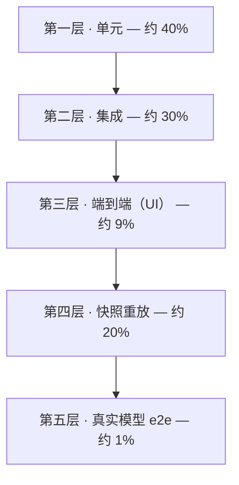
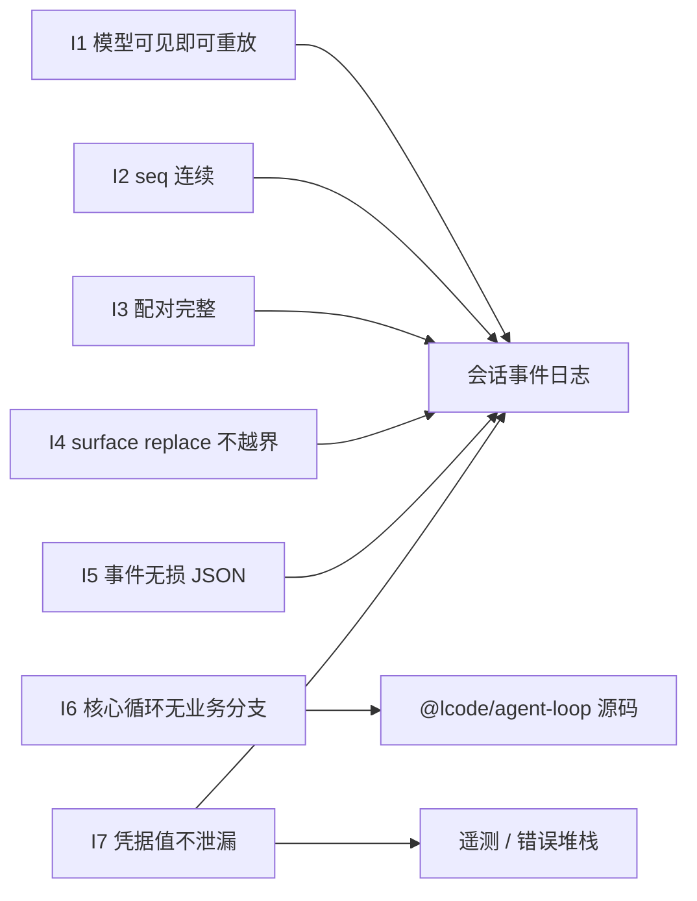
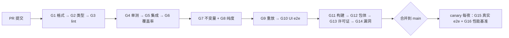

# 15 · 测试策略与质量门禁

> 这篇文档回答"Lcode 怎么保证不坏、哪些门禁阻断合并、核心不变量怎么被自动守住"。给研发与测试看；它是 [14-产品路线图与里程碑.md](./14-产品路线图与里程碑.md) 里每一个"出口标准"的落地手段。

| 项 | 值 |
|---|---|
| 状态 | 草案 |
| 负责人 | 质量负责人 |
| 上游依赖 | [00-文档总览与全局约定.md](./00-文档总览与全局约定.md)（技术宪法 D1–D18、§6 术语表、§8.5 数字口径）、[06-会话事件日志与可重放设计.md](./06-会话事件日志与可重放设计.md)（必读）、[14-产品路线图与里程碑.md](./14-产品路线图与里程碑.md) |
| 下游被引 | [16-风险登记册.md](./16-风险登记册.md) |

> **术语**：本文严格使用 [00 §6 术语表](./00-文档总览与全局约定.md#6-术语表) 的字面量——**会话 / 轮 / 步 / 表面 / 表面操作 / 派生 / 种子 / 接缝 / 服务 / 事件 / 副作用 / 撤销器 / 瀑布 / 守卫 / 作用域 / 规范值 / 卡片 / 预设 / 集束 / 配置档 / 时间轴 / 检查点 / 代码模式 / 模型可见即可重放**。

---

## 目录

- [1. 测试金字塔](#1-测试金字塔)
- [2. 核心不变量测试（I1–I7）](#2-核心不变量测试i1i7)
- [3. 快照重放测试](#3-快照重放测试)
- [4. 真实模型 e2e](#4-真实模型-e2e)
- [5. 覆盖率门禁](#5-覆盖率门禁)
- [6. 质量门禁清单](#6-质量门禁清单)
- [7. 性能回归测试](#7-性能回归测试)
- [8. 手动测试清单](#8-手动测试清单)
- [9. 测试基建](#9-测试基建)
- [10. 我们不做什么](#10-我们不做什么)
- [未决问题](#未决问题)
- [变更记录](#变更记录)

---

## 1. 测试金字塔

Lcode 的测试分五层，**比常见的三层多出"快照重放"与"不变量"两块**——它们是我们这套架构的专属资产：因为会话是 append-only 事件日志（D4）、消息历史是派生投影，所以"把一次真实会话录下来，用 `llm-replay` 重放，断言产生的事件流与录制一致"是可行且**零成本**的。



**这张图想让你看到什么**：金字塔不是按"测试数量"分层，而是按**确定性 × 成本**分层——越往上越接近真实，但越贵、越容易 flaky，所以面积（数量与运行频次）必须越小。

### 1.1 各层职责与预算

| 层 | 占比（用例数） | 测什么 | 运行时机 | 超时预算 | 命令 |
|---|---|---|---|---|---|
| 第一层 · 单元 | ≈ 40% | `session` 的 append / 派生、`tools` 校验、`util` 的保留策略、纯函数（投影、序列化） | 每次提交（watch 默认） | 单文件 ≤ 5s，全量 ≤ 180s | `pnpm test` |
| 第二层 · 集成 | ≈ 30% | 多包协作：loop + tools + system-prompt；持久化 + 恢复；插件加载 / 卸载 | 每次 PR | 全量 ≤ 240s | `pnpm test:integration` |
| 第三层 · 端到端（UI） | ≈ 9% | Electron 壳 + IPC + 会话流 + 时间轴，用假模型驱动 | 每次 PR | 全量 ≤ 300s | `pnpm test:ui` |
| 第四层 · 快照重放 | ≈ 20% | 真实会话 fixture + `llm-replay`，断言事件流与卡片一致 | 每次 PR | 全量 ≤ 120s | `pnpm test:replay` |
| 第五层 · 真实模型 e2e | ≈ 1% | 真实适配器 + 真实项目的最小场景 | 发布前必跑；canary 每夜 | 单场景 ≤ 180s，全集 ≤ 600s | `pnpm test:e2e` |
| 横切 · 不变量 | 独立项目 | I1–I7（§2），同时覆盖上面多层 | 每次 PR | ≤ 90s | `pnpm test:invariants` |

**统一约定**：框架用 `vitest`（ESM 原生，与 D1 一致），深比较用 `toEqual`、逐字节一致用 `toBe` / `deepStrictEqual`；目录与源码同包 `test/`，跨包场景放 `test/integration/`，fixture 放仓库根 `fixtures/`；命名 `*.test.ts` / `*.int.test.ts` / `*.ui.test.ts` / `*.replay.test.ts` / `*.e2e.test.ts`；单元 / 集成 / 重放层**禁止**读真实时钟、随机与网络（由 `@lcode/util` 注入可控时钟与 id），禁止 `sleep` 等待，禁止断言自由文本（见 §4.3）。

---

## 2. 核心不变量测试（I1–I7）

不变量是这套架构的**承重墙**：它们不是"某些功能的测试"，而是"任何改动都不许违反的物理定律"。全部实现为独立测试项目 `packages/core/*/test/invariants/` 与 `scripts/`，由 `pnpm test:invariants` 统一运行，**在 CI 上阻断合并**。



**这张图想让你看到什么**：I1–I5 与 I7 全部锚定在**同一个对象**（会话事件日志）上——只要日志是对的，重放就是对的；I6 是唯一一条针对**源码形状**的静态不变量。

### 2.1 I1 · 模型可见即可重放（最重要）

**陈述**：对任意一次 loop 构建的模型请求，`request.system === assembleFromLog(日志前缀)`，且 `deepEqual(request.messages, deriveMessages(日志前缀))`。日志前缀指"构建该请求那一刻已落盘的事件"。这条对应 [00 第一条](./00-文档总览与全局约定.md#第一条--可解释优先于聪明)的硬性要求。

**为什么它能被自动验证**：请求**从日志派生**，不是从内存数组拼装（反模式见参考文档 §11.1）。因此我们只需在测试装配里放一个**捕获适配器**，记录每次 `stream(options)` 收到的 `options` 与当时的 `seq`。

**伪代码实现**：

```ts
// packages/core/agent-loop/test/invariants/i1-model-visible-means-logged.test.ts
import { describe, it, expect } from 'vitest'
import { Session } from '@lcode/session'
import { assembleFromLog } from '@lcode/system-prompt'
import { deriveMessages } from '@lcode/session'   // 与内部缓存共用同一纯函数

/** 捕获每次构建的请求，并记录构建时的日志长度 */
function capturingAdapter(sink: CapturedRequest[]) {
  return {
    name: 'capture',
    async *stream(options: GenerateOptions): AsyncIterable<StreamChunk> {
      sink.push({ atSeq: options.__logLength, system: options.system, messages: options.messages })
      yield* scriptedChunksFor(options)
    },
  }
}

describe('I1 · 模型可见即可重放', () => {
  it('每次请求都能从日志前缀精确重建', async () => {
    const sink: CapturedRequest[] = []
    const session = await runScriptedTurn({ adapter: capturingAdapter(sink) })

    expect(sink.length).toBeGreaterThan(0)
    for (const req of sink) {
      const prefix = session.events.slice(0, req.atSeq)

      // ① system 逐字节一致（不是"差不多"）
      expect(req.system, `seq=${req.atSeq} 的 system 不可重建`).toBe(assembleFromLog(prefix))

      // ② messages 结构深相等
      expect(req.messages, `seq=${req.atSeq} 的 messages 不可重建`).toEqual(deriveMessages(prefix))
    }
  })
})
```

**它如何接入 CI（三重覆盖）**：

1. **脚本会话**：上面这个用例，用固定 fixture 驱动，每次 PR 必跑。
2. **全量 fixture 回放**：`fixtures/sessions/**/*.jsonl` 中的每一个真实会话，逐步截断日志并断言；任何一个历史会话出现漂移即失败。
3. **随机压力**：属性测试随机生成事件序列（含 replace、崩溃收尾），对每个前缀跑 I1。

**回归价值**：任何"顺手在内存里改一下 messages 再发请求"的改动，都会在第一步被抓住。这是 Lcode 最不能省的一条测试。

### 2.2 I2 · seq 连续

**陈述**：日志 append 后，`seq` 必须是**无空洞的 `0..n-1`**。`seq = log.length`（参考文档 §5.1 设计细节 1）。

```ts
// ${label} 必须为 0,1,2,...,n-1
export function assertSeqContiguous(events: readonly SessionEvent[], label = 'log'): void {
  for (let i = 0; i < events.length; i++) {
    if (events[i]!.seq !== i) {
      throw new InvariantViolation('I2', `${label}: 位置 ${i} 的 seq=${events[i]!.seq}，期望 ${i}`)
    }
  }
}
```

**接入点**（三处，缺一不可）：

- `Session.append` 在 `NODE_ENV !== 'production'` 时同步自检（O(1)，只比对新事件）。
- **加载路径**：`session-persistence` 的 `load()` 返回前全量校验——崩溃恢复后最容易在这里出问题。
- **fixture 校验**：CI 对 `fixtures/sessions/**/events.jsonl` 逐行校验，拒绝入库断裂的 fixture。

**反例**：把 `assistant/chunk` 过滤掉再落盘（认为"原始流不重要"）会立刻打破连续性——这是明确禁止的（参考文档"任何事件都不能被过滤掉再存"）。

### 2.3 I3 · 配对完整

**陈述**：任何 `tool/call` 必须有配对的 `tool/result`（按 `callId`）；并且**表面上**任何一个 tool-call block 必须有配对的 tool-result block。这条是崩溃恢复（合成收尾）的核心判据。

```ts
export function assertPairing(events: readonly SessionEvent[]): void {
  const open = new Map<string, number>()          // callId -> seq
  for (const e of events) {
    if (e.type === 'tool/call') {
      if (open.has(e.data.callId)) throw new InvariantViolation('I3', `重复 callId ${e.data.callId}`)
      open.set(e.data.callId, e.seq)
    } else if (e.type === 'tool/result') {
      const callId = e.data.message.callId
      if (!open.delete(callId)) throw new InvariantViolation('I3', `孤儿 tool/result: ${callId}`)
    }
  }
  if (open.size > 0) {
    throw new InvariantViolation('I3', `未闭合的 tool/call: ${[...open.keys()].join(', ')}`)
  }
}
```

**表面层面的配对**（独立断言，因为 replace 可能遮蔽结果而留下悬空 call）：

```ts
export function assertSurfacePairing(session: Session): void {
  const blocks = flattenSurfaceBlocks(session.deriveMessages())   // 按表面顺序展开 content blocks
  const calls = new Set(blocks.filter(isToolCall).map(b => b.id))
  for (const b of blocks.filter(isToolResult)) calls.delete(b.callId)
  if (calls.size > 0) throw new InvariantViolation('I3', `表面上悬空的 tool-call: ${[...calls]}`)
}
```

**接入点**：崩溃恢复 e2e（杀进程于工具执行中）必须满足 I3；压缩测试（`replace` 遮蔽区间）必须满足 `assertSurfacePairing`。

### 2.4 I4 · surface replace 不越界

**陈述**：`{ op: 'replace', start, end }` 的 `start/end` 必须在**当时**表面的范围内（闭区间，`0 ≤ start ≤ end < surfaceLength`），且不得切断配对。

```ts
export function assertReplaceInBounds(events: readonly SessionEvent[]): void {
  let surface: { seq: number }[] = []
  for (const e of events) {
    if (!isSurfaceEvent(e)) continue
    const op = e.surfaceOp ?? 'append'
    if (op === 'append') { surface.push(e); continue }
    if (!(op.start >= 0 && op.end >= op.start && op.end < surface.length)) {
      throw new InvariantViolation('I4', `seq=${e.seq} replace[${op.start},${op.end}] 越界（表面长度 ${surface.length}）`)
    }
    surface = [...surface.slice(0, op.start), e, ...surface.slice(op.end + 1)]
  }
}
```

**特别注意**：`start/end` 是**表面位置**不是 `seq`（参考文档 §5.1 的"容易搞错的点"）。测试里专门放一个"seq 与表面位置不相等"的 fixture，防止实现误用 `seq` 当索引。

### 2.5 I5 · 事件无损 JSON

**陈述**：所有事件 `data` 必须能**无损**序列化为 JSON。`append` 必须在写入前**一次递归**完成"读取 + 校验 + 拷贝"（避免有状态 getter 在校验与存储之间返回不同值，参考文档 §5.1 设计细节 4）。

**必须拒绝的类型**（每一项一个用例）：

| 值 | 拒绝理由 |
|---|---|
| `BigInt` | JSON 无对应类型 |
| `function` / `symbol` | 不可序列化 |
| `undefined` | 序列化后键会消失，破坏"无损" |
| `-0` / `NaN` / `Infinity` | 往返后不相等 |
| 循环引用 | 无法序列化 |
| 稀疏数组 | `[]` 与 `[undefined]` 无法区分 |
| `Map` / `Set` | 损失结构 |
| `Date` | 违背 D18（持久事件用 epoch ms） |
| 类实例 | 丢失原型，往返不相等 |

```ts
const BAD: unknown[] = [1n, () => {}, Symbol('x'), undefined, -0, NaN, Infinity, new Map(), new Set(), new Date()]
describe('I5 · 无损 JSON', () => {
  it.each(BAD.map((v, i) => [i, v]))('拒绝非法值 #%i', (_i, v) => {
    expect(() => session.append('todo/write', { todos: v as never })).toThrow(InvariantViolation)
  })
  it('接受并往返一致', () => {
    const data = { a: 1, b: [true, null, 'x'], c: { d: 2.5 } }
    const e = session.append('todo/write', { todos: data as never })
    expect(JSON.parse(JSON.stringify(e.data))).toEqual(e.data)
  })
})
```

**附加**：`deepFreeze` 生效性测试——append 后尝试改写事件字段必须静默失败（严格模式下抛错）。

### 2.6 I6 · 核心循环无业务分支

**陈述**：`@lcode/agent-loop` 的源码里，`if` 语句所判断的内容**不得涉及任何具体能力**（对应 [00 第三条](./00-文档总览与全局约定.md#第三条--内核只提供机制策略全部外挂)）。这是**静态检查**，不是运行时测试。

**为什么需要它**：这是一条"会随时间被侵蚀"的约束——每个人都会觉得"这里加一个 `if (needsApproval)` 很方便"。黑名单只能抓已知词，所以实现采取**白名单为主 + 黑名单为辅**。

**实现思路**（AST 扫描）：

```ts
// scripts/check-core-loop-purity.ts
import { Project, SyntaxKind } from 'ts-morph'

const SRC = 'packages/core/agent-loop/src'

/** 白名单：只允许"结构性"标识符出现在 if 条件里（真实判定靠它；黑名单只用于给出更好的报错） */
const ALLOWED = new Set(['call','message','result','kind','type','step','turn','pending',
  'events','length','signal','aborted','has','size','undefined','null'])
const BANNED = /(approv|permission|sandbox|guard|compact|summar|prune|plan|subagent|job|skill|preset|budget|cost|route|model|token)/i

const project = new Project({ tsConfigFilePath: 'tsconfig.base.json' })
const violations: string[] = []

for (const sf of project.getSourceFiles(`${SRC}/**/*.ts`)) {
  for (const ifStmt of sf.getDescendantsOfKind(SyntaxKind.IfStatement)) {
    const test = ifStmt.getExpression()
    if (test.getLeadingCommentRanges().some(c => c.getText().includes('purity-allow:'))) continue
    for (const id of test.getDescendantsOfKind(SyntaxKind.Identifier)) {
      const name = id.getText()
      if (BANNED.test(name) || !ALLOWED.has(name)) {
        violations.push(`${sf.getFilePath()}:${id.getStartLineNumber()}  非结构性标识符 \`${name}\``)
      }
    }
  }
}
if (violations.length) { console.error('I6 违规：核心循环出现业务分支\n' + violations.join('\n')); process.exit(1) }
```

**豁免机制**：允许 `// purity-allow: <理由>` 注释豁免单条 `if`，但必须由代码所有者 review；豁免数量超过阈值（初始 0）时 CI 打印告警。

**接入**：`pnpm check:purity`，作为独立门禁（§6），阻断合并。

### 2.7 I7 · 凭据值不泄漏

**陈述**：给定注册的凭据值（canary），遍历**日志 / 遥测载荷 / 错误堆栈 / 落盘文件**，断言均不出现。对应 [00 第二条](./00-文档总览与全局约定.md#第二条--用户拥有自己的数据与算力)的"凭据以引用形式存在，值永不进入 UI、日志、遥测"。

**golden test 形状**：

```ts
// packages/core/*/test/invariants/i7-credential-non-leak.test.ts
const CANARY = 'sk-lcode-canary-9f3a1c4e-DO-NOT-LEAK'

describe('I7 · 凭据值不泄漏', () => {
  it('日志 / 遥测 / 错误堆栈 / 落盘文件均不含凭据值', async () => {
    const { events, telemetryPayload, caughtErrors, writtenFiles } = await runScenario({
      credentials: { OPENAI_API_KEY: CANARY },   // 通过引用注册
      tools: ['read', 'shell'],                  // 让 shell 故意失败，制造错误堆栈
    })
    const blobs: Array<[string, string]> = [
      ['会话日志', events.map(e => JSON.stringify(e)).join('\n')],
      ['遥测载荷', JSON.stringify(telemetryPayload)],
      ['错误堆栈', caughtErrors.map(e => (e as Error).stack ?? '').join('\n')],
      ...writtenFiles.map<[string, string]>(f => [`落盘文件 ${f.path}`, f.content]),
    ]
    for (const [label, blob] of blobs) expect(blob, `${label} 泄漏了凭据值`).not.toContain(CANARY)

    // 反向确认：配置里只应有"引用"，不应有值
    const config = JSON.stringify(await readConfig())
    expect(config).not.toContain(CANARY)
    expect(config).toContain('OPENAI_API_KEY')
  })
})
```

**接入**：每次 PR 跑；`scripts/redact.ts`（§9.3）在 fixture 入库前做同样的 canary 扫描，双保险。

---

## 3. 快照重放测试

### 3.1 是什么

把一次**真实会话**的**事件流**录制成 fixture；回放时用 `llm-replay` 适配器（从 fixture 读 chunk）替代真实模型，驱动同一套内核，然后断言：

1. **重放产生的事件流与录制的一致**（逐事件，忽略 `time`）；
2. **重放的 UI 卡片与录制的一致**（纯投影重建）。

因为内核是"调模型 → 跑工具 → 重复"的确定性循环，把模型的输出固定住之后，整个会话的演进就变成了一条**纯函数**。

### 3.2 为什么这是性价比最高的测试层

| 维度 | 单元测试 | 快照重放 | 真实模型 e2e |
|---|---|---|---|
| 花钱 | 否 | **否** | 是（每次真金白银） |
| 确定性 | 高 | **高** | 低（模型不稳定） |
| 覆盖真实场景 | 低 | **高**（来自真实会话） | 最高 |
| 能抓到 I1–I4 回归 | 部分 | **强** | 弱（不确定） |
| 速度 | 快 | **快（≤ 120s 全量）** | 慢 |
| 重构保护 | 中 | **强**（断言的是可观测行为） | 弱 |

结论：**它是我们的主力测试层**。一次真实调试会话录下来，就变成了一个永久免费的回归用例。

### 3.3 fixture 目录结构

```
fixtures/
├── README.md                        # 录制纪律与脱敏说明
└── sessions/
    └── 2026-09-01-refactor-utils/   # 一个会话 = 一个目录
        ├── meta.json                # schemaVersion / 模型 / 日期 / 脱敏标记 / 标签
        ├── header.json              # SessionHeader（含 delegationDepth 等）
        ├── events.jsonl             # 录制得到的权威事件流
        ├── chunks.jsonl             # llm-replay 的输入：每次请求对应的流 chunk（按 atSeq 分组）
        └── expected/
            ├── events.jsonl         # 重放期望事件流（忽略 time）
            └── cards.jsonl          # 重放期望的 UI 卡片
```

`chunks.jsonl` 每行形如 `{ "atSeq": 42, "chunks": [ ... ] }`，与 I1 的捕获点一一对应；`llm-replay` 读取它并按调用顺序吐出。

### 3.4 录制与回放命令

```bash
# 录制（仅开发机，需要密钥；产出经脱敏后才可以入库）
pnpm replay:record --session <session-id> --out fixtures/sessions/2026-09-01-refactor-utils

# 回放：跑全部 fixture
pnpm test:replay

# 只跑某个 fixture
pnpm test:replay -- --filter refactor-utils

# 期望值变更：重新"祝福"（bless）——必须人工 review diff 后才允许提交
pnpm test:replay -- --update
```

**规则**：`--update` 只允许在**明确知道行为变化是预期的**情况下使用；CI 上禁止 `--update`（否则门禁失去意义）。任何一次 bless 都必须在 PR 描述里说明原因。

**断言细节**：忽略 `time`（epoch ms，每次不同）与随机 id；其余 `type` / `seq` / `data` 全量深相等，卡片按 `card` 类型（`generic` / `terminal` / `diff` / `search` / `read` / `web`）逐字段比较；**不**断言自由文本的"语义相似"（那是 e2e 的事）。

---

## 4. 真实模型 e2e

### 4.1 何时跑

| 场景 | 是否跑 | 说明 |
|---|---|---|
| 每次 PR | **默认跳过** | CI 无密钥即跳过（`LCODE_E2E_KEY` 未设置）；fork 的 PR 一律跳过 |
| main 分支合并 | 跑最小集 | 用最便宜的小模型 |
| canary 每夜 | 跑全集 | 捕获供应商侧行为漂移 |
| **发布前** | **必跑，阻断发布** | 见 §6 与 [14 号文档 §10](./14-产品路线图与里程碑.md#10-发布策略) |

跳过必须是**显式**的（打印 `skipped: missing LCODE_E2E_KEY`），不允许静默 0 用例通过。

### 4.2 成本控制

| 手段 | 做法 |
|---|---|
| 小模型 | 固定使用最便宜档位的模型；场景不依赖"聪明" |
| 固定种子 | 支持时设 `temperature = 0` + 固定 `seed` |
| token 上限 | 每个场景设 `maxTokens` 上限（建议 ≤ 2000 输出） |
| 场景数量 | 全集 ≤ 5 个场景（只测**结构性**行为：读文件 / 改文件 / 跑命令 / 取消收敛 / 后台任务），每个都用最小项目骨架 |
| 预算护栏 | harness 累计 token，超过预算（建议 ≤ 200k）立即中止并标记 `BUDGET_EXCEEDED` |

### 4.3 避免 flaky

| 手段 | 说明 |
|---|---|
| 重试 | 仅对**瞬态错误**（429 / 5xx / 网络超时）重试，最多 2 次，指数退避；对断言失败**不重试**（那是真 bug） |
| 断言结构化字段 | 断言"`tool/call` 的 name 是 `write`""目标文件存在且内容含 X""exit code 为 0"，**不断言模型的自然语言**；允许多种合理路径时只断言**最终状态** |
| 时间不敏感 | 不使用"几秒内完成"，用事件到达顺序断言 |
| 隔离 | 每个场景独立临时目录（`mkdtemp`），跑完清理 |

---

## 5. 覆盖率门禁

### 5.1 核心包逐文件 100%

**规定**：`packages/core/*/src/**` 的每一个文件，`lines / branches / functions / statements` 四项**均须 100%**。

```jsonc
// 共享 vitest 覆盖率预设（packages/core/*/vitest.config.ts 继承此 preset）
{
  "test": {
    "coverage": {
      "provider": "v8",
      "include": ["packages/core/*/src/**/*.ts"],
      "all": true,
      "perFile": true,                       // 关键：逐文件，不是全包平均
      "thresholds": {
        "perFile": true,
        "lines": 100, "branches": 100, "functions": 100, "statements": 100
      }
    }
  }
}
```

**为什么核心包要求这么高**：

| 理由 | 说明 |
|---|---|
| 爆炸半径大 | `session` / `agent-loop` / `tools` 的一行错误会污染**所有**会话与**所有**重放 |
| 体量小且稳定 | 这六个包加起来代码量可控，100% 是可达成的，不是负担 |
| 不变量依赖它们 | I1–I5 锚在日志与派生上，核心包本身必须无死角 |
| 重构安全网 | 核心包是长期演进的地基，逐文件 100% 是"敢重构"的前提 |

**为什么 UI 层宽松**：UI 是**体量大、视觉化、爆炸半径小**的代码，行覆盖率与"界面是否正确"相关性低；它的正确性主要由**快照重放**（卡片投影一致）+ **UI 端到端** + **手动清单**（§8）覆盖。对 UI 只设软目标（建议 ≥ 60%），**不作为阻断门禁**。

### 5.2 核心覆盖率不豁免

`packages/core/*/src` 的每个纳入报告的文件，lines / branches / functions / statements 都必须是 **100%**。不提供 allowlist、临时阈值或“纯导出文件”例外；没有可执行逻辑的文件应从测试报告范围中明确排除，而不是让门禁忽略一个有逻辑的文件。

**我们不做**：不做“整体平均覆盖率达标即可”（会掩盖单文件空洞）；不做“临时注释掉门禁”或白名单降级。

---

## 6. 质量门禁清单

所有门禁在 CI 上运行；"阻断合并"列为"是"的，任一失败即红灯。耗时预算为单次完整运行的上限（基准机），超预算视为失败。

| # | 门禁 | 命令 | 耗时预算 | 阻断合并 | 说明 |
|---|---|---|---|---|---|
| G1 | 格式检查 | `pnpm format:check` | ≤ 20s | 是 | Prettier |
| G2 | 类型检查 | `pnpm typecheck` | ≤ 120s | 是 | `tsc -b`，零 `any` 逃逸 |
| G3 | Lint | `pnpm lint` | ≤ 60s | 是 | ESLint（含 ESM only 规则） |
| G4 | 单元测试 | `pnpm test` | ≤ 180s | 是 | 第一层 |
| G5 | 集成测试 | `pnpm test:integration` | ≤ 240s | 是 | 第二层 |
| G6 | 覆盖率 | `pnpm coverage` | ≤ 240s | 是 | 核心包逐文件 100%（§5） |
| G7 | 不变量 I1–I5/I7 | `pnpm test:invariants` | ≤ 90s | 是 | §2 |
| G8 | 核心循环纯度 I6 | `pnpm check:purity` | ≤ 30s | 是 | AST 扫描，§2.6 |
| G9 | 快照重放 | `pnpm test:replay` | ≤ 120s | 是 | §3 |
| G10 | UI 端到端 | `pnpm test:ui` | ≤ 300s | 是 | 第三层 |
| G11 | 构建 | `pnpm build` | ≤ 300s | 是 | 三平台产物 |
| G12 | 包体检查 | `pnpm check:bundlesize` | ≤ 60s | 是 | 见 §7 阈值 |
| G13 | 许可证扫描 | `pnpm check:licenses` | ≤ 45s | 是 | 分发包禁 GPL / AGPL |
| G14 | 依赖漏洞 | `pnpm audit --prod --audit-level=high` | ≤ 40s | 是 | high / critical 阻断 |
| G15 | 真实模型 e2e | `pnpm test:e2e` | ≤ 600s | 否（发布前必跑） | §4 |
| G16 | 性能回归 | `pnpm bench` | ≤ 300s | 否（超阈值需说明） | §7 |



**这张图想让你看到什么**：门禁按"从便宜到昂贵"排序，前一步失败就不会浪费后一步的算力；而真实模型与性能基准被刻意放在合并**之后**的每夜任务里，因为它们慢且非确定。

---

## 7. 性能回归测试

### 7.1 基准与阈值

**口径与目标值只有一份权威来源**：目标值来自 [03 §4.1](./03-PRD-需求规格说明.md#41-性能nfr-perf)（产品验收）与 [10 §7](./10-桌面客户端设计.md#7-性能预算)（预算与达成手段），口径定义来自 [00 §8.5](./00-文档总览与全局约定.md#85-数字口径约定)。本节只规定**怎么测、怎么判**，不另立一套数字。

| 指标 | 目标值（基准机 M1 / 16GB） | CI 上限 | 口径 | 对应需求 |
|---|---|---|---|---|
| 冷启动 | ≤ 2.5s | ≤ 3.0s | 进程不存在 → 主窗口可交互 | `NFR-PERF-001` |
| **热启动** | ≤ 300ms | ≤ 360ms | 进程常驻，关窗后再打开 → 可交互 | `NFR-PERF-011` |
| **渲染进程重载** | ≤ 600ms | ≤ 720ms | 重建渲染进程 → 重新可交互 | `NFR-PERF-012` |
| 首 token 延迟 | ≤ 100ms | ≤ 150ms | 用户回车 → UI 出现第一个字符（不含模型排队） | `NFR-PERF-002` |
| 工具调用本地开销 | ≤ 30ms | ≤ 80ms | `tool/call` 落盘 → `tool/result` 落盘（不含工具自身执行） | `NFR-PERF-003` |
| 会话列表首屏（1 万会话） | ≤ 200ms | ≤ 240ms | 列表首屏可滚动 | `NFR-PERF-004` |
| 万级事件滚动 | 稳定 60fps | ≥ 48fps | 10 万事件会话滚动帧率 | `NFR-PERF-005` |
| 时间轴拖动定位 | ≤ 100ms | ≤ 150ms | 拖动到出结果 | `NFR-PERF-006` |
| 稳态内存 | ≤ 600MB | ≤ 720MB | 稳态 RSS（含 1 万事件会话） | `NFR-PERF-007` |
| 日志膨胀率 | ≤ 2.5× | ≤ 3.0× | 日志字节 ÷ 模型可见字节 | `NFR-PERF-009` |
| 会话恢复（1 万事件） | ≤ 800ms | ≤ 960ms | 恢复完成到可继续发消息 | `NFR-PERF-010` |
| 重放准确率 | 100% | 100%（**零容忍**） | 重放重建历史与实时历史逐字节一致的会话占比 | `NFR-REL-002` |

**CI 上限是可推导的，不是拍出来的**——这条规则专为防止"某个指标的 CI 阈值比产品目标还宽松得离谱、或反而更紧"这类自家打架：

| 指标类型 | 公式 | 理由 |
|---|---|---|
| 延迟类（> 100ms） | `目标 × 1.2` | 吸收 CI 机器的整体性能差 |
| **延迟类（≤ 100ms）** | `max(目标 × 1.2, 目标 + 50ms)` | 亚 100ms 量级下**底噪**占主导，纯比例会算出过紧的门槛而天天误报 |
| 吞吐 / 帧率类 | `目标 × 0.8` | 帧率是下限，宽容方向相反 |
| 体积 / 内存类 | `目标 × 1.2` | 与延迟类同理 |
| **正确性类**（重放准确率） | `= 目标`，零容忍 | 正确性不随机器快慢而变 |

> **两列的关系**：左列是**产品承诺**（用户看到的就是它，可能人工在基准机上复测）；右列只是 **CI 判定门槛**，放宽的是测量环境，**不是产品承诺**。任何把右列往宽调的动作，必须在 PR 里写明理由。

### 7.2 判定规则（统一口径）

| 情形 | 判定 |
|---|---|
| 未超 CI 上限，但**较基线回归 > 15%** | 该指标**告警**，在 PR 里贴出对比 |
| **连续两个版本**同一指标回归 > 15% | **升级为阻断**，必须先修或走 ADR 说明为何接受 |
| 超过 CI 上限 | **阻断** |
| 重放准确率 < 100% | **阻断**，按 bug 处理（不设宽容系数） |

### 7.3 如何固化

```bash
pnpm bench              # 跑全部基准，输出 bench/result.json
pnpm bench -- --update  # 建立新基线（需 review）
```

- **脚本位置**：`scripts/bench/*.ts`；CLI 冷/热启动用 `hyperfine`（热启动通过"保留进程 + 再次唤起窗口"模拟），UI 帧率用 Electron + 内置 probe，内存用 `process.memoryUsage().rss` 采样。
- **基线文件**：`bench/baseline.json`（入库，可 diff）。
- **数据来源**：基准会话用 `fixtures/sessions/` 中的长会话（≥ 10k 事件），**不用造的短会话**——否则测不出真实压力。
- **三平台**：冷/热启动在 macOS 与 Windows 上必测（两者的窗口与进程语义差异最大）；Linux 每版本至少测一次。

---

## 8. 手动测试清单

无法自动化、或自动化成本远高于收益的部分，写成**可执行步骤**。每一条都有前置条件、操作、期望结果。

### 8.1 OS 沙箱在各平台的实际拦截效果

> 前置：准备一个工作目录 `$WS` 与一个工作目录之外的 `$OUT`（如 `~/lcode-manual-out`）。

| 平台 | 步骤 | 期望结果 |
|---|---|---|
| macOS | 在会话中让 agent 执行 `echo x > $OUT/probe.txt` | 被沙箱拒绝；`$OUT/probe.txt` 不存在；运行日志可查（`strace` 不可用则看沙箱日志） |
| Linux | 同上；另跑 `strace -f -e landlock_create_ruleset lcode ...` | 拒绝写入；`strace` 输出中出现 `landlock_create_ruleset` |
| Windows | 同上；用 Process Explorer 确认子进程在 AppContainer 中 | 拒绝写入；AppContainer 标识可见 |

补充：对每个平台再验证一次**正向**路径——在 `$WS` 内写入**成功**（避免"一刀切全拒"被误判为通过）。

### 8.2 审批弹窗

1. 触发一个写操作（v0.2 起，且权限预设为"询问"）。
2. 确认弹窗出现，且包含：**工具名**、**目标路径 / argv**、**为什么需要确认**（策略链）。
3. 点"仅本次允许" → 操作执行；**再次触发相同操作仍会询问**（验证 one-shot）。
4. 点"拒绝" → agent 收到结构化拒绝并继续；时间轴能看到该拒绝事件。
5. 关闭所有应答者（模拟无人应答）→ 操作**被拒绝**（fail-closed）。

### 8.3 主题切换

1. 在浅色 / 深色间切换 ≥ 5 次。
2. 检查：无闪烁残留、无硬编码颜色（用开发者工具抽查背景色是否为 CSS 变量）、工具卡片（尤其 `diff` 与 `terminal`）在两种主题下均可读。
3. 系统级切换（跟随系统）时实时生效，无需重启。

### 8.4 真机崩溃恢复

> 前置：开启一个正在执行的会话。

| 场景 | 操作 | 期望结果 |
|---|---|---|
| 流式中途 | agent 正在输出时 `kill -9` 主进程 | 重开后：中断的**轮**被保留，出现合成收尾事件；无孤儿 `tool/call`（I3） |
| 工具执行中 | 工具正在运行时 `kill -9` | 同上；未完成的工具补一个错误结果 |
| 持久化批写窗口 | 在 write-behind 窗口内 `kill -9` | 最多丢失**撕裂的最后一条记录**；其余历史完整 |
| 正常关闭 | 正常退出后重开 | 历史逐字节一致，可直接继续对话 |

每个平台各跑 20 次（对应 `NFR-REL-001`），恢复成功率须为 **100%**。

---

## 9. 测试基建

### 9.1 fixture 管理

| 事项 | 约定 |
|---|---|
| 版本化 | 每个 fixture 的 `meta.json` 带 `schemaVersion`；内核事件结构变更时，CI 校验所有 fixture 可被当前版本解析 |
| 命名 | `<日期>-<主题>`（如 `2026-09-01-refactor-utils`） |
| 体量 | 大 fixture 用 `zstd` 压缩入库（与 JSONL 后端一致）；单文件 > 5MB 需说明 |
| 来源与校验 | 只能来自**脱敏后**的真实会话或脚本会话，不允许手写伪造的事件流（会与真实行为脱节）；入库时 CI 对每个 fixture 跑 I2 / I3 / I4 / I5 与 I1 回放 |

### 9.2 可复现的沙箱测试环境

| 平台 | 方式 |
|---|---|
| Linux | 容器（Docker）固定内核版本，确保 Landlock 可用；容器内若无法启用 Landlock，则**显式标记该用例跳过**并记录，不允许静默通过 |
| macOS | CI 上的 macOS runner（沙箱能力依赖真实内核，不用容器） |
| Windows | CI 上的 Windows runner（AppContainer + Job Object） |

**矩阵**：三平台 × {单元 / 集成 / 重放} 在 PR 上跑；真实 e2e 与沙箱真机验证只在 canary 每夜的对应平台 runner 上跑。

### 9.3 测试数据脱敏

- 必须处理：API 密钥（正则 + canary 扫描）、绝对路径（替换为 `<WS>` / `$HOME`）、用户名、内部 URL、token。工具为 `scripts/redact.ts`，在 fixture 入库前运行。
- **canary 扫描**：脱敏后再跑一次 I7 同款扫描（§2.7），确保脱敏本身没有漏网。
- **人工 review**：新 fixture 入库必须有一名 review 者确认"无敏感信息"；`fixtures/README.md` 记录检查清单。
- **凭据永不入库**：fixture 中的请求只保存 `request/header` 与消息内容，**不含**凭据值（配置只存引用）。

---

## 10. 我们不做什么

- **不用"平均覆盖率达标"替代逐文件门禁**——那会掩盖单文件空洞。
- **不做"最大化的测试数量"**——我们追求确定性与爆炸半径覆盖，不是用例数。
- **不在 CI 上用 `--update` 祝福期望值**——门禁必须独立于被检对象。
- **不断言模型的自由文本**——用结构化字段与最终状态，避免 flaky。
- **不做需要联网才能跑的单元测试**——单元 / 集成 / 重放三层必须离线可跑。
- **不把遥测当作质量信号**——崩溃率只作参考，且遵循"默认关闭"（[00 第二条](./00-文档总览与全局约定.md#第二条--用户拥有自己的数据与算力)）。
- **不静默跳过测试**——跳过必须显式打印原因（如缺密钥、平台不支持）。

---

## 未决问题

- [ ] **I6 白名单的初始集合**：§2.6 的 `ALLOWED` 需要在 `agent-loop` 初版实现后收敛到真实使用集合，避免误报。卡在架构负责人。
- [ ] **覆盖率工具选择**：v8 与 istanbul 在 ESM + Node 22 下的分支覆盖率精度差异需实测后定稿。卡在质量负责人。
- [ ] **性能基准机与回归阈值**：CI 是否有稳定的 M1 等基准机；若无，本地与 CI 基准如何对齐；15% 阈值需一个版本的实测数据后调整（区分噪声与真实回归）。卡在性能与交付负责人。
- [ ] **fixture 的规模上限**：单文件大小与仓库体积的平衡点，以及是否引入 git-lfs。卡在质量负责人。
- [ ] **真实 e2e 的场景终稿**：§4.2 的 5 个场景需与 [03-PRD-需求规格说明.md](./03-PRD-需求规格说明.md) 的核心用户旅程对齐。卡在产品与质量之间。
- [ ] **UI 端到端的框架**：Electron 场景化测试用 Playwright 还是自带 driver，需在 M-v0.1-05 前定。卡在客户端负责人。
- [ ] **沙箱用例在容器中的跳过策略**：跳过比例是否设上限（避免"绿但没测"）。卡在质量负责人。

---

## 变更记录

| 日期 | 版本 | 变更 | 说明 |
|---|---|---|---|
| 2026-09-10 | v0.1 | 初稿 | 建立五层测试金字塔、I1–I7 不变量、快照重放策略、覆盖率与 CI 门禁、性能与手动清单 |
| 2026-09-11 | v0.4 | 性能阈值对齐 + 判定规则统一 | 修正三处**与 03/04/10 矛盾**的数字（冷启动 3.0s→2.5s、首 token 150ms→100ms、内存 500MB→600MB 等）与全部错位的需求映射；引入**可推导公式**（延迟 >100ms 用 ×1.2；≤100ms 用 max(×1.2, +50ms)——亚 100ms 量级底噪占主导；帧率 ×0.8；体积/内存 ×1.2；正确性零容忍）并用脚本逐行复核表格数字与公式一致；引入"产品目标值 × CI 宽容系数 ≤1.2"的双列结构，明确放宽的是**测量环境**不是产品承诺；新增热启动与重载基准行；判定规则统一为"回归 >15% 告警、连续两版同指标回归阻断、超上限阻断、重放零容忍"（原先与 10 §7 的 10% 冲突） |
