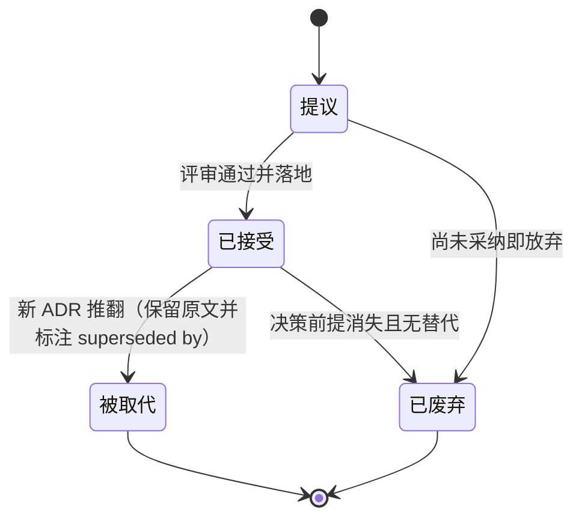
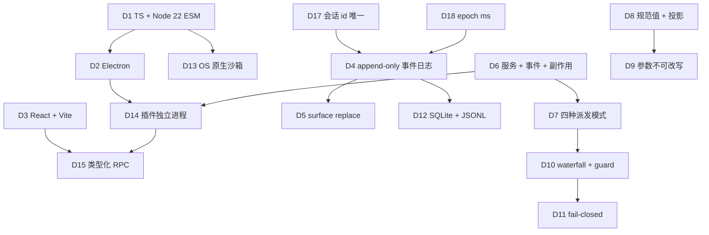

# 17 · 架构决策记录（ADR）

> 这篇文档回答"每个关键技术决策当时为什么这么选、代价是什么、什么条件下该重新审视"。给研发看：动手前先读它，评审在推翻一个决策前必须先改它。

| 项 | 值 |
|---|---|
| 状态 | 草案 |
| 负责人 | 架构负责人 |
| 上游依赖 | [00-文档总览与全局约定.md](./00-文档总览与全局约定.md)（§2 产品宪法、§4 技术宪法 D1–D18、§6 术语表、§7.1 模板） |
| 下游被引 | [05-系统架构设计.md](./05-系统架构设计.md)、[06-会话事件日志与可重放设计.md](./06-会话事件日志与可重放设计.md)、[07-插件内核与扩展点设计.md](./07-插件内核与扩展点设计.md)、[08-工具系统与执行流水线.md](./08-工具系统与执行流水线.md)、[09-上下文工程与压缩策略.md](./09-上下文工程与压缩策略.md)、[10-桌面客户端设计.md](./10-桌面客户端设计.md)、[11-数据模型与持久化设计.md](./11-数据模型与持久化设计.md)、[12-安全权限与沙箱模型.md](./12-安全权限与沙箱模型.md)、[13-插件SDK与协议设计.md](./13-插件SDK与协议设计.md)、[16-风险登记册.md](./16-风险登记册.md) |

---

## 目录

- [1. 这份文档是什么](#1-这份文档是什么)
- [2. 技术决策 ADR（对应 D1–D18）](#2-技术决策-adr对应-d1d18)
- [3. 产品级决策 ADR](#3-产品级决策-adr)
- [4. 被取代的决策怎么写（模板 + 示例）](#4-被取代的决策怎么写模板--示例)
- [5. 我们不做什么（汇总）](#5-我们不做什么汇总)
- [未决问题](#未决问题)
- [变更记录](#变更记录)

---

## 1. 这份文档是什么

### 1.1 用途

决策记录的价值不在于"我们选了什么"，而在于**"当时为什么这么选、放弃了什么、什么时候该重新看"**。结论可以写在 [00-文档总览与全局约定.md](./00-文档总览与全局约定.md) §4 的一句话理由里，但**代价不能**——代价只活在这份文档里。

三条使用规则：**① 新人动手前先读相关 ADR**（不理解代价的人，会在优化时把设计的前提拆掉）；**② 推翻一个决策必须先新增一个 ADR**，而不是直接改 00 的表格；**③ 负面后果不得省略、不得敷衍**——一条"没有任何缺点"的 ADR，视为没写。

### 1.2 状态机



**这张图想让你看到什么**：ADR 只有四种状态；推翻一个已接受的决策**不是删除**，而是新增一条并把它标记为"被取代"——历史必须可追溯，正如产品的日志必须可重放。

### 1.3 什么时候需要开新 ADR

满足**任一条**，就要开一条新 ADR（可以是"提议"状态）：改变了 [00-文档总览与全局约定.md](./00-文档总览与全局约定.md) §4 中 D1–D18 的任何一条；引入了**未来难以逆转**的技术约束（新协议、新持久化格式、新进程边界）；在两条都合理且各有明显代价的方案之间做了取舍；现有决策的**重新审视条件被触发**；有人问"为什么我们不直接用 X"并争论超过一次。**不需要**开 ADR 的：命名、目录结构、库的小版本选择、一次性的实现细节。

### 1.4 编号与索引

`ADR-0001`–`ADR-0022` 与 D1–D22 一一对应；`ADR-0101` 起为**产品级决策**；`ADR-0000` 为历史存档槽位（见 §4）。

| ADR | 对应 | 标题 | 状态 |
|---|---|---|---|
| [ADR-0001](#adr-0001) | D1 | 语言与运行时：TypeScript + Node.js 22+，ESM only | 已接受 |
| [ADR-0002](#adr-0002) | D2 | 桌面外壳：Electron（主进程承载 agent runtime） | 已接受 |
| [ADR-0003](#adr-0003) | D3 | UI 技术栈：React + TypeScript + Vite | 已接受 |
| [ADR-0004](#adr-0004) | D4 | 状态模型：append-only 事件日志，消息历史是派生投影 | 已接受 |
| [ADR-0005](#adr-0005) | D5 | 压缩原语：surface replace，不做删除 | 已接受 |
| [ADR-0006](#adr-0006) | D6 | 扩展模型：服务 + 事件 + 可逆副作用，三类事件域 | 已接受 |
| [ADR-0007](#adr-0007) | D7 | 事件派发模式：emit / waterfall / parallel / serial | 已接受 |
| [ADR-0008](#adr-0008) | D8 | 工具模型：结构化规范值 + 纯投影渲染 | 已接受 |
| [ADR-0009](#adr-0009) | D9 | 工具参数不可被中间件改写 | 已接受 |
| [ADR-0010](#adr-0010) | D10 | 策略优先级：waterfall + 单调 guard | 已接受 |
| [ADR-0011](#adr-0011) | D11 | 权限缺省 fail-closed | 已接受 |
| [ADR-0012](#adr-0012) | D12 | 持久化：SQLite + JSONL | 已接受 |
| [ADR-0013](#adr-0013) | D13 | 沙箱：OS 原生机制，不引入 VM | 已接受 |
| [ADR-0014](#adr-0014) | D14 | 插件隔离：独立 utility process + 类型化 RPC | 已接受 |
| [ADR-0015](#adr-0015) | D15 | 内部协议：从 TypeScript 类型图生成 RPC 描述符 | 已接受 |
| [ADR-0016](#adr-0016) | D16 | 外部协议：JSON-RPC 2.0 over stdio | 已接受 |
| [ADR-0017](#adr-0017) | D17 | 会话标识：会话 id 全局唯一，agent 与会话共享同一 id | 已接受 |
| [ADR-0018](#adr-0018) | D18 | 时间处理：持久事件用 epoch ms，展示层才本地化 | 已接受 |
| [ADR-0019](#adr-0019) | D19 | 模型配置分层：六层，逐字段合并 | 已接受 |
| [ADR-0020](#adr-0020) | D20 | 默认模型选择的归属：`@lcode/agent-default-model` | 已接受 |
| [ADR-0021](#adr-0021) | D21 | 模型选择不做自动化路由 | 已接受 |
| [ADR-0022](#adr-0022) | D22 | 凭据解析优先级，且 UI 必须显示"当前生效来源" | 已接受 |
| [ADR-0101](#adr-0101) | — | 默认本地优先，不做云 SaaS | 已接受 |
| [ADR-0102](#adr-0102) | — | MVP 阶段不建插件市场 | 已接受 |
| [ADR-0103](#adr-0103) | — | 不做文件级撤销/回滚进 MVP | 已接受 |
| [ADR-0104](#adr-0104) | — | 压缩把轻量手段（剪枝/spill）放在摘要之前 | 已接受 |
| [ADR-0105](#adr-0105) | — | 遥测默认关闭 | 已接受 |
| [ADR-0000](#adr-0000) | — | （历史）插件与内核同进程加载 | 被取代 |

### 1.5 决策之间的关系



**这张图想让你看到什么**：决策不是独立的点——**D4 是地基**（几乎一切状态能力都从它派生），**D6 是扩展性的地基**，而 D1/D2 决定了我们能容纳什么形态的插件。改地基的代价远大于改枝叶。

---

## 2. 技术决策 ADR（对应 D1–D22）

<a id="adr-0001"></a>
### ADR-0001 · 语言与运行时：TypeScript + Node.js 22+，ESM only

| 项 | 值 |
|---|---|
| 对应 | D1 ｜ 状态：已接受 ｜ 日期：2026-09-10 |
| 关联 | [00 §4](./00-文档总览与全局约定.md#4-技术宪法关键决策与理由)、[05-系统架构设计.md](./05-系统架构设计.md)、[16 R-TEC-01](./16-风险登记册.md) |

**背景**
需要"一端代码同时跑主进程、插件、CLI"，让类型成为内部协议与插件 SDK 的单一真相来源；插件生态必须是开发者最熟悉的形态；参考架构同源（见 `code-agent-architecture-design.md`）。约束：桌面分发对冷启动敏感，原生模块可用性参差。

**决策**
TypeScript + Node.js 22+，**ESM only**（`"type": "module"`，包间用包名引用，包内相对引用带 `.ts` 后缀）。

**备选方案**

| 方案 | 优点 | 缺点 | 结论 |
|---|---|---|---|
| A. TS + Node 22，ESM only（采纳） | 类型单一真相；主进程/插件/CLI 复用；生态最全；与 Electron 同源 | 与仍为 CJS 的库摩擦；原生 addon + ESM 组合脆弱；`__dirname` 等需替代 | **采纳** |
| B. Rust 核心 + TS 前端 | 性能与内存上限高；沙箱与 I/O 更可控 | 插件 SDK 需要跨语言双向绑定，生态割裂；开发速度显著下降；与"插件是 TS 包"冲突 | 否决 |
| C. Python | AI/数据生态强，原型快 | 桌面分发与打包重；类型系统弱，难做"类型即协议"；Electron 集成需额外桥 | 否决 |
| D. TS 但保持 CJS（渐进迁移） | 兼容性最好，无需处理互操作 | 动态 `require`、循环依赖、双包地狱；与"零循环依赖 + 类型图"目标冲突 | 否决 |

**后果**
- ✅ 正面：内部协议、插件 SDK、UI 共享同一套类型；招人容易；可复用庞大的 npm 生态。
- ❌ 负面：**ESM only 是一条持续摩擦线**——许多常用库仍是 CJS，需要 interop 处理；原生模块（SQLite/PTY 绑定）在 ESM 下加载更脆弱，跨 Node 版本升级容易断；`jest` 类工具链需要额外转译配置。这些成本不会消失，只会被反复支付。
- ➖ 中性：内存与 CPU 上限低于原生语言，只能靠工程优化弥补（见 [16 R-TEC-01](./16-风险登记册.md)）。

**代价与何时该重新审视**
代价是"与 CJS 世界的持续摩擦 + 无法触及原生性能上限"。
重新审视触发条件：① 冷启动/内存经优化仍无法达 [00 §8.5](./00-文档总览与全局约定.md#85-数字口径约定) 口径；② 关键依赖生态整体转向原生/CJS 断裂到无法维护；③ Node 主线弃用 22 基线导致升级被迫中断。

---

<a id="adr-0002"></a>
### ADR-0002 · 桌面外壳：Electron（主进程承载 agent runtime）

| 项 | 值 |
|---|---|
| 对应 | D2 ｜ 状态：已接受 ｜ 日期：2026-09-10 |
| 关联 | [10-桌面客户端设计.md](./10-桌面客户端设计.md)、[16 R-TEC-01](./16-风险登记册.md) |

**背景**
agent 需要 Node 原生能力（子进程、PTY、fs 监听、进程管理），同时需要一套 Web UI 技术栈；插件生态建立在 Node 之上；目标三平台，且第一版必须以桌面客户端形态交付。

**决策**
使用 **Electron**，由**主进程承载 agent runtime**（不另起 daemon）。

**备选方案**

| 方案 | 优点 | 缺点 | 结论 |
|---|---|---|---|
| A. Electron，主进程承载 runtime（采纳） | 与 D1 同源；插件生态直接复用；生态成熟、开发快；PTY/fs 集成成本低 | 包体与内存高；Chromium 升级被动；主进程崩溃带走整个应用 | **采纳** |
| B. Tauri（Rust 宿主 + WebView） | 包体/内存显著更小；系统集成现代 | Rust 侧无法直接运行 Node 插件，需 sidecar Node，进程模型更复杂；PTY/沙箱集成成本高 | 否决（保留为降级预案） |
| C. 纯原生（Qt/SwiftUI/WinUI） | 性能与观感最好 | 三平台三份 UI；插件无法用 TS，生态等于从零 | 否决 |
| D. 浏览器 + 本地 daemon | 前后端解耦；天然支持多前端 | 分发与权限受限；PTY/文件系统能力弱；"桌面级"定位受损 | 否决（作为未来形态保留） |

**后果**
- ✅ 正面：开发速度快、插件生态直接可用、三平台一致性好；调试链路成熟。
- ❌ 负面：**安装包与常驻内存明显高于原生/Tauri**，会被反复拿来对比（[16 R-TEC-01](./16-风险登记册.md)）；Chromium 安全更新节奏绑定上游，无法自主；**runtime 在主进程意味着一次未捕获异常可能带走整个应用**，对"长任务不丢工作"的承诺构成威胁（需靠 D4 的持久化与恢复弥补）。
- ➖ 中性：三平台签名/公证/更新链路的维护成本固定存在（[16 R-OPS-02](./16-风险登记册.md)）。

**代价与何时该重新审视**
代价是"用体积与内存换取开发速度与生态"。
重新审视触发条件：① 包体/内存成为获客硬障碍且无法优化；② 需要"常驻后台 + 多前端（CLI/IDE/Web）"的形态，此时把 runtime 拆为本地 daemon 更合理（与 D14 方向一致）。

---

<a id="adr-0003"></a>
### ADR-0003 · UI 技术栈：React + TypeScript + Vite

| 项 | 值 |
|---|---|
| 对应 | D3 ｜ 状态：已接受 ｜ 日期：2026-09-10 |
| 关联 | [10-桌面客户端设计.md](./10-桌面客户端设计.md)、[16 R-TEC-05](./16-风险登记册.md) |

**背景**
会话流与[时间轴](./00-文档总览与全局约定.md#6-术语表)是虚拟列表 + 高频增量更新的场景；需要浅/深色主题；团队与参考架构熟悉 React；希望构建快、热更新可靠。

**决策**
React + TypeScript + Vite；样式用 **CSS 变量主题**，**不引入重型组件库**。

**备选方案**

| 方案 | 优点 | 缺点 | 结论 |
|---|---|---|---|
| A. React + Vite，自建轻量组件（采纳） | 生态成熟；虚拟列表方案可靠；招人容易；主题可控 | 基础控件需自建，早期 UI 慢；十万级事件需精细优化 | **采纳** |
| B. Svelte / Solid | 运行时开销更小，无 VDOM，增量更新天然 | 生态与招人面窄；虚拟列表等成熟件少；团队不熟 | 否决 |
| C. Vue | 生态好、上手快 | 团队/参考架构为 React；类型体验略弱 | 否决 |
| D. React + MUI/AntD 等重型组件库 | 开发快、控件全 | 包体大、样式定制受制；与"轻量桌面 + 自研主题系统"冲突 | 否决 |

**后果**
- ✅ 正面：生态成熟、组件可替换性强；主题用 CSS 变量做到浅/深切换零成本。
- ❌ 负面：**不引入组件库意味着大量基础控件自建**，早期 UI 进度慢、可访问性（a11y）容易欠账；React 的更新模型与"每来一条事件就增量投影"结合时，需要手动控制重渲染，否则**十万级事件场景会成为性能瓶颈**（[16 R-TEC-05](./16-风险登记册.md)）。
- ➖ 中性：VDOM 的额外开销在桌面场景可控，但需要在关键路径上做 memo 与虚拟化。

**代价与何时该重新审视**
代价是"自建控件 + 手动性能优化"。
重新审视触发条件：① 会话流渲染成为不可逾越的瓶颈且 React 手段无法达标；② 团队规模扩大后自建控件的维护成本超过引入组件库的收益（可局部引入，不必整体替换）。

---

<a id="adr-0004"></a>
### ADR-0004 · 状态模型：append-only 事件日志，消息历史是派生投影

| 项 | 值 |
|---|---|
| 对应 | D4 ｜ 状态：已接受 ｜ 日期：2026-09-10 |
| 关联 | [06-会话事件日志与可重放设计.md](./06-会话事件日志与可重放设计.md)、[11-数据模型与持久化设计.md](./11-数据模型与持久化设计.md)、[16 R-TEC-02 / R-TEC-06](./16-风险登记册.md) |

**背景**
可重放、可分叉、可恢复、可审计是产品第一承诺（[00 §2 第一条](./00-文档总览与全局约定.md#2-产品宪法不可妥协的三条)）的直接要求。朴素的 `messages: Message[]` 是终态快照：无法表达"压缩前的样子"、无法 fork、无法在崩溃后精确恢复。

**决策**
会话状态 = **append-only 的 SessionEvent 日志**；消息历史、待办、UI 状态都是**派生投影**（`derive(events)`），不是存储的状态（"模型可见即可重放"）。

**备选方案**

| 方案 | 优点 | 缺点 | 结论 |
|---|---|---|---|
| A. append-only 事件日志 + 派生投影（采纳） | 可重放/分叉/恢复的唯一地基；UI 与真实状态同源；审计天然 | 每次读要 fold，热路径有 CPU 成本；日志膨胀；心智负担高 | **采纳** |
| B. 可变 `messages` 数组 | 简单直观、性能好 | 压缩需删中间元素、fork 无历史、崩溃恢复丢状态——三条全崩 | 否决 |
| C. 快照 + 增量（类 RDB） | 恢复快、读放大低 | "任意点回放"与血缘仍需额外实现；快照边界即保真度损失点 | 否决（可作为 A 的缓存层） |
| D. CRDT / OT | 天然支持多人协同 | 单机场景严重过度设计；复杂度与调试成本极高 | 否决 |

**后果**
- ✅ 正面：压缩、分叉、恢复、审计全部变成"对同一份事实的不同读法"；UI 不可能与真实状态分叉。
- ❌ 负面：**"没有终态"是持续的心智税**——新人必须转换思维（[16 R-TM-01](./16-风险登记册.md)）；每次投影都是 CPU 成本，热路径上需缓存；日志会膨胀（[16 R-TEC-02](./16-风险登记册.md)）；更危险的是，**只要有插件绕道往请求里塞未落盘内容，整套可重放承诺就会静默失效**（[16 R-TEC-06](./16-风险登记册.md)），必须靠不变量断言持续守护。
- ➖ 中性：`seq` 必须连续不可跳号；未知事件类型默认拒绝重建（宁可报错，不可静默丢事实）。

**代价与何时该重新审视**
代价是"性能与心智负担换可重放性"。
重新审视触发条件：① fold 成本成为交互延迟主因（此时引入可丢弃的物化缓存，**不改变日志为唯一真相**）；② 出现必须跨设备因果序的场景（此时在 wall clock 之外引入逻辑时钟，见 ADR-0018）。

---

<a id="adr-0005"></a>
### ADR-0005 · 压缩原语：surface replace，不做删除

| 项 | 值 |
|---|---|
| 对应 | D5 ｜ 状态：已接受 ｜ 日期：2026-09-10 |
| 关联 | [09-上下文工程与压缩策略.md](./09-上下文工程与压缩策略.md)、[ADR-0104](#adr-0104) |

**背景**
上下文必然溢出，压缩不可避免。但压缩不能破坏"可重放"：必须能回答"压缩前模型看到的是什么"。

**决策**
压缩的唯一原语是**表面操作**：追加一条声明替换区间的事件 `{ op: 'replace', start, end }`，**原始事实永不删除**。

**备选方案**

| 方案 | 优点 | 缺点 | 结论 |
|---|---|---|---|
| A. surface replace（采纳） | 事实恒定、重放确定、可审计；压缩可逆（可再解析原区间） | 区间边界计算复杂；易切断 tool-call/result 配对；存储不降反升 | **采纳** |
| B. 直接删除被压缩的消息 | 省 token 直观、实现最简单 | 破坏重放与审计；无法回答"当时是什么"；不可逆 | 否决 |
| C. 旁路重写整个历史并整体替换 | 一步到位、后续读取简单 | 历史断裂；无法追溯压缩前状态；与新事件的血缘丢失 | 否决 |
| D. 摘要就地写回原槽位 | 表面无痕、读取简单 | 同样不可追溯，且"摘要覆盖原文"是静默的信息销毁 | 否决 |

**后果**
- ✅ 正面：压缩成为"一次可审计的操作"而非"一次消失"；与 fork/重放在同一套原语下自洽。
- ❌ 负面：**`replace` 区间与后续 `append` 的边界计算是本设计最易出错的地方**，稍有差错就会切断 tool-call 与 tool-result 的配对，导致模型请求非法；**"表面"语义对普通用户反直觉**（"我明明压缩掉了它，日志里怎么还在"）；**压缩只省 token 不省磁盘**，长期存储压力反而更大。
- ➖ 中性：压缩需要显式的事件做锁（跨进程并发时），不能用内存锁。

**代价与何时该重新审视**
代价是"实现复杂度 + 存储不降反升"。
重新审视触发条件：① 磁盘成为主要瓶颈（此时在**归档层**引入冷存/压缩，但**不得改变事件语义**）；② 出现"replace 区间语义确实无法表达"的压缩需求（应扩展 surfaceOp，而不是引入删除）。

---

<a id="adr-0006"></a>
### ADR-0006 · 扩展模型：服务 + 事件 + 可逆副作用，三类事件域

| 项 | 值 |
|---|---|
| 对应 | D6 ｜ 状态：已接受 ｜ 日期：2026-09-10 |
| 关联 | [07-插件内核与扩展点设计.md](./07-插件内核与扩展点设计.md)、[00 §2 第三条](./00-文档总览与全局约定.md#2-产品宪法不可妥协的三条) |

**背景**
产品宪法第三条要求"内核只提供机制，策略全部外挂"，且"插件卸载时世界必须精确回滚"。朴素 hook 数组做不到"卸载即回滚"，也无法表达作用域隔离。

**决策**
扩展模型由三件套构成：**服务（Service）** 经 `ctx.<key>` 查找、**事件（Event）** 有四种派发模式（D7）、**副作用（Effect）** 注册即返回撤销器；事件分 **Session / Agent / 能力** 三类域，且明确"这条事实属于哪个域"。

**备选方案**

| 方案 | 优点 | 缺点 | 结论 |
|---|---|---|---|
| A. 服务 + 事件 + 副作用（采纳） | 卸载即回滚；作用域隔离；可测试；能力可整体替换 | 抽象层多；每个注册都要理清所有权；插件门槛高 | **采纳** |
| B. 传统 middleware/hook 数组 | 简单直接 | 无所有权与卸载语义，卸载必泄漏；无法作用域隔离 | 否决 |
| C. DI 容器 + 独立事件总线 | 概念正交清晰 | 丢失"注册即所有权"的保证；卸载顺序难以确定性保证 | 否决 |
| D. monkey-patch 补充/覆盖 | 极简、零抽象 | 不可维护、不可回滚、破坏可重放与审计 | 否决 |

**后果**
- ✅ 正面：插件卸载 = 世界精确回滚；作用域用结构而非运行时判断实现隔离（"这个工具只给这个 agent 用"）；HMR/子代理/测试共用同一套机制。
- ❌ 负面：**抽象层多，一个"读文件"可能横跨 3 个包**，新人难以追踪（[16 R-TM-01](./16-风险登记册.md)）；**每个注册都必须想清楚所有权与卸载顺序**，写错就是泄漏或"卸载后仍在跑"；插件作者从"写脚本"跃升为"理解 effect 语义"，**显著抬高生态门槛**（[16 R-ECO-01](./16-风险登记册.md)）。
- ➖ 中性：事件类型用声明合并扩展，插件可增类型而不改拥有者源码；但这也意味着 `switch` 不能用穷尽断言，必须 `default` 兜底。

**代价与何时该重新审视**
代价是"抽象复杂度与插件门槛"。
重新审视触发条件：① 插件作者普遍卡在 effect 与作用域语义上（应补脚手架与 lint，**而不是降低保证**）；② 出现无法用 service+event+effect 表达的能力形态（先证明是表达力问题，而非理解问题）。

---

<a id="adr-0007"></a>
### ADR-0007 · 事件派发模式：emit / waterfall / parallel / serial

| 项 | 值 |
|---|---|
| 对应 | D7 ｜ 状态：已接受 ｜ 日期：2026-09-10 |
| 关联 | [07-插件内核与扩展点设计.md](./07-插件内核与扩展点设计.md)、[ADR-0010](#adr-0010) |

**背景**
"观察""拦截""广播""顺序执行"是四种本质不同的语义。如果不显式声明，订阅方只能靠约定猜测：一个纯观察者会不会改行为？一个拦截器是按注册序还是优先级？

**决策**
事件有四种派发模式，**模式属于事件的公开契约**，写在类型上：

| 模式 | 是否 await | 顺序 | 有返回值 | 语义 |
|---|---|---|---|---|
| `emit` | 否 | 注册序 | 无 | 纯观察 |
| `waterfall` | 否 | 注册序 | 有 | 洋葱中间件（可包可短路） |
| `parallel` | 是 | 并行 | 无 | 广播 + 等待全部完成 |
| `serial` | 是 | 注册序 | 有 | 顺序执行、可累积 |

**备选方案**

| 方案 | 优点 | 缺点 | 结论 |
|---|---|---|---|
| A. 四种显式模式（采纳） | 语义写进类型；行为可预测；可审计 | 模式即契约，选错就是破坏性变更；waterfall 有学习成本 | **采纳** |
| B. 全部用 waterfall | 灵活统一 | 纯观察者也能返回值从而静默改变行为；无法表达"广播等待" | 否决 |
| C. 全部用 emit | 最简单 | 完全无法拦截/决策 | 否决 |
| D. 由订阅方自行声明模式 | 灵活 | 同一事件语义随订阅者变化，不可预测、不可审计 | 否决 |

**后果**
- ✅ 正面：观察与拦截在类型上就分得清；"观察者不该有能力影响结果"成为结构性保证。
- ❌ 负面：**模式一旦发布就是公开契约，事后改模式等于破坏性变更**；`waterfall` 的洋葱语义对不熟悉的插件作者是实打实的门槛（"我到底该不该调用 `next()`"）；**`emit` 不 await，观察者里的异步错误容易被静默吞掉**，必须在框架层兜底上报，否则会变成难查的幽灵问题。
- ➖ 中性：`serial` 的"可累积"返回值为未来的聚合型扩展留了口子，目前用得最少。

**代价与何时该重新审视**
代价是"契约不可轻易变更 + 学习成本"。
重新审视触发条件：① 某事件的实际使用长期与其声明模式不符（**应开新 ADR 显式迁移，禁止私下约定**）；② 出现"四种模式仍无法表达"的语义（考虑新增模式，但要评估是否值得扩大契约面）。

---

<a id="adr-0008"></a>
### ADR-0008 · 工具模型：结构化规范值 + 纯投影渲染

| 项 | 值 |
|---|---|
| 对应 | D8 ｜ 状态：已接受 ｜ 日期：2026-09-10 |
| 关联 | [08-工具系统与执行流水线.md](./08-工具系统与执行流水线.md)、[00-文档总览与全局约定.md](./00-文档总览与全局约定.md#6-术语表)（规范值、卡片） |

**背景**
同一份工具产出的数据要同时服务三处：**模型看到的文本**、**代码模式**里被调用的返回值、**UI 卡片**。若各写一份，三者必然分叉——这正是"UI 显示的和真实发生的不一致"的根源。

**决策**
工具返回**结构化规范值（canonical value，无损 JSON）**；模型可见文本与 UI [卡片](./00-文档总览与全局约定.md#6-术语表)都是**纯投影**，不可能分叉。

**备选方案**

| 方案 | 优点 | 缺点 | 结论 |
|---|---|---|---|
| A. 规范值 + 纯投影（采纳） | 单一真相；模型/Code Mode/UI 不可能分叉；可结构化审计 | 规范值 schema 需精心设计；投影有损风险；工具实现更重 | **采纳** |
| B. 工具直接返回字符串 | 最简单 | UI/模型/Code Mode 各自解析文本，必然分叉；不可结构化审计 | 否决 |
| C. 返回文本 + 额外 render 字段 | 缓解了 UI 需求 | 仍是两套真相，长期漂移 | 否决 |
| D. 工具直接产出 UI 组件 | 表现力最强 | 把渲染依赖注入工具；渲染结果若进日志则污染事实，破坏可重放 | 否决 |

**后果**
- ✅ 正面：一份值服务三处；工具结果可被结构化查询与审计；Code Mode 天然可用。
- ❌ 负面：**规范值一旦设计不当会限制工具表达力**（为满足无损 JSON 而丢掉的信息无法恢复）；**投影是有损的**，若文本投影截断了大 diff 却没留标记，会出现"模型看到的 ≠ 用户看到的"，这是可解释性承诺的隐患，必须在投影里显式保留"被截断"信息；投影渲染的保真度上限受 UI 能力限制（长结果要分页投影）。
- ➖ 中性：卡片类型（`generic`/`terminal`/`diff`/`search`/`read`/`web`）是渲染意图，新增卡片类型是增量工作，不破坏旧数据。

**代价与何时该重新审视**
代价是"schema 设计成本 + 投影有损风险"。
重新审视触发条件：① 反复出现"模型需要的字段被投影丢弃"的投诉（扩展规范值的保留策略）；② 出现无法用无损 JSON 表达的工具产出（先评估是否应拆成多个工具，而非破坏规范值约束）。

---

<a id="adr-0009"></a>
### ADR-0009 · 工具参数不可被中间件改写

| 项 | 值 |
|---|---|
| 对应 | D9 ｜ 状态：已接受 ｜ 日期：2026-09-10 |
| 关联 | [08-工具系统与执行流水线.md](./08-工具系统与执行流水线.md)、[ADR-0010](#adr-0010) |

**背景**
如果允许中间件改写工具参数（自动归一化路径、纠错、注入凭据），那么"日志里记录的调用""UI 展示的调用""实际执行的调用"三者可能不同。用户看到的 `tool/call` 将不代表真正发生的事，审计与重放同时失效。

**决策**
工具参数在进入流水线前**冻结**，中间件**不得改写**；中间件只能 allow/deny/ask、或包裹执行生命周期。

**备选方案**

| 方案 | 优点 | 缺点 | 结论 |
|---|---|---|---|
| A. 参数不可改写（采纳） | 历史/审计/UI/执行必然一致；重放确定 | 便捷的纠错/归一化能力被迫下沉；插件表达受限 | **采纳** |
| B. 允许改写 | 灵活，能"聪明地"帮用户补全参数 | 一致性破坏；审计不可信；改写链难追溯 | 否决 |
| C. 允许改写但记录 diff | 改写可追 | 执行的是改写后的值，"原始 call"失去意义；多级改写链仍难还原 | 否决 |
| D. 只允许工具内部规范化 | 把归一化放到最了解语义的地方 | 需要工具作者自觉；跨工具重复实现 | **作为 A 的配套采纳** |

**后果**
- ✅ 正面：日志、UI、执行、Code Mode 四方一致；审计可信。
- ❌ 负面：**一些本可在中间件一次完成的通用能力（路径归一、参数纠错、凭据注入）被迫下沉到每个工具或调用方**，导致重复代码；**对第三方插件作者是明确的功能限制**（不能"智能地"帮用户改参数）；调试"为什么参数没被修正"时容易困惑，容易催生"那我们就放宽一点吧"的压力。
- ➖ 中性：参数以原始 JSON 字符串保真存储，解析推迟到执行时（保真与审计）。

**代价与何时该重新审视**
代价是"牺牲便捷性换取一致性"。
重新审视触发条件：① 反复出现"必须在中间件层纠错否则工具不可用"的场景——先判断是否属于工具契约（schema）问题；② 若确需可协商的预校验，只新增**只读**的校验扩展点，绝不放开创写。

---

<a id="adr-0010"></a>
### ADR-0010 · 策略优先级：waterfall + 单调 guard

| 项 | 值 |
|---|---|
| 对应 | D10 ｜ 状态：已接受 ｜ 日期：2026-09-10 |
| 关联 | [08-工具系统与执行流水线.md](./08-工具系统与执行流水线.md)、[12-安全权限与沙箱模型.md](./12-安全权限与沙箱模型.md) |

**背景**
策略（审批、沙箱、计划模式）需要可插拔、可重排，这天然适合 `waterfall`。但安全场景需要**不可被翻盘的终局拒绝**——如果后注册的插件能把前面的 `deny` 翻回 `allow`，安全就没有底线。

**决策**
两条并行机制：**可重排策略**用 `waterfall`；**不可撤销的终局拒绝**用**单调 guard**——类型上只有"拒绝"或"弃权"，**没有 allow**，因此顺序无关地单调。

**备选方案**

| 方案 | 优点 | 缺点 | 结论 |
|---|---|---|---|
| A. waterfall + 单调 guard（采纳） | 兼顾可重排与不可翻盘；安全性编码进类型 | 两套机制并存，作者须理解何时用哪个 | **采纳** |
| B. 纯 waterfall + 优先级数字 | 统一、灵活 | "数字=顺序"是隐式约定；后置插件可翻盘 deny，安全不可靠 | 否决 |
| C. 纯 guard | 单调安全 | 无法表达"可被上层重排的 allow/ask" | 否决 |
| D. 运行时配置决定优先级 | 灵活 | 不可静态检查、不可预测、难审计 | 否决 |

**后果**
- ✅ 正面：安全语义"顺序无关"；恶意或错误的插件无法解锁已被守卫拒绝的操作。
- ❌ 负面：**两套机制并存带来认知成本**——插件作者用错（把可协商策略写成 guard）会导致**无法被上层定制**，且症状不明显；guard 没有 allow，意味着"默认允许"必须由别处给出，组合路径更绕；guard 只能拒绝不能修订，某些"条件放行"需求被迫拆到两处实现。
- ➖ 中性：guard 跑在 `waterfall` 之后、真正 dispatch 之前——这个位置本身也是契约的一部分。

**代价与何时该重新审视**
代价是"两套机制 + 学习成本"。
重新审视触发条件：① guard 数量膨胀到互相矛盾（说明缺一层显式策略优先级模型，**应开新 ADR，而非继续加 guard**）；② 出现必须在 guard 层表达"放行"的普遍需求。

---

<a id="adr-0011"></a>
### ADR-0011 · 权限缺省 fail-closed

| 项 | 值 |
|---|---|
| 对应 | D11 ｜ 状态：已接受 ｜ 日期：2026-09-10 |
| 关联 | [12-安全权限与沙箱模型.md](./12-安全权限与沙箱模型.md)、[16 R-SEC-01](./16-风险登记册.md) |

**背景**
"无人应答时怎么办""分类器不确定时怎么办"这两个默认值，直接决定安全底线。参考架构给出的规则是：无审批应答者 = 拒绝；并行分类器非精确 `true` = 独占。

**决策**
**fail-closed**：没有审批应答者即拒绝；并行分类器只有返回精确 `true` 才并行，其余一律按独占处理。

**备选方案**

| 方案 | 优点 | 缺点 | 结论 |
|---|---|---|---|
| A. fail-closed（采纳） | 不确定时选安全侧；与"用户拥有数据"宪法一致 | headless 场景易"什么都不做"；新手困惑 | **采纳** |
| B. fail-open | 体验顺畅、不卡流程 | 一次超时/崩溃即放行危险操作，破坏安全底线 | 否决 |
| C. 按操作类型分级 | 更细腻 | 分级表本身是业务策略，属于外挂而非内核缺省 | 否决（交由预设实现） |
| D. 提示用户后无限等待 | 安全 | 会卡死自动化/headless；可能永久挂起 | 否决 |

**后果**
- ✅ 正面：不确定时永远倒向安全侧；崩溃/断线不会导致静默放行。
- ❌ 负面：**headless / 无人值守场景容易"什么都不做"**——CI 里 agent 因无人应答而拒绝，若错误信息不清晰，用户会当成 bug（[16 R-OPS-01](./16-风险登记册.md)）；**新手会问"为什么它不干活"**，需要额外的权限预设来在可信场景降低摩擦，否则体验明显变差；把"降低摩擦"的责任推给了上层策略，增加配置负担。
- ➖ 中性：分类器"非精确 true 即独占"把并行安全保守化，牺牲吞吐换确定性。

**代价与何时该重新审视**
代价是"安全换流畅"。
重新审视触发条件：① headless 场景拒绝率成为主要投诉——引入**显式预授权档**，但**默认仍为 fail-closed**；② 出现"该拒绝却被放行"的事故（说明默认值被某处绕过，属缺陷而非决策问题）。

---

<a id="adr-0012"></a>
### ADR-0012 · 持久化：SQLite + JSONL

| 项 | 值 |
|---|---|
| 对应 | D12 ｜ 状态：已接受 ｜ 日期：2026-09-10 |
| 关联 | [11-数据模型与持久化设计.md](./11-数据模型与持久化设计.md)、[ADR-0004](#adr-0004) |

**背景**
有两个不重叠的需求：**"快速找到它"**（列出会话、搜索、按元数据查询）与**"完整保存它"**（事实的权威归档、可移植、可被用户直接读取/备份）。单一存储难以同时最优。

**决策**
**SQLite** 负责索引 / 查询 / 会话元数据；**JSONL** 是会话日志的**权威归档**。两者职责不重叠。

**备选方案**

| 方案 | 优点 | 缺点 | 结论 |
|---|---|---|---|
| A. SQLite（索引） + JSONL（权威日志）（采纳） | 各取所长；日志可读可移植；查询高效 | 两套存储需一致性协议；双写放大 I/O | **采纳** |
| B. 全 SQLite | 查询/事务强、单文件、崩溃恢复成熟 | 事件体大、人类不可读、可移植性差、损坏恢复粒度粗、diff/版本控制不友好 | 否决 |
| C. 全 JSONL | 简单、可读、可移植、天然 append | 会话一多，列表/搜索/元数据查询需全 scan，性能不可接受 | 否决 |
| D. 文件目录 + 自建索引文件 | 介于两者 | 索引一致性要自己维护，等于重造 SQLite | 否决 |

**后果**
- ✅ 正面：查询快、归档可读可移植、导出天然支持（"任何时刻可导出全部会话"，见产品宪法第二条）。
- ❌ 负面：**两套存储需要一致性协议**——崩溃时 SQLite 索引可能与 JSONL 不一致，必须有一条"以 JSONL 为准**重建索引**"的恢复路径，否则会出现"列表里有、打开是空的"这类不可信状态；**双写放大 I/O**；用户可能只备份其中一个导致半损坏；JSONL 原子追加要处理**撕裂的最后一行**（只能丢尾行，其余保留）。
- ➖ 中性：索引可被视为可丢弃的缓存——只要保证"从 JSONL 一定能重建索引"，就守住了单一真相。

**代价与何时该重新审视**
代价是"一致性维护成本"。
重新审视触发条件：① 一致性 bug 反复出现——**应把"JSONL 为唯一权威、SQLite 为可随时重建的缓存"写死并强制**（当前设计已隐含此方向）；② 出现 JSONL 无法承载的大对象需求（走 spill/外部存储，而非把 blob 塞进日志）。

---

<a id="adr-0013"></a>
### ADR-0013 · 沙箱：OS 原生机制，不引入 VM

| 项 | 值 |
|---|---|
| 对应 | D13 ｜ 状态：已接受 ｜ 日期：2026-09-10 |
| 关联 | [12-安全权限与沙箱模型.md](./12-安全权限与沙箱模型.md)、[16 R-TEC-03 / R-SEC-03](./16-风险登记册.md) |

**背景**
agent 会执行命令、读写文件、起子进程，必须在三平台限制其能力范围。约束：桌面产品对启动速度与"本地文件无缝访问"敏感，不能要求用户安装额外基础设施。

**决策**
使用 **OS 原生机制**：macOS 沙箱配置文件 / Linux Landlock + seccomp / Windows AppContainer + Job Object。**不引入 VM，也不要求容器**。

**备选方案**

| 方案 | 优点 | 缺点 | 结论 |
|---|---|---|---|
| A. OS 原生机制（采纳） | 无 VM、启动快、贴近本地体验、零额外安装 | 三平台能力不等价；实现与测试成本 ×3 | **采纳** |
| B. 容器（Docker） | 隔离强、跨平台一致、生态成熟 | 要求用户装 Docker；启动慢；与本地文件无缝访问冲突 | 否决 |
| C. 微型 VM（Firecracker/QEMU） | 隔离最强 | 资源重、启动慢、分发体积大远超 Electron | 否决（保留为 Windows 预案） |
| D. 纯应用层白名单 | 轻、无 OS 依赖 | 一旦 agent 调用原生/子进程即可绕过，是"假装安全" | 否决 |

**后果**
- ✅ 正面：启动快、无需额外依赖、与"本地优先"体验一致；沙箱与权限流水线（ADR-0010/0011）天然衔接。
- ❌ 负面：**三平台能力不等价是这套方案的固有缺陷**——macOS 配置能力强，Linux Landlock 受内核版本限制，Windows AppContainer 与 Node/PTY 组合问题多，**直接导致"同一约束在 macOS 真实生效、在 Windows 形同虚设"的体验落差**（[16 R-TEC-03](./16-风险登记册.md)）；实现、测试、文档成本三倍；**沙箱失败时的降级行为必须明确**（fail-closed 会拒绝、fail-open 会失守），含糊就会出事。
- ➖ 中性：OS 机制本身会随版本演进，需要持续跟踪各平台能力变化。

**代价与何时该重新审视**
代价是"平台不一致 + 三倍实现成本"。
重新审视触发条件：① Windows/Linux 的沙箱缺口导致真实安全事故；② 某平台 OS 机制长期无法满足基本约束（此时评估 WSL2 依赖或轻量 VM 作为该平台的一等方案）。

---

<a id="adr-0014"></a>
### ADR-0014 · 插件隔离：独立 utility process + 类型化 RPC

| 项 | 值 |
|---|---|
| 对应 | D14 ｜ 状态：已接受 ｜ 日期：2026-09-10 |
| 关联 | [07-插件内核与扩展点设计.md](./07-插件内核与扩展点设计.md)、[ADR-0000（被取代的历史决策）](#adr-0000)、[16 R-TEC-04 / R-SEC-01](./16-风险登记册.md) |

**背景**
插件是任意第三方代码，拥有读写文件、起子进程、联网等能力。Node 同进程内**无法建立安全边界**——恶意插件可读内核内存、一个崩溃带走整个 agent。而插件本身又必须足够强大才有价值。

**决策**
插件运行在**独立的 Electron utility process**，通过**类型化 RPC** 与内核通信；跨边界只传可序列化数据，能力由宿主显式暴露。

**备选方案**

| 方案 | 优点 | 缺点 | 结论 |
|---|---|---|---|
| A. 独立 utility process + RPC（采纳） | 真实安全边界；崩溃隔离；可限制资源 | RPC 延迟；不能传函数/实例；调试难 | **采纳** |
| B. 同进程加载 | 零 RPC 开销、API 全可用、开发最简 | 无安全边界；插件崩溃带走 agent；无法限资源 | 否决（见 ADR-0000） |
| C. worker_threads | 比进程轻、可共享内存 | 仍共享进程内存空间，无法做 OS 级限制；恶意插件仍可读同进程内存 | 否决 |
| D. 每次调用起子进程 | 隔离最强 | 延迟与开销不可接受 | 否决 |

**后果**
- ✅ 正面：存在真实安全边界；插件崩溃不带走主 agent；资源可被限制；能力必须显式暴露（最小暴露面）。
- ❌ 负面：**所有跨边界调用都变成异步 + 序列化，RPC 延迟直接影响工具调用体验**（[16 R-TEC-04](./16-风险登记册.md)）；**无法跨边界传函数/类实例**，插件 API 被迫限制在可序列化子集，表达力受损；调试困难（跨进程栈、日志需分流）；插件不能直接 `require` 内核内部模块，**移植成本与学习成本显著上升**。
- ➖ 中性：RPC 描述符由类型图生成（ADR-0015），因此"能跨边界的 API"必须是类型可描述的——这限制了某些动态 API。

**代价与何时该重新审视**
代价是"延迟、表达力、调试难度换安全边界"。
重新审视触发条件：① RPC 延迟被证明无法压到接近本地（评估"可信内置插件进程内路径"分级方案，但需显式标注信任级别）；② 出现"必须传实例"的普遍插件需求（扩展序列化协议，而非放弃隔离）。

---

<a id="adr-0015"></a>
### ADR-0015 · 内部协议：从 TypeScript 类型图生成 RPC 描述符

| 项 | 值 |
|---|---|
| 对应 | D15 ｜ 状态：已接受 ｜ 日期：2026-09-10 |
| 关联 | [13-插件SDK与协议设计.md](./13-插件SDK与协议设计.md)、[10-桌面客户端设计.md](./10-桌面客户端设计.md)、[ADR-0014](#adr-0014) |

**背景**
主进程（Host）与渲染进程/插件进程之间需要大量类型化调用。手写 IPC channel + 校验会形成"类型与实现两处维护"，长期必然漂移。

**决策**
从 **TypeScript 类型图生成 RPC 描述符**（typert 式），客户端消费生成产物；**类型是单一真相来源，描述符是派生产物**。

**备选方案**

| 方案 | 优点 | 缺点 | 结论 |
|---|---|---|---|
| A. 类型图生成描述符（采纳） | 单一真相；编译期发现不一致；无需手写序列化代码 | 引入代码生成步骤；类型图能力有限；生成产物需同步守护 | **采纳** |
| B. 手写 IPC + zod 校验 | 简单、无构建步骤、运行时可用 | 类型与实现两处维护，必然漂移；校验代码量随接口线性增长 | 否决 |
| C. gRPC / protobuf | 跨语言强、工具成熟 | 需维护 `.proto`，与 TS 仍是两套类型；构建链重 | 否决 |
| D. tRPC | TS 全栈优雅 | 强绑前端运行时与 HTTP 语义；与 Electron 多进程/非 HTTP 传输需适配 | 否决 |

**后果**
- ✅ 正面：类型与协议不可能分叉；客户端（渲染进程、插件进程）消费同一份生成产物；API 变更在编译期即暴露。
- ❌ 负面：**引入代码生成步骤与宿主工具链**，构建更复杂，调试生成产物困难；**类型图对递归类型、条件类型、重载等能力有限**，会导致某些 API **无法被描述**，反过来限制了 API 设计自由；生成产物必须随源码同步，CI 需要守护；**新人需要额外理解构建管线**，与 [16 R-TM-01](./16-风险登记册.md) 叠加。
- ➖ 中性：`source: 'lookup'` 这类机制可把 Host 侧对象参数降级为 wire 上的 id（依赖反转），但要求 Host 侧维护注册表。

**代价与何时该重新审视**
代价是"构建复杂度 + 类型图能力边界"。
重新审视触发条件：① 生成器维护成本长期高于手写收益；② 出现"必须表达但类型图无法描述"的核心 API（退回"手写 + 运行时校验 + 契约测试"，并接受漂移风险）。

---

<a id="adr-0016"></a>
### ADR-0016 · 外部协议：JSON-RPC 2.0 over stdio

| 项 | 值 |
|---|---|
| 对应 | D16 ｜ 状态：已接受 ｜ 日期：2026-09-10 |
| 关联 | [13-插件SDK与协议设计.md](./13-插件SDK与协议设计.md)、[16 R-OPS-02](./16-风险登记册.md) |

**背景**
CLI、自动化脚本、第三方客户端需要接入 Lcode。接入方式应"最容易上手、最容易用 shell 调试"，且不应引入网络攻击面（本地优先）。

**决策**
**JSON-RPC 2.0 over stdio（ndjson）**；**stdout 即协议，日志走 stderr**。

**备选方案**

| 方案 | 优点 | 缺点 | 结论 |
|---|---|---|---|
| A. JSON-RPC over stdio（采纳） | 最易接入；可 `echo \|` 调试；无网络面 | stdout 被协议独占；无背压/多路复用；不支持远程 | **采纳** |
| B. HTTP + WebSocket | 生态好、可远程、多客户端 | 需端口管理、鉴权、防火墙问题；为本地工具引入网络面 | 否决 |
| C. gRPC | 性能/流强、跨语言 | 依赖重、调试需专门工具、脚本接入门槛高 | 否决 |
| D. 自定义行协议 | 可极简 | 无生态、无既成错误语义，客户端需自写 | 否决 |

**后果**
- ✅ 正面：任何语言几行代码即可接入；可被 shell 直接测试；零网络配置。
- ❌ 负面：**stdout 被协议独占是最容易踩的坑**——任何组件误写一行日志到 stdout，就会污染协议流并让客户端解析失败，且症状诡异；**stdio 无背压与多路复用**，大流量下需自行分帧与限流；**无法支持远程或多客户端**；`prompt` 只返回"入队回执"而非结果，等待区间是调用方自己的责任，容易被误用成请求-响应关联。
- ➖ 中性：客户端关闭按 `stdin-EOF → SIGTERM → SIGKILL` 梯度处理，需要文档反复强调。

**代价与何时该重新审视**
代价是"无远程能力 + stdout 纪律要求"。
重新审视触发条件：① 出现远程接入或多客户端需求（新增传输层，**但保留 stdio 为一等本地通道**）；② stdout 污染类问题反复出现（用运行时封装 + lint 强制，而非改协议）。

---

<a id="adr-0017"></a>
### ADR-0017 · 会话标识：会话 id 全局唯一，agent 与会话共享同一 id

| 项 | 值 |
|---|---|
| 对应 | D17 ｜ 状态：已接受 ｜ 日期：2026-09-10 |
| 关联 | [06-会话事件日志与可重放设计.md](./06-会话事件日志与可重放设计.md)、[11-数据模型与持久化设计.md](./11-数据模型与持久化设计.md) |

**背景**
事件路由、恢复、分叉需要统一身份。若"会话"与"agent"各有一套 id，则每个事件、每条路由都要携带两个 id 并在多处维护映射，恢复时极易错配。

**决策**
**会话 id 全局唯一；agent 与会话共享同一 id**（主 agent 与它所属会话同 id；子代理与分叉出的新会话各自拥有新 id）。

**备选方案**

| 方案 | 优点 | 缺点 | 结论 |
|---|---|---|---|
| A. agent 与会话共享 id（采纳） | 路由无歧义；持久化简单；恢复不缺映射 | id 语义耦合两件事；子代理/分叉边界须严格定义 | **采纳** |
| B. 会话 id 与 agent id 分离 | 语义清晰，各自演化 | 每个事件/路由带两个 id；映射多处维护；恢复易错配 | 否决 |
| C. 无显式 id，按对象引用 | 无 id 管理成本 | 不可持久化、不可跨进程，与可重放矛盾 | 否决 |

**后果**
- ✅ 正面：事件与日志天然可归属；恢复时不需要额外的"会话↔agent"映射表。
- ❌ 负面：**子代理与分叉场景下"同 id"的边界必须极其清楚**——子代理有独立 id、分叉出的新会话必须是新 id，一旦搞混，日志血缘会串，且在"看起来正常"的情况下静默污染重放；**"一个 agent 生命周期内切换会话"这类未来需求会与"同 id"直接冲突**；id 耦合了两件事，未来若要拆分需数据迁移。
- ➖ 中性：分区/集群场景下"全局唯一"需要用足够强的 id 方案（如带随机段），否则合并日志时会碰撞。

**代价与何时该重新审视**
代价是"语义耦合 + 需要严格定义边界"。
重新审视触发条件：① 引入"会话迁移/接管"或更复杂的子代理树；② 出现必须区分 agent 身份与会话身份的路由需求（此时拆出独立 agent id，并开新 ADR 说明迁移代价）。

---

<a id="adr-0018"></a>
### ADR-0018 · 时间处理：持久事件用 epoch ms，展示层才本地化

| 项 | 值 |
|---|---|
| 对应 | D18 ｜ 状态：已接受 ｜ 日期：2026-09-10 |
| 关联 | [06-会话事件日志与可重放设计.md](./06-会话事件日志与可重放设计.md)、[11-数据模型与持久化设计.md](./11-数据模型与持久化设计.md) |

**背景**
同一份会话日志要在不同时区正确显示，且必须可排序、可比较。**时区不属于事实**——把某个时区烤进持久数据，等于让历史依赖展示环境。

**决策**
持久事件的时间字段用 **epoch ms（number）**；本地化只发生在**展示层**。

**备选方案**

| 方案 | 优点 | 缺点 | 结论 |
|---|---|---|---|
| A. epoch ms + 展示层本地化（采纳） | 无歧义、可比、可排序；时区无关 | 日志对人类不友好；毫秒精度不足以排序同一毫秒内事件 | **采纳** |
| B. ISO 8601 带时区字符串 | 人类可读、自带时区 | 解析/比较有成本；体积更大；"存哪个时区"仍需决定 | 否决 |
| C. 本地时间字符串 | 直观 | 用户换时区后历史全错——错误方案 | 否决 |
| D. 逻辑时钟/序号 + 时间戳 | 排序严格 | "何时发生"仍需 wall clock，二者不能互相替代 | 部分采纳（与 A 并存） |

**后果**
- ✅ 正面：日志时区无关、跨设备一致；排序与比较成本低。
- ❌ 负面：**导出的 JSONL 对人类不可读**（全是数字），用户需工具转换才能看懂何时发生；**毫秒精度对"同一毫秒内多个事件"的排序不可靠**，因此排序**必须**依赖 `seq` 而非 `time`——开发者极易误用 `time` 排序，这是需要反复强调的坑；**系统时钟回拨会产生"事件时间倒退"**，只能靠 `seq` 兜底，日志时间轴会出现"看起来不合逻辑"的顺序。
- ➖ 中性：展示层的相对时间（"3 分钟前"）与绝对时间需要不同格式化策略。

**代价与何时该重新审视**
代价是"人类可读性换无歧义"。
重新审视触发条件：这是**几乎不可逆**的基础约定，门槛极高——仅当出现"需要高精度逻辑时钟 / 分布式因果序"时才引入向量时钟等，且必须与 wall clock 并存、单独开 ADR。

---

<a id="adr-0019"></a>
### ADR-0019 · 模型配置分层：六层，逐字段合并

| 项 | 值 |
|---|---|
| 对应 | D19 ｜ 状态：已接受 ｜ 日期：2026-09-11 |
| 关联 | [18-模型接入与供应商配置.md](./18-模型接入与供应商配置.md)、[00 §4](./00-文档总览与全局约定.md#4-技术宪法关键决策与理由) |

**背景**
模型配置要同时满足四类主体：**部署方**（预置默认值）、**团队**（共享一套网关配置）、**个人**（覆盖自己的工作习惯）、**单次任务**（临时换便宜的模型）。如果只支持一层，必然要牺牲其中某一类。而且这个配置项是全产品**打开频率最高**的设置面。

**决策**
采用**六层配置，高覆盖低，逐字段合并**：

```
L1 单次覆盖（内存） > L2 会话选择 > L3 工作区预设 > L4 用户设置 > L5 适配器基座 > L6 schema 默认
```

**关键点：浅层只覆盖"字段"，不覆盖"整块"。** L4 写了 `baseUrl`，但没写 `models`，那么 `models` 仍来自 L5。

**备选方案**

| 方案 | 优点 | 缺点 | 结论 |
|---|---|---|---|
| A. 六层 + 逐字段合并（采纳） | 四类主体同时成立；单点覆盖不会误伤其它字段 | 解析逻辑复杂；**必须能显示"来源层"，否则用户无法自查** | **采纳** |
| B. 单层（只有用户设置） | 实现简单 | 团队无法共享；部署方无法预置；单次任务无法临时改 | 否决 |
| C. 多层 + **整块替换** | 语义简单、可预测（与插件树 patch 一致） | **灾难**：用户只想改 baseUrl，结果抹掉了适配器提供的整个模型清单 | 否决 |
| D. 多层 + 环境变量优先于用户设置 | 便于 CI/临时覆盖 | 陈旧的 shell 环境变量会静默遮蔽用户在 UI 里填的 key，**且用户无法自查** | 部分采纳（见 ADR-0022，必须配"显示来源"） |

**后果**
- ✅ 正面：四类主体各得其所；团队预设与个人覆盖可以共存；`lcode doctor --model` 能一次性回答"为什么用的是这个"。
- ❌ 负面：**解析链路的复杂度是真实成本**——六层的合并顺序必须逐字段实现且被测试覆盖，任何一处"整块替换"的误用都会造成静默的配置丢失；**"配置为什么没生效"成为高频支持问题**，因此"显示来源层"不是可选优化而是必需功能（若不做，本决策的收益会被支持成本吃掉）；**语义与插件树的 patch 语义相反**（patch 是整段替换），开发者极易混用，必须在文档与代码注释里反复强调。
- ➖ 中性：`settings.json` 需要 `$version` 字段以支持格式演进。

**代价与何时该重新审视**
代价是"灵活性换解析复杂度"。
重新审视触发条件：① 若用户调研显示 L3（工作区预设）几乎无人使用，可考虑合并到 L4 以简化；② 若"配置没生效"的支持工单持续占据前三位，说明来源可见性还没做够，应先补可观测性而不是砍层级。

---

<a id="adr-0020"></a>
### ADR-0020 · 默认模型选择的归属：`@lcode/agent-default-model`

| 项 | 值 |
|---|---|
| 对应 | D20 ｜ 状态：已接受 ｜ 日期：2026-09-11 |
| 关联 | [18 §3](./18-模型接入与供应商配置.md#3-入口模块)、[05 §4.1](./05-系统架构设计.md#41-骨架层七个包全部在产品-api-稳定性承诺内) |

**背景**
"当前用哪个模型"这份状态会被三个入口读写：**桌面 UI**（设置页与会话切换器）、**CLI**（`--model`）、**协议服务**（JSON-RPC 的 `initialize` 参数）。如果三个入口各自维护一份，就会出现"在 UI 里改了默认，但 CLI 起的会话还用旧值"这类不一致。

**决策**
新建骨架包 `@lcode/agent-default-model`（`ctx.agentDefaultModel`），作为"默认用哪家哪个模型"的**唯一权威**；它把值落在 settings 的用户层。供应商的实现细节归各自的适配器包（注册进 `ctx.llm`）。

**备选方案**

| 方案 | 优点 | 缺点 | 结论 |
|---|---|---|---|
| A. 独立骨架包 `agent-default-model`（采纳） | 一份状态一个主人；三个入口共享；可 `watch()` | 多一个包与一个 ctx key | **采纳** |
| B. 放进 `llm` 服务 | 少一个包 | **把"选择"与"能力"混在一起**：`ctx.llm` 应该只回答"怎么调"，不该拥有"用哪个"；且它无法依赖 settings（会引入环） | 否决 |
| C. 各入口自己读 settings | 无新包 | 三个入口三份逻辑，必然漂移；无法统一 `watch` | 否决 |
| D. 放进 `agent-loop` 的 config | 与现有 `agents[].provider` 一致 | `agent-loop` 是可替换的（见 [07](./07-插件内核与扩展点设计.md)），**把状态放进可替换件里等于把状态当实现细节** | 否决 |

**后果**
- ✅ 正面：UI / CLI / 协议三个入口共享同一份状态；换掉 `agent-loop` 不会丢失模型选择；`watch()` 让 UI 能实时反映外部变更。
- ❌ 负面：**多了一个必须理解的概念与 ctx key**，新人会在"`agentDefaultModel` 和 `agent-loop` config 里的 `provider` 有什么关系"上困惑（答案是 L2 > L3 > L4 的层级关系，见 ADR-0019）；**它依赖 `settings`，因此引入了骨架层对能力层的一条依赖**，需要确认不构成环（`settings` 不得反向依赖任何骨架包）。
- ➖ 中性：`get()` 在未配置时返回 `undefined`，把"未配置"的引导责任交给 UI。

**代价与何时该重新审视**
代价是"一个包换一份唯一状态"。
重新审视触发条件：若 `settings` 因为某些原因必须依赖骨架层（形成环），则需要把本包的持久化改为自己管理文件，届时必须重开 ADR。

---

<a id="adr-0021"></a>
### ADR-0021 · 模型选择不做自动化路由

| 项 | 值 |
|---|---|
| 对应 | D21 ｜ 状态：已接受 ｜ 日期：2026-09-11 |
| 关联 | [18 §7.4](./18-模型接入与供应商配置.md#74-明确不做v10-前)、[00 §2 第一条](./00-文档总览与全局约定.md#第一条--可解释优先于聪明) |

**背景**
一个自然的"聪明"功能是按任务难度自动选择模型（简单任务用便宜模型、复杂任务用强模型），或自动测速选最快，或自动降级省钱。这类功能在成本上确实有吸引力。

**决策**
**v1.0 之前不做任何自动化的模型选择。** 如果将来要做，必须是**显式、可审计、默认关闭**的插件。

**备选方案**

| 方案 | 优点 | 缺点 | 结论 |
|---|---|---|---|
| A. 不做（采纳） | 行为可预期；**同样输入产生同样行为**，`NFR-REL-002`（重放一致性）的语义基础成立 | 放弃一部分成本优化空间；用户需自己判断该用哪个模型 | **采纳** |
| B. 自动按难度路由 | 省钱 | **直接破坏可预期性**：用户无法预知"这次会用哪个模型"；且"为什么这次用了便宜模型"无法给出确定性答案，与产品宪法第一条（可解释优先于聪明）冲突 | 否决 |
| C. 自动测速选最快 | 快 | 结果随网络波动，**不可重现**；重放时无法复原"当时为什么选它" | 否决 |
| D. 显式、可审计、默认关闭的插件 | 保留可能性 | 当前没有真实需求驱动其设计 | 延期（见下） |

**后果**
- ✅ 正面：模型选择完全可预期、可重放；用户对自己的花费有明确预期（"我选了 Sonnet，就是 Sonnet"）。
- ❌ 负面：**放弃了真实的成本优化空间**——重度用户可能在长任务上花掉本可节省的钱，而竞品的自动路由会显得"更聪明"；**在营销对比中会处于下风**（"他们能自动省钱，你们不能"）；未来若补做，需要额外设计"自动决策如何落盘与重放"，成本高于一开始就做。
- ➖ 中性：用户可以手动做这件事（会话内切换模型，`FR-SESSION-007/008`），只是需要自己判断。

**代价与何时该重新审视**
代价是"可预期性换成本优化"。
重新审视触发条件：① 出现大量用户反馈"token 花费超出预期"，且手动切换无法解决；② 设计出**可落盘的自动决策**（把"为什么选这个模型"写成会话事件，从而可重放）。二者同时成立才考虑。

---

<a id="adr-0022"></a>
### ADR-0022 · 凭据解析优先级，且 UI 必须显示"当前生效来源"

| 项 | 值 |
|---|---|
| 对应 | D22 ｜ 状态：已接受 ｜ 日期：2026-09-11 |
| 关联 | [18 §6](./18-模型接入与供应商配置.md#6-凭据引用与记录)、[12 §7](./12-安全权限与沙箱模型.md#7-凭据管理) |

**背景**
凭据可以来自多个地方：进程环境变量、`Lcode Home/.env`、项目 `.env`、OS keychain 里由 UI 写入的记录。必须定义优先级，且必须处理一个由此产生的问题：**高优先级的陈旧值会静默遮蔽用户在 UI 里的输入。**

**决策**
优先级 **进程环境变量 > `Lcode Home/.env` > 项目 `.env` > OS keychain 记录**；**每次操作重新解析**（不缓存）；**UI 必须显示每个凭据的当前生效来源**。

**备选方案**

| 方案 | 优点 | 缺点 | 结论 |
|---|---|---|---|
| A. 环境变量优先 + 每次重新解析 + 显示来源（采纳） | CI 与临时覆盖好用；轮换 key 对下一个请求立即生效；**来源可见消除了"改了没生效"的黑箱** | 需要实现"来源追踪"并贯通到 UI | **采纳** |
| B. UI 记录优先于环境变量 | 用户在 UI 里的操作"总是生效" | 破坏 CI 与临时覆盖；且"我明明设了环境变量为什么没用" | 否决 |
| C. 缓存解析结果 | 少一次查找 | **轮换的 key 不能立即生效**；且缓存会让来源更难追踪 | 否决 |
| D. 不显示来源 | 实现简单 | 用户面对"改了没生效"完全无法自查——这是最高频的支持工单来源 | 否决 |

**后果**
- ✅ 正面：CI 与本地开发可以共存；key 轮换零延迟生效；**"为什么没生效"变成用户可自查的问题**。
- ❌ 负面：**每次请求都做一次来源查找**，多了一点延迟与实现复杂度；**环境变量优先是一把双刃剑**——用户机器上一个陈旧的 `ANTHROPIC_API_KEY` 会让 UI 里新填的 key 静默失效，**只有在 UI 明确显示"生效来源：环境变量"时用户才能理解**（这就是为什么本 ADR 把"显示来源"写成强制项而不是可选项）；**来源信息本身需要小心不要泄漏**（只能显示来源类型与位置，不得显示值）。
- ➖ 中性：`.env` 的解析需要处理引号、多行与注释等边界。

**代价与何时该重新审视**
代价是"每次查找 + 必须实现来源追踪"。
重新审视触发条件：若实测表明每次解析对首 token 延迟的影响超过 `NFR-PERF-002` 的预算（≤100ms），则改为"按请求生命周期缓存一次"——但**不得跨请求缓存**，否则会破坏 ADR 中的"轮换即生效"保证。

---

## 3. 产品级决策 ADR

<a id="adr-0101"></a>
### ADR-0101 · 默认本地优先，不做云 SaaS

| 项 | 值 |
|---|---|
| 对应 | 产品级 ｜ 状态：已接受 ｜ 日期：2026-09-10 |
| 关联 | [00 §2 第二条](./00-文档总览与全局约定.md#2-产品宪法不可妥协的三条)、[01-产品愿景与定位.md](./01-产品愿景与定位.md)、[16 R-MKT-02 / R-OPS-01](./16-风险登记册.md) |

**背景**
目标用户是个人开发者，对代码外流敏感；云 SaaS 需账号、托管服务器与合规成本。但云能带来跨设备同步、协作与更清晰的变现路径。

**决策**
**默认本地优先**：会话日志、索引、缓存、凭据全部落盘本机，不经过 Lcode 自有服务器；**无强制账号**；**可 BYOK**；**可导出**。

**备选方案**

| 方案 | 优点 | 缺点 | 结论 |
|---|---|---|---|
| A. 默认本地优先（采纳） | 信任门槛低；无服务器宕机面；隐私叙事强 | 无账号体系，变现与留存抓手弱；线上不可观测 | **采纳** |
| B. 云 SaaS 为主 | 变现清晰、跨设备、易做团队 | 违背宪法第二条；合规重；获客信任成本高 | 否决 |
| C. 本地 + 官方云同步（MVP） | 兼顾两者 | 过早复杂度；同步冲突；隐私边界模糊 | 否决（未来可选） |
| D. 本地 + 用户自选同步（git/网盘） | 零基建、用户可控 | 无托管、无实时协作 | **采纳为团队方案** |

**后果**
- ✅ 正面：与产品宪法一致；无远程故障面；用户可完全掌控与审计自己的数据。
- ❌ 负面：**没有账号体系就没有天然的续费/留存抓手，变现更难**；**无法做云端遥测、灰度与远程诊断，线上问题近乎不可见**（[16 R-OPS-01](./16-风险登记册.md)）；跨设备与团队体验需要用户自己搭；模型成本全在用户侧，我们很难用"更好的模型路由"增值。
- ➖ 中性：BYOK 把凭据责任交给用户，也把 ToS 合规主体责任部分转移（[16 R-DEP-02](./16-风险登记册.md)）。

**代价与何时该重新审视**
代价是"变现与可观测性换信任与隐私"。
重新审视触发条件：① "本地优先"导致获客/留存/变现任一指标不成立；② 出现"可选云同步 + 端到端加密"的明确用户需求（**默认仍为本地**）。

---

<a id="adr-0102"></a>
### ADR-0102 · MVP 阶段不建插件市场

| 项 | 值 |
|---|---|
| 对应 | 产品级 ｜ 状态：已接受 ｜ 日期：2026-09-10 |
| 关联 | [13-插件SDK与协议设计.md](./13-插件SDK与协议设计.md)、[16 R-ECO-01 / R-SEC-01](./16-风险登记册.md) |

**背景**
插件生态是差异化的一部分，但市场需要托管、审核、分发、支付与版本兼容矩阵。MVP 阶段插件作者极少，仓促上线可能只有空市场。

**决策**
MVP **不建市场**；插件以 npm 包 / 本地目录 / git 形式分发，通过预设声明装配；明确提示第三方插件风险。

**备选方案**

| 方案 | 优点 | 缺点 | 结论 |
|---|---|---|---|
| A. 不建市场（采纳） | 聚焦内核质量；避免空市场；无审核/支付负担 | 生态冷启动更难；发现性差；无统一安全审核 | **采纳** |
| B. MVP 即上市场 | 生态叙事强、易传播 | 过早投入；审核与兼容矩阵成本高；空市场更伤信心 | 否决 |
| C. 复用 npm 作为分发 | 成本最低、生态现成 | 无发现性；信任与安全责任外推，恶意包风险外溢 | 部分采纳（作为 MVP 分发渠道） |
| D. 只做内置插件，无第三方 | 最省、最安全 | 失去"可插拔"的可信度，与宪法第三条冲突 | 否决 |

**后果**
- ✅ 正面：精力集中在内核与官方能力；无审核与托管负担；风险面小。
- ❌ 负面：**生态冷启动更难**（[16 R-ECO-01](./16-风险登记册.md)）——开发者要自己去 npm/GitHub 搜插件，体验割裂；**没有统一版本兼容与安全审核，恶意/失修插件风险直接外溢到用户**（[16 R-SEC-01](./16-风险登记册.md)）；"可插拔"缺少展示面，营销叙事变弱。
- ➖ 中性：官方需要自建"插件能力声明"与来源校验，作为市场缺位时的最低治理。

**代价与何时该重新审视**
代价是"生态速度换聚焦与安全边界清晰"。
重新审视触发条件：出现稳定的第三方插件作者社群（如 ≥ 20 个活跃插件、有外部维护者），此时上**轻量市场**（索引 + 审核 + 兼容矩阵），而非自营托管全部。

---

<a id="adr-0103"></a>
### ADR-0103 · 不做文件级撤销/回滚进 MVP

| 项 | 值 |
|---|---|
| 对应 | 产品级 ｜ 状态：已接受 ｜ 日期：2026-09-10 |
| 关联 | [00 §8.1](./00-文档总览与全局约定.md#81-可重放不等于能撤销)、[14-产品路线图与里程碑.md](./14-产品路线图与里程碑.md)、[16 R-CMP-01](./16-风险登记册.md) |

**背景**
用户最怕"agent 改坏了"。但**可重放 ≠ 可撤销**（[00 §8.1](./00-文档总览与全局约定.md#81-可重放不等于能撤销)）：重放是观察能力，撤销是变更能力，需要快照/提交机制。文件级撤销涉及大文件快照、与 git 交互、跨平台 fs 原子性，复杂度极高。

**决策**
MVP **只承诺可重放**（能回放、能重跑），**不承诺**把文件系统退回某个状态。文件级撤销按路线图属于 v0.3。

**备选方案**

| 方案 | 优点 | 缺点 | 结论 |
|---|---|---|---|
| A. MVP 不做撤销（采纳） | 聚焦重放；避免半成品撤销误导用户 | 用户会误以为可回放=可回滚；竞品对比吃亏 | **采纳** |
| B. MVP 做 checkpoint / revert | 安全感强、竞争力强 | 快照存储、git 交互、跨平台原子性，复杂度极高，易做成半成品 | 否决（推迟到 v0.3） |
| C. 依赖 git 让用户自救 | 成本低、用户熟悉 | 非 git 项目与未提交改动无保护 | 部分采纳（作为建议路径） |
| D. 影子工作区/临时分支 | 隔离强 | 改变用户工作流；性能与磁盘代价大 | 否决 |

**后果**
- ✅ 正面：MVP 聚焦"能看清发生了什么"，把有限的复杂度花在核心不变量上。
- ❌ 负面：**用户会误以为"可回放"= "能回滚"，出事故时失望，直接损伤信任**（[16 R-CMP-01](./16-风险登记册.md)）；竞品若提供一键撤销，我们的安全叙事会吃亏；非 git 用户体验尤其差。**因此必须在 UI 与文档中反复澄清边界**，并尽量提供"从日志重建改动前内容"的补救路径。
- ➖ 中性：撤销能力未来可以建立在事件日志之上（日志已含足够的变更信息），不必推翻 D4。

**代价与何时该重新审视**
代价是"安全感延后 + 需要额外澄清成本"。
重新审视触发条件：出现"改坏文件导致用户流失"的真实信号——此时优先推进 v0.3 的 checkpoint/revert（已在路线图中）。

---

<a id="adr-0104"></a>
### ADR-0104 · 压缩把轻量手段（剪枝/spill）放在摘要之前

| 项 | 值 |
|---|---|
| 对应 | 产品级 ｜ 状态：已接受 ｜ 日期：2026-09-10 |
| 关联 | [09-上下文工程与压缩策略.md](./09-上下文工程与压缩策略.md)、[ADR-0005](#adr-0005) |

**背景**
压缩有三档手段：**剪枝**（丢掉可重取的大结果）、**spill**（把大结果落盘换成引用）、**摘要**（调模型生成）。摘要**有成本、有损、可能幻觉**，而前两者往往能无损或近无损地省下大量 token。

**决策**
按 **剪枝 → spill → 摘要** 的顺序执行，**只在轻量手段不足以满足预算时才调模型做摘要**。

**备选方案**

| 方案 | 优点 | 缺点 | 结论 |
|---|---|---|---|
| A. 剪枝 → spill → 摘要（采纳） | 省钱、低幻觉、尽量无损 | 多级流水线复杂；升级阈值难定；spill 有引用失效路径 | **采纳** |
| B. 直接摘要 | 一步到位、实现简单 | 每次都烧钱；有幻觉；丢掉本可无损保留的信息 | 否决 |
| C. 只做剪枝/spill | 省钱无损 | 长会话最终仍会爆；无法覆盖"语义必须压缩"的场景 | 否决 |
| D. 按 token 阈值一次性选策略 | 简单 | 无法渐进，容易过度压缩或压缩不足 | 否决 |

**后果**
- ✅ 正面：显著降低摘要调用频率（省钱）、降低幻觉风险、尽可能保留无损信息。
- ❌ 负面：**多级流水线与多次尝试增加实现与调优复杂度**；**"何时升级到摘要"的阈值很难定**——定错要么频繁烧钱、要么提前爆窗；**spill 引入"引用已失效"的失败路径**（被 spill 的文件被删/移动后如何回退）；**剪枝要求工具结果"可重取"**，对非幂等工具不成立，需要工具声明可重取性，等于增加工具契约负担。
- ➖ 中性：摘要请求复用原前缀可命中 KV cache，是可选优化而非正确性要求。

**代价与何时该重新审视**
代价是"实现与调优复杂度、工具契约负担"。
重新审视触发条件：① spill/剪枝的失败路径（引用失效、不可重取）频繁导致压缩失败——调整顺序或**把"可重取性"变成显式契约**；② 阈值调优长期不稳（引入更可解释的预算模型）。

---

<a id="adr-0105"></a>
### ADR-0105 · 遥测默认关闭

| 项 | 值 |
|---|---|
| 对应 | 产品级 ｜ 状态：已接受 ｜ 日期：2026-09-10 |
| 关联 | [00 §2 第二条](./00-文档总览与全局约定.md#2-产品宪法不可妥协的三条)、[16 R-OPS-01 / R-CMP-02](./16-风险登记册.md) |

**背景**
本地优先与数据自主是产品宪法（第二条）。但完全没有遥测会让崩溃率、性能劣化、真实使用路径全部不可见，质量只能靠"感觉"。

**决策**
**遥测默认关闭**；开启后必须逐项可审查；提供 `lcode doctor --telemetry` 展示"到底会发什么"。

**备选方案**

| 方案 | 优点 | 缺点 | 结论 |
|---|---|---|---|
| A. 默认关闭 + 逐项 opt-in（采纳） | 信任最大化；合规负担低；与宪法一致 | 样本极少；问题发现滞后 | **采纳** |
| B. 默认开启匿名遥测 | 数据多、早发现问题 | 违背信任叙事；一次争议即毁口碑；合规敏感 | 否决 |
| C. 只上报崩溃 | 折中，可发现崩溃 | 崩溃数据仍可能含路径/代码片段；用户对"默认上传"敏感 | 否决（可作 opt-in 项） |
| D. 完全无遥测 | 最干净 | 等于闭眼开发；严重问题长期不可见 | 否决 |

**后果**
- ✅ 正面：信任最大化；无"意外上传"的风险；合规面最小。
- ❌ 负面：**线上质量只能靠自愿反馈与 dogfooding**（[16 R-OPS-01](./16-风险登记册.md)）——崩溃率与性能回归发现滞后、修复晚；**无法用数据驱动优先级**；**自愿开启率会很低，样本偏差严重**，从数据得出的结论可能误导；出现问题时只能靠用户手动导出诊断包，反馈链路长。
- ➖ 中性：`lcode doctor --telemetry` 的"所见即所发"体验本身也是一种信任建设。

**代价与何时该重新审视**
代价是"可观测性换信任"。
重新审视触发条件：因缺乏遥测导致线上严重问题长期未被发现——评估"崩溃最小化转储 + 显式 opt-in + 本地预览"组合，**默认仍为关闭**。

---

## 4. 被取代的决策怎么写（模板 + 示例）

### 4.1 模板

当一条已接受的 ADR 被推翻时：**保留原文，不删除**，在头部标注状态与取代关系，并在文末写"为什么被取代"。

```markdown
### ADR-XXXX · <原标题>

| 项 | 值 |
|---|---|
| 对应 | <原对应> ｜ 状态：**被取代** ｜ 日期：<原日期> |
| 被取代于 | ADR-YYYY · <新决策标题>（<新决策日期>） |

> ⚠️ **本条已被 [ADR-YYYY](#...-yyyy) 取代。** 原文保留以便追溯"当时为什么这么选"。
> 取代原因见下方"为何被取代"。

（原文：背景 / 决策 / 备选方案 / 后果 / 代价，全部原样保留）

**为何被取代**
- 触发了原文中写明的重新审视条件：<引用原文条件>
- 新证据：<数据 / 事故 / 需求变化>
- 新决策带来的新代价：<见 ADR-YYYY 的负面后果>
```

### 4.2 示例：ADR-0000（历史存档，已被取代）

以下是一条**真实存在过**的早期决策记录（Lcode 尚在探索期，D 系列编号体系建立之前作出）。它现在不生效，但必须保留——因为"为什么当初选它、后来又为什么放弃"是理解 ADR-0014 的钥匙。

<a id="adr-0000"></a>
### ADR-0000 · 插件与内核同进程加载

| 项 | 值 |
|---|---|
| 对应 | （早期决策，编号在 D 系列之前） ｜ 状态：**被取代** ｜ 日期：2026-08-15 |
| 被取代于 | [ADR-0014](#adr-0014) · 插件隔离：独立 utility process + 类型化 RPC（2026-09-10） |

> ⚠️ **本条已被 [ADR-0014](#adr-0014) 取代。** 原文保留以便追溯"当时为什么这么选"。

**背景（原文）**
处于原型阶段，目标是尽快验证"事件 + 扩展点"这套模型能否支撑起一个可用的 agent。此时插件作者只有我们自己，插件数量个位数，每一行插件代码都可信。进程隔离会引入 RPC 与序列化开销，拖慢迭代。

**决策（原文）**
插件与内核**同进程加载**，插件直接 import 内核模块、直接调用服务；不做序列化边界，不做进程隔离。

**备选方案（原文）**

| 方案 | 优点 | 缺点 | 当时的结论 |
|---|---|---|---|
| A. 同进程加载 | 零开销、API 全可用、迭代最快 | 无安全边界；无意外的内存共享 | **采纳** |
| B. 进程隔离 + RPC | 有安全边界、崩溃隔离 | 延迟、序列化限制、开发慢 | 否决（当时认为过早） |

**后果（原文）**
- ✅ 正面：原型迭代极快；插件几乎无学习成本；调试简单（同一调用栈）。
- ❌ 负面：**没有安全边界，一个插件出错就可能损坏整个内核状态**；插件能读写内核私有结构，导致"插件依赖内部实现"的隐性耦合；无法限制资源。

**为何被取代**
- **触发了原文中写明的重新审视条件**：原文指出"当出现第一个不可信的第三方插件时应重新评估"。2026-09 产品定位明确为面向 C 端开发者、并要开放插件生态，**插件从"我们自己的代码"变成"第三方任意代码"**，条件成立。
- **新证据**：威胁建模（见 [12-安全权限与沙箱模型.md](./12-安全权限与沙箱模型.md)）显示，插件天然拥有读写文件、起子进程、联网的能力；同进程下恶意插件可读内核内存中的凭据引用、破坏事件日志一致性，直接威胁产品宪法第一条与第二条。
- **新决策带来的新代价**：接受 [ADR-0014](#adr-0014) 意味着承担 RPC 延迟（[16 R-TEC-04](./16-风险登记册.md)）、可序列化 API 限制与调试难度。**这个代价是我们主动换取的，不是意外。**

---

## 5. 我们不做什么（汇总）

"不做什么"和"做什么"同等重要。以下为全套 ADR 明确排除的选项，任何新增需求若指向它们，必须先推翻对应 ADR。

- **不引入 VM 或容器作为沙箱**（ADR-0013）——保持启动速度与本地体验；代价是三平台能力不等价。
- **不做云 SaaS 作为默认形态**（ADR-0101）——数据留在本机；代价是变现与可观测性更难。
- **不做强制账号、不做遥测默认开启**（ADR-0101、ADR-0105）——不登录即可用；代价是线上问题发现滞后。
- **不做对消息历史的删除式压缩**（ADR-0005）——只做 surface replace；代价是存储不降反升。
- **不允许中间件改写工具参数**（ADR-0009）——一致性优先；代价是便捷纠错能力下沉。
- **不在 guard 上提供 allow**（ADR-0010）——终局拒绝不可翻盘；代价是"条件放行"需拆到别处。
- **不让子代理直接向人提问**（见 [07-插件内核与扩展点设计.md](./07-插件内核与扩展点设计.md) 的扩展边界）——避免对话主控权分叉。
- **MVP 不建插件市场**（ADR-0102）——聚焦内核；代价是生态冷启动更难。
- **MVP 不做文件级撤销/回滚**（ADR-0103）——只承诺可重放；代价是需反复澄清边界。
- **不把插件做成"用户脚本"或"配置片段"**（[00 §8.2](./00-文档总览与全局约定.md#82-插件不等于用户脚本)）——插件是完整插件，简单定制由配置档/技能承接。
- **不把日志写到 stdout**（ADR-0016）——stdout 即协议；代价是所有输出必须严守通道纪律。

---

## 未决问题

- [ ] D1 的 Node 主版本升级策略（何时从 22 升到下一个 LTS）未定，与原生依赖兼容矩阵绑定。**卡在架构负责人**。
- [ ] ADR-0014 中"可信内置插件是否允许进程内路径"的分级方案未定，需先有延迟基线数据。**卡在架构负责人 + 安全负责人**。
- [ ] ADR-0015 的类型图对哪些 TS 特性（递归/条件类型/重载）支持到什么程度，尚未形成明确的"不可描述 API 清单"。**卡在客户端研发负责人**。
- [ ] ADR-0104 中"何时从剪枝/spill 升级到摘要"的具体阈值尚未定，需要真实会话的 token 分布数据。**卡在架构负责人 + 产品负责人**。
- [ ] ADR-0012 的"以 JSONL 为准重建索引"是否作为强制不变量（并在崩溃恢复中自动执行）尚未定稿。**卡在架构负责人**。

## 变更记录

| 日期 | 版本 | 变更 | 说明 |
|---|---|---|---|
| 2026-09-10 | v0.1 | 初稿 | 建立 D1–D18 共 18 条技术 ADR、5 条产品级 ADR、被取代决策模板与示例（ADR-0000，被 ADR-0014 取代） |
| 2026-09-11 | v0.2 | 新增 ADR-0019–0022 | 补齐模型配置环节的四条决策：六层配置分层（逐字段合并）、默认模型选择的归属包、不做自动化路由、凭据解析优先级与来源可见性。对应 [18-模型接入与供应商配置.md](./18-模型接入与供应商配置.md) |
