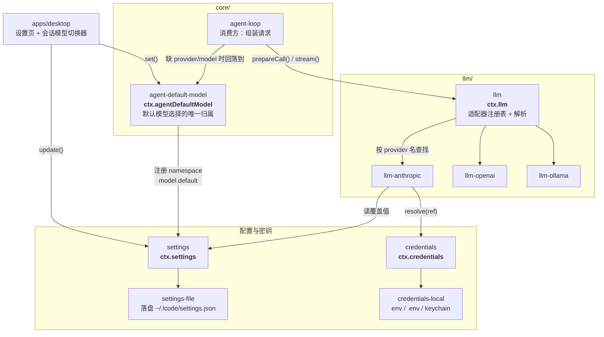
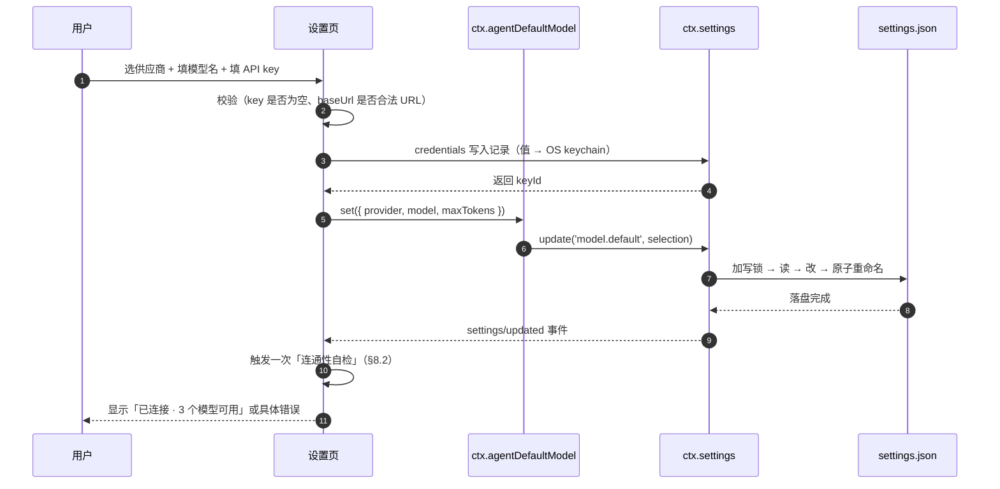

# 18 · 模型接入与供应商配置

> 这篇文档回答三个问题：**用户在哪里配置模型**、**配置怎么分层与解析**、**"当前用哪个模型"这个状态归谁所有**。
> 它是全产品最常被打开的设置面，也是"无账号可用（BYOK）"这条产品宪法的落地说明书。

| 项 | 值 |
|---|---|
| 状态 | 草案 |
| 负责人 | 内核研发（模型接入方向） |
| 上游依赖 | [00-文档总览与全局约定.md](./00-文档总览与全局约定.md)（D1/D19/D20/D21/§8.3）· [09-上下文工程与压缩策略.md](./09-上下文工程与压缩策略.md)（请求头与适配器默认值） |
| 下游被引 | [03-PRD-需求规格说明.md](./03-PRD-需求规格说明.md)（FR-MODEL 段）· [10-桌面客户端设计.md](./10-桌面客户端设计.md)（设置页与模型切换器）· [12-安全权限与沙箱模型.md](./12-安全权限与沙箱模型.md)（§7 凭据）· [13-插件SDK与协议设计.md](./13-插件SDK与协议设计.md) |
| 文档版本 | v0.1（2026-09-11） |

---

## 目录

- [1. 问题与目标](#1-问题与目标)
- [2. 四层配置模型](#2-四层配置模型)
- [3. 入口模块](#3-入口模块)
- [4. 配置文件格式](#4-配置文件格式)
- [5. 端到端解析链路](#5-端到端解析链路)
- [6. 凭据：引用与记录](#6-凭据引用与记录)
- [7. 多供应商并存与选择粒度](#7-多供应商并存与选择粒度)
- [8. 模型能力探测与降级](#8-模型能力探测与降级)
- [9. 本地模型](#9-本地模型)
- [10. 用户界面入口](#10-用户界面入口)
- [11. 反模式](#11-反模式)
- [未决问题](#未决问题)
- [变更记录](#变更记录)

---

## 1. 问题与目标

### 1.1 为什么这个环节值得单独一篇文档

模型配置有三个特征，使它成为最容易做错、也最容易被用户骂的地方：

| 特征 | 后果 |
|---|---|
| **它是用户打开频率最高的设置页** | 一次配置体验差，流失就发生在这里 |
| **它同时涉及状态、密钥、网络、UI 四层** | 边界不清就会出现"我改了但没生效" |
| **它的错误很难自证** | "为什么不回我"到底是 key 错、模型名错、baseUrl 错还是被拒？用户无法自力排查 |

### 1.2 五个必须满足的目标

| # | 目标 | 对应需求 |
|---|---|---|
| G1 | **无账号可用**：用户只需一把 API key 就能跑通，不注册任何账号 | [00 §2 第二条](./00-文档总览与全局约定.md#第二条--用户拥有自己的数据与算力) |
| G2 | **多供应商并存**：同时配 2–3 家，随时切换，互不干扰 | `FR-MODEL-001` |
| G3 | **密钥永不落盘明文**，且永不进入 UI / 日志 / 遥测 / 导出 | `FR-MODEL-005`、`SEC-CRED-001` |
| G4 | **配置可分层**：部署方可预置、团队可共享、个人可覆盖、单会话可临时改 | `FR-PRESET-003` |
| G5 | **换供应商不改调用方**：消费方只认 `ctx.llm`，不认具体适配器 | `EXT-SERVICE-001` |

### 1.3 三个必须回答清的问题

本文的核心就是把这三个问题钉死：

```
Q1  配置写在哪一层？覆盖顺序是什么？        → §2
Q2  谁拥有「当前用哪个模型」这份状态？      → §3
Q3  从「用户点保存」到「发出 HTTP 请求」经过谁？ → §5
```

---

## 2. 四层配置模型

### 2.1 分层与优先级

**从上到下，高优先覆盖低优先。** 这就是本节的权威定义，所有实现必须遵守。

| 层 | 名称 | 存放位置 | 谁能改 | 生命周期 | 典型内容 |
|---|---|---|---|---|---|
| **L1** | 单次覆盖 | 内存（进程内） | 程序化调用方 / CLI 参数 | 一次调用 | `--model` 命令行参数 |
| **L2** | 会话选择 | 会话头（`SessionHeader.modelSelection`） | 用户（会话内切换器） | 本会话 | "这个会话改用 Haiku 省钱" |
| **L3** | 工作区 / 预设 | `presets/*.yml` 的 `agents[].provider/model/maxTokens` | 用户 + 团队共享 | 随工作区 | "这个项目固定用 Sonnet" |
| **L4** | 用户设置 | `Lcode Home/settings.json` 的 `model` 段 | 用户 | 全局 | 默认模型、baseUrl 覆盖、自建网关地址 |
| **L5** | 适配器组合基座 | 适配器 `apply()` 里注册的 config | 插件作者（适配器包） | 随插件 | 官方默认 baseUrl、内置模型清单 |
| **L6** | Schema 默认值 | 代码里的 schemastery 默认 | 开发者 | 随版本 | `temperature: 1` 这类兜底 |

### 2.2 三条分层纪律

| # | 纪律 | 为什么 |
|---|---|---|
| **D-1** | **只有 L1–L4 是"用户可见"的配置，L5–L6 是实现细节** | 用户配置界面只应暴露 L4；L5/L6 不该出现在 UI 里（否则用户会改坏默认值） |
| **D-2** | **浅层只覆盖"字段"，不覆盖"整块"** | L4 的 `baseUrl` 覆盖了 L5 的默认值，但 L4 没写的 `models` 清单仍来自 L5。**逐字段合并，不是整对象替换** |
| **D-3** | **UI 必须显示"当前生效值与来源"** | 用户看到 `baseUrl = http://127.0.0.1:8080（来自：用户设置）`，才不会困惑"我改了环境变量为什么没生效" |

> **D-2 为什么要特别强调**：Lcode 的 patch 装配（见 [05 §5.2](./05-系统架构设计.md#52-声明方式)）用的是"替换整段 config"。那个语义适合插件树，**不适合用户配置**——如果用户在设置里只想改 baseUrl 结果把整个模型清单抹掉了，那是灾难。**两处语义不同，不要混用。**

### 2.3 覆盖示例

假设六层分别提供了如下值，最终生效的配置是：

| 字段 | L6 schema | L5 适配器基座 | L4 用户设置 | L3 预设 | L2 会话 | **最终** |
|---|---|---|---|---|---|---|
| `provider` | — | — | `anthropic` | `anthropic` | `openai` | **`openai`** |
| `model` | — | — | `claude-sonnet-4-5` | `claude-sonnet-4-5` | `gpt-5-mini` | **`gpt-5-mini`** |
| `baseUrl` | — | `https://api.anthropic.com` | *(未设)* | — | — | **`https://api.anthropic.com`**（来自 L5） |
| `maxTokens` | `4096` | — | `8192` | *(未设)* | — | **`8192`**（来自 L4） |
| `temperature` | `1` | — | *(未设)* | — | — | **`1`**（来自 L6） |

---

## 3. 入口模块

> **这是本文最重要的一节。** 直接回答"入口模块在哪"。

### 3.1 两个不同的"入口"，不要混为一谈

| 入口 | 回答什么问题 | 归属 |
|---|---|---|
| **配置入口** | 用户配的是什么、存在哪、怎么分层 | `@lcode/settings` + `@lcode/credentials` |
| **选择入口** | 当前这次请求用哪家哪个模型 | **`@lcode/agent-default-model`**（`ctx.agentDefaultModel`） |
| **执行入口** | 这个供应商怎么被调用 | `@lcode/llm`（`ctx.llm`）+ 各适配器包 |

**一句话**：

> **"用哪个模型"这份状态的唯一权威是 `ctx.agentDefaultModel`（包 `@lcode/agent-default-model`）。**
> **"这个供应商怎么调"的唯一权威是它的适配器包（注册进 `ctx.llm`）。**
> 两者之间靠 settings 的 `model` namespace 连接。

### 3.2 包清单与职责



> **这张图想让你看到什么**：上层只依赖两个接缝（`ctx.agentDefaultModel` 与 `ctx.llm`）。适配器是叶子，它可以同时读 `settings` 与 `credentials`——但**两者都不能反过来依赖适配器**。

| 角色 | 包 | ctx key | 职责（一句话） |
|---|---|---|---|
| **选择归属** | `core/agent-default-model` | `ctx.agentDefaultModel` | 持有并持久化"默认用哪家哪个模型" |
| 设置分层 | `settings` | `ctx.settings` | namespace 注册、分层解析、`describe()` 脱敏 |
| 设置落盘 | `settings-file` | — | 读写 `settings.json`，跨进程写锁 + 原子重命名 |
| 凭据引用 | `credentials` | `ctx.credentials` | 引用 / 记录的解析与写入 |
| 凭据来源 | `credentials-local` | — | `env` / `.env` / OS keychain 的优先级实现 |
| **适配器契约** | `llm` | `ctx.llm` | 注册表、provider 查找、`prepareCall` 编排 |
| 具体供应商 | `llm-anthropic` / `llm-openai` / `llm-ollama` / `llm-gateway` | — | Config schema + 默认 baseUrl + 内置模型清单 + 流实现 |
| 消费方 | `core/agent-loop` | `ctx.agentLoop` | 组装请求、调 `prepareCall`、落 `request/header` |
| UI 入口 | `apps/desktop` | — | 设置页、首启引导、会话内模型切换器 |

### 3.3 核心接口

```ts
/** 模型选择：L2–L4 层之间传递的最小单位 */
interface ModelSelection {
  readonly provider: string
  readonly model: string
  readonly maxTokens?: number
  readonly reasoningEffort?: 'low' | 'medium' | 'high'
  readonly temperature?: number
}

/** 默认模型选择服务：'当前用哪个模型'的唯一权威 */
interface AgentDefaultModel {
  /** 读当前默认（未配置时返回 undefined，由 UI 引导配置） */
  get(): ModelSelection | undefined
  /** 写默认：落进 user settings 层 */
  set(selection: ModelSelection): Promise<void>
  /** 订阅变化（UI 与 agent 都用它） */
  watch(listener: (selection: ModelSelection | undefined) => void): () => void
}
```

```ts
/** 适配器契约：每个供应商实现一份 */
abstract class LlmAdapter {
  /** 供应商元信息：展示名、支持的能力、是否需要凭据 */
  abstract get providerInfo(): ProviderInfo
  /** 这个供应商的重试语义（退避曲线 / 哪些错误可重试） */
  abstract get providerRetryPolicy(): RetryPolicy
  /** 列出可用模型（内置常量，可选远程刷新） */
  abstract listModels(): Promise<ModelInfo[]>
  /** 校验并解析模型 id → 能力描述（上下文窗口、是否支持工具/推理） */
  abstract resolveModel(id: string): ModelInfo | undefined
  /** 把配置物化成一次可流式消费的调用（含凭据解析） */
  abstract prepareCall(config: LlmCallConfig, signal: AbortSignal): Promise<PreparedLlmCall>
  /** 实际发起流式请求；一次调用 = 一次供应商尝试（绝不内置重试） */
  abstract stream(options: GenerateOptions): AsyncIterable<StreamChunk>
}
```

```ts
/** 模型运行时：适配器注册表 + 解析编排 */
interface LlmRuntime {
  /** 插件注册适配器；返回撤销器 */
  registerAdapter(adapter: LlmAdapter): () => void
  /** 按 provider 名查找（消费方只用这个，不 import 具体包） */
  getAdapter(provider: string): LlmAdapter | undefined
  /** 列出所有已注册供应商（设置页用） */
  listProviders(): ProviderInfo[]
  /** 解析 + 物化一次调用；结果绑定到同一个适配器注册代 */
  prepareCall(config: LlmCallConfig, signal: AbortSignal): Promise<PreparedLlmCall>
}
```

### 3.4 为什么 `prepareCall` 必须存在

这是本设计里最容易被忽略、但最关键的一个环节。

```
问题：如果解析配置、拉取凭据、物化默认值、真正 dispatch 是四个独立的异步步骤，
      中间一旦发生插件热重载或设置变更，就可能把
      「A 适配器的能力结果」和「B 适配器的端点」拼在一起。
```

`prepareCall` 把这三件事锁在**同一个适配器注册代**上：

```ts
// 伪代码
async prepareCall(config, signal): Promise<PreparedLlmCall> {
  const adapter = this.getAdapter(config.provider)          // ← 一次性解析
  if (!adapter) throw new LlmError('NO_ADAPTER', ...)
  const model = adapter.resolveModel(config.model)          // ← 同一代内校验
  if (!model) throw new LlmError('UNKNOWN_MODEL', ...)
  const credential = await this.credentials.resolve(config.credentialRef)  // ← 每次重新解析
  const materialized = applyAdapterDefaults(config, adapter.providerInfo)  // ← 标记哪些字段是默认值
  return {
    config: materialized,
    retryPolicy: adapter.providerRetryPolicy,
    context: { contextWindow: model.contextWindow, supportsTools: model.supportsTools },
    adapterDefaults: materialized.__defaults,   // 供下一步"移除并重新物化"
    stream: (opts) => adapter.stream({ ...opts, credential }),   // ← 只能调一次
  }
}
```

**`adapterDefaults` 标记的作用**（与 [09 §6.1](./09-上下文工程与压缩策略.md#61-保障一请求快照requestheader) 一致）：

| 情形 | 行为 |
|---|---|
| 字段被标记为"适配器默认" | 每步之前从提案中移除，让当前路由重新物化 |
| 字段是用户/预设显式设置的 | 跨步、跨路由变化保留 |

**解决的真实问题**：用户设了 `maxTokens: 4096`，然后换了模型——该按新模型重算默认值，还是沿用 4096？答案是"**看这个值是不是我们自己填的默认值**"。

---

## 4. 配置文件格式

### 4.1 用户设置：`Lcode Home/settings.json`

```jsonc
{
  "$version": 1,
  "model": {
    // 默认选择（对应 ctx.agentDefaultModel）
    "default": {
      "provider": "anthropic",
      "model": "claude-sonnet-4-5",
      "maxTokens": 8192
    },
    // 各供应商的"覆盖值"：只写要覆盖适配器默认的部分
    "providers": {
      "anthropic": {
        "baseUrl": "https://api.anthropic.com",
        "credentialRef": "ANTHROPIC_API_KEY"
      },
      "openai": {
        "credentialRef": "OPENAI_API_KEY"
      },
      "gateway": {
        // 自建网关：完全覆盖官方默认
        "baseUrl": "https://llm-gw.corp.internal/v1",
        "credentialRef": "CORP_GATEWAY_TOKEN",
        "models": {
          "corp-large": { "contextWindow": 128000, "supportsTools": true },
          "corp-fast":  { "contextWindow": 32000,  "supportsTools": true }
        }
      },
      "ollama": {
        "baseUrl": "http://127.0.0.1:11434"
        // 无 credentialRef：本地模型不需要凭据
      }
    },
    // 网络（与 12 §9 出站控制联动）
    "network": {
      "proxy": null,
      "timeoutMs": 300000
    }
  }
}
```

**三条约定**：

| # | 约定 | 理由 |
|---|---|---|
| 1 | `providers.<name>` 只写**覆盖**，不重述默认 | 逐字段合并（§2.2 D-2），避免"升级后官方默认值改了但用户文件把它钉死" |
| 2 | **绝不出现密钥明文** | 只有 `credentialRef`（引用名） |
| 3 | `$version` 必须存在 | 格式演进的基础（见 [11 §7](./11-数据模型与持久化设计.md)） |

### 4.2 凭据引用：`Lcode Home/credentials/refs.json`

```jsonc
{
  "$version": 1,
  "refs": {
    "ANTHROPIC_API_KEY": { "source": "env",    "env": "ANTHROPIC_API_KEY" },
    "OPENAI_API_KEY":    { "source": "record", "keyId": "k_01H8Z..." },
    "CORP_GATEWAY_TOKEN":{ "source": "record", "keyId": "k_01H9A..." }
  }
}
```

> `keyId` 指向 OS keychain 里的条目。**值本身永不落这个文件。** 详见 §6 与 [12 §7](./12-安全权限与沙箱模型.md#7-凭据管理)。

### 4.3 预设中的模型段：`presets/<name>.yml`

```yaml
- id: agents
  name: '@lcode/agent-loop'
  config:
    agents:
      - id: main
        provider: anthropic          # ← L3 层
        model: claude-sonnet-4-5
        maxTokens: 8192
```

**规则**：预设里的模型配置**优先于**用户设置（L3 > L4）。这意味着"团队共享的预设可以固定模型"——但要允许用户覆盖，见 [§7.3](#73-三层选择粒度)。

### 4.4 命令行的临时覆盖

```sh
lcode --model openai/gpt-5-mini "重构这个模块"      # L1，仅本次
lcode --provider ollama --model qwen3-coder "..."   # L1，本地模型
lcode doctor --model                                  # 打印各层解析结果与来源
```

**`lcode doctor --model` 是重要的可观测入口**——它必须打印出每个字段的**生效值与来源层**：

```
provider    openai                   ← 来自：会话选择 (L2)
model       gpt-5-mini               ← 来自：会话选择 (L2)
baseUrl     https://api.openai.com/v1 ← 来自：适配器默认 (L5)
maxTokens   8192                     ← 来自：用户设置 (L4)
temperature 1                        ← 来自：schema 默认 (L6)
credential  OPENAI_API_KEY → 已解析（来源：env）
```

---

## 5. 端到端解析链路

### 5.1 写入链路：用户点"保存"



### 5.2 读取链路：组一次请求

```
agent-loop 构造请求
  │
  ├─ 1. 取会话级选择      session.header.modelSelection            (L2)
  │      └─ 缺失 → 取预设里的 agents[].provider/model             (L3)
  │           └─ 缺失 → ctx.agentDefaultModel.get()               (L4)
  │                └─ 缺失 → 抛出 NO_MODEL_CONFIGURED，UI 引导首启
  │
  ├─ 2. ctx.llm.prepareCall(config, turnSignal)
  │      ├─ getAdapter(provider)                        → 查注册表
  │      ├─ adapter.resolveModel(model)                 → 校验 + 取能力
  │      ├─ ctx.credentials.resolve(credentialRef)      → 每次重新解析
  │      ├─ 物化 reasoningEffort / maxTokens 默认值      → 打 adapterDefaults 标记
  │      └─ 绑定 retryPolicy
  │
  ├─ 3. 落盘 session 事件 request/header                 → 供回放
  │
  └─ 4. prepared.stream(options)
         └─ adapter.stream() → HTTP → AsyncIterable<StreamChunk>
            └─ 每个 chunk → 落盘 assistant/chunk
```

### 5.3 三条必须成立的保证

| # | 保证 | 检验方式 |
|---|---|---|
| **A-1** | 换适配器不需要改任何调用方代码 | 依赖方向检查（`EXT-SERVICE-001`）+ 移除实现包后仍能编译 |
| **A-2** | 凭据每次请求都重新解析 → 轮换的 key 对下一个请求立即生效 | 测试：改 key 后下一次请求使用新值 |
| **A-3** | 一次 `prepareCall` 的结果绑定同一个适配器注册代 | 测试：`prepareCall` 与 `stream` 之间触发插件重载，仍使用原适配器 |

---

## 6. 凭据：引用与记录

> 详细安全设计见 [12 §7 凭据管理](./12-安全权限与沙箱模型.md#7-凭据管理)。本节只讲**在模型配置语境下的具体形状**。

### 6.1 两个 key 空间

| 空间 | 语法 | 语义 | 模型配置里怎么用 |
|---|---|---|---|
| **引用**（Ref） | `ANTHROPIC_API_KEY`（大写下划线） | 指向"一个可解析的来源" | 写进 `settings.json` 的 `credentialRef` |
| **记录**（Record） | `k_01H8Z...`（`keyId`） | 一次具体的值（在 keychain） | 由 `refs.json` 的 `source: "record"` 指向 |

两者**语法互斥**，所以不会碰撞。

### 6.2 解析优先级（`credentials-local`）

从高到低：

| 顺序 | 来源 | 用途 |
|---|---|---|
| 1 | **进程环境变量** | CI / 临时覆盖 / 高级用户 |
| 2 | `Lcode Home/.env` | 用户本机的常规配置 |
| 3 | **项目 `.env`** | 项目特定 |
| 4 | **OS keychain 记录** | UI 里填的（最常规的路径） |

> ⚠️ **注意第 1 条会让用户困惑**：如果一个陈旧的 `ANTHROPIC_API_KEY` 环境变量存在，用户在 UI 里填的 key **不会生效**。
>
> **因此 UI 必须显示"当前生效来源"**（§2.2 D-3）。这不是可选项——它是"配置为什么不生效"这类支持工单的主要来源。

### 6.3 存储

| 平台 | 存储位置 |
|---|---|
| macOS | Keychain（`safeStorage`） |
| Windows | DPAPI / Credential Manager |
| Linux | Secret Service（gnome-keyring / KWallet） |
| 回退 | `Lcode Home/credentials/values.enc`（0600），**必须显式提示用户"降级存储"** |

**回退必须提示**：静默降级到明文文件是安全设计上的欺骗。

### 6.4 值的三条禁令

| 禁令 | 检验 |
|---|---|
| 永不进入日志 | golden test：注册 canary 值，扫描全部日志 |
| 永不进入 UI（只显示前后 4 位） | UI 层无任何读取值的 API |
| 永不进入导出包 / 遥测 | 导出前扫描 + 遥测白名单 |

---

## 7. 多供应商并存与选择粒度

### 7.1 并存模型

用户可以同时配置任意多家。它们**互不干扰**，因为：

- 每家的配置在 `settings.model.providers.<name>` 下**独立**；
- 每家的凭据是**独立的引用**；
- 适配器之间**不共享状态**（各自持有自己的 HTTP 客户端）。

### 7.2 中间网关（企业/自建）是一等公民

`llm-gateway` 适配器允许把 `baseUrl` 指向公司自建网关。它能：

- 复用 OpenAI 兼容协议；
- 自定义模型清单（`models` 覆盖）；
- 使用独立凭据。

**为什么这很重要**：这是"本地优先 + 可私有化"在实际使用中的主要形态——团队往往不是直连官方 API，而是走自己的网关。

### 7.3 三层选择粒度

| 粒度 | 位置 | 典型场景 | 版本 |
|---|---|---|---|
| **默认** | L4 用户设置 | "我平时用 Sonnet" | v0.1 |
| **工作区/预设** | L3 | "这个项目固定用 Sonnet，因为要过内部网关" | v0.3 |
| **单会话** | L2 | "这次只是改个文案，换便宜的" | v0.1（`FR-SESSION-007/008`） |

### 7.4 明确不做（v1.0 前）

| 不做 | 为什么 |
|---|---|
| **按任务难度自动路由模型** | 与"可解释"原则冲突：用户会问"为什么这次用了便宜模型"却无法预测。**这是"看起来聪明"但破坏可预期性的典型功能** |
| **自动测速选最快** | 同上；且结果随网络波动，不可重现 |
| **自动降级到便宜模型省钱** | 属于策略，未来若要做必须是**显式的、可审计的**插件，且默认关闭 |
| **跨供应商的模型名映射** | 会掩盖真实差异；用户应该知道自己在调哪家的哪个模型 |

> **这条"不做自动路由"是刻意的**：Lcode 的差异化建立在可预期与可解释上。自动路由会让"同样的输入产生不同的行为"，直接破坏 `NFR-REL-002`（重放一致性）的语义基础。

---

## 8. 模型能力探测与降级

### 8.1 能力信息的三个来源

| 来源 | 精确度 | 何时用 |
|---|---|---|
| **适配器内置清单** | 高（人工维护） | 官方支持的模型，默认路径 |
| **远程拉取**（`listModels()`） | 中（可能缺能力字段） | 用户配了自建网关时 |
| **用户手填**（`settings` 的 `models` 覆盖） | 由用户负责 | 网关的私有模型名 |

### 8.2 保存时的连通性自检

用户保存配置后，**必须**立即做一次自检，并给出可读结果：

| 结果 | UI 文案 |
|---|---|
| 成功 | "已连接 · 发现 3 个可用模型" |
| 凭据无效（401/403） | "API key 被拒绝，请检查是否过期或权限不足" |
| 地址不通（DNS/连接失败） | "无法连接到 `<baseUrl>`，请检查地址或代理设置" |
| 模型名不存在 | "供应商没有名为 `xxx` 的模型，可用：a, b, c" |
| 超时 | "连接超时（30s），可能是网络或代理问题" |

**为什么自检是"必须"而不是"可选"**：没有它，"不回我"这类问题的归因成本极高，而这是模型配置最常见的失败形态。

### 8.3 探测失败时的降级（fail-safe）

| 缺失的能力信息 | 保守假设 | 后果 |
|---|---|---|
| `contextWindow` | **32,000**（保守下界） | 压缩会更早触发（多花一点钱，但不会溢出失败） |
| `supportsTools` | **true** | 若实际不支持，第一次工具调用会失败并给出明确错误 |
| `supportsReasoning` | **false** | 不发送推理参数 |
| `maxOutputTokens` | **4096** | 不会被供应商拒绝 |

> **降级方向必须"偏保守"**：宁可多花一点钱，也不要发出必然失败的请求。这与 [09 §7.3](./09-上下文工程与压缩策略.md#73-三个设计要点) 的"估算偏保守"是同一原则。

### 8.4 能力驱动压缩阈值

`contextWindow` 直接决定压缩的触发点（`FR-MODEL-007`）：

```
压缩触发阈值 = min( contextWindow × 0.75 , 用户配置上限 )
```

**为什么是 0.75 而不是 0.95**：预留空间给下一步的工具结果、上下文注入与输出。撞上硬性上限会导致请求失败，而提前压缩只是多花一次摘要调用。

---

## 9. 本地模型

### 9.1 与云端的三处不同

| 维度 | 云端 | 本地（Ollama / LM Studio） |
|---|---|---|
| 凭据 | 必需 | **不需要**（`credentialRef` 省略） |
| 地址 | 官方 baseUrl | `http://127.0.0.1:11434`（可改） |
| 启动 | 随时可用 | **可能没在跑** → 需要可读的"未启动"错误 |
| 用量统计 | 有（provider 返回 usage） | 通常有，但可能不全 → 计费面板要标注"估算" |

### 9.2 三条必须做对的

| # | 要点 |
|---|---|
| 1 | **"未启动"必须是可识别的错误**，而不是通用连接失败。UI 文案："Ollama 似乎没有运行，请先执行 `ollama serve`" |
| 2 | **模型清单来自 `listModels()`**（本地模型是用户自己拉的，无法内置） |
| 3 | **不需要凭据的供应商不能强制要求填 key**（否则首启引导会卡住） |

### 9.3 为什么本地模型值得进 MVP 之外但靠前

它同时服务三件事：BYOK 之外的**零成本试用**（首启体验）、**离线场景**、以及**隐私敏感用户**的入场。这是 [01 画像老陈](./01-产品愿景与定位.md#41-主画像老陈--独立开发者mvp-的核心用户) 在"我不想先绑卡"时的主要出路。

---

## 10. 用户界面入口

> 视觉细节归属 [10-桌面客户端设计.md](./10-桌面客户端设计.md)；本节定义**功能与信息**要求。

### 10.1 三个入口

> ⚠️ **v0.1 起，首次启动不再引导配置模型**（见 [19 §3.1](./19-原型与交互规格.md#31-p1--首页新对话)）。
> 理由：配置不是上手，是门槛。用户第一次打开产品时想的是"它能干什么"，不是"我要填哪个 key"；而且他还没体验过产品，无从判断该选哪家。

| # | 入口 | 何时出现 | 必须展示 |
|---|---|---|---|
| ~~E1 首启引导~~ | **已移除** | — | — |
| **E1' 首页** | 首次启动即进入 | 问候语 + 四张能力卡片 + 输入框；**页面任何位置都不出现配置入口或提示**（除一句说明性质的"想换模型随时在设置里改"） | 未配模型时**不阻断**输入；发出消息后才提示去设置 |
| **E2 设置 → 模型 → 供应商与密钥** | 用户主动打开（侧栏账户菜单 / `Ctrl+,`） | 供应商列表与状态、添加/删除、检测连接、设默认、服务地址、密钥掩码、**生效来源**、可用模型清单 | 见 §10.2 |
| **E3 会话内切换器** | 输入框下方 | 当前模型名 + 一键切换（**只改本次会话，不改默认**） | 切换要落盘为会话事件（`FR-SESSION-007`） |

### 10.2 E2 设置页的信息要求（六项）

| # | 要求 | 为什么 |
|---|---|---|
| 1 | 每个供应商显示 **凭据状态**（已配置 / 未配置 / 检测失败），但**永不显示值**（最多前后 4 位） | 安全 + 可诊断 |
| 2 | 显示生效值的**来源**，且**必须用人类语言**（"来自：你在设置里选的" / "默认值"）；内部层级编号（`L4/L5/L6`）**不得上界面** | 解决"我改了没生效"，同时不把架构词汇丢给用户（[19 §6.2](./19-原型与交互规格.md#62-术语黑名单硬性ux-copy-001)） |
| 3 | 显示 **最后一次自检时间与结果** | 可判断是否是"配对了但网络变了" |
| 4 | 「测试连接」按钮（可重复触发） | 排障的主要工具 |
| 5 | 「设为默认」明确区分**会话选择**与**默认选择** | 避免用户以为改了默认但只改了本会话 |
| 6 | 列出该供应商的**可用模型**（含上下文窗口标注） | 避免用户手输错模型名 |

### 10.3 一条交互纪律

> **任何保存动作都必须给出"是否生效"的即时反馈**，且反馈必须包含**生效来源**。

模型配置的所有用户困惑都可以归结为一句："我改了，但好像没生效。" 上述所有设计要求都是为了消灭这一句。

---

## 11. 反模式

| # | 反模式 | 问题 | 修正 |
|---|---|---|---|
| 1 | 把密钥明文写进 `settings.json` | 安全事故；且会被用户提交进 git | 只存引用，值进 keychain |
| 2 | 用户设置**整块替换**适配器默认 | 用户只改 baseUrl，结果丢掉了模型清单 | 逐字段合并（§2.2 D-2） |
| 3 | UI 不显示凭据来源 | 用户改了 key 但被陈旧环境变量遮蔽，完全无法自查 | 显示生效来源 |
| 4 | 解析配置、拉凭据、dispatch 是三个独立异步步骤 | 热重载时可能混用两个适配器 | 用 `prepareCall` 绑定同一注册代 |
| 5 | 适配器内置重试 | 与上层的重试策略叠加，实际重试次数爆炸 | 一次适配器调用 = 一次供应商尝试 |
| 6 | 按错误文本判断"key 无效" | 供应商改文案即失效 | 用规范错误码 |
| 7 | 自动路由模型 | 破坏可预期性与重放语义 | 明确不做（§7.4） |
| 8 | 强制要求凭据才能进入首启下一步 | 把"只想试试本地模型"的用户挡在门外 | 本地模型路径可跳过凭据 |
| 9 | 探测失败时假设"大上下文、支持工具" | 会发出必然失败的请求 | 保守降级（§8.3） |
| 10 | 模型切换不落盘 | 回放时看不出"当时用的是哪家" | 写会话事件 + `request/header` |

---

## 未决问题

- [ ] **`settings.json` 是否需要支持"配置档"（多套配置切换）**：例如"工作用网关 / 个人用官方"。当前只有一套。需要真实用户反馈再决定，避免过早引入复杂度。
- [ ] **凭据的"轮换"体验**：如果用户想同时保留新旧两把 key（灰度切换），当前的两个 key 空间设计支持吗？需要评估是否需要 `activeKeyId` 概念。
- [ ] **`listModels()` 的远程拉取频率**：每次打开设置都拉？还是缓存？自建网关的模型清单可能经常变。倾向"打开设置时拉一次 + 手动刷新按钮"，需要与 `10` 的性能预算对齐。
- [ ] **多模态能力是否纳入 `ModelInfo`**：`FR-MODEL-*` 目前只提了工具与推理。视觉输入（截图）会用到，需要在 v0.3 前补齐能力字段。
- [ ] **`credentialRef` 的命名是否要区分供应商前缀**：当前用小写供应商名 + 大写下划线环境变量名两套语法。`CORP_GATEWAY_TOKEN` 这种自定义名的校验规则需要明确。
- [ ] **[10-桌面客户端设计.md](./10-桌面客户端设计.md) 需要补充**：设置页与首启引导的**具体视觉规范**本文只给了信息要求，视觉稿需要 10 号文档承接（当前 10 号文档未包含模型设置页）。

---

## 变更记录

| 日期 | 版本 | 变更 | 说明 |
|---|---|---|---|
| 2026-09-11 | v0.1 | 初稿 | 补齐模型配置环节的空白：定义六层配置模型与优先级、明确三处入口模块（`ctx.agentDefaultModel` / `ctx.llm` / `ctx.settings`）、给出配置文件格式与端到端解析链路、多供应商并存与三层选择粒度、能力探测降级、本地模型与三个 UI 入口 |
| 2026-09-11 | **v0.2** | **移除首启引导入口** | §10.1 删除 E1 首启引导，改为「首页不出现任何配置入口；模型配置位于设置」；§10.2 要求来源展示**用人类语言**、禁止内部层级编号上界面。原由：首次启动配置模型把选择成本前置，是上手门槛而非上手引导（见 [19 §3.1](./19-原型与交互规格.md#31-p1--首页新对话)） |
