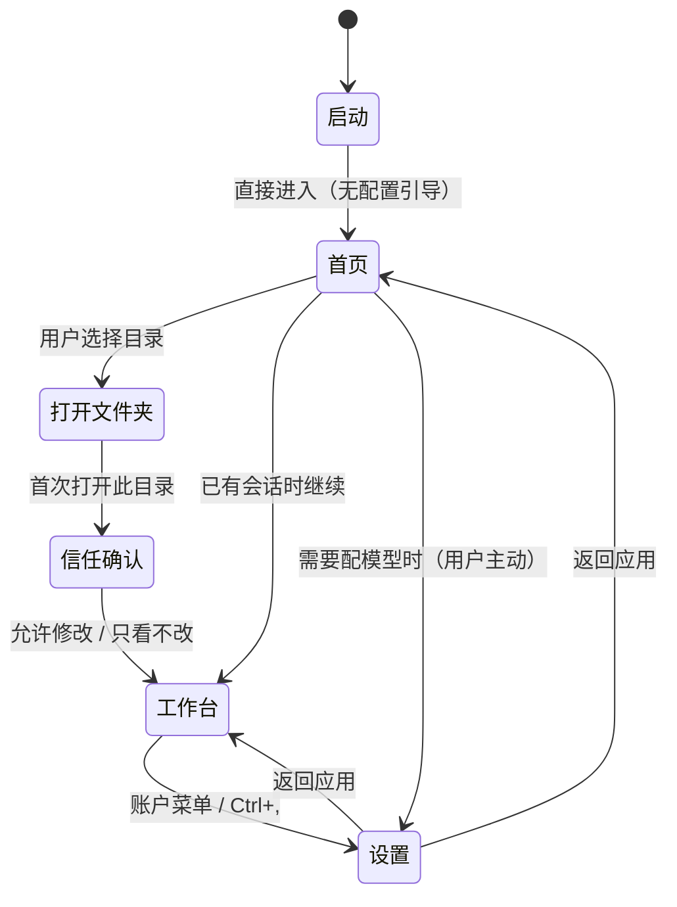
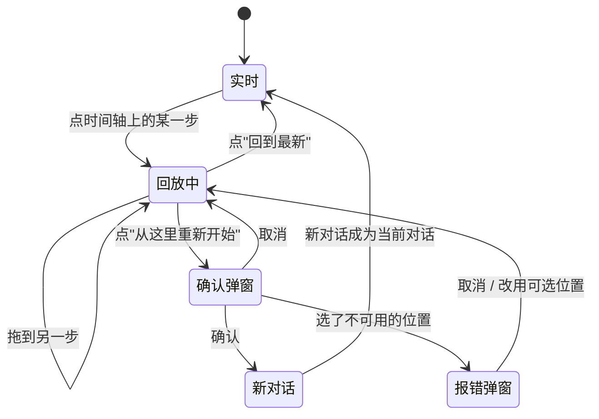
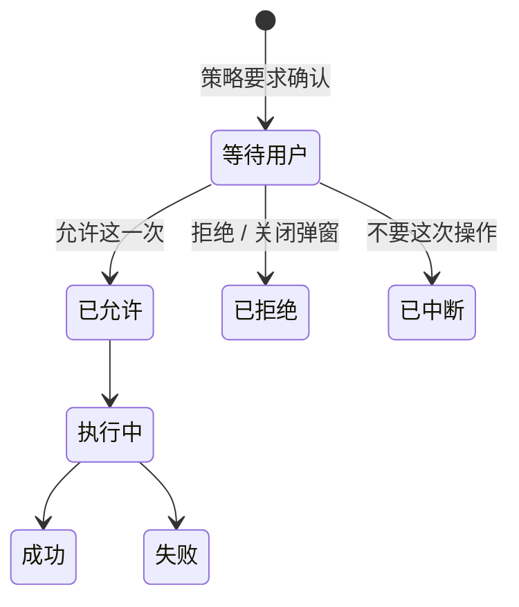

# 19 · 原型与交互规格

> 这篇文档回答：**每个界面长什么样、有哪些状态、怎么跳转、文案怎么写、对应哪条需求。**
> 它与可交互原型 [prototype/lcode-mvp-prototype.html](../prototype/lcode-mvp-prototype.html) 配对：**原型用来"看"，本文用来"评审与追溯"。**

| 项 | 值 |
|---|---|
| 状态 | 草案 |
| 负责人 | 交互设计 |
| 上游依赖 | [03-PRD-需求规格说明.md](./03-PRD-需求规格说明.md)、[04-MVP范围与验收标准.md](./04-MVP范围与验收标准.md)、[10-桌面客户端设计.md](./10-桌面客户端设计.md)（设计系统）、[18-模型接入与供应商配置.md](./18-模型接入与供应商配置.md)（模型设置） |
| 下游被引 | [14-产品路线图与里程碑.md](./14-产品路线图与里程碑.md)、[15-测试策略与质量门禁.md](./15-测试策略与质量门禁.md) |
| 原型文件 | [`prototype/lcode-mvp-prototype.html`](../prototype/lcode-mvp-prototype.html)（自包含、可离线打开、含浅/深色与色盲友好三态） |
| 文档版本 | v0.2（2026-09-11） |

---

## 目录

- [1. 这份文档与原型的关系](#1-这份文档与原型的关系)
- [2. 屏幕清单与需求追溯](#2-屏幕清单与需求追溯)
- [3. 逐屏规格](#3-逐屏规格)
- [4. 跨屏状态机](#4-跨屏状态机)
- [5. 组件规范](#5-组件规范)
- [6. 界面文案规范](#6-界面文案规范)
- [7. 覆盖度声明](#7-覆盖度声明)
- [8. 如何用它对接开发](#8-如何用它对接开发)
- [未决问题](#未决问题)
- [变更记录](#变更记录)

---

## 1. 这份文档与原型的关系

### 1.1 三者的分工

| 产物 | 回答 | 谁能改 |
|---|---|---|
| [10-桌面客户端设计.md](./10-桌面客户端设计.md) | **结构**：进程模型、信息架构、设计系统令牌 | 架构 + 设计 |
| [`prototype/lcode-mvp-prototype.html`](../prototype/lcode-mvp-prototype.html) | **观感**：可点、可切主题、看得见状态差异 | 设计 |
| **本文** | **契约**：状态、跳转、文案、需求追溯、验收锚点 | 设计 + 产品 + 测试 |

### 1.2 四条纪律

| # | 纪律 | 理由 |
|---|---|---|
| **P1** | **原型不引入新的设计决策** | 每个色值必须来自 [10 §6.1](./10-桌面客户端设计.md#61-色彩与主题) 的令牌；原型里出现新颜色 = 规格有漏洞 |
| **P2** | **原型不是规格** | 原型只覆盖"正常路径 + 关键异常"；开发以本文与 03/04 为准 |
| **P3** | **每个屏幕必须能追溯到需求** | 追溯不上的要么删掉，要么标注为"体验补充"（见 §2.3） |
| **P4** | **用户界面上不出现内部术语** | 见 §6.2 的黑名单。这是**硬性**的，由 `UX-COPY-001` 约束并在测试中扫描 |

> **P4 是 v0.2 新增的，也是本版最重要的一条。** v0.1 的原型把 `不变量 I1`、`seq 128`、`L4/L5/L6`、`presentationMeta`、`ABORTED_BEFORE_DISPATCH` 直接写在了界面上——这是**把系统内部的实现细节当成了用户语言**。用户不需要知道我们的架构，只需要知道"它做了什么、我能怎么办"。

### 1.3 四条界面设计取向

| 取向 | 含义 | 反例 |
|---|---|---|
| **沿用惯例，但不复制身份** | 菜单栏、左侧栏、设置左分类右内容、柔和中性风格——**这些惯例用户不用学，也不属于任何人**；身份由结构承载（见 [10 §6.6](./10-桌面客户端设计.md#66-视觉身份身份由结构承载不由颜色承载v04-修订)） | 自创奇特导航；或反过来连内部结构也照搬 |
| **先让人用起来，再让人配置** | 首次打开即可发消息；模型在设置里 | 首启就要求填 API Key |
| **能一句话说清，就不说两句** | 描述"它会做什么"用动词（读取 / 修改 / 运行） | 用工具的内部名称（`read` / `edit` / `bash`） |
| **身份来自结构，不来自颜色** | 别人没有的**信息组织方式**：时间轴脊柱、工作过程折叠组、轮总结卡、产物入口（见 §1.4） | 只靠换一个主色或改圆角来"显得不一样" |
| **过程可查，结论清爽**（v0.4 新增，v0.5 修正） | 过程（思考/工具调用）收在过程流里、任务结束时整体收起；最终总结**不可折叠**，用户永远不用点开就能看到结论（见 §3.2） | 让用户先展开折叠才看得到结论 |

> **第 1 条的边界怎么划**：见 [10 §6.6](./10-桌面客户端设计.md#66-视觉身份身份由结构承载不由颜色承载v04-修订) 的两栏表与 §6.7 的检测清单。
>
> **一句话判据**：**惯例可以共用，因为用户不用重新学；身份必须自有，因为那是我们存在的理由。**

### 1.4 签名元素（v0.4 扩充）

Lcode 的核心能力是"能倒带、能查证、能回到任意一步"。**把它做进界面骨架与对话流结构，而不是藏成面板和日志。** v0.4 起，签名元素由一个扩充为四个：

| # | 元素 | 规格 |
|---|---|---|
| 1 | **常驻时间轴脊柱** | 会话列表与对话流之间常驻（44–52px）；每步一个节点；状态：已完成（绿）/ 当前（强调色 + 外环）/ 补记（琥珀）；点击跳转、悬停出提示；**任何情况下不被折叠** |
| 2 | **过程流** | 思考与全部工具调用收在**一个容器**内；任务进行中自动展开、当前动作高亮、子任务完成时在流内插一句**阶段小结**；任务结束时**整体收起为一行**（`过程记录 · 2 轮 · 14 个操作`） |
| 3 | **最终总结（不可折叠）** | 任务完成时产出，是这一轮唯一正文：`✓ 任务完成 · 用时 N` + 三段式正文（做了什么 / 验证 / 需要你知道的）+ 产物入口 + 底栏；出现即覆盖前面全部折叠 |
| 4 | **产物入口** | 最终总结底部固定 `查看本轮所有产物 (N)` / `查看本轮所有变更 (N)`，点击聚焦右栏并过滤到本轮 |

> **判据**：遮住 logo 并排截图，用户能通过**结构**认出 Lcode——"左边有一列步骤节点、AI 干活的过程收起来、每轮结尾有总结和产物入口的那个"。

---

## 2. 屏幕清单与需求追溯

### 2.1 覆盖矩阵

| 屏 | 名称 | 原型锚点 | 主要覆盖需求 | 实现版本 |
|---|---|---|---|---|
| **P1** | 首页（新对话） | `#p1` | `UX-ONBOARD-001`、`UX-HOME-001`、`FR-MODEL-009` | v0.1 |
| **P2** | 工作台（运行中） | `#p2` | `FR-TOOL-007`、`UX-CARD-001/002/003`、`UX-FOLD-001`、`UX-SUMMARY-001`、`UX-ARTIFACT-001`、`UX-STATUS-001`、`FR-COMPACT-007` | v0.1 |
| **P3** | 回放（时光倒带） | `#p3` | `FR-REPLAY-001/003`、`UX-TIMELINE-001/002`、`UX-WHY-001`、`UX-CTX-001` | v0.1（只读版） |
| **P4** | 询问弹窗 | `#p4` | `FR-PERM-003/004`、`UX-APPROVAL-001/002`、`SEC-APPROVAL-001` | v0.2 |
| **P5** | 设置 | `#p5` | `FR-MODEL-008/009/010/011`、`FR-MODEL-005`、`SEC-CRED-002` | v0.1 |
| **P6** | 意外退出恢复 | `#p6` | `NFR-REL-001/003`、`FR-SESSION-003`、`M-REC-01`–`06` | v0.1 |
| **P7** | 从某一步重来 | `#p7` | `FR-REPLAY-004`、`UX-TIMELINE-003` | v0.3 |
| **P8** | 异常与空态（6 张卡） | `#p8` | `UX-ERR-001/002`、`FR-PERM-007`、`FR-COMPACT-002/003` | v0.1–v0.3 |

### 2.2 关键用户旅程与屏幕的对应

对照 [04 §8 可演示脚本](./04-MVP范围与验收标准.md#8-可演示脚本)：

| 脚本时刻 | 经过的屏 |
|---|---|
| 0:00–0:40 打开项目 | **P1 首页** → P8-信任确认 |
| 0:40–4:00 agent 工作 | P2（五种卡片全部出现） |
| 4:00–4:30 中途插话 | P2 |
| 4:30–5:30 **打开时间轴** | **P3** |
| 5:30–6:30 查看批准过程 | P3 |
| 6:30–7:40 强杀并恢复 | **P6** |
| 7:40–8:00 导出 | P2 |

### 2.3 体验补充（追溯不到具体需求，但必须做）

| 屏 | 为什么必须有 |
|---|---|
| P1 首页的能力卡片 | `UX-ONBOARD-001` 只说"直接进首页"，但"首页上放什么"是首次体验的主体 |
| P8 插件降级卡 | `NFR-REL-005` 要求插件可重启，但没规定**用户怎么知道** |
| P8 上下文压力卡 | `FR-COMPACT-002/003` 只规定机制，未规定**如何告知用户** |
| P3 的「已核对」小标 | 「可重放」的信任需要**可见的凭据**，但需求只规定了能力没规定表达 |

---

## 3. 逐屏规格

### 3.1 P1 · 首页（新对话）

> **本屏是 v0.2 最重要的变更。** 原「首启引导」被删除——**首次启动不配置模型**。

| 项 | 内容 |
|---|---|
| **目标** | 让用户**在一分钟内发出第一条消息**，全程不接触任何配置 |
| **进入条件** | 启动后无活跃会话；或点击侧栏「新对话」 |

**为什么删掉首启配置模型**（三条理由，务必写进评审纪要）：

1. **配置不是上手，是门槛。** 用户第一次打开产品时想的是"它能干什么"，不是"我要填哪个 key"。
2. **它把选择成本前置了。** 一个还没体验过产品的人，被要求先决定供应商、模型、地址——他无从判断。
3. **成熟产品都不这么做。** 首次体验是"直接开始"，配置是"需要时再去改"（见 §1.3 取向二）。

**布局：两栏（v0.3 变更）**

```
┌──────────────────────────────┬──────────────────────────────────────────┐
│ 应用菜单栏：Lcode │ 文件 编辑 视图 帮助                          ─ □ ✕ │
├────────┬─────────────────────┴──────────────────────────────────────────┤
│ 侧栏    │ 左：继续（带步数）          │ 右：开始                          │
│ 新对话  │ ┌ 第 14 步 把 parse.ts… ┐  │ 在 web-app 里你想做什么？         │
│ 插件    │ │ 2 分钟前 · 已改 3 个文件│  │ ┌────────────────────────────┐   │
│        │ └───────────────────────┘  │ │ 描述你想做的事…            │   │
│ web-app│ ┌ 已完成 看一下这个项目… ┐  │ ├────────────────────────────┤   │
│  · …   │ └───────────────────────┘  │ │ ＋ │ 权限 标准▾ │ 模型 ▾ │ 开始 │
│        │ ┌ 中断 给订单接口补测试 ┐  │ └────────────────────────────┘   │
│ api-…  │ └───────────────────────┘  │ 常用起点                          │
│        │                            │ 01 探索并理解代码        只读      │
│ ⚙ 设置 │ 最近的项目                  │ 02 构建新功能或工具      会改文件  │
└────────┴────────────────────────────┴───────────────────────────────────┘
```

| 段 | 内容 | 为什么这样 |
|---|---|---|
| 顶部菜单栏 | Lcode 标记 + 文件 / 编辑 / 视图 / 帮助 | 惯例可共用；标记用方形，与参照产品的圆形区分 |
| 左侧栏 | 新对话 / 插件 + **按项目分组的会话历史** + 底部账户（含设置入口） | 惯例可共用；**去掉了照搬来的「拉取请求」「已安排」** |
| **左内栏** | **继续**（每条带"第 N 步 / 已完成 / 中断"） + 最近的项目 | **Lcode 独有**：把"历史"放到首页左半边，因为历史是这个产品的核心 |
| **右内栏** | 左对齐标题 + 方形输入框 + **常用起点清单** | **Lcode 独有**：不用居中构图、不用等权卡片网格 |

**两条与 v0.2 的差异（避免与参照产品同形）**：

| 项 | v0.2（像参照产品） | v0.3（Lcode 自己的） |
|---|---|---|
| 构图 | 居中大标题 + 4 张等权卡片 | **左对齐标题 + 左侧历史栏 + 起点清单** |
| 输入框 | 胶囊形 + 圆形发送钮 | **方形工具条**（`＋ / 权限 / 模型 / 开始`，直角分隔） |

**常用起点清单**（用编号 + 一行说明，不用卡片网格）：

| # | 起点 | 右侧标注 |
|---|---|---|
| 01 | 探索并理解代码 | 只读 |
| 02 | 构建新功能或工具 | 会改文件 |
| 03 | 审查代码并提出建议 | 只读 |
| 04 | 修复问题与失败 | 会跑命令 |

> 右侧标注是 v0.3 新增的：**提前告诉用户这个起点会不会动他的文件**，比事后解释成本低得多。

**必须做到**：

- **页面任何位置都不出现"配置模型"的入口或提示**（除了底部那句"想换模型…在设置里改"，它是**说明**不是**要求**）。
- 输入框可直接用，不做任何前置校验（未配模型时，发出消息后才提示去设置）。

**对应需求**：`UX-ONBOARD-001`、`UX-HOME-001`、`FR-MODEL-009`
**验收锚点**：`M-UX-01`、`M-UX-06`、`M-UX-10`

---

### 3.2 P2 · 工作台（运行中）

| 项 | 内容 |
|---|---|
| **目标** | 任务进行时看到"它在做什么"，任务完成后只剩"提问 + 最终总结" |
| **进入条件** | 存在活跃会话 |

**五区结构**（见 [10 §4.2](./10-桌面客户端设计.md#42-四区职责)）：左 会话列表 / **时间轴脊柱** / 中 会话流 + 输入区（**输入框只在中间栏内**）/ 右 文件与变更。

> **v0.5 修正**：输入框属于**中间会话栏**（`.mid`），不跨到左侧工作区与右侧变更栏上方。原型顶部有「任务进行中 / 任务已完成」切换按钮，用于对照两种状态。

#### 核心语义：折叠只发生在"过程"里（v0.5 修订）

| 阶段 | 会话流里有什么 |
|---|---|
| **任务进行中** | 用户消息 → **过程流**（自动展开、实时：思考 / 读取 / 搜索 / **阶段小结** / 修改 / 运行，当前动作行高亮）→ 等待确认条（若有） |
| **任务已完成** | 用户消息 → **过程记录**（一行，默认收起：`过程记录 · 2 轮 · 14 个操作 · 用时 2 分 4 秒`）→ **最终总结**（不可折叠） |

**规则一：过程流（`UX-FOLD-001`）**

| 项 | 规格 |
|---|---|
| 内容 | 思考（`深度思考`，灰）、工具调用（**动词** + 目标 + 耗时/结果摘要）、**阶段小结**（普通文字行） |
| 运行中 | 自动展开；当前动作行用 shimmer 文本高亮（`▶ 运行命令 pnpm vitest run utils · 运行中…`） |
| 阶段小结 | 子任务完成时在流内插一句普通文字（如"已定位 4 处调用方…我一起改。"），**不单独成卡** |
| 任务结束 | **整体收起为一行**，随时可展开回看全部细节 |
| 三级密度 | L1 收起一行 / L2 紧凑行列表 / L3 该行详情（正文 / 搜索结果 / diff） |
| 硬性 | 对话流里**不铺开 diff**；折叠状态不进日志 |

**规则二：最终总结不可折叠（`UX-SUMMARY-001`）**

```
┌ 过程记录 · 2 轮 · 14 个操作 · 用时 2 分 4 秒                    ▸ ┐  ← 默认收起
└──────────────────────────────────────────────────────────────────┘

┌──────────────────────────────────────────────────────────────────┐
│ ⬤ Lcode                        ✓ 任务完成 · 用时 2 分 4 秒         │  ← 无折叠箭头
│   parse.ts 已切换为结构化解析，测试全部通过                        │  ← 做了什么
│   · utils/parse.ts — 换成 zod schema …                          │
│   验证：pnpm vitest 通过（14 用例 0 失败），连续两次通过            │  ← 验证
│   需要你知道的：改了工作区外的一个类型文件，这次确认只管那一次       │  ← 需要你知道的
│ ─────────────────────────────────────────────────────────────── │
│ 🗂 查看本轮所有产物 (6) ›   📝 查看本轮所有变更 (4) ›              │  ← 产物入口
│ ─────────────────────────────────────────────────────────────── │
│ ⧉ 👍 👎 🔊 ⑂ ⋯              共消耗 12.4k tokens · ◆ 模型名        │  ← 底栏
└──────────────────────────────────────────────────────────────────┘
```

| 区 | 规则 |
|---|---|
| 头部 | 静态的 `✓ 任务完成 · 用时 N`，**没有折叠箭头**——它不是可折叠项 |
| 覆盖行为 | 总结出现时**自动覆盖前面全部折叠**（过程收进那一行），最终视图只剩"提问 + 最终总结" |
| 正文三段 | **做了什么** / **验证** / **需要你知道的**；不复述每个操作（那是过程流的职责） |
| 底栏 | 操作图标（复制 / 反馈 / 朗读 / 从这里重新开始 / 更多）+ `共消耗 N tokens · 模型名`；用量来自日志派生 |

**规则三：产物入口（`UX-ARTIFACT-001`）**

- `查看本轮所有产物 (N)`：本轮**涉及**的全部文件（读取过的不算，只算写入 / 新建 / 命令产物）
- `查看本轮所有变更 (N)`：本轮的文件改动集合（带 `+/−` 行数）
- 点击后**聚焦右栏并把变更页过滤到本轮**（范围 chip 显示 `本轮 · 第 2 轮`，可切回"全部会话"）
- 变更数据来自工具结果的 `presentationMeta`，**不是**文件系统扫描——回放时显示的是**当时**的变更集合

**工具动词表**：

| 内部工具名 | 界面上显示的动词 |
|---|---|
| `read` | **读取文件** |
| `search` / `grep` / `glob` | **搜索** |
| `edit` | **修改文件** |
| `write` | **新建文件** |
| `shell` / `terminal` | **运行命令** |
| `todo_write` | **记录待办** |

**折叠提示说人话**：`还有 28 行（点击展开）` / `只显示了 3 处，共 11 处` / `第 1–4 行`。右栏说明文字写「这里是你这次会话改过的文件」。

**对应需求**：`FR-TOOL-007`、`UX-CARD-001/002/003`、`UX-FOLD-001`、`UX-SUMMARY-001`、`UX-ARTIFACT-001`、`UX-INPUT-002`、`UX-STATUS-001`、`FR-COMPACT-007`
**验收锚点**：`M-TOOL-03/08`、`M-UX-03`、`M-UX-12/13/14/15`

---

### 3.3 P3 · 回放（时光倒带）

> **这是全产品最重要的一个界面。** 差异化全部压在这里——但它必须**用人的语言**讲。

| 项 | 内容 |
|---|---|
| **目标** | 让用户回答"它当时到底看到了什么"，且答案可信 |
| **进入条件** | 点击时间轴上任意一步 |

**三段结构**：

| 段 | 标题（用户语言） | 关键约束 |
|---|---|---|
| ① 横幅 | 「正在看历史」+「这是 14:02 的状态。历史是只读的。」+ `回到最新` / `从这里重新开始` | 输入区必须禁用并**解释原因** |
| ② 时间轴 | 节点标签用「第 8 步」；三类特殊节点：「已压缩」「上次退出时补的」 | 三类点**视觉可区分**；「上次退出时补的」**不可**作为重新开始的位置 |
| ③ 双栏 | 左「**它当时看到的内容**」；右「**它当时能用的工具**」 | 内容必须与当时实际发出的请求一致 |

**术语替换表**（v0.2 核心变更）：

| 旧（v0.1） | 新（v0.2） |
|---|---|
| 请求快照 · system prompt | **它当时看到的内容** |
| 请求快照 · 工具列表（6） | **它当时能用的工具（6 个）** |
| 与第 12 步实际发出的请求逐字节一致（由不变量 I1 保证） | **已核对** ＋ 可展开的「这是怎么保证的？」 |
| 分叉点 seq 128（轮 #2 结束） | **第 8 步** |
| 消息历史（12 条 · 派生自日志） | 当时的历史共 12 条消息 |
| 为什么面板 | **这次操作是怎么被批准的** |
| `deny` / `ask` / `allowed-once` / `guard 弃权` | 需要你确认 / 你点了「允许一次」/ 红线检查没命中 |
| 并行 / 独占 | 可以同时做多个 / 一次只做一个 |

**「详情」折叠机制**：所有内部细节（事件名、错误码、策略标识）放在可展开的 `详情` 里。**默认收起，但必须可查**——这既保住了简明的界面，又没有牺牲"能查证"这个产品承诺。

**对应需求**：`FR-REPLAY-001/003`、`UX-TIMELINE-001/002`、`UX-WHY-001`、`UX-COPY-001`
**验收锚点**：`M-REPLAY-01`–`07`、`M-UX-06`

---

### 3.4 P4 · 询问弹窗

| 项 | 内容 |
|---|---|
| **目标** | 让用户在**一屏内**判断"该不该允许" |
| **进入条件** | 当前策略要求人工确认 |

**标题用问句**：「是否允许修改这个文件？」（而不是「需要你确认」这种通知口吻）

**三段式内容**：

| 段 | 用户语言 | 反例（不要这么写） |
|---|---|---|
| 要做什么 | 修改 `~/config/defaults.json` | `write` 工具 · 目标 `~/config/...` |
| 为什么问你 | 当前权限是「只能改这个项目」，改外面的文件需要你点头 | `permission-preset = workspace-write` |
| 会影响什么 | diff 摘要 + 「这个文件影响你机器上的全部 4 个项目」 | 仅列 diff |

**四个按钮**：

| 按钮 | 对应的内核结果 | 说明 |
|---|---|---|
| **允许这一次** | `allowed-once` | 唯一的放行路径 |
| 拒绝 | `rejected` | |
| 拒绝并说明… | `rejected` + 反馈 | 反馈进入下一步上下文 |
| 不要这次操作 | `cancelled` | 中断这次调用，而不是否决这个意图 |
| （关闭弹窗） | `unavailable` | **等同拒绝** |

**硬性约束**：

- **不提供"记住选择"或"永久允许"**（`FR-PERM-004`）。文案要解释：「这次允许**只对本次生效**」。
- 影响面**必须包含网络目标**（如果是网络出站）。
- **`拒绝` 与 `不要这次操作` 必须分开**——它们是两个不同的事实，不能合并成一个"取消"。

**对应需求**：`FR-PERM-003/004`、`UX-APPROVAL-001/002`
**验收锚点**：`M-PERM-02`、`SEC-APPROVAL-001`

---

### 3.5 P5 · 设置

> **本屏是 v0.2 新增，模型配置搬到了这里。**

| 项 | 内容 |
|---|---|
| **目标** | 让用户**需要时**能改到任何东西，且每一句都看得懂 |
| **进入条件** | 侧栏底部账户 → 「设置」；或菜单 编辑 → 设置；或快捷键 `Ctrl+,` |

**左侧分类导航（v0.3 改为 Lcode 自己的分组与命名）**：

| 分组 | 项 | 为什么这么分 |
|---|---|---|
| **工作** | 常规 / 外观 / 快捷键 | 与"干活"直接相关的通用设置 |
| **模型** | 供应商与密钥 / 默认模型 | 独立成组——它是最常被改的一组 |
| **记忆与历史** | 历史与保留 / 导出 | **Lcode 独有**：把产品核心能力（可查、可带走）做成设置里的一等公民，而不是塞进"高级" |
| **扩展** | 插件 / 终端与环境 | — |
| **账户** | 账户 / 已归档 | — |

> **为什么要改**：v0.2 的分类名与顺序是照参照产品抄的。分组命名和顺序**也是品牌的一部分**——同一个产品把「记忆与历史」提到一级，说明它真的把"可追溯"当回事。

**右侧「供应商与密钥」的信息要求（六项）**：

| # | 要求 | 呈现方式 |
|---|---|---|
| 1 | 供应商列表 + 状态 | 「已连接」/「未设置密钥」/「连不上」/「没在运行」 |
| 2 | 每个供应商的检测按钮 | `检测` |
| 3 | **密钥只显示状态与掩码**，永不显示值 | `sk-ant-••••4f2a` |
| 4 | **生效来源可见** | 单独一行「当前用的是哪个密钥来源」 |
| 5 | 可用模型清单 | 检测成功后自动更新，下拉选择 |
| 6 | 添加 / 删除供应商 | `＋ 添加供应商` |

**最重要的一行**（环境变量遮蔽时的提示）：

> **当前用的是哪个密钥来源**
> 你的系统里设置了一个同名环境变量，它的优先级更高，正在覆盖这里填的密钥。　[查看怎么做]

**没有这行提示，用户永远查不出"为什么改了没生效"**（ADR-0022 的负面后果靠这条对冲）。

**术语替换**：内部层级编号（`L4/L5/L6`）**绝不出现在界面上**。来源用人类语言表达：

| 内部 | 界面 |
|---|---|
| 来自 用户设置 (L4) | 来自：你在设置里选的 |
| 来自 适配器默认 (L5) | 默认值 |
| 来自 schema 默认 (L6) | 默认值 |
| `credentialRef = ANTHROPIC_API_KEY` | 密钥来源：系统环境变量 |

**对应需求**：`FR-MODEL-008/009/010/011`、`SEC-CRED-002`
**验收锚点**：`M-MODEL-07`–`M-MODEL-11`

---

### 3.6 P6 · 意外退出恢复

| 项 | 内容 |
|---|---|
| **目标** | 让用户确信"工作没丢"，且**不欺骗**他 |
| **进入条件** | 启动时检测到上次没有正常退出 |

**两个必须同时成立的表达**：

| 表达 | 文案 |
|---|---|
| **好消息** | 「上次没有正常退出。已经帮你恢复到**最后一个完整的状态**，可以直接接着聊。」 |
| **诚实** | 「下面这些是恢复时补的记录 —— 程序退出时第 3 次读取正要开始但没开始。为了让这段历史保持完整，我们补了 3 条记录。」 |

**术语替换**：

| 旧 | 新 |
|---|---|
| `Error: tool call aborted before dispatch` / `code: ABORTED_BEFORE_DISPATCH` | **这次读取没有执行 —— 程序在它排上队之后就意外退出了。** |
| 补齐了 3 条收尾事件（1 个中断的工具调用 + 步骤边界 + 轮边界） | 我们补了 3 条记录 |
| `tool/result（中断错误）· step/end · turn/end（reason: aborted）` | 收进「看详情」 |
| 已恢复到最后一个完整状态（绿条） | 保留 |

**最关键的规则**：**合成的事件必须可区分。** 不能让用户以为"agent 当时真的调用了这些工具然后失败了"。

**对应需求**：`NFR-REL-001/003`、`FR-SESSION-003`
**验收锚点**：`M-REC-01`–`06`

---

### 3.7 P7 · 从某一步重新开始

| 项 | 内容 |
|---|---|
| **目标** | 让用户安全地"换一条路走" |
| **进入条件** | 时间轴上点击「从这里重新开始」 |

**用「重新开始」代替「分叉」**：`分叉` 是版本控制的行话，普通开发者也不一定第一时间反应过来；`重新开始` 直接说清了用户意图。

**两种弹窗状态**：

| 状态 | 标题 | 内容 |
|---|---|---|
| **可以** | 从第 8 步重新开始 | 从哪开始 / 会带过去 / **不会带过去** / 新对话的名字 |
| **不可以** | **这里不能重新开始** | 说明原因（"你选的位置落在一个还没结束的回合中间"）+ 最近的可选位置 + 由用户显式选择 |

**「不会带过去」这一行不能省**：用户最怕的是"我以为它都保留了"。

**为什么"报错"而不是"自动前移"**：自动前移会让用户以为从第 11 步开始，实际从第 8 步开始。**静默的语义偏移是信任的杀手。**

**对应需求**：`FR-REPLAY-004`、`UX-TIMELINE-003`

---

### 3.8 P8 · 异常与空态

| 卡 | 文案要点 |
|---|---|
| 还没有对话 | 给**两个**入口（打开文件夹 / 先看一个例子）+ 一句"开始之前它不会动你的任何文件" |
| 模型没有回应 | 只说现象和动作（"密钥可能已经过期"），**错误码进详情** |
| 一个插件停用了 | 用"停用了"而不是"降级"；必须说明"其它功能不受影响" |
| 聊得太长了 | 两个选项标注**成本差异**（"不花钱" vs "要调用一次模型"），并说明"原文仍然可以展开看" |
| 空闲 | 三个最可能的下一步，一句话一个 |
| 第一次打开这个文件夹 | 两个按钮 + 说明"选只看不改时，它不会执行任何命令" |

**错误提示公式**（强制）：

```
[标题：发生了什么]  +  [一句原因]  +  [1–3 个可执行动作]  +  [折叠的详情]
```

**对应需求**：`UX-ERR-001/002`、`FR-PERM-007`、`FR-COMPACT-002/003`
**验收锚点**：`M-UX-04`、`M-PERM-01/02`

---

## 4. 跨屏状态机

### 4.1 启动与首次使用（v0.2 变更）



> **这张图想让你看到什么**：**首页是唯一的入口，配置是旁路。** 用户可以从首页直接开始工作，也可以主动绕到设置——但系统**绝不主动**把他推去配置。

### 4.2 回放 / 重新开始



**硬性规则**：

| 规则 | 理由 |
|---|---|
| 回放中**不能**发消息 | 否则会产生"在过去的分支上继续"的歧义；要这么做必须显式重新开始 |
| 回放中**可以**复制内容、展开详情、看批准过程 | 只读操作全部允许 |
| 新对话创建后**自动切换**过去 | 避免用户在新旧之间困惑 |

### 4.3 询问（审批）



**注意**：`已拒绝` 与 `已中断` 对用户看起来差别小，但**不能合并**——"用户不同意"和"用户中断了这次操作"是两个不同的事实。

---

## 5. 组件规范

### 5.1 必须在 v0.1 实现的基础组件

| 组件 | 用途 | 关键属性 |
|---|---|---|
| `AppMenuBar` | 顶部菜单栏 | 4 个菜单 + 快捷键提示 |
| `SideBar` | 左侧导航 + 项目分组的会话树 + 底部账户 | 与首页/工作台共用 |
| `HomePanel` | 首页问候语 + 能力卡片 + 输入框 | — |
| `ToolCard` | 六类卡片容器 | `kind`、`state: pending \| completed`、`durationMs`、`error?` |
| `DiffView` | diff 卡片与右栏预览共用 | 双行号、折叠阈值、词级高亮 |
| `TimelineRail` | 时间轴轨道 | 四类节点、当前点、拖动 |
| `SettingsLayout` | 设置页左右布局 | 左侧分类 + 右侧内容 |
| `SettingsRow` | 设置项行 | 标题 + 说明 + 控件 |
| `Modal` | 询问 / 重新开始 / 报错 | 标题、内容、底部动作（≤4 个） |
| `DetailToggle` | 「详情」折叠 | 默认收起，可展开 |

### 5.2 按钮层级（每屏最多一个主按钮）

| 层级 | 样式 | 用途 |
|---|---|---|
| 主 | 实心强调色 | 当前推荐的唯一动作 |
| 次 | 描边 | 其它等效或次要动作 |
| 幽灵 | 无边框 | 取消、返回、辅助入口 |

### 5.3 三态主题

原型必须同时验证三态（`NFR-A11Y-001`、[10 §6.5](./10-桌面客户端设计.md#65-语义色不等于视觉色)）：浅色 / 深色 / 色盲友好（diff 增删改蓝/橙 + `+`/`−` 双编码）。

---

## 6. 界面文案规范

### 6.1 三条原则

| 原则 | 反例 | 正例 |
|---|---|---|
| **说用户的语言，不说系统的语言** | "工具调用被 pre-execute 拦截" | "这个操作需要你先确认" |
| **给动作，不给感叹** | "出错了！" | "模型没有回应。重试 / 去设置检查" |
| **不假装确定** | "已自动为你选择最优模型" | "使用 Sonnet 4.5" |

### 6.2 术语黑名单（**硬性，`UX-COPY-001`**）

以下内容**不得**出现在任何面向用户的界面文本中（包括按钮、提示、状态、空态、错误信息）：

| 类别 | 禁止出现在界面上的例子 | 正确做法 |
|---|---|---|
| **事件名** | `tool/result`、`turn/end`、`session/event` | 说"记录"、"这一步" |
| **字段名 / 类型名** | `presentationMeta`、`surfaceOp`、`EpochHeader`、`ModelSelection` | 直接说它的含义 |
| **错误码** | `ABORTED_BEFORE_DISPATCH`、`CREDENTIAL_REJECTED`、`TOOL_TIMEOUT` | 说现象（"没有执行"、"密钥被拒绝"） |
| **内部编号** | `L4/L5/L6`、`不变量 I1`、`ADR-0022`、`seq 128`、`轮 #2` | 说"你在设置里选的"、"第 8 步" |
| **机制名称** | `surface replace`、`fail-closed`、`单调守卫`、`水滴/洋葱` | 说"原文仍然保留"、"没人确认时当作不同意" |
| **工具内部名** | `read`、`edit`、`bash`、`grep`、`todo_write` | 用动词：读取文件 / 修改文件 / 运行命令 / 搜索 / 记录待办 |
| **架构词** | `插件降级`、`作用域`、`派发模式` | 说"停用了" |
| **行话** | `分叉`、`回放态`、`请求快照` | 说"重新开始"、"正在看历史"、"它当时看到的内容" |

**唯一的例外**：可折叠的「详情」区域。那里**可以且应该**出现原始信息——因为它的存在意义就是"给要看的人看"。**但默认必须是收起的。**

### 6.3 禁用态必须说明原因

任何被禁用的控件，**旁边必须有说明**。例如回放态的输入区不是简单置灰，而是给出横幅：

> 这是 14:02 的状态。历史是只读的。 → [回到最新] [从这里重新开始]

### 6.4 自检失败的六种归因文案（必须各自独立）

| 失败 | 文案 |
|---|---|
| 密钥无效 | 密钥被拒绝了，可能已经过期或权限不足 |
| 地址不通 | 连不上 `<地址>`，检查一下地址或代理设置 |
| 模型不存在 | 这家没有叫 `xxx` 的模型，可用的是：a、b、c |
| 超时 | 连接超时（30 秒），可能是网络或代理的问题 |
| 本地未运行 | 需要先启动 Ollama |
| 未配置 | 还没填密钥。点这里填 → |

### 6.5 文案评审的执行方式

| 环节 | 做法 |
|---|---|
| 设计 | 按 §6.2 黑名单自查 |
| 开发 | 前端实现时，文案写成常量表而非散落在 JSX 里（便于统一替换） |
| 测试 | 加一条自动化检查：扫描界面文案常量表，命中黑名单关键词即失败（对应 `M-UX-06`） |

---

## 7. 覆盖度声明

### 7.1 原型已覆盖

| 覆盖 | 说明 |
|---|---|
| MVP 全部关键路径 | 首页 → 干活 → 回放 → 询问 → 恢复 |
| 桌面惯例结构 | 菜单栏 / 侧栏 / 首页 / 设置页 |
| 五种工具卡片双态 | 读取 / 搜索 / 修改 / 运行 / 通用 |
| 三态主题 | 浅色 / 深色 / 色盲友好 |
| 六类异常态 | 空、错误、暂停用、上限、空闲、信任 |
| 两种询问弹窗（可/不可） | — |

### 7.2 原型**未**覆盖（明确声明）

| 未覆盖 | 何时补 |
|---|---|
| 网页抓取卡片、计划模式卡片 | v0.2 |
| 终端抽屉展开态 | v0.2 |
| 设置页其它分区（外观 / 快捷键 / 插件 / 终端 / 环境） | v0.2 |
| 「默认模型」设置页 | v0.1 内补（当前只在原型中作导航项） |
| 团队协作（预设共享 / 会话分享） | v1.0 |
| 高保真动画与过渡 | 交给前端 |
| 响应式与小窗口布局 | 前端按 10 的约束实现（最小 1024×720） |
| 键盘导航与焦点顺序 | 前端实现后补测 |

### 7.3 一条提醒

> **原型的价值是让分歧提前暴露，不是让开发照抄像素。** 如果开发发现某个状态在原型里没有对应设计，那是**规格漏洞**——回到本文补一节，而不是自行发明。

---

## 8. 如何用它对接开发

### 8.1 给前端的三件东西

| # | 交付物 | 来源 |
|---|---|---|
| 1 | **设计令牌**（CSS 变量，浅/深两套） | [10 §6.1](./10-桌面客户端设计.md#61-色彩与主题)（原型已直接使用同一套，0 个规格外色值） |
| 2 | **组件清单**（10 个基础组件） | 本文 §5.1 |
| 3 | **状态矩阵** | 本文 §3 逐屏规格 |

### 8.2 给测试的三件东西

| # | 交付物 | 用途 |
|---|---|---|
| 1 | **屏幕 → 需求追溯表** | §2.1，确认每条 MVP 验收项都有对应界面 |
| 2 | **异常态清单** | §3.8 的 6 张卡 + §4 状态机的所有非正常分支 |
| 3 | **术语黑名单** | §6.2，用于自动化扫描（`M-UX-06`） |

### 8.3 一条验收纪律

> 每个屏幕交付时，**必须逐条走一遍本文 §3 的"关键状态"表**，并**逐条核对 §6.2 黑名单**。原型只覆盖正常路径，异常态与文案才是 bug 的高发区。

---

## 未决问题

- [ ] **「默认模型」设置页的独立设计**：原型中它是导航项但未展开内容。它与「供应商与密钥」里的模型下拉是什么关系？（倾向：前者设全局默认，后者设该供应商下可用的模型清单）
- [ ] **首页能力卡片是否可自定义**：四张卡是固定的还是随项目类型变化？（倾向 v0.1 固定，简单优先）
- [ ] **时间轴脊柱在大会话下的密度**：500 步以上时，52px 宽的脊柱放不下 500 个节点。需要方案（按轮折叠？只有关键节点常驻 + 滚动？）。这是签名元素的实现前提，优先解决。
- [ ] **脊柱节点的"重量"语义**：当前节点等距。是否应按时长/工具数改变间距或大小（做成语义化的 minimap）？倾向 v0.1 等距（简单），但需要真实会话验证可用性。
- [ ] **`权限：标准 ▾` 的三个档位命名**：需要与 [12](./12-安全权限与沙箱模型.md) 的权限预设对齐并给出用户能懂的档位名（如「只看不改 / 标准 / 完全放开」）。
- [ ] **回放态下"复制它当时看到的内容"的用途**：如果是为了反馈问题，需要连带提供脱敏说明；如果只是自用，可以更简单。
- [ ] **术语黑名单的自动化检查粒度**：是扫文案常量表，还是扫最终渲染出的文本？前者简单但可能漏，后者准确但需要测试基建。
- [ ] **[10-桌面客户端设计.md](./10-桌面客户端设计.md) 需要同步**：v0.2 新增了菜单栏、首页、设置页三个结构，10 号文档的 §4 信息架构需要补齐（当前只描述了工作台四区）。

---

## 变更记录

| 日期 | 版本 | 变更 | 说明 |
|---|---|---|---|
| 2026-09-11 | v0.1 | 初稿 | 建立 8 屏原型规格、需求追溯矩阵、跨屏状态机、组件与微文案规范 |
| 2026-09-11 | **v0.2** | **重大修订（按反馈）** | ① **删除首启模型配置引导**——首次启动直接进首页，模型配置搬入「设置 → 模型」；② 采用成熟桌面惯例：菜单栏、侧栏（新对话 + 项目分组会话树 + 底部设置）、首页问候语 + 能力卡片 + 输入框、设置页左分类右内容；③ 新增 **P4 纪律「界面不出现内部术语」**与 §6.2 **术语黑名单**（事件名/字段名/错误码/内部编号/机制名/工具名/行话）；④ 全部界面文案去术语化，内部细节收进可展开的「详情」；⑤ 屏幕重命名为 P1–P8，新增 P5 设置页 |
| 2026-09-11 | **v0.3** | **建立自有视觉身份（按反馈）** | 起因：v0.2 **照结构搬用了参照产品的骨架**，观感像"换皮"。① §1.3 第一条改为「**沿用惯例，但不复制身份**」并新增第四条「身份来自结构，不来自颜色」；② 新增 **§1.4 签名元素：常驻时间轴脊柱**；③ P1 首页从"居中问候 + 4 卡片网格"改为"**左历史 / 右开始**两栏 + 起点清单"；④ P2 工作台从三栏改四栏（加入脊柱）；⑤ P5 设置改为 **Lcode 自己的分组命名**（新增「记忆与历史」组）；⑥ 首页侧栏**去掉照搬来的「拉取请求」「已安排」**；⑦ 输入框从胶囊改为**方形工具条**。视觉令牌同步到 [10 §6](./10-桌面客户端设计.md#6-设计系统)（含新增 §6.6 身份边界与 §6.7 检测清单） |
| 2026-09-11 | **v0.4** | **观感回归柔和 + 对话流瘦身（按反馈）** | 起因：v0.3 的锐角工程感不够简洁美观；且工具调用铺满对话流过于臃肿。① **观感回归柔和中性风**（圆角、浅灰面、轻阴影），身份改由结构承载（[10 §6.6](./10-桌面客户端设计.md#66-视觉身份身份由结构承载不由颜色承载v04-修订) 修订）；② **P2 会话流重做**：工作过程**默认折叠**成组（收起一行 / 展开紧凑行 / 行详情再展开）、**每轮以总结卡收尾**（做了什么 / 验证 / 需要你知道的 + 底栏 token 与模型名）、总结卡带**产物入口**（「查看本轮所有产物 / 所有变更」聚焦右栏并过滤到本轮）；③ 运行中的组自动展开、当前操作 shimmer 高亮、完成自动收起；④ §1.3 新增第五条取向、§1.4 签名元素由一个扩充为四个；⑤ P1 首页恢复居中问候 + 能力卡片（惯例，不构成模仿）；⑥ 新增需求 `UX-FOLD-001` / `UX-SUMMARY-001` / `UX-ARTIFACT-001` 与验收项 `M-UX-12/13/14`（见 03/04） |
| 2026-09-11 | **v0.5** | **过程/结果语义修正 + 输入区归位（按反馈）** | 起因：用户指出 ① 折叠只应属于「思考与执行过程」，任务完成后的总结不该折叠；② 最终总结要**自动覆盖**前面全部折叠，最终只剩「提问 + 回复」；③ 输入框不应压到左侧工作区与右侧变更区。修订：**§3.2 重写**——折叠只发生在过程里（过程中自动展开 + 实时高亮、子任务完成时在流内插一句**阶段小结**、任务结束时过程**整体收起为一行**）、**最终总结不可折叠**（头部无折叠箭头，出现即覆盖）、新增**规则 4 输入区属于会话栏**；§1.3 取向改为「过程可查，结论清爽」；§1.4 签名元素 2/3 改为「过程流」与「最终总结（不可折叠）」；新增需求 `UX-INPUT-002` 与验收项 `M-UX-15`（见 03/04） |
