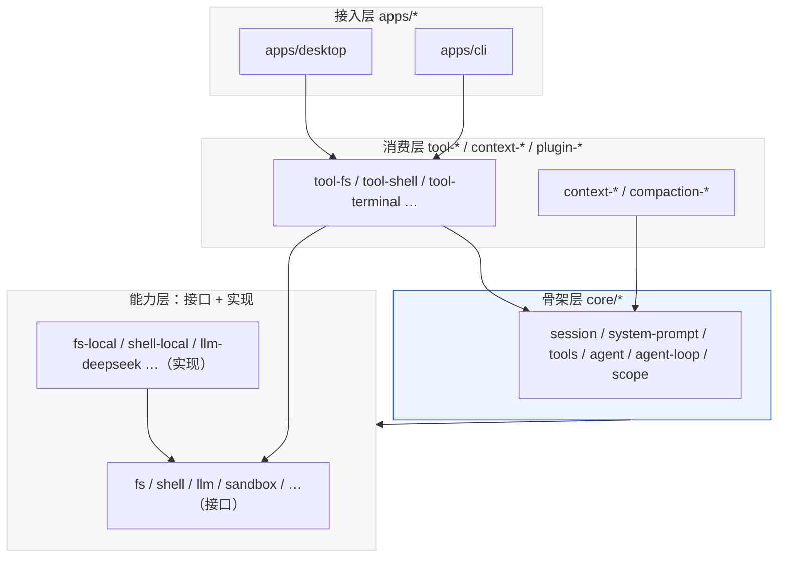
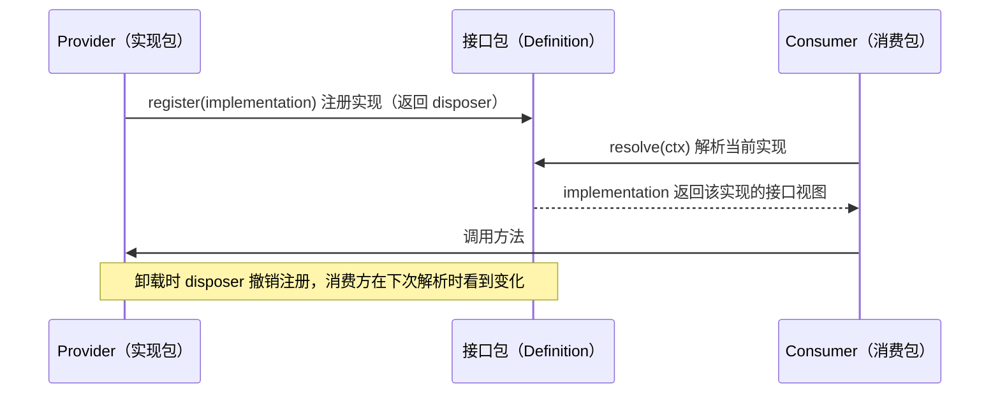

# 20 · 模块设计与接口清单

| 项 | 内容 |
|---|---|
| 文档编号 | 20 |
| 文档类型 | 设计（模块级） |
| 状态 | 草案 |
| 负责角色 | 研发（各模块 owner）/ 架构 |
| 上游依据 | [00 产品宪法](./00-文档总览与全局约定.md)、[05 系统架构设计](./05-系统架构设计.md)、[07 插件内核与扩展点设计](./07-插件内核与扩展点设计.md)、[08 工具系统与执行流水线](./08-工具系统与执行流水线.md) |
| 关联文档 | [21 接口契约与错误码总表](./21-接口契约与错误码总表.md)、[22 数据字典与 DDL](./22-数据字典与DDL.md)、[13 插件 SDK 与协议设计](./13-插件SDK与协议设计.md)、[15 测试策略与质量门禁](./15-测试策略与质量门禁.md) |
| 适用读者 | 准备开始写代码的研发；评审模块边界的架构 |
| 文档版本 | v0.1（2026-09-11） |
| 最后更新 | 2026-09-11 |

## 目录

1. [这份文档解决什么问题](#1-这份文档解决什么问题)
2. [模块划分准则](#2-模块划分准则)
3. [依赖规则：谁可以依赖谁](#3-依赖规则谁可以依赖谁)
4. [能力接缝的统一形状](#4-能力接缝的统一形状)
5. [骨架层模块规格（七个包）](#5-骨架层模块规格七个包)
6. [能力层模块规格](#6-能力层模块规格)
7. [接入层模块规格](#7-接入层模块规格)
8. [模块清单速查表](#8-模块清单速查表)
9. [接口变更流程](#9-接口变更流程)
10. [我们不做什么](#10-我们不做什么)
11. [未决问题](#未决问题)
12. [变更记录](#变更记录)

---

## 1. 这份文档解决什么问题

[05](./05-系统架构设计.md) 回答了"**系统由哪几层组成**"，这份文档回答"**每个模块的边界在哪、对外暴露什么、谁来改它**"。

判断标准很实际：**两个研发能否在不互相商量的情况下各写一个模块，并且第一次集成就通过？** 只有当每个模块的接口、事件、不变量都写在纸面上时，答案是"能"。

| 这份文档给什么 | 不给什么 |
|---|---|
| 每个模块的**职责边界**与**不做什么** | 具体算法实现（模块内自由） |
| 每个模块的**导出接口形状** | 逐参数、逐错误码的完整契约（→ [21](./21-接口契约与错误码总表.md)） |
| 模块间**允许的依赖方向** | 编译配置细节（→ [23](./23-工程脚手架与开发规范.md)） |
| 每个模块的**不变量**与**验收锚点** | 测试用例清单（→ [15](./15-测试策略与质量门禁.md)） |

> **接口形状是"规格"不是"代码"。** 下面所有 TS 代码块描述的是**必须成立的形状**（方法名、参数、返回、语义），实现时可以调整内部类型别名，但**不得改变语义**。

---

## 2. 模块划分准则

### 2.1 放哪一层（引用 05 §4.3 的判据）

加任何东西前，先回答一个问题：**它是状态、能力、策略，还是视图？**

| 它是什么 | 放哪 | 例子 |
|---|---|---|
| 每个组合都要的**状态** | 骨架层 | 会话日志、agent 注册表 |
| 日志的**一部分** | 扩展 `session` 的事件类型（声明合并） | 新的审计事件 |
| 可被替换实现的**能力** | 能力层接缝（接口 + 实现 + 消费） | 换一个沙箱后端 |
| **什么时候做**（时机） | 插件挂在事件上 | "工具执行前检查重复调用" |
| **怎么看**（渲染） | 接入层 | 卡片渲染、时间轴 |

### 2.2 模块粒度判据（什么时候该新建一个包）

三条**全都满足**才值得新建包，否则先扩展现有包：

| # | 判据 | 反例（不该新建包） |
|---|---|---|
| 1 | 它有**独立的可替换性**——即存在"换掉它、其它人不用改"的合理场景 | "工具参数解析工具函数"没有第二种实现 |
| 2 | 它有**独立的生命周期**——可以被单独启用/禁用/替换而不破坏系统 | 循环的一部分不能被单独替换 |
| 3 | 它**不与现有包共享可变状态**——否则会出现两个包改同一份数据 | 与 `session` 抢日志写入权 |

> **宁可少一个包，不要多一个包。** 每个包都要有 README、目录、构建产物与版本号——这是固定成本。新增包的门槛应该高，因为拆包容易、合包难。

### 2.3 三种包的角色必须标清

| 角色 | 命名 | 内容 | 例子 |
|---|---|---|---|
| **接口包**（Service Definition） | 名词本身 | 只含类型、接口、事件声明、`ctx` key 声明；**不含实现** | `llm`、`fs`、`shell`、`sandbox` |
| **实现包**（Provider） | `名词-后端` | 提供一种具体实现，通过 `register()` 挂到接口上 | `llm-deepseek`、`fs-local`、`sandbox-linux` |
| **消费包**（Consumer） | `tool-名词` / 无前缀 | 把能力暴露给模型或其它模块 | `tool-fs`、`tool-shell` |

接口包里出现 `fs.readFile` 的实现代码，是**架构错误**，不是风格问题（它会让"换实现"变成"改所有人"）。

---

## 3. 依赖规则：谁可以依赖谁



> **这张图想让你看到什么**：箭头只有一个方向——**箭头从"使用者"指向"被使用者"**。特别注意 `I2 → I1`（实现依赖接口）与 `L1 → L2`（骨架层只依赖接口，不依赖任何具体实现）。

### 3.1 允许与禁止（硬性）

| 规则 | 允许 | 禁止 | 违反的后果 |
|---|---|---|---|
| 依赖接口而非实现 | `tool-fs` → `fs` | `tool-fs` → `fs-local` | 换沙箱后端要改消费包 |
| 骨架层不依赖实现 | `agent-loop` → `llm`（接口） | `agent-loop` → `llm-deepseek` | 内核被具体供应商绑死 |
| 无循环依赖 | `scope` 被 `session` 与 `system-prompt` 共用 | `session` ↔ `system-prompt` 互相 import | 构建失败 / 加载顺序不确定 |
| 跨包只用包名 | `import { x } from '@lcode/fs'` | `import '../../fs/src/x.ts'` | 打破包边界与版本约束 |
| 包内相对引用带 `.ts` | `import './y.ts'` | `import './y'`（ESM only） | 运行期解析失败 |
| 状态只有一个 owner | 只有 `session` 能写日志 | 任何包直接 append 到日志文件 | 违反"模型可见即可重放" |

### 3.2 依赖检查（进 CI）

`23 §6` 的门禁包含一条**依赖方向检查**：静态扫描每个包的 import，命中"实现包被非实现包依赖"或"骨架层出现具体实现包名"即失败。这条检查对应产品宪法第三条（内核只提供机制）。

---

## 4. 能力接缝的统一形状

所有能力都按**同一套路**组织。这不是巧合，是为了让"加一个新能力"这件事有唯一的写法。

### 4.1 三角结构



> **这张图想让你看到什么**：实现是**运行时注册**的，不是 import 进来的。这带来两个能力：可以同时存在多个实现（按作用域选择）、可以整体卸载（可逆副作用）。

### 4.2 接口包必须写的四样东西

```ts
// ① 服务接口（Service Definition）—— 唯一的能力名字
export interface FsService {
  read(path: string, opts?: { range?: [number, number] }): Promise<FsReadResult>
  write(path: string, data: string, opts?: WriteOpts): Promise<FsWriteResult>
  stat(path: string): Promise<FsStat>
  // …不出现任何后端专有名词
}

// ② ctx key 的声明合并 —— 消费方唯一的解析入口
declare module '@lcode/context' {
  interface Services {
    fs: FsService
  }
}

// ③ 事件（本能力域的）—— 声明合并，payload 带 @param 文档
declare module '@lcode/context' {
  interface Events {
    'fs/changed': { path: string; kind: 'create' | 'update' | 'delete' }
  }
}

// ④ 注册入口 —— 实现包调用它才生效
export function register(impl: FsService): Disposer
```

### 4.3 实现包必须满足的三条

| 条 | 要求 | 为什么 |
|---|---|---|
| 1 | **只在 `apply()` 里注册**，注册即副作用 | 卸载时世界精确回滚（[07 §3](./07-插件内核与扩展点设计.md)） |
| 2 | **不 import 任何具体消费包** | 实现与消费解耦 |
| 3 | **失败必须给出可归因错误**，且不得静默降级 | 静默降级会让用户以为功能正常（见 [21 §6](./21-接口契约与错误码总表.md) 错误处理总则） |

### 4.4 消费包必须满足的三条

| 条 | 要求 |
|---|---|
| 1 | 通过 `ctx` 解析能力，**不缓存跨会话的实现引用**（实现可能被换掉） |
| 2 | 返回**规范值**，渲染是**纯投影**（D8）——同一个值同时服务模型与 UI |
| 3 | 需要权限时走**审批接缝**，不自己判断"该不该问"（D10 / D11） |

---

## 5. 骨架层模块规格（七个包）

骨架层 = **产品 API 稳定性承诺**覆盖的范围。改动这些包的接口属于破坏性变更，必须走 [§9 变更流程](#9-接口变更流程)。

### 5.1 `core/session` · `ctx.sessions`

| 项 | 内容 |
|---|---|
| **职责** | append-only 事件日志的**唯一 owner**：追加、读取、派生投影、分叉 |
| **不做什么** | 不渲染、不压缩（压缩只是"追加一条 surface 事件"）、不判断业务策略 |
| **依赖** | `core/scope`、`session-persistence`（接口）、`util` |

```ts
export interface SessionService {
  // 唯一入口：追加事件（seq 由本模块分配，调用方不得传入）
  append(input: EventInput): AppendedEvent
  // 批量追加（原子性：要么全部可见，要么全部不可见）
  appendMany(inputs: EventInput[]): AppendedEvent[]
  // 读取（可按区间；返回的是逐条事件而非派生结果）
  events(range?: { from?: number; to?: number }): readonly SessionEvent[]
  // 派生投影（纯函数语义：同样的日志必然得到同样的结果）
  deriveMessages(): readonly ModelMessage[]
  // 分叉：按某个"安全切点"复制出新会话
  fork(cutAtSeq: number): Promise<SessionHandle>
  // 生命周期分界线（见 11 §6）
  markEndSeed(): void
}
```

| 事件 | 说明 |
|---|---|
| **发布** | `session/event`（每个落盘事件广播一次，UI 的数据源） |
| **订阅** | 无（它是源头） |

**不变量**

| # | 不变量 | 违反后果 |
|---|---|---|
| S1 | `seq` 单调、无空洞：第 n 条事件的 `seq === n - 1` | 回放定位失效 |
| S2 | 日志是**唯一真相**：任何进入模型请求的内容都能从日志重建（I1） | "可重放"承诺破产 |
| S3 | `surfaceOp: replace` 的区间必须落在当前 surface 范围内（I4） | 投影越界崩溃 |
| S4 | 事件 `data` 必须无损 JSON 序列化（I5） | 落盘失败或静默丢字段 |
| S5 | 追加是**同步提交**到内存 + 有界批写磁盘；`flush()` 是静默屏障 | 崩溃后丢更多 |

**验收锚点**：`M-SESSION-01`–`M-SESSION-08`（[04 §5.2](./04-MVP范围与验收标准.md)）、不变量 I1–I5（[15 §2](./15-测试策略与质量门禁.md)）

**Known Limitations**：单会话日志不自动分片（见 [22 §9](./22-数据字典与DDL.md) 容量与保留）；`fork()` 不支持落在未关闭的轮内。

---

### 5.2 `core/system-prompt` · `ctx.systemPrompt`

| 项 | 内容 |
|---|---|
| **职责** | 把"要告诉模型的一切"装配成一次请求的 system 内容与工具 schema 列表 |
| **不做什么** | 不发起请求、不决定用哪个模型、不缓存跨请求的装配结果 |
| **依赖** | `core/scope`、`core/tools`（只读 schema）、`util` |

```ts
export interface SystemPromptService {
  // 注册一个静态段落（返回 disposer）
  section(id: string, content: string, opts?: { order?: number; scope?: Scope }): Disposer
  // 注册一个动态上下文（每次装配时求值；求值必须是纯函数且不得阻塞）
  context(id: string, fn: (ctx: AssembleCtx) => string | Promise<string>, opts?: { order?: number }): Disposer
  // 声明变量的取值来源
  variable(name: string, resolve: (ctx: AssembleCtx) => string): Disposer
  // 追加/收窄工具 schema（收窄是叠加的，不可放宽）
  tools(ids: string[] | ((all: ToolSchema[]) => ToolSchema[])): Disposer
  // 装配（纯函数语义）
  assemble(input: AssembleInput): AssembledPrompt
}
```

**不变量**

| # | 不变量 |
|---|---|
| P1 | `assemble()` 对同一份日志与同一份注册集合**逐字节可复现**（I1 的另一半） |
| P2 | 段落顺序由 `order` 与注册顺序共同决定，**结果不得依赖并发注册的时序** |
| P3 | 动态上下文的求值不得产生副作用（不得写日志、不得触发工具） |
| P4 | 工具 schema 只可**收窄**不可放宽——子代理不能拿到父代理没有的能力 |

**验收锚点**：`M-CTX-01`–`M-CTX-05`；不变量 P1 与 I1 合并断言。

---

### 5.3 `core/tools` · `ctx.tools`

| 项 | 内容 |
|---|---|
| **职责** | 作用域工具注册表 + 受守卫的执行流水线（五段 + 两侧） |
| **不做什么** | 不实现任何具体工具；不决定权限（策略通过 guard/waterfall 注入） |
| **依赖** | `core/scope`、`interaction/approval`（接口）、`util` |

```ts
export interface ToolRegistry {
  // 注册工具（返回 disposer）
  register<TIn, TOut>(tool: ToolDefinition<TIn, TOut>): Disposer
  // 当前可见的 schema 列表（受作用域与 restrict 影响）
  schemas(): readonly ToolSchema[]
  // 收窄可见集合（只能收窄）
  restrict(ids: string[]): Disposer
  // 注册守卫：类型上只有 deny 与"弃权"，没有 allow
  guard(guard: ToolGuard): Disposer
  // 执行（唯一入口；调用方不得绕过）
  execute(call: ToolCall, opts: ExecuteOpts): Promise<ToolResult>
}

export interface ToolGuard {
  // 注意：返回值类型里**没有 allow**（D10 / D11）
  (call: ToolCall, ctx: GuardCtx): 'deny' | 'abstain'
}
```

| 事件 | 说明 |
|---|---|
| **发布** | `tools/pre-execute`（waterfall，可 allow/deny/ask）、`tools/execute`、`tools/post-execute`、`tool/call`、`tool/result` |
| **订阅** | `agent/pre-step`（用于清理临时状态） |

**不变量**

| # | 不变量 | 说明 |
|---|---|---|
| T1 | **参数不可被中间件改写**（D9）：`pre-execute` 只能放行/拒绝/要求审批 | 防止"策略悄悄改了模型意图" |
| T2 | 守卫**没有 allow**（类型上不可能） | 杜绝"监听器顺序决定结果" |
| T3 | 工具返回**规范值**，UI 渲染是纯投影（D8） | 模型与 UI 不可能分叉 |
| T4 | 无应答者即 `unavailable`（fail-closed，D11） | 权限缺省安全 |
| T5 | 任何 `tool/call` 必须有配对的 `tool/result`（I3） | 否则下一轮请求会被模型 API 拒绝 |

**验收锚点**：`M-TOOL-01`–`M-TOOL-14`；不变量 T1–T5、I3。

---

### 5.4 `core/agent` · `ctx.agents`

| 项 | 内容 |
|---|---|
| **职责** | Agent 契约、活体注册表、创建/恢复工厂接缝、发起者上下文 |
| **不做什么** | 不实现循环（那是 `agent-loop`）、不管 UI 状态 |
| **依赖** | `core/session`、`core/scope` |

```ts
export interface AgentService {
  create(spec: AgentSpec): Promise<AgentHandle>
  resume(ref: { sessionId: string; agentId: string }): Promise<AgentHandle>
  get(agentId: string): AgentHandle | undefined
  list(): readonly AgentHandle[]
  // 让后续操作归属到某个发起者（子代理与工具调用链的归属）
  withInitiator<T>(initiator: InitiatorRef, fn: () => Promise<T>): Promise<T>
}

export interface AgentHandle {
  readonly id: string
  readonly sessionId: string
  readonly status: 'idle' | 'running' | 'waiting-approval' | 'cancelled'
  // 三条入队语义（见 05 §6）
  followup(input: UserInput): Promise<void>   // 追加一轮
  steer(input: UserInput, mode?: 'soft' | 'interrupt'): Promise<void> // 默认在下一步边界生效；interrupt 打断当前步骤（工具/流式请求）后立即交付
  inject(input: InjectedContext): Promise<void> // 不改对话可见内容，只入上下文
  cancel(reason: CancelReason): Promise<void>
  // disposer 就是能力：销毁即回滚
  dispose(): Promise<void>
}
```

| 事件 | 说明 |
|---|---|
| **发布** | `agent/created`、`agent/status`、`agent/inbox`、`agent/disposed` |
| **订阅** | `session/end-seed`（重建活体注册表） |

**不变量**

| # | 不变量 |
|---|---|
| A1 | `agentId` 与会话共享同一 id（D17）；全局唯一 |
| A2 | 取消后必须落盘一个明确的结束事件；不得留下"看起来还在跑"的状态 |
| A3 | 无内容的 assistant 消息**也必须落盘**（否则重放时消息序列会变） |
| A4 | `dispose()` 后不得再有该 agent 的事件；在途操作必须收敛为取消态 |

**验收锚点**：`M-AGENT-01`–`M-AGENT-06`。

---

### 5.5 `core/agent-default-model` · `ctx.agentDefaultModel`

| 项 | 内容 |
|---|---|
| **职责** | **"当前用哪个模型"的唯一权威**（三处入口共享同一状态 owner，见 [18 §3](./18-模型接入与供应商配置.md)） |
| **不做什么** | 不解析凭据（那是 `credentials`）、不发起调用（那是 `llm`）、**不做自动路由**（D21） |
| **依赖** | `settings`（接口）、`llm`（接口，只读取能力信息） |

```ts
export interface AgentDefaultModelService {
  get(scope?: Scope): ModelSelection
  set(sel: ModelSelection, scope?: Scope): Promise<void>
  watch(fn: (sel: ModelSelection) => void): Disposer
}

export interface ModelSelection {
  provider: string        // 供应商标识
  model: string           // 模型标识
  params?: SamplingParams // 采样参数（可选，缺省由适配器决定）
}
```

**不变量**

| # | 不变量 |
|---|---|
| M1 | UI、CLI、协议服务三个入口读写的是**同一个状态**（不是三份各自维护的副本） |
| M2 | 会话内临时切换**不修改默认值**，但必须落盘为会话事件 |
| M3 | 不引入任何"按难度自动选模型"的逻辑（D21，重放一致性的前提） |

---

### 5.6 `core/agent-loop` · `ctx.agentLoop`

| 项 | 内容 |
|---|---|
| **职责** | **全仓库唯一的具体循环**：构建请求 → 调模型 → 跑工具 → 重复 |
| **不做什么** | 不出现任何针对具体能力的 `if`（产品宪法第三条，静态检查守住） |
| **依赖** | `core/session`、`core/system-prompt`、`core/tools`、`core/agent`、`llm`（接口）、`compaction`（接口） |

```ts
export interface AgentLoop {
  create(spec: AgentSpec): Promise<AgentHandle>
  resume(ref: AgentRef): Promise<AgentHandle>
}
```

**循环的协作点**（全部通过事件，不通过 if）：

| 时机 | 事件 | 谁用 |
|---|---|---|
| 构建请求前 | `agent/pre-step` | 压缩、上下文注入、守卫 |
| 请求可用时 | `agent/request`（waterfall，可替换调用配置） | 模型替换、降级 |
| 请求发出前 | `request/header` 落盘 | 可重放的审计点 |
| 流式片段到达 | `session/event`（chunk 类） | UI 流式渲染 |
| 工具调用前后 | `tools/pre-execute` / `tools/post-execute` | 策略、审计 |
| 轮结束 | `turn/end` | UI 收尾（最终总结的触发点） |

**不变量**

| # | 不变量 |
|---|---|
| L1 | 源码中不出现针对具体能力的判断（I6，AST 扫描守住） |
| L2 | 每次请求的 system 与 messages 必须逐字节等于从日志重建的结果（I1） |
| L3 | 循环不捕获"取消"以外的异常吞掉——任何异常都必须变成可归因的错误或明确的中断 |

**验收锚点**：`M-LOOP-01`–`M-LOOP-04`；不变量 I1、I6。

---

### 5.7 `core/scope` · 无 ctx key（纯库）

| 项 | 内容 |
|---|---|
| **职责** | 作用域键与分层注册原语；**位于 `session` 与 `system-prompt` 的共同下游，专门为避免循环依赖** |
| **依赖** | `util` 或不依赖任何包 |

```ts
export type ScopeKey = symbol | string
export interface Scoped<T> { get(scope: ScopeKey): T | undefined }
export interface ScopedLayers<L> { layer(scope: ScopeKey, value: Partial<L>): Disposer }
```

**不变量**：作用域必须可嵌套且查找顺序确定（从最内层向外解析，命中即止）。

---

## 6. 能力层模块规格

能力层按**同一个模式**（接口 + 实现 + 消费，见 §4）。下面按能力族给出接口形状要点与硬性要求，完整方法契约见 [21 §2](./21-接口契约与错误码总表.md)。

### 6.1 能力族总表

| 能力族 | 接口包 | 实现包 | 消费包 | 关键约束 |
|---|---|---|---|---|
| 模型 | `llm` | `llm-anthropic` / `llm-openai` / `llm-deepseek` / `llm-ollama` / `llm-gateway` / `llm-replay` | 循环直接调用（不是工具） | `prepareCall()` 必须在**同一注册代**上完成"解析配置 → 拉凭据 → 物化默认值"（[18 §5](./18-模型接入与供应商配置.md)） |
| 文件 | `fs` | `fs-local` / `fs-sandbox` | `tool-fs` | 路径规范化 + 工作区边界判定在接口层统一，实现层不得各自实现 |
| Shell | `shell` | `shell-local` / `shell-sandbox` | `tool-shell` | 沙箱只约束**即将 spawn 的 argv**，不约束工具逻辑 |
| 子进程 | `subprocess` | `subprocess-local` | shell / terminal / lsp / mcp | 进程树必须可整体终止（不留孤儿进程） |
| 沙箱 | `sandbox` | `sandbox-macos` / `sandbox-linux` / `sandbox-win32` | `shell-sandbox` / `fs-sandbox` / `terminal` | 是**约束**不是虚拟化；各平台必须公开已知逃逸面 |
| 终端 | `terminal` | `terminal-pty` | `tool-terminal` | 终端输入**不经过模型**，除非显式引用 |
| 上下文 | —（无接口包） | `context-instructions` / `context-time` / `context-repo-map` / `file-reference` | 循环（非工具） | 一律注册到 `systemPrompt.context()`，不得直接改消息 |
| 压缩 | `compaction` | `compaction-prune` / `compaction-summary` | 循环（非工具） | 压缩 = 追加 `surfaceOp: replace` 事件；**轻量手段先于摘要**（剪枝 → spill → 摘要） |
| 溢出存储 | `spill` | `spill-local` | 结果后处理策略 | 超大工具结果落盘 + 消息里留 locator（可回查） |
| 技能 | `skill` | `skill-filesystem` | `tool-skill` | 两段式加载：catalog 常驻（只给名字与描述）→ 命中才 load 全文 |
| 子代理 | `subagent` | `subagent-inprocess` | `tool-subagent` | 能力只可**收窄**不可放大（P4）；深度必须有限 |
| 作业 | `jobs` | `jobs-local` | `tool-jobs` + 后台 shell/终端 | 作业输出有界缓冲；超出转 spill |
| 网页 | `web` | `web-search-*` / `web-fetch` | `tool-web` | 抓回的网页内容必须**包裹并转义**（提示注入防线，见 [12 §8](./12-安全权限与沙箱模型.md)） |
| 语言服务 | `lsp` | `lsp-stdio` | `tool-lsp` | 服务崩溃不得杀死会话；重启后需重新初始化 |
| 持久化 | `session-persistence` | `-jsonl` / `-sqlite` | 循环（write-behind） | JSONL 是权威，SQLite 可重建（[22 §1](./22-数据字典与DDL.md)） |
| 交互 | `approval` / `user-questions` / `commands` | 由接入层提供应答者 | `tool-ask-user` / `tool-todo` / `plan-mode` | 审批一次性、fail-closed；**不允许"永久允许"** |
| 凭据与设置 | `credentials` / `settings` | `credentials-local` / `settings-file` | llm 适配器 | 配置里只放**引用**；UI 只拿 descriptor；值永不进日志 |
| 扩展 | `plugin-host` / `plugin-manifest` / `plugin-registry` / `plugin-sdk` | — | 接入层 | 插件跑独立进程；清单必须声明权限（[13 §6](./13-插件SDK与协议设计.md)） |

### 6.2 三个最容易被写坏的模块

**① `llm` 适配器：`prepareCall()` 不是可选项**

```ts
export interface LlmAdapter {
  providerInfo(): ProviderInfo
  listModels(): Promise<ModelInfo[]>
  resolveModel(ref: ModelSelection): Promise<ResolvedModel>
  // 把"解析配置 → 拉凭据 → 物化默认值 → 构造请求"锁在同一个注册代上
  prepareCall(sel: ModelSelection, opts: PrepareOpts): Promise<PreparedCall>
  stream(call: PreparedCall, signal: AbortSignal): AsyncIterable<StreamChunk>
  providerRetryPolicy(): RetryPolicy
}
```

> **为什么必须存在**：热重载时，如果"能力探测"与"实际调用"落在不同注册代，可能把 A 适配器的能力结果配上 B 适配器的端点。`prepareCall()` 是这条竞态的唯一边界。

**② `compaction`：压缩不是删除**

| 做法 | 结果 |
|---|---|
| 追加一条声明"替换某区间"的 surface 事件 | ✅ 日志可回放，用户能展开看被压缩前的原文 |
| 从日志里删掉内容 | ❌ 破坏"模型可见即可重放"（I1），且不可审计 |

顺序必须是：**剪枝（去冗余）→ spill（大结果外置）→ 摘要（最后手段）**。

**③ `agent-default-model`：状态要有个家**

UI、CLI、协议服务都要读写"当前用哪个模型"。**如果没有唯一 owner，必然出现三个入口各自维护副本、互相覆盖。** 这个包存在的唯一理由就是这件事。

### 6.3 能力层通用不变量

| # | 不变量 | 适用 |
|---|---|---|
| C1 | 实现只在 `apply()` 里注册，注册即副作用、返回 disposer | 全部实现包 |
| C2 | 消费包通过 `ctx` 解析，不缓存跨会话引用 | 全部消费包 |
| C3 | 能力失败必须可归因，不得静默降级 | 全部 |
| C4 | 需要外部输入的能力（网络、写工作区外、spawn）必须过审批接缝 | fs / shell / terminal / web / mcp |
| C5 | 能力返回的规范值必须无损 JSON 序列化 | 全部（与 I5 一致） |

---

## 7. 接入层模块规格

### 7.1 `apps/desktop`（Electron）

| 进程 | 职责 | 硬性 |
|---|---|---|
| main | **承载 agent runtime**（要 spawn、开 PTY、访问 fs） | 持状态；不渲染 |
| renderer | 纯投影：消费 `session/event`（数据）与 `agent/*`（控制状态） | **不直接访问 fs / 不直接发模型请求** |
| utility（每插件一个） | 插件宿主，经类型化 RPC 与内核通信 | 可整体杀掉；崩溃可重启 |
| preload | `contextBridge` 白名单 API | 只暴露明确的方法，不暴露 `ipcRenderer` |

**硬性**：渲染进程崩溃不得杀死会话（状态在 main）；插件进程崩溃要能重启并恢复（见 [10 §2.5](./10-桌面客户端设计.md)）。

### 7.2 `apps/cli`（headless）

| 项 | 说明 |
|---|---|
| 定位 | **另一个前端，不是简化版**（[10 §8](./10-桌面客户端设计.md)） |
| 复用 | 同一套内核 + 集束，只是把渲染换成终端输出 |
| 必须支持 | `--profile`、`--dump-config`、`lcode doctor`、`lcode migrate`、协议模式（JSON-RPC over stdio） |
| 不可用 | 任何依赖 GUI 的能力（如审批弹窗）必须降级为明确的 fail-closed 或终端提问 |

### 7.3 集束（`bundle/lcode-base`、`bundle/lcode-desktop`）

| 项 | 说明 |
|---|---|
| 内容 | 只有装配声明（`cordis.patch.yml`），**没有逻辑代码** |
| 语义 | patch **替换整段 config**，不是深合并；禁用用 `disabled: true`，不删行（[05 §5.3](./05-系统架构设计.md)） |
| 验收 | `lcode --profile desktop --dump-config` 能打印最终装配（含层级与来源） |

---

## 8. 模块清单速查表

一页看完所有模块。**稳定性**列的含义：`冻结`= 产品契约，改要走 ADR；`稳定`= 接口稳定，允许加方法；`内部`= 可自由重构。

> **⚠️ 这张表是"设计上每族该有几个实现包"，不是实现进度。** 下面「有实现包」列写的是**规划数**（如 `sandbox` + 3 实现 = 三平台各一），而实际落地情况**以 [24 §3 现状盘点](./24-数据层与接口实施计划.md#3-现状盘点) 为准**。
> 截至 2026-09-15：**已实现**的是 `llm` 族的 `llm-openai-compatible`（收敛成一个 OpenAI 兼容适配器，见 [24 §10](./24-数据层与接口实施计划.md#10-批次真实模型--工具--权限已完成)）· `fs` 族的 `fs-local` · `shell` 族的 `shell-local` · `sandbox` 族的 `sandbox-local`（**无约束兜底**，三平台原生沙箱未接入）· `tool-fs` / `tool-shell` · `interaction/approval` / `permission-presets`。其余仍是骨架占位。

| 模块 | 层 | ctx key | 稳定性 | 有实现包 | 验收锚点 |
|---|---|---|---|---|---|
| `core/session` | 骨架 | `ctx.sessions` | 冻结 | — | `M-SESSION-*`、I1–I5 |
| `core/system-prompt` | 骨架 | `ctx.systemPrompt` | 冻结 | — | `M-CTX-*`、I1 |
| `core/tools` | 骨架 | `ctx.tools` | 冻结 | — | `M-TOOL-*`、T1–T5、I3 |
| `core/agent` | 骨架 | `ctx.agents` | 冻结 | — | `M-AGENT-*` |
| `core/agent-default-model` | 骨架 | `ctx.agentDefaultModel` | 稳定 | — | `M-MODEL-06`–`11` |
| `core/agent-loop` | 骨架 | `ctx.agentLoop` | 冻结 | — | `M-LOOP-*`、I6 |
| `core/scope` | 骨架 | —（库） | 稳定 | — | 单测覆盖 |
| `llm` + 6 实现 | 能力 | `ctx.llm` | 稳定 | 6 个 | `M-MODEL-01`–`05` |
| `fs` + 3 实现 | 能力 | `ctx.fs` | 稳定 | 3 个 | `M-TOOL-01`–`04` |
| `shell` + 3 实现 | 能力 | `ctx.shell` | 稳定 | 3 个 | `M-TOOL-05`–`07` |
| `sandbox` + 3 实现 | 能力 | `ctx.sandbox` | 稳定 | 3 个（按平台） | `M-SEC-01`–`04` |
| `terminal` + 2 | 能力 | `ctx.terminals` | 稳定 | 2 个 | `M-TERM-*` |
| `subprocess` + 1 | 能力 | `ctx.subprocess` | 稳定 | 1 个 | — |
| `context-*`（4） | 能力 | 注册到 `ctx.systemPrompt` | 稳定 | 4 个 | `M-CTX-*` |
| `compaction` + 2 | 能力 | `ctx.compaction` | 稳定 | 2 个 | `M-COMPACT-*` |
| `spill` + 1 | 能力 | `ctx.spill` | 稳定 | 1 个 | `M-SPILL-*` |
| `skill` + 2 | 能力 | `ctx.skills` | 稳定 | 2 个 | `M-SKILL-*` |
| `subagent` + 2 | 能力 | `ctx.subagents` | 稳定 | 2 个 | `M-SUB-*` |
| `jobs` + 2 | 能力 | `ctx.jobs` | 稳定 | 2 个 | `M-JOB-*` |
| `web` + N | 能力 | `ctx.web` | 稳定 | N 个 | `M-WEB-*` |
| `lsp` + 2 | 能力 | `ctx.lsp` | 稳定 | 2 个 | `M-LSP-*` |
| `session-persistence` + 2 | 能力 | `ctx.sessionPersistence` | 冻结 | 2 个 | `M-REC-*`、[22](./22-数据字典与DDL.md) |
| `interaction/*`（6） | 能力 | `ctx.approval` / `ctx.userQuestions` / `ctx.commands` | 冻结 | 接入层应答者 | `M-APPR-*`、`M-UX-*` |
| `settings` + 1 | 能力 | `ctx.settings` | 冻结 | 1 个 | `M-MODEL-08/09` |
| `credentials` + 1 | 能力 | `ctx.credentials` | 冻结 | 1 个 | `M-MODEL-04`、`SEC-CRED-*` |
| `extension/*`（4） | 能力 | `ctx.plugins` | 稳定 | — | `M-PLUG-*` |
| `preset` | 能力 | `ctx.presets` | 稳定 | 1 个 | `M-PRESET-*` |
| `bundle/*`（2） | 装配 | — | 内部 | — | `--dump-config` 冒烟 |
| `util` | 基础 | — | 稳定 | — | 单测覆盖 |
| `apps/desktop` | 接入 | — | 内部 | — | `M-UX-*` |
| `apps/cli` | 接入 | — | 内部 | — | CLI 冒烟 |

> **`冻结` 模块的数量是 12 个。** 这是产品 API 稳定性承诺的真实边界——其余所有东西都可以重写而不影响用户。这个数字越大，产品的演进自由度越低；所以新增"冻结"必须过 ADR。

---

## 9. 接口变更流程

| 变更类型 | 例子 | 需要什么 |
|---|---|---|
| **加方法 / 加可选参数** | 给 `FsService` 加 `readdir()` | 改接口包 + 更新本文 + 通知消费包 owner；不需要 ADR |
| **改语义（同名不同行为）** | `fork()` 的切点规则变化 | **ADR** + 全库搜索消费方 + 快照重放测试 |
| **删方法 / 改必填参数** | 移除 `SessionService.markEndSeed()` | **ADR** + 迁移说明；冻结包还需更新 [00 §4](./00-文档总览与全局约定.md) 的决策表 |
| **改事件 payload** | 给 `tools/post-execute` 加字段 | 声明合并天然兼容；但**必须**同步 [06](./06-会话事件日志与可重放设计.md) 与 [22 §5](./22-数据字典与DDL.md) 字段字典 |
| **新增 ctx key** | 新能力族 | 更新本文 + [00 §5](./00-文档总览与全局约定.md) 包布局 |

**一条硬规则**：改接口前先问"**这个变更会不会让某个消费包在不知情的情况下行为改变？**"如果会，就必须走 ADR——因为那意味着这次改动的影响面超出了你能枚举的范围。

---

## 10. 我们不做什么

- **不做"万能基类"**：不存在 `BaseTool` / `BaseService` 这类共享基类。接口 + 组合优于继承。
- **不做跨模块的内部状态共享**：模块间只能通过接口与事件通信，不允许共享可变对象。
- **不为"将来可能需要"预留扩展点**：没有第二个实现场景的能力，先写成模块内的具体函数。
- **不做运行时动态改接口**：能力可以被替换（换实现），但接口形状在进程生命周期内不变。
- **不承诺第三方模块的实现细节**：稳定性承诺只覆盖标 `冻结` 与 `稳定` 的**接口**，不覆盖实现。

---

## 未决问题

- [ ] **`spill` 是否需要独立的接口包**：当前列在能力层但没有 `spill` 接口包（只有 `spill-local`）。若将来出现第二种 spill 后端（如云端对象存储），需要补接口包并提升为完整三角。→ 由架构决策。
- [ ] **`context-*` 为什么不设接口包**：它们的消费方是 `systemPrompt.context()`，本质上不需要"可替换实现"。需要确认这个判断在加入更多上下文来源后仍然成立。→ 由架构评审。
- [ ] **`agent-loop` 的可替换性边界**：它是"唯一的具体循环"，但又被列为可替换接缝。需要明确"替换循环"到底允许改什么——目前倾向只允许替换**模型调用与工具执行两个协作点**，不允许改循环骨架。→ 需要 ADR。
- [ ] **`interaction/*` 的应答者注册时机**：CLI 与 desktop 的应答者不同，且 CLI 下部分场景只能 fail-closed。需要一份"各前端的应答者能力矩阵"。→ 由客户端与 CLI owner 共同确认。
- [ ] **模块 README 与本文的关系**：约定每个包必须有 README（[00 §5.1](./00-文档总览与全局约定.md)），但 README 与本文 §5/§6 会重复。倾向 README 只写"如何使用"，本文写"边界与不变量"。→ 待工程规范（[23](./23-工程脚手架与开发规范.md)）定稿时统一。

---

## 变更记录

| 日期 | 版本 | 变更 | 说明 |
|---|---|---|---|
| 2026-09-11 | v0.1 | 初稿 | 建立模块划分准则、依赖规则、能力接缝统一形状、七个骨架包与全部能力族的模块规格、接入层规格、模块清单速查表与接口变更流程 |
