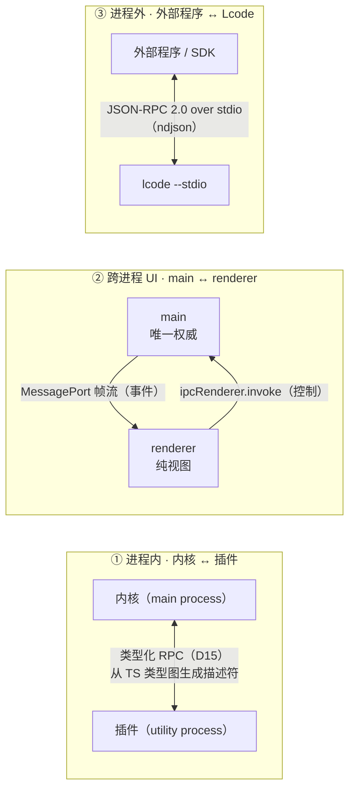
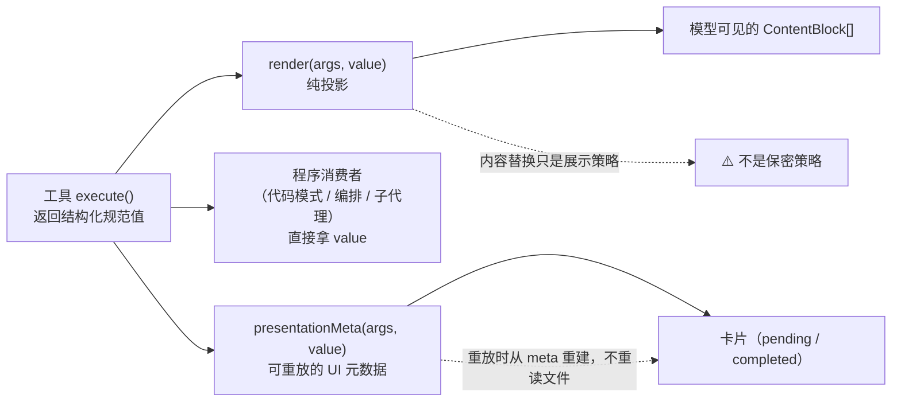
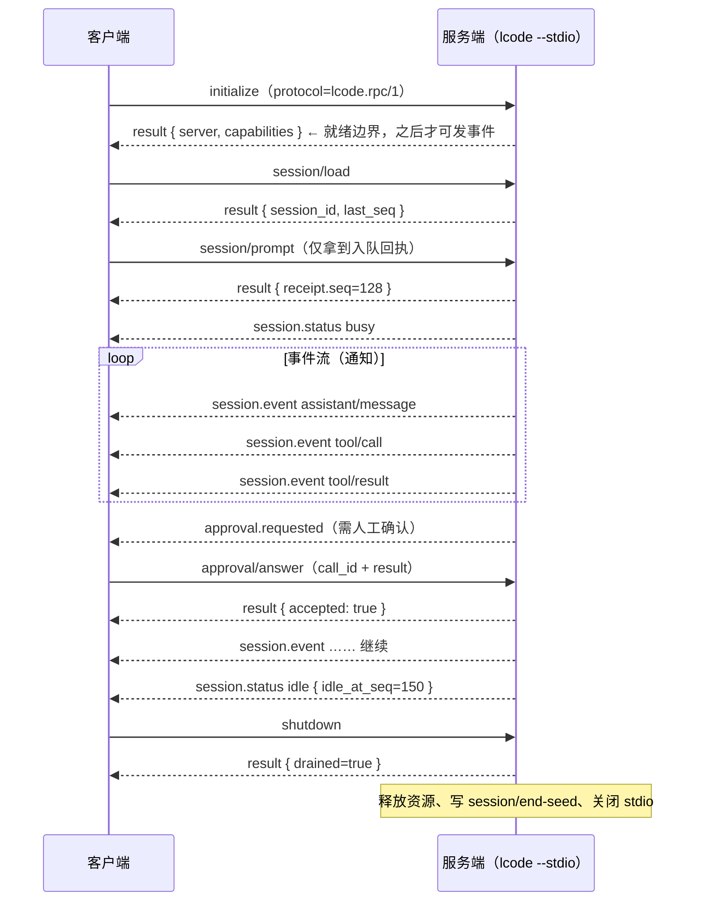

# 21 · 接口契约与错误码总表

> 这篇文档回答：**Lcode 的每一种"边界"上，谁定义了什么、谁消费什么、怎么版本化、出错时给什么码、给用户说什么话。**
> 它是一份**待实现的契约规格**（`docs/` 下没有代码）。给研发、插件作者、接入方与测试看；任何跨边界的字段、方法、错误码都在这里收口。

| 项 | 值 |
|---|---|
| 状态 | 草案 |
| 负责人 | 架构负责人 / 内核研发 |
| 上游依赖 | [00-文档总览与全局约定.md](./00-文档总览与全局约定.md)（§6 术语表、D7–D22）· [05-系统架构设计.md](./05-系统架构设计.md) · [06-会话事件日志与可重放设计.md](./06-会话事件日志与可重放设计.md) · [08-工具系统与执行流水线.md](./08-工具系统与执行流水线.md) · [10-桌面客户端设计.md](./10-桌面客户端设计.md)（§2）· [12-安全权限与沙箱模型.md](./12-安全权限与沙箱模型.md) · [13-插件SDK与协议设计.md](./13-插件SDK与协议设计.md) · [18-模型接入与供应商配置.md](./18-模型接入与供应商配置.md) |
| 下游被引 | [15-测试策略与质量门禁.md](./15-测试策略与质量门禁.md)（契约测试）· `packages/api/*` 边界层 · **桌面端 IPC（已接线，见 §2.13）** · CLI |
| 文档版本 | v0.2（2026-09-14） |

> **读法**：本文是**查阅型**文档。要"实现某个方法"看 §2；要"写一个工具"看 §3；要"接一个外部程序"看 §5；要"给人看的话怎么写"看 §6；要"给契约写测试"看 §7。
>
> **术语一律以 [00 §6](./00-文档总览与全局约定.md#6-术语表) 为准**：会话 / 轮 / 步 / 表面 / 表面操作 / 派生 / 种子 / 接缝 / 服务 / 事件 / 副作用 / 撤销器 / 瀑布 / 守卫 / 作用域 / 规范值 / 卡片 / 预设 / 集束 / 配置档 / 时间轴 / 检查点 / 代码模式 / 模型可见即可重放 / 模型选择 / 适配器 / 凭据引用。

## 目录

- [1. 契约总则](#1-契约总则)
  - [1.1 三种边界](#11-三种边界)
  - [1.2 每条边界：谁定义、谁消费、怎么版本化](#12-每条边界谁定义谁消费怎么版本化)
  - [1.3 命名规范](#13-命名规范)
  - [1.4 破坏性变更规则](#14-破坏性变更规则)
  - [1.5 契约不承诺什么（我们不做什么）](#15-契约不承诺什么我们不做什么)
- [2. 内部方法契约全表](#2-内部方法契约全表)
  - [2.0 共享类型与方向记号](#20-共享类型与方向记号)
  - [2.1 `sessions.*`](#21-sessions)
  - [2.2 `agents.*`](#22-agents)
  - [2.3 `tools.*`](#23-tools)
  - [2.4 `approval.*`](#24-approval)
  - [2.5 `settings.*`](#25-settings)
  - [2.6 `credentials.*`](#26-credentials)
  - [2.7 `model.*`](#27-model)
  - [2.8 `fs.*`](#28-fs)
  - [2.9 `terminal.*`](#29-terminal)
  - [2.10 `jobs.*`](#210-jobs)
  - [2.11 `plugins.*`](#211-plugins)
  - [2.12 `history.*`](#212-history)
  - [2.13 UI IPC 通道对照（main ↔ renderer）](#213-ui-ipc-通道对照main--renderer)
- [3. 工具契约（模型可见面）](#3-工具契约模型可见面)
  - [3.0 三个消费者与两条铁律](#30-三个消费者与两条铁律)
  - [3.1 `read`](#31-read)
  - [3.2 `write`](#32-write)
  - [3.3 `edit`](#33-edit)
  - [3.4 `glob`](#34-glob)
  - [3.5 `grep`](#35-grep)
  - [3.6 `shell`（别名 `bash`）](#36-shell别名-bash)
  - [3.7 `terminal`](#37-terminal)
  - [3.8 `todo_write`](#38-todo_write)
  - [3.9 `web_fetch` / `web_search`](#39-web_fetch--web_search)
  - [3.10 `ask_user`](#310-ask_user)
  - [3.11 `run_code`（代码模式）](#311-run_code代码模式)
  - [3.12 工具契约的公共约束](#312-工具契约的公共约束)
- [4. 事件契约索引](#4-事件契约索引)
- [5. 外部协议（JSON-RPC 2.0 over stdio）](#5-外部协议json-rpc-20-over-stdio)
  - [5.1 传输规则](#51-传输规则)
  - [5.2 方法表](#52-方法表)
  - [5.3 通知表](#53-通知表)
  - [5.4 核心约定：`prompt` 只返回入队回执](#54-核心约定prompt-只返回入队回执)
  - [5.5 一个完整会话的示例序列](#55-一个完整会话的示例序列)
- [6. 错误码总表](#6-错误码总表)
  - [6.1 错误对象结构](#61-错误对象结构)
  - [6.2 错误码总表](#62-错误码总表)
  - [6.3 错误处理总则](#63-错误处理总则)
- [7. 契约测试要求](#7-契约测试要求)
- [未决问题](#未决问题)
- [变更记录](#变更记录)

---

## 1. 契约总则

### 1.1 三种边界

Lcode 的接口分属**三种互不相同**的边界。它们的隔离级别、信任级别、版本节奏都不同，**绝不能用同一套规则处理**。



*这张图想让你看到什么*：三种边界的**方向与通道数量不同**——内部是双向 RPC、UI 是"控制上行 + 事件下行"两条独立通道、外部是单条 stdio 管道上的请求/通知混合流。

| 边界 | 通道 | 信任假设 | 版本节奏 | 定义权威 |
|---|---|---|---|---|
| ① **进程内** | 类型化 RPC（描述符 + 运行时校验） | 插件**不可信**（[12 §8.4](./12-安全权限与沙箱模型.md#84-插件不是可信代码)）；内核代码级可信 | 与内核**同版本发布** | `@lcode/*` 接口包的 TS 类型 |
| ② **跨进程 UI** | 控制类 `invoke` + 事件流 `MessagePort` | renderer **可牺牲且不可信**（渲染不可信内容） | 与桌面应用同版本；不做跨版本兼容 | `preload` 的**白名单** API + `lcode:*` 通道常量 |
| ③ **进程外** | 单条 stdio，ndjson | 外部调用方不可信；**能力受当前权限预设与审批约束** | **独立协议版本**（`lcode.rpc/1`） | 本文 §5 + [13 §5](./13-插件SDK与协议设计.md#5-外部协议json-rpc-20-over-stdio) |

### 1.2 每条边界：谁定义、谁消费、怎么版本化

| 维度 | ① 进程内（内核 ↔ 插件） | ② 跨进程 UI（main ↔ renderer） | ③ 进程外（外部 ↔ Lcode） |
|---|---|---|---|
| **谁定义** | 接口包的 TS 类型（`@lcode/session` 等），经 `WorkspaceAnalyzer` 生成描述符 | `preload` 里 `contextBridge` 暴露的白名单对象；`lcode:*` 通道名 | 本文 §5 的方法/通知表 |
| **谁消费** | 插件进程（客户端产物 `typert.client.js`）与宿主（`typert.host.js` 校验） | renderer UI | 任意外部程序 / SDK / 脚本 / MCP 编排器 |
| **真相来源** | TS 类型（D15：类型是单一真相来源，描述符是派生产物） | 冻结的普通对象（renderer **拿不到** `ipcRenderer` 本身） | 协议 schema（ndjson 每行可校验） |
| **版本载体** | 描述符格式版本 + 插件 `engines.lcode` | 应用自身版本（main/renderer 同包发布） | `initialize.params.protocol` |
| **不兼容时** | **拒绝激活**插件（写 `plugin/incompatible` 事件），不猜 | 视为**同一版本**；重载即重新握手，不存在"旧 renderer 配新 main" | `initialize` 返回错误且**不进入就绪**，客户端不得继续 |
| **是否 opt-in** | **是**：只有标注 `@face` 的包进类型图；跨进程必须走 RPC | 不适用（UI 全部走通道） | 不适用 |
| **校验位置** | 生成期（编译期）+ 宿主侧运行时 schema | 主进程侧每个 `handle` 校验 `sessionId` 与调用方 `webContents` | 服务端逐行解析并 schema 校验 |

**三条落地要求（待实现）**：

1. **跨进程的包必须 opt-in 生成描述符**；同进程内部直接调用，零额外成本（[13 §4.5](./13-插件SDK与协议设计.md#45-业务包如何-opt-in)）。
2. **UI 白名单纪律**：主进程**禁止**任何形如 `invoke('lcode:raw', channel, ...)` 的通用转发——那等于把 `ipcRenderer` 漏回渲染进程（[10 §2.4](./10-桌面客户端设计.md#24-ipc-通道设计)）。
3. **外部协议 stdout 只放协议**；一切日志走 stderr（见 §5.1）。

### 1.3 命名规范

| 对象 | 规范 | 示例 | 权威出处 |
|---|---|---|---|
| **内部方法** | `<service>.<method>`，service 用 [05 §4](./05-系统架构设计.md#4-模块分解) 的 `ctx` key（复数/单数语义见 00 §5.1）；method 用小驼峰 | `sessions.append`、`approval.request` | [13 §4.2](./13-插件SDK与协议设计.md#42-描述符结构)（描述符 `id`） |
| **线上字段名** | RPC 描述符的 `wire` 字段规范化为 `snake_case` | `sessionId` → `session_id` | [13 §4.2](./13-插件SDK与协议设计.md#42-描述符结构) |
| **事件名** | `domain/event`（斜杠），全小写 | `tool/result`、`agent/status`、`session/end-seed` | [06 §2.2](./06-会话事件日志与可重放设计.md#22-事件词汇表)、[10 §3.1](./10-桌面客户端设计.md#31-两类数据源不要混) |
| **外部协议方法** | `domain/method`（斜杠，与内部方法**同名不同形**） | `session/prompt`、`session/load` | [13 §5.2](./13-插件SDK与协议设计.md#52-方法请求--响应) |
| **UI IPC 通道** | `lcode:<域>.<动作>` | `lcode:session.create`、`lcode:agent.send` | [10 §2.4](./10-桌面客户端设计.md#24-ipc-通道设计) |
| **错误码** | `E?–UPPER_SNAKE`，前缀表分类（见 §6.2） | `ET-TIMEOUT`、`EP-APPROVAL_UNAVAILABLE` | 本文 §6 |
| **卡片类型** | 闭合字面量 | `generic` / `terminal` / `diff` / `search` / `read` / `web` | [00 §6](./00-文档总览与全局约定.md#6-术语表)、[08 §8](./08-工具系统与执行流水线.md#8-ui-卡片) |

> **一条纠偏**：内部方法名（`sessions.prompt` 形态）与外部协议方法名（`session/prompt` 形态）**是两种东西**，不要因为字面相近就互相替换。转换发生在协议适配层（`apps/cli --stdio`），见 §2 与 §5.2 的对照。

### 1.4 破坏性变更规则

**统一判据：只增不改是兼容的；改语义、改形状、移除是破坏的。**

| 变更 | ① 进程内 | ② 跨进程 UI | ③ 进程外 |
|---|---|---|---|
| 新增方法 / 事件 / 错误码 | 兼容（小版本） | 兼容 | 兼容（次版本） |
| 新增**可选**参数（有默认） | 兼容 | 兼容 | 兼容 |
| 新增**必填**参数 | **破坏**（升主版本） | **破坏** | **破坏**（升主协议版本） |
| 改参数名 / 线上字段名 | **破坏** | **破坏** | **破坏** |
| 改返回值结构 / 收窄类型 | **破坏** | **破坏** | **破坏** |
| 移除字段 / 方法 / 事件 | **破坏** | **破坏** | **破坏** |
| 改**幂等性**或**超时默认值** | 视为破坏（会改变调用方假设） | 视为破坏 | 视为破坏 |
| 改 `userMessage` 文案 | **兼容**（面向人，不是机器契约） | 兼容 | 兼容 |
| 改 `code` / `category` | **破坏** | **破坏** | **破坏** |
| 改事件**派发模式**（emit/waterfall/…） | **破坏**（模式是公开契约） | **破坏** | 不适用 |

**四条配套纪律**：

1. **错误按 `code` 路由，绝不按文本**。任何"按错误消息字符串判断"的实现都是缺陷（[09 §5.3](./09-上下文工程与压缩策略.md#53-溢出恢复的正确做法)）。
2. **`userMessage` 不是契约**：它必须通过 [19 §6.2 术语黑名单](./19-原型与交互规格.md#62-术语黑名单硬性ux-copy-001)，可以随版本优化，调用方不得依赖它。
3. **内部 RPC 的破坏性变更 = SDK 主版本变更**；SDK 大版本 = 内核大版本（[13 §7.4](./13-插件SDK与协议设计.md#74-插件版本与内核版本兼容性)）。
4. **外部协议的破坏性变更必须升 `lcode.rpc` 主版本**；不兼容时 `initialize` 失败，而不是"尽力解析"。

### 1.5 契约不承诺什么（我们不做什么）

| 不做的事 | 为什么 |
|---|---|
| **不为内部方法手写两套桩** | 类型是单一真相来源（D15）；手写桩必然漂移。 |
| **不承诺"猜测式兼容"** | 老插件 / 老协议 / 老日志格式一律**明确拒绝**并给出原因，不尽力加载（[13 §7.4](./13-插件SDK与协议设计.md#74-插件版本与内核版本兼容性)、[11 §8.1](./11-数据模型与持久化设计.md#81-格式版本策略未知版本报错不尽力解析)）。 |
| **不保证 `renderer` 与 `main` 可跨版本混用** | 两者同包发布；只承诺"同版本可用、重载即重新握手"。 |
| **不让外部协议绕过权限与审批** | 入站调用**全部**进入同一条工具执行流水线（[13 §6.3](./13-插件SDK与协议设计.md#63-安全mcp-一律过权限流水线)）。 |
| **不把凭据值放进任何线上返回** | 见 §2.6；`credentials` 的取值能力**不生成 RPC 描述符**。 |
| **不承诺 `userMessage` 文案稳定** | 它服务人，不服务机器。 |
| **不承诺事件顺序按 `callId` 排序** | 并行时**落盘顺序**才是权威顺序（[08 §6.4](./08-工具系统与执行流水线.md#64-并行的可观测性)）。 |

---

## 2. 内部方法契约全表

> 这一节是内核 ↔ 插件（以及少量内核内部接缝）**所有跨边界方法**的权威清单。列：**方法 | 方向 | 参数 | 返回 | 可能错误码 | 幂等 | 默认超时**。
> 参数格式：`名称: 类型`，**加粗 `(必)` 表示必填**，其余可省略（括号内给默认值）。错误码用短名（完整定义见 §6.2）。

### 2.0 共享类型与方向记号

**方向记号**：

| 记号 | 含义 |
|---|---|
| `P→K` | 插件 / 能力包调用内核（内核提供实现） |
| `K→P` | 内核回调插件（插件提供实现，如工具体、应答者） |
| `in` | **进程内直调，不生成 RPC 描述符**（不可跨进程） |

**共享类型（节选，与 [06 §2.1](./06-会话事件日志与可重放设计.md#21-事件信封)、[18 §3.3](./18-模型接入与供应商配置.md#33-核心接口) 一致）**：

```ts
type SessionId = string                      // 全局唯一；agent 与会话共享（D17）
type CallId    = string
type JsonValue = null | boolean | number | string | JsonValue[] | { [k: string]: JsonValue }

interface EnqueueReceipt { accepted: true; queue_id: string; session_id: SessionId; seq: number; enqueued_at: number }
interface SessionEvent   { type: string; seq: number; time: number; data: JsonValue;
                           surfaceOp?: 'append' | { op: 'replace'; start: number; end: number };
                           sourceEventSeqs?: number[]; ignorable?: true }
interface ModelSelection { provider: string; model: string; maxTokens?: number;
                           reasoningEffort?: 'low' | 'medium' | 'high'; temperature?: number }
interface CredentialInfo { key: string; ref?: string; present: boolean;
                           source?: 'keychain' | 'file' | 'env' | 'session';
                           updatedAt?: number; lastUsedAt?: number; maskedHint?: string }  // ⚠️ 无 value 字段
interface ApprovalRequest { callId: CallId
  action: { tool: string; summary: string; argv?: string[]; cwd?: string }
  basis:  { source: 'preset' | 'waterfall' | 'guard' | 'delegation'; reason: string; presetName?: string }
  impact: { paths?: { path: string; mode: 'read' | 'write'; outsideWorkspace: boolean }[]
            network?: { domains: string[] }; env?: string[]
            sandboxChange?: { from: string; to: string }; processScope?: string } }
type ApprovalResult = 'allowed-once' | 'rejected' | 'cancelled' | 'unavailable'
type CancellationCause = 'user' | 'parent' | 'hook' | 'dispose'
```

### 2.1 `sessions.*`

| 方法 | 方向 | 参数 | 返回 | 可能错误码 | 幂等 | 超时 |
|---|---|---|---|---|---|---|
| `sessions.create` | P→K | `cwd: string (必)`、`preset?: string`、`title?: string`、`modelSelection?: ModelSelection` | `{ session_id, last_seq }` | `EC-INVALID_PARAMS`、`EF-PERMISSION_DENIED`、`EX-INCOMPATIBLE` | 否（每次产生新会话） | 5s |
| `sessions.resume` | P→K | `session_id: string (必)`、`seed?: SessionEvent[]` | `{ session_id, last_seq, repaired: boolean, closers?: SessionEvent[] }` | `ES-SESSION_NOT_FOUND`、`ES-FORMAT_UNSUPPORTED`、`ES-SEQ_DISCONTINUOUS`、`ES-CORRUPTED` | 幂等 | 10s |
| `sessions.list` | P→K | `workspace?: string`、`includeArchived?: boolean (false)`、`limit?: number (50)`、`cursor?: string` | `{ items: SessionMeta[], nextCursor?: string }` | `EC-INVALID_PARAMS` | 幂等 | 2s |
| `sessions.meta` | P→K | `session_id: string (必)` | `{ last_seq, header: SessionHeader, log_revision: string }` | `ES-SESSION_NOT_FOUND` | 幂等 | 2s |
| `sessions.fork` | P→K | `source_session_id: string (必)`、`boundary: number (必)`、`child_id?: SessionId` | `{ session_id, last_seq }` | `ES-FORK_BOUNDARY_INVALID`、`ES-SESSION_NOT_FOUND`、`ES-LOG_MODIFIED_EXTERNALLY` | 否 | 10s |
| `sessions.append` | P→K | `session_id: string (必)`、`type: string (必)`、`data: JsonValue (必)`、`surface_op?`、`source_event_seqs?: number[]` | `SessionEvent` | `ES-SESSION_NOT_FOUND`、`EC-INVALID_PARAMS`、`ES-SEQ_DISCONTINUOUS`、`EC-EVENT_NOT_JSON` | 否 | 1s |
| `sessions.derive` | P→K | `session_id: string (必)`、`up_to?: number` | `{ messages: Message[] }` | `ES-SESSION_NOT_FOUND` | 幂等 | 2s |
| `sessions.flush` | P→K | `session_id: string (必)` | `{ flushed: true }` | `ES-LOG_WRITE_FAILED`、`EF-DISK_FULL` | 幂等（静默屏障） | 15s |
| `sessions.export` | P→K | `session_id: string (必)`、`format: 'jsonl'\|'md' (必)`、`inline_attachments?: boolean (false)` | `{ path: string, bytes: number, sha256: string }` | `ES-SESSION_NOT_FOUND`、`EF-DISK_FULL`、`EF-PERMISSION_DENIED` | 否（产生文件） | 30s |
| `sessions.exportAll` | P→K | `out?: string`（省略则落 `<Home>/exports/<时间戳>/`）、`format?: 'jsonl'\|'md' (jsonl)`、`includeDeleted?: boolean (false)` | `{ dir, manifest_path, entries: { session_id, path, bytes, sha256 }[], skipped: { session_id, reason }[] }` | `EF-DISK_FULL`、`EF-PERMISSION_DENIED` | 否（产生文件） | 300s |
| `sessions.import` | P→K | `path: string (必)`、`title?: string` | `{ session_id, last_seq, imported_events }` | `EC-INVALID_PARAMS`（路径或格式不可恢复）、`EF-DISK_FULL` | 否（每次生成新会话） | 30s |
| `sessions.search` | P→K | `query: string (必)`、`limit?: number (20)`、`include_deleted?: boolean (false)` | `{ items: { session_id, seq, role, summary, title, workspace, updated_at }[] }`（按会话去重，保留排名最高的一条） | `EC-INVALID_PARAMS`（空检索词） | 幂等 | 5s |
| `sessions.delete` | P→K | `session_id: string (必)` | `{ deleted_at: number }` | `ES-SESSION_NOT_FOUND` | 幂等 | 2s |
| `sessions.restore` | P→K | `session_id: string (必)` | `{ restored: true }` | `ES-SESSION_NOT_FOUND` | 幂等 | 2s |
| `sessions.purge` | P→K | `session_id: string (必)`、`exported?: boolean (false)`、`force?: boolean (false)` | `{ trashed_path: string, spill_freed_bytes: number }` | `ES-SESSION_NOT_FOUND`、`EC-CONFLICT`（未确认可导出）、`EF-DISK_FULL` | 否 | 30s |
| `sessions.listTrash` | P→K | — | `{ items: { session_id, path, bytes, deleted_at, expires_in_ms }[], total_bytes: number }` | — | 幂等 | 2s |
| `sessions.storageUsage` | P→K | — | `{ sessions, trash, cache, exports, index, total }`（均为字节数） | — | 幂等 | 5s |
| `sessions.prune` | P→K | `trash?: boolean (true)`、`cache?: boolean (true)`、`purgeCache?: boolean (false)`、`emptyTrash?: boolean (false)` | `{ trash: { removed, freedBytes, kept }, cache: { evicted, freedBytes, remainingBytes, stillOverLimit }, usage }` | `EF-PERMISSION_DENIED` | 幂等 | 60s |
| `sessions.archive` | P→K | `session_id?: string`、`openSessionIds?: string[]`、`dryRun?: boolean (false)`、`idleMs?: number (30 天)` | `{ scanned, archived: { session_id, file, archived_path, original_bytes, compressed_bytes, ratio }[], skipped_idle, skipped_open, failed: { session_id, message }[], zstd_available: boolean }` | `EF-DISK_FULL`、`EF-PERMISSION_DENIED` | 幂等（已归档的不再处理） | 120s |

**会话生命周期与本地存储（§2.1 后段九个方法）的三条硬约束**：

| 约束 | 为什么 |
|---|---|
| **删除前必须先提示导出**：`sessions.purge` 在 `exported !== true && force !== true` 时**拒绝执行**并回 `EC-CONFLICT` | 产品宪法第二条「用户拥有自己的数据」。提示只有在**真的拦住一次调用**时才有意义；`force` 是"用户已知情仍不备份"的显式表达 |
| **软删不动文件**：`sessions.delete` 只写 `sessions.deleted_at`，日志文件原地保留；`sessions.restore` 撤销 | [11 §9.3](./11-数据模型与持久化设计.md)。"隐藏"与"销毁"是两个不同的动作，合并会让误删不可挽回 |
| **`sessions.prune` / `sessions.archive` 绝不自动删会话** | 只清 `trash/` 里到期的条目与 `cache/`（两者都可重建或已被用户显式删除）。空间不够时应**提示用户**，而不是替他删掉唯一不可重建的会话日志 |

**`sessions.archive` 的 `openSessionIds` 必须由装配层传入**：开放中的会话**永不压缩**（[22 §9.2](./22-数据字典与DDL.md)）——压缩一个正在被追加的文件会直接破坏它。`sessions.resume` 遇到归档会话会**先解压回 `.jsonl`**，因为一旦要写入就不能是压缩形态；而**只读**操作（`sessions.derive` / `list` / `meta`）**不得**触发解压，否则"看一眼列表"就会把压缩省下的磁盘重新吃掉。

**最小调用示例**：

```ts
// 插件内：创建一个会话并追加一条用户消息（surfaceOp 默认 append）
const { session_id } = await rpc.call('sessions.create', { cwd: '/repo/web' })
await rpc.call('sessions.append', {
  session_id, type: 'user/message',
  data: { role: 'user', content: [{ type: 'text', text: '把 login 改成 async' }] },
})
```

### 2.2 `agents.*`

| 方法 | 方向 | 参数 | 返回 | 可能错误码 | 幂等 | 超时 |
|---|---|---|---|---|---|---|
| `agents.create` | P→K | `session_id: string (必)`、`options?: AgentOptions` | `{ agent_id }` | `ES-SESSION_NOT_FOUND`、`EC-INVALID_PARAMS` | 否 | 5s |
| `agents.resume` | P→K | `session_id: string (必)` | `{ agent_id }` | `ES-SESSION_NOT_FOUND`、`ES-FORMAT_UNSUPPORTED` | 幂等 | 10s |
| `agents.get` | P→K | `session_id: string (必)` | `{ agent_id } \| null` | `EC-INVALID_PARAMS` | 幂等 | 1s |
| `agents.followup` | P→K | `agent_id: string (必)`、`content: ContentBlock[] (必)`、`signal?` | `EnqueueReceipt` | `ES-SESSION_NOT_FOUND`、`EL-NO_MODEL_CONFIGURED`、`EC-INVALID_PARAMS` | 否 | 2s |
| `agents.steer` | P→K | `agent_id: string (必)`、`content: ContentBlock[] (必)` | `{ accepted: true, seq }` | `EC-NOT_RUNNING` | 否 | 2s |
| `agents.queued` | P→K | `agent_id: string (必)` | `{ items: QueuedMessage[] }` | `ES-SESSION_NOT_FOUND` | 幂等 | 1s |
| `agents.editQueued` | P→K | `agent_id: string (必)`、`queue_id: string (必)`、`content: ContentBlock[] (必)` | `{ updated: boolean }` | `EC-INVALID_PARAMS` | 否 | 1s |
| `agents.removeQueued` | P→K | `agent_id: string (必)`、`queue_id: string (必)` | `{ removed: boolean }` | — | 幂等 | 1s |
| `agents.clearQueued` | P→K | `agent_id: string (必)` | `{ removed: number }` | — | 幂等 | 1s |
| `agents.guideQueued` | P→K | `agent_id: string (必)`、`queue_id: string (必)` | `{ guided: boolean }` | `EC-NOT_RUNNING` | 否 | 1s |
| `agents.inject` | P→K | `agent_id: string (必)`、`content: ContentBlock[] (必)`、`dedupe_key?: string` | `{ accepted: true, seq }` | `EC-INVALID_PARAMS` | 幂等（按 `dedupe_key`） | 2s |
| `agents.cancel` | P→K | `agent_id: string (必)`、`cause: CancellationCause (必)` | `{ cancelled: boolean }` | `EC-INVALID_PARAMS` | 幂等 | 2s |
| `agents.watch` | P→K | `agent_id: string (必)` | `Stream<AgentStatusEvent>` | `ES-SESSION_NOT_FOUND` | 幂等（重订阅） | 流式（无固定超时） |
| `agents.dispose` | P→K | `agent_id: string (必)` | `{ disposed: true }` | — | 幂等 | 10s |

> **`agents.followup` 只返回入队回执**（`EnqueueReceipt`），不返回本**轮**结果。这与外部协议 `session/prompt` 同义（§5.4）：**等待某个区间是调用方自己的事**。`queue_id` 仅在当前运行进程内有效，可在该消息开始前用于编辑、关闭或转为引导。

**最小调用示例**：

```ts
const { agent_id } = await rpc.call('agents.create', { session_id })
const receipt = await rpc.call('agents.followup', { agent_id, content: [{ type: 'text', text: '开始' }] })
// 插件在 agents.watch 的流上观察状态；收到 idle 且 idleSeq >= receipt.seq 视为本次输入跑完
```

### 2.3 `tools.*`

| 方法 | 方向 | 参数 | 返回 | 可能错误码 | 幂等 | 超时 |
|---|---|---|---|---|---|---|
| `tools.list` | K→P | `scope_id?: string` | `ToolSchema[]` | — | 幂等 | 1s |
| `tools.execute` | K→P | `call_id: CallId (必)`、`name: string (必)`、`arguments: string (必)`、`agent_id?: string`、`signal?` | `ToolExecutionResult` | 见 [08 §7.3](./08-工具系统与执行流水线.md#73-标准错误码)（`ET-*`）+ `ET-TIMEOUT`、`ET-ABORTED`、`ET-UNKNOWN_TOOL`、`ET-INVALID_ARGS`、`ET-INVALID_OUTPUT`、`ET-DENIED`、`EP-*` | 否 | `timeoutMs` 或默认 120s |
| `tools.cancel` | K→P | `call_id: CallId (必)`、`reason: string` | `{ cancelled: boolean }` | `ET-NOT_CANCELLABLE`、`ET-UNKNOWN_CALL` | 幂等 | 2s |
| `tools.status` | K→P | `call_id: CallId (必)` | `{ state: 'pending'\|'running'\|'done', started_at?: number }` | `ET-UNKNOWN_CALL` | 幂等 | 1s |
| `tools.register` | P→K | `tool: ToolDefinition (必)` | `disposer` | `EX-UNDECLARED_PERMISSION`、`EC-INVALID_PARAMS`（schema 非法） | 否 | 2s |
| `tools.restrict` | P→K | `scope_id: string`、`allow?: string[]`、`deny?: string[]` | `disposer` | `EC-INVALID_PARAMS` | 幂等 | 1s |
| `tools.guard` | P→K | `guard: ToolGuard (必)` | `disposer` | `EC-INVALID_PARAMS` | 幂等 | 1s |

> **身份在 `ToolExecution` 上，不在结果里**：`tools.execute` 的返回**不含** `call_id` / `name`——避免"两个互相矛盾的身份"（[08 §7.2](./08-工具系统与执行流水线.md#72-三个刻意的缺失)）。
> **`arguments` 是未解析的原始 JSON 字符串**（保真、可审计；[06 §2.2](./06-会话事件日志与可重放设计.md#22-事件词汇表)、D9）。

**最小调用示例**：

```ts
// 插件注册一个工具（返回 disposer，卸载即回滚）
const dispose = await rpc.call('tools.register', { tool: myTool })
// disposer 在插件卸载时由内核按注册逆序统一调用（EXT-EFFECT-001）
```

### 2.4 `approval.*`

> **⚠️ 实现现状**：契约方法名是 `approval.request` / `answer` / `pending`；桌面端把它接到内核 `ApprovalService.ask`（`packages/interaction/approval`）上，IPC 通道名是 `lcode:approval.answer` / `lcode:approval.pending`、推送是 `lcode:approval.asked`（见 §2.13）。
> **字段名以实现为准**：进程内问题用 **`callId`** 标识（与 `tool/call` 配对，I3），答案是 **`result`**（不是 `requestId` / `decision`）。stdio 是唯一例外：为 JSON-RPC 载荷采用 `call_id`。两种写法指同一个标识，审批与那次工具调用不得另起 id，否则"拒绝了哪次调用"要靠再对一次表。

| 方法 | 方向 | 参数 | 返回 | 可能错误码 | 幂等 | 超时 |
|---|---|---|---|---|---|---|
| `approval.request` | P→K | `request: ApprovalRequest (必)`（`callId` + 三段 `action`/`basis`/`impact`） | `ApprovalResult` | `EP-APPROVAL_UNAVAILABLE`（无应答者时直接返回该结果，不抛错） | 否（每次独立提问） | **无固定超时**（见 [12 未决问题](./12-安全权限与沙箱模型.md#未决问题)） |
| `approval.answer` | K→P（应答者） | `callId: string (必)`、`result: ApprovalResult (必)` | `{ accepted: true }` | `EC-CONFLICT`（同 `callId` 二次应答）、`EC-INVALID_PARAMS` | 否（二次应答报冲突） | 2s |
| `approval.pending` | P→K | — | `string[]`（挂着的 `callId`） | — | 幂等 | 1s |

> **四个结果只有一个是"放行"**：`allowed-once`（[12 §5.3](./12-安全权限与沙箱模型.md#53-四个结果)）。**无应答者 = `unavailable` = 拒绝**（fail-closed，D11）。
> **子代理不能直接问人**：子作用域的 `approval.request` 被拒 → 落 `unavailable`（[12 §5.6](./12-安全权限与沙箱模型.md#56-子代理不能直接问人)）。实现里这条落在**策略判定**（`ctx.delegated` → 直接 deny，`EP-APPROVAL_UNAVAILABLE`），而不是等到 `ask` 才拒。
> **只对**并发**去重，不缓存历史结果**：同一个 `callId` 并发问两次会复用同一次询问（不该弹两个框），但**串行**的第二次会**重新问**——`callId` 由模型生成、跨轮重复完全可能，缓存会让第 5 轮沿用第 1 轮的"允许"，即把一次性审批变成永久授权。

**最小调用示例**：

```ts
const result = await rpc.call('approval.request', {
  callId: 'ap_9',
  action:  { tool: 'shell', summary: 'npm test -- login', argv: ['npm','test','--','login'], cwd: '/repo/web' },
  basis:   { source: 'preset', reason: '标准预设下运行命令需要确认', presetName: '标准' },
  impact:  { network: { domains: ['registry.npmjs.org'] },
             sandboxChange: { from: 'workspace-write', to: 'workspace-write' } },
})
if (result !== 'allowed-once') { /* 不执行；写一条类型化拒绝结果，而不是抛错 */ }
```

### 2.5 `settings.*`

| 方法 | 方向 | 参数 | 返回 | 可能错误码 | 幂等 | 超时 |
|---|---|---|---|---|---|---|
| `settings.describe` | P→K | `namespace: string (必)` | `FieldDescriptor[]`（**脱敏**） | `EC-INVALID_PARAMS`、`EC-NOT_FOUND` | 幂等 | 1s |
| `settings.get` | P→K | `namespace: string (必)`、`key?: string` | `{ value: JsonValue, source: 'L1'\|'L2'\|'L3'\|'L4'\|'L5'\|'L6' }` | `EC-INVALID_PARAMS` | 幂等 | 1s |
| `settings.update` | P→K | `namespace: string (必)`、`key: string (必)`、`value: JsonValue (必)`、`scope?: 'user'\|'workspace'\|'session'` | `{ saved: true, source }` | `EC-INVALID_PARAMS`、`EF-PERMISSION_DENIED`、`EC-VALIDATION_FAILED` | 幂等（写同值） | 5s |
| `settings.watch` | P→K | `namespace: string (必)` | `Stream<{ namespace, key, value, source }>` | — | 幂等（重订阅） | 流式 |

> **`source` 用 `L1–L6` 是线上字段，不是 UI 文案**：UI 必须翻译成人类语言（"来自：你在设置里选的"），内部层级编号**不得上界面**（[18 §10.2](./18-模型接入与供应商配置.md#102-e2-设置页的信息要求六项)、[19 §3.5](./19-原型与交互规格.md#35-p5--设置)）。
> `describe()` 与 `get()` 必须**永不返回凭据值**（`credentialRef` 只给引用名与元信息）。

**最小调用示例**：

```ts
const { value, source } = await rpc.call('settings.get', { namespace: 'model', key: 'default.maxTokens' })
// value: 8192, source: 'L4' —— UI 侧渲染为「来自：你在设置里选的」
```

### 2.6 `credentials.*`

> **本节的核心约束：任何**线上**返回都不得包含明文值。** 做法是把"取值"排除在 RPC 之外。

| 方法 | 方向 | 参数 | 返回 | 可能错误码 | 幂等 | 超时 |
|---|---|---|---|---|---|---|
| `credentials.listRefs` | P→K | `scope?: string` | `CredentialInfo[]`（**无 `value` 字段**） | — | 幂等 | 1s |
| `credentials.resolve` | **in**（不生成描述符） | `ref_or_key: string (必)` | `string`（**仅发起方进程内**） | `EL-CREDENTIAL_MISSING`、`EL-CREDENTIAL_REJECTED` | 否（**每次操作重新解析**，D22） | 5s |
| `credentials.write` | K→P（写入应答者 / 设置页） | `key: string (必)`、`value: string (必)`、`scope?: string` | `{ keyId: string, info: CredentialInfo }` | `EF-PERMISSION_DENIED`、`EF-DISK_FULL` | 否 | 5s |
| `credentials.delete` | P→K | `key: string (必)` | `{ deleted: boolean }` | `EC-NOT_FOUND` | 幂等 | 2s |

**为什么 `resolve` 不跨进程**：

1. **架构约束而非代码纪律**：取值的唯一入口是 `resolve(ref | key) → string`，它**只在发起方进程内被调用一次**，返回值不进入任何可序列化的公共对象（[12 §7.3](./12-安全权限与沙箱模型.md#73-配置只放引用ui-只拿元信息)）。
2. **跨进程的凭据使用由适配器在自身进程内完成**：`llm-*` 适配器解析凭据、直接发起 HTTP；**从不把值交回内核**。
3. **因此不存在"跨边界返回明文"的合法形态**——这是 I7（凭据不泄漏，§7）可被自动验证的前提。

**最小调用示例**：

```ts
// ✅ 仅进程内直调（例如 llm 适配器内部）
const apiKey = credentials.resolve('ANTHROPIC_API_KEY')          // 值为 string，不序列化
// ✅ 跨进程只暴露元信息面
const refs = await rpc.call('credentials.listRefs', {})
// refs[0] = { key: 'llm/anthropic-default', ref: 'ANTHROPIC_API_KEY', present: true,
//             source: 'env', maskedHint: 'sk-ant-…4f2a' }      // ⚠️ 没有 value
```

### 2.7 `model.*`

| 方法 | 方向 | 参数 | 返回 | 可能错误码 | 幂等 | 超时 |
|---|---|---|---|---|---|---|
| `model.listProviders` | P→K | — | `ProviderInfo[]` | — | 幂等 | 2s |
| `model.listModels` | P→K | `provider: string (必)` | `ModelInfo[]` | `EL-NO_ADAPTER`、`EL-ENDPOINT_UNREACHABLE`、`EL-PROVIDER_NOT_RUNNING` | 幂等 | 30s |
| `model.probe` | P→K | `provider: string (必)`、`model?: string`、`base_url?: string` | `{ ok: true, models: ModelInfo[] } \| { ok: false, failure: ProbeFailure }` | 见下方六类归因 | 幂等（可重复触发） | 30s |
| `model.getDefault` | P→K | — | `ModelSelection \| undefined` | — | 幂等 | 1s |
| `model.setDefault` | P→K | `selection: ModelSelection (必)` | `{ saved: true }` | `EC-INVALID_PARAMS` | 幂等（写同值） | 5s |
| `model.watchDefault` | P→K | — | `Stream<ModelSelection \| undefined>` | — | 幂等（重订阅） | 流式 |

**`model.probe.failure` 的六类归因**（与 [18 §8.2](./18-模型接入与供应商配置.md#82-保存时的连通性自检)、[19 §6.4](./19-原型与交互规格.md#64-自检失败的六种归因文案必须各自独立) 一一对应）：

| `failure.kind` | 对应错误码 |
|---|---|
| `credential-rejected` | `EL-CREDENTIAL_REJECTED` |
| `endpoint-unreachable` | `EL-ENDPOINT_UNREACHABLE` |
| `model-not-found` | `EL-UNKNOWN_MODEL` |
| `timeout` | `EN-TIMEOUT` |
| `provider-not-running` | `EL-PROVIDER_NOT_RUNNING` |
| `not-configured` | `EL-CREDENTIAL_MISSING` |

> **选择入口的唯一权威是 `ctx.agentDefaultModel`**（`model.getDefault` / `setDefault` / `watchDefault`），执行入口是 `ctx.llm`（`model.listProviders` 等）（[18 §3.1](./18-模型接入与供应商配置.md#31-两个不同的入口不要混为一谈)）。**不做自动路由**（D21）。

> **生效时机**：`model.setDefault` 保存的选择只在下一次 `turn/start` 读取；一旦回合开始，provider、model 与采样参数会固定到该回合结束（包括工具调用后的续步）。历史按通用消息投影，实际请求始终以各自的 `request/header` 为准；首个使用新选择的请求以 `model-switch` 标记。

**最小调用示例**：

```ts
await rpc.call('model.setDefault', { selection: { provider: 'anthropic', model: 'claude-sonnet-4-5', maxTokens: 8192 } })
const probe = await rpc.call('model.probe', { provider: 'anthropic' })
// probe.ok === false 时，probe.failure.kind 用于选择 §6.2 的 userMessage
```

### 2.8 `fs.*`

| 方法 | 方向 | 参数 | 返回 | 可能错误码 | 幂等 | 超时 |
|---|---|---|---|---|---|---|
| `fs.resolve` | **in** | `root: string (必)`、`path: string (必)` | `ResolvedPath` | `EF-PERMISSION_DENIED` | 幂等 | 0.1s |
| `fs.read` | P→K | `path: string (必)`、`offset?: number (1)`、`limit?: number` | `{ text: string, truncated: boolean, total_lines: number }` | `EF-NOT_FOUND`、`EF-TOO_LARGE`、`EF-ENCODING_UNKNOWN`、`EF-PERMISSION_DENIED` | 幂等 | 10s |
| `fs.write` | P→K | `path: string (必)`、`content: string (必)`、`create_dirs?: boolean (true)` | `{ bytes_written: number, created: boolean }` | `EF-PERMISSION_DENIED`、`EF-DISK_FULL`、`EP-OUTSIDE_WORKSPACE`（未获批准时） | 否 | 10s |
| `fs.stat` | P→K | `path: string (必)` | `{ exists: boolean, size?: number, mtime_ms?: number, is_dir?: boolean }` | — | 幂等 | 1s |
| `fs.list` | P→K | `path: string (必)`、`glob?: string`、`max_results?: number (500)` | `{ entries: string[], truncated: boolean }` | `EF-NOT_FOUND` | 幂等 | 10s |

> **写意图门**：`fs.write` 必须经过 `fs/write-intent` 事件门（沙箱与观察策略挂在这里），写成功后发 `fs/observed`（[08 §9.2](./08-工具系统与执行流水线.md#92-write)）。
> **工作区外写入**：未获审批时返回 `EP-OUTSIDE_WORKSPACE`（**不是** `isError` 崩溃，而是类型化拒绝结果）。

**最小调用示例**：

```ts
const { text, truncated } = await rpc.call('fs.read', { path: 'src/auth.ts', offset: 1, limit: 200 })
await rpc.call('fs.write', { path: 'src/auth.ts', content: text.replace('function verify', 'async function verify') })
```

### 2.9 `terminal.*`

| 方法 | 方向 | 参数 | 返回 | 可能错误码 | 幂等 | 超时 |
|---|---|---|---|---|---|---|
| `terminal.open` | P→K | `agent_id: string (必)`、`cwd?: string`、`shell?: string` | `{ terminal_id: string }` | `EF-PERMISSION_DENIED`、`EJ-LIMIT_REACHED` | 否 | 30s |
| `terminal.send` | P→K | `terminal_id: string (必)`、`data: string (必)` | `{ written: number }` | `EC-NOT_FOUND` | 否 | 2s |
| `terminal.read` | P→K | `terminal_id: string (必)`、`since_offset?: number` | `{ data: string, offset: number, exited: boolean, exit_code?: number }` | `EC-NOT_FOUND` | 幂等（按 `offset`） | 2s |
| `terminal.signal` | P→K | `terminal_id: string (必)`、`signal: string (必)` | `{ sent: true }` | `EC-NOT_FOUND` | 幂等 | 1s |
| `terminal.close` | P→K | `terminal_id: string (必)` | `{ closed: true }` | — | 幂等 | 5s |
| `terminal.list` | P→K | `agent_id?: string` | `TerminalInfo[]` | — | 幂等 | 1s |

> **作用域隔离**：终端以 **owner agent** 隔离，跨 agent 访问被拒（`EP-DENIED_CROSS_SCOPE`）（[05 §4.2](./05-系统架构设计.md#42-能力层按能力族分组)、`FR-TOOL-004`）。
> **与前台 `shell` 的区别**：`shell` 是一次性调用；`terminal` 是长期存在的会话，两者**不共享缓冲区**（[10 §4.2](./10-桌面客户端设计.md#42-四区职责)）。

**最小调用示例**：

```ts
const { terminal_id } = await rpc.call('terminal.open', { agent_id, cwd: '/repo/web', shell: '/bin/bash' })
await rpc.call('terminal.send', { terminal_id, data: 'npm run dev\n' })
const out = await rpc.call('terminal.read', { terminal_id, since_offset: 0 })
```

### 2.10 `jobs.*`

| 方法 | 方向 | 参数 | 返回 | 可能错误码 | 幂等 | 超时 |
|---|---|---|---|---|---|---|
| `jobs.start` | **in**（含 `run()` 回调，不可跨进程） | `kind: string (必)`、`label: string (必)`、`owner_agent_id?: string`、`output_limit_bytes?: number` | `{ job_id: string }` | `EC-INVALID_PARAMS` | 否 | 2s |
| `jobs.list` | P→K | `agent_id?: string` | `JobSnapshot[]` | — | 幂等 | 1s |
| `jobs.status` | P→K | `job_id: string (必)` | `JobSnapshot` | `EJ-NOT_FOUND` | 幂等 | 1s |
| `jobs.read` | P→K | `job_id: string (必)`、`since_offset?: number` | `{ output: string, status: JobStatus, offset: number, base_offset: number }` | `EJ-NOT_FOUND` | 幂等 | 2s |
| `jobs.kill` | P→K | `job_id: string (必)` | `{ status: JobStatus }` | `EJ-NOT_FOUND`、`EP-DENIED_CROSS_SCOPE` | 幂等（结算 first-wins） | 5s |

> **发布即脱离**：作业一旦启动，外层取消 signal **不影响**它；只有 `jobs.kill` / 所有者销毁 / 服务卸载才能终止（[08 §10.2](./08-工具系统与执行流水线.md#102-发布即脱离的语义)）。
> `JobStatus = 'running' | 'stopping' | 'completed' | 'killed' | 'failed'`；快照是**非活引用**。

**最小调用示例**：

```ts
// 插件在自身进程内启动一个后台作业（run 是回调，不走 RPC）
const { job_id } = jobs.start({ kind: 'build', label: 'pnpm build' })
// 查询面可跨进程
const snap = await rpc.call('jobs.status', { job_id })
```

### 2.11 `plugins.*`

| 方法 | 方向 | 参数 | 返回 | 可能错误码 | 幂等 | 超时 |
|---|---|---|---|---|---|---|
| `plugins.list` | P→K | `includeBuiltin?: boolean (true)` | `PluginInfo[]`（`{ id, version, state, contributes }`） | — | 幂等 | 2s |
| `plugins.install` | K→P（插件注册表） | `source: { kind: 'local', path } \| { kind: 'market', id, version } (必)` | `{ id, version, hash, permissions }` | `EX-MANIFEST_INVALID`、`EX-INCOMPATIBLE`、`EF-PERMISSION_DENIED` | 否 | 60s |
| `plugins.activate` | K→P | `id: string (必)`、`version?: string` | `{ activated: true }` | `EX-MANIFEST_INVALID`、`EX-INCOMPATIBLE`、`EX-UNDECLARED_PERMISSION`、`EX-HOST_UNAVAILABLE` | 幂等（同预设只挂载一次） | 15s |
| `plugins.deactivate` | K→P | `id: string (必)` | `{ deactivated: true }` | — | 幂等 | 15s |
| `plugins.uninstall` | K→P | `id: string (必)`、`version?: string` | `{ removed: true }` | — | 幂等 | 20s |

> **激活是四重闸门**：内核版本 → 依赖 → 权限 → 激活；任一不满足**明确拒绝或延迟**，不"尽力尝试"（[13 §7.4](./13-插件SDK与协议设计.md#74-插件版本与内核版本兼容性)）。
> **`contributes` 与运行时注册必须一致**：不一致时记 `plugin/undeclared` 事件并按策略拒绝该注册（[13 §3.5.1](./13-插件SDK与协议设计.md#351-manifest-字段约定)）。

**最小调用示例**：

```ts
const info = await rpc.call('plugins.install', { source: { kind: 'local', path: './plugins/my-plugin' } })
// info.permissions 展示给用户确认后：
await rpc.call('plugins.activate', { id: info.id, version: info.version })
```

### 2.12 `history.*`

> **归属已冻结**：`history.*` 是 `session-api` 边界上的回放与检查点**只读投影**；`session-persistence` 只提供可复用的纯投影实现，不能暴露为另一个服务域。会话生命周期与本地存储继续归 `sessions.*`。这些方法**不改变会话状态**，全部是纯投影。

| 方法 | 方向 | 参数 | 返回 | 可能错误码 | 幂等 | 超时 |
|---|---|---|---|---|---|---|
| `history.replay` | P→K | `session_id: string (必)`、`up_to_seq: number (必)` | `ReplaySnapshot`（`header` / `messages` / `chunks` / `toolCalls` / `decisions`） | `ES-SESSION_NOT_FOUND`、`ES-FORMAT_UNSUPPORTED` | 幂等（纯函数） | 5s |
| `history.why` | P→K | `session_id: string (必)`、`call_seq: number (必)` | `DecisionTrace`（策略链 + 审批 + 依据） | `ES-SESSION_NOT_FOUND`、`EC-NOT_FOUND` | 幂等 | 2s |
| `history.checkpoints` | P→K | `session_id: string (必)` | `Checkpoint[]`（通常为**轮**边界） | `ES-SESSION_NOT_FOUND` | 幂等 | 2s |
| `history.body` | P→K | `session_id: string (必)`、`seq: number (必)` | `{ bytes: number, ref: string }`（**惰性拉取**，大 payload 不进帧） | `ES-SESSION_NOT_FOUND` | 幂等 | 2s |

> **`history.replay` 必须由不变量 I1 保证**：返回的 `messages` **就是**当时发出去的那份，而不是"从当前日志重算的近似"（[06 §10.2](./06-会话事件日志与可重放设计.md#102-回放一次第-n-步需要什么)）。
> **回放遇到读不懂的事件**：若前缀里存在不认识且未标 `ignorable` 的事件类型，**拒绝渲染**并提示升级，而不是尽力渲染一段错误历史（[10 §5.3](./10-桌面客户端设计.md#53-时间轴回放timeline-replay)）。

**最小调用示例**：

```ts
const snap = await rpc.call('history.replay', { session_id, up_to_seq: 812 })
// snap.messages 是第 812 步当时的消息历史；snap.header 是当时的 system + 工具 schema
const why = await rpc.call('history.why', { session_id, call_seq: 803 })
```

### 2.13 UI IPC 通道对照（main ↔ renderer）

**控制类**走 `ipcRenderer.invoke`（低频、请求/响应）；**事件流**走专属 `MessagePort`（高频、批量、带背压）。通道名与 [10 §2.4](./10-桌面客户端设计.md#24-ipc-通道设计) 完全一致。

> **⚠️ 接线状态**：本表是**规格全量**，不是"已实现的清单"。下表最后两列区分两者——**`已接线`** 表示桌面端真的注册了这条通道（`apps/desktop/electron/main.ts` 为准），**`规格`** 表示只有契约、尚未接线。看代码时请以这一列为准，别按表格假设某条通道存在。

| UI 通道（`lcode:*`） | 方向 | 映射到内部方法 | 状态 | 备注 |
|---|---|---|---|---|
| `lcode:session.list` | R→K | `sessions.list` | **已接线** | 只读 |
| `lcode:session.create` | R→K | `sessions.create` | **已接线** | 控制 |
| `lcode:session.open` | R→K | `sessions.resume` + `derive` + `meta` + 订阅事件 | **已接线** | 一次调用拿到"元信息 + 已有历史 + 之后的事件流"。**取代了规格里的 `session.meta` + `session.history` 两条**：打开一个会话必然同时要这三样，拆成三条通道会让"先 meta 再 history"之间出现窗口期 |
| `lcode:agent.send` | R→K | `agents.followup` | **已接线** | 返回入队回执（结果走事件流） |
| `lcode:agent.cancel` | R→K | `agents.cancel` | **已接线** | 控制 |
| `lcode:approval.answer` | R→K | `approval.answer` | **已接线** | 应答者。**二次应答同一个 `callId` 会报错**（一次审批只管一次，12 §5.1） |
| `lcode:approval.pending` | R→K | — | **已接线** | 当前挂着的问题（窗口刷新后据此恢复弹窗） |
| `lcode:model.list` / `save` / `remove` / `probe` / `setDefault` / `getDefault` / `hasCredential` | R→K | `model.*`（§2.7） | **已接线** | 设置页模型分区。`hasCredential` **只回布尔**（值永不进 UI，I7） |
| `dialog:choose-folder` / `dialog:choose-file` | R→K | —（main 独占 `dialog`） | **已接线** | 系统选择框。标题由渲染层按当前语言传入（主进程不做 i18n） |
| `dialog:choose-session-file` | R→K | —（main 独占 `dialog`） | **已接线** | 导入会话专用：单选、只列 `*.jsonl`；取消返回 `null` |
| `app:get-locale` / `app:set-locale` / `app:get-theme` / `app:get-version` | R→K | — | **已接线** | 语言落盘在主进程（打包后 `file://` 下 web storage 不可用） |
| `lcode:session.meta` | R→K | `sessions.meta` | 规格 | 已由 `session.open` 一并返回 |
| `lcode:session.fork` | R→K | `sessions.fork` | **已接线** | 分叉页 `/fork/:id` 已接 |
| `lcode:session.history` | R→K | `history.replay`（窗口化） | **已接线** | 回放页冷启动拉取窗口 |
| `lcode:event.body` | R→K | `history.body` | **已接线** | 万级事件下渲染进程只持元数据 |
| `lcode:trace.why` | R→K | `history.why` | **已接线** | 「为什么」面板 |
| `lcode:session.checkpoints` / `fileCheckpoints` / `checkpoint.restore` | R→K | `history.checkpoints` + 文件检查点 | **已接线** | 回放页检查点列表与用户确认后的恢复 |
| `lcode:workspace.open` | R→K | — | 规格 | 见 `dialog:choose-*` |
| `lcode:session.export` / `delete` / `restore` | R→K | `sessions.*`（§2.1 后段） | **已接线** | 单会话导出与回收站恢复；`purge` / `trash` / `storage` 仍未接（CLI 已可用） |
| `lcode:session.import` | R→K | `sessions.import` | **已接线** | 只接受用户选择的 JSONL；永远新建本地会话并连续重排 `seq`，不覆盖源会话 |
| `lcode:stream.port` | K→R | —（建立 `MessagePort`） | 规格 | 事件流专用通道（见下）。**当前实现走 `webContents.send` 直推**（`lcode:session.event` / `lcode:session.chunks`），chunk 按 33ms 合帧；契约要求的三条规则见下，改 MessagePort 是性能优化、不改变语义 |

**实现中新增、规格表里没有的推送通道**（`K→R`，主进程 `webContents.send`）：

| 通道 | 载荷 | 为什么需要 |
|---|---|---|
| `lcode:session.event` | `{ session_id, event }` | 结构与表面事件（即时推，不攒批——它们是界面的骨架） |
| `lcode:session.chunks` | `{ session_id, chunks[] }` | `assistant/chunk` 按 33ms 合帧（逐条推会让 IPC 很吵） |
| `lcode:session.turnFailed` | `{ session_id }` | **这一轮失败了**。事件流里 `turn/end {reason:'error'}` **不带原因**，而被拒的 Promise 落在 `enqueue` 的空 settle 上——不单独推一条，界面上就只剩空白（实测踩过） |
| `lcode:approval.asked` | `ApprovalRequest` | 审批问题。**没订阅 = 没人应答 = fail-closed**（D11），所以通道断了不会让危险操作溜过去 |

> **`lcode:session.archive` 不单独开通道**：压缩归档由主进程按保留策略**后台自动跑**（空闲 ≥30 天），不经渲染层触发。它需要把"当前打开的会话"作为 `openSessionIds` 传进去（22 §9.2：开放中的会话永不压缩），这个信息只有主进程有。

**事件流通道的三条规则**（与 [10 §2.4](./10-桌面客户端设计.md#24-ipc-通道设计) 一致）：

1. 每 16ms 一个**帧**，帧内 `seq` 升序、帧间严格递增；帧上限 64KB。
2. **只允许丢弃 `assistant/chunk` 帧**；`turn/*`、`step/*`、`tool/call`、`tool/result`、`user/message`、`assistant/message`、`todo/write` 等**结构与表面事件永不丢弃**。
3. 大 `tool/result` 的 body **不进帧**，只送 `{ seq, size, kind }`；渲染进程按需 `invoke('lcode:event.body')`。

---

## 3. 工具契约（模型可见面）

> 工具的 **input 形状以 [08 §2](./08-工具系统与执行流水线.md#2-工具契约) / §9 为准**；本节把每个内置工具的**模型可见契约**逐字段列全，并补 `08` 未覆盖的工具（`terminal` / `todo_write` / `web_*` / `ask_user` / `run_code`，来源标注在各小节，**待 08 评审**）。

### 3.0 三个消费者与两条铁律



*这张图想让你看到什么*：同一份**规范值**同时服务模型、程序、UI 三个消费者；而"内容替换"只影响模型这一路，**改不了程序看到的值**。

**两条铁律**：

| 铁律 | 内容 | 出处 |
|---|---|---|
| **D8** | 工具返回**结构化规范值**；模型可见文本与 UI 卡片都是**纯投影** | [00 §4](./00-文档总览与全局约定.md#4-技术宪法关键决策与理由) |
| **D9** | 工具**参数不可被中间件改写**；历史 / 审计 / UI / 执行必须一致 | [08 §1.2](./08-工具系统与执行流水线.md#12-五个设计约束)（T2） |

下表统一列：**input**（字段 / 类型 / 必填 / 约束 / 默认）· **output 规范值** · **卡片** · **并发安全** · **不可逆性** · **默认超时** · **是否需审批** · **权限轴起点**。

### 3.1 `read`

| input | 类型 | 必填 | 约束 / 默认 |
|---|---|---|---|
| `path` | string | **是** | 绝对路径或工作区相对路径 |
| `offset` | integer | 否 | 起始行（从 1 开始），默认 `1` |
| `limit` | integer | 否 | 最多读取行数，默认 `2000` |

- **output 规范值**：`{ path: string, offset: integer, lines: { number: integer, text: string }[], totalLines: integer }`
- **卡片**：`read`
- **并发安全**：✅ `true`
- **不可逆副作用**：无
- **默认超时**：10s
- **需审批**：工作区内普通读取**否**；读取工作区外路径或疑似凭据文件（`**/.env*`、`**/.ssh/**`、`**/.aws/**`）→ **是**（`ask` 档询问；`never` 档直接拒）
- **权限轴起点**：`read-only` 起可用
- **行为要点**：按行窗口返回；单行与总字节都有上限，超限**截断并标注**；**跳过 spill**（避免 `read → spill → read` 死循环，[09 §4.3](./09-上下文工程与压缩策略.md#43-第-2-层溢出落盘spill)）

### 3.2 `write`

| input | 类型 | 必填 | 约束 / 默认 |
|---|---|---|---|
| `path` | string | **是** | 目标路径 |
| `content` | string | **是** | 完整文件内容 |

- **output 规范值**：`{ path: string, bytesWritten: integer, created: boolean }`
- **卡片**：`diff`（`oldText: null` 表示新建；**pending 态不显示 diff 内容**）
- **并发安全**：❌ 独占（写工具默认独占，[08 §6.3](./08-工具系统与执行流水线.md#63-三条约束)）
- **不可逆副作用**：**高**（可覆盖已有内容）
- **默认超时**：10s
- **需审批**：**是**（工作区外写**强制**审批；`workspace-write` 档下由策略决定工作区内是否询问）
- **权限轴起点**：`workspace-write`（`read-only` 档**禁止**）
- **行为要点**：写前经 `fs/write-intent` 事件门，写成功后发 `fs/observed`

### 3.3 `edit`

| input | 类型 | 必填 | 约束 / 默认 |
|---|---|---|---|
| `path` | string | **是** | 目标路径 |
| `old` | string | **是** | 待替换片段 |
| `new` | string | **是** | 替换后的片段 |
| `replaceAll` | boolean | 否 | 默认 `false` |

- **output 规范值**：`{ path: string, applied: integer, hunks: { start: integer, end: integer, oldLines: string[], newLines: string[] }[] }`
- **卡片**：`diff`（completed 态用**持久化的 hunks** 重建，不重读文件）
- **并发安全**：❌ 独占
- **不可逆副作用**：**高**
- **默认超时**：10s
- **需审批**：同 `write`
- **权限轴起点**：`workspace-write`
- **行为要点**：**默认要求唯一匹配**；不唯一时**报错而不是猜**（[08 §9.3](./08-工具系统与执行流水线.md#93-edit)）

### 3.4 `glob`

| input | 类型 | 必填 | 约束 / 默认 |
|---|---|---|---|
| `pattern` | string | **是** | glob 模式 |
| `path` | string | 否 | 搜索根，默认工作区根 |
| `include` | string | 否 | 额外过滤 |
| `maxResults` | integer | 否 | 默认 `500` |

- **output 规范值**：`{ paths: string[], truncated: boolean, total: integer }`
- **卡片**：`search`
- **并发安全**：✅ `true`
- **不可逆副作用**：无
- **默认超时**：10s
- **需审批**：否
- **权限轴起点**：`read-only`
- **行为要点**：**绝不把被截断的结果展示为完整**（[08 §9.4](./08-工具系统与执行流水线.md#94-grep--glob)）

### 3.5 `grep`

| input | 类型 | 必填 | 约束 / 默认 |
|---|---|---|---|
| `pattern` | string | **是** | 检索正则 / 文本 |
| `path` | string | 否 | 搜索根 |
| `include` | string | 否 | 文件过滤 |
| `maxResults` | integer | 否 | 默认 `500` |

- **output 规范值**：`{ matches: { path: string, line: integer, column: integer, text: string }[], truncated: boolean, total: integer }`
- **卡片**：`search`
- **并发安全**：✅ `true`
- **不可逆副作用**：无
- **默认超时**：15s
- **需审批**：否
- **权限轴起点**：`read-only`
- **行为要点**：同 `glob`，截断必须显式标注

### 3.6 `shell`（别名 `bash`）

> 08 §9.5 的规范名为 `shell`；界面动词表同时列出 `bash`（[19 §3.2](./19-原型与交互规格.md#32-p2--工作台运行中)）。**模型可见的 `name` 必须是其中之一，二者不可同时出现**（避免同名工具冲突）。

| input | 类型 | 必填 | 约束 / 默认 |
|---|---|---|---|
| `command` | string | **是** | 要执行的命令 |
| `description` | string | **是** | 一句话描述（面向用户与日志） |
| `timeoutMs` | integer | 否 | 前台超时，默认 `120000` |
| `workdir` | string | 否 | 工作目录，默认工作区根 |
| `runInBackground` | boolean | 否 | 默认 `false` |
| `sandboxPermissions` | object | **动态** | **仅当沙箱受限时**才追加到 schema |
| `justification` | string | **动态** | 同上 |

- **output 规范值**：`oneOf` 两分支
  - 后台：`{ kind: 'background', jobId: string }`
  - 前台：`{ kind: 'foreground', exitCode: integer, signal: string | null, timedOut: boolean, aborted: boolean, timeoutMs: integer, stdout: string, stderr: string, sandbox: { enforced: boolean } }`
- **卡片**：pending 前台 `terminal` / 后台 `generic`；completed `terminal`（带退出状态）
- **并发安全**：❌ 独占
- **不可逆副作用**：**高**（可执行任意命令）
- **默认超时**：120s
- **需审批**：**是**（`ask` 档：变更类命令询问；**工作区外、网络出站、项目中从未出现过的命令强制审批**，不可被配置关闭——`SEC-INJECT-002`）
- **权限轴起点**：`read-only` 档可 spawn 但受只读沙箱约束（写类 / 系统级命令被拒）；完整能力自 `workspace-write`
- **行为要点**：`sandboxPermissions` / `justification` **不广告就要拒绝对应输入**；**禁止从散文解析 id**（读规范值，不解析 `started background job bash-1`）

### 3.7 `terminal`

> 来源：[05 §4.2](./05-系统架构设计.md#42-能力层按能力族分组) 的 `tool-terminal`（操作族）；`08` 未展开规格，本节补全，**待 08 评审**。

| input | 类型 | 必填 | 约束 / 默认 |
|---|---|---|---|
| `op` | `'open' \| 'send' \| 'read' \| 'signal' \| 'close' \| 'list'` | **是** | 操作 |
| `terminalId` | string | 条件必填 | `send` / `read` / `signal` / `close` 必填 |
| `data` | string | 条件必填 | `send` 必填 |
| `signal` | string | 条件必填 | `signal` 操作必填 |
| `cwd` | string | 否 | `open` 用，默认工作区根 |
| `shell` | string | 否 | `open` 用；省略则自动检测 |

- **output 规范值**（按 `op`）：`open → { terminalId }`；`read → { data, offset, exited, exitCode? }`；`list → { terminals: TerminalInfo[] }`；其余 `{ ok: true }`
- **卡片**：`terminal`
- **并发安全**：`read` ✅；`open` / `close` / `send` ❌
- **不可逆副作用**：中（`close` 结束会话）
- **默认超时**：`open` / `close` 30s；其余 10s
- **需审批**：**是**（`open` 创建持久进程需确认）
- **权限轴起点**：`workspace-write`
- **行为要点**：会话以 **owner agent** 隔离，跨 agent 访问被拒

### 3.8 `todo_write`

> 来源：`packages/core/interaction` 的 `tool-todo`（[00 §5](./00-文档总览与全局约定.md#5-代码组织与包布局)）；落 `todo/write` 事件（整表快照，last-write-wins）。

| input | 类型 | 必填 | 约束 / 默认 |
|---|---|---|---|
| `todos` | `{ id: string, text: string, status: 'pending' \| 'in_progress' \| 'done' }[]` | **是** | **整表快照**，不是增量 |

- **output 规范值**：`{ todos: TodoItem[] }`
- **卡片**：`generic`
- **并发安全**：✅ `true`（纯状态、不改文件）
- **不可逆副作用**：无
- **默认超时**：2s
- **需审批**：否
- **权限轴起点**：`read-only`
- **行为要点**：整表 last-write-wins；UI 的时间轴与计划卡片从最后一条 `todo/write` 派生

### 3.9 `web_fetch` / `web_search`

> 来源：`packages/web/` 的 `tool-web`（[00 §5](./00-文档总览与全局约定.md#5-代码组织与包布局)）；`08` 未展开规格，本节补全，**待 08 评审**。

**`web_fetch`**

| input | 类型 | 必填 | 约束 / 默认 |
|---|---|---|---|
| `url` | string | **是** | 目标 URL |
| `maxBytes` | integer | 否 | 默认 `2097152`（2MB） |

- **output 规范值**：`{ url, finalUrl, status: integer, title: string, contentType: string, text: string, truncated: boolean, fetchedAt: number }`
- **卡片**：`web`
- **并发安全**：✅
- **不可逆副作用**：无（只读外部；但**有数据外泄面**）
- **默认超时**：30s
- **需审批**：**是**（**网络出站默认受控**；出站域名必须在审批的 `impact.network.domains` 里显著标出——这是 T1 提示注入的最终防线，[12 §5.4](./12-安全权限与沙箱模型.md#54-审批展示内容规范)）
- **权限轴起点**：`read-only` 起（但网络受沙箱 + 域名策略约束）
- **行为要点**：返回内容属**不可信数据**，进模型前必须**包裹 + 转义**（[12 §9.2](./12-安全权限与沙箱模型.md#92-框架包裹与转义)）

**`web_search`**

| input | 类型 | 必填 | 约束 / 默认 |
|---|---|---|---|
| `query` | string | **是** | 查询词 |
| `maxResults` | integer | 否 | 默认 `10` |
| `domains` | string[] | 否 | 限定域名 |

- **output 规范值**：`{ query, results: { title, url, snippet, domain }[], truncated: boolean }`
- **卡片**：`web`
- **并发安全**：✅
- **默认超时**：30s
- **需审批**：**是**（出网）
- **权限轴起点**：`read-only` 起
- **行为要点**：同 `web_fetch`，结果是不可信数据

### 3.10 `ask_user`

> 来源：`packages/core/interaction` 的 `tool-ask-user`（[00 §5](./00-文档总览与全局约定.md#5-代码组织与包布局)）。

| input | 类型 | 必填 | 约束 / 默认 |
|---|---|---|---|
| `question` | string | **是** | 问题文本 |
| `options` | `{ id: string, label: string }[]` | 否 | 预设选项 |
| `allowFreeform` | boolean | 否 | 默认 `true` |

- **output 规范值**：`{ answer: string, selectedOptionId?: string, freeform: boolean, answeredAt: number } \| { unanswered: true }`
- **卡片**：`generic`
- **并发安全**：✅
- **不可逆副作用**：无
- **默认超时**：无固定超时（可取消）
- **需审批**：否（它本身即交互）
- **权限轴起点**：`read-only`
- **行为要点**：**子代理不可调用**（`DELEGATED_CALLER` → `EP-APPROVAL_UNAVAILABLE`）；无应答者时返回 `unanswered` 而不是挂起整个会话（[12 §5.6](./12-安全权限与沙箱模型.md#56-子代理不能直接问人)）

### 3.11 `run_code`（代码模式）

> 来源：代码模式（Code Mode，[00 §6](./00-文档总览与全局约定.md#6-术语表)）；`08` 未展开规格，本节补全，**待 08 评审**。

| input | 类型 | 必填 | 约束 / 默认 |
|---|---|---|---|
| `code` | string | **是** | 模型写的代码；工具在此变成 `await tools.<name>(args)` |
| `language` | `'javascript' \| 'typescript'` | 否 | 默认 `'javascript'` |

- **output 规范值**：`{ ok: boolean, result: JsonValue, logs: string[], error?: { message: string, code: string } }`
- **卡片**：`generic`
- **并发安全**：❌ 独占（可任意调用其它工具）
- **不可逆副作用**：**取决于它调用的工具**
- **默认超时**：60s
- **需审批**：**是**（每个子调用**重新进入同一条流水线**，逐个走策略 → 守卫 → 审批 → 沙箱）
- **权限轴起点**：`workspace-write`
- **行为要点**：子调用不旁路；嵌套派发最大深度为 **8**，超过时以类型化错误拒绝。

### 3.12 工具契约的公共约束

| # | 约束 | 说明 |
|---|---|---|
| 1 | **参数只读** | 注册表把参数做一次无损物化并**深冻结**；任何 `cast` 都改不了（T2 / D9）。 |
| 2 | **白名单投影** | `output` / `execute` / `timeoutMs` / `isConcurrencySafe` / `presentCall` / `presentResult` **绝不泄漏**到模型请求。 |
| 3 | **抛错 = `isError`** | 基础设施失败用抛错；**领域上的非理想结果放进规范值**（如"命令退出码 1"是成功的工具调用）。判据：**"发生了但结果不理想" → 放进值；"没能发生" → 抛错**（[08 §2.3](./08-工具系统与执行流水线.md#23-规则-4-的展开什么时候该抛错)）。 |
| 4 | **必须观察 `exec.signal`** | 取消时停止在途工作；声明 `timeoutMs` 即承诺"可被中断并收敛"。 |
| 5 | **失败不终结轮** | 工具调用的失败永远不终结**轮**；模型看到错误后自行决定下一步（[08 §4.4](./08-工具系统与执行流水线.md#44-失败包含)）。 |
| 6 | **渲染是纯投影** | `presentCall` / `presentResult` 在**实时流**与**日志重放**两种场景下被调用 → **不许 I/O、不许读会话状态、不许读时钟/随机数**。 |

---

## 4. 事件契约索引

> **本表只做索引，不复制定义。** 详细定义见所指章节；事件信封与词汇表见 [06 §2](./06-会话事件日志与可重放设计.md#2-事件模型)，控制状态见 [10 §3.1](./10-桌面客户端设计.md#31-两类数据源不要混)。

| 事件名 | 触发时机 | 落盘 | 影响模型可见内容 | 定义章节 |
|---|---|---|---|---|
| `turn/start` | 认领第一个输入之前 | ✅ | 否（结构） | [06 §2.2](./06-会话事件日志与可重放设计.md#22-事件词汇表) |
| `turn/end` | "没有欠账"时 | ✅ | 否（结构） | [06 §2.2](./06-会话事件日志与可重放设计.md#22-事件词汇表) |
| `step/start` | 进入本步 | ✅ | 否（结构） | [06 §2.2](./06-会话事件日志与可重放设计.md#22-事件词汇表) |
| `step/end` | 本步工具执行完 | ✅ | 否（结构） | [06 §2.2](./06-会话事件日志与可重放设计.md#22-事件词汇表) |
| `user/message` | 用户输入 / 注入 / 压缩摘要 | ✅ | **是**（表面） | [06 §2.2](./06-会话事件日志与可重放设计.md#22-事件词汇表)、[09 §2](./09-上下文工程与压缩策略.md#2-五种让模型看到东西的机制) |
| `assistant/message` | 每次成功的适配器调用完成 | ✅ | **是**（表面，空内容不进派生） | [06 §4.1](./06-会话事件日志与可重放设计.md#41-投影规则表) |
| `assistant/chunk` | 流式片段到达 | ✅ | 否（原始流，仅重放/UI 保真） | [06 §4.1](./06-会话事件日志与可重放设计.md#41-投影规则表) |
| `tool/call` | **执行前先落盘** | ✅ | 否（调用块已在 assistant 消息里） | [06 §2.2](./06-会话事件日志与可重放设计.md#22-事件词汇表)、[08 §4.1](./08-工具系统与执行流水线.md#41-全景) |
| `tool/result` | 工具执行完成（含失败） | ✅ | **是**（表面，user 角色） | [06 §2.2](./06-会话事件日志与可重放设计.md#22-事件词汇表) |
| `request/header` | 每次模型请求前 | ✅ | 否（供回放读取） | [06 §6.1](./06-会话事件日志与可重放设计.md#61-保障一请求快照requestheader) |
| `request/context` | 每轮生效的外部上下文来源清单 | ✅ | 否（供 `UX-CTX-001` 展示） | [06 未决问题](./06-会话事件日志与可重放设计.md#未决问题) |
| `session/end-seed` | 带**种子**恢复/分叉后立刻追加 | ✅ | 否（生命周期分界线） | [11 §7](./11-数据模型与持久化设计.md#7-生命周期分界线sessionend-seed)、[06 §8](./06-会话事件日志与可重放设计.md#8-生命周期分界线) |
| `session/imported` | 从外部 JSONL 导入会话时，先于被导入事件追加 | ✅ | 否（来源审计：文件、字节数与 SHA-256，不进模型历史） | [25 §10](./25-后续开发任务清单.md) P8-01、[06 §2.2](./06-会话事件日志与可重放设计.md#22-事件词汇表) |
| `todo/write` | 待办整表变化 | ✅ | 否（整表快照，last-write-wins） | [06 §2.2](./06-会话事件日志与可重放设计.md#22-事件词汇表) |
| `plan/mode` | 计划模式进入 / 退出 | ✅ | 否（`active` 整值替换；可选 `reason` 区分进入、确认、取消） | [06 §2.2](./06-会话事件日志与可重放设计.md#22-事件词汇表)、[10 §5.5](./10-桌面客户端设计.md#55-计划模式) |
| `plan/proposed` | 模型提交的结构化计划 | ✅ | 否（作为用户确认前的计划产物） | [10 §5.5](./10-桌面客户端设计.md#55-计划模式) |
| `plan/approved` | 用户确认某份结构化计划 | ✅ | 否（记录被确认的 `proposedSeq`） | [10 §5.5](./10-桌面客户端设计.md#55-计划模式) |
| `plan/changed` | 用户批准对已批准计划的实质变更 | ✅ | 否（记录原计划、变更后计划和原因；审批对由 `approval/*` 保存） | [10 §5.5](./10-桌面客户端设计.md#55-计划模式) |
| `approval/asked` | 向应答者发出请求 | ✅ | 否（但影响是否执行） | [12 §5.5](./12-安全权限与沙箱模型.md#55-审批必须落盘为可审计事件) |
| `approval/decided` | 拿到四结果之一 | ✅ | 否（但影响是否执行） | [12 §5.5](./12-安全权限与沙箱模型.md#55-审批必须落盘为可审计事件) |
| `compaction/start` | 摘要压缩开始（持久锁） | ✅ | 否 | [09 §4.4](./09-上下文工程与压缩策略.md#44-第-3-层摘要压缩compaction-summary) |
| `compaction/summary` | 摘要生成 | ✅ | 否（随后由 replace 表象） | [09 §4.4](./09-上下文工程与压缩策略.md#44-第-3-层摘要压缩compaction-summary) |
| `compaction/end` | 压缩提交完成 | ✅ | 否 | [09 §4.4](./09-上下文工程与压缩策略.md#44-第-3-层摘要压缩compaction-summary) |
| `sandbox/profile` | 沙箱包装 argv 时记录 profile | ✅ | 否（审计） | [12 §4.3](./12-安全权限与沙箱模型.md#43-macos沙箱配置文件) |
| `sandbox/degraded` | 沙箱不可用、降级为纯审批 | ✅ | 否（审计） | [12 §4.2](./12-安全权限与沙箱模型.md#42-只约束即将-spawn-的-argv) |
| `plugin/undeclared` | 插件注册了清单未声明的工具/服务 | ✅ | 否（审计） | [13 §3.5.1](./13-插件SDK与协议设计.md#351-manifest-字段约定) |
| `plugin/incompatible` | 内核版本不满足 `engines.lcode` | ✅ | 否（审计） | [13 §7.4](./13-插件SDK与协议设计.md#74-插件版本与内核版本兼容性) |
| `permissionPresets/preset` | 用户切换权限预设 | ✅ | 否（同时改两条轴） | [12 §3.3](./12-安全权限与沙箱模型.md#33-轴三权限预设用户看到的概念) |
| `workspace/trust` | 工作区信任状态变化 | ✅ | 否（审计） | [12 §10](./12-安全权限与沙箱模型.md#10-工作区信任模型) |

**控制状态（`agent/*`，进程内、不落盘）与上面这张表是两类数据源，不要混**：

| 控制事件 | 性质 | 是否落盘 | 定义章节 |
|---|---|---|---|
| `agent/status` | 活体、可合并 | ❌ | [10 §3.1](./10-桌面客户端设计.md#31-两类数据源不要混) |
| `agent/created` / `agent/disposed` | 生命周期 | ❌ | [07 §5.1](./07-插件内核与扩展点设计.md#51-循环相关) |
| `agent/inbox/inserted` / `claimed` / `discarded` / `spliced` | inbox 变化 | ❌ | [10 §3.2](./10-桌面客户端设计.md#32-store-设计) |
| `agent/pre-step` / `agent/request` / `agent/request-error` / `agent/turn-stopping` | 循环扩展点 | ❌ | [07 §5.1](./07-插件内核与扩展点设计.md#51-循环相关) |

> **硬性规则**：`SessionLogStore` 的 reducer **不读** `AgentStore`，反之亦然；只有 selector 层被允许同时读两者（[10 §3.1](./10-桌面客户端设计.md#31-两类数据源不要混)）。因此**事件契约索引里只列会话事件**——`agent/*` 不是历史，它是"此刻在做什么"。

---

## 5. 外部协议（JSON-RPC 2.0 over stdio）

> 外部协议见 [13 §5](./13-插件SDK与协议设计.md#5-外部协议json-rpc-20-over-stdio)。本节把**方法表、通知表、核心约定与一段完整可校验的序列**补齐，作为接入方与实现的共同基线。

### 5.1 传输规则

| 约定 | 规则 |
|---|---|
| 分帧 | **ndjson**：一行一个 JSON 对象，`\n` 分隔；行内不得有裸换行 |
| stdout | **只放协议消息**。任何日志、进度、`console.log` 一律走 **stderr** |
| 编码 | UTF-8；字段名遵循 JSON-RPC 规范（`jsonrpc` / `id` / `method` / `params` / `result` / `error`） |
| 版本 | `"jsonrpc": "2.0"` 必填 |
| 关闭梯度 | 客户端关闭：**stdin EOF → SIGTERM → SIGKILL**（给进程 drain 的机会） |

> **为什么 stdout 必须干净**：把 stdout 当作协议通道，才能让 `lcode --stdio | jq`、`echo '...' | lcode --stdio` 这样的调试直观可用。日志混进 stdout 会直接破坏协议——这是最常见的接入事故。

### 5.2 方法表

| 方法 | 用途 | 是否等结果 | 内部对应方法 |
|---|---|---|---|
| `initialize` | 握手：协商协议版本、能力、工作区 | 是（**就绪边界**） | —（协议适配层） |
| `session/prompt` | 提交一次用户输入 | **否**，仅返回入队回执 | `agents.followup` |
| `approval/answer` | 回传一次审批决定（`call_id` + `result`） | 是（回执式） | `approval.answer` |
| `session/cancel` | 取消某会话当前进行中的活动 | 是（回执式） | `agents.cancel` |
| `session/load` | 装载 / 恢复既有会话（**种子**） | 是 | `sessions.resume` |
| `shutdown` | 优雅退出：先 drain 再退出 | 是 | `sessions.flush` + 进程退出 |

### 5.3 通知表

| 通知 | 载荷要点 | 语义 | 内部来源 |
|---|---|---|---|
| `session.event` | 一条会话事件（如 `tool/call`、`assistant/message`） | 事件流主通道 | 事件总线订阅 |
| `session.status` | `idle` / `busy` / `error` 等状态迁移 | 供客户端判断"是否还在忙" | `agents.watch` |
| `approval.requested` | `call_id`、`asked_at`、`action` / `basis` / `impact` | 请求一次性审批 | `approval.request` |
| `subagent.started` | 子代理作用域 id、父作用域 | 子代理生命周期 | `agents.create`（子作用域） |
| `subagent.finished` | 子代理结论摘要 | 子代理生命周期 | `agents.dispose`（子作用域） |

> **`approval.requested` 是通知，不是请求**：服务端不阻塞等待某个 RPC 响应；客户端以独立的 `approval/answer`（`call_id` + `result`）回传决定，最终落为 `approval/decided` 事件（[13 §5.3](./13-插件SDK与协议设计.md#53-通知服务端--客户端无-id)、[12 §5.5](./12-安全权限与沙箱模型.md#55-审批必须落盘为可审计事件)）。`result` 仅接受 `allowed-once` / `rejected` / `cancelled`；`unavailable` 是服务端无人应答时的落盘结果。stdio 载荷固定 snake_case，内部事件固定 camelCase。

### 5.4 核心约定：`prompt` 只返回入队回执

> **`session/prompt` 返回的是"durable enqueue receipt"（入队回执），不是本轮的结果。**

**请求**

```json
{"jsonrpc":"2.0","id":7,"method":"session/prompt",
 "params":{"session_id":"s_01H...","content":[{"type":"text","text":"重构 auth 模块"}]}}
```

**响应（立即，不等模型跑完）**

```json
{"jsonrpc":"2.0","id":7,
 "result":{"receipt":{"accepted":true,"session_id":"s_01H...","seq":128,"enqueued_at":1757491200123}}}
```

**为什么不能把 `prompt` 做成"请求-响应"**（同 [13 §5.4](./13-插件SDK与协议设计.md#54-核心约定prompt-只返回入队回执)）：

1. **取消**：用户可在模型跑到一半时取消；若 `prompt` 与"轮结束"绑定，取消会造出一个既非成功也非失败的第四态。
2. **插话 / 多轮**：一次 `prompt` 可能触发**多个轮**（工具循环、用户中途追加输入），"消息 id ↔ 轮结束"的关联会错位。
3. **并发**：同一会话可能连续提交多条输入；若每条都等"自己的轮结束"，客户端被迫串行化。
4. **失败粒度**：模型错误、工具错误、取消发生在**什么时候**、影响**哪一段**，天然是**事件**，不是一条响应能表达的。

**调用方如何界定要等的区间**：

| 调用方 | 它拥有的区间 | 如何界定 |
|---|---|---|
| 交互式 UI | 无（持续观察） | 一直消费 `session.event` 与 `session.status`；UI 按状态渲染，从不"等一个响应" |
| 自动化客户端 | `receipt → 下一次 idle` | 记住回执的 `seq`；持续消费事件直到 `session.status = idle` **且** `idle_at_seq >= receipt.seq`，并**明确声明那是它自己拥有并已界定的区间** |
| 批处理 | `receipt → session 关闭` | 到 `shutdown` 为止 |

> **一句话**：协议不承诺"这条消息什么时候结束"；它承诺"你的消息被可靠接住了"。

### 5.5 一个完整会话的示例序列



*这张图想让你看到什么*：客户端的"我要等的区间"是**回执 → idle**（`idle_at_seq ≥ 回执 seq`），而**不是** `session/prompt` 的响应；审批是可插在事件流中间的一次往返。

**逐条可校验的报文**（字段与 §5.2 / §5.3 一致，可贴进 `jq` 校验）：

```jsonc
// 1) 握手
→ {"jsonrpc":"2.0","id":1,"method":"initialize","params":{"protocol":"lcode.rpc/1","capabilities":{"approvals":true},"client":{"name":"my-tool","version":"0.3.1"},"workspace":{"root":"/Users/me/proj","trust":"trusted"}}}
← {"jsonrpc":"2.0","id":1,"result":{"server":{"name":"lcode","version":"1.0.0"},"capabilities":{"approvals":true}}}
// 2) 装载会话
→ {"jsonrpc":"2.0","id":2,"method":"session/load","params":{"session_id":"s_01H"}}
← {"jsonrpc":"2.0","id":2,"result":{"session_id":"s_01H","last_seq":127}}
// 3) 提交输入：只拿到入队回执
→ {"jsonrpc":"2.0","id":3,"method":"session/prompt","params":{"session_id":"s_01H","content":[{"type":"text","text":"修复 login 的测试"}]}}
← {"jsonrpc":"2.0","id":3,"result":{"receipt":{"accepted":true,"session_id":"s_01H","seq":128,"enqueued_at":1757491200123}}}
// 4) 事件流（通知，无 id）
← {"jsonrpc":"2.0","method":"session.status","params":{"session_id":"s_01H","status":"busy","since_seq":128}}
← {"jsonrpc":"2.0","method":"session.event","params":{"session_id":"s_01H","seq":129,"type":"assistant/message","payload":{"text":"我先看看测试文件。"}}}
← {"jsonrpc":"2.0","method":"session.event","params":{"session_id":"s_01H","seq":130,"type":"tool/call","payload":{"tool":"read","args":{"path":"test/login.test.ts"}}}}
← {"jsonrpc":"2.0","method":"session.event","params":{"session_id":"s_01H","seq":131,"type":"tool/result","payload":{"tool":"read","ok":true}}}
// 5) 需要审批：通知 + 独立的客户端回传决定
← {"jsonrpc":"2.0","method":"approval.requested","params":{"call_id":"ap_9","asked_at":1757491200456,"action":{"tool":"shell","summary":"npm test -- login"},"basis":{"source":"preset","reason":"标准预设下 shell 需询问"},"impact":{"sandboxChange":{"from":"workspace-write","to":"workspace-write"},"network":{"domains":[]}}}}
→ {"jsonrpc":"2.0","id":4,"method":"approval/answer","params":{"call_id":"ap_9","result":"allowed-once"}}
← {"jsonrpc":"2.0","id":4,"result":{"accepted":true}}
// 6) 子代理
← {"jsonrpc":"2.0","method":"subagent.started","params":{"scope":"ag_7f3a","parent":"s_01H"}}
← {"jsonrpc":"2.0","method":"subagent.finished","params":{"scope":"ag_7f3a","summary":"定位到 mock 未重置"}}
// 7) 回到空闲（这才是"这次输入跑完了"的信号）
← {"jsonrpc":"2.0","method":"session.status","params":{"session_id":"s_01H","status":"idle","idle_at_seq":150}}
// 8) 优雅退出
→ {"jsonrpc":"2.0","id":5,"method":"shutdown","params":{}}
← {"jsonrpc":"2.0","id":5,"result":{"drained":true}}
```

---

## 6. 错误码总表

### 6.1 错误对象结构

**所有边界的错误一律归一化为同一个对象**（内部 RPC 的 `error`、UI IPC 的 reject、外部协议 `error.data`）：

```ts
interface LcodeError {
  /** 稳定、机器可路由的标识（E?–UPPER_SNAKE）。按它路由，绝不按 message/userMessage 文本。 */
  code: string
  /** 粗粒度分类，等于 code 的前缀语义（见 §6.2）。 */
  category: 'client' | 'session' | 'tool' | 'permission' | 'model'
          | 'plugin' | 'filesystem' | 'network' | 'model-output' | 'job'
  /** 面向研发的诊断信息：可含内部术语、路径、堆栈摘要。**不得含凭据值**（I7）。 */
  message: string
  /** 面向用户的人话。**必须通过 19 §6.2 术语黑名单**：不出现事件名 / 字段名 / 错误码 / 内部编号 / 机制名 / 工具内部名。 */
  userMessage: string
  /** 调用方可据此决定是否退避重试（不代表"重试一定成功"）。 */
  retryable: boolean
  /** 结构化细节：人话不便表达、但要给「详情」区看的东西（内部值只允许出现在这里）。 */
  details?: JsonValue
  /** 因果链：底层错误（保留原始 code/stack 摘要，用于诊断，不面向用户）。 */
  cause?: { code?: string; message: string; stackDigest?: string }
}
```

**三条硬性规则**：

| # | 规则 | 理由 |
|---|---|---|
| 1 | **`code` 稳定、`userMessage` 可演进** | 机器按 `code` 路由；人对文案有偏好，优化文案不应算破坏性变更（§1.4）。 |
| 2 | **`message` / `details` / `cause` 允许内部术语，`userMessage` 不允许** | 内部信息只允许出现在默认收起的「详情」区（`UX-COPY-001`，[19 §6.2](./19-原型与交互规格.md#62-术语黑名单硬性ux-copy-001)）。 |
| 3 | **任何字段不得含凭据值** | 序列化末尾统一脱敏（[12 §7.5](./12-安全权限与沙箱模型.md#75-值永不进入日志怎么写测试守住)、I7）。 |

> **`userMessage` 的公式**（强制，[19 §3.8](./19-原型与交互规格.md#38-p8--异常与空态)）：`[发生了什么] + [一句原因] + [1–3 个可执行动作]`。**不给感叹、不假装确定、不显示堆栈。**

### 6.2 错误码总表

列：**错误码 | 分类 | 含义 | 触发条件 | 给用户看的话（人话） | UI 行为 | 可重试 | 落盘为事件**。
「别名」列给出本文规范码与其它文档既有码的对应关系——**实现以本文规范码为准，既有码作为输入侧的兼容别名保留**。

#### `EC-` · 客户端 / 契约（category `client`）

| 错误码 | 分类 | 含义 | 触发条件 | 给用户看的话（人话） | UI 行为 | 可重试 | 落盘 | 别名 |
|---|---|---|---|---|---|---|---|---|
| `EC-INVALID_PARAMS` | 客户端 | 参数不满足方法 schema | 缺必填、类型错、越界 | 「这一步少了必要的信息，没有执行。」 | 内联错误条，不弹窗 | 否 | 否 | — |
| `EC-NOT_READY` | 客户端 | 握手未完成即发消息 | `initialize` 之前发 `session/*` | 「还在准备中，请稍候。」 | 阻塞态提示 | 是（延后） | 否 | — |
| `EC-UNSUPPORTED_PROTOCOL` | 客户端 | 协议版本不认识 | `initialize.protocol` 主版本不匹配 | 「这个用法和当前版本对不上，请升级后再连。」 | **不进入就绪**，客户端停止 | 否 | 否 | — |
| `EC-EVENT_NOT_JSON` | 客户端 | 事件负载无法无损序列化 | 含 BigInt / NaN / 函数 / 循环引用等 | 「这条记录存不下（内容格式不支持）。」 | 错误条 + 详情 | 否 | 否 | I5 违规 |
| `EC-CONFLICT` | 客户端 | 并发冲突（如二次应答） | 同一审批键重复应答（内部 `callId` / stdio `call_id`） | 「这一步已经处理过了。」 | 静默忽略 + 详情 | 否 | 否 | — |
| `EC-NOT_RUNNING` | 客户端 | 目标不在可操作状态 | 空闲时 `steer` | 「它现在没在干活，插话没地方放。」 | 提示可改发新消息 | 是（改动作） | 否 | — |
| `EC-NOT_FOUND` | 客户端 | 目标不存在（泛化） | 查询/操作一个不存在的对象 | 「找不到这个对象了。」 | 错误条 | 否 | 否 | — |
| `EC-VALIDATION_FAILED` | 客户端 | 配置校验失败 | 保存非法配置（URL / 枚举） | 「这项设置的值不对，请检查后再保存。」 | 就地标红 | 否 | 否 | — |
| `EC-TELEMETRY_DENIED` | 客户端 | 遥测被用户拒绝 | 用户关闭遥测 | 「你拒绝了发送使用数据，我们不会发送。」 | 一次性确认 | 否 | 否（本地记） | — |

#### `ES-` · 会话与日志（category `session`）

| 错误码 | 分类 | 含义 | 触发条件 | 给用户看的话（人话） | UI 行为 | 可重试 | 落盘 | 别名 |
|---|---|---|---|---|---|---|---|---|
| `ES-SESSION_NOT_FOUND` | 会话 | 会话不存在 | 会话被删 / id 错 | 「找不到这个对话了。」 | 回到首页 | 否 | 否 | — |
| `ES-FORMAT_UNSUPPORTED` | 会话 | 会话格式版本不认识 | `formatVersion` 高于本机 / 不认识且未标可跳过的必需事件 | 「这个对话是用更新版本的 Lcode 保存的，请先升级再打开。」 | **拒绝打开** + 升级入口 | 否 | 否 | `SessionFormatUnsupportedError` |
| `ES-CORRUPTED` | 会话 | 日志结构损坏 | 非最后一条记录不可解析 | 「这个对话的记录损坏了，没法完整还原。可以试试导出已有的部分。」 | 提供**只读抢救模式** | 否 | 否 | `SessionPersistenceCorruptionError` |
| `ES-SEQ_DISCONTINUOUS` | 会话 | 事件序列不连续 | 序号有空洞 | 「这个对话的记录有缺失，没法完整还原。」 | 拒绝重建 + 建议导出 | 否 | 否 | I2 违规 |
| `ES-LOG_MODIFIED_EXTERNALLY` | 会话 | 会话文件被外部修改 | `revision` 与索引不一致 | 「这个对话的文件被别的程序改动过，我们停下来避免覆盖你的内容。」 | **停止写入** + 提示导出/重建索引 | 否 | 否 | — |
| `ES-FORK_BOUNDARY_INVALID` | 会话 | 快照分叉点非法 | 切点落在未关闭的**轮**内 | 「你选的位置落在一个还没结束的回合中间，请换一个位置。」 | 弹窗 + 给最近可选位置 | 是（改位置） | 否 | `FORK_BOUNDARY_INSIDE_OPEN_TURN` |
| `ES-LOG_WRITE_FAILED` | 会话 | 日志写入失败 | 批写失败、权限、I/O 错误 | 「这次的记录没能写到磁盘上，但对话还在，可以重试或导出到别处。」 | **琥珀横幅**（degraded），会话继续 | 是（退避） | 否（内存保留） | `write-degraded` |
| `ES-RECOVERY_REPAIRED` | 会话 | 崩溃恢复时补齐了收尾记录 | 上次未正常退出 | 「上次没有正常退出。已经帮你恢复到最后一个完整的状态，下面这些是恢复时补的记录。」 | 时间轴**标注可区分**的补记节点 | 否 | **是** | `ABORTED_BEFORE_DISPATCH` 等合成收尾 |

> `ES-RECOVERY_REPAIRED` **不是"错误"，是"通知性结果"**：它必须让用户看得见"这段是补的"，但**不能伪装成真实发生的事件**（[06 §9.4](./06-会话事件日志与可重放设计.md#94-恢复的用户可见性)、[19 §3.6](./19-原型与交互规格.md#36-p6--意外退出恢复)）。

#### `ET-` · 工具执行（category `tool`）

| 错误码 | 分类 | 含义 | 触发条件 | 给用户看的话（人话） | UI 行为 | 可重试 | 落盘 | 别名 |
|---|---|---|---|---|---|---|---|---|
| `ET-UNKNOWN_TOOL` | 工具 | 工具不存在 / 不可见 | 名字错或未授权 | 「它想用一件手上没有的东西，没有执行。」 | 卡片标失败 | 否 | **是** | `UNKNOWN_TOOL` |
| `ET-INVALID_ARGS` | 工具 | 参数校验失败 | 不满足参数 schema | 「它想做的这一步少了必要的信息，没有执行。」 | 卡片标失败 + 详情 | 是（模型自纠） | **是** | `INVALID_ARGS` |
| `ET-INVALID_OUTPUT` | 工具 | 返回的值不满足声明的形状 | 规范值校验失败 | 「这一步的结果格式不对，已经记为失败。」 | 卡片标失败 | 是 | **是** | `INVALID_TOOL_OUTPUT` |
| `ET-DENIED` | 工具 | 被策略拒绝 | `pre-execute` 返回 deny | 「这一步被当前的规则拦下了。」 | 卡片标**已拦截** | 否 | **是** | `DENIED` |
| `ET-TIMEOUT` | 工具 | 工具超时 | 超过声明的超时预算 | 「这一步等太久了，先停下来了。可以让它再试一次。」 | 卡片标超时 | 是 | **是** | `TOOL_TIMEOUT` |
| `ET-ABORTED` | 工具 | 调用被取消（已开始执行） | `exec.signal` 触发 | 「你取消了这一步，它没有执行。」 | 卡片标已取消 | 否 | **是** | `ABORTED` |
| `ET-ABORTED_BEFORE_DISPATCH` | 工具 | 取消发生在派发之前 | 崩溃恢复合成 / 派发前取消 | 「这一步没有执行 —— 程序在它排上队之后就停下来了。」 | **可区分**的补记标记 | 否 | **是** | `ABORTED_BEFORE_DISPATCH` |
| `ET-ERROR` | 工具 | 工具体抛错（未分类） | 基础设施失败 | 「这一步出错了，已经记下来，可以再试一次。」 | 卡片标失败 + 详情 | 是 | **是** | `TOOL_ERROR` |
| `ET-NOT_CANCELLABLE` | 工具 | 该调用不可取消 | 已完成 / 不支持取消 | 「这一步已经结束了，不用再取消。」 | 静默 + 详情 | 否 | 否 | — |
| `ET-UNKNOWN_CALL` | 工具 | 查询一个不存在的调用 | `call_id` 错 | 「找不到这一步了。」 | 错误条 | 否 | 否 | — |

> **工具失败永不终结轮**（[08 §4.4](./08-工具系统与执行流水线.md#44-失败包含)）：`ET-*` 一律**落盘为 `tool/result` 事件**并交给模型；模型看到错误后自行决定下一步。

#### `EP-` · 权限与审批（category `permission`）

| 错误码 | 分类 | 含义 | 触发条件 | 给用户看的话（人话） | UI 行为 | 可重试 | 落盘 | 别名 |
|---|---|---|---|---|---|---|---|---|
| `EP-OUTSIDE_WORKSPACE` | 权限 | 工作区外写入被拒（需审批） | 目标在工作区外且未获批准 | 「它想改动这个项目之外的文件，需要你先确认。」 | 弹**询问框**，显著标出工作区外 | 是（批准后） | **是** | — |
| `EP-APPROVAL_UNAVAILABLE` | 权限 | 审批无人应答（fail-closed） | 无应答者 / 无通道 / 无归属 / 子代理提问 | 「没人确认，所以这一步没有执行（我们不会替你同意）。」 | 提示"等待确认超时/无人应答" | 否 | **是** | `APPROVAL_UNAVAILABLE` |
| `EP-APPROVAL_REJECTED` | 权限 | 用户明确拒绝 | 用户点"拒绝" | 「你拒绝了这一步，它没有执行。」 | 卡片标**已拒绝** | 否 | **是** | — |
| `EP-APPROVAL_CANCELLED` | 权限 | 审批被取消 | 轮/会话取消、"不要这次操作" | 「这一步被取消了，它没有执行。」 | 卡片标已取消 | 否 | **是** | — |
| `EP-DENIED_BY_GUARD` | 权限 | 被不可撤销的规则拒绝 | 单调守卫返回原因 | 「这一步被一条不能绕过的规则拦下了。」 | 卡片标已拦截 + 原因 | 否 | **是** | — |
| `EP-DENIED_CROSS_SCOPE` | 权限 | 跨作用域访问被拒 | 访问非本 agent 的资源 | 「这一步想碰别的对话的东西，已经拦下。」 | 错误条 | 否 | **是** | `DELEGATED_CALLER`（子代理口径） |
| `EP-SANDBOX_DEGRADED` | 权限 | 沙箱不可用而降级 | OS 机制不可用 | 「这台机器上没法完全隔离，这次会更谨慎地询问你。」 | 提示 + 逐次确认 | 是（批准后） | **是** | `sandbox/degraded` |

> **四个审批结果的语义以 [12 §5.3](./12-安全权限与沙箱模型.md#53-四个结果) 为准**；`rejected` 与 `cancelled` 是**两个不同的事实**，**不得合并成一个"取消"**（[19 §3.4](./19-原型与交互规格.md#34-p4--询问弹窗)）。

#### `EL-` · 模型与供应商（category `model`）

| 错误码 | 分类 | 含义 | 触发条件 | 给用户看的话（人话） | UI 行为 | 可重试 | 落盘 | 别名 |
|---|---|---|---|---|---|---|---|---|
| `EL-CREDENTIAL_MISSING` | 模型 | 凭据缺失 | 引用未解析到 | 「还没填密钥。点这里填 →」 | 引导到设置 | 否 | 否 | — |
| `EL-CREDENTIAL_REJECTED` | 模型 | 凭据无效 | 401 / 403 | 「密钥被拒绝了，可能已经过期或权限不足。」 | 就地提示 + 去设置 | 否 | 否 | `CREDENTIAL_REJECTED` |
| `EL-ENDPOINT_UNREACHABLE` | 模型 | 模型地址不通 | DNS / 连接失败 | 「连不上这个地址，检查一下地址或代理设置。」 | 提示检查地址 | 是 | 否 | — |
| `EL-UNKNOWN_MODEL` | 模型 | 模型不存在 | 供应商无此模型名 | 「这家没有叫 `xxx` 的模型，可用的是：a、b、c。」 | 列出可用模型 | 是（换模型） | 否 | `UNKNOWN_MODEL` |
| `EL-NO_ADAPTER` | 模型 | 无可用适配器 | 未注册该 provider | 「这家供应商还没接上，去设置里看看。」 | 引导设置 | 否 | 否 | `NO_ADAPTER` |
| `EL-NO_MODEL_CONFIGURED` | 模型 | 未配置模型 | 六层都解析不到 | 「还没选好要用哪个模型，去设置里选一个吧。」 | 引导设置（**不阻断输入**） | 是（配置后） | 否 | `NO_MODEL_CONFIGURED` |
| `EL-RATE_LIMITED` | 模型 | 模型限流 | 429 | 「服务方现在请求太多，稍等一下它会自动重试。」 | 显示退避倒计时 | 是（退避） | 否 | — |
| `EL-CONTEXT_OVERFLOW` | 模型 | 上下文溢出 | 命中规范溢出错误码 | 「这次的内容太长了，超出它能一次处理的量。可以压缩后再继续。」 | 提示压缩选项 | 是（压缩后） | 否 | `CONTEXT_WINDOW_EXCEEDED` |
| `EL-PROVIDER_NOT_RUNNING` | 模型 | 本地模型未运行 | 本机端口无响应 | 「需要先启动 Ollama。」 | 给启动提示 | 是 | 否 | — |
| `EL-MODEL_ERROR` | 模型 | 供应商返回的其它错误 | 5xx / 未分类 | 「模型那边出错了，可以再试一次。」 | 错误条 + 重试 | 是 | 否 | — |

> **按错误码路由，不按错误文本**（`FR-MODEL-003`、[09 §5.3](./09-上下文工程与压缩策略.md#53-溢出恢复的正确做法)）。**只有"表面真的变了"才重试溢出恢复**，否则会死循环。

#### `EX-` · 插件（category `plugin`）

| 错误码 | 分类 | 含义 | 触发条件 | 给用户看的话（人话） | UI 行为 | 可重试 | 落盘 | 别名 |
|---|---|---|---|---|---|---|---|---|
| `EX-HOST_UNAVAILABLE` | 插件 | 插件崩溃 / 宿主不可用 | utility process 退出 | 「有个扩展停用了，其它功能不受影响。」 | 状态栏琥珀提示 + 重载入口 | 是（≤3 次） | **是** | `PLUGIN_HOST_UNAVAILABLE` |
| `EX-UNDECLARED_PERMISSION` | 插件 | 权限未声明 | 运行时注册了未声明的能力 | 「这个扩展想做一件它没有声明过的事，已阻止。」 | 记诊断 + 拒绝该注册 | 否 | **是** | `plugin/undeclared` |
| `EX-MANIFEST_INVALID` | 插件 | 清单非法 | `lcode.json` schema 校验失败 | 「这个扩展的说明书有问题，装不了。」 | **拒绝安装** | 否 | 否 | — |
| `EX-INCOMPATIBLE` | 插件 | 内核版本不兼容 | 不满足 `engines.lcode` | 「这个扩展和当前版本不匹配，先升级 Lcode 吧。」 | **拒绝激活** | 否 | **是** | `plugin/incompatible` |
| `EX-ACTIVATION_FAILED` | 插件 | 激活失败 | 依赖缺失 / `apply` 抛错 | 「这个扩展没能启动，其它功能不受影响。」 | 明确原因 + 重试入口 | 是 | **是** | — |

> **卸载即回滚**：即使激活失败，已产生的注册也要按**撤销器逆序**回滚，**半激活不留痕**（[13 §7.4](./13-插件SDK与协议设计.md#74-插件版本与内核版本兼容性)、`EXT-EFFECT-001`）。

#### `EF-` · 文件系统（category `filesystem`）

| 错误码 | 分类 | 含义 | 触发条件 | 给用户看的话（人话） | UI 行为 | 可重试 | 落盘 | 别名 |
|---|---|---|---|---|---|---|---|---|
| `EF-NOT_FOUND` | 文件系统 | 文件 / 目录不存在 | 路径错或被删 | 「这个文件找不到了。」 | 卡片标失败 | 是（改路径） | **是** | `FS_NOT_FOUND` |
| `EF-TOO_LARGE` | 文件系统 | 文件过大 | 超过单次读取上限 | 「这个文件太大了，一次读不了这么多。可以只看其中一段。」 | 提示按行窗口读 | 是（缩小范围） | **是** | — |
| `EF-ENCODING_UNKNOWN` | 文件系统 | 编码不可识别 | 非文本 / 未知编码 | 「这个文件的内容读不出来，可能不是常见的文本格式。」 | 卡片标失败 | 否 | **是** | — |
| `EF-DISK_FULL` | 文件系统 | 磁盘写满 | 写入时 ENOSPC | 「磁盘空间不够，这次的记录没能保存。请清理后重试。」 | **琥珀横幅** + 导出入口 | 是（清理后） | 否 | — |
| `EF-PERMISSION_DENIED` | 文件系统 | 权限不足 | OS 拒绝访问 | 「没有权限动这个文件，已经跳过了。」 | 错误条 + 详情 | 否 | **是** | `secure` 相关 |
| `EF-ALREADY_EXISTS` | 文件系统 | 目标已存在（且不允许覆盖） | 新建冲突 | 「那里已经有一个同名文件了。」 | 提示改名 / 覆盖 | 是（改动作） | **是** | — |

#### `EN-` · 网络与 I/O（category `network`）

| 错误码 | 分类 | 含义 | 触发条件 | 给用户看的话（人话） | UI 行为 | 可重试 | 落盘 | 别名 |
|---|---|---|---|---|---|---|---|---|
| `EN-TIMEOUT` | 网络 | 请求超时 | 连接 / 响应超时 | 「等回话超时了。可以再试一次。」 | 错误条 + 重试 | 是（退避） | 否 | — |
| `EN-DNS_FAILED` | 网络 | 域名解析失败 | DNS 失败 | 「找不到这个网站，检查一下网络。」 | 错误条 | 是 | 否 | — |
| `EN-CONNECTION_RESET` | 网络 | 连接中断 | 连接被重置 | 「连接被中断了，可以再试一次。」 | 错误条 + 重试 | 是 | 否 | — |
| `EN-PROXY_ERROR` | 网络 | 代理错误 | 代理配置 / 认证失败 | 「代理好像有问题，检查一下代理设置。」 | 引导设置 | 是 | 否 | — |
| `EN-IO_ERROR` | 网络 | 通用 I/O 错误 | 未分类基础设施失败 | 「读写出错了，已经记下来，可以再试一次。」 | 错误条 + 详情 | 是 | 否 | — |

#### `EM-` · 模型输出（category `model-output`）

| 错误码 | 分类 | 含义 | 触发条件 | 给用户看的话（人话） | UI 行为 | 可重试 | 落盘 | 别名 |
|---|---|---|---|---|---|---|---|---|
| `EM-STREAM_PROTOCOL` | 模型输出 | 流协议不符合约定 | 出现未知 chunk 变体 | 「模型回话的格式出了问题，这次先停下。」 | 错误条 + 详情 | 是（重发） | 否 | — |
| `EM-TOOL_CALL_MALFORMED` | 模型输出 | 工具调用参数无法解析 | 参数不是合法 JSON | 「它想调用的方式不合规，这次没有执行。」 | 卡片标失败 | 是（模型自纠） | **是** | — |

> **D9 的体现**：`EM-TOOL_CALL_MALFORMED` **不修正**参数，只把它作为失败结果交给模型；中间件**不得改写参数**。

#### `EJ-` · 后台作业（category `job`）

| 错误码 | 分类 | 含义 | 触发条件 | 给用户看的话（人话） | UI 行为 | 可重试 | 落盘 | 别名 |
|---|---|---|---|---|---|---|---|---|
| `EJ-NOT_FOUND` | 作业 | 作业不存在 | id 错 / 已清理 | 「找不到这个后台任务了。」 | 错误条 | 否 | 否 | — |
| `EJ-LIMIT_REACHED` | 作业 | 作业数达上限 | 超出并发预算 | 「同时跑的任务太多了，等一个结束再开新的。」 | 提示上限 | 是（等待） | 否 | — |
| `EJ-KILLED` | 作业 | 作业被终止 | `jobs.kill` / 所有者销毁 | 「这个后台任务已经停了。」 | 卡片标已终止 | 否 | 否 | — |

### 6.3 错误处理总则

```mermaid
flowchart TD
  E["一个错误发生"] --> Q1{"它是否让\"事实\"不再可信？<br/>（格式/序号/外部改动/协议）"}
  Q1 -->|是| A["① 必须打断<br/>停止该会话/连接，不猜测、不降级解析"]
  Q1 -->|否| Q2{"它是否涉及授权安全？<br/>（审批 / 守卫 / 沙箱）"}
  Q2 -->|是| B["② 必须 fail-closed<br/>拒绝，而不是默认放行"]
  Q2 -->|否| Q3{"它是否可被吸收？<br/>（工具失败/限流/超时/插件崩溃）"}
  Q3 -->|是| C["③ 降级继续<br/>落盘事件、退避重试、会话不中断"]
  Q3 -->|否| D["④ 归类为未分类错误<br/>记诊断 + 给可读原因，不静默"]
```

*这张图想让你看到什么*：**判断顺序是"事实可信 → 授权安全 → 可否吸收"**——先决定要不要停，再决定要不要拒，最后才谈重试与降级。放错顺序会导致"用重试掩盖了数据损坏"或"降级成了静默放行"。

| 处理档 | 规则 | 典型错误码 |
|---|---|---|
| **① 必须打断** | 停止该会话 / 拒绝加载 / 不进入就绪；**绝不静默降级解析**。 | `ES-FORMAT_UNSUPPORTED`、`ES-CORRUPTED`、`ES-SEQ_DISCONTINUOUS`、`ES-LOG_MODIFIED_EXTERNALLY`、`EC-UNSUPPORTED_PROTOCOL` |
| **② 必须 fail-closed** | 不确定时选更安全的一侧：拒绝而不是放行；**不得被配置关闭**。 | `EP-APPROVAL_UNAVAILABLE`、`EP-DENIED_BY_GUARD`、`EP-OUTSIDE_WORKSPACE`（未批准）、`EP-SANDBOX_DEGRADED`（`never` 档）、`EL-CREDENTIAL_MISSING/REJECTED`（不发请求） |
| **③ 可降级继续** | 落盘为事件、退避重试、**会话不中断**；UI 必须**可见**（不许静默）。 | `ET-*`（工具失败不终结轮）、`EL-RATE_LIMITED`、`EL-CONTEXT_OVERFLOW`（压缩后重试）、`EN-TIMEOUT`、`EX-HOST_UNAVAILABLE`（该插件能力消失，其余继续）、`EF-TOO_LARGE`（截断）、`ES-LOG_WRITE_FAILED`（degraded 但可交互） |
| **④ 未分类** | 记诊断 + 给可读原因；**不静默吞掉**。 | `EN-IO_ERROR`、`EL-MODEL_ERROR`、`ET-ERROR` |

**四条不可协商的纪律**：

1. **失败不终结轮**：工具失败永远只是"这一步失败"，模型自行决定下一步（[08 §4.4](./08-工具系统与执行流水线.md#44-失败包含)）。
2. **降级必须可见**：`write-degraded`、`sandbox/degraded`、插件停用都**必须**在 UI 上出现，且**不得静默**（[11 §5.4](./11-数据模型与持久化设计.md#54-写失败回滚与退避)、[10 §2.5](./10-桌面客户端设计.md#25-崩溃隔离与恢复)）。
3. **`rejected` ≠ `cancelled`**：两个不同的事实，不能合并（[19 §3.4](./19-原型与交互规格.md#34-p4--询问弹窗)）。
4. **`userMessage` 必过黑名单**：任何新错误码进表时，必须同时给出通过 [19 §6.2](./19-原型与交互规格.md#62-术语黑名单硬性ux-copy-001) 的文案，并有自动化扫描（§7）。

---

## 7. 契约测试要求

> 契约不是"写完就算"，而是**被测住才算**。本节列出的每一条都必须在 CI 上阻断合并（门禁见 [15 §6](./15-测试策略与质量门禁.md#6-质量门禁清单)）。不变量编号（I1–I7）见 [15 §2](./15-测试策略与质量门禁.md#2-核心不变量测试i1i7)。

| # | 契约面 | 测什么 | 怎么测 | 挂钩不变量 / 门禁 |
|---|---|---|---|---|
| C1 | **形状** | 每个内部方法/事件的参数与返回**符合类型图** | 从描述符生成 property-based 用例，随机合法/非法输入 | `pnpm test:invariants`（G7） |
| C2 | **错误码稳定性** | 触发条件 → `code` 的映射稳定；`code` 不与别名混淆 | 每个错误码至少一条"触发它"的用例（覆盖 §6.2 全部行） | G4 / G5 |
| C3 | **`userMessage` 过黑名单** | 所有 `userMessage` 不含事件名/字段名/错误码/内部编号/机制名/工具内部名 | 扫文案常量表 + 扫最终渲染文本（双层） | [19 §6.5](./19-原型与交互规格.md#65-文案评审的执行方式)、`M-UX-06` |
| C4 | **脱敏** | 任何错误对象、日志、遥测、导出包中**不含凭据值** | canary 注入 + 全出口扫描 | **I7**（[15 §2.7](./15-测试策略与质量门禁.md#27-i7--凭据值不泄漏)） |
| C5 | **幂等** | 标注幂等的方法重复调用结果一致（`sessions.resume`、`approval.answer` 二次返回 `EC-CONFLICT` 等） | 对每个幂等方法跑"同参两次" | G5 |
| C6 | **入队回执语义** | `followup` / `session/prompt` **只返回回执**，不等轮结果 | 断言响应在模型开始前返回；结果只从事件流到达 | [13 §5.4](./13-插件SDK与协议设计.md#54-核心约定prompt-只返回入队回执) |
| C7 | **可重放** | `history.replay` 的 `messages` **就是**当时发出去的那份 | 捕获适配器 + 逐步截断日志比对 | **I1**（[15 §2.1](./15-测试策略与质量门禁.md#21-i1--模型可见即可重放最重要)） |
| C8 | **事件契约** | `seq` 连续、`tool/call` 配对完整、`surface replace` 不越界、事件无损 JSON | fixture 全量校验 + 崩溃恢复 e2e | **I2 / I3 / I4 / I5** |
| C9 | **工具契约** | 参数只读（深冻结）、返回规范值符合 `output.schema`、卡片可纯重放 | 参数改写尝试必须失败；重放比对卡片 | **I1**、[15 §3](./15-测试策略与质量门禁.md#3-快照重放测试) |
| C10 | **外部协议** | 传输规则（stdout 干净、ndjson）、协议版本不兼容即拒绝 | 假客户端逐行校验；注入日志到 stdout 应使测试失败 | G5 |
| C11 | **权限语义** | 无应答者 → `unavailable`；守卫无法翻回允许；审批一次性 | 关掉所有应答者；守卫顺序乱序跑 | **`SEC-APPROVAL-001` / `SEC-GUARD-001`** |
| C12 | **插件回滚** | 卸载后状态与装载前**逐项一致**（含激活失败路径） | 快照比对 | **`EXT-EFFECT-001`**（[15 §2](./15-测试策略与质量门禁.md#2-核心不变量测试i1i7)） |

**两条元规则**：

1. **契约测试必须离线可跑**（单元 / 集成 / 重放三层），不依赖真实模型与网络（[15 §10](./15-测试策略与质量门禁.md#10-我们不做什么)）。
2. **不得用 `--update` 祝福契约期望值**：契约的门禁必须独立于被检对象（[15 §10](./15-测试策略与质量门禁.md#10-我们不做什么)）。

---

## 未决问题

- [x] **`history.*` 的归属**：`history.*` 固定为 `session-api` 边界的只读投影；`session-persistence` 只承载纯投影实现；会话生命周期与本地存储归 `sessions.*`。
- [x] **审批结果回传方法**：固定为独立的 `approval/answer`，参数为 `call_id` 与 `result`；`session/prompt` 只提交用户输入。
- [x] **`terminal` 工具形态**：固定为一个 `terminal` 工具加闭合的 `op`，减少模型 schema 数量；所有 `op` 仍进入同一权限流水线。
- [x] **`EP-SANDBOX_DEGRADED` 在 `ask` 档的动作**：作为审批影响面展示并发出降级事件，不自动批准也不直接拒绝；`never` 档仍拒绝。
- [x] **审批超时**：不设置自动超时；只由用户答复、当前轮/会话取消或窗口关闭结束，均按 fail-closed 处理。
- [x] **`run_code` 嵌套深度**：最大 8 层，超过时返回类型化拒绝错误。
- [x] **错误码既有别名**：v0.x 保留为输入侧兼容别名，v1.0 移除；新增代码只允许规范码。
- [x] **`userMessage` 自动化扫描**：2026-09-16 起，新增或修改的受管界面文案必须通过 `docs/tools/check.py` 对 `renderer/i18n/en-US.ts` 的黑名单扫描；`smoke-portable.mjs` 另在真实 Electron 首页断言最终渲染文本。原始诊断仍只允许出现在可折叠详情区，不能作为默认 UI 文案。

## 变更记录

| 日期 | 版本 | 变更 | 说明 |
|---|---|---|---|
| 2026-09-14 | v0.2 | **`sessions.*` 补 8 个方法（T6.1–T6.4 落地回填）** | 数据层实现到阶段 6 后，把**已经实现并测试过**的契约回填进 §2.1，使文档与代码一致：<br>① **新增 8 个方法**：`sessions.exportAll`（全量导出 + `manifest.json`）、`sessions.delete`（软删）、`sessions.restore`、`sessions.purge`（硬删）、`sessions.listTrash`、`sessions.storageUsage`、`sessions.prune`（保留策略）、`sessions.archive`（压缩归档）。并补**三条硬约束**：删除前必须先提示导出（未确认回 `EC-CONFLICT`）、软删不动文件、`prune`/`archive` 绝不自动删会话。<br>② **`sessions.resume` 的返回补 `closers?: SessionEvent[]`**：崩溃恢复补出的收尾事件经此回执给 UI，用于在时间轴上把补记标注为**可区分**（`ES-RECOVERY_REPAIRED` 已在 §6.2 码表里，无需新增）。<br>③ **§2.13 UI IPC 通道补 6 条**：`lcode:session.delete` / `.restore` / `.purge` / `.export` / `.trash` / `.storage`。并说明 **`archive` 不单独开通道**——它由主进程按保留策略后台跑，因为 `openSessionIds`（"开放中的会话永不压缩"的判据）只有主进程有。<br>④ **§未决问题**：`history.*` 的归属**部分收口**——会话生命周期归 `sessions.*`（已定），只读回放投影的归属仍待评审。<br>**注**：本次只改文档、不改任何已有方法的语义；`sessions.*` 的既有 9 个方法完全未动。 |
