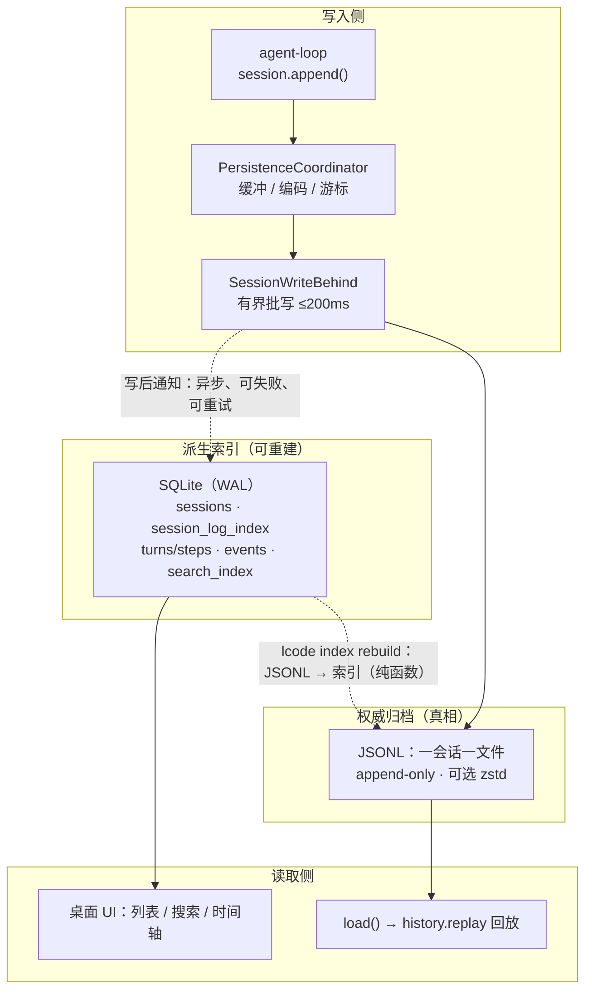
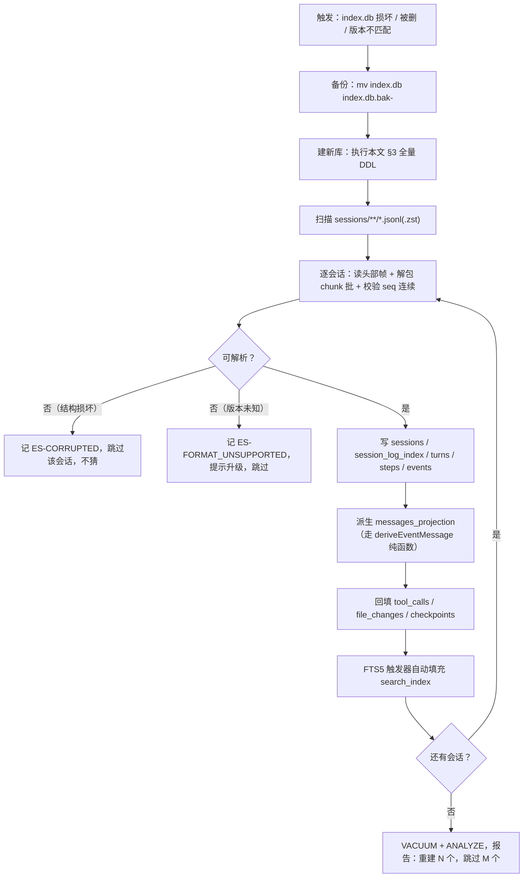

# 22 · 数据字典与 DDL

> 这篇文档回答：**Lcode 的每一张表、每一个字段、每一个枚举，长什么样、取值域是什么、为什么这么定。**
> 它是 [11-数据模型与持久化设计.md](./11-数据模型与持久化设计.md) 的**可执行落地版**——`11` 讲"存在哪、什么格式、怎么恢复"，本文把它变成**可直接粘贴执行**的 SQLite DDL 与字段字典。给内核研发、持久化研发、测试与插件作者看。

| 项 | 值 |
|---|---|
| 状态 | 草案 |
| 负责人 | 内核研发（持久化方向） |
| 上游依赖 | [00-文档总览与全局约定.md](./00-文档总览与全局约定.md)（§6 术语表、D4/D5/D12/D17/D18/D19/D22）· [11-数据模型与持久化设计.md](./11-数据模型与持久化设计.md)（**最重要依据**）· [06-会话事件日志与可重放设计.md](./06-会话事件日志与可重放设计.md) · [12-安全权限与沙箱模型.md](./12-安全权限与沙箱模型.md) · [13-插件SDK与协议设计.md](./13-插件SDK与协议设计.md) · [18-模型接入与供应商配置.md](./18-模型接入与供应商配置.md) · [21-接口契约与错误码总表.md](./21-接口契约与错误码总表.md) |
| 下游被引 | **已接线**：`session-persistence-sqlite` / `session-persistence-jsonl` / `settings-file`（`settings_kv` 同在 `index.db`）· `lcode index rebuild` / `doctor --index` / `doctor --storage` |

> **读法**：查阅型规格。建库看 §3；写日志编码器看 §4；查**事件** `data` 字段看 §5；查枚举看 §6；实现迁移看 §8。
> **术语一律以 [00 §6](./00-文档总览与全局约定.md#6-术语表) 为准**：会话 / 轮 / 步 / 表面 / 表面操作 / 派生 / 种子 / 接缝 / 服务 / 事件 / 副作用 / 撤销器 / 瀑布 / 守卫 / 作用域 / 规范值 / 卡片 / 预设 / 集束 / 配置档 / 时间轴 / 检查点 / 代码模式 / 模型可见即可重放 / 模型选择 / 适配器 / 凭据引用。

## 目录

- [1. 存储总览](#1-存储总览)
- [2. 本地目录布局](#2-本地目录布局)
- [3. SQLite 全量 DDL](#3-sqlite-全量-ddl)
- [4. JSONL 事件日志的物理编码](#4-jsonl-事件日志的物理编码)
- [5. 事件 data 字段字典](#5-事件-data-字段字典)
- [6. 枚举附表](#6-枚举附表)
- [7. 字段与类型规范](#7-字段与类型规范)
- [8. 迁移与版本](#8-迁移与版本)
- [9. 容量与保留](#9-容量与保留)
- [未决问题](#未决问题)
- [变更记录](#变更记录)

---

## 1. 存储总览

### 1.1 职责边界

D12：**SQLite（索引 / 查询 / 全文搜索）+ JSONL（**会话**日志的权威归档）**，职责**不重叠**，且 **JSONL 是真相**（[11 §2](./11-数据模型与持久化设计.md#2-存储分层)）。

| 维度 | SQLite（`index.db`） | JSONL（`sessions/**/*.jsonl`） |
|---|---|---|
| 角色 | 索引、元数据、查询、全文搜索 | **会话**日志的**权威归档** |
| 谁写 | `session-persistence-sqlite` | `session-persistence-jsonl` |
| 时机 | write-behind，异步、可重试、**可丢** | 批写提交，持久屏障后视为权威 |
| 能重建吗 | **能**：`lcode index rebuild` | **不能**：丢了就是丢了 |
| 一致性 | 最终一致（允许落后） | **会话**内强一致（`seq` 连续） |
| 用途 | "有标题含『登录』的**会话**吗" | "把**会话** #42 完整重放出来" |
| 损坏后果 | 重建索引，数据无损 | 数据损失，按 [11 §6](./11-数据模型与持久化设计.md#6-崩溃恢复契约) 抢救 |

**三条硬性推论**：① 不允许"只在 SQLite 里有、JSONL 里没有"的**事实**——一切可重放**事实**先落 JSONL；② SQLite 允许丢原始流（`supportsRawArtifacts = false`，不存 chunk）与精度；③ **删掉 `index.db` 永远安全**，这是可检验判据，也是 CI 门禁。

### 1.2 写入路径与读取路径



*这张图想让你看到：**唯一的箭头从 JSONL 指向 SQLite**；SQLite 永远可从 JSONL 重建，反向不成立；UI 的"找到它"走 SQLite，回放的"完整重建它"走 JSONL。*

| 请求 | 走哪条 | 例子 |
|---|---|---|
| 列表 / 搜索 / 计数 / 定位 | **SQLite** | `sessions.list`、时间轴骨架 |
| **模型可见即可重放** / 分叉 / 导出 | **JSONL** | `history.replay`、`sessions.fork`、`sessions.export` |

> write-behind 更新索引失败**不阻塞****会话**（[11 §5.4](./11-数据模型与持久化设计.md#54-写失败回滚与退避)）；下次启动以 `sessions.log_revision` 与真实文件比对，不一致即增量重索引。

### 1.3 从 JSONL 重建 SQLite



*这张图想让你看到：重建**只丢弃单会话**，其余照常；两条错误路径**不猜、不降级解析**，与 [11 §8.1](./11-数据模型与持久化设计.md#81-格式版本策略未知版本报错不尽力解析) 一致。*

```sh
rm -f "$LCODE_HOME"/index.db "$LCODE_HOME"/index.db-wal "$LCODE_HOME"/index.db-shm
lcode index rebuild                       # 全量重建（安全，因为 SQLite 可丢）
lcode index rebuild --session <id>        # 局部：一个会话
lcode index rebuild --workspace /repo/web # 局部：一个工作区
lcode index rebuild --check               # 只体检：报告哪些可重建、哪些损坏/版本未知
lcode doctor --index                      # 比对每会话 log_revision 与真实文件
```

**重建不做的三件事**：① 不"修补"损坏的**会话**日志（只读 JSONL，修补属 [11 §6](./11-数据模型与持久化设计.md#6-崩溃恢复契约) 的 `load()` 路径）；② 不从 SQLite 反推 JSONL（反向不成立）；③ 不对未知 `formatVersion` 尽力解析。

---

## 2. 本地目录布局

### 2.1 目录树与权限位

目录树定义在 [11 §3](./11-数据模型与持久化设计.md#3-本地目录布局)；本节补齐**权限位**与**保留策略**。

```
Lcode Home/                              0700  (POSIX)
├── sessions/                            0700
│   ├── <workspace-key>/                 0700   workspace-key = 规范化 cwd 的 16 hex 短哈希
│   │   ├── <session-id>.jsonl           0600   未压缩：活跃或近期会话
│   │   └── <session-id>.jsonl.zst       0600   压缩归档：空闲 ≥ 30 天
│   └── _unknown/                        0700   无 cwd 的会话
├── index.db / -wal / -shm               0600   SQLite 索引（可重建）
├── plugins/<id>/<version>/              0700   已安装插件（package.json、dist/、lcode.json）
├── presets/{user,profiles}/             0700   预设（agent.cordis.yml）与配置档
├── skills/<skill-name>/SKILL.md         0600   技能
├── cache/{repo-map,lsp,web,spill}/      0700   一切可重建、可清空的派生数据
├── logs/{main.log,host-<pid>.log}       0600   应用自身日志（滚动 10MB × 5）
├── credentials/{refs.json,values.enc}   0600   凭据**引用**（值在 keychain；缺 keychain 时 values.enc 降级）
├── trash/<session-id>.jsonl.<ts>        0600   软删暂存（7 天后硬删）
├── settings.json                        0600   用户设置（仅引用，无明文密钥）
├── .env                                 0600   本机常规凭据来源（[18 §6.2](./18-模型接入与供应商配置.md#62-解析优先级credentials-local)）
└── trusted-workspaces.json              0600   工作区信任状态（[12 §10](./12-安全权限与沙箱模型.md#10-工作区信任模型)）
```

| 条目 | 权限位 | 保留策略 | 可删除 | 备注 |
|---|---|---|---|---|
| `sessions/` | `0700` / 文件 `0600` | **永不自动删除**；空闲 ≥ 30 天压 `.zst` | 否（仅用户显式） | **唯一不可重建** |
| `index.db*` | `0600` | 随**会话**增长；空闲 `VACUUM` | **是**（重建） | 可随时删 |
| `plugins/` | `0700` | 随安装 / 卸载 | 是（重装） | |
| `presets/` `skills/` | `0700` | 用户文件，同 git 管理 | 是（重写） | |
| `cache/` | `0700` | `repo-map` 7 天 / `lsp` 进程退出即清 / `web` 7 天 / `spill` 随**会话**；总上限 **2GB**，LRU | **是**（绝不影响正确性） | |
| `logs/` | `0600` | 10MB × 5 滚动 | 是 | 不是**会话**日志 |
| `credentials/` | `0700` / `0600` | 随凭据管理 | 是（需重配） | **只放引用**，值在 OS keychain |
| `trash/` | `0700` | 7 天后硬删 | 是 | |
| `settings.json` `.env` | `0600` | 随用户修改 | 是（重写） | 不含密钥明文 |

> **硬性约定**（承接 [11 §3](./11-数据模型与持久化设计.md#3-本地目录布局)）：`Lcode Home` 下**不允许**出现**会话**正文的明文副本（除 `sessions/` 与 `cache/spill/`）。
> **Windows**：NTFS 无 POSIX 权限位，用 ACL 表达"仅当前用户可读写"；`0600` 语义 = 关闭继承 + 仅 Owner 完全控制，**必须显式设置，不能默认继承父目录**。

### 2.2 三平台默认路径

| 平台 | 默认值 | 覆盖 | 备注 |
|---|---|---|---|
| macOS | `~/.lcode` | `LCODE_HOME` | 不用 `~/Library/Application Support`——**可导出**与 grep 友好优先 |
| Linux | `~/.lcode` | `LCODE_HOME` | 是否遵循 XDG 见未决问题 |
| Windows | `%USERPROFILE%\.lcode` | `LCODE_HOME` | 路径大小写不敏感（§7.3） |

`LCODE_HOME` **必须**可覆盖——CI 与测试依赖这一点。路径不含版本号，**跨版本稳定**。

---

## 3. SQLite 全量 DDL

> 可直接粘贴执行。目标：SQLite **3.43+**（Node 22 `node:sqlite` / `better-sqlite3` 均可）。
> 约定：时间一律 `INTEGER`（epoch ms，D18）；无损 JSON 一律序列化为 `TEXT`；布尔一律 `INTEGER`（0/1）。

### 3.0 连接前设与版本表

```sql
PRAGMA journal_mode = WAL;        -- 索引可丢，会话不可丢（11 §2）
PRAGMA synchronous  = NORMAL;     -- WAL 下足够安全，写放大可控
PRAGMA foreign_keys = ON;         -- 依赖外键级联清理，避免手工扫孤儿行
PRAGMA busy_timeout = 5000;       -- 多进程（desktop + CLI）并发写等待窗口
PRAGMA temp_store   = MEMORY;

CREATE TABLE IF NOT EXISTS schema_migrations (
  version    INTEGER PRIMARY KEY,           -- 单调递增的 SCHEMA_VERSION
  name       TEXT    NOT NULL,              -- 迁移名（可读，用于日志）
  applied_at INTEGER NOT NULL,              -- epoch ms
  checksum   TEXT    NOT NULL               -- 迁移脚本内容的 sha256（防篡改/防漂移）
);
-- 索引：version 已是 PK，无需额外索引。
```

| 字段 | 类型 | 约束 | 默认 | 说明 |
|---|---|---|---|---|
| `version` | INTEGER | PK | — | 等于该迁移完成后的 `SCHEMA_VERSION` |
| `name` | TEXT | NOT NULL | — | 如 `0012-add-sessions-log-bytes` |
| `applied_at` / `checksum` | INTEGER / TEXT | NOT NULL | — | epoch ms / sha256；checksum 不符即报错（§8.2） |

### 3.1 `sessions`

**职责**：**会话**元数据（列表、搜索、定位入口）。字段是 [11 §2](./11-数据模型与持久化设计.md#2-存储分层) 所列列的**超集**（新增当前**模型**、状态、日志字节数）。

```sql
CREATE TABLE IF NOT EXISTS sessions (
  session_id     TEXT    PRIMARY KEY,                 -- 全局唯一；agent 与会话共享同一 id（D17）
  workspace      TEXT,                                -- 工作区根，规范化绝对路径；无 cwd 为 NULL
  workspace_key  TEXT    NOT NULL,                    -- sessions/ 分桶名（16 hex）
  title          TEXT    NOT NULL DEFAULT '',
  created_at     INTEGER NOT NULL,                    -- epoch ms
  updated_at     INTEGER NOT NULL,                    -- epoch ms（最后一次 append）
  last_seq       INTEGER NOT NULL DEFAULT -1,         -- 已知最大 seq；零事件为 -1
  preset         TEXT,                                -- 预设名（agent.cordis.yml）
  model_provider TEXT,                                -- 当前模型的适配器 provider（L2 快照）
  model_name     TEXT,                                -- 当前模型的 model id
  status         TEXT    NOT NULL DEFAULT 'idle'
                 CHECK (status IN ('idle','busy','waiting-approval','error')),
  parent_session TEXT,                                -- 分叉来源；非分叉为 NULL
  seed_length    INTEGER NOT NULL DEFAULT 0,          -- 种子长度（分叉/恢复继承的事件条数）
  log_path       TEXT    NOT NULL,                    -- 相对 Lcode Home 的会话文件路径
  log_codec      TEXT    NOT NULL DEFAULT 'none' CHECK (log_codec IN ('none','zstd')),
  log_bytes      INTEGER NOT NULL DEFAULT 0,          -- 当前字节数（revision 的 size 分量）
  log_revision   TEXT,                                -- 上次索引时的 revision（11 §4.4）
  key_id         TEXT,                                -- 静态加密密钥标识；NULL = 未加密
  archived_at    INTEGER,                             -- 归档（压缩）时间
  deleted_at     INTEGER,                             -- 软删时间
  indexed_at     INTEGER,                             -- 上次索引时间；NULL = 尚未索引
  FOREIGN KEY (parent_session) REFERENCES sessions(session_id) ON DELETE SET NULL
);
-- 索引清单
CREATE INDEX IF NOT EXISTS idx_sessions_updated_at     ON sessions (updated_at DESC);            -- 列表首屏（最近更新）
CREATE INDEX IF NOT EXISTS idx_sessions_workspace_upd  ON sessions (workspace, updated_at DESC); -- 工作区分组列表
CREATE INDEX IF NOT EXISTS idx_sessions_alive          ON sessions (updated_at DESC)
  WHERE deleted_at IS NULL;                                                                     -- 部分索引：未软删
CREATE INDEX IF NOT EXISTS idx_sessions_parent         ON sessions (parent_session)
  WHERE parent_session IS NOT NULL;                                                             -- 分叉溯源（稀疏）
CREATE INDEX IF NOT EXISTS idx_sessions_archive_scan   ON sessions (archived_at, updated_at)
  WHERE deleted_at IS NULL AND archived_at IS NULL;                                             -- 保留策略扫描
```

| 字段 | 类型 | 约束 | 默认 | 说明 |
|---|---|---|---|---|
| `session_id` | TEXT | PK | — | 全局唯一（§7.2） |
| `workspace` / `workspace_key` | TEXT | 可空 / NOT NULL | NULL / — | 规范化绝对路径 / 分桶名 |
| `title` | TEXT | NOT NULL | `''` | 空串 = 未命名 |
| `created_at` / `updated_at` | INTEGER | NOT NULL | — | epoch ms |
| `last_seq` | INTEGER | NOT NULL | `-1` | `-1` = 零**事件**（`seq` 从 0 起） |
| `preset` / `model_provider` / `model_name` | TEXT | 可空 | NULL | L2 **模型选择**快照（[18 §2.1](./18-模型接入与供应商配置.md#21-分层与优先级)） |
| `status` | TEXT | CHECK | `'idle'` | 见 §6.2 |
| `parent_session` / `seed_length` | TEXT / INTEGER | FK 自引用 / NOT NULL | NULL / `0` | 与头部帧 `parentSession`/`seedLength` 一致（§4.1） |
| `log_path` / `log_codec` / `log_bytes` | TEXT/INTEGER | NOT NULL | —/`'none'`/`0` | 定位与增量重索引判据 |
| `log_revision` / `key_id` | TEXT | 可空 | NULL | [11 §4.4](./11-数据模型与持久化设计.md#44-revision-计算) / 加密标识 |
| `archived_at` / `deleted_at` / `indexed_at` | INTEGER | 可空 | NULL | 时间戳表达"何时"，`status` 表达"此刻"，二者正交 |

### 3.2 `session_log_index`

**职责**：JSONL 的**字节级定位索引**——"某个 `seq` 在文件哪一段"，让随机 seek 不必从文件头扫。

```sql
CREATE TABLE IF NOT EXISTS session_log_index (
  session_id   TEXT    NOT NULL,
  seq          INTEGER NOT NULL,        -- 记录覆盖的首个 seq
  seq_last     INTEGER NOT NULL,        -- 记录覆盖的最后一个 seq（单事件 = seq）
  kind         TEXT    NOT NULL CHECK (kind IN ('header','event','chunk-batch')),
  type         TEXT    NOT NULL,        -- 事件类型，或 'assistant/chunk/batch'
  byte_offset  INTEGER NOT NULL,        -- 相对文件起点的字节偏移
  byte_length  INTEGER NOT NULL,        -- 该记录的字节长度（含换行）
  created_at   INTEGER NOT NULL,        -- 索引行写入时间（非事件时间）
  PRIMARY KEY (session_id, seq),
  FOREIGN KEY (session_id) REFERENCES sessions(session_id) ON DELETE CASCADE
);
CREATE INDEX IF NOT EXISTS idx_log_index_type ON session_log_index (session_id, type);  -- 会话内按类型定位
CREATE INDEX IF NOT EXISTS idx_log_index_kind ON session_log_index (kind);               -- 容量分析采样
```

| 字段 | 类型 | 约束 | 说明 |
|---|---|---|---|
| `seq` / `seq_last` | INTEGER | PK 部分 / NOT NULL | 单**事件**：`seq_last = seq`；chunk 批：`seqFirst`/`seqLast` |
| `kind` | TEXT | CHECK | `header` / `event` / `chunk-batch` |
| `byte_offset` / `byte_length` | INTEGER | NOT NULL | 定位与懒读的凭据 |

> **与 [11 §2](./11-数据模型与持久化设计.md#2-存储分层) 一致**：`assistant/chunk` **不逐条**建行，只按**打包批**建一行（`kind='chunk-batch'`）。索引行数与"结构性 + 表面**事件** + chunk 批"同阶，不会因 chunk 泛滥反超日志。

### 3.3 `turns` / `steps`

**职责**：**轮**与**步**的边界索引（时间轴骨架、**检查点**判定依据）。

```sql
CREATE TABLE IF NOT EXISTS turns (
  session_id  TEXT    NOT NULL,
  turn        INTEGER NOT NULL,               -- 1 起编号
  start_seq   INTEGER NOT NULL,               -- turn/start 的 seq
  end_seq     INTEGER,                        -- turn/end 的 seq；NULL = 未闭合
  reason      TEXT,                           -- TurnEndReason.kind；未闭合为 NULL
  started_at  INTEGER NOT NULL,
  ended_at    INTEGER,
  steps       INTEGER NOT NULL DEFAULT 0,     -- 本轮的步数（冗余计数）
  tool_calls  INTEGER NOT NULL DEFAULT 0,     -- 本轮工具调用数（列表徽标）
  PRIMARY KEY (session_id, turn),
  FOREIGN KEY (session_id) REFERENCES sessions(session_id) ON DELETE CASCADE
);
CREATE TABLE IF NOT EXISTS steps (
  session_id  TEXT    NOT NULL,
  turn        INTEGER NOT NULL,
  step        INTEGER NOT NULL,               -- 1 起编号，轮内唯一
  start_seq   INTEGER NOT NULL,               -- step/start 的 seq
  end_seq     INTEGER,                        -- step/end 的 seq；NULL = 未闭合
  started_at  INTEGER NOT NULL,
  ended_at    INTEGER,
  model_provider TEXT,                        -- 本步实际使用的 provider（来自 request/header）
  model_name     TEXT,
  input_tokens   INTEGER,                     -- 来自 assistant/message.usage；缺失为 NULL（不是 0）
  output_tokens  INTEGER,
  PRIMARY KEY (session_id, turn, step),
  FOREIGN KEY (session_id, turn) REFERENCES turns(session_id, turn) ON DELETE CASCADE
);
CREATE INDEX IF NOT EXISTS idx_turns_open  ON turns (session_id) WHERE end_seq IS NULL;      -- 崩溃恢复：未闭合轮
CREATE INDEX IF NOT EXISTS idx_steps_open  ON steps (session_id) WHERE end_seq IS NULL;      -- 崩溃恢复：未闭合步
CREATE INDEX IF NOT EXISTS idx_turns_time  ON turns (session_id, started_at);                -- 时间轴刻度
```

| 字段 | 类型 | 约束 | 说明 |
|---|---|---|---|
| `start_seq` / `end_seq` | INTEGER | NOT NULL / 可空 | 边界**seq**；未闭合 = NULL |
| `reason` | TEXT | 可空 | `TurnEndReason`（§6.2） |
| `steps` / `tool_calls` | INTEGER | NOT NULL | 冗余计数，避免列表 `COUNT` |
| `model_provider` / `model_name` | TEXT | 可空 | 本**步**的**模型选择**（"为什么换了模型"追溯） |
| `input_tokens` / `output_tokens` | INTEGER | 可空 | 用量；缺失 = NULL（不是 0） |

### 3.4 `events`

**职责**：**可选投影表**，用于查询与回放定位。**不是真相**（真相是 JSONL），是"JSONL 的可查询镜像"，**可随时重建**。

```sql
CREATE TABLE IF NOT EXISTS events (
  session_id   TEXT    NOT NULL,
  seq          INTEGER NOT NULL,
  type         TEXT    NOT NULL,               -- 事件类型（§6.1）
  time         INTEGER NOT NULL,               -- epoch ms（D18）
  turn         INTEGER,
  step         INTEGER,
  call_id      TEXT,                           -- tool/call、approval/* 的关联键
  surface_op   TEXT    CHECK (surface_op IN ('append','replace')),
  repl_start   INTEGER,                        -- surface replace 的 start（表面位置）
  repl_end     INTEGER,                        -- surface replace 的 end（闭区间）
  ignorable    INTEGER NOT NULL DEFAULT 0,     -- 0/1；缺省不可跳过（06 §2.1）
  data_bytes   INTEGER,                        -- 该事件 data 的序列化字节数
  PRIMARY KEY (session_id, seq),
  FOREIGN KEY (session_id) REFERENCES sessions(session_id) ON DELETE CASCADE
);
CREATE INDEX IF NOT EXISTS idx_events_type ON events (session_id, type, seq);   -- 按类型定位（找最后一条 request/header）
CREATE INDEX IF NOT EXISTS idx_events_call ON events (session_id, call_id) WHERE call_id IS NOT NULL;  -- 调用/审批交叉
CREATE INDEX IF NOT EXISTS idx_events_turn ON events (session_id, turn, step);  -- 时间轴按轮/步取事件
CREATE INDEX IF NOT EXISTS idx_events_time ON events (session_id, time);        -- 时间窗口查询
```

| 字段 | 类型 | 约束 | 说明 |
|---|---|---|---|
| `session_id` / `seq` | TEXT / INTEGER | 复合 PK | 与 JSONL 的 `seq` 一一对应 |
| `turn` / `step` / `call_id` | INTEGER / TEXT | 可空 | 从 `data` 提取的结构归属（非所有**事件**都有） |
| `surface_op` / `repl_start` / `repl_end` | TEXT / INTEGER | CHECK / 可空 | 仅**表面****事件**非空（[06 §3.2](./06-会话事件日志与可重放设计.md#32-表面操作surfaceop)） |
| `ignorable` | INTEGER | NOT NULL | 0/1；默认**不可**跳过 |
| `data_bytes` | INTEGER | 可空 | 容量分析与"超大 payload 懒取"判断 |

> **本表不含 `assistant/chunk` 行**（[11 §2](./11-数据模型与持久化设计.md#2-存储分层)）：chunk 只在 `session_log_index` 里以**批**为单位出现。因此 `DELETE FROM events` 不损失任何**事实**。

### 3.5 `messages_projection`

**职责**：**派生**消息投影——把**表面****事件**投影成"模型看到的消息列表"（[06 §4](./06-会话事件日志与可重放设计.md#4-派生投影)），并记录被**表面操作** `replace` 覆盖者。**纯函数 `deriveEventMessage` 的物化结果。**

```sql
CREATE TABLE IF NOT EXISTS messages_projection (
  session_id      TEXT    NOT NULL,
  surface_index   INTEGER NOT NULL,            -- 表面位置（0 起），不是 seq
  seq             INTEGER NOT NULL,            -- 对应事件的 seq（replace 后不再单调）
  role            TEXT    NOT NULL CHECK (role IN ('user','assistant','tool')),
  block_kind      TEXT    NOT NULL,            -- 'text' | 'tool-call' | 'tool-result' | 'summary'
  summary         TEXT    NOT NULL DEFAULT '', -- 可见文本摘要（进 FTS 的就是它）
  text_bytes      INTEGER NOT NULL DEFAULT 0,
  replaced_by_seq INTEGER,                     -- 被哪条 surface replace 覆盖
  is_active       INTEGER NOT NULL DEFAULT 1,  -- 0 = 已被 replace 遮蔽
  created_at      INTEGER NOT NULL,
  PRIMARY KEY (session_id, surface_index),
  FOREIGN KEY (session_id) REFERENCES sessions(session_id) ON DELETE CASCADE
);
CREATE INDEX IF NOT EXISTS idx_messages_active ON messages_projection (session_id, surface_index)
  WHERE is_active = 1;                         -- 当前表面（UI 主查询）
CREATE INDEX IF NOT EXISTS idx_messages_seq    ON messages_projection (session_id, seq);  -- seq → 表面位置（FTS 回跳）
```

| 字段 | 类型 | 约束 | 说明 |
|---|---|---|---|
| `surface_index` | INTEGER | PK 部分 | **表面位置**，不是 `seq`（二者混淆是本子系统最易犯的错） |
| `seq` | INTEGER | NOT NULL | 对应**表面**节点的事件 `seq`；`replace` 后**不再单调** |
| `role` / `block_kind` | TEXT | CHECK / NOT NULL | `tool/result` 投影为 `tool` 角色消息 |
| `summary` | TEXT | NOT NULL | **可见文本**；空内容消息投影为空串（[06 §4.1](./06-会话事件日志与可重放设计.md#41-投影规则表) 的"空内容不进**派生**历史"） |
| `replaced_by_seq` / `is_active` | INTEGER | 可空 / NOT NULL | 血缘；**原始****事件****仍在 JSONL**，此处只标记"当前表面是否包含它" |

### 3.6 `tool_calls`

**职责**：工具调用的结构化索引（"为什么"面板、耗时统计、失败率、并发观测）。

```sql
CREATE TABLE IF NOT EXISTS tool_calls (
  session_id   TEXT    NOT NULL,
  call_id      TEXT    NOT NULL,
  seq          INTEGER NOT NULL,               -- tool/call 的 seq
  result_seq   INTEGER,                        -- tool/result 的 seq；NULL = 尚无结果
  turn         INTEGER NOT NULL,
  step         INTEGER NOT NULL,
  name         TEXT    NOT NULL,               -- 工具名
  args_digest  TEXT    NOT NULL,               -- **脱敏**摘要（哈希 + 安全白名单字段）
  args_bytes   INTEGER NOT NULL DEFAULT 0,
  status       TEXT    NOT NULL DEFAULT 'pending'
               CHECK (status IN ('pending','running','done','failed','denied','cancelled')),
  started_at   INTEGER,
  ended_at     INTEGER,
  duration_ms  INTEGER,                        -- ended_at - started_at
  error_code   TEXT,                           -- §6.6 的错误码；成功为 NULL
  result_bytes INTEGER,
  PRIMARY KEY (session_id, call_id),
  UNIQUE (session_id, seq),
  FOREIGN KEY (session_id) REFERENCES sessions(session_id) ON DELETE CASCADE
);
CREATE INDEX IF NOT EXISTS idx_tool_calls_name   ON tool_calls (session_id, name);       -- 工具次数/失败率
CREATE INDEX IF NOT EXISTS idx_tool_calls_status ON tool_calls (session_id, status)
  WHERE status IN ('failed','denied','cancelled');                                        -- 只看异常调用
CREATE INDEX IF NOT EXISTS idx_tool_calls_open   ON tool_calls (session_id)
  WHERE result_seq IS NULL;                                                                -- 崩溃恢复：未配对调用（I3）
CREATE INDEX IF NOT EXISTS idx_tool_calls_turn   ON tool_calls (session_id, turn, step);  -- 时间轴按步展开
```

| 字段 | 类型 | 约束 | 说明 |
|---|---|---|---|
| `call_id` | TEXT | PK 部分 | 与 JSONL 的 `tool/call.callId` 一致 |
| `seq` / `result_seq` | INTEGER | NOT NULL / 可空 | 无结果 = NULL（崩溃恢复前的正常态） |
| `args_digest` | TEXT | NOT NULL | **脱敏摘要**（如 `sha256:ab12…` + 白名单字段）；**原始参数只在 JSONL** |
| `status` | TEXT | CHECK | 见 §6.2 |
| `error_code` | TEXT | 可空 | §6.6 的错误码；**按码路由，不按文本**（[21 §1.4](./21-接口契约与错误码总表.md#14-破坏性变更规则)） |

> **为什么 `args_digest` 不存原始参数**：SQLite 是可丢的派生层，而参数**可能含敏感内容**（路径、token 片段、命令）。原始参数已在权威 JSONL 里（且经序列化器脱敏）；索引层再存一份纯属扩大暴露面。

### 3.7 `file_changes`

**职责**：本轮（**轮**）的变更集合。**从工具结果的 `presentationMeta` 派生，不是文件系统扫描**（[08 §8.4](./08-工具系统与执行流水线.md#84-diff-卡片的可重放)）。

```sql
CREATE TABLE IF NOT EXISTS file_changes (
  session_id   TEXT    NOT NULL,
  turn         INTEGER NOT NULL,               -- 该变更归属的轮
  path         TEXT    NOT NULL,               -- 工作区相对路径（规范化，§7.3）
  change_kind  TEXT    NOT NULL
               CHECK (change_kind IN ('add','modify','delete','rename')),
  additions    INTEGER NOT NULL DEFAULT 0,     -- + 行数
  deletions    INTEGER NOT NULL DEFAULT 0,     -- − 行数
  tool_call_id TEXT    NOT NULL,               -- 产生该变更的工具调用
  source       TEXT    NOT NULL DEFAULT 'presentation-meta'
               CHECK (source = 'presentation-meta'),
  seq          INTEGER NOT NULL,               -- 工具结果事件的 seq
  created_at   INTEGER NOT NULL,
  PRIMARY KEY (session_id, tool_call_id, path)
);
CREATE INDEX IF NOT EXISTS idx_file_changes_turn ON file_changes (session_id, turn);         -- 按轮取变更集合
CREATE INDEX IF NOT EXISTS idx_file_changes_path ON file_changes (session_id, path);         -- "这个文件被改过几次"
CREATE INDEX IF NOT EXISTS idx_file_changes_tool ON file_changes (session_id, tool_call_id); -- 从调用反查变更
```

| 字段 | 类型 | 约束 | 说明 |
|---|---|---|---|
| `turn` | INTEGER | NOT NULL | **必须带**：变更集合"按**轮**"展示（§3.14） |
| `path` / `change_kind` | TEXT | NOT NULL / CHECK | 工作区相对路径（跨平台 `/`）；`rename` 时 `path` 是新路径 |
| `additions` / `deletions` | INTEGER | NOT NULL | 行数统计，来自 diff hunks |
| `source` | TEXT | CHECK | **只允许 `presentation-meta`**——在表结构层面排除"文件系统扫描"作为来源 |

> **`source` 单一值的意义**：把"变更集合是可重放的**派生**"钉死在表结构里。将来若要支持"用户手动改的文件"，必须**新增**来源值并走 ADR——**不允许**悄悄混入扫盘结果（会破坏**模型可见即可重放**）。

### 3.8 `checkpoints`

**职责**：可回放 / 可分叉的**检查点**（通常是**轮**边界）。

```sql
CREATE TABLE IF NOT EXISTS checkpoints (
  session_id  TEXT    NOT NULL,
  seq         INTEGER NOT NULL,               -- 检查点对应的 seq
  kind        TEXT    NOT NULL
              CHECK (kind IN ('turn-end','step-end','session-end-seed','manual')),
  safe_fork   INTEGER NOT NULL DEFAULT 0,     -- 1 = 可安全分叉（不在未闭合轮内）
  label       TEXT,
  created_at  INTEGER NOT NULL,
  PRIMARY KEY (session_id, seq, kind),
  FOREIGN KEY (session_id) REFERENCES sessions(session_id) ON DELETE CASCADE
);
CREATE INDEX IF NOT EXISTS idx_checkpoints_fork ON checkpoints (session_id, seq)
  WHERE safe_fork = 1;                        -- 分叉候选点
```

| 字段 | 类型 | 约束 | 说明 |
|---|---|---|---|
| `kind` | TEXT | CHECK | `turn-end`（默认）/ `step-end` / `session-end-seed`（生命周期分界线）/ `manual` |
| `safe_fork` | INTEGER | NOT NULL | 1 可作 `sessions.fork` 的 `boundary`；0 表示切点在未闭合**轮**内，分叉报 `ES-FORK_BOUNDARY_INVALID`（[06 §7.2](./06-会话事件日志与可重放设计.md#72-三条硬约束)） |

### 3.9 `settings_kv` / `settings_effective`

**职责**：持久化用户设置，并记录**来源层**，使 UI 能回答"这个值哪来的"（[18 §2.2 D-3](./18-模型接入与供应商配置.md#22-三条分层纪律)、[21 §2.5](./21-接口契约与错误码总表.md#25-settings)）。

```sql
CREATE TABLE IF NOT EXISTS settings_kv (
  namespace    TEXT    NOT NULL,               -- 如 'model'、'ui'、'compaction'
  key          TEXT    NOT NULL,               -- 如 'default.maxTokens'
  value_json   TEXT    NOT NULL,               -- 无损 JSON 文本（§7.6）
  source_layer TEXT    NOT NULL CHECK (source_layer IN ('L2','L3','L4')),  -- 仅持久层
  scope        TEXT    NOT NULL DEFAULT 'user' CHECK (scope IN ('user','workspace','session')),
  scope_ref    TEXT    NOT NULL DEFAULT '',     -- workspace 路径 / session id；user 层为空串
  updated_at   INTEGER NOT NULL,
  PRIMARY KEY (namespace, key, source_layer, scope, scope_ref)
);
-- 合并结果视图：对每个 (namespace,key)，取优先级最高的持久层
CREATE VIEW IF NOT EXISTS settings_effective AS
SELECT namespace, key, value_json AS value, source_layer AS source
FROM (
  SELECT namespace, key, value_json, source_layer,
         ROW_NUMBER() OVER (PARTITION BY namespace, key
           ORDER BY CASE source_layer WHEN 'L2' THEN 1 WHEN 'L3' THEN 2 WHEN 'L4' THEN 3 ELSE 9 END
         ) AS rn
  FROM settings_kv
)
WHERE rn = 1;
CREATE INDEX IF NOT EXISTS idx_settings_ns    ON settings_kv (namespace, key);
CREATE INDEX IF NOT EXISTS idx_settings_scope ON settings_kv (scope, scope_ref);
```

| 字段 | 类型 | 约束 | 说明 |
|---|---|---|---|
| `namespace` / `key` | TEXT | PK 部分 | 命名空间 / 点分键 |
| `value_json` | TEXT | NOT NULL | 无损 JSON 文本 |
| `source_layer` | TEXT | CHECK | **只允许 L2/L3/L4**（持久层），见下 |
| `scope` / `scope_ref` | TEXT | CHECK / NOT NULL | `user` / `workspace` / `session`；`scope_ref` 存 workspace 路径或 session id，user 层为空串 `''` |

> **只有三层落盘**：L1（单次覆盖）是**内存**，L5（适配器组合基座）与 L6（schema 默认值）是**代码**（[18 §2.1](./18-模型接入与供应商配置.md#21-分层与优先级)）。故 CHECK **刻意不含** L1/L5/L6——写进去就是 bug。完整解析序 `L1 > L2 > L3 > L4 > L5 > L6`（**逐字段合并，不整块替换**，D19）；视图只合并持久层，L1/L5/L6 在解析器里叠加。`settings.get` 返回的 `source ∈ L1..L6` 是**最终来源**，可来自视图之外两层。

### 3.10 `credentials_refs`

**职责**：**凭据引用**（`credentialRef`）与记录（`CredentialKey`）的元信息。**绝不存明文值**（[12 §7](./12-安全权限与沙箱模型.md#7-凭据管理)、D22）。

```sql
CREATE TABLE IF NOT EXISTS credentials_refs (
  ref          TEXT    NOT NULL,               -- 引用名（如 'ANTHROPIC_API_KEY'）或记录 id（'k_01H8Z…'）
  ref_kind     TEXT    NOT NULL CHECK (ref_kind IN ('env-ref','record')),
  scope        TEXT    NOT NULL DEFAULT 'llm'
               CHECK (scope IN ('llm') OR scope LIKE 'plugin:%' OR scope LIKE 'sandbox:%'),
  backend      TEXT    NOT NULL CHECK (backend IN ('keychain','file-0600','env','session')),
  key_id       TEXT,                            -- OS keychain 条目 id；是值的**引用**，非值本身
  masked_hint  TEXT,                            -- 如 'sk-ant-…4f2a'，仅供确认"是哪一个"
  created_at   INTEGER NOT NULL,
  updated_at   INTEGER NOT NULL,
  last_used_at INTEGER,
  PRIMARY KEY (ref, scope)
);
CREATE INDEX IF NOT EXISTS idx_credential_scope     ON credentials_refs (scope, ref_kind);
CREATE INDEX IF NOT EXISTS idx_credential_last_used ON credentials_refs (last_used_at DESC)
  WHERE last_used_at IS NOT NULL;              -- "哪些凭据很久没用了"
```

| 字段 | 类型 | 约束 | 说明 |
|---|---|---|---|
| `ref` / `ref_kind` | TEXT | PK 部分 / CHECK | 引用名或记录 id；**语法互斥**（[18 §6.1](./18-模型接入与供应商配置.md#61-两个-key-空间)） |
| `scope` / `backend` | TEXT | CHECK | `llm` / `plugin:<id>` / `sandbox:<id>`；值的存放后端 |
| `key_id` | TEXT | 可空 | 指向 OS keychain 条目；**不是值** |
| `masked_hint` | TEXT | 可空 | 展示用掩码 |

> **本表没有、也永远不会有 `value` 列。** 这是**结构层面**的保证（[12 §7.3](./12-安全权限与沙箱模型.md#73-配置只放引用ui-只拿元信息)）。取值的唯一入口是进程内 `credentials.resolve(ref | key) → string`，**不生成 RPC 描述符**（[21 §2.6](./21-接口契约与错误码总表.md#26-credentials)）。

### 3.11 `plugins`

**职责**：已安装插件的记录与授权（[13 §3.5](./13-插件SDK与协议设计.md#35-插件清单lcodejson)、[12 §8.2](./12-安全权限与沙箱模型.md#82-安装时的权限提示与校验)）。

```sql
CREATE TABLE IF NOT EXISTS plugins (
  id               TEXT    NOT NULL,           -- 反向域名，全局唯一
  version          TEXT    NOT NULL,           -- semver
  manifest_hash    TEXT    NOT NULL,           -- lcode.json 的 sha256（权限确认的锚）
  content_hash     TEXT    NOT NULL,           -- 包内容整体 sha256（内容变化提示重新确认）
  permissions_json TEXT    NOT NULL,           -- 声明的权限（fs/network/spawn/env），无损 JSON
  contributes_json TEXT    NOT NULL DEFAULT '{}',  -- 自陈清单（tools/services/promptSections）
  enabled          INTEGER NOT NULL DEFAULT 0, -- 0 未启用 / 1 已启用（用户意图）
  install_path     TEXT    NOT NULL,           -- 相对 Lcode Home 的安装路径
  source           TEXT    NOT NULL CHECK (source IN ('builtin','local','market')),
  engines_lcode    TEXT    NOT NULL,           -- manifest.engines.lcode 的 semver range
  granted_at       INTEGER,                     -- 用户确认权限的时间；NULL = 尚未授权
  installed_at     INTEGER NOT NULL,
  activated_at     INTEGER,
  PRIMARY KEY (id, version)
);
CREATE INDEX IF NOT EXISTS idx_plugins_enabled ON plugins (enabled) WHERE enabled = 1;  -- 启动期读已启用插件
CREATE INDEX IF NOT EXISTS idx_plugins_source  ON plugins (source);
```

| 字段 | 类型 | 约束 | 说明 |
|---|---|---|---|
| `id` / `version` | TEXT | 复合 PK | 同 id 多版本共存（[13 §7.1](./13-插件SDK与协议设计.md#71-打包格式与安装路径)） |
| `manifest_hash` / `content_hash` | TEXT | NOT NULL | 内容变化 → 提示"请重新确认权限"（[12 §8.2](./12-安全权限与沙箱模型.md#82-安装时的权限提示与校验)） |
| `permissions_json` | TEXT | NOT NULL | **默认拒绝**：未声明即不可用 |
| `contributes_json` | TEXT | NOT NULL | 与运行时注册比对，不一致记 `plugin/undeclared` |
| `enabled` / `activated_at` | INTEGER | NOT NULL / 可空 | "用户意图开关"与"激活成功"是两件事 |
| `source` / `engines_lcode` | TEXT | CHECK / NOT NULL | 不满足 `engines` 即拒绝激活（`EX-INCOMPATIBLE`） |
| `granted_at` | INTEGER | 可空 | NULL = 权限未确认 |

### 3.12 `jobs`

**职责**：后台任务（`jobs.*`）。**运行态是活体、非持久的**（[21 §2.10](./21-接口契约与错误码总表.md#210-jobs)）；本表只存**结算快照**。

```sql
CREATE TABLE IF NOT EXISTS jobs (
  job_id        TEXT    PRIMARY KEY,
  kind          TEXT    NOT NULL,               -- 如 'build'、'index'、'fetch'
  label         TEXT    NOT NULL,               -- 展示标签（如 'pnpm build'）
  owner_session TEXT,                            -- 所属会话；NULL = 全局
  status        TEXT    NOT NULL DEFAULT 'running'
                CHECK (status IN ('running','stopping','completed','killed','failed')),
  progress      REAL,                            -- 0.0–1.0；未知为 NULL（不是 0）
  output_bytes  INTEGER NOT NULL DEFAULT 0,
  started_at    INTEGER NOT NULL,
  ended_at      INTEGER,
  error_code    TEXT,
  FOREIGN KEY (owner_session) REFERENCES sessions(session_id) ON DELETE SET NULL
);
CREATE INDEX IF NOT EXISTS idx_jobs_owner   ON jobs (owner_session, started_at DESC);
CREATE INDEX IF NOT EXISTS idx_jobs_running ON jobs (status) WHERE status IN ('running','stopping');
```

| 字段 | 类型 | 约束 | 说明 |
|---|---|---|---|
| `status` | TEXT | CHECK | `JobStatus`（[21 §2.10](./21-接口契约与错误码总表.md#210-jobs)） |
| `progress` | REAL | 可空 | `NULL` = "无法估计"——**不是 0**（§7.5） |
| `ended_at` | INTEGER | 可空 | NULL = 未结算；崩溃留下的 `running` 行在启动时**标记为 `killed`**（"发布即脱离"，不恢复） |

### 3.13 `search_index`（FTS5）与触发器

**职责**：**会话**全文搜索。**只有模型可见文本进 FTS**——避免把工具原始输出（可能是二进制噪声）塞进搜索（[11 §2](./11-数据模型与持久化设计.md#2-存储分层)）。

> **命名说明**：[11 §2](./11-数据模型与持久化设计.md#2-存储分层) 以 `fts_events` **泛指**这张虚表；本文作为 DDL 落地版将其定名为 `search_index`。二者指同一对象，**语义不冲突**，DDL 以本文为准。

```sql
CREATE VIRTUAL TABLE IF NOT EXISTS search_index USING fts5(
  text,                                        -- 被索引的可见文本
  session_id UNINDEXED,                        -- 便于过滤，不参与全文匹配
  seq        UNINDEXED,
  role       UNINDEXED,
  tokenize = 'unicode61 remove_diacritics 2'
);
-- 与 messages_projection 同步：只有「当前生效」且非空的消息进 FTS
CREATE TRIGGER IF NOT EXISTS trg_search_index_insert
AFTER INSERT ON messages_projection
WHEN NEW.is_active = 1 AND NEW.summary <> ''
BEGIN
  INSERT INTO search_index(rowid, text, session_id, seq, role)
  VALUES (NEW.rowid, NEW.summary, NEW.session_id, NEW.seq, NEW.role);
END;
CREATE TRIGGER IF NOT EXISTS trg_search_index_delete
AFTER DELETE ON messages_projection
BEGIN
  DELETE FROM search_index WHERE rowid = OLD.rowid;
END;
CREATE TRIGGER IF NOT EXISTS trg_search_index_update
AFTER UPDATE OF summary, is_active ON messages_projection
BEGIN
  DELETE FROM search_index WHERE rowid = OLD.rowid;
  INSERT INTO search_index(rowid, text, session_id, seq, role)
  SELECT NEW.rowid, NEW.summary, NEW.session_id, NEW.seq, NEW.role
  WHERE NEW.is_active = 1 AND NEW.summary <> '';
END;
-- 查询形状
-- SELECT session_id, seq, role, snippet(search_index, 0, '[', ']', '…', 12) AS hit
-- FROM search_index WHERE search_index MATCH ? ORDER BY rank LIMIT 50;
```

| 约束 | 说明 |
|---|---|
| **只有模型可见文本进 FTS** | 来源是 `messages_projection.summary`（`user/message` / `assistant/message` / `tool/result` 的可见文本） |
| **被 `surface replace` 遮蔽的消息不参与** | 触发器 `WHEN NEW.is_active = 1` 保证，语义与 UI 一致 |
| 软删**会话**是否参与 / `web` 正文是否索引 | 见未决问题；倾向：软删不参与；`web` 卡在安全（[12](./12-安全权限与沙箱模型.md)） |

### 3.14 为什么这么建

| 设计 | 理由 |
|---|---|
| **`events` 是投影，不是真相** | 真相是 JSONL。它是**纯函数 `JSONL → 行`** 的物化结果，故可 `DELETE` 后重建；**不保留原始 chunk**——chunk 进索引会让索引体积反超日志（[11 §2](./11-数据模型与持久化设计.md#2-存储分层)） |
| **`file_changes` 必带 `turn`** | 变更集合的唯一消费场景是"**按轮**展示"（"这一轮它改了什么"）。少了 `turn` 只能靠 `tool_call_id` 反查，多一次 join 且语义模糊；带 `turn` 后一条复合索引即出整轮。也正因是"按轮"语义，它**必须**是**派生**而非扫盘——扫盘给的是"盘上哪些文件变了"，与"这一轮改了什么"不是同一个问题 |
| **`settings_kv` 要记来源层** | 用户困惑头号来源是"我改了但没生效"（[18 §1.1](./18-模型接入与供应商配置.md#11-为什么这个环节值得单独一篇文档)）。记录 `source_layer` 才能在 UI 回答"来自：你在设置里选的"；只存合并值则**来源不可恢复** |
| **凭据表不能有值列** | 把"能不能看到值"做成**架构约束**而非代码纪律（[12 §7.3](./12-安全权限与沙箱模型.md#73-配置只放引用ui-只拿元信息)）。列不存在，任何"顺手存一份"都落库失败。取值入口只有进程内 `resolve()`，不进可序列化对象——这是 I7 可被自动验证的前提 |
| **`session_log_index` 按批不逐 chunk** | 行数与"结构 + 表面 + chunk 批"同阶，避免被 chunk 淹没，同时保留 byte offset 支持随机 seek |
| **`turns`/`steps` 冗余计数** | 列表与时间轴高频读，避免每次 `COUNT` 扫 `events`；重建时整体重算，无一致性风险 |

**我们不在 SQLite 里做什么**：不存原始流式 chunk（体积会反超日志）；不存工具参数原文（扩大敏感暴露面）；不存凭据值（架构红线 I7）；不存"只能从 SQLite 得到"的**事实**；不用触发器实现压缩/**表面操作**（**表面操作**是 JSONL 的追加语义，索引只能**镜像**结果）。

---

## 4. JSONL 事件日志的物理编码

> 本节是 [11 §4](./11-数据模型与持久化设计.md#4-会话日志格式) 的字段级落地，**不改变 `11` 的任何规则**。

### 4.1 一行记录的形状

一会话一文件、**一行一帧**（ndjson）；第 0 帧是**头部帧**，其后全是**事件**记录。

```json
{"kind":"file-header","formatVersion":1,"sessionId":"01J8FZ6Q2M4T0V7K9W3C5B8NDP","createdAt":1757491200000,"cwd":"/repo/web","parentSession":null,"seedLength":0,"codec":"zstd","keyId":null}
{"type":"tool/result","seq":7,"time":1757491201450,"data":{"turn":1,"step":1,"message":{"toolCallId":"call_a1","content":[{"type":"text","text":"…"}],"isError":false},"meta":{"card":"read","path":"src/auth.ts","totalLines":42}},"surfaceOp":"append","sourceEventSeqs":[6],"ignorable":false}
```

| 字段 | 类型 | 强制 | 取值域 | 说明 |
|---|---|---|---|---|
| `type` | string | 是 | §6.1 | 判别联合的判别式 |
| `seq` | number | 是 | ≥ 0 整数 | **等于 `log.length`**，连续不跳号（I2） |
| `time` | number | 是 | epoch ms | D18 |
| `data` | object | 是 | 无损 JSON | 见 §5；拒绝 BigInt/undefined/NaN/循环引用/Map/Set/Date/类实例（I5） |
| `surfaceOp` | string \| object | 仅**表面****事件** | `"append"` \| `{"op":"replace","start":N,"end":M}` | **压缩的唯一原语**（D5） |
| `sourceEventSeqs` | number[] | 否 | 更早的 `seq` 列表 | 血缘（[06 §6.2](./06-会话事件日志与可重放设计.md#62-保障二血缘sourceeventseqs)） |
| `ignorable` | boolean | 否 | `true` | 缺省即**不可跳过**（[06 §2.1](./06-会话事件日志与可重放设计.md#21-事件信封)） |

**两条不可妥协的编码规则**：① `seq` 必须连续，物理编码可自定义但 `load()` 必须还原出**完全相同的追加序列**；② 工具参数存**原始 JSON 字符串**，不存解析后对象（D9）。

### 4.2 连续 chunk 打包

`assistant/chunk` 数量最大（可达全部**事件**的 60–80%）。对**同一 `(turn, step)` 的极大连续 chunk 段**打包为一条记录（[11 §4.2](./11-数据模型与持久化设计.md#42-连续-chunk-打包)）：

```json
{"type":"assistant/chunk/batch","seqFirst":3,"seqLast":4,"time":1757491201000,"data":{"turn":1,"step":1,"chunks":[{"dt":0,"c":{"type":"reasoning-delta","text":"用户想"}},{"dt":20,"c":{"type":"reasoning-delta","text":"改签名"}}]}}
```

**还原是纯函数**：`seq = seqFirst + i`，`time = 批首 time + dt[i]`。因此 `load()` 得到的追加序列与逐条写入**完全一致**。

**为什么省约 60%**——省的是**每记录的固定键开销**，不是内容：

| 形态 | 单条（8 字节文本） | 100 条合计 |
|---|---|---|
| 逐条记录 | ≈ 125 B | ≈ 12,500 B |
| 打包后每条 | ≈ 47 B | ≈ 4,700 B |
| 打包批头 | （一次） | ≈ 130 B |
| **合计** | — | **≈ 4,830 B** |

压缩比 ≈ **61%**，预期区间 **45%–65%**（[11 §4.2](./11-数据模型与持久化设计.md#42-连续-chunk-打包)）。**打包不丢任何信息**，只换物理排布。

**算法要点**：只打包**极大连续段**（遇任何非 chunk **事件**即封口）；段长上限 **4096 条**；`dt` 为相对批首的整数毫秒差（同毫秒为 0）；被打包的 chunk **不携带** `surfaceOp`；解包后逐条 `seq` 必须重新连续（I2 在解包后校验）。

### 4.3 原子物化与 revision

**原子物化**仅用于"整文件重写"（创建、压缩归档、备份），**滚动追加不走物化**（[11 §4.3](./11-数据模型与持久化设计.md#43-原子物化)）：

```
1. 写临时文件 <target>.tmp-<pid>-<rand>   2. fsync(文件)   3. fsync(父目录，POSIX)
4. rename(<tmp>, <target>)   原子替换
```

| 平台 | 实现 |
|---|---|
| POSIX | `rename` 覆盖已存在文件是原子的 |
| Windows | `rename` **不覆盖**；走 `ReplaceFile`；退化路径（`Remove`+`Rename`）须**持锁 + 保留备份** |

**`revision`（廉价变更检测令牌，非内容哈希）**：`revision = ${dev}:${ino}:${size}:${mtimeNs}:${ctimeNs}`。Windows 无稳定 inode 时用 `dev:fileIndex:size:mtimeNs:ctimeNs`（`fileIndex` 来自 `GetFileInformationByHandle`）；时间戳不足则退到系统最高精度并**记录实际精度**；`revision` **不**用于完整性校验（导出/迁移另算 SHA-256，[11 §9.3](./11-数据模型与持久化设计.md#93-删除语义软删-vs-硬删)）。`sessions.log_revision` 存上次索引时的 `revision`，不一致即增量重索引，也是 `ES-LOG_MODIFIED_EXTERNALLY` 的判据。

### 4.4 撕裂尾记录的识别与丢弃

**只有最后一条**记录可因撕裂被丢弃（[11 §6.1 R1](./11-数据模型与持久化设计.md#61-四条规则)）：

| 情形 | 判定 | 处理 |
|---|---|---|
| **最后一条**：JSON 解析失败 / zstd 帧不完整 / 尾部截断 | 撕裂 | **丢弃**该条 |
| **非最后一条**不可解析 | 损坏 | `ES-CORRUPTED`——**报错，不猜** |
| 头部帧不可解析 | 损坏 | `ES-CORRUPTED`，提示导出抢救 |
| `formatVersion` 未知 | 版本 | `ES-FORMAT_UNSUPPORTED`，提示升级——**绝不尽力解析** |

> **判定顺序**：先读头部帧 → 校验 `formatVersion` → 逐行解包（含 chunk 批）→ **只有走到最后一条**时才判定撕裂。保证"中间坏行"不会被误当成撕裂尾。

---

## 5. 事件 data 字段字典

> 按**事件域**分组。定义以 [06 §2.2](./06-会话事件日志与可重放设计.md#22-事件词汇表) 与 [21 §4](./21-接口契约与错误码总表.md#4-事件契约索引) 为准；`06` 未覆盖者标注 **待 06 补充**。**不得与 `06` 矛盾。** 记号：✅ 必填 / ◻ 可选。

### 5.1 生命周期（session / turn / step）

| 事件 | 字段 | 类型 | 必填 | 含义 | 单位/取值域 |
|---|---|---|---|---|---|
| `turn/start` | `turn` | number | ✅ | **轮**编号 | ≥ 1 整数 |
| `turn/end` | `turn` | number | ✅ | **轮**编号 | ≥ 1 整数 |
| `turn/end` | `reason` | object | ✅ | 结束原因 | `TurnEndReason`（§6.2） |
| `step/start` / `step/end` | `turn` / `step` | number | ✅ | 所属**轮** / **步**编号 | ≥ 1 整数，步在轮内唯一 |
| `session/end-seed` | —（空载荷 `{}`） | object | ✅ | 生命周期分界线，含义由位置表达 | 恒为 `{}`（[11 §7](./11-数据模型与持久化设计.md#7-生命周期分界线sessionend-seed)） |

> `session/end-seed` 之前属于**种子**（上一世），之后属于本次生命周期（[06 §8](./06-会话事件日志与可重放设计.md#8-生命周期分界线)）；由 `session` 核心（**不是**插件）在**种子**注入后**立刻**追加。

### 5.2 模型交互

| 事件 | 字段 | 类型 | 必填 | 含义 | 单位/取值域 |
|---|---|---|---|---|---|
| `assistant/message` | `turn` / `step` | number | ✅ | 所属**轮** / **步** | ≥ 1 |
| `assistant/message` | `message` | object | ✅ | assistant 消息（含 provider/model 来源） | `AssistantMessage` |
| `assistant/message` | `usage` | object | ◻ | 用量 | `TokenUsage`（input/output/cacheRead…） |
| `assistant/message` | `interrupted` | `true` | ◻ | 流式被打断但有可见内容 | 仅当为真时出现 |
| `assistant/chunk` | `turn` / `step` | number | ✅ | 所属**轮** / **步** | ≥ 1 |
| `assistant/chunk` | `chunk` | object | ✅ | 流式片段 | `StreamChunk`（闭合联合） |
| `request/header` | `header` | object | ✅ | **请求快照** | `EpochHeader`（config/system/tools/adapterDefaults） |
| `request/header` | `reason` | string | ✅ | 为何新快照 | `RequestHeaderReason`（`new-epoch` / `continuation` …，**完整集合待 06 补充**） |
| `request/context` | —（`RequestContext`） | object | ✅ | 本轮生效的外部上下文来源清单 | 结构**待 06 补充**（[06 未决问题](./06-会话事件日志与可重放设计.md#未决问题)） |

> `assistant/chunk` 是纯日志**事件**，不进**表面**；`assistant/message` 记录**每一次**成功到达的适配器调用（**含内容为空者**），但空内容不进**派生**历史（[06 §4.1](./06-会话事件日志与可重放设计.md#41-投影规则表)）。

### 5.3 工具与审批

| 事件 | 字段 | 类型 | 必填 | 含义 | 单位/取值域 |
|---|---|---|---|---|---|
| `tool/call` | `turn` / `step` | number | ✅ | 所属**轮** / **步** | ≥ 1 |
| `tool/call` | `callId` / `name` | string | ✅ | 调用 id / 工具名 | 会话内唯一 / 注册表内名字 |
| `tool/call` | `arguments` | string | ✅ | **未解析的原始 JSON 字符串** | 原样保真（D9） |
| `tool/result` | `turn` / `step` | number | ✅ | 所属**轮** / **步** | ≥ 1 |
| `tool/result` | `message` | object | ✅ | 工具结果消息（user 角色） | `ToolResultMessage` |
| `tool/result` | `error` | object | ◻ | 失败信息 | `{ name: string; code: string }`（码见 §6.6） |
| `tool/result` | `meta` | object | ◻ | **可重放的 UI 元数据**（如 diff hunks） | `JsonValue`；由 `presentationMeta` 产生 |
| `approval/asked` | `callId` | string | ✅ | 请求所属调用 | 与 `tool/call.callId` 对应 |
| `approval/asked` | `action` / `basis` / `impact` | object | ✅ | 操作 / 依据 / 影响面 | 见 [12 §5.4](./12-安全权限与沙箱模型.md#54-审批展示内容规范) |
| `approval/decided` | `callId` | string | ✅ | 请求所属调用 | — |
| `approval/decided` | `result` | string | ✅ | 四结果之一 | `allowed-once` / `rejected` / `cancelled` / `unavailable`（§6.5） |

> **审批必须落盘**（[12 §5.5](./12-安全权限与沙箱模型.md#55-审批必须落盘为可审计事件)）：`asked` 与 `decided` 成对；悬挂的 `asked` 是崩溃恢复要处理的。`unavailable` **也要记录**——它是"被拒绝"的一种，不是"没发生"。`06 §2.2` 载荷为 `{ callId, action, basis, impact }`；[12 §5.5](./12-安全权限与沙箱模型.md#55-审批必须落盘为可审计事件) 另提 `requestId` / `askedAt` / `decidedAt`，合并入词汇表**待 06 补充**。

### 5.4 内容与表面

| 事件 | 字段 | 类型 | 必填 | 含义 | 单位/取值域 |
|---|---|---|---|---|---|
| `user/message` | `role` | string | ✅ | 角色 | 恒 `"user"` |
| `user/message` | `content` | array | ✅ | 内容块 | `ContentBlock[]`（text / image 等） |
| `user/message` | `id` / `source` | string / object | ◻ | 消息 id / 来源（用户/注入/压缩摘要） | `MessageSource`（开放） |
| `user/message` | `surfaceOp` / `sourceEventSeqs` | object / number[] | ◻ | **表面操作**（缺省 = `append`）/ 血缘 | 见 §4.1 |
| `todo/write` | `todos` | array | ✅ | **整表快照**（last-write-wins） | `TodoItem[]` |
| `plan/mode` | `active` | boolean | ✅ | 计划模式开关（**整值替换**） | `true` / `false` |

> `user/message` / `assistant/message` / `tool/result` 是**唯三**的**表面****事件**（[06 §3.1](./06-会话事件日志与可重放设计.md#31-表面的定义)）。压缩摘要以 `user/message` + `surfaceOp:{op:'replace',…}` 进入**表面**（[06 §3.3](./06-会话事件日志与可重放设计.md#33-replace-的三种用途)）。

### 5.5 压力与压缩

| 事件 | 字段 | 类型 | 必填 | 含义 | 单位/取值域 |
|---|---|---|---|---|---|
| `compaction/start` / `compaction/end` | `compactionId` | string | ✅ | 压缩会话 id | 唯一，`start`/`end` 成对 |
| `compaction/summary` | `compactionId` / `summary` | string | ✅ | 压缩会话 id / 摘要文本 | 与 `start` 对应 / 纯文本 |

> **括号型**：`start` … `end` 是一对"开/关括号"，其**孤儿判定依赖 `session/end-seed`**（[11 §7.2](./11-数据模型与持久化设计.md#72-解决方案)）——分界线之前的孤儿是"上一世残骸"，之后的是"正在进行"。**内核不补**这类括号（[11 §6.1 R3](./11-数据模型与持久化设计.md#61-四条规则)）。

### 5.6 审计与治理

| 事件 | 字段 | 类型 | 必填 | 含义 |
|---|---|---|---|---|
| `sandbox/profile` | `profile` / `mode` | string | ✅ | 生成的沙箱 profile 与档位（[12 §4.3](./12-安全权限与沙箱模型.md#43-macos沙箱配置文件)） |
| `sandbox/degraded` | `reason` | string | ✅ | 降级原因（平台机制不可用说明） |
| `plugin/undeclared` | `pluginId` / `capability` | string | ✅ | 插件注册了清单未声明的能力（[13 §3.5.1](./13-插件SDK与协议设计.md#351-manifest-字段约定)） |
| `plugin/incompatible` | `pluginId` / `engines` | string | ✅ | 内核版本不满足（[13 §7.4](./13-插件SDK与协议设计.md#74-插件版本与内核版本兼容性)） |
| `permissionPresets/preset` | `preset` + `sandboxMode` / `approvalPolicy` | string | ✅ | 权限**预设**名 + 两条权限轴实际值（§6.4；可审计性要求两条轴都留） |
| `workspace/trust` | `workspace` / `trust` | string | ✅ | 工作区信任状态变化（`trusted` / `untrusted`，[12 §10](./12-安全权限与沙箱模型.md#10-工作区信任模型)） |

> 上述**事件**的载荷以 [12](./12-安全权限与沙箱模型.md) / [13](./13-插件SDK与协议设计.md) 为准；`06 §2.2` 未声明其字段，**待 06 补充**到词汇表。

---

## 6. 枚举附表

> 新增取值必须同时更新本文与 [21 §6.2](./21-接口契约与错误码总表.md#62-错误码总表)。

### 6.1 事件类型全表

| 值 | 落盘 | 表面 | 含义 |
|---|---|---|---|
| `turn/start` / `turn/end` | ✅ | 否 | **轮**开始 / 结束 |
| `step/start` / `step/end` | ✅ | 否 | **步**开始 / 结束 |
| `user/message` | ✅ | **是** | 用户输入 / 注入 / 压缩摘要 |
| `assistant/message` | ✅ | **是** | 一次成功的适配器调用完成 |
| `assistant/chunk` | ✅ | 否 | 流式片段（原始流） |
| `tool/call` | ✅ | 否 | 工具调用（**执行前先落盘**） |
| `tool/result` | ✅ | **是** | 工具结果（含失败） |
| `request/header` / `request/context` | ✅ | 否 | **请求快照** / 外部上下文来源清单 |
| `session/end-seed` | ✅ | 否 | 生命周期分界线 |
| `todo/write` / `plan/mode` | ✅ | 否 | 待办整表快照 / 计划模式开关 |
| `approval/asked` / `approval/decided` | ✅ | 否 | 审批提问 / 决定 |
| `compaction/start` / `compaction/summary` / `compaction/end` | ✅ | 否 | 摘要压缩 |
| `sandbox/profile` / `sandbox/degraded` | ✅ | 否 | 沙箱审计 |
| `plugin/undeclared` / `plugin/incompatible` | ✅ | 否 | 插件审计 |
| `permissionPresets/preset` | ✅ | 否 | 用户切换权限**预设** |
| `workspace/trust` | ✅ | 否 | 工作区信任变化 |

定义来源：全部见 [06 §2.2](./06-会话事件日志与可重放设计.md#22-事件词汇表)（`session/end-seed` 另见 [11 §7](./11-数据模型与持久化设计.md#7-生命周期分界线sessionend-seed)；审计类另见 [12](./12-安全权限与沙箱模型.md) / [13](./13-插件SDK与协议设计.md)）。**插件可扩展**（`SessionEventMap` 声明合并，[06 §2.3](./06-会话事件日志与可重放设计.md#23-为什么-map-是开放的而流协议是闭合的)）；新增类型默认**不可跳过**。

> `agent/*`（`agent/status`、`agent/created`、`agent/disposed`、`agent/inbox/*`、`agent/pre-step` 等）是**控制状态**：进程内、**不落盘**、可合并，**不进 JSONL、不进 `events` 表**（[21 §4](./21-接口契约与错误码总表.md#4-事件契约索引)）。**想"从日志查 `agent/*`"是幻觉。**

### 6.2 会话 / agent / 工具调用 / 作业 状态

| 枚举 | 取值 | 含义 | 出现位置 |
|---|---|---|---|
| **会话状态** | `idle` / `busy` / `waiting-approval` / `error` | 空闲 / 跑**轮** / 等审批（`busy` 细分） / 上一轮错误 | `sessions.status`；对外汇报时 `waiting-approval` **归并为 `busy`** |
| **agent 状态** | `idle` / `running` | 空闲 / 运行中 | `agent/status`（**不落盘**、可合并，[10 §3.1](./10-桌面客户端设计.md#31-两类数据源不要混)） |
| **工具调用状态** | `pending` / `running` / `done` / `failed` / `denied` / `cancelled` | 未派发 / 执行中 / 成功 / 失败 / 被拒 / 取消 | `tool_calls.status`；外部 `tools.status` 只暴露前三者（[21 §2.3](./21-接口契约与错误码总表.md#23-tools)） |
| **作业状态** | `running` / `stopping` / `completed` / `killed` / `failed` | `JobStatus` | `jobs.status`（[21 §2.10](./21-接口契约与错误码总表.md#210-jobs)） |
| **`TurnEndReason`（部分）** | `{kind:'completed'}` / `{kind:'aborted'}` | 正常结束 / 崩溃恢复补的 `turn/end` | `turns.reason`、`turn/end`；**完整集合待 06 补充** |

> 软删 / 归档**不是**状态：由 `deleted_at` / `archived_at` 表达，与 `status` 正交。

### 6.3 卡片类型

| 值 | 含义 |
|---|---|
| `generic` / `terminal` / `diff` / `search` / `read` / `web` | 通用 / 终端 / 文件差异（含 hunks） / 搜索 / 文件读取 / 网页抓取 |

出现位置：`tool/result.meta.card`、[08 §8](./08-工具系统与执行流水线.md#8-ui-卡片)（[00 §6](./00-文档总览与全局约定.md#6-术语表)）。**卡片是"UI 渲染意图"，纯投影**（D8），**不是**内容替换/保密策略；`presentCall` 回退到 `generic` 时**不得抛错**。

### 6.4 权限预设与两条权限轴

| 轴 / 预设 | 取值 | 含义 |
|---|---|---|
| 轴一 `sandbox/mode` | `read-only` / `workspace-write` / `danger-full-access` | 工作区只读 / 工作区可读写（**默认**） / 全部路径 |
| 轴二 `approval/policy` | `ask` / `never` | 需要时向有应答者请求一次性批准 / **不问人**（不安全即 `deny`，**绝不等于默认允许**） |
| **预设** 只读 | `read-only` + `ask` | "它只能看，不能改" |
| **预设** 标准（默认） | `workspace-write` + `ask` | "能改我的项目，动手前问我" |
| **预设** 自动 | `workspace-write` + `never` | "工作区内自己干，不打扰我" |
| **预设** 完全访问 | `danger-full-access` + `ask` | "哪里都能碰，但动手前问我" |
| **预设** 无人值守 | `workspace-write` + `never` | 用于 CI / 自动化，配合最严**守卫** |

出现位置：`permissionPresets/preset`、`ResolvedSandboxPolicy`、UI（[12 §3](./12-安全权限与沙箱模型.md#3-三条正交的权限轴)）。**UI 只呈现预设，不暴露两条轴**（`SEC-AXES-001`），但"为什么"面板与日志**必须**展示两条轴实际值（[12 §3.4](./12-安全权限与沙箱模型.md#34-为什么不能合并成一个枚举)）。

### 6.5 审批结果四态

| 值 | 含义 | 工具侧后果 | 对应错误码 |
|---|---|---|---|
| `allowed-once` | 仅本次允许 | **执行**；`tool/result.meta` 带审批凭据 | — |
| `rejected` | 用户明确拒绝 | 不执行，写**类型化拒绝结果**（非崩溃） | `EP-APPROVAL_REJECTED` |
| `cancelled` | 问题作废（轮/会话取消） | 不执行，标记已取消 | `EP-APPROVAL_CANCELLED` |
| `unavailable` | 无人应答（fail-closed，D11） | **拒绝** | `EP-APPROVAL_UNAVAILABLE` |

出现位置：`approval/decided.result`（[12 §5.3](./12-安全权限与沙箱模型.md#53-四个结果)、[21 §2.4](./21-接口契约与错误码总表.md#24-approval)）。**只有 `allowed-once` 会导致执行**；`rejected` 与 `cancelled` 是**两个不同的事实，不得合并**。审批是 one-shot，内核**没有"记住这个选择"的状态位**（[12 §5.1](./12-安全权限与沙箱模型.md#51-一次性不存在永久允许)）。

### 6.6 错误码分类前缀（与 21 对齐）

| 前缀 | `category` | 域 | 命名空间 |
|---|---|---|---|
| `EC-` | `client` | 客户端 / 契约 | — |
| `ES-` | `session` | **会话**与日志 | `sessions.*` |
| `ET-` | `tool` | 工具执行 | `tools.*` |
| `EP-` | `permission` | 权限与审批 | `approval.*` |
| `EL-` | `model` | **模型**与供应商 | `model.*` / `credentials.*` |
| `EX-` | `plugin` | 插件 | `plugins.*` |
| `EF-` | `filesystem` | 文件系统 | `fs.*` |
| `EN-` | `network` | 网络与 I/O | — |
| `EM-` | `model-output` | **模型**输出 | — |
| `EJ-` | `job` | 后台作业 | `jobs.*` |

定义与完整码表见 [21 §6.2](./21-接口契约与错误码总表.md#62-错误码总表)。错误对象结构 `{ code, category, message, userMessage, retryable, details?, cause? }`（[21 §6.1](./21-接口契约与错误码总表.md#61-错误对象结构)）。`code`/`category` 的改动是**破坏性变更**；`tool_calls.error_code` / `jobs.error_code` 存的就是这里的 `code`（**按码路由，不按文本**）。

### 6.7 配置来源层（六层）

| 层 | 名称 | 存放位置 | 是否落 `settings_kv` | 优先级 |
|---|---|---|---|---|
| **L1** | 单次覆盖 | 内存（进程内） | **否**（内存） | 最高 |
| **L2** | 会话选择 | **会话**头（`SessionHeader.modelSelection`） | 是（`source_layer='L2'`） | ↓ |
| **L3** | 工作区 / **预设** | `presets/*.yml` | 是（`source_layer='L3'`） | ↓ |
| **L4** | 用户设置 | `Lcode Home/settings.json` | 是（`source_layer='L4'`） | ↓ |
| **L5** | 适配器组合基座 | 适配器 `apply()` 注册的 config | **否**（代码） | ↓ |
| **L6** | Schema 默认值 | 代码里的 schemastery 默认 | **否**（代码） | 最低 |

覆盖顺序 `L1 > L2 > L3 > L4 > L5 > L6`，**逐字段合并，不整块替换**（D19，[18 §2.2](./18-模型接入与供应商配置.md#22-三条分层纪律)）。`settings.get` 返回 `source ∈ L1..L6`（[21 §2.5](./21-接口契约与错误码总表.md#25-settings)）；UI 必须把 `L1–L6` 翻译成人类语言，**内部层级编号不得上界面**（[18 §10.2](./18-模型接入与供应商配置.md#102-e2-设置页的信息要求六项)）。

---

## 7. 字段与类型规范

### 7.1 时间：`epoch ms`

- 持久**事件**与 `created_at` / `updated_at` / `started_at` 等一律 **epoch 毫秒（`number`，整数）**（D18）；**时区不属于事实**，展示层才本地化。
- `Date` 对象**禁止**进入 `data`（I5）；入库前一律 `.getTime()`。
- 缺失时间用 `NULL`（SQLite）/ 键缺省（JSON），**不用 0 或 -1 冒充**（§7.5）。

### 7.2 id 形态与全局唯一性

| id | 生成规则 | 全局唯一性 |
|---|---|---|
| **会话 id**（`session_id`） | **ULID**（26 字符 Crockford Base32，时间有序）或等价时间有序随机 id | **全局唯一**；`agent` 与**会话**共享同一 id（D17） |
| **agent id** | **等于其**会话** id**（D17） | 同上；**不再有第二身份** |
| **事件 id** | **没有独立 id**——`seq` 即**事件**在**会话**内的稳定标识 | 复合唯一 `(session_id, seq)`（[06 §2.1](./06-会话事件日志与可重放设计.md#21-事件信封)） |
| **工具调用 id**（`callId`） | 适配器生成 | 复合唯一 `(session_id, call_id)` |
| **凭据记录 id**（`keyId`） | `k_` + 随机 | 全局唯一（[18 §6.1](./18-模型接入与供应商配置.md#61-两个-key-空间)） |
| **lookup id** | 宿主侧注册活体对象时分配（如 `ag_7f3a`） | 进程内唯一、随对象销毁失效（[13 §4.3](./13-插件SDK与协议设计.md#43-lookup-机制)） |

**统一规则**：id 是 **opaque 字符串**，消费方**不得**从 id 解析语义。`seq` 从 **0** 起；`last_seq = -1` 表示零**事件**。

### 7.3 路径规范化

| 维度 | 规则 |
|---|---|
| 形式 | 入库一律**绝对路径**，除非字段语义是"工作区相对"（如 `file_changes.path`） |
| 分隔符 | **统一用 `/`**；Windows 的 `\` 在入库前转换 |
| 大小写 | macOS/Windows 默认不敏感、Linux 敏感——比较以**真实大小写**为准，**不做**统一小写（会破坏 Linux） |
| 符号链接 | 解析到规范化形式；保留原始路径用于展示 |
| 日志路径 | `sessions.log_path` 存**相对** `Lcode Home` 的路径，以便整体迁移 |

### 7.4 字符串编码

- 一律 **UTF-8**、**不带 BOM**。
- JSONL 每行**不得含裸换行**（行内换行必须转义，[13 §5.1](./13-插件SDK与协议设计.md#51-传输ndjsonstdout-即协议)）。
- 不可信文本进入**模型消息**前必须**框架包裹 + 转义**（[12 §9.2](./12-安全权限与沙箱模型.md#92-框架包裹与转义)）；但**入库**存**转义前**的原文（转义是渲染策略，不是存储事实）。

### 7.5 `null` 与 `undefined` 的取舍

| 场景 | 用什么 | 理由 |
|---|---|---|
| "这个**轮**还没结束" | `null`（`end_seq`） | 显式缺失 |
| "已知没有值"（如零用量） | `0` | 与"未知"区分 |
| "未知 / 不适用"（如未知 `progress`） | `null` | **不用 0 冒充**，避免 UI 显示"已完成 0%" |
| JSON `data` 中的可选字段 | **缺省**（键不存在），**禁止** `undefined` | `undefined` 序列化后"键消失"，破坏无损（I5） |
| JSON `data` 中显式"我确认没有" | `[]` / `null` | `[]` 与缺失语义不同（[06 §6.2](./06-会话事件日志与可重放设计.md#62-保障二血缘sourceeventseqs)） |

### 7.6 事件 data 必须无损 JSON 序列化（不变量 I5）

**陈述**（[15 §2.5](./15-测试策略与质量门禁.md#25-i5--事件无损-json)）：所有**事件** `data` 必须能**无损**序列化为 JSON；`append` 必须在写入前**一次递归**完成"读取 + 校验 + 拷贝"（防有状态 getter 在两次遍历间返回不同值）。

**必须拒绝的类型**：`BigInt`（JSON 无对应类型）、`function` / `symbol`（不可序列化）、`undefined`（键会消失）、`-0` / `NaN` / `Infinity`（往返不等）、循环引用（无法序列化）、稀疏数组（`[]` 与 `[undefined]` 不可区分）、`Map` / `Set`（损失结构）、`Date`（违背 D18）、类实例（丢失原型）。违反返回 `EC-EVENT_NOT_JSON`（[21 §6.2](./21-接口契约与错误码总表.md#62-错误码总表)）。物化是**纯内存**的一次递归，**不得引入 I/O**（`append()` 同步返回、不 `await` 磁盘，[06 §5.3](./06-会话事件日志与可重放设计.md#53-热路径纪律)）。

---

## 8. 迁移与版本

### 8.1 `SCHEMA_VERSION`：单调递增

- `SCHEMA_VERSION` 是**单调递增整数**，与 `schema_migrations.version` 一一对应。
- **两套版本空间独立演进**：JSONL 的 `formatVersion`（§4.1）管"日志格式"；SQLite 的 `SCHEMA_VERSION` 管"索引结构"。
- 启动时读 `schema_migrations` 最大 `version`：等于 → 正常；小于 → 运行迁移（§8.3）；**大于 → 报错**，提示"索引由更新版本的 Lcode 写入"，**不尽力解析**。
- **索引版本高于程序时，正确动作是 `lcode index rebuild`**（索引可丢），而非让旧程序硬读新表。

### 8.2 未知版本：报错而非尽力解析

| 场景 | 行为 |
|---|---|
| `SCHEMA_VERSION` 高于本机 | 报错 + 提示 `lcode index rebuild`，**拒绝写入** |
| `schema_migrations.checksum` 与代码内常量不符 | 报错（脚本被篡改/漂移），**拒绝启动迁移** |
| 迁移中途失败 | 单事务回滚，`schema_migrations` 不推进 |

> **未知即报错的代价极低**：索引可丢，让用户重扫一次无损；反之，"看起来能跑"的旧程序悄悄写错数据代价极高。

### 8.3 迁移脚本形状（示例：新增一列 + 回填）

```ts
// packages/session-persistence/session-persistence-sqlite/src/migrations/0012.ts
export const version = 12
export const name = 'add-sessions-log-bytes'
export function up(db: Database): void {
  db.exec(`ALTER TABLE sessions ADD COLUMN log_bytes INTEGER NOT NULL DEFAULT 0;`)
  // 回填：读真实字节数；读不到的保持 0，下次增量重索引会修正（索引层允许暂时不准）
  const rows = db.prepare(`SELECT session_id, log_path FROM sessions WHERE log_bytes = 0`).all()
  const upd  = db.prepare(`UPDATE sessions SET log_bytes = ? WHERE session_id = ?`)
  for (const r of rows) {
    const bytes = statBytesBestEffort(r.log_path)     // 失败返回 -1
    if (bytes >= 0) upd.run(bytes, r.session_id)
  }
}
```

```sql
BEGIN IMMEDIATE;                     -- ① INSERT OR IGNORE 幂等防护 ② ALTER/UPDATE ③ 写入 schema_migrations
  INSERT OR IGNORE INTO schema_migrations (version, name, applied_at, checksum)
  VALUES (12, 'add-sessions-log-bytes',
          CAST(strftime('%s','now') AS INTEGER) * 1000, '<sha256>');
  -- ALTER TABLE / 回填 UPDATE 在此执行
COMMIT;
```

| 迁移硬性规则 | 说明 |
|---|---|
| **只增不改** | 优先 `ADD COLUMN` + 回填；**不**改列名/类型（SQLite 改列需重建表，风险高） |
| **可重入** | 以 `INSERT OR IGNORE` 起头，重复执行安全 |
| **单事务 + 回填尽力而为** | 失败整体回滚；回填读不到就留默认值，靠重索引修正 |
| **新列给默认值** | 一律非空默认，避免旧行出现 `NULL` 破坏读取 |
| **不改写 JSONL** | 索引迁移**只动 `index.db`**；**会话**日志迁移是 `lcode migrate`（[11 §8.3](./11-数据模型与持久化设计.md#83-迁移工具-lcode-migrate)），两条独立通道 |

### 8.4 `lcode migrate` 的行为

> 区分：`lcode migrate` 迁移**会话**日志（JSONL）；索引结构迁移在**启动时**自动进行（§8.3），不暴露为独立命令。

```
lcode migrate --check            # 只扫描、只报告，不写
lcode migrate <path|--all>       # 执行会话日志迁移
lcode migrate <path> --dry-run   # 输出将发生的变化摘要
lcode migrate --resume           # 续跑上次中断的迁移
lcode index rebuild              # 迁移后重建索引
```

| 规则 | 说明 |
|---|---|
| **前向变换** | 只做字段重命名、默认值补齐、编码换形（如逐条 chunk → 打包）；**不重新派生历史** |
| **迁移前必有备份** | `.bak-v<旧版本>`，工具输出备份路径 |
| **原子路径 + 可续跑** | 写 tmp → fsync → rename；每文件独立，`--resume` 跳过已完成 |
| **用户显式动作** | **不在启动时自动跑**（自动迁移会在用户不知情时改写其唯一权威数据） |

### 8.5 向下不兼容的窗口期策略

| 情形 | 策略 |
|---|---|
| 读**旧** `formatVersion` 的**会话**日志 | 最多**往前 2 个次版本**可迁移（[11 §8.2](./11-数据模型与持久化设计.md#82-不做向后兼容的窗口期)）；更旧：报错 + 手工指引 |
| 读**新** `formatVersion` | `ES-FORMAT_UNSUPPORTED`，提示升级——**不**尽力解析 |
| 索引版本不匹配 | `lcode index rebuild`（索引可丢） |
| **不做兼容读路径** | Lcode 不为旧格式维护兼容读路径，而是把旧格式**前向迁移** |

---

## 9. 容量与保留

### 9.1 单会话日志的体量估算

```
会话日志字节数 ≈ Σ_事件 ( 固定键开销 + data 长度 )
              ≈ 结构事件数 × ~120B + assistant/message 数 × ~350B
              + tool/call 数 × ( ~90B + arguments 长度 )
              + tool/result 数 × ( ~90B + 结果文本长度 )
              + Σ_chunk段 ( 批头 ~130B + 条数 × ( ~47B + chunk 文本长度 ) )
```

**例子**（"中等强度"编码**会话**：约 60 **步**、40 次工具调用、8 次大输出，[11 §9.1](./11-数据模型与持久化设计.md#91-单会话日志的预期体量)）：

| 组成 | 原始 JSONL（打包前） | 说明 |
|---|---|---|
| 结构**事件**（turn/step/boundary） | 30–80 KB | 条数多，单条小 |
| `assistant/chunk`（含思考） | **3–20 MB** | 主要体量来源；打包后降 45–65% |
| `assistant/message` + `tool/call` | 200 KB–1 MB | 参数存原始 JSON 字符串 |
| `tool/result` | **2–25 MB** | 读大文件、跑测试、diff 是大头 |
| **合计（打包前）/（`codec=zstd`）** | **≈ 5–45 MB / ≈ 1.5–12 MB** | 文本冗余度高，压缩比通常 3–4× |

**参考口径**：**日志膨胀率 = 会话日志字节数 ÷ 模型可见内容的字节数**（[00 §8.5](./00-文档总览与全局约定.md#85-数字口径约定)），预期 **1.5×–4×**——这是"可重放"的**代价**，用打包 + zstd 压到可接受区间。

### 9.2 索引体量

| 表 | 行数级 | 单行估算 |
|---|---|---|
| `sessions` | = **会话**数 | ~400 B |
| `session_log_index` | 结构 + **表面** + chunk 批 | ~60 B |
| `events` | 结构 + **表面****事件**（**不含** chunk） | ~120 B |
| `messages_projection` | **表面**节点数 | ~200 B + 摘要长度 |
| `tool_calls` / `file_changes` | 工具调用数 / 文件 × **轮** | ~200 B / ~120 B |
| `search_index`（FTS5） | **表面**节点数 | ~摘要长度 × 1.0–1.5 |
| **合计** | — | **约为日志的 3–8%** |

> **判据**：索引体积 **> 日志的 15%** 视为异常（多半是误索引了 chunk），可做成 CI 体检项。

### 9.3 自动保留策略

| 对象 | 策略 | 默认值 |
|---|---|---|
| **会话**日志 | **不自动删除**；空闲压缩 | 空闲 ≥ **30 天** → `.jsonl` 转 `.jsonl.zst` |
| 开放中的**会话** | 永不压缩 | resume 时先解压回 `.jsonl` |
| `cache/repo-map` | TTL + LRU | 7 天 / 单项 ≥ 50MB |
| `cache/web` / `cache/lsp` | TTL / 进程退出即清 | 7 天 / — |
| `cache/spill` | 随所属**会话** | **会话**硬删时一并清除 |
| `cache/` 总上限 | 全局 LRU | **2 GB** |
| `logs/` | 滚动 | 10 MB × 5 |
| `trash/` | 定时硬删 | 7 天 |

**总磁盘预算**（默认，可调）：`sessions/` **无硬上限**（用户数据，不设帽）；除 `sessions/` 外合计上限 **5 GB**，超出时按 LRU 清 `cache/`，仍超出则**提示用户**而非静默删**会话**（[11 §9.2](./11-数据模型与持久化设计.md#92-自动保留策略)）。

### 9.4 压缩归档

空闲 ≥ 30 天的**会话**：`.jsonl` → `.jsonl.zst`，走原子物化（§4.3）。**先打包再整体 zstd**（[11 未决问题](./11-数据模型与持久化设计.md#未决问题) 的倾向）；一文件一 `codec`，**不 per-record 混用**。`sessions.log_codec` / `log_bytes` / `log_revision` 随之更新。

**实现落地（2026-09-14，T6.2）**——以下四条是写代码时才明确下来的口径：

| 口径 | 取值 | 理由 |
|---|---|---|
| 空闲怎么判 | **文件 `mtime`**，不用 `sessions.updated_at` | `updated_at` 是索引里的**派生值**、可能落后或缺失；而"这个文件最近有没有被写"是文件系统的事实。索引可以被删掉重建，保留策略不该依赖它 |
| 读路径怎么认压缩件 | 看 **zstd 魔数**（`0xFD2FB528` 小端），**不看扩展名** | `.jsonl.zst` 被改名成 `.jsonl` 时，按扩展名判会去按明文解析，报一堆莫名其妙的"行解析失败"（§4.4 的不猜） |
| 什么时候解压还原 | **只在真要写入时**（`sessions.resume` / 追加 / 分叉） | 只读操作（`sessions.derive` / `list` / `meta`）若也触发还原，用户"看一眼列表"就会把压缩省下的磁盘重新吃掉——**实测确认过这个后果**，一次 `lcode sessions show` 就让 `.jsonl.zst` 变回 `.jsonl` |
| zstd 实现 | **WASM**（`@bokuweb/zstd-wasm`），不是原生模块 | 会话日志要同时被系统 Node 22（ABI 127）与 Electron 的 Node 20（ABI 130）读写，一份 `.node` 只能服务一个 ABI。实测两端往返一致、且与原生 `node:zlib` 的产物**互解**。详见 [24 §7.2.1](./24-数据层与接口实施计划.md) |

**压缩实测基线**（合成会话，只作量级参照，**不可外推**）：原始 40 KB → 打包后 21 KB → zstd 后 0.9 KB。合成数据重复度远高于真实日志；本文 §9.1 给的预期是"打包降 45–65%、zstd 再压 3–4×"，即合计约 6–10×。

### 9.5 软删 vs 硬删与"可导出"

| 操作 | 语义 | 实现 |
|---|---|---|
| **软删**（归档 / 删除） | 从列表隐藏，数据保留 | `sessions.deleted_at`；文件**不动** |
| **恢复** | 撤销软删 | 清空 `deleted_at` |
| **硬删** | 真正移除 | 文件移入 `trash/`（7 天）→ 到期删文件 + `index.db` 相关行 + `cache/spill` 条目 |
| **清空回收站** | 立即硬删 | 跳过 7 天窗口 |

**"可导出"原则**（产品宪法第二条）：**删除在任何情况下都先提示导出**（[11 §9.3](./11-数据模型与持久化设计.md#93-删除语义软删-vs-硬删)）：

```sh
lcode export <session-id> --format jsonl|md      # 单会话
lcode export --all --format jsonl --out ./backup # 全量
```

| 格式 | 内容 |
|---|---|
| `jsonl` | 逐帧原样（含头部帧），**可被 Lcode 重新导入** |
| `md` | 人类可读：按**轮**渲染消息、**卡片**摘要、**检查点**目录；**不含** chunk 级细节 |

导出时对每个文件计算 **SHA-256** 写入清单（`manifest.json`），供用户校验——这是"`revision` 不用于完整性"的补充。

**实现落地（2026-09-14，T6.2/T6.3）**：

- **`jsonl` 导出是字节级副本、不解析内容**：所以一个**损坏**的会话文件照样能导出（用户至少能抢救已解析的前缀），不会被 `skipped` 掉。**`md` 导出必须解析**，故损坏会话进 `skipped` ——这是两种格式的真实语义差，不是实现疏漏。`skipped` 也会写进 `manifest.json`，用户才知道"这次备份少了谁"。
- **`manifest.json` 的 `sha256` 必须与文件实际字节一致**（有测试逐文件比对）——这是"用户能自己校验备份"的全部意义所在。
- **硬删前必须先确认可导出**：`sessions.purge` 在 `exported !== true && force !== true` 时回 `EC-CONFLICT`（不是警告、是**拒绝执行**）。"提示"只有在真的拦住一次调用时才有意义。
- **硬删的动作顺序是「先移文件、后删索引行」**，不可颠倒：反过来的话，中途失败会留下"索引说会话没了、文件还在"的状态，用户再也找不到它；而"文件在回收站、索引还留着"是可恢复的。
- **`trash/` 的到期判定用条目自带的 `deleted_at`**（文件名里的 `trash/<session-id>.jsonl.<ts>`），**不用文件系统 `mtime`**。理由同 §9.4 的空闲判定：`now` 在应用里是可注入的，与墙钟 mtime 混用会让"7 天"在注入时钟下失效一个数量级。

**不在 JSONL 里的用户元数据**（`title` / `deleted_at` / `archived_at`）——**删库类操作前必须先保全**：

这三项只住在索引里（§3.1；JSONL 的头部帧 §4.1 不含它们）。而"`index.db` 可以随时删掉重建"说的是**派生数据**可丢，这三项是**用户输入**，一删就永久没了。因此 `lcode index rebuild` 在删库前先把它们读出来、重建后回填；投影的 UPSERT 也在"投影没带 title（空串）"时保留已有值（否则每次重投影都会把用户命名过的会话打回未命名）。
**将来再加这类字段（置顶、标签…）时照此办理。**

**数据库侧硬删顺序**（避免孤儿行）：

```sql
BEGIN IMMEDIATE;
DELETE FROM sessions WHERE session_id = ?;   -- 外键 ON DELETE CASCADE 级联清 session_log_index /
                                             -- turns / steps / events / messages_projection /
                                             -- tool_calls / checkpoints
COMMIT;                                      -- search_index 由触发器随 messages_projection 删除同步
-- file_changes 显式清理；jobs.owner_session 与 sessions.parent_session 为 SET NULL，保留关系记录
```

> **级联的取舍**：`session_log_index` / `turns` / `steps` / `events` / `messages_projection` / `tool_calls` / `checkpoints` 用 `CASCADE`（离开**会话**无意义）；`file_changes` 显式清理；`jobs.owner_session` 与 `sessions.parent_session` 用 `SET NULL`（不因删父**会话**而删分叉关系或作业记录）。

### 9.6 我们不做什么（保留与容量）

| 不做 | 为什么 |
|---|---|
| 自动删除用户**会话** | 违反"用户拥有自己的数据"；保留策略只做压缩归档，删除必须是用户显式动作 |
| 因空间不足静默删**会话** | 只能提示用户；清 `cache/` 允许，删**会话**不允许 |
| 跨设备同步 / 云备份 | 见 [00 §8.4](./00-文档总览与全局约定.md#84-团队协作不等于云端-saas) |
| 对"很旧的 chunk"做有损处理 | 破坏**可重放**；只有打包实测远不达预期时才重新评估 |

---

## 未决问题

- [x] **`search_index` 与软删/归档的关系（已定并落地，2026-09-14）**：**软删的会话不参与 FTS**。`fts.ts` 的查询侧加了 `JOIN sessions … AND sessions.deleted_at IS NULL`（`includeDeleted` 可选开启），有测试覆盖（软删后搜不到、恢复后又能搜到）。**注意**：归档（`archived_at`，即 §9.4 的压缩）**仍参与** FTS——归档只是文件形态变了，会话本身没被删除，用户理应还能搜到它。
- [ ] **`web` 卡片抓回的正文是否进 FTS**：索引增强搜索，但会把外部内容引入本地索引。卡在安全（[12](./12-安全权限与沙箱模型.md)）。
- [ ] **`events` 表是否保留**：既然 JSONL 是真相、`session_log_index` 已能定位，`events` 是"查询便利"还是"必要"？倾向保留（时间轴骨架依赖），需实测确认不与 `session_log_index` 冗余。卡在内核研发。
- [ ] **`TurnEndReason` 完整取值集合**：`completed` / `aborted` / `cancelled` / `interrupted` / `error` 已在代码里实现（`core/session/src/types.ts`），但**本文 §6.2 的表尚未回填**；`aborted` 由 T6.1 的崩溃恢复补记使用。待 06 定稿后回填 §6.2。
- [ ] **审批事件字段的最终形状**：`06 §2.2` 只给 `{ callId, action, basis, impact }`，`12 §5.5` 另提 `requestId` / `askedAt` / `decidedAt`。以谁为准并合入 `06` 词汇表？卡在内核研发。
- [ ] **`file_changes` 的 `rename` 语义**：`path` 只记新路径，旧路径放哪？倾向"前旧后新各一行 + 一个 `from_path` 列"，需定稿。
- [ ] **`sessions.status` 的 `waiting-approval` 是否独立**：当前作为 `busy` 细分；需确认 UI 是否需要独立状态点。卡在客户端设计（[10](./10-桌面客户端设计.md)）。
- [ ] **`settings_effective` 是否物化**：当前用视图实时计算；设置读写是低频，倾向不物化。卡在内核研发。
- [ ] **是否启用 SQLite `STRICT` 表**：本文未用（兼容性优先）。v1.0 锁到 SQLite ≥ 3.37 后是否全面启用？启用会让类型错误在写入时暴露。卡在内核研发。
- [ ] **`Lcode Home` 是否遵循 XDG**（`$XDG_DATA_HOME`）：当前固定 `~/.lcode`。卡在产品 + 客户端研发。
- [ ] **索引体检门禁**：§9.2 的"索引 > 日志 15% 即异常"是否进 CI？需先有基线数据。卡在质量负责人。
- [ ] **`credentials_refs.scope` 的 `LIKE` 约束**：SQLite 的 `LIKE` 在 `CHECK` 里的大小写敏感性与索引利用需实测；可能需拆成显式枚举。卡在内核研发。

---

## 变更记录

| 日期 | 版本 | 变更 | 说明 |
|---|---|---|---|
| 2026-09-14 | v0.4 | **T6.1–T6.4 落地：崩溃恢复 / 压缩归档 / 删除语义的实测口径** | 数据层实现到阶段 6 完成后，把"写代码时才明确"的口径回填进本文（**不改变任何 DDL**）：<br>① **§9.4 补 4 条实现口径**：空闲按**文件 mtime** 判（不用 `updated_at`，那是派生值）；读路径按 **zstd 魔数**而非扩展名识别压缩件；**解压还原只发生在真要写入时**（只读操作不得触发，否则"看一眼列表"就吃掉压缩省下的磁盘——实测确认）；zstd 走 **WASM** 而非原生模块（两端 ABI 不同）。<br>② **§9.5 补 5 条**：jsonl 导出是**字节级副本**（损坏文件也照导，md 才因需解析而进 `skipped`）；manifest 的 sha256 与文件字节逐一对得上；**硬删前必须确认可导出**（回 `EC-CONFLICT` 而非警告）；**硬删顺序是先移文件后删索引行**（反过来会留下用户再也找不到的会话）；`trash/` 到期判定用条目自带的 `deleted_at` 而非 mtime。<br>③ **§9.5 新增一条纪律**：**不在 JSONL 里的用户元数据（`title`/`deleted_at`/`archived_at`）在删库类操作前必须先保全**——"删库永远安全"说的是派生数据可丢，这几项是用户输入。`index rebuild` 现在删库前抢救、重建后回填。<br>④ **§未决问题**：`search_index` 与软删的关系**已定并落地**（软删不参与 FTS；**归档仍参与**——归档只是换形态，会话没被删）；`TurnEndReason` 的实际取值集合已实现，但 §6.2 的表**尚待回填**（标注清楚，不留模糊）。 |
| 2026-09-11 | v0.1 | 初稿 | 建立存储总览（JSONL 权威 / SQLite 可重建）、目录布局与权限位、SQLite 全量 DDL（15 张表 + 索引 + FTS5 触发器）、JSONL 物理编码（头部帧 / chunk 打包 / 原子物化 / revision / 撕裂尾）、事件 data 字段字典（六域）、枚举附表（事件类型 / 四种状态 / 卡片 / 权限轴与预设 / 审批四态 / 错误码前缀 / 六层配置）、字段与类型规范、迁移与版本、容量与保留。作为 [11-数据模型与持久化设计.md](./11-数据模型与持久化设计.md) 的可执行落地版，承接 D12/D17/D18/D19/D22，错误码与 [21](./21-接口契约与错误码总表.md) 对齐，不变量对齐 [15 §2](./15-测试策略与质量门禁.md#2-核心不变量测试i1i7) 的 I2/I3/I4/I5/I7。 |
