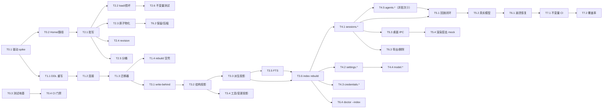

# 24 · 数据层与接口实施计划

> 这篇文档回答：**把 `packages/` 里那套骨架变成能跑的真实数据层与接口，按什么顺序做、每步的产出与验收判据是什么、彼此怎么依赖。**
> 它是**工程排期文档**，不是设计规格——设计的事实源仍是 [11-数据模型与持久化设计.md](./11-数据模型与持久化设计.md)（为什么这么存）与 [22-数据字典与DDL.md](./22-数据字典与DDL.md)（表长什么样）。本文与它们冲突时，**以 11 / 22 为准**。

| 项 | 值 |
|---|---|
| 状态 | **实施中**（阶段 0–6 完成 + 桌面端接线完成；余项见 §9） |
| 负责人 | 工程排期（内核 + 持久化方向） |
| 上游依赖 | [22](./22-数据字典与DDL.md)（DDL 事实源）· [11](./11-数据模型与持久化设计.md)（持久化设计）· [21-接口契约与错误码总表.md](./21-接口契约与错误码总表.md)（接口事实源）· [23 §14](./23-工程脚手架与开发规范.md#14-v01-的包初始化顺序)（批次顺序）· [06-会话事件日志与可重放设计.md](./06-会话事件日志与可重放设计.md) · [15-测试策略与质量门禁.md](./15-测试策略与质量门禁.md) |
| 下游被引 | `session-persistence-jsonl` / `session-persistence-sqlite` / `lcode index rebuild` / **桌面端 IPC（已接线）** |

## 目录

- [1. 先把前提说清](#1-先把前提说清)
- [2. 三个"库"分别是什么](#2-三个库分别是什么)
- [3. 现状盘点](#3-现状盘点)
- [4. 必须先修：骨架 DDL 与文档 22 的偏差](#4-必须先修骨架-ddl-与文档-22-的偏差)
- [5. 阶段任务清单](#5-阶段任务清单)
- [6. 依赖关系](#6-依赖关系)
- [7. 需要先拍板的决策](#7-需要先拍板的决策)
- [8. 建议的推进方式](#8-建议的推进方式)
- [9. 未决问题](#9-未决问题)
- [变更记录](#变更记录)

---

## 1. 先把前提说清

**Lcode 没有服务端，也没有 MySQL。** 这一节必须放在最前面，因为它决定了"数据表 + 后端接口"在这个项目里的确切含义。

| 常见预期 | Lcode 的实际形态 | 依据 |
|---|---|---|
| 独立后端服务（REST / gRPC） | **不存在**。全仓库已核对：无 express / fastify / koa / `createServer` | 本文 §3 实测 |
| MySQL / PostgreSQL | **不存在**。数据全在本机 `~/.lcode` | [22 §2](./22-数据字典与DDL.md#2-本地目录布局) |
| 表 = 业务实体 | 表 = **派生索引**，可随时删库重建；真相在 JSONL | [22 §1.1](./22-数据字典与DDL.md#11-职责边界) |
| "后端接口" = HTTP 端点 | "接口" = [21 §2](./21-接口契约与错误码总表.md#2-内部方法契约全表) 的**内部方法契约**（`sessions.*` / `agents.*` / …），落成进程内服务，再由 Electron 主进程经 IPC 暴露给渲染层 | [21 §1.1](./21-接口契约与错误码总表.md#11-三种边界) · [21 §2.13](./21-接口契约与错误码总表.md#213-ui-ipc-通道对照) |

**为什么必须是这个形态**：产品宪法里"用户拥有自己的数据"与"可导出优先"要求数据留在本机且格式可 grep（[22 §2.2](./22-数据字典与DDL.md#22-三平台默认路径)：不用 `~/Library/Application Support` 就是为了可导出）；[00 §8.4](./00-文档总览与全局约定.md) 明确"团队协作 ≠ 云端 SaaS"；[01 §10](./01-产品愿景与定位.md) 把云端同步列为非目标。

> **如果确实想要一个服务端（团队版、多人共享会话），那是一个需要先改 00/01/05 三篇文档的产品决策**，不是数据层的实现细节。建议先把本地数据层做扎实，服务端届时复用同一套契约（21 的边界设计本就为此留了口子）。

---

## 2. 三个"库"分别是什么

| # | 存储 | 角色 | 谁写 | 可删吗 | 本文对应阶段 |
|---|---|---|---|---|---|
| ① | `~/.lcode/sessions/**/*.jsonl`（空闲 ≥30 天后转 `.jsonl.zst`） | **会话日志 = 权威真相** | `session-persistence-jsonl` | **不可**（丢了就是丢了） | 阶段 2、6 |
| ② | `~/.lcode/index.db`（SQLite，15 表 + FTS5） | 派生索引：列表 / 搜索 / 定位 / 时间轴 | `session-persistence-sqlite`（write-behind） | **可以**，`lcode index rebuild` 重建 | 阶段 1、3 |
| ③ | `~/.lcode/settings.json` + `settings_kv` / `credentials/` | 用户设置（六层合并）与凭据**引用** | `settings-file` / `credentials-local` | 可（需重配） | 阶段 4 |

**"接入真实数据"因此是三条独立数据流**，不是一个开关：

1. **会话事件流**：agent-loop `append()` → 编码器 → JSONL（真相）→ write-behind → SQLite 投影
2. **设置流**：`settings.update` 写 L4 → `settings_kv` / `settings.json` → `settings.get` 按 `L1 > L2 > L3 > L4 > L5 > L6` **逐字段合并**返回生效值与来源层
3. **凭据流**：只落**引用**（`credentials_refs`，表里**没有也没有 `value` 列**），值进 OS keychain；取值唯一入口是进程内 `credentials.resolve()`

---

## 3. 现状盘点

实测（2026-09-14），避免按印象排期：

| 项 | 状态 |
|---|---|
| 批次①（`util` / `core/scope` / `core/session` 内存实现） | **已完成**。`core/session` 有 `SessionService` / `SessionHandle` / `InMemorySessionStore`（152 行）+ `session.test.ts`；`types.ts` 已含完整事件词汇表（26 个类型导出） |
| `session-persistence`（契约包） | **接口已定**：`SessionPersistenceService`（open/append/flush/load/verify/close/onExternalChange）+ `VerificationReport` |
| `session-persistence-jsonl` | ✅ **文件层已完成（T2.1–T2.6 + T6.1/T6.2）**：`SessionWriteBehind` 有界批写（≤200ms、flush 持久屏障、append 同步返回）、`loader` 撕裂尾/损坏判定（**按魔数透明解压 `.zst`**）、`atomic` 原子物化、`revision`、`spans` 记录级字节定位、`JsonlSessionPersistence`（契约实现）+ `findSessionFile`/`listSessionFiles`（**两种扩展名都认**）、**`recovery.ts` 崩溃恢复**（T6.1）、**`zstd.ts`/`archive.ts`/`retention.ts` 压缩归档**（T6.2） |
| `session-persistence-sqlite` | ✅ **索引层已完成（T1.1–T1.4、T3.1–T3.6）**：`ddl.ts` 已按 22 §3 重写（15 表 + 视图 + 3 触发器 + 5 pragma）、`db` 连接与 pragma、`migrations` 迁移器（checksum/版本守卫/单事务）、`rebuild` 建删库、`project` 投影纯函数、`index-writer` write-behind 通道、`index-rebuild` 全量重建（**删库前抢救索引侧用户元数据**）、`fts` 中文检索 |
| 其余 53 个包 | 骨架占位（`throw` / TODO）。**已实现的除外**：`settings-file` / `credentials-local`（批次④）· `llm-openai-compatible`（**真实的 OpenAI 兼容适配器**——DeepSeek / Ollama / vLLM / 自建网关都讲这套协议，所以收敛成一个实现，见 §10）· `fs-local` / `shell-local` / `sandbox-local`（批次⑤⑥）· `tool-fs` / `tool-shell`（六个工具）· `approval` / `permission-presets`（审批与权限判定）· `bundle/lcode-desktop`（桌面装配） |
| 测试 | ✅ **32 个测试文件 / 526 个用例全绿**（`pnpm test` 退出码 0）。数据层 19 文件见 v0.13 记录；批次④⑤⑥ 新增 13 文件：`llm-openai-compatible`（31）、`fs`/`fs-local`（10+24）、`shell-local`（13）、`sandbox-local`（8）、`approval`（16）、`permission-presets`（27+13）、`tool-fs`/`tool-shell`（12+10）、`lcode-desktop`（35） |
| 端到端冒烟 | ✅ **6 个真启动 Electron 的冒烟**（`apps/desktop/scripts/smoke-*.mjs`）：模型链路 / 多轮对话 / 失败可见 / **工具链** / **审批闭环** / **真实模型**（打真实 API，需 `LCODE_E2E_LIVE=1`）。它们验的是**接缝**——单测证明了每一层，而"层与层之间"只有真跑一次才看得见（§11 记了这类 bug 的完整清单） |
| 门禁脚本 | `scripts/check-invariants.mjs`（I6 关键词粗扫，**已有实现**）/ `check-deps.mjs`（**2026-09-14 修复**：兼容单层包目录布局的崩溃 bug；按 docs/24 T4.1 的装配层决策豁免 `packages/api/*` 与测试文件的实现包依赖）/ `check-size.mjs` / `bench.mjs` 均在；`docs/tools/check.py`（文档链接 + 原型自检）在 |
| CI | ✅ **已落地（2026-09-14）**：`.github/workflows/ci.yml` 跑六项——`typecheck` / `test` / `check:deps` / `check:invariants` / `check:docs` / `check:size`，另有一步 `better-sqlite3` 原生自检（**best effort**，不决定成败）。**范围取舍**：CI 不跑 Electron，故 docs/24 §7.1 的 **ABI 130 双构建**不在门禁内（那是本地/发布流程）；`better-sqlite3` 由 pnpm 白名单触发 `prebuild-install` 拉预编译产物，产物缺失时数据层测试**失败而非跳过**（宁可红，不静默跳过验收）。 |
| SQLite 驱动 | **已选定并落地**：`better-sqlite3@11.10.0` + 双份构建（Node ABI 127 / Electron ABI 130）+ `src/native.ts` 运行时选择；内置 SQLite 3.49.2（可 `STRICT`）。详见 §7.1 的 T0.1 实测结论 |
| 根 `typecheck` | ✅ **已修复（2026-09-14）**：`pnpm typecheck` 退出码 **0**。原 79 个错 / 34 个文件，按四类病根分别治理（见下方「类型检查修复记」） |
| 单包 `build` 脚本 | ⚠️ **不再视为问题**：`TS5097` 那一大批已随 `tsconfig.base.json` 统一开启 `allowImportingTsExtensions` + `noEmit` 而消除；`pnpm -r build` 仍红的 `TS2664` 是「模块增强目标解析到 `.ts` 源文件」的 TS 限制（`--traceResolution` 显示已成功解析）。**结论：本仓库源码即产物，逐包 `tsc` 产出无意义，门禁统一用根 `pnpm typecheck`** |

> **✅ 实施进度（2026-09-14）**：**阶段 0–3 已全部落地**（T0.1–T3.6）。`pnpm typecheck` 与 `pnpm test` 均退出码 **0**；两端原生探针（Node ABI 127 + Electron ABI 130）全绿。§5 各阶段表格里的「验收判据」列**均已满足**，且每条判据都有对应测试；三处**有意偏离**记录在 §4 第 15 项（FTS 中文检索）、T1.1（未启用 `STRICT`，跟随 22 §3）与 §9 已决项。

### 3.1 类型检查修复记（2026-09-14）

`pnpm typecheck` 原本 **79 个错 / 34 个文件 / 退出码 2**。四类病根，必须分开治（一把梭会误伤）：

| # | 类别 | 数量 | 病根 | 处置 |
|---|---|---|---|---|
| 1 | `TS5097` | ~60 | `tsconfig.host.json` / 各包 tsconfig **都没开** `allowImportingTsExtensions`，而源码普遍 `import './x.ts'` | `tsconfig.base.json` 统一开启 `allowImportingTsExtensions` + `noEmit`（本仓库是**源码即产物**：各包 exports 指向 `src/*.ts`，由 Vite/vitest/tsx 解析，无编译中间产物） |
| 2 | `TS1295` | 11 | `tsconfig.host.json` 把 `apps/desktop/electron/**`（CJS）当 ESM 检查 | 从 host 的 include 摘掉，归 `apps/desktop/tsconfig.electron.json`（并加进根 `typecheck` 脚本，避免漏检） |
| 3 | `TS2307` / `TS2664` | 7 | 5 个包**引用了没声明的 workspace 依赖**（`@lcode/tools` 少 `session`、`llm` 少 `session`+`agent-default-model` 等） | 补 `dependencies`（`workspace:*`）并 `pnpm install` 重建软链接 |
| 4 | 真实缺陷 | ~10 | 逐条改：CLI 的 `readonly` 选项被就地赋值、`exactOptionalPropertyTypes` 下传 `undefined`、未使用参数/导入、`LogFrame` 联合无法单字段辨识（补类型守卫）、**`SessionEvent` 不是可辨识联合**（改成按 K 分配的映射联合，`type` 才能收窄 `data`） | 见各文件内注释 |

其中 **第 4 类的 `SessionEvent` 是设计级修复**：原写法 `type SessionEvent = SessionEventEnvelope<SessionEventType>` 是「**一个**对象类型」，`type` 与 `data` 是彼此独立的属性，于是 `if (e.type === 'x') e.data.x` 无法收窄（会在 `packages/core/agent/src/store.ts` 报「Property 'turn' does not exist on UserMessage | …」）。改成 `{[P in K]: SessionEventEnvelope
}[K]` 后 `type` 成为判别式；因为 `SessionEventMap` 是开放接口（插件可声明合并新增事件），映射联合会**自动**纳入插件新增事件，不破坏 06 §2.2 的开放语义。

**仍未解决的 `TS2664`**（只影响 `pnpm -r build`，不影响 `pnpm typecheck`）：逐包编译时，`declare module '@lcode/context'` 这类**模块增强**报「Invalid module name in augmentation」，但 `--traceResolution` 显示该模块**已成功解析**到 `packages/core/context/src/index.ts`。即：解析没问题，是 TS 对「增强目标解析到 `.ts` 源文件」的处理限制。候选出路（三选一，T0.4 前定）：① 各包 tsconfig 里显式把依赖源码纳入 program；② 给包启用 `emitDeclarationOnly` 产出 `.d.ts` 让增强目标可解析；③ 承认 `pnpm -r build` 不是门禁、统一用根 `typecheck`。**倾向 ③**：本仓库本就源码即产物，逐包 `tsc` 产出无意义。

---

## 4. 必须先修：骨架 DDL 与文档 22 的偏差

`packages/session-persistence/session-persistence-sqlite/src/ddl.ts` 是**早期草稿**，注释虽写"以 22 §3 为准"，实际有 14 处偏差。[22 §3](./22-数据字典与DDL.md#3-sqlite-全量-ddl) 是**可执行落地版**、且明示"DDL 以本文为准"，因此这份 `ddl.ts` 需要**整体重写**而不是增量修补。

| # | 偏差 | 骨架现状 | 文档 22 要求 | 后果 |
|---|---|---|---|---|
| 1 | 版本表 | `schema_version(version, appliedAt, note)` | `schema_migrations(version, name, applied_at, checksum)` | 无 checksum → 无法检测迁移脚本漂移（[22 §8.2](./22-数据字典与DDL.md#82-未知版本报错而非尽力解析)） |
| 2 | `sessions` 缺 13 列 | 无 workspace / workspace_key / preset / model_provider / model_name / seed_length / log_path / log_codec / log_bytes / log_revision / key_id / archived_at / indexed_at | 全需 | **无法判断增量重索引**（缺 `log_revision`/`log_bytes`），无法定位日志文件 |
| 3 | `sessions.status` | `DEFAULT 'active'`，无 CHECK | `DEFAULT 'idle'` + CHECK 四值 | 与 [22 §6.2](./22-数据字典与DDL.md#62-会话--agent--工具调用--作业-状态) 枚举不符，UI 状态点会错 |
| 4 | `session_log_index` **语义不同** | 一会话一行（logPath/revision/eventCount/bytes） | 一记录一行：PK `(session_id, seq)` + kind/type/byte_offset/byte_length | 失去**字节级随机 seek** 能力，"回放到第 N 步"退化为从头扫 |
| 5 | `turns` / `steps` 缺列 | 只有 startedAt/endedAt/reason | 缺 `start_seq`/`end_seq`/`steps`/`tool_calls`/`model_provider`/`model_name`/`input_tokens`/`output_tokens` | 时间轴无法定位、**检查点判定**与崩溃恢复（未闭合轮）都做不了 |
| 6 | `events` 缺 8 列 | sessionId/seq/type/time | 缺 turn/step/call_id/surface_op/repl_start/repl_end/ignorable/data_bytes | 按类型/调用/轮次定位全部失效 |
| 7 | `messages_projection` 列名与语义 | `content` / `hidden` | `summary` / `text_bytes` / `replaced_by_seq` / **`is_active`** | FTS 触发器与"表面被 replace 遮蔽"的语义对不上 |
| 8 | **`tool_calls` 存原始参数** | `arguments TEXT NOT NULL` | **禁止**：应为 `args_digest`（哈希 + 白名单字段）+ status/duration_ms/args_bytes/result_bytes/error_code | 违反 [22 §3.6](./22-数据字典与DDL.md#36-tool_calls) 的安全取舍——索引层再存一份原始参数纯属扩大暴露面 |
| 9 | `file_changes` 缺列 | sessionId/seq/path/kind | 还缺 `turn`（**必须带**）/additions/deletions/tool_call_id/`source`（CHECK 只允许 `presentation-meta`） | 少了 `source` 就丢掉了"变更集合是可重放派生、不许扫盘"的**结构层保证** |
| 10 | `checkpoints` 缺列 | seq/label/kind | 缺 `safe_fork`/`created_at`，kind 枚举不同 | 分叉候选点无法判定（`ES-FORK_BOUNDARY_INVALID`） |
| 11 | `settings_kv` / `settings_effective` | 列名不符；`settings_effective` 建成了 **TABLE** | 需 `namespace`/`key`/`value_json`/`source_layer`(CHECK **仅 L2/L3/L4**)/`scope`/`scope_ref`；`settings_effective` 应为 **VIEW** | 来源层不可恢复 → UI 答不出"这个值哪来的"；表会被误写 |
| 12 | `credentials_refs` | 三列（refName/source/updatedAt） | 需 ref/ref_kind/scope(CHECK)/backend(CHECK)/key_id/masked_hint/last_used_at | |
| 13 | `plugins` / `jobs` 大量缺列 | 各 5–7 列 | plugins 需 hash×2 / permissions_json / contributes_json / source / engines_lcode / granted_at / activated_at；jobs 需 label/progress/output_bytes/ended_at/error_code | 权限确认锚点、作业进度都无处可放 |
| 14 | FTS 与触发器 | `search_index(sessionId UNINDEXED, content, role UNINDEXED)`；**只 1/3 触发器** | `search_index(text, session_id UNINDEXED, seq, role)` + `tokenize='unicode61 remove_diacritics 2'`；需 insert / delete / update **三个**触发器 | 中文检索质量与"遮蔽消息不进搜索"的语义都对不上 |

| 15 | **FTS 分词器对中文无效**（T0.1 实测） | 22 §3.13 指定 `tokenize='unicode61 remove_diacritics 2'` | 需改为「逐字预分词 + 前缀 AND」，或另定方案（见下） | **中文几乎搜不到**：`unicode61` 把连续汉字当成一个 token，查「解析」「测试」「通过」命中全为 **0**；`trigram` 只覆盖 ≥3 字，2 字词（中文高频）同样落空 |

另外缺 `PRAGMA temp_store = MEMORY`（22 §3.0）。

**第 15 项的实测数据**（脚本 `packages/session-persistence/session-persistence-sqlite/scripts/probe-sqlite.mjs`，文档内容 `把 parse.ts 换成结构化解析，测试全部通过`）：

| 方案 | 解析(2字) | 测试(2字) | 通过(2字) | 结构化(3字) | parse |
|---|---|---|---|---|---|
| A. `unicode61 remove_diacritics 2`（**22 §3.13 现状**） | 0 | 0 | 0 | 0 | 1 |
| B. `trigram` | 0 | 0 | 0 | 1 | 1 |
| **C. `unicode61` + 中文逐字预分词 + 前缀 AND** | **1** | **1** | **1** | **1** | 1 |

方案 C 零依赖（纯字符串切分，不需要分词库），覆盖全部查询长度；代价是索引体积变大（每字一个 token），需与 [22 §9.2](./22-数据字典与DDL.md#92-索引体量) 的「索引 < 日志 15%」门禁一起验证。**T3.5 定案前，DDL 的 FTS 部分不要照抄 22 §3.13。**

---

## 5. 阶段任务清单

规模标记：**S** ≈ 半天内、**M** ≈ 1–2 天、**L** ≈ 3 天以上（仅用于排序参考，不代表承诺）。

### 阶段 0 · 决策与地基（阻塞全部后续）

| 编号 | 任务 | 产出物 | 验收判据 | 依赖 | 依据 | 规模 |
|---|---|---|---|---|---|---|
| T0.1 | **SQLite 驱动选型 spike** ✅**已完成** | 结论见 §7.1（`better-sqlite3@11.10.0`，双构建 + `src/native.ts`）；产出 `src/native.ts` / `scripts/build-native.mjs` / `scripts/probe-sqlite.mjs` | 两端 `probe` 全绿（Node ABI 127 与 Electron ABI 130 各跑一次），含 FTS5 / STRICT / WAL / foreign_keys | 无 | §7.1 | S |
| T0.2 | `.lcode` Home 与路径解析 | `packages/util` 或独立包：`resolveLcodeHome()`（`LCODE_HOME` 可覆盖）、workspace-key（规范化 cwd 的 16 hex）、跨平台路径规范化（`\`→`/`，不对大小写做统一） | 测试可指定临时 `LCODE_HOME`，互不污染；Windows 上路径入库全为 `/` | T0.1 | [22 §2](./22-数据字典与DDL.md#2-本地目录布局) · §7.3 | S |
| T0.3 | 测试地基 | vitest workspace 配置（多包）、`pnpm -r test` 可跑、每个持久化包 1 个 smoke 测试 | `pnpm test` 全绿；新增包自动纳入 | 无 | [15](./15-测试策略与质量门禁.md) · [23 §10](./23-工程脚手架与开发规范.md#10-测试基建) | S |
| T0.4 | CI 门禁落地 ✅**已完成（2026-09-14）** | `.github/workflows/ci.yml`：typecheck + test + check:deps + check:invariants + check:docs + check:size（+ best-effort 原生自检） | workflow 存在且六步与 `package.json` 脚本一一对应；**本地逐条实跑通过**（CI 运行器上的结果需首次 push 后确认） | T0.3 | [23 §8.1](./23-工程脚手架与开发规范.md#81-门禁表) | S |

> **✅ T0.4 的前置条件已全部就绪**：`pnpm typecheck` 转绿（§3.1），`pnpm test` 也已退出码 **0**。原先那 **4 个既有失败**已逐条处理完毕，且都是**真问题**而非测试噪声：
> - `withTimeout` **压根没实现超时**——它只 `abort()` 了 signal，被调方不理会（如永不 resolve 的 Promise）就永远挂住，与自身文档「Promise 竞速」矛盾 → 补上竞速分支；
> - `surface.ts` 用 `else if` 串起「表面事件」与「replace 应用」两支，导致**表面事件自带的 replace 被整段忽略**（压缩摘要正是这种形态）→ `hidden` 永远为 false、I4 也永远查不出来；
> - `session.ts` 的 I4 只在派生时校验，`append()` 不拦 → 会写出**自己都派生不出来**的日志（`index rebuild` 会把整个会话判成损坏）→ 改为 append 时 O(1) 校验；
> - 「拒绝 NaN」用例**自身写错**（传的是字符串 `'x' as unknown as number`，压根没有 NaN）→ 改成真 NaN。

> T0.1 建议**第一个做**：它是唯一的"可能推翻方案"的点，半小时内能证伪，越早越好。

### 阶段 1 · DDL 与迁移（依赖 T0.1）

| 编号 | 任务 | 产出物 | 验收判据 | 依赖 | 依据 | 规模 |
|---|---|---|---|---|---|---|
| T1.1 | **按 22 §3 重写 `ddl.ts`** | 15 表 + 全部索引 + 3 触发器 + `settings_effective` 视图 + 5 条 pragma，逐条对照 §4 偏差表 | 建库后 `PRAGMA foreign_keys` 生效；FTS5 `MATCH` 能查到中文；`tool_calls` **没有** arguments 列 | T0.1 | [22 §3](./22-数据字典与DDL.md#3-sqlite-全量-ddl) | M |
| T1.2 | 连接与初始化 | 开库封装：pragma 按序执行、WAL、`busy_timeout`；单例复用 | 并发两进程（desktop + CLI）同时写不报 `SQLITE_BUSY` | T1.1 | 22 §3.0 | S |
| T1.3 | 迁移器 | `schema_migrations` 读写、checksum 校验、`version > 程序` 即**报错**、单事务回滚、`INSERT OR IGNORE` 可重入 | 构造"版本高于本机"的库 → 报错且**拒绝写入**；构造 checksum 不符 → 报错；迁移中途抛错 → 回滚 | T1.2 | [22 §8.2/§8.3](./22-数据字典与DDL.md#82-未知版本报错而非尽力解析) | M |
| T1.4 | 建库/删库脚本 | `lcode index rebuild` 的**空壳**（删库 → 建库），重建后无数据 | 删掉 `index.db*` 后可一键重建出空表结构 | T1.3 | [22 §1.3](./22-数据字典与DDL.md#13-从-jsonl-重建-sqlite) | S |

### 阶段 2 · JSONL 会话日志（权威真相；与阶段 1 并行）

| 编号 | 任务 | 产出物 | 验收判据 | 依赖 | 依据 | 规模 |
|---|---|---|---|---|---|---|
| T2.1 | 日志文件写入 | `SessionWriteBehind`：有界批写（≤200ms）、追加语义、`flush()` 持久屏障、`open()` 惰性创建（第 0 帧为头部帧） | `append()` **同步返回不 await 磁盘**；`flush()` 后另一进程能读到全部事件 | T0.2 | [11 §5.4](./11-数据模型与持久化设计.md#54-写失败回滚与退避) · [06 §5.3](./06-会话事件日志与可重放设计.md#53-热路径纪律) | M |
| T2.2 | `load()` 与损坏判定 | 头部帧校验 → 逐行解包（含 chunk 批）→ 最后一条才判撕裂；`ES-CORRUPTED` / `ES-FORMAT_UNSUPPORTED` | **杀掉进程后** `load()` 能返回；人为截断最后一行 → 丢弃且不报错；中间行损坏 → 报 `ES-CORRUPTED`（**不猜**） | T2.1 | [22 §4.4](./22-数据字典与DDL.md#44-撕裂尾记录的识别与丢弃) · [11 §6.1](./11-数据模型与持久化设计.md#61-四条规则) | M |
| T2.3 | 原子物化 | tmp → fsync(文件) → fsync(父目录) → rename；Windows 退化路径（`ReplaceFile` 或持锁 Remove+Rename） | 写入过程中断电模拟，目标文件要么是旧内容要么是新内容，**不会半截** | T2.1 | [22 §4.3](./22-数据字典与DDL.md#43-原子物化与-revision) | M |
| T2.4 | `revision` 计算 | `${dev}:${ino}:${size}:${mtimeNs}:${ctimeNs}`，Windows 用 `fileIndex`；精度不足时记录实际精度 | 内容不变 → revision 不变；追加一字节 → 变化；**不**用作完整性校验 | T0.2 | 22 §4.3 | S |
| T2.5 | 目录分桶与会话索引 | `sessions/<workspace-key>/<session-id>.jsonl`，无 cwd 落 `_unknown/`；codec 固定 `none`（zstd 推迟到阶段 6） | 同一 workspace 的会话落在同一桶；能按 sessionId 反查路径 | T2.1 | [22 §2](./22-数据字典与DDL.md#2-本地目录布局) | S |
| T2.6 | 不变量测试 | I1（往返一致）/ I2（seq 连续，含解包后）/ I5（无损 JSON 拒绝 BigInt/NaN/循环引用…） | 三个不变量各有独立测试且能故意失败（负例测试） | T2.1–T2.5 | [15 §2](./15-测试策略与质量门禁.md) · [22 §7.6](./22-数据字典与DDL.md#76-事件-data-必须无损-json-序列化不变量-i5) | M |

### 阶段 3 · SQLite 投影（依赖阶段 1 + 阶段 2）

| 编号 | 任务 | 产出物 | 验收判据 | 依赖 | 依据 | 规模 |
|---|---|---|---|---|---|---|
| T3.1 | write-behind 通道 | 有界队列 + 失败退避；写索引失败**不阻塞会话** | 注入索引写失败 → `append()` 仍成功；恢复后能补上 | T1.3 · T2.1 | [22 §1.2](./22-数据字典与DDL.md#12-写入路径与读取路径) | M |
| T3.2 | 元数据与结构投影 | 写 `sessions`（含 log_revision/log_bytes）、`session_log_index`（**含 byte_offset**）、`turns`、`steps`、`events` | 事件落盘后，各表行数与预期一致；`idx_turns_open` 能查出未闭合轮 | T3.1 | 22 §3.1–§3.4 | L |
| T3.3 | 派生投影 | `deriveEventMessage` 纯函数 → `messages_projection`（surface_index 与 seq 分离、`is_active`/`replaced_by_seq` 正确反映 `replace`） | 构造一次压缩 `replace` → 被遮蔽消息 `is_active=0`，且**事件仍在 JSONL** | T3.2 | [06 §4](./06-会话事件日志与可重放设计.md#4-派生投影) · 22 §3.5 | L |
| T3.4 | 工具与变更投影 | `tool_calls`（`args_digest` 脱敏 + status/duration/error_code）、`file_changes`（从 `presentationMeta` 派生，带 `turn`） | **断言：`tool_calls` 里查不到原始参数**；`file_changes.source` 恒为 `presentation-meta` | T3.2 | 22 §3.6/§3.7 | M |
| T3.5 | FTS 联调 | 3 个触发器 + **中文分词方案定案**（§4 第 15 项：逐字预分词 + 前缀 AND）；`sessions.list` 搜索可用 | 2 字与 3 字以上中文查询**都能命中**；被 `replace` 遮蔽的消息搜不到；索引体积仍 < 日志 15% | T3.3 | 22 §3.13（**但分词器需按 §4 第 15 项修正**） | M |
| T3.6 | **`index rebuild`** | JSONL → SQLite 全量重建（纯函数）、`--session` / `--workspace` / `--check` | **删库重建后，查询结果与重建前逐行一致**（这是 CI 门禁候选）；损坏会话记 `ES-CORRUPTED` 并跳过、不猜 | T3.2–T3.5 | [22 §1.3](./22-数据字典与DDL.md#13-从-jsonl-重建-sqlite) | L |

### 阶段 4 · 服务与接口（依赖阶段 3）

| 编号 | 任务 | 产出物 | 验收判据 | 依赖 | 依据 | 规模 |
|---|---|---|---|---|---|---|
| T4.1 | `sessions.*`（9 个） ✅ **已完成（2026-09-14）** | `create` / `resume` / `list` / `meta` / `fork` / `append` / `derive` / `flush` / `export`，含幂等语义与错误码。落在**新边界层包 `packages/api/session-api`**（骨架层不能依赖实现包、接口包不能含实现 → 集束与实现之间必须有一个装配层） | 24/24 单测全绿：`sessions.fork` 在未闭合轮边界报 `ES-FORK_BOUNDARY_INVALID`；`resume` 幂等 + `repaired` 标记；`export` 带 sha256 | T3.6 | [21 §2.1](./21-接口契约与错误码总表.md#21-sessions) | L |
| T4.2 | `settings.*` ✅ **已完成（2026-09-14）** | 六层合并解析器（逐字段合并）+ `settings_kv` 落盘（只存 L2/L3/L4）+ `settings.describe/get/update/watch`，落在 `@lcode/settings-file`。**原子写原语提到 `@lcode/util/fs-atomic` 子路径导出**（settings 与 jsonl 共用，util 主入口保持无 fs） | 17/17 单测全绿：同 key 在 L2/L4 各一份 → 返回 L2 值且 `source='L2'`；describe 永不返回凭据值 | T3.6 | [18 §2](./18-模型接入与供应商配置.md) · 21 §2.5 · 22 §3.9 | L |
| T4.3 | `credentials.*` ✅ **已完成（2026-09-14）** | `credentials_refs` + 0600 文件后端（keychain 不可用，`keychainAvailable()` 如实报 false）+ 四层层序解析（记录 → 项目 .env → Home .env → 环境变量带白名单），落在 `@lcode/credentials-local` | 13/13 单测全绿：**I7 泄露检测**（递归收集返回对象全部字符串、断言不含原值）；`listRefs` 类型无 `value` 字段；`resolve` 无缓存（改 .env 下一次立即生效）；`describeSource` 不更新 `last_used_at` | T3.6 | [12 §7](./12-安全权限与沙箱模型.md#7-凭据管理) · 21 §2.6 · 22 §3.10 | M |
| T4.4 | `model.*` ✅ **已完成（2026-09-14）** | `listProviders` / `listModels` / `probe` / `getDefault` / `setDefault` / `watchDefault`，落在**新边界层包 `packages/api/model-api`**。选择入口 = `ctx.agentDefaultModel`、执行入口 = `ctx.llm`（18 §3.1 两入口不混用，D21 不自动路由）；契约扁平形 ModelSelection ↔ core 嵌套 params 的换算在本层完成 | 10/10 单测全绿：**probe 六类归因永不抛错**（credential-rejected / endpoint-unreachable / model-not-found / timeout / provider-not-running / not-configured，注入故障逐一验证；未映射码归 endpoint-unreachable 且保留原始 code）；listModels 超时映射 `EN-TIMEOUT`；watchDefault 可重订阅 | T4.2 · 批次④ | 21 §2.7 · [18](./18-模型接入与供应商配置.md) | M |
| T4.5 | `agents.*` ✅ **已完成（2026-09-14）** | `create` / `resume` / `get` / `followup` / `steer` / `inject` / `cancel` / `watch` / `dispose`（9 方法），落在**新边界层包 `packages/api/agents-api`**，包装批次③循环的运行时句柄（`AgentLoopRuntime`）。**followup 只传入队回执**（`EnqueueReceipt`，21 §5.4 同义）；引擎为此新增 `enqueue()`（同步入队 + 回执 seq）与 `LoopHandle`；content 支持 ContentBlock[]（UserInput 扩展 content 变体；CancelReason 对齐 CancellationCause +parent/hook） | 14/14 单测全绿：**followup 回执 seq = user/message 的 seq**、watch 的 idle 事件带 seq（`idleSeq ≥ 回执 seq` 判据）；**inject 按 dedupe_key 幂等**（重复回**首次**回执，来源落 request/context）；**cancel 幂等**；**watch 可重订阅**（两独立流同收 running+idle）；未配置模型 → `EL-NO_MODEL_CONFIGURED` 入队前同步给出；idle 事件在 drain 完全收尾后广播（修复「看到 idle 却还不能 steer」竞态） | T4.1 · **批次③（`llm-replay` + `agent-loop`）** ✅ | 21 §2.2 | L |

> T4.5 是**跨批次的依赖**：`agents.*` 的实现依赖批次③把 `agent-loop` 从 `throw` 变成能跑。数据层可以先把 `sessions.*` 做完整，`agents.*` 与批次③合并推进。

### 阶段 5 · 真实数据接入（端到端；依赖阶段 4）

| 编号 | 任务 | 产出物 | 验收判据 | 依赖 | 依据 | 规模 |
|---|---|---|---|---|---|---|
| T5.1 | 无密钥回放闭环 ✅ **已完成（2026-09-14）** | `llm-replay` + `agent-loop` 跑通一次完整循环（含工具调用）→ 事件经持久化会话写穿 JSONL → `SessionIndexWriter` 投影 SQLite。接线：`session-api` 新增 `createPersistedSession`（泛型写穿转发）+ `LocalSessionsApi.sessionServiceFor()`（引擎装配入口，未打开会话拒绝发包装）；集成测试落 `packages/bundle/lcode-base` | **不联网、不花钱**跑通 4 用例：JSONL 读回与内存逐条一致、索引落齐（sessions/turns/steps/tool_calls/messages_projection）、FTS 中文可搜、**删库重建逐行一致**（豁免 `indexed_at` 类「索引时刻」列） | T4.1 · T4.5 | 23 §14 · [15 §3](./15-测试策略与质量门禁.md) | L |
| T5.2 | 真实模型接入 ✅ **已完成** | 走 **`llm-openai-compatible`**（不是原计划的 `llm-deepseek`）：设置页那句「仅支持 OpenAI 兼容协议」不是偷懒，是**刻意的收敛**——DeepSeek / Ollama 的 `/v1` / vLLM / LiteLLM / 自建网关都讲同一套 `POST /chat/completions`，差别只在 `base_url` 与模型名。凭据经 D22 每次操作重新解析（轮换 key 下一个请求即生效）。模型配置落在 `settings.model.providers` + `credentials`（值永不进 settings，I7） | 真实 DeepSeek 跑通多轮（`smoke-live-model.mjs`）；**日志与 settings.json 里搜不到明文 key**；改 base_url 后下一个请求就走新地址 | T5.1 · T4.3 | [18](./18-模型接入与供应商配置.md) | M |
| T5.3 | 桌面端接线（读路径） ✅ **已完成** | main 进程持有 runtime（状态在 main，[20 §7.1](./20-模块设计与接口清单.md)），IPC 暴露 `session.list/create/open` + `agent.send/cancel`（**按新契约，见 §9 的 21 号同步项**）；`initZstd()` 在装配入口 await（见 §9 已决项）；**`agentRuntime()` 与模型配置共享同一个 ctx**——两套 ctx 会让"设置页改的模型"与"引擎用的模型"变成两个世界 | 渲染层拿到真实会话列表与事件流；`model.setDefault` 真的会写主进程；主进程崩溃不丢会话 | T4.1 | 21 §2.13 · [10 §3.1](./10-桌面客户端设计.md#31-两类数据源不要混) | L |
| T5.4 | 渲染层去 mock ✅ **已完成** | 侧栏会话树（`session.list`）、工作台（`session.open` + 事件流 + `deriveMessages` 权威投影）、设置页模型（`model.*`）、**审批弹窗**（`approval.*`）。删掉了写死的假消息区与假总结卡（连同 5 个孤儿组件），以及**写死假数据的 `/ask` 演示页** | 重启后会话仍在；设置改动落盘；**删除了"没有主进程桥"之外的降级路径**（不留"看起来能用、其实是假数据"的中间态） | T5.3 · T4.2 · T4.4 | [19](./19-原型与交互规格.md) | L |

### 阶段 6 · 崩溃恢复与保留（依赖阶段 5）

| 编号 | 任务 | 产出物 | 验收判据 | 依赖 | 依据 | 规模 |
|---|---|---|---|---|---|---|
| T6.1 | 崩溃恢复 ✅**已完成（2026-09-14）** | 未闭合轮/步补记 + 未配对 `tool/call`（I3）+ `session/end-seed`。落在 `session-persistence-jsonl` 的纯函数 `recovery.ts`（`findOpenStructures` / `planRecovery` / `appendClosers`），由 `sessions.resume` 调用。**⚠️ 不含悬挂 `approval/asked` 的补记**（原本这里写"已包含"，是错的——当时还没有任何代码写 `approval/*`，补一个没人开的括号等于凭想象设计）。审批落地后仍未补，见 §9 | 14 个新用例（纯函数 13 + API 端到端 9 + 装配层 3）：顺序恒为 `tool/result` → `step/end` → `turn/end`（11 §6.3）；补记**写回 JSONL** 且 seq 连续；**幂等**（二次 resume 零新增）；轮已闭合时上一世孤儿调用**不**算欠账（11 §7.2）；`repaired` 同时反映撕裂尾与补记。**另修一个破坏性缺陷**：`resume` 原本对**已打开**的会话也做"按磁盘快照重写"，而 UI 的正常流程（发送 → 跳转工作台 → `session.open`）会在轮还在跑时踩中——`forget()` 换掉底层 store，引擎仍往旧 store 写，两边各自编号 → **重复 seq（违反 I2）**。已改为"已打开则直接返回"；9 个恢复测试一并补了 `restart()`（换实例 = 新进程），此前它们全用"已打开的会话"触发恢复，**那条路一次都没走对过** | 阶段 5 | [11 §6](./11-数据模型与持久化设计.md#6-崩溃恢复契约) · [06 §9](./06-会话事件日志与可重放设计.md#9-崩溃恢复契约) | L |
| T6.2 | 保留与压缩 ✅**已完成（2026-09-14）** | 空闲 ≥30 天 `.jsonl` → `.jsonl.zst`（**先打包再整体 zstd** + 原子物化）；`cache/` LRU 2GB；`trash/` 7 天；`applyRetention` + `archive`/`restore` 原语；zstd 走 **WASM（方案 D，§7.2.1）** | 17 个新用例（jsonl 层）+ 6 个（API 层）：空闲到期才归档、**开放中的会话永不压缩**、往返一致、归档件被 `loadLog` 透明读取、改名成 `.jsonl` 仍按**魔数**识别、**只读操作不会把归档解压回来**、`resume` 才还原并能续写、压缩后 `load()` 仍能还原、**绝不自动删会话**。两端 `probe:zstd` 全绿（Node 22 + Electron 的 Node 20） | T2.2 · T2.3 | [22 §9.4](./22-数据字典与DDL.md#94-压缩归档) | M |
| T6.3 | 导出与删除语义 ✅**已完成（2026-09-14，含 T6.3b）** | `export`（jsonl/md + manifest 的 SHA-256）、`exportAll`（`--all` + `manifest.json`）、软删/恢复/硬删（进 `trash/` → `/prune` 到期真删）、`listTrash`、`storageUsage`、`prune`（trash 到期 + cache LRU）。**删除前必提示导出**（未确认回 `EC-CONFLICT`）；CLI 侧 `lcode sessions/export/delete/restore/purge/trash` + `lcode doctor --storage` | 24 个新用例：软删**文件不动**且不被重投影覆盖；未确认导出**拒绝**硬删；确认后文件进 `trash/`、索引行与派生行**零孤儿**；`prune` 按条目自带 `deleted_at` 判到期（未到期的**绝不**动）；`cache/` 按 LRU 淘汰且**永不碰 `sessions/`**；`exportAll` 的 manifest sha256 与文件字节**逐一对得上**；jsonl 是**字节级副本**（损坏也照导）、md 才因需解析而记 `skipped`。CLI 端已实跑完整生命周期 | T4.1 | [22 §9.3/§9.5](./22-数据字典与DDL.md#93-自动保留策略) · [11 §9.3](./11-数据模型与持久化设计.md#93-删除语义软删-vs-硬删) | M |
| T6.4 | `doctor --index` ✅**已完成（2026-09-14）** | `LocalSessionsApi.doctorIndex()`（只读比对 `sessions.log_revision` 与真实文件，四类判定 `changed`/`not-indexed`/`no-revision`/`missing`）+ CLI 接线 `lcode doctor --index`（退出码 0 = 无需处理，1 = 有需处理项） | 7 个用例：一致时零告警；**手工改 jsonl → 报 `changed`**（T6.4 核心判据）；`index rebuild` 后收敛为零；缺行报 `not-indexed`；文件不在报 `missing` 且**不计入** `needsReindex`；库不存在时报"建议重建"而非抛错；体检**只读**（两次结果一致、文件 size/mtime 不变）。CLI 端已实跑验证 | T3.6 · T2.4 | [22 §1.3](./22-数据字典与DDL.md#13-从-jsonl-重建-sqlite) | S |

### 阶段 7 · 加固与门禁（依赖阶段 6）

| 编号 | 任务 | 产出物 | 验收判据 | 依赖 | 依据 | 规模 |
|---|---|---|---|---|---|---|
| T7.1 | 七条不变量 CI 强制 | I1–I5 / I7 测试 + I6 AST 扫描（替换现在的关键词粗扫 + 白名单） | 故意引入违规 → CI 红 | 阶段 2–5 | [15 §2](./15-测试策略与质量门禁.md) · [23 §8.3](./23-工程脚手架与开发规范.md#83-七条不变量ci-强制) | L |
| T7.2 | 覆盖率阶梯 | 核心包逐文件 100%（含"哪些防御分支可豁免"的判据） | 覆盖率门禁进 CI 且不被绕过 | T7.1 | [23 §8.2](./23-工程脚手架与开发规范.md#82-覆盖率阶梯) | M |
| T7.3 | 索引体检门禁 | 索引体积 > 日志 15% 即报警（多半是误索引了 chunk） | 能用一份真实日志跑出基线与报警 | T3.6 | [22 §9.2](./22-数据字典与DDL.md#92-索引体量) | S |
| T7.4 | 容量基线实测 | 真实会话的日志/索引体量 vs [22 §9.1](./22-数据字典与DDL.md#91-单会话日志的体量估算) 的估算 | 偏差有解释；若索引比预期大 → 回头查投影 | T5.2 | 22 §9.1 | S |

> **⚠️ 阶段 7 全部四项未开始**（T7.1–T7.4）。它们都是"加固与门禁"，不阻塞功能；`check-invariants.mjs` 目前仍是**关键词粗扫 + 白名单**，与 T7.1 要求的 AST 扫描不是一回事。

---

## 6. 依赖关系

**关键路径**：`T0.1 → T1.1 → T1.3 → T3.1 → T3.2 → T3.3 → T3.6 → T4.1 → T5.1 → T5.3 → T5.4`
**可并行**：阶段 1（SQLite 结构）与阶段 2（JSONL 文件）互不依赖，可两人分工；阶段 2 内部的 T2.3/T2.4/T2.5 也可并行。

---

## 7. 需要先拍板的决策

### 7.1 SQLite 驱动（阻塞 T0.1）

实测结论：

| 运行时 | Node | ABI | `node:sqlite` | FTS5 | SQLite 版本 |
|---|---|---|---|---|---|
| Electron 33.4.11 主进程 | **20.18.3** | 130 | ❌ `ERR_UNKNOWN_BUILTIN_MODULE` | — | — |
| 系统 Node 22.22.2（CLI / 测试） | 22.22.2 | 127 | ✅（实验性） | ✅ | 3.51.2 |

[22 §3](./22-数据字典与DDL.md#3-sqlite-全量-ddl) 说"`node:sqlite` / `better-sqlite3` 均可"——但**只在两端的 Node 都 ≥ 22.5 时成立**。当前桌面端不满足。三条路：

| 方案 | 做法 | 代价 | 风险 |
|---|---|---|---|
| **A. `better-sqlite3` 统一** | CLI 与桌面共用同一原生模块 + `@electron/rebuild` | 一个原生依赖；Electron 升级需重编 | 需确认 ABI 130 有预编译产物，否则要 MSVC + node-gyp |
| **B. 升级 Electron 到 ≥ 35**（内置 Node 22） | 两端都用内置 `node:sqlite`，**零原生依赖** | 一次 Electron 升级 + 回归 | 刚解决完 ESM/GPU 一串坑；升级可能复发；`node:sqlite` 仍标实验性 |
| **C. 双适配器** | CLI 用 `node:sqlite`、桌面用 `better-sqlite3`，抽一层极小 SQLite 接口 | 两条代码路径要各自测 | 双份维护，长期成本最高 |

**倾向**：先试 **A**（成熟、FTS5 完整、性能好），把 B 记为"若 A 的预编译产物不可用则改为 B"。**不建议 C**（双路径的测试成本会吃掉收益）。

> **✅ 已决策（2026-09-14）**：采用 **方案 A —— `better-sqlite3` 统一**（CLI / 测试 / Electron 主进程共用同一原生模块）。
> T0.1 的验收相应收敛为：**证实 A 可用**（两端都能加载并执行 FTS5 查询）；若 A 在本机不可得（无预编译产物且无 C++ 工具链），则触发回退到 B 并回写本节。

#### T0.1 实测结论（已完成，2026-09-14）

**结论：方案 A 可行，但必须"双份构建 + 运行时选择"——这不是备选方案，是硬要求。**

关键事实（均为本机实测，非推断）：

| 事实 | 证据 |
|---|---|
| **一份 `.node` 只能服务一个 ABI** | 为 Electron 编好后，Node 侧立刻 `ERR_DLOPEN_FAILED`（NODE_MODULE_VERSION 130 vs 127）；两端互斥 |
| Node 侧真值 | 系统 Node 22.22.2 → **ABI 127** |
| Electron 侧真值 | Electron 33.4.11 内置 **Node 20.18.3 / ABI 130** |
| `node:sqlite` | Electron 侧**不可用**（`ERR_UNKNOWN_BUILTIN_MODULE`）；Node 侧可用但无法两端统一 |
| C++ 工具链 | **齐备**：MSVC 14.44.35207 + Windows SDK 10.0.26100；`@electron/rebuild` 编译耗时约 1–2 分钟 |
| **`better-sqlite3` v13 不可用** | 它把连接放到 worker 线程；在 Electron 33 下 `new Database()` 让进程**硬崩**（无异常可捕，`require` 本身却正常）。已实测 v13.0.3 → **弃用** |
| `better-sqlite3` v11 可用 | `11.10.0`：Node 侧 `prebuild-install` 直出 ✅；Electron 侧 `@electron/rebuild` 编出 ✅ |
| 内置 SQLite 版本 | **3.49.2**（v11）→ ≥ 3.37，**可启用 `STRICT` 表** |
| FTS5 / WAL / foreign_keys | 两端均 ✅ |

**落地方案（已实现）**：
- `src/native.ts`：导出 `nativeBindingPath()` / `assertNativeBindingAvailable()` / `loadBetterSqlite3()` / **`openDatabase()`**。规则：Electron 下用 `nativeBinding` 显式指向 `native/electron-<ABI>/better_sqlite3.node`；Node 下返回 `undefined`，由模块自行解析 prebuild。**产品代码一律走 `openDatabase()`，不要直接 `new Database()`。**
- `scripts/build-native.mjs`（`pnpm --filter @lcode/session-persistence-sqlite native:build`）：备份 Node 版 → 按 `apps/desktop` 锁定的 Electron 版本编译 → 固化到 `native/electron-<ABI>/` → **还原 Node 版**（最后一步不能省，否则 CLI/vitest 全挂）。
- `scripts/probe-sqlite.mjs`（`pnpm … probe`）：两端自检脚本，T0.1 的验收证据，也可当环境体检。
- `native/` 已加入 `.gitignore`（每 ABI 约 1.8 MB，按需构建）。
- Electron 版本号只写在 `apps/desktop/package.json` 一处，构建脚本从那里读，避免两处漂移。

> **升级警告**：改动 Electron 版本或 `better-sqlite3` 主版本后，必须重跑 `native:build` + 两端 `probe`。特别地，**不要升到 v13**，除非先验证 worker 线程架构在目标 Electron 上已可用。

### 7.2 是否确认"无服务端"这一前提

> **✅ 已决策（2026-09-14）**：**确认本地优先，先做个人版**。团队功能（多人共享会话 / 云端同步）**后置**——等整个项目做完再拓展。
>
> 因此本文按"无服务端"排期，**当前不需要修改 [00](./00-文档总览与全局约定.md) / [01](./01-产品愿景与定位.md) / [05](./05-系统架构设计.md)**：这三篇本就写的是本地优先，团队能力属未来增量而非现在的目标。
> 唯一需要留意的是**不要把将来会破坏本地优先的设计提前塞进来**（例如：让 `settings` 依赖远端、让会话必须联网才能读）。§4 那条"`credentials` 只存引用"、§2 的"JSONL 是真相"都是这类不可回退的地基。

### 7.2.1 zstd 实现选型 ✅**已定案并落地：方案 D（WASM）**

**实测（2026-09-14，本机）**：

| 运行时 | Node 版本 | ABI | `node:zlib` 的 zstd API |
|---|---|---|---|
| 系统 Node（CLI / 测试） | 22.20.0 | 127 | ✅ `zstdCompressSync` / `zstdDecompressSync` 等 8 个 |
| **Electron 33.4.11 主进程** | **20.18.3** | 130 | **❌ 一个都没有** |

`node:zlib` 的 zstd 是 **Node 22.15.0** 进入的（本机系统 Node 22.20.0 有）。**桌面端是当前优先项**（主进程在 Electron 里跑），所以"只用内置模块"这条路**走不通**——两端会分叉。

> **为什么 Electron 不是 Node 22**（常见误解）：`package.json` 的 `"engines": { "node": "^22.19 || >=24" }` 约束的是**构建/开发时的系统 Node**（跑 tsc / vitest / CLI），而 Electron 自带一份**打包进 `electron.exe` 的 Node 运行时**，版本由 Electron 大版本决定，无法单独替换。本机实测：系统 Node v22.20.0 / ABI 127；Electron 33.4.11 内置 **v20.18.3 / ABI 130**。同一份 `.node` 原生模块**只能服务一个 ABI**，这正是 §7.1 需要双份构建的原因。

候选与取舍：

| 方案 | 做法 | 代价 | 结论 |
|---|---|---|---|
| A. `@mongodb-js/zstd` | 预编译**原生**模块 + 双构建 | 重蹈 ABI 问题；且其 `engines` 要求 **node ≥ 20.19.0**，而 Electron 33 是 **20.18.3** | **排除** |
| B. 升级 Electron 到 ≥ 35 | 内置 Node 22 → 用内置 zstd，零依赖 | 33→35 跨两个大版本（Chromium 130→134）；`better-sqlite3` 需按新 ABI 重编 | **保留为将来选项**（当前不必要） |
| C. 延后 | 不做压缩 | 只损失磁盘优化，不损失正确性 | 兜底，未采用 |
| **D. WASM（`@bokuweb/zstd-wasm`）** ✅ | 纯 WASM，**同一份实现跑两端** | 需异步初始化一次（见下）；包体约 1.1 MB | **已采用（2026-09-14）** |

**方案 D 的实测证据**（两端各跑一次 `pnpm --filter @lcode/session-persistence-jsonl probe:zstd`）：

| 运行时 | 结果 |
|---|---|
| 系统 Node 22.20.0（ABI 127） | 950 B → 54 B，往返一致 ✅ |
| **Electron 33 的 Node 20.18.3（ABI 130）** | 950 B → 54 B，往返一致 ✅ |

**为什么 WASM 比 A 好**：① **没有 ABI 问题**——不需要第二个原生构建、不需要 `native.ts` 那样的运行时选择；② 产物**与原生 `node:zlib` 的 zstd 互解**（已实测），所以将来升到 Electron ≥ 35 可以无缝换成内置实现，**不留格式债**；③ CI 上不需要原生工具链。

**唯一代价是初始化是异步的**：`@bokuweb/zstd-wasm` 只暴露 `await init()`，而 `compress`/`decompress` 是同步的。处理方式是"**装配层负责把异步前置条件解决掉**"——桌面主进程 / CLI / 测试 setup 各 `await initZstd()` 一次，底下保持全同步（`loadLog()` 是同步 API，把它改成 `async` 会牵动契约层与全部调用点）。
另有一条 `ensureZstdReadySync()` 兜底（用原生 `node:zlib`），只服务于"绕开装配层直接调用"的场景。**没有 zstd 时不静默降级**：压缩与读取归档各给可路由的错误。

**方案 B 的准确边界（已核实，2026-09-14）**：Electron **35 是第一个内置 Node 22 的大版本**（Node 22.16.0 / Chromium 134）。34 及以下全是 Node 20——`33 = 20.18.3` / `34 = 20.19.1`。所以"让 Electron 用 Node 22"**只能等价于升到 ≥ 35**；**不能**让它去用机器上装的那份系统 Node（Electron 的 Node 是编译进 `electron.exe` 的，无法指向外部 `node.exe`）。

| Electron | 内置 Node | Chromium |
|---|---|---|
| 33（**当前**） | 20.18.3 | 130 |
| 34 | 20.19.1 | 132 |
| **35** | **22.16.0** | 134 |
| 36 | 22.19.0 | 136 |
| 37 | 22.21.1 | 138 |
| 38 | 22.22.0 | 140 |

> 数据源：`https://releases.electronjs.org/releases.json`。升到 ≥35 后 `probe:zstd` 仍应通过（届时它可能走原生实现）。

### 7.2.2 压缩实测基线（供 T7.3 / T7.4 参照）

2026-09-14 本机实测（脚本 `/tmp` 临时构造的合成会话，**不是**真实用户日志，只作量级参照）：

| 阶段 | 体积 | 说明 |
|---|---|---|
| 原始 `.jsonl`（含 300–400 条连续 `assistant/chunk`） | **40–51 KB** | 打包前 |
| 打包后（`assistant/chunk/batch`） | **21 KB** | 省掉约 50% 的**每记录固定键开销** |
| 再整体 zstd（`level 3`） | **0.9–1.3 KB** | 累计 **23–33×** |

两点解读：

- **打包省的是键开销、zstd 省的是内容冗余**，两者正交，所以"先打包再整体 zstd"是对的（11 未决问题已定此倾向、22 §9.4 复述）。打包单独就能省掉约一半——因为逐条 chunk 的 `type`/`seq`/`time`/`data`/`turn`/`step`/`chunk` 每条约 78 B。
- 合成数据的重复度**远高于**真实日志（真实会话里 tool 输出、diff、代码块都是低冗余内容），所以 **23–33× 不可外推**。22 §9.1 给的预期是"打包降 45–65%、zstd 再压 3–4×"，即**合计约 6–10×**。真实基线要等 T7.4 用真实会话量。

### 7.3 起点范围
| 选项 | 范围 | 特点 |
|---|---|---|
| **切到阶段 3**（推荐） | T0 – T3.6 | 得到一个**可验证的最小闭环**：能落盘、能重建、能查、能搜。删掉 `index.db` 还能重建，是数据层"做对了"的最硬判据 |
| 切到阶段 4 | T0 – T4.3 | 多出 `sessions.*` / `settings.*` / `credentials.*` 真实接口，桌面端可开始接线 |
| 切到阶段 5 | T0 – T5.4 | 需要连带批次③（`llm-replay` + `agent-loop`）与批次④（`llm-deepseek`），范围跨出数据层 |

> **待确认**：本文暂按"**切到阶段 3**"推进（§8 的策略也以此为前提）。注意 **T0.1 在三种范围下都必须先做**，因此它已直接开工，不受此选择题影响。

---

## 8. 建议的推进方式

1. **先做 T0.1（驱动 spike）**：它是唯一可能推翻方案的点，成本极低，先证伪。
2. **阶段 1 与阶段 2 并行**：一个管 SQLite 结构、一个管 JSONL 文件，两者无交集（只在阶段 3 汇合）。
3. **每个任务带负例测试**：数据层最有价值的测试不是"正常路径能跑"，而是"损坏时**不猜**"——撕裂尾丢弃、中间行报 `ES-CORRUPTED`、未知版本报错。这是 [11 §6.1](./11-数据模型与持久化设计.md#61-四条规则) 与 22 §4.4 反复强调的纪律，也是最容易被"顺手尽力解析"破坏的地方。
4. **阶段 3 的出口判据只有一条**：`lcode index rebuild` 前后查询结果逐行一致，且删库永远安全。过不了这条，不要往阶段 4 走。
5. **阶段 4 里 `agents.*` 与批次③合并**：它依赖 `agent-loop` 从 `throw` 变成能跑，不宜在数据层内单独立项。

---

## 未决问题

- [x] **SQLite 驱动最终选型**（§7.1）：已定为**方案 A（`better-sqlite3`）**，T0.1 已实测证实并落地（v11.10.0 + 双构建）。
- [x] **`better-sqlite3` 内置 SQLite 版本**：**3.49.2** → ≥ 3.37，**`STRICT` 表可用**（是否启用在 T1.1 定，见下条）。
- [x] **是否启用 `STRICT` 表**（T1.1 已定）：**不启用**，跟随 22 §3 的「兼容性优先」。驱动（SQLite 3.49.2）确实支持，但 `STRICT` 会改变列亲和性与约束行为，且 22 §3 的 DDL 未按四类列型书写；v1.0 若要用需先通校 22 §3 并按 §8.3 走迁移。
- [x] **FTS 中文分词方案已定案并落地**（T3.5）：采纳 §4 第 15 项的**方案 C（逐字预分词 + 前缀 AND）**。实现方式：`messages_projection` 增列 `fts_text` 存分词形态，3 个触发器索引 `fts_text`（`summary` 保原样），查询侧由 `fts.ts` 构造 `解* AND 析*`。**召回优先**（不做短语约束）；索引体积是否破 15% 门禁留待 T7.3 用真实日志验。
- [x] **根 `typecheck` 已转绿**（§3.1）：`pnpm typecheck` 退出码 0（含把 `apps/desktop/electron/**` 交给自己的 `tsconfig.electron.json` 并纳入根脚本）。T0.4 可以在此基础上落地。
- [x] **单包 `build` 的定位已定**（§3）：维持「逐包 `tsc` 不是门禁，统一用根 `pnpm typecheck`」。`pnpm -r build` 残留的 `TS2664` 是 TS 对「模块增强目标解析到 `.ts` 源文件」的限制，不是代码缺陷。
- [x] **`index rebuild` 的"逐行一致"已自动化**（T3.6）：`projection.test.ts` 里的「删库重建后查询结果与重建前逐行一致」用例即为该门禁。做法上不是"两边各写一遍再比对"，而是**实时写入与重建共用同一个纯函数 `projectSession()`**——一致性是构造性的；仍然保留逐行比对，用于防回归。比较时排除两个天然不确定的索引写入时间戳（`sessions.indexed_at`、`session_log_index.created_at`）。
- [x] **起点范围（§7.3）**：**已按「切到阶段 3」执行完毕**（T0–T3 全部落地）。下一步自然衔接的是**阶段 4**（`sessions.*` / `settings.*` / `credentials.*`）。
- [x] **21 号文档需同步方法清单**（文档同步）：**已完成**。§2.1 现有 **17 个** `sessions.*` 方法（含后段九个生命周期方法）；§2.13 的 IPC 表已补"已接线 / 规格"两列，并按实现补上了规格表里没有的推送通道（`lcode:session.event` / `chunks` / `turnFailed` / `approval.asked`）与模型通道组；§2.4 的字段名已改为实现口径（`callId` / `result`）。
- [x] **阶段 5 的余项 T5.3 / T5.4**：**已完成**，另加 T5.2（真实模型接入）。桌面端跑通「真实模型 → 工具 → 审批」全链路，见 §5 阶段 5 与 §10。
- [x] **桌面主进程要接 `initZstd()`**：**已完成**。`createAgentRuntime()` 开头即 `await initZstd()`（T6.2 的异步前置条件必须在这一层解决——`loadLog()` 是同步 API，改成 async 会牵动契约层与全部调用点）。
- [ ] **T6.1 的「悬挂 `approval/asked`」补记**：**仍未做**。22 §6.5 已定语义（补 `approval/decided` 且 `result: 'cancelled'`，错误码 `EP-APPROVAL_CANCELLED`），且**审批现在已经有真实代码在写 `approval/*` 了**（`packages/interaction/approval`），所以不再是"凭想象设计一个没人开的括号"。但 `recovery.ts` 的 `planRecovery` 目前只处理轮/步/工具调用三类未闭合结构，**不含 `approval/asked`**。要件：① 检测末尾悬挂的 `approval/asked`（没有配对的 `approval/decided`）→ 补一条 `decided { result: 'cancelled' }`；② 补出的 `decided` 必须与真实决定**可区分**（`decidedBy: 'cancelled'` 已有这个位，但需要断言钉住）；③ 顺序上它必须排在 `turn/end` **之前**（问题作废是轮结束的原因之一，不是结果）。
- [x] **T6.3 的契约缺口（已补，2026-09-14）**：11 §9.3 / 22 §9.5 要求的全量导出与软删/恢复/硬删，21 §2.1 的 `sessions.*` 原本没有对应方法。**已按"删除与会话管理属于会话域本身的语义"落进 `sessions.*`**（`exportAll` / `delete` / `restore` / `purge`），理由：它们操作的是会话的生命周期，与 `sessions.list`/`meta` 同域；CLI 只是这一套契约的一个消费者（`lcode delete` 等），桌面端 IPC 接的也是同一套。**21 号文档需要相应补这 4 个方法**（属文档同步，不阻塞实现）。`sessions.export` 单会话部分此前已实现。
- [x] **T6.2 的 zstd 选型（已定案，2026-09-14）**：采纳**方案 D（WASM，`@bokuweb/zstd-wasm`）**，理由与实测见 §7.2.1。要点：同一份实现跑两端（无 ABI 问题、无需第二个原生构建），与原生 `node:zlib` 的产物**互解**（将来升 Electron ≥35 可无缝换内置）；代价是初始化异步，由装配层 `await initZstd()` 解决、底下保持同步。
- [ ] **`file_changes` 的 `rename` 语义**（承接 [22 未决问题](./22-数据字典与DDL.md#未决问题)）：当前实现按 `presentation-meta.changes[].kind='rename'` 记一行、`path` 为新路径，**未记旧路径**。若产品需要「从 X 重命名为 Y」，要按 22 的倾向加 `from_path` 列并走迁移。
- [ ] **schema 数：15 表是否都进 v0.1**：`plugins` / `jobs` / `credentials_refs` 属批次⑤⑥⑦ 的域，可先建表不接服务（建表成本低，避免后续迁移）。
- [ ] **本文与 `docs/README.md` 索引的关系**：新增文档是否需要登记进总览，由文档 owner 决定。

---

## 10. 批次④⑤⑥：真实模型 · 工具 · 权限（已完成）

数据层收尾后接的是 [23 §14](./23-工程脚手架与开发规范.md#14-v01-的包初始化顺序) 的批次④⑤⑥。它们不在本文原本的 30 项任务里（那些是数据层），但**装配在同一个 runtime 上**，所以记在这里以免两处排期打架。

| 批次 | 内容 | 落地包 | 关键决策 |
|---|---|---|---|
| ④ | 真实模型接入 | **`llm-openai-compatible`**（不是 `llm-deepseek`）· `settings-file` 的 `model.*` 写路径 · `model-api` | **收敛成一个适配器**：设置页那句「仅支持 OpenAI 兼容协议」是刻意的——DeepSeek / Ollama 的 `/v1` / vLLM / LiteLLM / 自建网关都讲 `POST /chat/completions`，差别只在 `base_url` 与模型名。将来某家出现真协议分叉（如原生 tool-call 格式不同）再单独开包 |
| ⑤ | 工具族 | `fs` / `fs-local` · `shell` / `shell-local` · `tool-fs`（read/write/edit/glob/grep）· `tool-shell` | **工具结果必须发成 `role:'tool'`**（见 §11 第一个 bug）。`read` 返回值是**行窗口 + 行号**而不是整段文本——模型后续 `edit` 时行号是它的坐标系 |
| ⑥ | 治理 | `approval` · `permission-presets` · `sandbox` / `sandbox-local` | **审批与工具同时上**（14 §3.5）：只上工具就是"能改文件却没人拦"。`never` 档**不等于放行**——遇到高风险动作时它直接拒绝（12 §3.3）。沙箱按 14 §3.5 **分批发布**，未接入的平台走 `sandbox-local`（如实报 `enforced: false`，发 `sandbox/degraded`），**不允许静默降级为裸跑** |

**一个刻意的范围取舍**：模型配置里**新增了 `model` 字段**（真正发给服务端的模型 id），与 `label`（显示名）分开。原先只有一个字段，于是引擎把显示名当模型名发出去——而界面上一切正常，因为列表里显示的确实就是用户填的那个名字。

---

## 11. 接缝缺陷记（单测全绿但真跑就坏的 bug）

这一节记的是**同一类**问题的完整清单：**每一层单独正确，但层与层之间断了**。它们全都通过了单元测试，因为我的测试恰好只覆盖了我理解对的那部分。留在这里是因为**下一次还会犯**——判断"我的测试有没有覆盖这条接缝"比"这一层写对了吗"难得多。

| # | 缺陷 | 为什么单测没抓到 | 怎么发现的 |
|---|---|---|---|
| 1 | **流式适配器在 `done` 时给空 `content: []`** | 只断言了 chunk 翻译，没断言 `done` 的内容完整性。而引擎把 `done.message` 当**权威**落盘 → 日志里 "chunk 有文本、assistant/message 是空的"，`deriveMessages` 跳过空 assistant 消息 → **界面上什么都没有** | 端到端冒烟 |
| 2 | **`model.setDefault` 从来没被调用过** | 保存模型只是存清单，没有任何地方设默认。而 `uiPrefs.setModels` 会回落到清单第一项显示 → **菜单里看着是选好的**，发消息却报 `EL-NO_MODEL_CONFIGURED`（报错还指向"设置 → 模型"，正是用户做过配置的那页） | 用户报告 |
| 3 | **适配器把引擎的 body 原样发出** | `llm-replay` 根本不看 body，而单测只测了 `prepareCall` 拼的起点 body（那份是 OpenAI 形状）。引擎实际用 `withBody()` 换进去的是**内部形状** → OpenAI 收到没有 `model` 的 JSON → 一律 400。**每次真实对话必踩** | 打真实 API |
| 4 | **DeepSeek 每个分片带 `"usage": null`** | 判断写的是 `!== undefined`，而 `null !== undefined` 为真 → 读 `null.prompt_tokens` 抛 TypeError → **整轮流被中断**。设置页「测试连接」却成功（那只打 `/models`、不流式） | 打真实 API |
| 5 | **`resume` 把正在跑的轮搞坏** | 9 个恢复测试**全在同一实例上** `append` 完就 `resume`——从不模拟进程重启。于是"用已打开的会话去触发崩溃恢复"这条路**一次都没走对过**；而 UI 的正常流程（发送 → 跳转工作台 → `session.open`）必然踩中 → 重复 seq（违反 I2） | 用户报告 |
| 6 | **工具结果被发成 `role:'user'`** | 适配器只认**内容块**形式的 `tool_result`，而引擎派生的是**消息级** `toolCallId`。模型看不出工具跑过 → **9 秒 1095 次 `tool/call`，没有 `turn/end`** | 端到端冒烟 |
| 7 | **`edit` 的路径按 `process.cwd()` 解析** | `fs` 是单例、绑进程启动目录，而工作区是**每会话**的 → A 项目里 `read hello.txt` 读到了别处 | 端到端冒烟 |
| 8 | **审批结果被永久缓存** | `callId` 由**模型生成**，跨轮重复后第 5 轮会沿用第 1 轮的"允许"、**不再问人** → 一次性审批变成永久授权 | 端到端冒烟（假服务端复用 id 才暴露） |

**两条从这八条里长出来的纪律**：

1. **假服务端如果按"我以为的形状"写，就永远测不出我以为错的地方。** 所以 `smoke-tools.mjs` 的假服务端**按 `role:'tool'` 判断轮次**——它只有在工具结果被正确标注时才停得下来，本身就是一条断言。
2. **冒烟脚本必须自带依赖。** 第 6 条排查了很久，因为 8898 端口上残留着一个**旧**服务端，测的其实是旧逻辑、而报错完全指向别处。现在每个冒烟脚本自己拉 `fake-model-server.mjs`。

---

## 变更记录

| 日期 | 版本 | 变更 | 说明 |
|---|---|---|---|
| 2026-09-15 | v0.14 | **批次④⑤⑥ 与桌面端接线完成 → 全链路可用；文档对齐实现** | 全部门禁绿：`pnpm typecheck` ✓ / `pnpm test` **32 文件 / 526 用例** ✓ / check-deps ✓ / I6 ✓ / check:docs ✓ / check:size ✓；**6 个真启动 Electron 冒烟**全过。① **批次④**：`llm-openai-compatible` 真实适配器（DeepSeek 实测多轮）+ 模型配置写路径（`model.*` / settings / credentials）。② **批次⑤**：`fs`/`fs-local` / `shell`/`shell-local` / `tool-fs`（read/write/edit/glob/grep）/ `tool-shell`——六个工具真实可用。③ **批次⑥**：`approval`（fail-closed + 两条事件落盘）/ `permission-presets`（五档预设 + 策略判定 + `tools/pre-execute` 钩子）/ `sandbox-local`（**如实降级**，发 `sandbox/degraded`）。④ **桌面端**：`createAgentRuntime()` 装配 + 对话 IPC + 事件流 + **审批弹窗**（工作区外/域名显著标出）+ 系统提示改为"你有工具"。⑤ **顺带把三处文档与实现对齐**：21 §2.1 方法清单（17 个）、§2.13 IPC 表（补"已接线/规格"两列 + 实现新增的推送通道）、§2.4 字段名（`callId`/`result`）；T6.1 那行**原先声称做了"悬挂 `approval/asked`"补记，实际没有**——已改为如实标注。⑥ **本文档新增 §10（批次④⑤⑥）与 §11（接缝缺陷记）**：§11 记了 8 个"单测全绿、真跑就坏"的 bug 及其共同模式——每一条都是"层与层之间"，而不是"某一层写错了"。 |
| 2026-09-14 | v0.13 | **T6.2 完成 → 阶段 6 收官，数据层工程实现完毕** | 全部门禁绿：`pnpm typecheck` ✓ / `pnpm test` **19 文件 / 306 用例** ✓ / check-deps ✓ / I6 ✓ / check:docs ✓ / check:size ✓；两端 `probe:zstd` 全绿（Node 22 ABI 127 + Electron 的 Node 20 ABI 130）。 ① **zstd 走 WASM（方案 D，§7.2.1）**：`@bokuweb/zstd-wasm`，**同一份实现跑两端**——原生模块的 ABI 问题（§7.1 那个）在这里根本不存在，也不需要第二个双构建。实测产物与原生 `node:zlib` 的 zstd **互解**，所以将来升 Electron ≥35 可无缝换内置实现，不留格式债。排除 `@mongodb-js/zstd` 的两条理由：它仍是原生模块，且 `engines` 要求 node ≥ 20.19.0 而 Electron 33 是 20.18.3。 ② **唯一代价是初始化异步**：`@bokuweb/zstd-wasm` 只暴露 `await init()`。处理方式是"**装配层把异步前置条件解决掉**"——桌面主进程 / CLI / 测试 setup 各 `await initZstd()` 一次，底下保持全同步（`loadLog()` 是同步 API，改成 `async` 会牵动契约层与全部调用点）。另留 `ensureZstdReadySync()` 兜底（原生 `node:zlib`）服务"绕开装配层直接调用"的场景；**没有 zstd 时不静默降级**，压缩与读归档各给可路由的错误。 ③ **归档/还原原语**（`archive.ts`）+ **保留策略**（`retention.ts`）：先打包再整体 zstd、原子物化、`codec` 一文件一值、按 **mtime** 判空闲（不用索引里的 `updated_at`——那是派生值、可能缺失）。 ④ **读路径按魔数而非扩展名判定**：`.jsonl.zst` 被改名成 `.jsonl` 也照样解压，否则会报一堆莫名其妙的"行解析失败"（22 §4.4 的不猜）。 ⑤ **`listSessionFiles` 现在两种扩展名都认**——原先只认 `.jsonl`，那会让归档过的会话从索引重建与导出里**静默消失**。 ⑥ **修一个只在端到端实跑时才暴露的缺陷**：归档后跑一次**只读**的 `sessions show` 会把 `.jsonl.zst` 解压回 `.jsonl`（实测确认），于是"看一眼就吃掉 33× 磁盘"、归档策略形同虚设。修法是给读取路径加 `ensureReadable()`——**只读不挂持久化句柄**，还原只发生在真要写入时（`resume`/追加/分叉，正是 22 §9.2「resume 时先解压回来」的原文口径）。 ⑦ CLI 新增 `lcode archive [--check]`；`doctor --storage` 与它共用同一套统计。 **至此数据层工程实现完毕**；余下的是桌面端接线（T5.3/T5.4）与 21 号文档同步，见「未决问题」。 |
| 2026-09-14 | v0.12 | **T6.3 + T6.3b 完成（导出 / 删除 / 本地存储）；阶段 6 只剩 zstd** | 全部门禁绿：`pnpm typecheck` ✓ / `pnpm test` **18 文件 / 282 用例** ✓ / check-deps ✓ / I6 ✓ / check:docs ✓ / check:size ✓。 ① **T6.3 导出与删除**：`sessions.*` 新增 `exportAll` / `delete` / `restore` / `purge` / `listTrash` / `storageUsage` / `prune`；新增 `packages/api/session-api/src/storage.ts`（trash 到期清理、cache LRU、容量统计、移入回收站、清 spill、写 manifest）。**删除前必提示导出**：`purge` 未带 `exported`/`force` 时回 `EC-CONFLICT`（宪法第二条的硬要求，必须真的拦住一次调用才有意义）。**硬删顺序**是先移文件、后删索引行——反过来中途失败会留下"索引说没了、文件还在"，用户再也找不到它。 ② **T6.3b 本地存储**：`trash/` 7 天（按条目**自带的 `deleted_at`** 判定，不用 mtime）、`cache/` 全局 LRU 2GB（淘汰单位是 `cache/` 顶层条目，不是单个文件）、容量分项统计。三者都**绝不碰 `sessions/`**。 ③ **CLI 接线**：`lcode sessions list|show` / `export [--all]` / `delete` / `restore` / `purge --exported|--force` / `trash [--empty]` / `doctor --storage`——这在桌面端 IPC（T5.3）接线之前就是"能真的用起来"的入口。已实跑完整生命周期验证。 ④ **修两个真缺陷**（都由写测试暴露）： &nbsp;&nbsp;· **`title` 被静默丢弃**：`sessions.create` 收了 `title` 却没人落盘，`list` 永远显示"(无标题)"。而 `title` **不在 JSONL 头部帧里**（22 §3.1/§4.1），所以它只能住索引——于是重投影会把标题清掉。 &nbsp;&nbsp;· **`index rebuild` 丢用户元数据**：重建是"删库 → 重扫 JSONL"，而 `title`/`deleted_at`/`archived_at` **都不在 JSONL 里**，一删就没了。修法与"删库永远安全"不矛盾：那条说的是**派生数据**可丢，而这三项是用户输入。现在重建前先抢救、重建后回填。 **新增一条设计纪律（已写进代码注释）**：**不在 JSONL 里的用户元数据，必须在删库类操作前显式保全**。将来再加这类字段（如手动置顶、用户标签）时照此办理。 |
| 2026-09-14 | v0.11 | **T6.1 崩溃恢复 + T6.4 `doctor --index` 完成** | 阶段 6 走完一半（T6.1 / T6.4），全部门禁绿：`pnpm typecheck` ✓ / `pnpm test` **17 文件 / 256 用例** ✓ / check-deps ✓ / I6 ✓ / check:docs ✓ / check:size ✓。 ① **T6.1**：新增纯函数 `session-persistence-jsonl/src/recovery.ts`（`findOpenStructures` / `planRecovery` / `appendClosers`），`sessions.resume` 调用它。补记顺序恒为 `tool/result` → `step/end` → `turn/end` → `session/end-seed`（11 §6.3）；补记**写回 JSONL**；幂等（二次 resume 零新增）；轮已闭合时上一世孤儿 `tool/call` **不**算欠账（11 §7.2）。`ResumeSessionResult` 新增 `closers` 字段承载"补了哪几条"（06 §9.4 要求补记可区分）。 **两处设计取舍（写代码时才暴露，值得记）**： &nbsp;&nbsp;· **写回用「物化重写」而不是「追加几条」**：撕裂尾场景下磁盘帧数比可用事件数多一条（被丢弃的那条），补记的 `seq` 只能从**保留下来**的事件之后续起，与磁盘帧数对不上；运行期补写又会让"内存镜像"与"文件内容"静默分叉。物化重写（22 §4.3 既有原语）把两件事一起解决，且撕裂尾被丢弃时**也必须重写**，否则那条半截记录会一直留着、下次加载再被当一次撕裂尾。 &nbsp;&nbsp;· **重写前必须先丢会话状态**：会话若在本进程已打开过，内存镜像与 write-behind 的续写偏移都停在补记前，重写文件后必须一并丢弃，否则下一次追加会从旧偏移写起、把日志写坏（表现为 I2 违规）。 ② **T6.4**：`LocalSessionsApi.doctorIndex()` + `lcode doctor --index`（退出码 0/1 可被脚本判定）。四类判定；`missing` 不计入 `needsReindex`（重建救不回它，多半要人工看）。体检**只读**。 ③ **顺带**：`apps/cli` 补 `@lcode/session-api` / `-sqlite` 依赖；`check:docs` 的跨平台修复见 v0.10。 ④ **顺带修一处实现与文档的偏差（落在 T5.3 的接缝上）**：`InMemorySessionStore.broadcast` 原本没有 try/catch，而 [06 §5.3](./06-会话事件日志与可重放设计.md) 明确要求「观察者失败被**逐个包含**」。`onEvent` 正是桌面端 UI 事件流的挂载点，于是"某个订阅者出错"会升级成"`append()` 失败"并掐断其余订阅者——把渲染层的问题变成数据层的损坏。改为逐个包含，并新增可选上报口 `onObserverError`（不传则静默，**不**重抛到全局处理器——那会让每次订阅者抖动都污染 `unhandledRejection`，与 `SessionWriteBehind` 对定时器路径失败的处理方式也不一致）。2 个用例覆盖。 **未做**：T6.3（导出 `--all` / `manifest.json` / 软删硬删）需要先补 21 号契约，T6.2（zstd 压缩）需要先定压缩实现——两者都在下一条记录里说明。 | ① 新增 `.github/workflows/ci.yml`：push(master/develop) 与 PR 触发，六项门禁（typecheck / test / check:deps / check:invariants / check:docs / check:size）+ 一步 best-effort 的 `better-sqlite3` 自检；**明示不覆盖** Electron ABI 130 双构建（需 Electron，属本地/发布流程）。② **修 `check:docs` 在 Windows 上必然失败**：原脚本写死 `python`，而 Windows 的启动器是 `py`（本机实测：`python`/`python3` 均不存在，`py` = 3.13.14），报 `ELIFECYCLE` 退出码 9009。改为 `scripts/check-docs.mjs` + `scripts/lib/python.mjs` 解析解释器（`LCODE_PYTHON` → `python3` → `python` → `py -3`），把参数与退出码原样转发给 `docs/tools/check.py`（校验规则仍只有一处）。③ 修正 §3 现状盘点里「CI 不存在」一行。**校验**：`pnpm typecheck` ✓ / `pnpm test` 14 文件 224 用例 ✓ / `check:deps` ✓ / `check:invariants` ✓ / `check:docs` ✓（首次转绿）/ `check:size` ✓。 |
| 2026-09-14 | v0.10 | **T0.4 CI 门禁落地；`check:docs` 跨平台修复** | ① 新增 `.github/workflows/ci.yml`：push(master/develop) 与 PR 触发，六项门禁（typecheck / test / check:deps / check:invariants / check:docs / check:size）+ 一步 best-effort 的 `better-sqlite3` 自检；**明示不覆盖** Electron ABI 130 双构建（需 Electron，属本地/发布流程）。② **修 `check:docs` 在 Windows 上必然失败**：原脚本写死 `python`，而 Windows 的启动器是 `py`（本机实测：`python`/`python3` 均不存在，`py` = 3.13.14），报 `ELIFECYCLE` 退出码 9009。改为 `scripts/check-docs.mjs` + `scripts/lib/python.mjs` 解析解释器（`LCODE_PYTHON` → `python3` → `python` → `py -3`），把参数与退出码原样转发给 `docs/tools/check.py`（校验规则仍只有一处）。③ 修正 §3 现状盘点里「CI 不存在」一行。**校验**：`pnpm typecheck` ✓ / `pnpm test` 14 文件 224 用例 ✓ / `check:deps` ✓ / `check:invariants` ✓ / `check:docs` ✓（首次转绿）/ `check:size` ✓。 |
| 2026-09-14 | v0.9 | **T5.1 完成（无密钥回放闭环）→ 阶段 5 起步** | 闭环成立：`llm-replay` + `agent-loop` 的完整循环（含工具调用）→ 事件经持久化会话写穿 JSONL（权威真相）→ `SessionIndexWriter` 投影 SQLite（可列表/可查/FTS 中文可搜）→ **删库重建逐行一致**。① 接线：`session-api` 新增 `createPersistedSession()`（把引擎的同步 `append` 写穿到 JSONL 的泛型转发）+ `LocalSessionsApi.sessionServiceFor()`（装配入口；**未打开的会话拒绝发包装**——防止未灌日志的 store 让 seq 从 0 重排覆盖日志；T5.3 桌面装配将用它接 `AgentLoopDeps.getSession`）；② 集成测试落 **`packages/bundle/lcode-base`**（装配层从空壳长出第一个闭环测试）：4 用例——三层落齐（JSONL 读回事件序列与内存逐条一致；sessions/turns/steps/tool_calls/messages_projection 行落齐；FTS「回显」「完成」命中且回表取原文）、读路径与写路径同源（`sessions.derive/meta/list` 看到引擎写入）、删库重建逐行一致（豁免 `indexed_at` 类「索引时刻」列）、未打开会话防护；③ **顺带修 `check-deps.mjs` 两处问题**：遍历崩溃（不适配 `packages/util` 单层目录布局）+ 规则过严（按 docs/24 T4.1「集束与实现之间必须有一个装配层」豁免 `packages/api/*` 装配层、按测试夹具语义豁免 `*.test.ts`——此前脚本已报 10 处误报且中途崩溃）。**校验**：`pnpm typecheck` 三套 ✓ / `pnpm test` **14 文件 / 224 用例** ✓ / check-deps ✓ / I6 ✓ / check-size ✓。**下一步**：T5.3 桌面 IPC（读路径）可先行（只依赖 T4.1）；T5.2 依赖批次④真实适配器。 |
| 2026-09-14 | v0.8 | **阶段 4 全部完成（T4.4 + T4.5）→ 阶段 0–4 收官** | `pnpm typecheck` ✓ / `pnpm test` **13 文件 / 220 用例** ✓ / I6 ✓ / docs ✓。① T4.5 `agents.*` 落在新边界层包 `packages/api/agents-api`（9 方法）：followup 只传入队回执（引擎新增 `enqueue()` 同步入队 + 回执 seq）、inject 按 dedupe_key 幂等、cancel 幂等、watch 可重订阅且 idle 带 seq；连带 core 层微调（UserInput 支持 ContentBlock[]、CancelReason 对齐 CancellationCause）并修复「idle 事件早于 drain 收尾」的竞态；② T4.4 `model.*` 落在 `packages/api/model-api`（6 方法）：probe 六类归因永不抛错（注入故障逐一验证）、两入口不混用（18 §3.1）、扁平↔嵌套 ModelSelection 换算在本层。**阶段 4 五项任务全部完成**——下一步是阶段 5（T5.1 无密钥回放闭环的前置已全部就绪）。 |
| 2026-09-14 | v0.7 | **批次③完成（`llm-replay` + `agent-loop`）** | 里程碑「无密钥也能跑通一次循环」达成（[23 §14](./23-工程脚手架与开发规范.md#14-v01-的包初始化顺序)）。① `llm-replay` 升级为**多脚本队列**（每次 `stream()` 按序消费下一段，两段脚本即可驱动"跑工具→再要模型"；`served` 记录每次调用供 I1 捕获；中止抛 AbortError；耗尽抛 `EC-NOT_READY` 不猜）；② `agent-loop` 从 `throw` 变成能跑：`engine.ts` 实现全仓库唯一循环（turn/step 边界、流式 chunk 逐条落盘、`tool/call` 原始参数 D9、工具失败不终结轮、取消收尾带血缘 A2、steer 步边界插话、inject 经 `request/context` + 装配变量）；协作点全部事件化（`agent/pre-step` emit、`agent/request` waterfall 原地替换调用配置、工具守卫走注册表 pre-execute），**I6 门禁通过**（`scripts/check-invariants.mjs`）；③ 补齐 ctx key 声明（`agents`/`tools`/`systemPrompt`/`agentDefaultModel`/`agentLoop`）并给 4 个接口包加 `@lcode/context` 依赖（声明合并宿主必须可解析）；④ I1 捕获断言进了测试（每次请求的 messages 深等于 `deriveMessages(日志前缀)`、system 逐字节等于装配结果）。**校验**：I6 ✓ / `pnpm typecheck` ✓ / `pnpm test` **11 文件 / 196 用例** ✓。**T5.1（无密钥回放闭环 → JSONL → SQLite 投影）的前置已全部就绪**；T4.5 `agents.*` 现在可以做了。 |
| 2026-09-14 | v0.6 | **阶段 4 主体完成（T4.1–T4.3）** | 三组接口落地并全绿（9 测试文件 / **180 用例**，`pnpm typecheck` 与 `pnpm test` 均退出码 0）。① T4.1 新建**边界层包 `packages/api/session-api`** 装配 core/session + JSONL + SQLite，`sessions.*` 9 方法全实现（fork 边界校验 / resume 幂等 / export 带 sha256）；② T4.2 六层合并落在 `@lcode/settings-file`，原子写原语提到 `@lcode/util/fs-atomic` 子路径（util 主入口保持无 fs）；③ T4.3 四层层序 + 0600 文件后端落在 `@lcode/credentials-local`，I7 泄露检测进了测试。**T4.4（`model.*`，依赖批次④适配器）与 T4.5（`agents.*`，依赖批次③ agent-loop）未动**——阶段 4 按依赖关系收敛到"除 LLM 耦合项外全部完成"。 |
| 2026-09-14 | v0.5 | **阶段 0–3 全部落地** | 数据层实现完成，`pnpm typecheck` 与 `pnpm test` 均退出码 **0**（6 个测试文件 / 127 用例），两端原生探针全绿。要点：① T0.2 `.lcode` Home 与路径解析落进 `@lcode/util`（`resolveLcodeHome`/`normalizePath`/`workspaceBucket`）；② T1.1 `ddl.ts` 按 22 §3 整体重写，§4 的 15 处偏差全部修正；③ T1.2–T1.4 连接/pragma、迁移器（checksum + 版本守卫 + 单事务）、建删库；④ T2 文件层（批写 / 撕裂尾判定 / 原子物化 / revision / 分桶 / 字节定位）；⑤ T3 投影——**实时写入与重建共用同一个纯函数 `projectSession()`**，于是「删库重建后逐行一致」是构造性结果；⑥ FTS 采用方案 C 并落地。**顺手修的 4 个既有测试失败**：`surface.ts` 的 `else if` 使「表面事件自带 replace」被整段忽略；`session.ts` 的 I4 只在派生时校验、`append()` 不拦（会写出自己索引不了的日志）；`withTimeout` 只 abort 不竞速（fn 不理会就永不超时）；`session.test.ts` 的 NaN 用例传的是字符串、压根没测到。 |
| 2026-09-14 | v0.4 | `pnpm typecheck` 转绿 | 79 错 / 34 文件按四类病根分类治理（§3.1）：tsconfig 层统一 `allowImportingTsExtensions` + `noEmit`；Electron 主进程从 host 摘出单独检查；补 5 个包的 workspace 依赖声明；逐条修真实缺陷（含把 `SessionEvent` 改成可辨识映射联合）。`pnpm typecheck` 退出码 **0**，渲染层构建与 Electron 主进程产出均正常。`pnpm -r build` 仍剩一类 `TS2664`（模块增强在逐包编译下的解析限制），已记候选出路。另查明 `pnpm test` 的 4 个失败**均为既有**（T0.4 前置项）。 |
| 2026-09-14 | v0.3 | T0.1 完成 | 实测证实方案 A 可行但**必须双构建**：一`.node` 一 ABI（Node 127 / Electron 130 互斥）；**v13 在 Electron 下硬崩**，锁 **v11.10.0**（内置 SQLite 3.49.2，可 STRICT）；落地 `src/native.ts`（`openDatabase()` 统一入口）+ `scripts/build-native.mjs` + `scripts/probe-sqlite.mjs`，两端 probe 全绿。**另发现 §4 第 15 项：22 §3.13 的 FTS 分词器对中文完全无效**（实测数据见 §4），并新增 §3 两条现状（根 `typecheck` 与单包 `build` 全仓是红的）。 |
| 2026-09-14 | v0.2 | 锁定两项决策 | §7.1 定 **方案 A（`better-sqlite3` 统一）**，T0.1 验收收敛为"证实 A 可用，否则回退 B"；§7.2 确认**本地优先、先做个人版**，团队功能后置且**当前无需改 00/01/05**，同时记下"不要提前塞入破坏本地优先的设计"这一约束。§7.3 起点范围暂按"切到阶段 3"。 |
| 2026-09-14 | v0.1 | 初稿 | 澄清"无服务端"前提（§1）与三个库的分工（§2）；盘点现状（§3）；列骨架 DDL 与文档 22 的 14 处偏差（§4）；按阶段 0–7 排出 30 项任务含产出/验收/依赖（§5）；给依赖图与关键路径（§6）；标出三个待拍板决策（§7）与推进建议（§8）。 |
