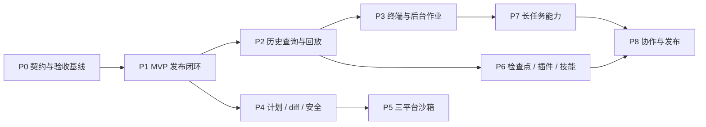

# 25 · 后续开发任务清单

> 本文是当前开发的执行队列。它不重述产品愿景或技术方案，而是把已实现能力、待冻结决策和后续开发拆成可验收的工作包。开始一个任务前先检查其依赖；完成后必须回填本文的状态与证据。

| 项         | 约定                                                                                                                           |
| ---------- | ------------------------------------------------------------------------------------------------------------------------------ |
| 状态       | `未开始` / `进行中` / `阻塞` / `完成`                                                                                          |
| 任务粒度   | 一个任务应能在一个独立变更中完成并验证；跨多个服务的能力拆为“契约 → 内核 → 接入 → 验收”四步                                    |
| “后端接口” | 本项目没有 HTTP 服务端；接口是主进程内的 TypeScript 服务方法，经 Electron IPC 或 CLI/stdio 适配层暴露                          |
| 事实来源   | 功能现状以代码和测试为准；接口形状以 [21](./21-接口契约与错误码总表.md) 为准；数据层以 [24](./24-数据层与接口实施计划.md) 为准 |

---

## 1. 当前基线

截至 2026-09-16，数据工程（JSONL 权威日志、SQLite 投影/迁移/重建、FTS、恢复、归档、删除与导出）和 T7 门禁已经完成。`sessions.*`、`agents.*`、`settings.*`、`credentials.*`、`model.*` 以及本地 `fs` / `shell` / 审批主链路已有实现与测试。

下列能力不能被误认为“已完成”：三平台原生沙箱、后台作业/PTY、计划模式与 diff 审阅、历史查询服务、插件/技能、上下文压缩、子代理、Web/LSP、协作。这些包大多已有骨架，但骨架不是可发布实现。

### 1.1 已实现接口基线

| 域                                         | 当前结论                                                                                   | 后续动作                             |
| ------------------------------------------ | ------------------------------------------------------------------------------------------ | ------------------------------------ |
| `sessions.*`                               | 已实现创建、恢复、列表、元数据、分叉、导出、删除、归档与存储管理                           | 以真实验收补齐产品级证据；不重写存储 |
| `agents.*`                                 | 已实现运行时句柄、入队、取消、订阅与释放                                                   | 先冻结取消粒度，再扩展长任务/子代理  |
| `settings.*` / `credentials.*` / `model.*` | 本地配置、凭据引用、OpenAI 兼容模型接入已可用                                              | 做多适配器与模型切换语义             |
| `fs.*` / `shell.*` / `approval.*`          | 本地文件、前台 shell、审批与权限预设已接线                                                 | 补计划/diff 审阅和真实沙箱约束       |
| `history.*`                                | `replay` / `why` / `checkpoints` / `body` 已由 `session-api` 实现，并接入桌面 IPC 与回放页 | 以真实回放验收维持行为证据           |
| `terminal.*` / `jobs.*` / `plugins.*`      | 契约存在，主体仍是骨架                                                                     | 分别按 P3、P6 开发                   |

---

## 2. 执行顺序

并行原则：P2 与 P4 可并行；P5 需要 P4 的策略和审批证据；P6 中的检查点可先于插件，但插件宿主不能在 RPC/权限模型未冻结时开工。每个 P 阶段结束后都必须运行完整质量门禁，并新增至少一条真实 Electron 或 CLI 验收。

---

## 3. P0 · 契约与验收基线

目标：消除“代码已变、文档仍把它列为未开始”的歧义，保证后续接口开发只有一个真相源。

| ID    | 任务                 | 状态 | 依赖  | 产出与验收                                                                                                                                                                                                         |
| ----- | -------------------- | ---- | ----- | ------------------------------------------------------------------------------------------------------------------------------------------------------------------------------------------------------------------ |
| P0-01 | 建立接口实现矩阵     | 完成 | 无    | 本文 §14 已覆盖 21 §2 的全部方法、IPC、CLI、测试与状态；未实现方法明确标为规格                                                                                                                                     |
| P0-02 | 回填 MVP 验收状态    | 完成 | P0-01 | 已在 04 §5.13 回填每条 `M-*` 的完成、未实现或待真机验收状态，并附证据索引；未以单测替代真机项                                                                                                                      |
| P0-03 | 统一审批事件字段     | 完成 | 无    | 已将 06/12/13/21/22 统一为 `callId`（内部）/`call_id`（stdio），明确时间字段、结果枚举、崩溃恢复及 `requestId` 的导入兼容策略                                                                                      |
| P0-04 | 冻结取消粒度         | 完成 | P0-03 | v0.x 的暂停只中断当前活动回合，保留用户消息；再次点击继续会新开续跑回合，不重复用户消息。删除会话才释放 agent；事件以 `turn/end(cancelled)` 表达暂停。                                                             |
| P0-05 | 冻结模型切换语义     | 完成 | 无    | 设置变更仅在下一次 `turn/start` 生效；当前回合（含工具续步）固定使用开始时的选择。跨 provider 历史仍按通用消息投影，每个实际请求由 `request/header` 记录 provider/model，首次采用新选择的请求标为 `model-switch`。 |
| P0-06 | 文案与文档一致性门禁 | 完成 | P0-02 | `check.py` 扫描集中词典的术语黑名单，portable Electron 冒烟断言首页最终文本；19/21 的检查策略和 22 的索引门禁均已回填                                                                                              |
| P0-07 | CI 运行时修复        | 完成 | 无    | 实机 `corepack pnpm --version` 验证为 9.12.0；此前失败是受限环境无法写 Corepack 缓存，不是签名错误。CI 显式固定并验证 9.12.0，本机与 CI 都以 `pnpm` 为唯一入口                                                     |

P0 出口：接口矩阵完整；P0-03 至 P0-05 有 ADR 或冻结结论；`pnpm` 脚本可直接执行；04/19/21/22/24 无已知状态冲突。

---

## 4. P1 · MVP 发布闭环

目标：把已有主链路从“代码与冒烟通过”提升到可交付的 MVP。

| ID    | 任务                   | 状态 | 依赖  | 涉及模块                                  | 验收                                                                                                                                                                                                                                                                                                                                  |
| ----- | ---------------------- | ---- | ----- | ----------------------------------------- | ------------------------------------------------------------------------------------------------------------------------------------------------------------------------------------------------------------------------------------------------------------------------------------------------------------------------------------- |
| P1-01 | 真实用户旅程验收脚本   | 完成 | P0-02 | desktop、bundle、session-api              | `smoke-live-model.mjs` 用已配置 DeepSeek 覆盖新会话、流式、多轮、暂停/继续、真实 read/write/shell、工作区外写审批、关闭重开、回放与 JSONL/Markdown 导出；日志和导出为可复现证据                                                                                                                                                       |
| P1-02 | 恢复与渲染进程恢复验收 | 完成 | P1-01 | desktop、session-persistence              | `smoke-recovery-live.mjs` 已通过强杀未配对工具补记、`aborted` 收尾、恢复后继续、撕裂尾恢复提示及未来格式拒绝；`smoke-live-model.mjs` 已通过 Renderer 重载后恢复完整审批卡并继续完成                                                                                                                                                   |
| P1-03 | 回放与工具卡一致性     | 完成 | P1-01 | history UI、renderer、tool-fs、tool-shell | `ToolCard` 统一实时/回放入口；单测覆盖 generic/read/diff/terminal 与 240 行 diff 折叠；真实 DeepSeek 验收覆盖实时 read/diff/terminal、回放卡片、why 与按需正文                                                                                                                                                                        |
| P1-04 | CLI 完整任务入口       | 完成 | P0-04 | apps/cli、bundle                          | `lcode run` 与桌面复用模型/会话/工具/审批；`smoke-live.mjs` 已用真实 DeepSeek 跑通工作区任务，非 TTY 审批保守报 `EP-APPROVAL_UNAVAILABLE`；满足 M-ENG-05                                                                                                                                                                              |
| P1-05 | 打包、升级与诊断       | 完成 | P1-01 | desktop、CI                               | Windows portable 包含 Electron ABI SQLite；空 `userData` 与 `LCODE_HOME` 下首启经真实 IPC 写入模型/会话，重启后持久化仍存在。自动更新与崩溃转储归 P8 发布能力，不阻塞 v0.1 portable 交付                                                                                                                                              |
| P1-06 | 性能基线               | 完成 | P1-01 | desktop、bench                            | `bench` 已以 portable 的真实渲染器/桥/持久化验收替换仅端口探测，并记录空闲 renderer 帧率；Windows 基线记录首启、重启、1万/10万事件派生、RSS 与包体。默认百炼模型的真实桌面探针已验证首文本到达 0 ms、DOM 可见 16 ms（模型生成等待另计）。10 万事件 UI 滚动/回放定位及 macOS/Linux 真机属于 P8 正式 NFR，不以当前 Windows 基线冒充通过 |

P1 出口：P1-01 至 P1-06 的 Windows 可交付主旅程、portable 与质量门禁均有通过/失败结论，可在干净机器安装并完成核心旅程。它**不**将 [04](./04-MVP范围与验收标准.md) 中仍标为未实现的工作区信任、100 个真实会话回放、三平台正式 NFR 等项目虚报为完成；这些需求按 P4/P5/P8 的对应任务继续关闭。

---

## 5. P2 · `history.*`：历史查询与回放服务

目标：将目前 renderer 的散落读取收敛为 `session-api` 的只读服务，为回放、为什么面板和大日志懒加载提供稳定后端接口。

| ID    | 方法/任务             | 状态 | 前置           | 详细交付                                                                                                                                                         | 验收                                                          |
| ----- | --------------------- | ---- | -------------- | ---------------------------------------------------------------------------------------------------------------------------------------------------------------- | ------------------------------------------------------------- |
| P2-01 | `history.replay`      | 完成 | P0-03          | `session-api` 从权威 JSONL 构造 `ReplaySnapshot`；输入 `session_id`、`up_to_seq`；复用 I1 投影，不复制第二套派生规则                                             | 截断点、损坏与未来格式已有类型化测试                          |
| P2-02 | `history.why`         | 完成 | P0-03          | 从 `tool/call`、策略、审批和沙箱事件构造 `DecisionTrace`；缺失策略记录返回稳定的未记录结果                                                                       | 覆盖允许、拒绝、取消、未记录与参数错误，且不返回凭据          |
| P2-03 | `history.checkpoints` | 完成 | P2-01          | 返回已闭合轮的只读检查点，不提前实现文件回滚                                                                                                                     | 顺序和未闭合轮过滤已有测试                                    |
| P2-04 | `history.body`        | 完成 | P2-01          | 给大事件 payload 返回大小与引用，采用按需读取；明确 ref 生命周期与权限边界                                                                                       | 不存在 seq 与参数错误返回规范错误；正文不随会话列表投递       |
| P2-05 | IPC 与 UI 接线        | 完成 | P2-01 至 P2-04 | `lcode:session.history`、`lcode:event.body`、`lcode:trace.why`、`lcode:session.checkpoints` 已接通；回放页使用 replay、工具卡、why、body、checkpoints、decisions | 真实 DeepSeek Electron 验收已点击回放卡并读取决策链与完整正文 |

---

## 6. P3 · `terminal.*` 与 `jobs.*`：长命令能力

目标：在前台 shell 之外提供可读取、可中断、可恢复观察的终端与后台任务。不要用前台 `shell` 假装后台作业。

| ID    | 方法/任务        | 状态 | 前置  | 详细交付                                                                                                                                                          | 验收                                                                                                                                        |
| ----- | ---------------- | ---- | ----- | ----------------------------------------------------------------------------------------------------------------------------------------------------------------- | ------------------------------------------------------------------------------------------------------------------------------------------- |
| P3-01 | PTY 与终端注册表 | 完成 | P0-04 | `@lcode/terminal-pty` 已用 node-pty 实现 `terminal.open/send/read/signal/close/list`；UTF-8 offset 环形输出缓冲、owner agent 隔离、数量上限与服务卸载清理均已落地 | 真实 PTY 覆盖多终端、offset 续读、跨 scope `EP-DENIED_CROSS_SCOPE`、上限、signal 与幂等 close                                               |
| P3-02 | 终端工具统一入口 | 完成 | P3-01 | `tool-terminal` 已实现闭合 `op` 的 `terminal` 工具；owner 只取执行 scope 的 `agentId`，并接入既有权限、审批、事件与 terminal 卡片流水线                           | 真实 PTY 的 `terminal.open` 已经由 Agent Loop 写入配对 `tool/call` / `tool/result` 和可回放卡片；各 op 的参数、owner 和规范值由工具测试覆盖 |
| P3-03 | 后台作业服务     | 完成 | P3-01 | `@lcode/jobs-local` 已实现 `jobs.start/list/status/read/kill`、UTF-8 有界输出、first-wins 结算与 owner 清理；`shell.runInBackground` 已接入真实 JobsService       | 外层 turn 取消不停止已发布作业；`jobs.kill`/owner 销毁才终止，定向 50 项测试覆盖                                                            |
| P3-04 | 任务 UI/CLI      | 完成 | P3-03 | 桌面端已提供当前会话的任务抽屉、后台作业卡片、输出读取与停止；资源按 session→agent owner 隔离，主进程重开明确显示不可恢复。`lcode jobs` 已显式说明不能跨进程接管  | 长命令运行时继续对话；重开后明确作业不恢复。跨进程控制留给后续长任务/守护进程工程                                                           |

---

## 7. P4 · 计划、diff 与权限产品化

目标：把当前“审批单次放行”扩展为可预览、可审阅、可解释的受控执行体验。

| ID    | 任务             | 状态   | 前置  | 涉及模块                                                                                                                                                                                                                                                                                                | 验收                                                                                                                                                                                                                                     |
| ----- | ---------------- | ------ | ----- | ------------------------------------------------------------------------------------------------------------------------------------------------------------------------------------------------------------------------------------------------------------------------------------------------------- | ---------------------------------------------------------------------------------------------------------------------------------------------------------------------------------------------------------------------------------------- |
| P4-01 | 计划模式服务     | 完成   | P0-04 | `@lcode/plan-mode` 按会话装配：计划态只暴露 `read/glob/grep/submit_plan`，写调用在 `tools/pre-execute` 再拒绝；`submit_plan` 落 `plan/proposed`，确认落 `plan/approved` + `plan/mode`，桌面主进程自动以批准计划创建执行回合；实质偏离只能经 `request_plan_change` 复用审批弹窗确认后记录 `plan/changed` | 计划阶段文件不落盘；批准后正常模式自动获得结构化计划；运行时验收覆盖写调用被拒、确认后的真实写入与计划变更审批                                                                                                                           |
| P4-02 | 写后 diff 审查   | 完成   | P4-01 | `write` / `edit` 均在 `tool/result.meta` 保存前后行 diff，实时与回放工具卡复用同一呈现组件；不采用普通模式逐块写前阻断                                                                                                                                                                               | 默认百炼模型真机验收已验证 `write` 成功后持久化 `card: diff` 与 hunk，关闭并重开桌面端后回放页实际展开并显示新增行；逐块接受/拒绝与可靠文件回滚留给 P6-01 检查点工程                                                                       |
| P4-03 | 工作区信任流程   | 完成   | P4-01 | permission-presets、desktop、CLI                                                                                                                                                                                                                                                                        | 精确目录信任存储与执行前拦截已落地：不可信工作区可读但 `write/edit/shell/terminal` 被实际拒绝；桌面端首次进入会明确选择“保持只读 / 信任此文件夹”，工作台和设置页可授予/撤销；CLI 以 `lcode run --trust-workspace` 显式授信，不会隐式继承 |
| P4-04 | 审批解释面板     | 完成   | P2-02 | approval、policy、renderer                                                                                                                                                                                                                                                                              | 审批请求和最终决定已随会话事件回放：展示动作、依据、路径/网络/环境影响、沙箱变化、进程范围与决定来源；缺应答者保持 fail-closed                                                                                                           |
| P4-05 | 权限预设 UX 收口 | 完成   | P4-03 | settings、renderer                                                                                                                                                                                                                                                                                      | 五档预设由主进程运行时持有并原子持久化；设置页与输入区均先回写实际策略再更新显示，呈现默认/本机来源和最近切换审计；未信任工作区仍强制只读                                                                                                |

---

## 8. P5 · 三平台原生沙箱

目标：将当前 `sandbox-local` 的如实降级替换为可测量的系统级约束；未完成的平台必须保守拒绝。

| ID    | 任务                       | 状态   | 前置           | 验收                                                                                                                                                                                                                                                              |
| ----- | -------------------------- | ------ | -------------- | ----------------------------------------------------------------------------------------------------------------------------------------------------------------------------------------------------------------------------------------------------------------- |
| P5-00 | 执行入口收口与 fail-closed | 完成 | P4-03 至 P4-05 | `shell`、后台作业、PTY、LSP 与文件服务只经可替换能力服务访问 OS；LSP stdio 已具备受控 stdin、JSON-RPC framing、退出清理和可注入沙箱包装。文件写入由策略 hook 在最终放行后签发 `(sessionId, callId, 精确路径)` 的一次性许可，`fs-local` 在 OS 写入前消费；拒绝、取消、无审批通道与不可信工作区均无许可。策略层读取实际沙箱状态。降级时 `ask` 将沙箱影响纳入审批、`never` 拒绝并落 `sandbox/degraded`；未接入的入口不得宣称受保护 | `scripts/check-invariants.mjs` 的 P5-00 执行入口扫描通过；权限链路 20 项测试通过，覆盖降级审批、never 拒绝、审计事件和一次性路径授权；LSP/PTY/shell 相关服务保持受控 Provider 接线 |
| P5-01 | 三平台能力矩阵             | 完成   | P4-03          | 已定义 macOS/Linux/Windows 对文件、网络、spawn 的目标机制、已知逃逸面与统一状态模型；降级策略已由 P5-00 接入策略层                                                                                                                                                | `SandboxStatus.capabilities` 与 `sandbox-local` 如实报告当前边界，不以矩阵冒充系统级强制                                                                                                |
| P5-02 | Windows 实现               | 完成   | P5-00、P5-01   | `sandbox-win32` 已定义 AppContainer、工作区 ACL、网络 capability、Job Object 四项原生桥自检；桌面 Windows 自动选用该 Provider。`lcode-sandbox-win32.exe` 由构建机预编译并复制进 portable 包，失败时仍保持降级；LSP stdio 与 PTY 均消费同一沙箱包装器。helper 可按 `ResolvedSandboxPolicy.allowNetwork` 为单次启动注入 `internetClient`，默认仍为 deny | helper 缺失、自检失败或启动时失效均不报告 `enforced`；实际启动失败只会由 helper 返回失败，绝不回退裸进程。2026-09-18 已在受支持 Windows 真机验证工作区内写允许、同级目录写拒绝、无网络、Job Object 实际进程终止、受控 ConPTY 命令与 ACL 撤销；调用层尚未开放允许出网的审批/域名策略，但这不改变默认 deny |
| P5-03 | macOS 实现                 | 进行中 | P5-00、P5-01   | `sandbox-macos` 已实现 Seatbelt profile Provider：按回合从 `ResolvedSandboxPolicy` 生成 SBPL，通过 `sandbox-exec` 以 argv 包装；缺少命令、非 macOS 或桥接自检失败时明确降级，PTY 可由原生 bridge 接管。 | Windows 已完成契约测试，仍需 macOS 真机验证 profile 语法、工作区内外读写、网络 deny、后代进程继承和审计；机制不可用时走 P5-00 的降级路径。 |
| P5-04 | Linux 实现                 | 进行中 | P5-00、P5-01   | `sandbox-linux` 已实现 Landlock + seccomp 原生 helper Provider 接缝：只有 Landlock、seccomp、工作区规则和网络规则四项 probe 全部通过才允许包装，缺少 helper/旧内核/预检失败均 fail-closed；PTY 可由原生 bridge 接管。 | Windows 已完成契约测试，仍需 Linux 真机验证文件/进程边界、后代继承、网络策略和可归因错误；旧内核走 P5-00 的降级路径。 |
| P5-05 | 跨平台回归                 | 未开始 | P5-02 至 P5-04 | 每个平台完成 M-SEC-01 至 04 与 P4 审批链路；失败平台不允许伪装受保护                                                                                                                                                                                              | 每个平台均有真实反例测试和审计证据                                                                                                                                                      |

---

## 9. P6 · 检查点、插件、技能与预设

目标：实现可撤销和可扩展能力；这是最容易破坏内核不变量的一段，必须逐项验收。

| ID    | 任务                     | 状态   | 前置         | 详细交付                                                                                                                                                                                                       | 验收                                                                                                                                                                                       |
| ----- | ------------------------ | ------ | ------------ | -------------------------------------------------------------------------------------------------------------------------------------------------------------------------------------------------------------- | ------------------------------------------------------------------------------------------------------------------------------------------------------------------------------------------ |
| P6-01 | 文件检查点与回滚 | 完成 | P2-03、P4-02 | `LocalFileCheckpointService` 在每个已闭合 `turn/end` 后通过 `agent/turn-ended` 捕获成功 `write/edit` 影响路径；文本文件以 SHA-256 blob + manifest 保存，恢复前校验工作区、blob、最终目标及每一级父目录的符号链接与 partial 状态；恢复只写当前工作区并追加 `checkpoint/restored`，不改历史。主进程通过 `lcode:session.fileCheckpoints` / `lcode:session.checkpoint.restore` 暴露元数据和恢复入口，回放页在用户确认后执行并刷新事件 | `file-checkpoints.test.ts` 3/3；`agent-runtime.test.ts` 19/19；Electron/preload 与 renderer 类型检查通过。二进制、大文件、符号链接或不可读快照标为 partial 并拒绝恢复；逐 hunk 接受/拒绝留给后续增强 |
| P6-02 | 插件 manifest 与注册表   | 完成   | P0-03        | 已实现本地目录快照安装、`lcode.json` 严格校验、内容/manifest SHA-256、`engines.lcode` 校验、零权限默认值、SQLite 安装记录及 `plugins.list/install` 内部服务；安装路径为 `<LCODE_HOME>/plugins/<id>/<version>/` | 11 项定向测试覆盖成功快照、未激活记录、不兼容拒绝、入口缺失拒绝、同 id/version 内容覆写拒绝以及 manifest schema/越界入口/未知字段拒绝；安装过程不 `import()` 插件代码                      |
| P6-03 | 插件 utility host 与 RPC | 完成 | P6-02、P5    | `@lcode/plugin-host` 以受控 `SubprocessService` 启动独立 utility process，强制要求已生效的 sandbox wrapper；stdio 仅接受 NDJSON RPC，`host/initialize` 校验协议与 manifest 身份，ctx 首轮只投影由 manifest 推导的只读能力目录，其他 ctx 调用明确拒绝；超时、异常 stdout 和进程退出均隔离为 `EX-HOST_UNAVAILABLE`。`@lcode/plugin-sdk` 提供共享协议和 context-proxy 类型。 | 5 项定向测试覆盖受控启动、声明能力目录、未声明调用拒绝、协议不兼容、崩溃和初始化超时；utility process 崩溃不会中断调用方。P6-04 再把已验证的注册表 entry 接入激活、注册和反向释放。 |
| P6-04 | 插件生命周期             | 完成 | P6-03        | `PluginLifecycleManager` 管理 `activating/active/rolling-back/deactivating` 事务：utility runner 只从 verified entry 加载插件，工具、提示段和事件监听必须走 `ctx/register*` RPC，并由 core 按 manifest `contributes` / activation events 校验后登记 disposer；释放逆序回滚资源再关闭 host。`InstalledPluginLifecycleService` 将运行时 activate/deactivate/uninstall 与 registry 的快照复验、enabled 状态和删除操作串联。 | 真实 fixture 经 runner 注册 3 工具/1 提示段/2 监听，停用后工具、提示段和监听均移除；覆盖激活中失败回滚、激活中停用与迟到注册释放。注册表复验 entry 内容哈希，成功激活后才标记 enabled，卸载删除记录与快照。 |
| P6-05 | 技能与预设               | 完成 | P6-04        | `LocalSkillFilesystem` 提供多来源 `SKILL.md` 两段式 catalog/load、来源可见、符号链接/超限拒绝；`skill_list` / `skill_load` 均只读且不会执行可选脚本。`LocalAgentPresets` 使用 YAML 解析器读取纯数据预设，按显式 ID 生成会话 snapshot，递归 object patch、数组/标量整段替换，并稳定导出；敏感字段拒绝进入预设。Desktop Runtime 统一注册技能工具，并在显式取得预设快照时写入 `preset/snapshot` 会话事件。 | 技能不会自动进入上下文或执行脚本，任何脚本仍走普通 shell 审批与沙箱。预设快照带 session ID、来源和顺序，元数据不混入 config；多来源叠加、导出和敏感字段拒绝均有定向测试。 |
| P6-06 | 插件能力自检目录         | 完成 | P6-02、P6-04 | `PluginLifecycleManager.inspect()` / `InstalledPluginLifecycleService.inspect()` 只从 active runtime record、manifest contributes 与 P6-03 capability catalog 生成目录；ctx `plugins` 仅声明该只读 inspect 接缝。目录不返回 entry 路径、凭据、RPC/服务句柄或任意 lookup。 | 真实 runner fixture 验证版本、active 状态、3 项声明工具/提示段与已投影 fs/network 能力；停用后 inspection 原子变为空，不能枚举或调用未声明能力。 |
| P6-07 | 产品接入与收口           | 完成 | P6-01 至 P6-06 | `AgentRuntime` 统一持有插件、技能与预设服务；桌面设置页可本地目录安装、查看、启动、停用和卸载插件，preload/IPC 只投影安全字段；CLI 提供 `lcode plugins list/inspect/install/activate/deactivate/uninstall`。退出桌面端时 Runtime 先逆序释放插件 host，再退出进程。 | Runtime 集成 fixture 覆盖插件安装/启动/工具注册、技能加载、预设快照持久化；桌面 typecheck/build、CLI build 与 P6 相关 43 项测试通过。插件仍必须经当前系统沙箱启动，沙箱不可用时拒绝启动。 |

---

## 10. P7 · 内置组合、长会话、子代理与高级能力

| ID    | 任务                 | 状态   | 前置         | 验收                                                                                                                                                             |
| ----- | -------------------- | ------ | ------------ | ---------------------------------------------------------------------------------------------------------------------------------------------------------------- |
| P7-00 | 内置 Profile / Bundle 装配层 | 完成 | P6-07 | `@lcode/runtime-composition` 提供静态 profile 的依赖排序、重复/缺失 provider 拒绝、mount 后服务复验、失败逆序释放与脱敏快照。`desktop-default` / `cli-default` 以可信 `lcode-spine` entry 装配既有 Runtime；第一批保持 `createAgentRuntime()` 行为等价，不开放 YAML/远程配置执行。`lcode --dump-config` 与桌面 `lcode:runtime.composition` 均只返回快照。 | 组合内核覆盖依赖排序、缺失/重复 provider、虚假 provider、mount 失败回滚与幂等释放；Runtime 集成断言默认快照，CLI/桌面类型检查、Electron 真机冒烟通过。快照不含凭据、路径或句柄；第三方插件仍不能覆盖内置 service。 |
| P7-00.1 | 会话 provider 抽离 | 完成 | P7-00 | `sessions-local` 已从临时 `lcode-spine` 抽出，`sessions` 成为 Context 的正式内置服务契约；loop、检查点、策略仍通过同一 provider 获取会话。Profile 仍为发行包静态定义，不解析用户 YAML。 | 组合快照验证 `sessions-local → lcode-spine`，装配失败和正常退出均按逆序释放；会话、工具、审批、插件与桌面/CLI 闭环行为保持等价，快照不暴露 home、凭据或对象句柄。 |
| P7-00.2 | 其余内置服务 Provider 化 | 完成 | P7-00.1 | `execution-local` 负责本地子进程、沙箱、文件系统、作业、Shell、终端、剪枝和 spill；`tooling-local` 负责工具注册表、系统提示及文件/Shell/终端工具；`policy-local`、`extensions-local`、`code-runtime-local`、`agent-local` 分别负责策略、插件/技能/预设、受控代码运行时与 Agent/上下文/压缩。`model-local` 以受限 `adopts` 接管宿主在 Profile 前创建的共享模型服务，避免设置页与 Agent 建两套 Context。`lcode-spine` 只消费服务，不拥有这些实现；第三方 manifest 不能取得或覆盖内核服务。 | 组合快照反映独立 entry、依赖与宿主接管关系；组合器支持重复/缺失/虚假 provider fail-closed、mount 失败逆序释放和幂等清理。runtime-composition、desktop Runtime 定向 28/28 通过，相关行为、审批与审计语义保持不变。 |
| P7-01 | 上下文来源与会话引用 | 完成 | P7-00.1、P0-05 | `@lcode/context-local` 在 `agent/pre-step` 物化时间、根指令、repo map 和显式 `@file` / `@session:id` 引用；文件和会话内容用不可信容器注入并有单源/总量上限，路径穿越与符号链接逃逸被拒绝。 | provider 独立于 Bundle；定向与 Runtime 测试验证注入来源、外部内容标记、限制与不逃逸，默认模型实际回合仍保持可重放。 |
| P7-02 | 压缩与 spill         | 完成 | P7-01        | `compaction-prune` 先对超长成功工具结果追加 head/tail replace；`spill-local` 再把原文存入会话范围的 `lcode://spill/<id>` 并追加 replace / `spill/created`；`compaction-summary` 最后执行带 `compactionId` 的 start/summary/replace/end 事务。所有原始事实日志保留。 | 剪枝、spill、引用 read、摘要事务共 19 项定向测试；多次压缩使用当前可见表面，工具配对边界、无收益、孤儿事务与跨会话 spill 读取均 fail-closed。 |
| P7-03 | 摘要成本模型         | 完成 | P7-02        | `@lcode/context-budget` 将当前表面、system、工具 schema 保守估算为不可变快照，并单独汇总 provider 已返回 usage；模型有输入窗口配置时预留输出预算，超过阈值仅产生 `summary-candidate`，不会自动调用摘要模型或重试请求。 | 预算 provider 类型检查通过，定向测试验证 revision、实测 usage 不重复计入、窗口预留、未知窗口不触发。真实阈值可在后续模型指标样本中调优，不影响安全语义。 |
| P7-04 | 子代理               | 完成 | P3-03、P7-00、P7-01 | `@lcode/subagent-inprocess` 为每项委托创建独立子会话/agent，默认仅 `read/glob/grep` 且只能进一步收窄，最大深度为 2；父会话追加 delegated/completed 审计事件，继承已冻结 profile snapshot。 | Runtime 23/23 验证子会话、只读工具、快照、深度限制与完成清理；子代理 guard 在 policy 前拒绝非只读操作，不能转交人工审批。 |
| P7-05 | Web 与 LSP           | 完成 | P5           | `web_fetch/search` 与 LSP stdio 通过显式注入的可信 Provider 挂载为 `web-provider` / `lsp-provider` Profile entry，并复用工具注册表、权限、审批与沙箱链路；默认 Profile 不提供联网工具、不启动语言服务。网页与搜索摘要均按不可信数据处理。 |
| P7-06 | 多模型路由与代码模式 | 完成 | P7-00、P0-05、P7-02 | `model-router` 作为独立内置 Provider 通过 `agent/model-selection` waterfall 在 Adapter 解析前执行首个匹配规则；规则只返回下一轮选择，当前回合及工具续步冻结并由 `request/header` 记录实际 provider/model。`code-runtime` / `code-runtime-subprocess` / `tool-code` 提供 `run_code`：仅在真实 `SandboxService.wrap()` 返回 enforced 时启动受控子进程，代码效果通过工具桥回到既有权限、审批、审计和沙箱流水线，降级时结构化拒绝。`compaction-policy` 只在显式提供摘要器时执行 threshold 压缩，默认仅记录候选，不隐藏模型调用。 |

---

## 11. P8 · 协作、发布与运营

| ID    | 任务               | 状态   | 前置      | 验收                                                                                                           |
| ----- | ------------------ | ------ | --------- | -------------------------------------------------------------------------------------------------------------- |
| P8-01 | 团队预设与会话分享 | 进行中 | P6-05     | 预设/技能仍以仓库文件共享；会话 JSONL 已支持 `sessions.import`，导入时生成新本地 session、重排连续 seq、重建索引并拒绝 Markdown/非法日志，CLI `lcode import` 与桌面 `lcode:session.import` 已接入；桌面「文件 → 导入会话…」已接系统选择框（只列 `*.jsonl`），导入时先写 `session/imported` 记录源文件、字节数与 SHA-256，回放页展示来源；「导出当前会话…」输出 JSONL 并回显路径与哈希。未引入协作服务器或凭据同步。 | 还需补导出包的 manifest 校验展示，以及通过 git/网盘/NAS 的跨用户文件同步验收；冲突与撤销只能在文件同步语义上处理。 |
| P8-02 | 协作审计视图       | 未开始 | P8-01     | 可按会话、成员、操作和审批结果筛选；不展示凭据                                                                 |
| P8-03 | 发布渠道与自动更新 | 未开始 | P1-05     | canary/beta/stable、签名、回滚、最小更新源与隐私说明                                                           |
| P8-04 | 性能与可靠性达标   | 进行中 | P1-06、P7 | 会话流与回放步骤列表已改为分段窗口（默认 150 / 300 行，倍增加载并在扩容时锚定视口），并移除每次事件到达时的全量消息派生；消息投影仍以 `deriveMessages` 为唯一权威。仍需完成 10 万事件下的真实滚动/回放定位数据、三平台基准、持续基准与故障演练 |

---

## 12. 每个接口任务的固定完成定义

开始实现任何新增方法前，任务必须写清：输入/输出、错误码、幂等性、所有权/作用域、事件、持久化投影、IPC/CLI 是否暴露、权限与审批路径。

完成时必须同时满足：

1. 接口包类型和 [21](./21-接口契约与错误码总表.md) 一致。
2. 实现包不让内核反向依赖具体能力，实现按 ctx/装配接入。
3. 成功、参数错误、权限拒绝、取消/崩溃各至少一个测试。
4. 对可见副作用写入可重放事件；对敏感数据执行 I7 检查。
5. 若向 renderer/CLI 暴露，增加 IPC/stdio 合约测试和真实进程验收。
6. 运行质量门禁：类型检查、测试、核心覆盖率、依赖方向、不变量、文档检查与相应容量/性能检查。

---

## 13. 开发记录模板

每完成一个任务，在本节追加一行，并同步更新任务状态。避免只在聊天记录里保留结论。

| 日期       | 任务                                   | 状态   | 证据                                                                                                                                                                              | 备注                                                                                                                                                                                                                                                                                                                                                                               |
| 2026-09-18 | P5-00 执行入口收口、P6-01 文件检查点与回滚 | 完成 | P5-00 扫描通过；file-checkpoints 3/3；permission hook 20/20；agent-runtime 19/19；Electron 与 client typecheck 通过 | 桌面回放页已接入文件检查点列表与用户确认恢复；测试命令均使用短生命周期进程，未留下 Node 测试进程 |
| ---------- | -------------------------------------- | ------ | --------------------------------------------------------------------------------------------------------------------------------------------------------------------------------- | ---------------------------------------------------------------------------------------------------------------------------------------------------------------------------------------------------------------------------------------------------------------------------------------------------------------------------------------------------------------------------------- |
| 2026-09-16 | 建立本文                               | 完成   | 盘点 03/04/05/06/07/08/10/12/13/14/15/19/20/21/22/23/24 与现有包                                                                                                                  | P0 是下一批开发入口                                                                                                                                                                                                                                                                                                                                                                |
| 2026-09-16 | P0-01 接口实现矩阵                     | 完成   | 本文 §14                                                                                                                                                                          | 下一步是 P0-02：按证据回填 MVP 验收状态                                                                                                                                                                                                                                                                                                                                            |
| 2026-09-16 | P0-02 MVP 验收回填                     | 完成   | `04` §5.13                                                                                                                                                                        | 下一步是 P0-03：清除接口文档冲突并冻结契约                                                                                                                                                                                                                                                                                                                                         |
| 2026-09-16 | P0-03 审批事件字段统一                 | 完成   | `06` §2.2、`12` §5.5、`13` §5.3、`21` §5.3、`22` §5.3                                                                                                                             | 下一步是 P0-04：冻结取消粒度                                                                                                                                                                                                                                                                                                                                                       |
| 2026-09-16 | P0-04 取消粒度                         | 完成   | `agent-loop` 暂停/续跑测试、桌面 IPC 与真实模型冒烟                                                                                                                               | 当前回合暂停，继续创建续跑回合                                                                                                                                                                                                                                                                                                                                                     |
| 2026-09-16 | P0-05 模型切换                         | 完成   | `agent-loop` 模型快照测试、`request/header`                                                                                                                                       | 切换仅对下一回合生效，当前回合固定快照                                                                                                                                                                                                                                                                                                                                             |
| 2026-09-16 | P2-01 至 P2-04 历史服务                | 完成   | `packages/api/session-api/src/history.test.ts`                                                                                                                                    | P2-05 仅剩 why/body/checkpoints 的产品交互与快照验收                                                                                                                                                                                                                                                                                                                               |
| 2026-09-16 | P1-01 真实用户旅程                     | 完成   | `apps/desktop/scripts/smoke-live-model.mjs`；真实 DeepSeek 会话与 JSONL/Markdown 导出                                                                                             | 覆盖流式、多轮、工具、审批、重开、回放与导出；下一项是 P1-02 恢复验收                                                                                                                                                                                                                                                                                                              |
| 2026-09-16 | P1-02 强杀与 Renderer 重载恢复         | 完成   | `apps/desktop/scripts/smoke-recovery-live.mjs`、`apps/desktop/scripts/smoke-live-model.mjs`；真实 DeepSeek 会话                                                                   | 强杀恢复补记 `ABORTED_BEFORE_DISPATCH` 与 `turn/end(aborted)`；撕裂尾/未来格式有明确结果；Renderer 重载后待审批卡恢复、应答后文件写入完成                                                                                                                                                                                                                                          |
| 2026-09-16 | P1-02 撕裂尾与版本拒绝                 | 完成   | `apps/desktop/scripts/smoke-recovery-live.mjs`                                                                                                                                    | 撕裂尾在恢复页给出补记提示；`formatVersion=999` 被明确拒绝，未静默降级                                                                                                                                                                                                                                                                                                             |
| 2026-09-16 | P1-03 / P2-05 回放与工具卡             | 完成   | `ToolCard.test.tsx`、`smoke-live-model.mjs`；真实 DeepSeek Electron 会话                                                                                                          | 实时与回放共用卡片；真实回放已验证工具步骤、用户化标题、决策链与按需正文；大 diff 受限布局由组件测试覆盖                                                                                                                                                                                                                                                                           |
| 2026-09-16 | P1-04 CLI 任务入口                     | 完成   | `apps/cli/src/run.ts`、`apps/cli/scripts/smoke-live.mjs`；真实 DeepSeek                                                                                                           | CLI 复用桌面模型与运行时；工作区内任务完成，非 TTY 审批 fail-closed                                                                                                                                                                                                                                                                                                                |
| 2026-09-16 | P0-06 / P0-07 发布门禁                 | 完成   | `docs/tools/check.py`、`smoke-portable.mjs`、`.github/workflows/ci.yml`                                                                                                           | 集中文案静态扫描 + Electron 渲染文本断言已落地；Corepack 实机验证 9.12.0，CI 显式固定同一版本                                                                                                                                                                                                                                                                                      |
| 2026-09-17 | P1-05 / P1-06 发布基线                 | 完成   | `package-portable.mjs`、`smoke-portable.mjs`、`bench.mjs`、`smoke-live-model.mjs`、`probe-live-stream.ts`                                                                         | portable 空环境首启/重启与持久化已复验；最新 Windows 基线首启 277 ms、重启 288 ms、空闲 renderer 60 fps（P95 16.8 ms）、10 万事件派生 16.57 ms。默认百炼模型真实流返回 200；桌面首文本 IPC 到达 0 ms、DOM 可见 16 ms。修复了 main → renderer 错传 chunk 日志包装导致的“最终消息可见但实时流不可见”；长会话 UI 与三平台正式 NFR 移至 P8-04                                          |
| 2026-09-17 | P5-00 执行入口与降级策略（第一段）     | 进行中 | `permission-presets/hook.test.ts`、`subprocess-local/local-subprocess.test.ts`、`shell-local/shell-local.test.ts`、`terminal-pty/local-terminal.test.ts`、`agent-runtime.test.ts` | `sandbox/degraded` 已进入审批影响与会话审计；`ask` 强制一次审批、`never` 拒绝。Shell/后台作业/PTY 已经由 `SubprocessService` Provider 启动，原始 `child_process`/`node-pty` 仅留在 `subprocess-local`。Windows 原生 Provider 已具备真机基础验证；仍缺原生 ConPTY 与开放网络 capability 策略，不能标完成。                                                                                                       |
| 2026-09-17 | P5-00 执行入口与降级策略（第二段）     | 进行中 | `check-invariants.mjs`、`check-invariants.test.mjs`、权限预设与系统提示                                                                                                           | 文件能力已保持为 `FsService` Provider，原生 `node:fs` 限于 `fs-local`；原生 `child_process` 与 `node-pty` 限于 `subprocess-local`。门禁覆盖文件、Shell、终端、LSP 与子进程能力族，静态探针证明消费者绕过会阻断。PTY 在 Provider 已声明系统级隔离、但未实现受控 PTY 时明确拒绝，避免把 `node-pty` 误报为受保护。LSP stdio 已经由 `SubprocessService` 接入；具体语言服务器与工具暴露仍在 P7。 |
| 2026-09-17 | P5-02 Windows 原生桥接（第一段）       | 进行中 | `sandbox-win32/sandbox-win32.test.ts`、`agent-runtime.test.ts`、桌面构建                                                                                                          | Windows 会选用 `sandbox-win32`。只有 AppContainer、工作区 ACL、无网络能力和 Job Object 四项桥接自检同时成立才报告 `enforced`；缺桥/自检失败降级，真正启动时桥失效直接拒绝，绝不回退裸运行。                                                                                                                                                                                        |
| 2026-09-17 | P5-02 Windows 原生 helper（第二段）    | 进行中 | `lcode_sandbox_win32.cpp`、`build-sandbox-win32.mjs`、`package-portable.mjs`、42 项定向测试、类型检查、桌面构建                                                                   | helper 已实现 AppContainer 启动属性、工作区 ACL、无网络 capability 与 `KILL_ON_JOB_CLOSE` Job Object，并由 portable staging 显式携带；本机构建成功，但 `CreateAppContainerProfile` 自检失败，故只能报告降级。真机越界写/无网络/进程树验收、开放网络能力和受控 PTY/LSP 仍未完成。                                                                                                   |
| 2026-09-18 | P5-00 / P5-02 受控 PTY 与首次 ACL 准备 | 完成项 | `local-terminal.test.ts`、`sandbox-win32.test.ts`、`smoke-sandbox-win32.mjs`、静态门禁、类型检查 | Windows 首次获批执行会先调用 helper `--prepare` 授予并复检工作区 ACL，再包装实际命令；预检失败拒绝，不能回退裸 argv。ConPTY 以 helper 为 PTY 宿主，AppContainer 目标 shell 继承其交互句柄；真实命令和工作区写入已验收。取消工作区信任时调用 helper `--revoke` 撤销 ACL，失败会保留可审计原因但不会保留本地信任。PTY 在降级环境仍走审批，在已声明强制沙箱但没有受控 PTY Provider 时拒绝启动；LSP 已纳入原生执行 API 静态门禁。 |
| 2026-09-18 | P5-00 LSP stdio Provider               | 完成   | `lsp-stdio/index.test.ts`、`subprocess-local.test.ts`、类型检查与依赖门禁                                                                                                         | LSP 传输层通过 `SubprocessService` 启动，支持 Content-Length JSON-RPC 帧、请求关联、中止、服务器退出清理与受控 stdin；可注入与 shell 相同的沙箱包装器，Provider 不支持 stdin 时拒绝启动。具体语言服务器配置、`tool-lsp` 消费与桌面暴露仍属于 P7。                                                                                                                                  |
| 2026-09-18 | deepseek-harness 架构对照              | 完成   | 审阅 `D:/li/deepseek-harness/packages` 的 agent-loop、compaction、workspace、session-query、extensions 与 workflow 源码及测试                                                     | Lcode 的服务解耦、工具流水线、追加历史和沙箱边界无需迁移框架；补强 P6 的异步生命周期/只读能力目录，以及 P7 的压缩事务关联与不变量验收。                                                                                                                                                                                                                                            |
| 2026-09-18 | P6-02 插件 manifest 与注册表           | 完成   | `plugin-manifest/manifest.test.ts`、`plugin-registry/index.test.ts`、类型检查、依赖方向门禁                                                                                       | 本地插件先复制到 staging 快照并拒绝符号链接，再校验 schema、ESM entry 和内核版本，计算 SHA-256 后原子移动并写入 SQLite；只生成 `installed` 记录，未加载任何插件入口。                                                                                                                                                                                                              |
| 2026-09-20 | P6-03 插件 utility host 与 RPC         | 完成   | `plugin-host/index.test.ts` 5/5；plugin-host / plugin-sdk / subprocess 类型检查；插件相关定向测试 16/16 | utility host 强制经 sandbox wrapper 和 `SubprocessService` 启动；NDJSON 握手验证协议与 plugin identity，清单权限仅作为只读能力目录投影，未声明 ctx 调用拒绝。子进程崩溃、超时和协议错误收敛为稳定插件错误；注册表 entry 的激活与 disposer 生命周期留给 P6-04。 |
| 2026-09-20 | P6-04 插件生命周期                     | 完成   | plugin-host lifecycle 4/4、host 5/5、manifest 7/7、registry 6/6；相关包类型检查通过 | 通过独立 runner 从经复验的 entry 运行插件；core 仅接受 manifest 声明的工具、提示段和事件注册，全部资源由生命周期事务逆序释放。激活失败、取消和 host 退出均不会留下 core 注册；持久化 enabled 仅在成功后写入，卸载先停用后删除快照。 |
| 2026-09-20 | P6-05 技能与预设                       | 完成   | skill-filesystem 2/2、agent-presets 2/2；P6 相关定向测试 26/26；相关包类型检查 | 技能目录常驻的只有名称、描述与来源，正文按需读取且不执行脚本。预设通过 YAML 解析生成带 session/source 的纯数据 snapshot，递归 patch 与稳定导出可复现；凭据字段被拒绝，预设不会直接改变活动插件或绕开权限/沙箱。 |
| 2026-09-20 | P6-06 插件能力自检目录                 | 完成   | plugin-host host/lifecycle 9/9；plugin-host 类型检查 | 仅对 active 插件投影 manifest 的 contributions 与已受代理的能力目录，未返回安装路径、凭据、RPC 或可调用服务。停用后目录立即清空。 |
| 2026-09-20 | P6-07 产品接入与收口                   | 完成   | `agent-runtime.test.ts`、`plugins.test.ts`、P6 相关 43/43；desktop typecheck/build；CLI build | Runtime 成为插件/技能/预设唯一装配点；设置页与 CLI 都经同一 Runtime 操作插件，renderer 只见安全投影。退出桌面端前会释放 utility host，避免遗留插件 Node 子进程。 |
| 2026-09-20 | P7-00 内置 Profile / Bundle 装配层     | 完成   | `runtime-composition` 3/3、`agent-runtime` 21/21、CLI build、桌面 typecheck/build、Electron 冒烟 | `desktop-default` / `cli-default` 都通过同一可信 `lcode-spine` entry 装配，依赖失败或重复 provider fail-closed，mount 失败逆序回滚。`lcode --dump-config` 与桌面 composition IPC 仅输出脱敏服务关系；外部插件仍在独立宿主，不能覆盖 root service。 |
| 2026-09-20 | P7-01 至 P7-04 上下文、压缩、预算与子代理 | 完成 | context/compaction/spill 定向 25/25；`agent-runtime` 23/23；相关包与桌面类型检查通过 | Bundle 只注册独立 provider：`context-local`、`compaction-prune`、`spill-local`、`compaction-summary`、`context-budget`、`subagent-inprocess`。原始事件不删除；spill 限当前会话读取；预算仅判定候选、不隐式产生额外模型调用；子代理结束后从活体 Agent 注册表注销。 |
| 2026-09-20 | P7-05 Web 与 LSP | 完成 | desktop build；`agent-runtime`、tool-web、tool-lsp 共 26/26 | `AgentRuntimeOptions` 只接受显式注入的 Web/LSP Provider，Profile 以可信内部 entry 挂载服务与工具并在释放时注销；未配置时默认桌面/CLI 组合保持离线且不拉起语言服务。Web 抓取和搜索结果继续以不可信数据容器交给模型。 |
| 2026-09-20 | P7-06 多模型路由（第一段） | 完成项 | `agent-loop` build；定向 20/20 | 新增回合开始时的 `agent/model-selection` waterfall；路由先于 Adapter 解析，结果复制为本回合固定快照，避免多步骤混用 Provider，`request/header` 记录实际模型。后续策略 Provider、代码模式与自动压缩已在 2026-09-21 收口记录中完成。 |
| 2026-09-20 | P7-00.2 执行 Provider（第一段） | 完成项 | desktop build；`agent-runtime` 24/24；文档检查 | `execution-local` 已从 `lcode-spine` 抽出，负责 subprocess/sandbox/fs/jobs/shell/terminals 与 prune/spill；后续策略、扩展、代码运行时、Agent 及模型宿主接管已在 2026-09-21 收口记录中完成。 |
| 2026-09-21 | P7-00.2 / P7-06 收口 | 完成 | `runtime-composition`、`agent-runtime`、`model-router`、`code-runtime-subprocess`、`tool-code`、`compaction-policy`；6 个定向测试文件 35/35；7 个相关包 build | 完成内置服务 Provider 化和模型宿主接管快照；模型路由规则、受控代码模式与自动压缩策略均经 Profile 装配。代码模式在无真实系统级沙箱时 fail-closed，自动压缩没有显式摘要器时不产生隐藏模型调用。桌面 Runtime 24/24、组合器 4/4、模型路由 2/2、代码运行时 2/2、代码工具 1/1、压缩策略 2/2 全部通过。 |
| 2026-09-21 | P5-03 / P5-04 原生 Provider 接缝 | 进行中 | `sandbox-macos`、`sandbox-linux`；沙箱定向 15/15；sandbox 四包 build；依赖/不变量门禁 | macOS Provider 已能按策略生成 Seatbelt argv，Linux Provider 已要求 Landlock、seccomp、工作区和网络四项原生证明；两者默认缺少目标平台能力时都报告 `enforced:false`，不把普通进程伪装成受保护执行。真实目标系统反例和后代继承验收待对应真机完成。 |
| 2026-09-21 | P8-01 会话分享导入（第一段） | 进行中 | `session-api`、CLI、桌面 preload/main | `sessions.import` 只接受用户选择的 JSONL，永远生成新的本地会话 ID 并连续重排事件序号，不覆盖源会话；Markdown 明确不可逆、不作为恢复输入。CLI `lcode import <file.jsonl>` 与桌面 IPC 已接线；session-api 27/27、CLI/桌面相关 build 通过。 |
| 2026-09-18 | P5-02 Windows 真机隔离验收             | 完成项 | `smoke-sandbox-win32.mjs`、`lcode_sandbox_win32.cpp`、Windows AppContainer                                                                                                      | 在 `D:\\li` 临时隔离目录完成 AppContainer 实机验收：仅工作区写入成功、同级工作区外写入被拒绝、`TcpClient` 网络连接得到 `AccessDenied`、Job Object 关闭后真实子进程被终止；finally 已撤销临时 ACL 并删除验收目录。 |
| 2026-09-18 | P4-02 写后 diff 真机回放               | 完成   | `smoke-live-model.mjs`、默认百炼模型、Electron                                                                                                                                | 真实模型调用 `write` 后，`tool/result.meta` 持久化 `card: diff` 与新增行 hunk；关闭并重开 Electron 后在回放页实际定位、展开 diff 工具卡并读取新增行。验收临时信任通过桌面 IPC 授予并恢复，随机测试文件在 finally 删除。 |
| 2026-09-18 | P5-00 文件能力 broker                  | 完成项 | `fs-local.test.ts`、`tool-fs.test.ts`、`hook.test.ts`、`agent-runtime.test.ts`、类型检查 | 策略层仅在最终允许后签发一次性 `(sessionId, callId, 精确路径)` 许可；`write/edit` 在本机 Provider 写入前消费。缺失、错路径、跨调用、重复使用，以及审批拒绝/取消/不可用均 fail-closed。它是进程内能力传递，不替代 AppContainer ACL、真实路径解析或原生 ConPTY。 |
| 2026-09-18 | P5-02 Windows 网络 capability          | 完成项 | `lcode_sandbox_win32.cpp`、`sandbox-win32.test.ts`、本机 helper 构建与临时 ACL 验收 | helper 可由 `ResolvedSandboxPolicy.allowNetwork` 注入 AppContainer `internetClient` capability；默认路径仍明确为 deny。已实机验证 allow 的 helper 预检、受控启动、工作区写入与 finally ACL 撤销；尚未提供上层出网审批或域名策略，不能称为默认开放网络。 |
| 2026-09-18 | P5-02 Windows 受控 ConPTY 真机验收     | 完成项 | `smoke-sandbox-win32.mjs`、`local-subprocess.ts`、`local-terminal.ts`、Windows AppContainer | `node-pty` 只启动 `lcode-sandbox-win32.exe`，helper 再在 AppContainer 与 Job Object 内启动 `cmd.exe`；PTY 中的命令输出和工作区写入成功，关闭后等待 helper 退出；同一验收仍验证工作区外写拒绝、网络 `AccessDenied`、进程树清理与 finally ACL 撤销。 |
| 2026-10-20 | P8-01 桌面导入交互 | 进行中 | `dialog:choose-session-file`、`SessionBridge.import`、AppShell 文件菜单；typecheck、check-i18n、712 项用例全绿 | 桌面「文件 → 导入会话…」走系统选择框（单选 `*.jsonl`），导入后派发会话变更、提示事件数并直达新会话；`sessions.import` 仍生成新 session ID 且重排 seq。 |
| 2026-10-20 | P8-01 来源审计与导出 | 完成项 | `session/imported` 事件、`sessions.import`、回放页来源提示、`文件 → 导出当前会话…`；session-api 27/27；typecheck 与桌面构建通过 | 导入先追加 `session/imported`（源文件、字节数、SHA-256、源会话与创建时间），被导入事件从 seq 1 起连续重排；回放页显示来源并可核对哈希。单会话导出返回路径与哈希，桌面直接回显。来源事件不进模型历史，派生消息与源会话一致。导出包 manifest 校验展示与跨用户同步验收待补。 |
| 2026-10-20 | P8-04 长会话分段渲染 | 进行中 | `SessionStream`、`Replay`、`app.css`；typecheck、桌面构建、712 项用例全绿 | 会话流只挂载最近 150 行，回放步骤只挂载最近 300 步；「加载更早」倍增扩容，扩容前记录 scrollHeight 以锚定视口；用户上翻历史时不再强制滚到底；空态判断改为可渲染行数，去掉每次事件到达时的全量 `deriveMessages`。10 万事件真机滚动与回放定位数据待补。 |
| 2026-10-20 | 会话全文检索入口 | 完成 | `sessions.search`、CLI `lcode search`；session-api 28/28；typecheck 通过 | 复用既有 FTS（逐字分词 + 前缀 AND），命中回表取原文 `summary`，按会话去重；检索前排空索引写入，刚追加的消息也能命中。CLI 支持 `--limit` 与 `--deleted`。桌面端入口未接。 |

---

## 14. P0-01 接口实现矩阵

状态：`完成` = 有进程内实现和测试；`部分` = 只实现了内部能力或部分 IPC；`规格` = 仅有契约/骨架。Lcode 没有 HTTP 后端；桌面暴露指 main → preload → renderer IPC，CLI 指 `apps/cli` 命令。

| 契约方法                                                                              | 实现与测试                                             | 桌面 / CLI                                                                                                     | 状态与缺口                                               |
| ------------------------------------------------------------------------------------- | ------------------------------------------------------ | -------------------------------------------------------------------------------------------------------------- | -------------------------------------------------------- |
| `sessions.create/resume/list/meta/fork/append/derive/flush`                           | `LocalSessionsApi`；sessions/recovery 测试             | 桌面有 create/list/open/fork；CLI 有 list/show                                                                 | 完成；`open` 组合了 resume/meta/derive，不是逐方法 IPC   |
| `sessions.export/exportAll/delete/restore/purge/listTrash/storageUsage/prune/archive` | `LocalSessionsApi`、storage 测试                       | 桌面有 export/delete/restore；CLI 有 export、delete/restore/purge/trash/archive、index rebuild、doctor storage | 完成；桌面未暴露完整存储管理                             |
| `agents.create/resume/get/followup/steer/inject/cancel/watch/dispose`                 | `LocalAgentsApi`、agent runtime/loop 测试              | 桌面与 `lcode run` 均可发送、暂停与续跑                                                                        | 主链路完成；长任务/子代理见 P3/P7                        |
| `tools.list/execute/register/restrict/guard`                                          | `InMemoryToolRegistry`、registry/工具测试              | 由 agent-loop 内部调用                                                                                         | 完成内核接缝，不应直接暴露 renderer                      |
| `tools.cancel/status`                                                                 | 无调用追踪实现                                         | 无                                                                                                             | 规格；随 terminal/jobs 的可取消执行模型实现              |
| `approval.request`                                                                    | `ApprovalService.ask`，写 asked/decided 事件           | main 通过 ApprovalChannel 推送                                                                                 | 完成内部请求面                                           |
| `approval.answer/pending`                                                             | main 的待答表                                          | 桌面 `approval.answer/pending` 与 asked 推送                                                                   | 部分；没有独立 approval-api 边界                         |
| `settings.describe/get/update/watch`                                                  | `SettingsFileService`、设置测试                        | 无通用 IPC；模型页走专用通道                                                                                   | 完成服务，接入不完整                                     |
| `credentials.listRefs/resolve/write/delete`                                           | `LocalCredentialsService`、I7 测试                     | resolve 只允许进程内；模型保存间接写入                                                                         | 完成；不得新增返回明文的 IPC                             |
| `model.listProviders/listModels/probe/getDefault/setDefault/watchDefault`             | `LocalModelApi`、模型测试与冒烟                        | 桌面有 list/save/remove/probe/default；`lcode doctor --model` 复用本机模型装配并隐藏密钥值                     | 单适配器 MVP 完成；多适配器/来源 UI 见后续任务           |
| `fs.resolve/read/write/stat`                                                          | fs-local/tool-fs 测试                                  | 仅工具面，无 raw IPC                                                                                           | 完成能力实现，权限在工具流水线                           |
| `fs.list`                                                                             | 现有 `glob/readdir`，形状不同                          | 无                                                                                                             | 部分；开放 raw fs 前统一契约                             |
| `terminal.open/send/read/signal/close/list`                                           | `@lcode/terminal-pty`；terminal 工具与真实 PTY 测试    | 已由 Agent Loop 接入 terminal 卡片                                                                             | P3-01/P3-02 完成；持久终端 UI 见 P3-04                   |
| `jobs.start/list/status/read/kill`                                                    | `@lcode/jobs-local`；Shell 后台分支与 owner 清理测试   | 已由 `shell.runInBackground` 接入运行时；查询/kill UI 见 P3-04                                                 | P3-03 完成                                               |
| `plugins.list/install`                                                                | `LocalPluginRegistry`；manifest/registry 11 项定向测试 | 桌面设置页与 `lcode plugins list/install`；IPC 不返回安装路径                                                   | P6-07 完成；只允许本地快照安装和只读列表，不加载插件代码 |
| `plugins.activate/deactivate/uninstall`                                               | `PluginLifecycleManager` + `InstalledPluginLifecycleService`；runner / registry 测试 | 桌面设置页与 `lcode plugins activate/deactivate/uninstall`；退出时反向释放 host                                | P6-07 完成；生命周期内核可消费已验证快照                 |
| `history.replay/why/checkpoints/body`                                                 | `LocalSessionsApi` 与 history 测试                     | 桌面 IPC 与回放页已接 replay/why/body/checkpoints                                                              | P2 完成；100 个真实 fixture 是独立的 MVP 验收缺口        |

### 14.1 已接线的桌面与 CLI 面

- 桌面：`session.list/create/open/delete/restore/export/fork/history`、`event.body`、`trace.why`、`agent.send/cancel/resume`、`approval.answer/pending`、`model.list/save/remove/probe/setDefault/getDefault/hasCredential`、`plugins.list/inspect/install/activate/deactivate/uninstall`，以及 session/approval 事件推送。
- CLI：会话列表/详情、导出、删除/恢复/回收站、归档、索引体检/重建和存储体检，以及 `plugins list/inspect/install/activate/deactivate/uninstall`。
- 尚未暴露：完整 agents、通用 settings/credentials、terminal、jobs，以及大部分会话存储管理。

矩阵结论：下一任务仍是 P0-02，但只能将具有真实测试或真机证据的 MVP 项回填为完成；其余保持未完成。
