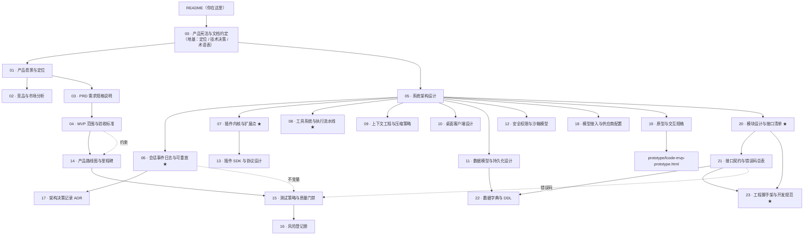

# Lcode 产品文档集

> **Lcode** — 可插拔内核 + 全链路可重放的桌面级 AI 编程工作台。
> 本目录是 Lcode 从定位到交付的完整文档集，按「产品 → 架构 → 支撑 → 交付」四层组织。

| 项 | 值 |
|---|---|
| 产品名 | **Lcode** |
| 一句话定位 | 一个可以随时倒带、并且随便你改的 AI 编程工作台 |
| 技术栈 | TypeScript / Node.js 22+ · Electron · React |
| 目标用户 | C 端开发者（个人为主，小团队协作为次） |
| 核心差异化 | 全链路可重放（时间轴回放 + 从任意点分叉）+ 可插拔内核 |
| 当前阶段 | v0.1 MVP 设计定稿中 |
| 文档版本 | v0.8（2026-09-11） |

---

## 三句话说明白 Lcode 是什么

1. **它不像大多数 agent 那样"做完就忘"。** 它的状态是一份追加式事件日志，所以你能回到会话的任意一步，看到**当时**模型确切看到了什么——不是事后重算的近似。
2. **它的内核里没有业务逻辑。** 压缩、审批、沙箱、计划模式、子代理全部是挂在事件上的插件。所以你不喜欢某个策略，可以自己换掉，不用等官方排期。
3. **它把代码留在你的机器上。** 没有强制账号，没有自建的数据服务器，凭据用你自己的。数据是可导出的，也是可彻底删除的。

这三句话对应三份宪法条款，详见 [00-文档总览与全局约定.md](./00-文档总览与全局约定.md#2-产品宪法不可妥协的三条)。

---

## 从哪里开始读

### 按角色

| 你是谁 | 建议顺序 |
|---|---|
| **第一次接触这个项目** | [01 产品愿景与定位](./01-产品愿景与定位.md) → [05 系统架构设计](./05-系统架构设计.md) |
| **产品 / 创始人** | [01](./01-产品愿景与定位.md) → [02 竞品与市场分析](./02-竞品与市场分析.md) → [03 PRD](./03-PRD-需求规格说明.md) → [04 MVP 范围](./04-MVP范围与验收标准.md) |
| **要开始写代码的研发（第一天）** | [23 工程脚手架与开发规范](./23-工程脚手架与开发规范.md)（§4 跑起来 → §14 建包顺序）→ [20 模块设计与接口清单](./20-模块设计与接口清单.md) → [00 全局约定](./00-文档总览与全局约定.md) → [05 架构](./05-系统架构设计.md) → [06 事件日志](./06-会话事件日志与可重放设计.md) → [07 插件内核](./07-插件内核与扩展点设计.md) → [08 工具系统](./08-工具系统与执行流水线.md) |
| **客户端 / 交互设计** | [10 桌面客户端设计](./10-桌面客户端设计.md) → [08 §8 UI 卡片](./08-工具系统与执行流水线.md#8-ui-卡片) |
| **要写插件的人** | [13 插件 SDK 与协议](./13-插件SDK与协议设计.md) → [07 插件内核](./07-插件内核与扩展点设计.md) → [08 工具系统](./08-工具系统与执行流水线.md) |
| **测试 / 质量** | [15 测试策略与质量门禁](./15-测试策略与质量门禁.md) → [06 §9 崩溃恢复](./06-会话事件日志与可重放设计.md) → [21 §7 契约测试](./21-接口契约与错误码总表.md) |
| **安全评审** | [12 安全权限与沙箱模型](./12-安全权限与沙箱模型.md) → [09 §9 提示注入防线](./09-上下文工程与压缩策略.md#9-提示注入防线) |
| **想知道"为什么这么设计"** | [17 架构决策记录 ADR](./17-架构决策记录ADR.md) |
| **想深挖上游参考架构** | [`code-agent-architecture-design.md`](./code-agent-architecture-design.md)（DeepSeek Harness 架构研究，是设计灵感来源，**不是** Lcode 的规格） |

### 按任务

| 我要做的事 | 读这个 |
|---|---|
| **我准备开始开发，先做什么** | [23 §4 初始化](./23-工程脚手架与开发规范.md#4-初始化第一天就能跑起来) → [23 §14 v0.1 建包顺序](./23-工程脚手架与开发规范.md#14-v01-的包初始化顺序) |
| **我要加一个新模块 / 判断它放哪层** | [20 §2 模块划分准则](./20-模块设计与接口清单.md#2-模块划分准则) → [05 §4.3 判断流程](./05-系统架构设计.md#43-一个模块该放哪一层判断流程) |
| **我要用某个方法，参数是什么** | [21 §2 内部方法契约全表](./21-接口契约与错误码总表.md) |
| **我要查表结构 / 字段含义 / 枚举值** | [22 数据字典与 DDL](./22-数据字典与DDL.md) |
| **我要处理某个错误，用什么码、给用户看什么话** | [21 §6 错误码总表](./21-接口契约与错误码总表.md) |
| 加一个新工具 | [08 工具系统与执行流水线](./08-工具系统与执行流水线.md) → [21 §3 工具契约](./21-接口契约与错误码总表.md) |
| 加一个新策略（审批 / 拦截 / 改写结果） | [07 §5 扩展点全景](./07-插件内核与扩展点设计.md#5-扩展点全景) → [08 §4 执行流水线](./08-工具系统与执行流水线.md) |
| **加一个新模型供应商** | [18 模型接入与供应商配置](./18-模型接入与供应商配置.md) → [13 插件 SDK](./13-插件SDK与协议设计.md) |
| **搞清楚"用户怎么配自己的模型"** | [18 模型接入与供应商配置](./18-模型接入与供应商配置.md)（§2 分层 · §3 入口模块 · §5 解析链路） |
| 改会话日志格式 | [06 会话事件日志与可重放设计](./06-会话事件日志与可重放设计.md) + [22 §3 DDL](./22-数据字典与DDL.md) + [17 ADR-0004/0005](./17-架构决策记录ADR.md) |
| 加一个 UI 面板 | [10 桌面客户端设计](./10-桌面客户端设计.md) → [19 原型与交互规格](./19-原型与交互规格.md) |
| **看界面长什么样 / 开始切图** | [原型 `lcode-mvp-prototype.html`](../prototype/lcode-mvp-prototype.html) → [19 原型与交互规格](./19-原型与交互规格.md) |
| **改完文档后自检** | 跑 `python docs/tools/check.py`（链接 / 原型 / 色值 / 术语） |
| 决定某个功能进不进 MVP | [04 MVP 范围与验收标准](./04-MVP范围与验收标准.md) §1 的三条准入规则 |
| 推翻一个技术决策 | [17 ADR](./17-架构决策记录ADR.md) 的变更流程 |

---

## 文档地图



> **这张图想让你看到什么**：★ 标记的三篇（06 / 07 / 08）是**技术地基**；**准备开工时改读 20 / 23**——20 定模块边界，23 定怎么跑起来。21 与 22 是**查阅型**文档（写代码时对照，不必通读）。

### 全部文档

| 编号 | 文档 | 一句话 | 章节 | 状态 |
|---|---|---|---|---|
| **00** | [产品宪法与文档约定](./00-文档总览与全局约定.md) | 产品定位、技术决策 D1–D22、术语表、写作规范 | 8 | 草案 |
| 01 | [产品愿景与定位](./01-产品愿景与定位.md) | 为什么存在、为谁存在、凭什么赢、放弃什么 | 11 | 草案 |
| 02 | [竞品与市场分析](./02-竞品与市场分析.md) | 五类竞争者的结构性约束、三个共同盲点、我们的空位 | 8 | 草案 |
| 03 | [PRD 需求规格说明](./03-PRD-需求规格说明.md) | 78 条功能 + 22 条非功能 + 19 交互 + 16 安全 + 12 扩展需求 | 9 | 草案 |
| 04 | [MVP 范围与验收标准](./04-MVP范围与验收标准.md) | v0.1 做什么、不做什么、60+ 条可复现验收项 | 9 | 草案 |
| 05 | [系统架构设计](./05-系统架构设计.md) | 五层架构、三进程模型、四层装配、七条核心不变量 | 12 | 草案 |
| **06** | [会话事件日志与可重放设计](./06-会话事件日志与可重放设计.md) | 表面机制、派生投影、可重放三保障、崩溃恢复契约 | 12 | 草案 |
| **07** | [插件内核与扩展点设计](./07-插件内核与扩展点设计.md) | 四核心概念、三事件域、四派发模式、扩展点全景 | 10 | 草案 |
| **08** | [工具系统与执行流水线](./08-工具系统与执行流水线.md) | 工具契约、Schema DSL、九步流水线、六种 UI 卡片 | 11 | 草案 |
| 09 | [上下文工程与压缩策略](./09-上下文工程与压缩策略.md) | 五种上下文机制、压缩三层、成本纪律、注入防线 | 10 | 草案 |
| 10 | [桌面客户端设计](./10-桌面客户端设计.md) | 进程模型、IPC、信息架构、时间轴回放与分叉交互 | — | 草案 |
| 11 | [数据模型与持久化设计](./11-数据模型与持久化设计.md) | 存储分层、日志格式、写入路径、崩溃恢复 | — | 草案 |
| 12 | [安全权限与沙箱模型](./12-安全权限与沙箱模型.md) | 威胁模型、三权限轴、三平台沙箱、凭据与插件安全 | — | 草案 |
| 13 | [插件 SDK 与协议设计](./13-插件SDK与协议设计.md) | 三层扩展模型、插件 SDK、类型化 RPC、JSON-RPC、MCP | — | 草案 |
| 14 | [产品路线图与里程碑](./14-产品路线图与里程碑.md) | v0.1→v1.0 五阶段、双周里程碑、关键路径、发布策略 | — | 草案 |
| 15 | [测试策略与质量门禁](./15-测试策略与质量门禁.md) | 测试金字塔、七条不变量、快照重放、16 项 CI 门禁 | — | 草案 |
| 16 | [风险登记册](./16-风险登记册.md) | 23 条风险、3×3 矩阵、Top 5、复查机制 | — | **活文档** |
| 17 | [架构决策记录 ADR](./17-架构决策记录ADR.md) | D1–D22 + 5 条产品级决策，含代价与重审条件 | 5 | 草案 |
| **18** | [模型接入与供应商配置](./18-模型接入与供应商配置.md) | 六层配置模型、三处入口模块、配置文件格式、解析链路、能力探测降级 | 11 | 草案 |
| **19** | [原型与交互规格](./19-原型与交互规格.md) | 8 屏规格（P1 首页 / P2 工作台 / P3 回放 / P4 询问 / P5 设置 / P6 恢复 / P7 重来 / P8 异常）、**签名元素（三个）**、需求追溯、**界面术语黑名单** | 8 | 草案 |
| **20** | [模块设计与接口清单](./20-模块设计与接口清单.md) | 模块划分准则、依赖规则、能力接缝统一形状、七个骨架包规格、模块清单速查表 | 12 | 草案 |
| **21** | [接口契约与错误码总表](./21-接口契约与错误码总表.md) | 12 组方法契约、12 个工具 input/output、外部 JSON-RPC、60+ 错误码与错误对象结构 | 7 | 草案 |
| **22** | [数据字典与 DDL](./22-数据字典与DDL.md) | 15 张表可执行 DDL、JSONL 物理编码、事件字段字典、枚举附表、迁移与容量 | 9 | 草案 |
| **23** | [工程脚手架与开发规范](./23-工程脚手架与开发规范.md) | 仓库结构、命令一览、TS 三层配置、代码规范、14 条门禁、协作流程、v0.1 建包顺序 | 17 | 草案 |
| **24** | [数据层与接口实施计划](./24-数据层与接口实施计划.md) | 分阶段实施计划、真实验收、T7 质量门禁与收口决策 | 16 | 实施中 |
| **25** | [后续开发任务清单](./25-后续开发任务清单.md) | 后续接口与产品能力的执行队列、依赖、验收与完成定义 | 16 | 实施中 |
| — | [**MVP 高保真原型**](../prototype/lcode-mvp-prototype.html) | 可交互 HTML：菜单栏 + 侧栏 + 工作台（**过程流折叠 / 最终总结不可折叠 / 产物入口**）+ 回放 + 设置 · 三态主题 · 可离线打开 | — | 可用 |
| — | [文档集校验脚本](./tools/check.py) | 相对链接 / 原型结构 / 规格外色值 / 术语黑名单四项自动校验 | — | 可用 |
| — | [上游架构研究](./code-agent-architecture-design.md) | DeepSeek Harness 架构拆解（设计灵感来源） | 12 | 参考 |

---

## 这套文档的五条纪律

写文档容易，让文档**可信**很难。以下五条是本套文档的自我约束。

| # | 纪律 | 说明 |
|---|---|---|
| **1** | **术语唯一** | 所有文档严格使用 [00 §6 术语表](./00-文档总览与全局约定.md#6-术语表) 的字面量。禁止同义词。 |
| **2** | **给数字不给形容词** | "≤ 150ms"而不是"很快"；"≤ 150MB"而不是"比较小"。口径定义在 [00 §8.5](./00-文档总览与全局约定.md#85-数字口径约定)。 |
| **3** | **必须写"不做什么"** | 每篇文档都要有明确的非目标。**说清楚不做什么，才能让做什么变得可信。** |
| **4** | **代价不能省** | 每条 ADR 必须写真实的负面后果。只讲收益的决策记录是营销材料，不是文档。 |
| **5** | **未决问题公开** | 每篇末尾的"未决问题"是公开的待办，不是羞耻。**假装都定了，才是最危险的。** |

---

## 文档的变更流程

```
改一个小错别字 / 补一个例子
  └─ 直接改，更新变更记录

改一个需求的优先级 / 加一条验收项
  └─ 改 03 或 04，同步检查 14 的排期与 15 的门禁

推翻一条技术决策（D1–D18）
  └─ 必须先改 17 的对应 ADR（标注 superseded by），
     再改 00 的技术宪法表，再同步所有引用它的文档

改变产品定位 / 一条产品原则
  └─ 需要创始团队一致同意，走 01 + 00 的联合修改
```

> **一条硬规则**：**任何与 [00](./00-文档总览与全局约定.md) 冲突的表述，以 00 为准。** 发现冲突时，要么改 00，要么改那篇文档——**不允许两处并存**。

---

## 当前状态：哪些是确定的，哪些还在飘

### 已经钉死的（可以据此开工）

| 项 | 位置 |
|---|---|
| 产品定位与三条不可妥协的原则 | [00 §2](./00-文档总览与全局约定.md#2-产品宪法不可妥协的三条) |
| 技术栈与 22 条技术决策 | [00 §4](./00-文档总览与全局约定.md#4-技术宪法关键决策与理由) |
| 术语表 | [00 §6](./00-文档总览与全局约定.md#6-术语表) |
| 模型配置的分层与入口模块 | [18](./18-模型接入与供应商配置.md) |
| 事件模型、表面机制、可重放三保障 | [06](./06-会话事件日志与可重放设计.md) |
| 插件模型与扩展点全景 | [07](./07-插件内核与扩展点设计.md) |
| 工具契约与九步流水线 | [08](./08-工具系统与执行流水线.md) |
| 七条核心不变量 | [05 §8](./05-系统架构设计.md#8-核心不变量) |
| MVP 范围与验收项 | [04](./04-MVP范围与验收标准.md) |

### 还在飘的（需要真实数据或决策）

汇总了各文档的未决问题，按"卡在哪"排序：

| 未决问题 | 卡在谁 | 需要什么才能定 | 出处 |
|---|---|---|---|
| 主进程内存 ≤600MB 是否可信 | 研发 | 原型实测 | [05](./05-系统架构设计.md) |
| 插件进程数量策略（一插件一进程 vs 共享） | 架构 | 实测内存/隔离权衡 | [05](./05-系统架构设计.md) |
| 跨进程后插件可用的 `ctx` 能力面 | 架构 | v0.3 最大技术风险 | [07](./07-插件内核与扩展点设计.md) |
| 日志膨胀率 ≤2.5× 是否可达 | 研发 | chunk 打包效果实测 | [03](./03-PRD-需求规格说明.md) |
| `tool/result.meta` 大小上限 | 研发 | diff hunks 的真实体量 | [06](./06-会话事件日志与可重放设计.md) |
| 提示注入的结构层方案 | 安全 | 攻击样本测试 | [09](./09-上下文工程与压缩策略.md) |
| 三平台沙箱的能力差距边界 | 研发 + 安全 | 三平台实测 | [12](./12-安全权限与沙箱模型.md) |
| 定价模型 | 创始团队 | 内测付费意愿数据 | [01](./01-产品愿景与定位.md) / [16](./16-风险登记册.md) |
| **"用户是否真的想要可审计"** | 创始团队 | **v0.5 前必须有明确答案** | [02 §7.3](./02-竞品与市场分析.md#73-一个不舒服但必须承认的判断) |

> **最后一条是最重要的。** 如果我们最终失败，最可能的原因不是被大厂抄了，而是**用户根本不想要可审计**——他们只是想要更快。这个风险在 [16](./16-风险登记册.md) 有登记，并有明确的验证节点。**不要用"用户现在不懂，以后会懂"来搪塞它。**

---

## 开发就绪度：还缺什么

> 结论：**开发就绪。** 系统设计、模块设计、需求文档、接口契约、数据字典、工程规范六类产物齐备；剩余缺口全部标记为"开发过程中滚动补齐"，不卡开工。

| # | 产物 | 现状 | 说明 |
|---|---|---|---|
| 1 | 需求文档 | ✅ [03 PRD](./03-PRD-需求规格说明.md)（147 条需求）+ [04 MVP 验收](./04-MVP范围与验收标准.md)（70 条验收项） | 含需求编号与追溯矩阵 |
| 2 | **系统设计** | ✅ [05 系统架构设计](./05-系统架构设计.md) | 五层架构、三进程模型、四层装配、七条不变量 |
| 3 | **模块设计** | ✅ **v0.8 新补** — [20 模块设计与接口清单](./20-模块设计与接口清单.md) | 七个骨架包的完整规格 + 全部能力族 + 依赖规则 + 模块清单速查表 |
| 4 | **接口契约** | ✅ **v0.8 新补** — [21 接口契约与错误码总表](./21-接口契约与错误码总表.md) | 12 组方法契约 + 12 个工具 input/output + 外部协议 + 60+ 错误码 |
| 5 | **数据字典与 DDL** | ✅ **v0.8 新补** — [22 数据字典与DDL](./22-数据字典与DDL.md) | 15 张表可执行 DDL + 事件字段字典 + 枚举附表 + 迁移 |
| 6 | **工程脚手架与开发规范** | ✅ **v0.8 新补** — [23 工程脚手架与开发规范](./23-工程脚手架与开发规范.md) | 仓库结构、命令、TS 配置、代码规范、14 条门禁、协作流程、v0.1 建包顺序 |
| 7 | 原型图 | ✅ [19 原型与交互规格](./19-原型与交互规格.md) + [可交互原型](../prototype/lcode-mvp-prototype.html) | 8 屏 · 三态主题 · 过程流折叠 / 最终总结不可折叠 |
| 8 | 测试策略 | ✅ [15 测试策略与质量门禁](./15-测试策略与质量门禁.md) | 五层金字塔 + 七条不变量（I1–I7）在 CI 强制 |
| 9 | 设计系统 | ✅ [10 §6](./10-桌面客户端设计.md#6-设计系统) | 令牌精确到色值，原型严格取自它（校验脚本检查规格外色值 = 0） |
| 10 | 详细测试用例集（前置/步骤/期望） | 🟡 **滚动补** | 策略与验收项已有；分步用例随每个里程碑同步产出，避免写完全部再返工 |
| 11 | 埋点与指标采集规格 | 🟡 **滚动补** | 北极星指标已定（[01](./01-产品愿景与定位.md)）；埋点表在 v0.1 内测前产出，需与"遥测默认关闭"对齐 |
| 12 | 运维手册 / 法务合规材料 | 🟡 **发布前** | 不影响开工；崩溃分级、回滚步骤、隐私政策、许可证清单 |

### 一句话判断

> **可以开工了。** 第 1–9 项已齐备——其中 2/3/4/5/6 是这一轮新补的（系统设计、模块设计、接口契约、数据字典、工程规范）。
>
> 第 10–12 项属于"开发过程中滚动产出"的产物，不卡第一个人写第一行代码。
>
> **但请先接受两件事**：① [16 风险登记册](./16-风险登记册.md) 里那条"用户是否真的想要可审计"仍未验证——它决定的是**要不要做这个产品**，不是怎么做；② 文档再全也替代不了原型验证，建议在写第一行代码之前，先用 [原型](../prototype/lcode-mvp-prototype.html) 找 5 个真实开发者做一次 15 分钟的可用性测试。
>
> **开工建议顺序**：先读 [23](./23-工程脚手架与开发规范.md) §4 把环境跑起来 → 按 §14 的八批包初始化顺序推进 → 每批用 [20](./20-模块设计与接口清单.md) 的验收锚点自查。

---

## 快速索引：几条最常被引用的条款

| 条款 | 位置 |
|---|---|
| 产品宪法三条 | [00 §2](./00-文档总览与全局约定.md#2-产品宪法不可妥协的三条) |
| 技术决策 D1–D22 | [00 §4](./00-文档总览与全局约定.md#4-技术宪法关键决策与理由) |
| 术语表 | [00 §6](./00-文档总览与全局约定.md#6-术语表) |
| 常见误用澄清（可重放≠可撤销、插件≠用户脚本、**harness 是形态不是定位**） | [00 §8](./00-文档总览与全局约定.md#8-常见误用与澄清) |
| **定位辨析：内核通用 ≠ 产品通用** | [01 §6.4](./01-产品愿景与定位.md#64-定位辨析我们是-harness-但不是一个通用-harness) |
| 七条核心不变量 | [05 §8](./05-系统架构设计.md#8-核心不变量) |
| 表面操作（压缩的唯一原语） | [06 §3](./06-会话事件日志与可重放设计.md#3-表面机制压缩与分叉的唯一原语) |
| 崩溃恢复契约 | [06 §9](./06-会话事件日志与可重放设计.md#9-崩溃恢复契约) |
| 扩展点全景表 | [07 §5](./07-插件内核与扩展点设计.md#5-扩展点全景) |
| 九步工具流水线 | [08 §4](./08-工具系统与执行流水线.md#4-执行流水线) |
| **展示策略 ≠ 保密策略** | [08 §5.2](./08-工具系统与执行流水线.md#52-内容替换-vs-值替换的语义差别重要) |
| 成本三字段评审纪律 | [09 §8.2](./09-上下文工程与压缩策略.md#82-每个模型可见改动都要做一次成本评审) |
| MVP 三条准入规则 | [04 §1](./04-MVP范围与验收标准.md#1-mvp-的判定原则) |
| **界面术语黑名单（什么词不许出现在界面上）** | [19 §6.2](./19-原型与交互规格.md#62-术语黑名单硬性ux-copy-001) |
| **为什么首次启动不配置模型** | [19 §3.1](./19-原型与交互规格.md#31-p1--首页新对话) |
| **身份由结构承载**（视觉身份边界） | [10 §6.6](./10-桌面客户端设计.md#66-视觉身份身份由结构承载不由颜色承载v04-修订) |
| **结构身份磨损检测**（六条） | [10 §6.7](./10-桌面客户端设计.md#67-检测怎么知道我们的身份结构被磨掉了v04-修订) |
| **签名元素（三个：过程流 / 最终总结 / 产物入口）** | [19 §1.4](./19-原型与交互规格.md#14-签名元素v04-扩充v07-由四个改为三个) |
| **模型配置的三处入口**（`ctx.agentDefaultModel` / `ctx.llm` / `ctx.settings`） | [18 §3](./18-模型接入与供应商配置.md#3-入口模块) |
| **为什么不做自动路由模型** | [18 §7.4](./18-模型接入与供应商配置.md#74-明确不做v10-前) |
| **8 屏原型与逐屏规格** | [19 原型与交互规格](./19-原型与交互规格.md) · [原型文件](../prototype/lcode-mvp-prototype.html) |
| **开发就绪度与缺口清单** | 本文件 §[开发就绪度](#开发就绪度还缺什么) |

---

## 变更记录

| 日期 | 版本 | 变更 | 说明 |
|---|---|---|---|
| 2026-09-10 | v0.1 | 初稿 | 建立文档地图、角色/任务索引、五条纪律、变更流程与全局未决问题汇总 |
| 2026-09-11 | v0.2 | 新增 18 号文档 | 补上模型配置环节（原为设计真空）：六层配置模型、三处入口模块、配置文件格式、端到端解析链路；技术决策扩展为 D1–D22 |
| 2026-09-11 | v0.3 | 新增 19 号文档与原型 | 补上原型图（原为零覆盖）：8 屏规格 + 需求追溯矩阵 + 4 组状态机 + 8 个基础组件；新增可交互 HTML 原型（三态主题）；新增「开发就绪度」缺口清单 |
| 2026-09-11 | **v0.4** | **原型与需求修订（按反馈）** | ① **首次启动不再引导配置模型**，直接进首页；模型配置移入「设置 → 模型」；② 采用桌面惯例：常驻菜单栏 + 侧栏（新对话 + 项目分组会话树 + 底部设置）+ 首页能力卡片 + 设置页左分类右内容；③ 新增 **`UX-COPY-001` 界面不出现内部术语**（含术语黑名单与自动化扫描验收项 `M-UX-06`）；④ 全部界面文案去术语化（工具名→动词、`seq`→第 N 步、`L4/L5/L6`→"来自：你在设置里选的"、错误码→现象描述）；⑤ 同步更新 03 / 04 / 10 / 18 |
| 2026-09-11 | **v0.5** | **建立自有视觉身份（按反馈）** | 起因：v0.4 照结构搬用参照产品骨架，观感像"换皮"。① 设计令牌全量改版（强调色蓝→**靛紫**、锐角 3–4px、**取消阴影**、新增时间轴脊底色）；② 新增 **`UX-VISUAL-001`**（身份边界 + [10 §6.7](./10-桌面客户端设计.md#67-检测怎么知道我们又像别人了) 六条检测清单）与 **`UX-VISUAL-002`**（签名元素）；③ **签名元素：常驻时间轴脊柱**——把"可倒带"做进界面骨架；④ 首页改「左历史 / 右开始」两栏 + 起点清单（不再是居中问候 + 卡片网格）；⑤ 设置改 Lcode 自己的分组（新增「记忆与历史」）；⑥ 首页侧栏去掉照搬来的「拉取请求」「已安排」 |
| 2026-09-11 | **v0.6** | **观感回归柔和 + 对话流瘦身（按反馈）** | 起因：v0.5 锐角工程感不够简洁美观；工具调用铺满对话流过于臃肿。① **观感回归柔和中性风**（圆角 6–18px、恢复轻阴影、强调色回到蓝、主按钮近黑）；② **身份改由结构承载**：脊柱 / 折叠组 / 总结卡 / 产物入口四件套（10 §6.6/6.7 修订）；③ **P2 会话流重做**：工作过程默认折叠成组（运行中自动展开、完成自动收起）+ **每轮以总结卡收尾**（做了什么/验证/需要你知道的 + 底栏 token 与模型名）+ **产物入口**（「查看本轮所有产物/变更」过滤右栏到本轮）；④ 新增 `UX-FOLD-001` / `UX-SUMMARY-001` / `UX-ARTIFACT-001` 与验收项 `M-UX-12/13/14`；⑤ P1 首页恢复居中问候 + 能力卡片；⑥ 同步更新 03 / 04 / 10 / 19 与原型 |
| 2026-09-11 | **v0.7** | **过程/结果语义修正 + 输入区归位（按反馈）** | ① **折叠只发生在过程里**：思考与工具调用收在一个过程流容器内；过程中自动展开 + 当前动作高亮；子任务完成时在流内插一句**阶段小结**；任务结束时过程**整体收起为一行「过程记录」**；② **最终总结不可折叠**：头部为静态「✓ 任务完成 · 用时 N」，出现即覆盖前面全部折叠，最终只剩「提问 + 最终总结」；③ **输入框只属于中间会话栏**，不再压到左侧工作区与右侧变更栏；④ 新增 `UX-INPUT-002` 与 `M-UX-15`，修订 `UX-FOLD-001` / `UX-SUMMARY-001` / `M-UX-12/13`；⑤ 同步更新 10 / 19 / 03 / 04 与原型 |
| 2026-09-11 | **v0.8** | **补齐开发启动包（按请求）** | 起因：用户将全部文档移入 `docs/` 并要求确认是否具备开发条件。审计结论：系统设计（05）已有，但**模块设计、接口契约、数据字典、工程规范四类缺失**。① 新增 **[20 模块设计与接口清单](./20-模块设计与接口清单.md)**（七个骨架包规格 + 能力族 + 依赖规则 + 速查表）；② 新增 **[21 接口契约与错误码总表](./21-接口契约与错误码总表.md)**（12 组方法 + 12 个工具契约 + 外部协议 + 60+ 错误码）；③ 新增 **[22 数据字典与 DDL](./22-数据字典与DDL.md)**（15 张表可执行 DDL + 事件字段字典 + 枚举附表）；④ 新增 **[23 工程脚手架与开发规范](./23-工程脚手架与开发规范.md)**（仓库结构 / 命令 / TS 配置 / 代码规范 / 14 条门禁 / v0.1 建包顺序）；⑤ 新增 `docs/tools/check.py` 校验脚本；⑥ 「开发就绪度」改为 12 项**全部满足或标记滚动补齐**；⑦ 修正文档移入 `docs/` 后的三处相对链接（原型路径） |
| 2026-09-11 | **v0.9** | **启动性能设计补齐 + 阈值一致性修正** | 起因：审计"冷/热启动速度"时发现两个真问题——① **热启动在全库没有定义**；② `15 §7` 的性能阈值与 `03/04/10` **四组数字互相矛盾**（冷启动 3.0 vs 2.5s、首 token 150 vs 100ms、内存 500 vs 600MB、日志膨胀 3.0× vs 2.5×），且需求编号映射全部错位。① [00 §8.5](./00-文档总览与全局约定.md#85-数字口径约定) 把启动拆为三种口径；② [03](./03-PRD-需求规格说明.md#41-性能nfr-perf) 新增 `NFR-PERF-011/012`；③ [04](./04-MVP范围与验收标准.md) 新增 `M-NFR-09/10`；④ [10 §7](./10-桌面客户端设计.md#7-性能预算) 重写为「启动性能 + 其余预算」，含热启动实现手段与"常驻内存"取舍；⑤ [15 §7](./15-测试策略与质量门禁.md#7-性能回归测试) 改为"目标值 + CI 宽容系数 ≤1.2"双列并统一判定规则 |
| 2026-09-14 | **v1.0** | **作废签名元素「常驻时间轴脊柱」** | 起因：审计前端完整性时发现该元素（`UX-VISUAL-002` / `M-UX-11`，均为 Must）**三处文档要求、原型与实现两处都没有**，且 `docs/README` 曾误称原型含此元素。① 新增 [ADR-0106](./17-架构决策记录ADR.md#adr-0106)（含代价与重审条件）；② [19 §1.4](./19-原型与交互规格.md#14-签名元素v04-扩充v07-由四个改为三个) 签名元素四个改**三个**、§3.2 五区改**四区**、§1.3 去掉脊柱；③ [03](./03-PRD-需求规格说明.md) `UX-VISUAL-002` 作废、`UX-VISUAL-001` 四件套改**三件套**；④ [04](./04-MVP范围与验收标准.md) `M-UX-11` 作废、`M-UX-10` 去掉"脊柱默认可见"；⑤ [10 §6.6/§6.7](./10-桌面客户端设计.md#66-视觉身份身份由结构承载不由颜色承载v04-修订) 身份表与磨损检测去掉脊柱；⑥ 本文件清单、原型描述与快速索引同步；⑦ 删除已无引用的 `TimelineSpine.tsx` |
