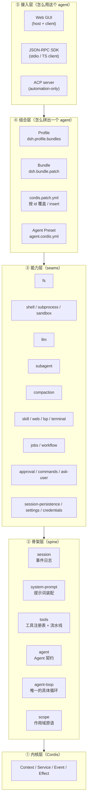
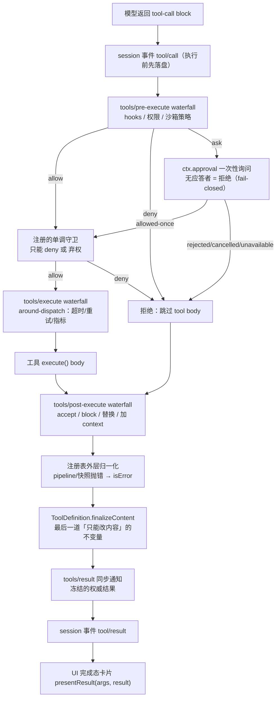
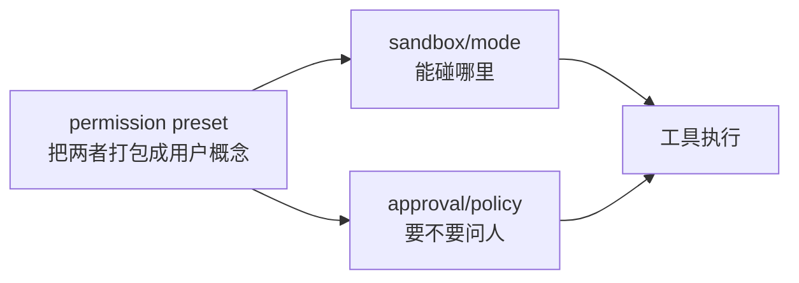

# 从 DeepSeek Harness 学写 Code Agent —— 架构拆解与实现指南

> 本文基于对 `deepseek-harness`（下称 DSH）仓库源码与文档的系统性精读写成。
> 目标读者：打算自己从零实现一个 code agent（或 agent framework）的工程师。
> 阅读方式：第 1–4 章讲「为什么这么设计」，第 5–7 章讲「它到底怎么实现的」，第 8 章是可直接执行的落地路线图，第 9–11 章是代码模板、决策清单与踩坑指南。

---

## 目录

- [0. 导读：这份文档想解决什么](#0-导读这份文档想解决什么)
- [1. 一句话总纲](#1-一句话总纲)
- [2. 设计推演：为什么是「事件溯源 + 插件微内核」](#2-设计推演为什么是事件溯源--插件微内核)
- [3. 分层架构总览](#3-分层架构总览)
- [4. 内核：Cordis 的四个概念](#4-内核cordis-的四个概念)
- [5. 骨架层（Spine）逐包拆解](#5-骨架层spine逐包拆解)
- [6. 能力层（Seams）：Service Definition / Provider / Consumer 三角](#6-能力层seamsdef-provider-consumer-三角)
- [7. 高级设计专题（深挖）](#7-高级设计专题深挖)
- [8. 落地路线图：自己写一个 Code Agent](#8-落地路线图自己写一个-code-agent)
- [9. 关键代码模板](#9-关键代码模板)
- [10. 设计决策清单](#10-设计决策清单)
- [11. 反模式与常见坑](#11-反模式与常见坑)
- [12. 附录](#12-附录)

---

## 0. 导读：这份文档想解决什么

市面上的 "code agent" 实现大多长成这个样子：

```
main() {
  messages = [system]
  while (true) {
    resp = llm.chat(messages, tools)
    if (!resp.toolCalls) break
    for (tc of resp.toolCalls) results.push(exec(tc))
    messages.push(resp, ...results)
  }
}
```

这段 20 行代码能跑，但撑不过三件事：

1. **上下文会爆** —— 工具结果越堆越多，迟早撞上 context window。
2. **行为不可控** —— 想加审批、想加沙箱、想加 plan mode、想加子代理，全都得往这个 while 里塞 `if`。
3. **用户看到的东西不可信** —— 流式输出、工具卡片、崩溃恢复到一半的会话，UI 和真实状态是对不上的。

DSH 的价值在于：它把这三件事当成**架构的一等约束**，而不是事后补丁。它给出的答案可以浓缩成一句话：

> **一切模型可见的东西都来自一份 append-only 事件日志；一切能力都是可替换的插件；agent 循环本身只是这个插件图里的一个节点。**

这份文档会把这句话拆开，告诉你每一个零件为什么存在、接口长什么样、以及你自己实现时该怎么取舍。

---

## 1. 一句话总纲

DSH 有四个贯穿全局的设计公理，理解它们比记住任何接口都重要：

| 公理 | 含义 | 直接后果 |
|---|---|---|
| **① 模型可见即可重放** | 任何进入模型请求的内容，必须能从事件日志重建 | 新增一种"模型能看到的东西" = 新增一种 `SessionEvent` |
| **② 注册即副作用（effect）** | 每一次能力注册都返回一个 disposer | 插件卸载 = 世界精确回滚到加载前，HMR / 子代理隔离 / 测试都靠它 |
| **③ 能力用 seam 三角表达** | 接口（Definition）/ 实现（Provider）/ 使用者（Consumer）分成三个包 | 换一个 provider 就换掉整个产品行为，不用改调用方 |
| **④ 用事件拦截，不用 if 判断** | 策略、审批、压缩、hook 全是某条事件的监听器 | agent loop 里没有业务分支，只有"call model, run tools, repeat" |

第 ④ 条尤其重要。DSH 的 `agent-loop` 是整个仓库里**唯一**含具体循环逻辑的包，它的 README 明确写着：

> This is the only package in the harness that contains concrete loop logic. Everything else is an abstract service or a plugin against extension points — new behavior goes into plugins, not here.

这就是所谓的**微内核（microkernel）**：内核只提供机制，一切策略外挂。下面这张表就是 DSH 自己给出的"功能 → 机制"映射（摘自 `docs/cookbook/extension-cookbook.md`），注意**没有任何一行需要修改循环**：

| 产品功能 | 挂载点 |
|---|---|
| Hook 系统 | `agent/session-start` / `agent/pre-step` / `agent/request` / `tools/pre-execute` / `tools/post-execute` / `agent/turn-stopping` |
| 上下文压缩 | `ctx.compaction` seam，压力检测在 `agent/pre-step`，溢出恢复在 `agent/request-error` |
| 模型请求重试 | `agent/request-error` 上返回 `{ kind: 'retry' }` |
| 沙箱 / 权限 / Plan mode | `tools/pre-execute`（可重排策略）+ `ctx.tools.guard()`（单调终局拒绝）+ `tools/post-execute` |
| 子代理 | `ctx.subagents` provider 注册表，进程内 provider 用 `ctx.agents.create()` |
| 持久化 | 监听 `session/event` 做 write-behind，`session/flush` 是显式屏障 |
| UI | 监听 `session/event`（数据）+ `agent/*`（控制状态） |
| MCP | 每个 server 一个插件：发现工具 → `ctx.tools.register()` |
| AGENTS.md | 一个 prompt section provider + 一个 `agent.inject()` 的 watcher |
| 定时任务 | 一个工具注册 cron → 到点 `followup()` 或 `inject()` |

---

## 2. 设计推演：为什么是「事件溯源 + 插件微内核」

这一章是全文的"思考过程"，请慢慢读。

### 2.1 第一轮思考：Code Agent 的本质是什么？

剥掉所有花哨功能，一个 code agent 其实只做两件事：

1. **维护一段对话状态**（含工具调用与工具结果）。
2. **驱动一个循环**：把状态发给模型 → 模型返回工具调用 → 执行工具 → 把结果放回状态 → 再来一轮。

于是"架构"的全部意义就是回答三个问题：

- **Q1：这段状态是什么？**（数据结构）
- **Q2：谁有权改它？**（并发与所有权）
- **Q3：怎么在不改循环的前提下扩展行为？**（扩展性）

### 2.2 第二轮思考：朴素方案的三个失败点

**失败点 A：把 messages 数组当状态。**

`messages: Message[]` 看着自然，但它是个"可变数组 + 隐式语义"。你一旦想：
- 压缩历史（要删掉中间几条）
- 重放一次会话（要精确复原每一帧）
- 分支（从第 5 轮 fork 出另一条线）
- 崩溃恢复（进程死了，最后一条写到一半）

就会发现 `messages[]` 什么都做不到。它是**终态快照**，没有历史。

**失败点 B：把扩展点写成 if。**

"加个审批" → `if (needsApproval(tool)) { ask() }`；"加个压缩" → `if (tokens > limit) compact()`。加到第五个功能时，这个 while 循环就变成了谁都不敢动的东西：它的分支顺序、它与异步取消的交互、它在流式中途被打断时的行为，全是隐式约定。

**失败点 C：把"用户看到的"和"模型看到的"当成一回事。**

流式输出需要 token 级增量；重放需要完整消息；UI 需要"这个工具是 pending / 已完成"；模型只需要最终结果。一份数据结构承载不了四种投影。

### 2.3 第三轮思考：DSH 的三个反直觉选择

**选择 1 —— 用 append-only 事件日志替换 messages 数组。**

```ts
// 不是这样：
type Session = { messages: Message[] }

// 而是这样：
type SessionEvent =
  | { type: 'turn/start';        seq: number; time: number; data: { turn: number } }
  | { type: 'user/message';      seq: number; time: number; data: UserMessage }
  | { type: 'assistant/chunk';   seq: number; time: number; data: { chunk: StreamChunk } }
  | { type: 'assistant/message'; seq: number; time: number; data: {...} }
  | { type: 'tool/call';         seq: number; time: number; data: {...} }
  | { type: 'tool/result';       seq: number; time: number; data: {...} }
  | { type: 'turn/end';          seq: number; time: number; data: { reason: TurnEndReason } }
  // ...

interface Session {
  readonly events: readonly SessionEvent[]        // 唯一真相
  deriveMessages(): Message[]                      // 派生，不是存储
}
```

- 压缩？不是"删消息"，而是**追加一条声明自己替换了某段区间的 surface event**（见 §7.1）。
- 重放？把同一份 events 重新 fold 一遍。
- 分支？`fork(source, boundary)` 按 seq 切前缀。
- 崩溃恢复？只丢**撕裂的最后一条记录**，其余原样保留。

**关键收获**：`deriveMessages()` 是**投影**，不是**状态**。这个思维转换是整个架构的地基。

**选择 2 —— 用"事件 + 决策类型"替换 if。**

DSH 把每个可拦截点都做成一个带类型化返回值的**事件**，并明确规定它的 dispatch 模式：

| 模式 | 是否 await | 顺序 | 有返回值 | 语义 |
|---|---|---|---|---|
| `emit` | 否 | 注册序 | 无 | 纯观察（"事情发生了"） |
| `waterfall` | 否 | 注册序 | 有 | 洋葱中间件（可包可短路） |
| `parallel` | 是 | 并行 | 无 | 广播 + 等待全部完成 |
| `serial` | 是 | 注册序 | 有 | 顺序执行、可累积 |

`waterfall` 是主力。它的签名永远是 `(...args, next) => Result`：调用 `next()` 表示"交给下游，我同意"，直接 return 表示"我接管，短路"。而返回值是**带 tag 的决策联合**，不是 boolean：

```ts
type PreToolDecision =
  | { kind: 'allow' }
  | { kind: 'deny'; reason: string }
  | { kind: 'ask'; reason?: string }
```

这比 `return false` 强太多：`ask` 这种"我不确定，交给人"的第三态可以被显式表达，而且**决策本身可以被审计**（写进日志）。

**选择 3 —— 用"单调守卫"补 waterfall 的可重排性。**

waterfall 是"可重排"的，这对策略扩展很友好，但有时你需要一个**谁都不能撤销的终局拒绝**。DSH 因此额外提供了 `ToolGuard`：

```ts
type ToolGuard = (execution: Readonly<ToolExecution>) => string | undefined
// 返回 reason 表示拒绝；返回 undefined 表示不表态。
// 注意：没有 "allow" 这个返回值 —— 所以守卫永远无法把已有拒绝翻回允许。
```

这是一个非常精妙的设计：**用一个类型上就不可能的值，把"顺序无关的单调性"编码进了类型系统**。守卫跑在 `tools/pre-execute` waterfall 之后、真正 dispatch 之前。

### 2.4 第四轮思考：代价是什么？

任何设计都有代价，诚实地列出来：

| 收益 | 代价 |
|---|---|
| 可重放、可分支、可恢复 | 日志会膨胀（DSH 甚至把 `assistant/chunk` 都存下来，只为了 UI 保真）；需要专门的压缩机制 |
| 任意行为可外挂 | 抽象层多，一个"读文件"工具可能横跨 3 个包 |
| 能力可替换 | 接口先行，早期开发速度慢 |
| 精确的 effect 回滚 | 每个注册都要想清楚所有权与卸载顺序 |

**你的取舍**：如果你只是要做个玩具，不需要事件溯源。如果你要做的是**会被长期使用、需要多前端、需要可靠恢复**的 code agent，DSH 的路径是被验证过的。

---

## 3. 分层架构总览

DSH 的运行时分五层，每一层只依赖下面一层：



**自检方法**：DSH 提供 `dsh --profile web --dump-config` 打印实际启动的插件树，任何一行都能被上层 patch 替换。你的框架也应该有等价的"打印当前装配"能力 —— 一个无法被观察的装配系统是不可能被调试的。

---

## 4. 内核：Cordis 的四个概念

DSH 把自己的插件框架 vendor 进来（`vendor/`），叫 Cordis。只有四个概念，但每个都做得很透。

### 4.1 插件（Plugin）

一个插件就是导出 `apply` 的模块。三种形态：

```ts
// 形态 1：函数
export const name = 'my-plugin'
export const inject = ['tools', 'llm']       // 声明依赖，框架等它们就绪才调用 apply
export function apply(ctx: Context) { /* ... */ }

// 形态 2：对象
export default { name: 'my-plugin', inject: ['tools'], apply(ctx) { /* ... */ } }

// 形态 3：类（当你要对外提供 service 时）
export default class MyService extends Service {
  static inject = ['tools']
  constructor(ctx: Context) {
    super(ctx, 'myService')   // 声明 ctx key
  }
}
```

**设计要点 —— 用 `inject` 声明依赖，而不是手写启动顺序。**
这是依赖倒置的经典用法。你不用写 `await initLLM(); await initTools();` 这种脆弱序列，只声明"我需要 `tools`"，框架负责等待。启动顺序变成声明式的、可静态检查的。

**设计要点 —— service 通过 `ctx.<key>` 查找，绝不 import 具体实现。**
`packages/README.md` 里有一条硬性规定：

> **Extension plugins depend on Service Definitions, never concrete providers.**

这就是为什么 `dsh-agent-loop` 是"可替换的" —— 所有扩展插件依赖的是 `dsh-agent`（接口包），而不是这个具体循环。你想换成 ReAct / Reflexion / 自己的循环，只换一个 provider 即可。

### 4.2 服务（Service）与上下文（Context）

`Context` 是服务的仓库。`ctx.tools`、`ctx.llm`、`ctx.sessions` 都是"从上下文中租用的稳定 key"。因为 `Context` 是可继承的（`ctx.extend()` / 子 context），DSH 用它实现了**作用域**：

```ts
// 每个 agent 有自己的 scoped context
agent.ctx.tools.register(一个只属于这个 agent 的工具)
// 该注册在 agent 销毁时自动卸载，且对其它 agent 不可见
```

这把"per-agent 隔离"从"运行时判断"变成了"结构性保证"。

### 4.3 事件（Event）

三类事件域，DSH 明确要求你在改动前先想清楚"这条事实属于哪个域"：

| 域 | 例子 | 何时用 |
|---|---|---|
| **Session 事件** | `turn/start`、`tool/result`、`user/message` | 事实必须**活过重载**（会被持久化） |
| **Agent 事件** | `agent/pre-step`、`agent/request`、`agent/status` | 观察 / 拦截**在途**的工作（活的对象） |
| **能力事件** | `fs/*`、`tools/*`、`telemetry/*` | 给某个 seam 挂策略或适配器，而不 import 循环 |

事件的类型通过 **declaration merging（声明合并）** 扩展，这样插件可以给事件总线和类型图加成员，而**不需要改拥有者包的源码**：

```ts
declare module '@deepseek-ai/dsh-session' {
  interface SessionEventMap {
    'myplugin/custom': { foo: string }   // 插件新增一种日志事件
  }
}
```

DSH 把这条模式总结为 **`…Map → derived-union` 模式**——全仓库有 6 个规范 map：

| Map | 所属包 | 派生出的类型 |
|---|---|---|
| `ContentBlockMap` | dsh-llm | `ContentBlock` |
| `MessageSourceMap` | dsh-llm | `MessageSource` |
| `FinishReasonMap` | dsh-llm | `FinishReason` |
| `TurnTriggerMap` | dsh-session | `TurnTrigger` |
| `TurnEndReasonMap` | dsh-session | `TurnEndReason` |
| `SessionEventMap` | dsh-session | `SessionEvent` |

```ts
// 模式示意
interface ThingMap {
  'a': { kind: 'a'; /* ... */ }
  'b': { kind: 'b'; /* ... */ }
}
type ThingKind = keyof ThingMap        // 'a' | 'b'
type Thing     = ThingMap[keyof ThingMap]  // 判别联合
```

**这是整套架构最重要的可扩展性技巧之一**：用接口 + `keyof` 派生联合，让"加一个变体"变成"扩展一个接口"，而不是"改遍所有 switch"。

> **注意反例**：因为 `SessionEventMap` 是 merge-extensible 的，`switch (event.type)` **不能用 `assertNever`** —— 插件加的变体在编译期是合法的未知值。要 `default` 兜底。

### 4.4 副作用（Effect）

**每一次注册都必须返回 disposer。** 这是全仓库的硬约定：

```ts
export function apply(ctx: Context) {
  // 方式 1：ctx.on() 注册事件监听，卸载时自动解除
  ctx.on('tools/pre-execute', handler)

  // 方式 2：ctx.effect() 注册任意带清理的东西
  ctx.effect(() => {
    const timer = setInterval(tick, 5000)
    return () => clearInterval(timer)   // 卸载时执行
  })

  // 方式 3：注册 API 本身就返回 disposer
  const dispose = ctx.tools.register(myTool)
}
```

**设计要点 —— 卸载顺序也属于契约。**
如果一个 teardown 有顺序要求（"先停循环，再注销 agent，最后关 session"），就要把这些工作放进**同一个 composite effect**，让 Cordis 按 yield 顺序嵌套展开。DSH 里 agent 创建事务就明确规定：

```
Teardown runs: stop and drain → unwind scope → detach agent → detach session
```

并且特别强调：如果用一个 wrapper 包住 disposer，它就会变成"并发的兄弟 effect"，导致**在最后一轮还在 drain 的时候就把 agent 注销掉了**。这种细节通常只有踩过坑才会写进文档 —— 读它能省你三天。

### 4.5 作用域（Scope）

`scope` 是骨架层里唯一的**非服务包**，一个零依赖库，位于 `session` 和 `system-prompt` 的下游，避免循环依赖。它提供三样东西：

```ts
type ScopeKey = object                        // 不透明的、按身份比较的作用域键
type Scoped<T> = object & { [ScopedBrand]: T } // 编译期的路由标记
interface Scope {
  ctx: Context
  rawDispose: () => Promise<void> | void      // 精确的 Cordis disposer（用于有序嵌套）
  dispose(): Promise<void>                     // 公开的静默边界（竞态调用 await 同一个完成）
}
```

DSH 的循环直接用**活着的 `Agent` 对象**当 `ScopeKey`。于是"这个工具只给这个 agent 用"、"这条事件只发给这个 agent"都变成了作用域查找，而不是运行时条件判断。

分层的注册表由 `ScopedLayers<L>` 承载：
- 全局层（eager）+ 每个 scope 惰性创建的层。
- **读不创建层**（`peek(undefined)` 表示"无覆盖"）。
- `merge()` 输出"插入序的全局条目 + scoped 覆盖"。
- 注册在同一个 context 里**同时**表达可见性与 effect 所有权。
- 一个 scoped 层只在它的整个 `ScopeLayer` 为空时才被回收。

这个 "全局 + 每 scope 覆盖，读不物化" 的结构，是 `tools`、`system-prompt`、`skill` 三个注册表共用的底座。**你自己的框架里至少会需要一次。**

---

## 5. 骨架层（Spine）逐包拆解

骨架层是"每个 composition 都会启动"的部分。它只有 6 个包（外加一个 `agent-default-model`）：

| 包 | 拥有什么 | ctx key |
|---|---|---|
| `core/session` | append-only `SessionEvent` 日志 + 内存 store | `ctx.sessions` |
| `core/system-prompt` | prompt section 与 tool schema 装配 | `ctx.systemPrompt` |
| `core/tools` | 作用域工具注册表 + 受守卫的执行流水线 | `ctx.tools` |
| `core/agent` | `Agent` 接口、活体注册表、`agent/*` 事件 | `ctx.agents` |
| `core/agent-loop` | 默认驱动器（唯一的具体循环） | `ctx.agentLoop` |
| `core/scope` | 作用域注册原语 | 库，无 key |
| `llm/llm` | 消息与流词汇 + adapter seam | `ctx.llm` |

### 5.1 session —— 整个架构的心脏

#### 事件词汇表

```ts
interface SessionEventMap {
  'turn/start':  { turn: number }
  'turn/end':    { turn: number; reason: TurnEndReason }
  'step/start':  { turn: number; step: number }
  'step/end':    { turn: number; step: number }

  // 三个「surface event」（会产生模型可见消息）
  'user/message':      UserMessage
  'assistant/message': { turn: number; step: number; message: AssistantMessage;
                         usage?: TokenUsage; interrupted?: true }
  'tool/result':       { turn: number; step: number; message: ToolResultMessage;
                         error?: { name: string; code: string }; meta?: JsonValue }

  // 纯日志事件（不进模型历史）
  'assistant/chunk':  { turn: number; step: number; chunk: StreamChunk }
  'tool/call':        { turn: number; step: number; callId: CallId
                        name: string; arguments: string }   // 注意：arguments 是未解析的原始 JSON 字符串
  'todo/write':       { todos: TodoItem[] }                  // 整表快照，last-write-wins
  'request/header':   { header: EpochHeader; reason: RequestHeaderReason }
  'request/context':  RequestContext
  'session/end-seed': Record<string, never>
}
```

**设计细节 1：`seq = log.length`，永远连续。**
包括原始 chunk 在内，任何事件都不能被过滤掉再存。持久化后端可以自定义编码（DSH 的 JSONL 后端会把连续 chunk 打包，省约 60% 体积），但 `load()` 必须还原出**完全相同的追加序列**。

**设计细节 2：事件是判别联合，`switch (event.type)` 自动收窄 `event.data`。**

```ts
type SessionEvent<T extends SessionEventType = SessionEventType> = {
  [K in SessionEventType]: {
    type: K
    seq: number        // 单调序号
    time: number       // epoch ms
    data: SessionEventMap[K]
    ignorable?: true   // 读方遇到不认识的事件时是否可以安全跳过
  } & (K extends SurfaceEventType
      ? { sourceEventSeqs?: number[]; surfaceOp?: SurfaceOp }
      : object)
}[T]
```

**设计细节 3：`ignorable` 标记 —— 默认"必须拒绝"。**
这是一个非常成熟的向前兼容策略：如果读到一个**不认识的、且没有 `ignorable: true`** 的事件类型，读方必须**拒绝重建会话**，而不是静默丢弃。理由写得很清楚：

> 一个不认识的必需事件可能会改变日志其余部分的解释方式。

宁可多拒绝（用户麻烦），也不要静默恢复出一个被掏空的会话（用户被骗）。**这个决策值得直接抄。**

**设计细节 4：`append()` 做一次递归校验 + 复制。**
要求所有 `event.data` 无损 JSON 可序列化（拒绝 BigInt / function / symbol / undefined / -0 / 非有限数 / 循环引用 / 稀疏数组 / Map / Set / Date / 类实例）。而且**一次递归同时完成读取、校验、拷贝**，避免有状态的 getter 在校验和存储之间返回不同的值。

事件在**进入日志的那一刻**就深冻结了 —— 之后任何 cast 或普通 JS 都改不了历史。

**设计细节 5：热路径绝不阻塞 I/O。**
`append()` 同步提交 + 同步通知观察者，持久化插件自己在后台缓冲。观察者失败被**逐个**包含（contained），不影响返回值，也不影响后续监听器看到同一个事件。

> 这条"热路径不阻塞 + observer failure contained"是 agent 性能与稳定性的关键。你的日志 append 一旦开始 await 磁盘，整个循环的延迟就被磁盘绑死了。

#### Surface 机制：压缩与重放的唯一原语

三个 `surface event`（`user/message` / `assistant/message` / `tool/result`）携带 surface 元数据，声明它如何加入"有序 surface"：

```ts
type SurfaceOp =
  | 'append'                                            // 正常追加
  | { op: 'replace'; start: number; end: number }        // 影子替换 [start, end] 闭区间

interface SurfaceIntent {
  surfaceOp: SurfaceOp
  sourceEventSeqs?: number[]     // 引用了哪些更早的事件（血缘）
}
```

- **表面（surface）是"模型看到的顺序"**，由 `deriveMessages()` 从这个有序序列 fold 出来。
- `replace` 表示"我用自己替换掉 start..end 这几个 surface 节点"，被遮蔽的原始事件**依然留在 raw log 里**。
- 因此**压缩 = 追加一条 replace**，而不是删除。原始事实保留 → 重放确定 → 富客户端仍可从事件血缘还原"压缩前是什么"。

**注意一个容易搞错的点**：`start`/`end` 是 **surface 位置**，不是 `seq`；而且 replace 之后 surface 位置的 seq 不再单调。代码里只要有一处把它当 seq 就会埋雷。

#### 派生规则 `deriveMessages()`

| 事件 | 投影 |
|---|---|
| `user/message` | user 消息，逐字取 `content` |
| `assistant/message` | assistant 消息（带 provider/model + adapter 私有 replayState）；**空内容被跳过** |
| `tool/result` | user 消息，内含一个 `tool-result` block |
| `assistant/chunk` | **跳过**（原始流仅供重放/UI，组装后的 message 才是权威） |
| `turn/*` `step/*` 等 | 结构性，不投影 |

并做了两个工程优化：
- **缓存**：每个 surface 节点只投影一次，O(新增节点)；surface 重写（`replaceGeneration` 变化）才整体重建。
- **共享 + 深冻结**：返回的数组是每次新建的快照，但里面的 `Message` 对象是共享且深冻结的 —— 既有"调用者拿不到会变的数组"，又不需要第二次深拷贝。

**实现建议**：把 `deriveEventMessage(event)` 作为**纯函数单独导出**，这样外部重建器和开发期不变量校验可以用**完全相同的规则**投影日志前缀，不可能与缓存结果产生分歧。

#### 为什么会有 `session/end-seed`

这是一个很"老练"的设计。resume / fork / replay 出来的会话，前面的历史与"本次生命周期的写入"在字节上**完全一样**。于是一个拥有"开/关括号"的插件（比如压缩的 `compaction/start` … `compaction/end`）无法判断：那个未配对的 `compaction/start` 是崩溃留下的，还是此刻正在压缩？

解决方式：seeded session 在构造函数 seed 之后**立刻追加一条 `session/end-seed`**（空 payload，靠位置和 time 表达含义）。位于它之前的事件来自 seed，属于**已经结束的生命周期**。

> **可迁移的经验**：只要你的系统支持"从历史恢复 + 有跨事件的括号操作"，你就需要这样一个"生命周期分界线"。

#### 持久化 seam

```ts
abstract class SessionPersistence extends Service {   // ctx key: sessionPersistence
  abstract create(...): ...
  abstract append(...): ...
  abstract load(...): ...
  abstract list(...): ...
  // ...
}
```

两个后端：

- **JSONL**：一 session 一文件，append-only。物理编码 `zstd`（首帧独立可解码 = header）或 `none`。物化是原子的：temp 写 + `fsync` + `link()`（POSIX，防并发覆盖）/ Windows 专用路径。append 失败回滚到 previous size。revision 用 `dev:ino:size:mtimeNs:ctimeNs`。
- **SQLite**：单库、WAL 模式、seek-capable 的 `loadStoredFrom`（只读后缀），`supportsRawArtifacts = false`。

中间有个 `PersistenceCoordinator` 负责缓冲、序列化、游标、修复排序；`SessionWriteBehind` 做**有界批写**（默认 200ms 最大延迟），`flush()` 是静默屏障。

**崩溃恢复的契约**（值得逐字抄）：

> `load()` 保留**完整的中断 turn**，并用 `interruptedTurnClosers` 补上缺失的 tool 错误与未闭合的 step/turn 边界，只丢弃**撕裂的最终记录**。

即：
1. 只丢"写了一半的最后一条"（torn record）；
2. 未闭合的 turn 不删，而是**合成收尾事件**（包括为未 dispatch 的工具调用补一个错误结果）；
3. 未知格式版本抛 `SessionFormatUnsupportedError`（提示升级），损坏抛 `SessionPersistenceCorruptionError`。

**为什么"保留中断 turn 并补收尾"比"直接丢弃"好？** 因为模型下一轮看到的历史才是连续的、合法的（每个 tool-call 都有配对 result）。丢弃会导致请求非法。

### 5.2 system-prompt —— 提示词装配

核心是两个注册入口 + 一个装配方法：

```ts
interface PromptSection {
  name: string
  order: number                     // 升序拼接
  text: string | ((ctx: AssembleContext) => string)
  complete?: boolean                // 我把整个 system prompt 包了
}

interface PromptContext {           // 动态上下文：会被物化成 durable 的 user-role 快照
  name: string
  order: number
  text: string | ((ctx: AssembleContext) => string)
}

interface SystemPrompt {
  section(s: PromptSection): () => void
  context(c: PromptContext): () => void
  tools(provider: (ctx: AssembleContext) => ToolProviderResult): () => void
  variable(name: string, provider: (ctx) => string | undefined): () => void
  suppressRuntimeContext(): () => void
  assemble(context?: AssembleContext): Promise<PromptAssembly>
}
```

**设计细节 1：`order` 的约定。**
`-100` = harness 身份（harness identity），`0` = deployment persona，`100–199` = 工具指引，其它负数渲染在 persona 之前。**把这个约定写进文档，而不是让每个插件自己猜** —— 这省下的调试时间非常可观。

**设计细节 2：`complete` 的排他性。**
一个 section 标 `complete: true` 表示"我是整个 system prompt"。装配仍会跑完整的协作 waterfall（让工具、上下文、变量都解析出来），**然后把这个 section 恢复成唯一的 prompt section**。多个生效的 `complete` 直接让装配失败。

**设计细节 3：区分 `section` 与 `context`。**
- `section` → 进 system prompt（**每一步都重发**，KV cache 前缀）。
- `context`（PromptContext）→ agent-loop 在**保留的历史之后**记录它的完整当前快照，**且只在变化时**，或被压缩移除后才重发。

这个区分是 token 与 KV cache 的关键。参见 DSH 每个包 README 都强制要求的 "Model Experience" 三字段：**What the model sees / Token effect / KV Cache effect**。这相当于给每次模型可见改动强制做一次成本评审。

**强烈建议你也建立这个习惯**：每加一个模型可见的东西，写清楚它是否每次重发、是否破坏前缀复用。

### 5.3 tools —— 工具注册表 + 受守卫的执行流水线

这是全仓库最有信息量的一节。

#### ToolDefinition

```ts
interface ToolOutputDefinition {
  schema: JsonSchemaNode                              // 规范输出的 schema
  render(args: unknown, value: JsonValue): ContentBlock[]        // 纯投影：值 → 模型可见内容
  presentationMeta?(args: unknown, value: JsonValue): JsonValue  // 纯投影：值 → 可重放的 UI 元数据
}

interface ToolDefinition extends ToolSchema {          // ToolSchema = { name, description, parameters }
  readonly output: ToolOutputDefinition                // 必填！
  execute(args: unknown, exec: ToolRunContext): Promise<unknown>
  finalizeContent?(exec, result): ContentBlock[] | undefined
  timeoutMs?: number
  isConcurrencySafe?(args: unknown): boolean
  presentCall?(args: unknown): ToolCallView | undefined
  presentResult?(args: unknown, result: ToolResult): ToolResultView | undefined
}
```

**设计细节 1：`output` 是必填的。**
工具不返回"一段文本"，而是返回**一个规范的、无损 JSON 的值**；模型可见文本由 `render(args, value)` 纯投影出来。带来的好处极大：

- 模型看到的是人类可读的文本；
- Code Mode（让模型写代码调工具）可以直接拿到**结构化值**，不需要解析散文；
- UI 卡片从**同一个值**投影出来，三种消费者永远一致。

**设计细节 2：`schemas()` 用显式白名单投影。**
`output` / `execute` / `finalizeContent` / `timeoutMs` / `isConcurrencySafe` / `presentCall` / `presentResult` **绝不能泄漏到模型请求里**。这是"注册表持有富对象、线上只发瘦 schema"的经典做法。实现上一定要用**白名单**（允许列表），不要用黑名单。

**设计细节 3：`presentCall` / `presentResult` 必须是纯函数。**
因为它们不仅在实时流里被调用，也在**从日志重放**时被调用。所以：不许 I/O、不许读会话状态、不许读时钟和随机数。

> DSH 里有个反面教材的自我提醒：`write` 的 `presentCall` 用 `oldText: null`，因为调用时刻**还不知道旧文件内容**。如果你发现自己想在 `presentCall` 里读旧文件或 cwd —— 打住，那属于持久化的 result metadata 或 UI adapter。

**设计细节 4：`defineTool` 的类型 DSL。**
手写 `args: unknown` + 自己校验太痛苦，所以 DSH 提供了一个统一的 schema DSL：

```ts
type ValueSchemaSpec =
  | StringValueSchemaSpec | NumberValueSchemaSpec | IntegerValueSchemaSpec
  | BooleanValueSchemaSpec | NullValueSchemaSpec | ArrayValueSchemaSpec
  | ObjectValueSchemaSpec | JsonValueSchemaSpec | OneOfValueSchemaSpec

type ParameterPropertySpec = ValueSchemaSpec & { required?: true }
type ParameterSchemaSpec = { [key: string]: ParameterPropertySpec }
```

`defineTool({ ... })` 把**参数推断**（`InferArgs<P>`）与**输出推断**（`InferValue<OutputSchema>`）都接到同一份 schema 上，并在调用前完成运行时校验：

```ts
ctx.tools.register(defineTool({
  name: 'read_file',
  description: 'Read a file from disk.',
  parameters: {
    path:  { type: 'string', required: true, description: 'Absolute path' },
    limit: { type: 'number' },     // 默认可选
  },
  output: {
    schema: { type: 'string' },
    render: (_args, value) => [{ type: 'text', text: value }],
  },
  async execute(args, exec) {
    // args 已经是 { path: string; limit?: number }
    return readFile(args.path, { encoding: 'utf8', signal: exec.signal })
  },
}))
```

**一个有意思的实现细节**：`InferValue<S>` 只精确推断到 **16 层容器深度**，再深就退化成 `JsonValue` —— 这是为了避免耗尽 TypeScript 的类型实例化栈。但**运行时校验仍然走完整 schema**。这种"编译期近似、运行期精确"的取舍在类型系统项目里很实用。

**设计细节 5：`ToolRestriction` —— 每个 scope 对"继承来的工具"的活过滤器。**

```ts
interface ToolRestriction {
  readonly allow?: readonly string[]   // 白名单：只保留这些
  readonly deny?: readonly string[]    // 黑名单：移除这些
}
```

规则很精细：
- 只作用于**继承来的**工具（全局层 + 链上所有祖先 scope），**不影响本 scope 自己的注册**（这样被委派的子代理仍保留它用来"回话"的工具）。
- 多个 restriction **求交**。
- 纯 deny 的过滤器会**放行之后新出现的未列出工具**；allow-list 则不会。

这个"继承 vs 自有"的区分，是任何做"工具集裁剪"的系统都必须处理的问题。

#### 执行流水线（五段 + 两侧）



**几个必须理解的点：**

1. **`tool/call` 在执行前就落盘。** 这样"模型要求调用但还没执行"这个事实也是可重放的。
2. **参数不可被改写。** `PreToolDecision` 里**没有** rewrite 选项，理由是"历史、审计、UI、执行必须一致"。这是个很硬的取舍：放弃了"middleware 修正参数"的灵活性，换来了三者永不分叉。**大多数系统会在这里犯错。**
3. **守卫是单调的。** 见 §2.3 选择 3。
4. **`ask` 缺省失败关闭（fail-closed）。** 没有审批通道 / 没有审批服务 / 无 agent 的请求 → 一律变成拒绝。
5. **结果替换二选一。** `PostToolDecision` 里，内容替换（`content`）与值替换（`value`）**互斥**：
   - 内容替换 = **展示策略**，保留规范值（`value` 不变，`meta` 不变）；
   - 值替换 = 重新校验 + 重算 content/meta；
   - 阻断（`block`）= 移除 value，变成带纠正反馈的 `isError`。
   > 文档特别强调：内容替换**不是**保密策略。真要藏住程序可见的值，必须 `block` 或替换 `value`。这种"把安全语义从展示语义里切出来"的说明，非常值得学。
6. **`finalizeContent` 是"最后一道只能改内容的闸门"。** 它接收**不可变的执行对象**（而不是类型化参数），因为无效输入和流水线外层错误也会走到这里。
7. **未知工具和抛错工具都变成结构化错误**（`ToolNotFoundError` → `UNKNOWN_TOOL`），**调用失败但不会终结 turn**。

#### 并行调度

```ts
type ToolExecutionMode = { kind: 'parallel' } | { kind: 'exclusive' }
type ToolExecutionResult =
  | { isError: false; value: JsonValue; content: ContentBlock[]; meta?: JsonValue;
      additionalContexts?: UserMessage[]; concludesTurn?: true }
  | { isError: true;  error: ToolFailure;  content: ContentBlock[];
      meta?: JsonValue; additionalContexts?: UserMessage[] }
```

- `isConcurrencySafe(args)` **只有精确返回 `true`** 才并行；省略、抛错、非 `true`、参数非法 —— 全部视为**独占**。这是典型的 **fail-closed 分类器**。
- 独占调用构成**顺序屏障**；并行安全的调用进入**有界滚动池**（`maxParallelToolCalls` 默认 10）。
- **只有 dispatch/body 允许重叠**。策略、持久化结果、结果上下文仍然按模型的顺序执行。
- 中止时：停止新调用 → 排空已启动的结果 → 保留它们最终确定的 result context。
- `additionalContexts` 是**同批次 FIFO**，在记录的 tool result 之后作为 `user/message` 注入。
- `concludesTurn` 是"提前结束 turn"的**数据化表达**（而不是让插件去 veto）：某个成功的工具结果标记它，循环在本步之后停。

**设计要点**：把"要不要继续这个 turn"做成**写在结果里的数据**，而不是"监听器的顺序决定"。文档的原话是 *Data decides, so listener order cannot change the outcome.* 这是高并发系统里避免"顺序依赖 bug"的正确姿势。

### 5.4 agent / agent-loop —— 契约与驱动

#### 公共 Agent 契约

```ts
interface Agent {
  readonly id: SessionId                        // 与 session 共享的同一个身份
  readonly options: AgentOptions                // { provider?, model?, maxTokens? }
  readonly session: Session                     // 活体会话，它的日志是唯一真相
  readonly inbox: Inbox                         // agent 拥有的、持久化的待办投影
  readonly status: AgentStatus                  // 'idle' | 'running'
  readonly ctx: Context                         // agent 作用域上下文

  cancel(cause: AgentCancelCause, options?: CancelOptions): void
  whenIdle(): Promise<void>
  runMaintenance<T>(task: (signal: AbortSignal) => Promise<T>): Promise<T>

  send(message: UserMessage, target: InboxTarget, wakeup: boolean): void
  followup(message: UserMessage): void          // = send(..., 'next-turn', true)
  steer(message: UserMessage): void             // = send(..., 'next-step', true)
  inject(message: UserMessage): void            // = send(..., 'next-step', false)
}
```

**设计细节 1：inbox 只有两个有序列表。**

```ts
type InboxTarget = 'next-turn' | 'next-step'
```

- `followup` → 追加到 `next-turn`，**唤醒**驱动 → 开一个属于自己的新 turn。
- `steer` → 追加到 `next-step`，**唤醒** → 在最近一个 step 边界被消费。
- `inject` → 追加到 `next-step`，**不唤醒** → 空闲时一直挂着，等 followup/steer 唤醒。

**这三种投递语义 + 一个统一的 `send` 原语**，是"人在环上"最干净的接口设计。它同时解决了三个常见需求：排队（followup）、插话（steer）、静默追加上下文（inject）。

**设计细节 2：`AgentCancelCause` 是类型化的，并且只有四种。**

```ts
type AgentCancelCause =
  | { readonly kind: 'user' }
  | { readonly kind: 'parent' }
  | { readonly kind: 'hook'; readonly reason: string }
  | { readonly kind: 'disposed' }
```

事件里它的名字是 `cancel(cause)`，而不是 `cancel()`。**在类型上强制调用者说明"谁取消的、为什么"**，这在多代理或 hook 介入的场景里非常值钱。

而且文档明确指出一个边界：cause 是**同进程的输入**，活动取消持有者把它拷进运行时的 `AbortSignal.reason`；**signal 本身不授予任何分类权威**。持久化的 `turn/end` 只保留粗粒度的 `{ kind: 'aborted' }` —— 想记录"谁取消的"必须另开一个持久事件，而不是重载终态结果。

> **这是个反复出现的模式**：运行时字段（给同进程协作）与持久字段（给重建）严格分离，绝不用一个字段两头兼顾。

**设计细节 3：`whenIdle()` 的语义被刻意限制得很窄。**

> 它跟随"在被观察的驱动退役之前启动的替换工作"，但**不标识任何特定消息的结算**。调用者只有在**显式拥有那个区间**时，才能把"回执 → idle"叫成一次 run。

这是一个非常克制的 API 设计示例：与其提供一个语义模糊的 `runToCompletion()`，不如给它一个精确而窄的语义，并明确说明它**不能**用来做什么。

#### AgentHandle —— 所有权即能力

```ts
interface AgentHandle {
  agent: Agent
  dispose(): Promise<void>
}
```

注释里写得很漂亮：

> The disposer is a **CAPABILITY**: among consumers, only the holder can tear this agent down.

**创建者拿到 handle，`ctx.agents.get(id)` 只返回裸 `Agent`。** 所以"能不能销毁它"不是靠权限检查，而是靠你有没有拿到那个函数。这是一个很聪明的资源所有权设计 —— 没有全局销毁接口，就没有"谁能销毁谁"的授权问题。

#### 驱动的事务性

`create` / `resume` 是**一个带回滚保护的事务**：

```
构造私有 session + 具体 agent + scoped context
  → 可选 setup（此时两个 id 都还没发布）
  → 进入两个注册表
  → 先 announce session/created，再 announce agent/created
  → 发 agent/session-start
  → 最后才启动驱动
```

任何一个环节失败（setup 抛错、commit 抛错、owner 销毁）→ **整个事务回滚，两个 id 都不发布**。这避免了"半个 agent"这种最难调试的状态。

`setup` 的定位也很清晰：*composition-only*，收 `agentCtx`，**不许驱动还没发布的 agent**。

#### Turn / Step 流程（核心中的核心）

DSH 的定义：
- **step** = 一次模型请求 + 它请求的工具执行。
- **turn** = 零或多个 step；在第一个输入被 claim 之前开启，在"没有欠账"时关闭。

```text
turn/start
  claim 下一批 next-step 输入 + 一条 next-turn 消息
  装配 prompt sections + tool schemas
  -> agent/pre-step                    reject | enter(messages)
     reject，或首次 enter 被改写成空 → 关闭这个 turn，不花任何 step
     step/start
     把 enter 的消息追加为 user/message
     从日志派生模型历史（deriveMessages）
     agent/request -> llm/stream -> assistant/chunk* -> assistant/message
     tool/call* -> tools/pre-execute -> tools/execute -> tools/post-execute -> tool/result*
     step/end
     工具还欠一次请求，或来了新的 next-step 输入 -> claim -> 下一个 step
  -> agent/turn-stopping
turn/end
```

**哪些是持久事件、哪些是活体扩展点**：`turn/*`、`step/*`、`user/message`、`assistant/*`、`tool/*` 是**持久**的；其余是**活体**扩展点，跨三个域。其中 `agent/pre-step`、`agent/request`、`llm/stream` 和三个 `tools/*` 是 **waterfall**（监听器必须调 `next()` 才能委托）；`agent/turn-stopping` 是 **serial 且没有 `next()`**。

**一个很细但很重要的规则**：被拒绝或被改写成空的**首次 claim**，仍然会关闭一个"花了零个 step"的 durable turn —— **日志记录这次尝试**。

> 这条规则的价值在于：日志是完整的行为记录。"用户按了发送但被 hook 拦下了"这件事本身也是可审计事实，不能因为"模型没被调用"就不记。

#### `agent/*` 事件全景

| 事件 | 模式 | 用途 |
|---|---|---|
| `agent/created` / `agent/disposed` | emit | 活体注册表公告；同步监听器抛错可**否决**创建 |
| `agent/session-start` | emit | 会话生命周期开始（`startup \| resume \| clear \| compact`）；用 `agent.inject()` 播种上下文 |
| `agent/status` | emit | `idle ⇄ running` |
| `agent/inbox/inserted` / `claimed` / `discarded` | emit | 待办投影的精确通知 |
| `agent/inbox/spliced` | emit | **归一化的**增删改坐标（供整体重建 UI 投影） |
| `agent/pre-step` | **waterfall** | 决定模型看到什么；可改写或直接拒绝 |
| `agent/request` | **waterfall** | 替换冻结的调用配置（provider/model/reasoning/sampling）；**不能改消息** |
| `agent/request-error` | **waterfall** | 处理失败请求；返回 `{ kind: 'retry' }` 表示接管恢复 |
| `agent/turn-stopping` | **serial** | turn 即将关闭；反对者通过 `agent.steer()` 表态，机器重读 inbox |

**`agent/turn-stopping` 的注释值得整段读**：它是"数据决定结果，监听器顺序无法改变结果"这一原则的又一实例 —— 监听器不是"投票否决"，而是**往 inbox 里塞 steer**，机器重新读 inbox 再决定。

> 反过来说：如果你设计一个"turn 结束前的 veto 事件"，多个监听器互相否决会让结果依赖注册顺序。DSH 的做法是把它变成一个**数据重读**循环，从根上消除顺序敏感。

### 5.5 llm —— 消息、流协议、适配器 seam

#### 内容块与消息

```ts
interface ContentBlockMap {
  'text': TextBlock
  'reasoning': ReasoningBlock        // 思考内容，与可见文本分离
  'image': ImageBlock                // 持久化的 image attachment
  'tool-call': ToolCallBlock         // { id: CallId; name; arguments: 原始 JSON 字符串 }
  'tool-result': ToolResultBlock     // { toolCallId; content: ContentBlock[]; isError? }
}

interface Message {
  readonly id: MessageId
  readonly role: 'system' | 'user' | 'assistant'
  readonly content: ContentBlock[]
  readonly source: MessageSource     // 谁产出的（可扩展）
}

interface MessageSourceMap {
  user:   { kind: 'user' }
  plugin: { kind: 'plugin'; plugin: string } & ContextFormed
  model:  ModelMessageSource         // 含 AssistantProvenance { provider, model, replayState? }
  tool:   ToolMessageSource
}
```

**设计细节 1：`source` 是 merge-extensible 的，且**语义与视觉分离**。**
`kind` 回答"谁产出的"，`form` 回答"这是什么类型的信息"：

```ts
type ContextForm =
  | 'instructions'   // 从工作区文件读出的、模型应遵循的指令
  | 'catalog'        // 本会话可用条目的目录，随变化重新发布
  | 'snapshot'       // 当前状态；同一 producer 的后续快照会取代前者
  | 'notice'         // "刚刚发生了什么"的一次性叙述，不取代任何东西
  | 'relay'          // 另一个 agent 发给这个 agent 的消息
  | 'recall'         // 从另一个会话日志里搬来的内容，可能被缩减
```

文档原话：**词汇表是语义的，绝不是视觉的**。颜色、图标、排序、折叠默认值全是消费者的事。这个"契约只描述语义"的纪律，是让 UI 和内核各自演化的前提。

**设计细节 2：`replayState` 是 adapter 私有的。**

```ts
interface AssistantProvenance {
  provider: string
  model: string
  replayState?: unknown   // 只有「当前注册的、拥有历史与目标两个 provider 的同一 adapter 实例」才能拿到
}
```

这是"provider 私有状态"的处理范式：**持久化内容永远是权威**。如果读它的 adapter 用不了这段状态，就降级成 provider-neutral 转换 + 一条诊断，而**不是让请求失败**。

#### 流协议 `StreamChunk`

```ts
type StreamChunk =
  | { type: 'block-start';    index: number; blockType: ContentBlockType }
  | { type: 'text-delta';     index: number; text: string }
  | { type: 'reasoning-delta';index: number; text: string }
  | { type: 'tool-call-delta';index: number; id: CallId; name?: string; argumentsDelta: string }
  | { type: 'block-end';      index: number; block: ContentBlock }  // 带上组装好的块，消费者不用自己拼
  | { type: 'usage';          usage: TokenUsage }
  | { type: 'finish';         reason: FinishReason; replayState?: ReplayEnvelope }
```

**注意这是一个闭合联合**（不像 `SessionEventMap` 那样可扩展）：`switch` 以 `assertNever` 结尾，所以**加一个变体会让所有必须处理的消费者编译失败**。什么时候用闭合、什么时候用开放，DSH 是分开的：
- **协议/流**：闭合（宁可编译错误，也不要静默漏处理）。
- **事件/消息来源**：开放（允许插件扩展）。

#### Adapter 契约（逐条都值得抄）

1. **`usage` 在 `finish` 之前，`finish` 之后什么都没有。**
2. **工具调用的 `arguments` 端到端保持原始 JSON 字符串。** 部分片段走 `argumentsDelta`；provider 若给的是已解析对象，在 `block-end` 时重新字符串化。
3. **两条被认可的错误路径，一个 `LlmFailure` 类型。** 可以 `throw`，也可以以 `finish { kind: 'error' | 'aborted', failure }` 结束流。
4. **一次 adapter 调用 = 一次 provider 尝试。** Adapter **禁用库级重试**；重试由上层（`agent/request-error`）负责。
5. **provider 卡死由传输层兜底。** 两个远程 adapter 都有正的有限 `streamIdleTimeoutMs`（默认 5 分钟），watchdog 只在 `next()` 未决期间布防，用**一个稳定 signal** 覆盖整个请求，自己的超时映射成 `TIMEOUT`，更早的调用方中止保留为 `ABORTED`。
6. **上下文溢出只有一个规范码**：`CONTEXT_WINDOW_EXCEEDED`。**消费者按 code 路由，绝不按 provider 文本**。
7. **空补全是可重试错误，不是静默成功。** 终止 `stop` 但没有任何内容块 → `finish { kind: 'error' }`，规范码 `EMPTY_RESPONSE`，默认重试。
8. **每个 provider HTTP 请求都带应用归因头。** 并且用一个 wire 级测试证明它。
9. **`replayState` 归 adapter 所有，但它与块的"对齐方式"是共享词汇。** `ReplayEnvelope` 里 `blocks` 是"每个发射块一条，按首次出现的流顺序"；组装丢弃一个块就在同一位置丢弃对应条目。这样**存储的元数据永远描述存储的内容**。

**设计细节 3：TokenUsage 的字段是"不相交"的。**

```ts
interface TokenUsage {
  inputTokens: number            // 仅未缓存的输入
  outputTokens: number
  cacheReadTokens?: number       // 缓存读，单独报
  cacheWriteTokens?: number
  reasoningTokens?: number       // 信息性；已包含在 outputTokens 里，别再加一次
}
```

计费输入 = 三者之和。**这份"不相交"的约定必须写进类型注释**，否则每个接入方都会重复计算。

#### 请求装配：`EpochHeader`

```ts
interface EpochHeader {
  config: LlmCallConfig                              // provider/model/reasoningEffort/temperature/maxTokens/stop
  adapterDefaults?: LlmCallConfigAdapterDefaults     // 哪些字段是 adapter 默认值物化出来的
  system?: string                                    // 渲染好的 system prompt（无则缺失）
  tools?: ToolSchema[]                               // 装配好的工具 schema（无则缺失）
}
```

这是"请求 = 日志的纯函数"的关键：**一个完整 `request/header` 快照 + 派生历史 = 可以重建出任意一次模型请求**。

`adapterDefaults` 这个标记的作用很细：每步之前，循环会把"标了默认来源的字段"从提案里**移除**，让当前 route 自己重新物化；**没标记的显式设置**则跨 step、跨 route 变化保留。

**这条规则解决的是一个真实问题**：用户设了 `maxTokens: 4096`，然后换了模型，此时应该重新按新模型算默认值还是沿用 4096？DSH 的答案是"看你这个值是不是我们自己填的默认值" —— 用一个显式标记把两种情况分开。

#### `prepareCall`：把能力解析与分发绑定到同一个 adapter 注册代

```ts
interface PreparedLlmCall {
  readonly config: LlmCallConfig
  readonly retryPolicy: ResolvedRetryPolicy
  readonly context?: LlmModelContext
  readonly adapterDefaults: LlmCallConfigAdapterDefaults
  stream(options: GenerateOptions): AsyncIterable<StreamChunk>   // 只能调一次
}
```

**为什么需要它？** 因为在"解析模型能力（async）→ 落盘 header → 真正 dispatch"之间，如果发生了插件热重载或配置变更，可能把**一个 adapter 代的能力结果**和**另一个 adapter 的端点**拼在一起。`prepareCall` 把这三步锁在同一个注册代上。

**这是"异步 + 可热重载"系统里非常容易忽略的一致性洞。** 如果你的框架支持配置热更新，务必有等价的机制。

### 5.6 agent-loop —— 唯一的具体循环

配置面很克制：

```ts
interface Config {
  maxParallelToolCalls?: number   // 默认 10；1 = 串行
  agents: Array<{
    id: string
    provider?: string
    model?: string
    maxTokens?: number
    resumeSessionId?: string      // 加载这个已持久化的会话，而不是新建
    cwd?: string
  }>
}
```

注入的五个服务：`agents`、`sessions`、`llm`、`tools`、`systemPrompt`。

**几个务实的设计决策：**

1. **`agents` 故意不放进 Settings section** —— 它只在服务启动时被消费一次，存一个改动只会"看起来有效果"。
   > 一个小但重要的原则：**不要把"只在启动时读一次"的配置放进可热改的 UI，否则你就在制造错觉。**
2. **配置创建的 agent 没有 per-agent persona 字段、没有 setup hook** —— 想要 scoped persona/工具组合，必须走编程式 `ctx.agents.create()`。**先给最小面，需要时再暴露**。
3. **没有内置的 turn 预算** —— 需要限制跑飞的 turn，请在 `agent/turn-stopping` 这类现成扩展点上取消。**框架不替用户做他还没说出口的政策。**

**取消 / 唤醒的竞态处理**（值得抄）：

```
cancel(cause) 清空待办（除非 keepInbox）+ 协作式中止 signal；空闲时 cancel 是 no-op。
在 abort 触发之后、活动收敛到 idle 之前落地的唤醒输入会被 latch（wakeRequested），
在驱动器自己的收敛边界处重放 —— 所以它不需要再来一次唤醒。
'disposed' 的取消永不 latch；已经 idle 时提交的唤醒总是开启它的 turn 边界
（即使消息在被 claim 之前就被清掉，status 也会出现一次瞬时的 idle → running → idle）。
```

**"唤醒 latch"** 是典型的"取消与唤醒竞态"补丁。这类 bug 只在压力测试里出现，而它的修复方案（记住意图，在收敛边界重放）是可以直接借鉴的模式。

**`assistant/message` 锚点规则**：

> 每一次到达成功 finish 的 provider 调用，都恰好追加**一个** `assistant/message` 完成锚点 —— 包括无内容的调用和 `max-tokens` 的 finish。锚点原样记录组装后的内容，在 `sourceEventSeqs` 里列出确切的 chunk seq（无 chunk 时是 `[]`），有 usage 时带上；**空内容不进派生历史**。
>
> 一次取消若打断了流式输出，且有非空文本/推理已经触达用户，也会追加一个 `interrupted: true` 锚点。

**为什么"无内容也记锚点"？** 因为 usage 需要落盘（失败的尝试没有 assistant message，它的 usage chunk 就是唯一的持久账目），而且"模型调用了但什么都没说"本身是有意义的事实。**派生历史与持久记录是两件事** —— 这是全文反复出现的思想。

---

## 6. 能力层（Seams）：Definition / Provider / Consumer 三角

### 6.1 什么叫一个 seam

DSH 的定义非常精确：

> A **seam** is a swappable capability with three roles: a **Service Definition** declaring the interface, a **Service Provider** implementing it, and a **Consumer** using it, commonly a model-facing tool. **A package may combine roles, but one role alone is not a seam.**

三个角色**独立演进时才分拆成包**。典型的命名规律：

| 包名 | 角色 |
|---|---|
| `fs` | Definition（`ctx.fs`） |
| `fs-local` / `fs-sandbox` / `fs-e2b` | Provider |
| `tool-fs` | Consumer（模型可见的工具） |

**为什么值得这么麻烦？** 看 `fs` + `subprocess` 的例子：

> Filesystem and subprocess providers share one execution world, so pointing them at a remote sandbox moves Bash, PTY, and LSP with them, with no provider forks.

即：把 `ctx.fs` 和 `ctx.subprocess` 换成 E2B（远程沙箱）实现后，**bash、持久终端、LSP 全部自动跟着搬到远程**，因为这些 consumer 只依赖 Definition。这就是 seam 的复利。

### 6.2 seam 全景表

下面是从 `docs/capability-seams.md` 提炼的清单（截取与 code agent 最相关的部分）：

| ctx key | 角色 | 拥有者 | 实现 | 消费者 | 一句话 |
|---|---|---|---|---|---|
| `ctx.llm` | seam | llm | llm-deepseek, llm-pi-ai, llm-replay | agent-loop, compaction-basic | LLM adapter 注册表 |
| `ctx.sessions` | core | session | — | agent-loop, persistence, query, subagent | append-only 日志 |
| `ctx.systemPrompt` | core | system-prompt | — | agent-loop, tool-* | prompt / schema 装配 |
| `ctx.tools` | core | tools | — | agent-loop, 所有 tool-* | 工具注册表 + 流水线 |
| `ctx.agents` | core | agent | — | agent-loop, acp, subagent | 活体 Agent + 创建/恢复工厂 |
| `ctx.subprocess` | seam | subprocess | subprocess-local, subprocess-e2b | bash-local, terminal-bash, lsp-stdio, subagent-* | 进程与进程树 |
| `ctx.shell` | seam | shell | bash-local, bash-sandbox, pwsh-local | tool-bash, tool-pwsh, hooks-* | bash 执行器 |
| `ctx.terminals` | seam | terminal | terminal-bash | tool-terminal | 持久 PTY 会话 |
| `ctx.sandbox` | seam | sandbox | sandbox-local | bash-sandbox, terminal-bash | 进程约束（bwrap/Landlock/Seatbelt） |
| `ctx.sandboxPolicy` | core | sandbox-policy | — | bash-sandbox, fs-sandbox | 部署默认 mode + workspace root |
| `ctx.approval` | seam | approval | acp | tools, tool-bash | 一次性权限决策（fail-closed） |
| `ctx.permissionPresets` | core | permission-presets | — | — | 把 sandbox-mode + approval-policy 打包成预设 |
| `ctx.fs` | seam | fs | fs-local, fs-sandbox, fs-e2b | tool-fs | 文件系统 |
| `ctx.lsp` | seam | lsp | lsp-local | tool-lsp | 只暴露四种归一化操作，无协议逃生口 |
| `ctx.web` | seam | web | search-exa/perplexity/deepseek, fetch-http | tool-web | 搜索与抓取 |
| `ctx.skills` | seam | skill | skill-filesystem, skill-badge | tool-skill | 技能目录（两段式） |
| `ctx.compaction` | seam | compaction | compaction-basic | compaction-basic | 历史压缩 |
| `ctx.subagents` | seam | subagent | spawn/fork/acp/codex/claude-code/dsh-sdk | tool-subagent, tool-ralph | 子代理 |
| `ctx.jobs` | seam | jobs | jobs-local | tool-bash, tool-terminal, tool-subagent, tool-jobs | 后台作业 |
| `ctx.workflowEngine` | seam | workflow | workflow-worker-thread | tool-workflow, tool-ralph | 工作流脚本引擎 |
| `ctx.codeRuntime` | seam | code-runtime | code-runtime-worker | tools（Code Mode） | 执行模型写的程序 |
| `ctx.spillStore` | seam | spill | spill-local | spill-policy | 超大结果落盘 |
| `ctx.sessionPersistence` | seam | session-persistence | jsonl, sqlite | agent-loop, query, hooks | 会话持久化 |
| `ctx.settings` | seam | settings | settings-file | llm-*, apiproxy | 分层用户设置 |
| `ctx.credentials` | seam | credentials | credentials-local | llm-*, apiproxy | 凭据引用/记录 |

**注意一个设计上的一致性**：核心骨架（`sessions`/`tools`/`systemPrompt`/`agents`）标 `core`（不可替换），但一切**外部能力**（llm/fs/shell/sandbox/approval/...）都是 `seam`（有 provider）。这就是"内核最小、能力最大可替换"的具体体现。

### 6.3 几个 seam 的设计细节

#### fs —— 工具与提供者的分工

`tool-fs` 注册 `read` / `write` / `edit`，每个都遵循"schema + 规范值 + render + 卡片投影"：

```ts
// read 的输出是结构化的，不是一段文本
output: {
  schema: { type: 'object', ... },      // { path, offset, lines: [{ number, text }], totalLines }
  render: ...
}
```

- `isConcurrencySafe: () => true`（读是并行的）
- `write` / `edit` 的 `execute`：`sandbox.resolvePolicy()` → `ctx.waterfall('fs/write-intent' | 'fs/edit-intent')` → `ctx.fs.writeText/editText` → `emit('fs/observed', ...)`
- **`presentResult` 从持久化的 `meta` 重建 read 卡片** —— 这就是"UI 可重放"的落地方式。
- **`write` 的 pending 卡片用 `oldText: null`**，因为调用时刻还不知道旧内容；完成卡片才是真正的 diff，来自 `presentationMeta` 存下的 hunks。
- **沙箱升级字段按需动态追加**：只有当 `ctx.fs` 受限时才往 schema 里加 `sandbox_permissions` / `justification`（不广告就要拒绝校验）。

#### tool-bash —— 前后台双分支与结构化 exit

```ts
parameters: { command, description, timeoutMs, workdir, run_in_background,
              sandbox_permissions, justification }
output.schema: 一个 oneOf
  | { kind: 'background', jobId }
  | { kind: 'foreground', exitCode, signal, timedOut, aborted, timeoutMs, stdout, stderr, sandbox }
```

- 后台走 `ctx.jobs.start()` 返回 `jobId`；前台走 `ctx.shell.run()`。
- `presentCall`：前台 → `terminal` 卡片；后台 → `generic` 卡片。
- `presentResult` 从 `[exit code: N]` 里提取出 exit pill。

**注意这里的类型设计**：`output` 用 `oneOf` 表达"两种完全不同的成功形态"。模型和 Code Mode 都能拿到结构化的 `jobId` 或 `exitCode`，**不需要去解析 `started background job bash-1` 这种散文**。文档里有一条硬规定：

> its Native renderer may keep human prose such as `started background job bash-1`, but **Code Mode must never parse that prose to recover the id**.

#### tool-terminal —— owner 隔离的持久终端

六个工具：`terminal_open / send / read / signal / close / list`。会话以 **owner agent** 隔离（owner 身份来自 `exec.agent`）。`finalizeContent` 用 `maxResultBytes`（默认 256KB）统一截断模型可见文本。`isConcurrencySafe` 只有 `read` 显式声明为 `true`。

**设计要点**：工具层的"会话所有权"必须来自**执行上下文**（`exec.agent`），而不是某个全局 map 的 key 由调用方指定 —— 否则就是一个越权洞。

#### skill —— 两段式（catalog / loader）

这是**token 经济学**的绝佳案例：

- **catalog 阶段**：在 `agent/pre-step` 调 `ctx.skills.snapshot()`，只把 `name` + `description` 渲染成一个 `<available_skills>` 摘要，source 是 `skill-catalog`（digest 基于持久条目）。
- **loader 阶段**：`skill` 工具，**`execute` 时才** `ctx.skills.get(name)` 取出完整 body，经 `renderSkillContent()` 输出 `<skill_content>`。

**body 永远不进 catalog** → 系统中有一万个 skill 时，前缀成本只与"名字 + 一行描述"成正比，与实际技能内容的体量无关。这就是所谓**渐进式披露（progressive disclosure）**。

配套的设计还有：nearest-wins 合并 + rank 排序；provider 返回 `complete: false` 时不缓存，保留 last-good。

> **任何做"可扩展能力目录"的系统都应该抄这一招**：目录只承载路由元数据，内容按需加载。

#### compaction —— 可重放的历史压缩

**两个触发时机**：
1. `agent/pre-step` 上的**压力检测**（在派生请求之前）。
2. `agent/request-error` 上的 `CONTEXT_WINDOW_EXCEEDED`（规范上下文溢出）。

**压缩算法**：
1. `session.append('compaction/start')` —— 作为**持久化锁**（而不是内存 mutex）。
2. 调一次性的 `ctx.llm.stream()` 生成摘要（**replay 原会话的 system/tools/消息前缀以复用 KV cache**）。
3. commit 一条 `user/message`，带 `surfaceOp: { op: 'replace', start, end }` —— 这是**唯一**的 surface 变更。
4. `compaction/end`。

**几个必须注意的约束：**
- 摘要必须**严格小于**被遮蔽的内容，否则拒绝。
- 边界用 `toolPairingBalancedBefore/After` 保证**不切断 tool-call / result 配对**。
- `shadowedRange` 是 **surface 位置区间**，不是 seq 区间。
- 用**持久化事件**做锁，而不是内存 mutex —— 崩溃会留下**可见的孤儿**（一个未配对的 `compaction/start`），配合 §5.1 的 `session/end-seed` 就能判断它是"上一世的残骸"。

配套还有两个"轻量"手段：
- **`compaction-tool-result-pruner`**：纯 model-free 地把超大 `tool/result` 换成 head + marker + tail，走**可重放的单节点 surface replace**。压缩成本为 0。
- **`token-meter`**：`ctx.tokenMeter.measure(session)` 基于 durable log 做 replay-fold 预算，给压力消费者共享"带版本号的不可变测量"。

> **工程建议**：先做 pruner（免费），再做 summarizer（要花钱）。DSH 的顺序是"pruner 先跑，然后才选摘要范围"。

#### spill —— 超大工具结果落盘

- seam 只有一个方法：`ctx.spillStore.saveText(input): Promise<SpillRef>`。**刻意不含** retention / 替换 / 检索策略。
- `spill-policy` 挂在 `tools/post-execute`（`{ prepend: true }`）：先 `next()`，再对超 `maxInlineBytes` 的**纯文本**结果落盘，替换成 head/tail 预览 + locator + 检索提示；**notice 的字节从预算里预留**，绝不产出超上限的替换。
- **best-effort**：落盘失败就保留原 inline 结果，**绝不把一次成功调用变成 `isError`**。
- locator 是不透明 brand，模型用 `read` / `grep` 去取回。`read` 工具**跳过 spill**，避免 `read → spill → read` 死循环。

> **"基础设施失败不能污染领域结果"** —— 这条原则在 spill 这里体现得最清楚，值得抄。

#### subagent —— 一次性 vs 可续

```ts
interface SubagentProvider {
  name: string
  capabilities: { outputSchema?; depthLimit; toolFilter; persona }
  inheritsParentContext: boolean
  start(req: ResolvedSubagentStartRequest): Promise<SubagentRun>
  prepareContinuable?(req): Promise<ContinuableCreateSpec>
}

interface SubagentRun    { id; localAgent?; result: Promise<SubagentResult>; dispose() }
interface SubagentResult { output; structured?; diagnostic?; stopReason }
```

**两种委派形态**（很重要的区分）：
- **one-shot**：`SubagentRun`，单结果、可 dispose。适合"帮我查个东西"。
- **continuable**：持久 child Session + 进程内至多一个 Activation。**Agent inbox 是唯一 FIFO**（没有中间 Task 队列），从持久 `subagent/descriptor` 冷恢复。适合"你来做这块，我一会儿再问你"。

**能力继承：`composeFrom` 的一招制敌**

```ts
// 子代理组合的唯一入口（单次调用）
applyChildComposition(childCtx, parent, { persona, toolFilter }) {
  childCtx.get('agentPresets')?.composeFrom(childCtx, parent.ctx)  // ← 先 join 父的 preset
  // 再注册 delegation 运行上下文、persona、tools.restrict()
}
```

注释说得很直白：

> 父作为**参数**是刻意设计，使"不 join"不可表达（否则子代理工具表为空）。

`composeFrom` 还有一个关键性质：它是 **bind 而不是 mount**。父的组合**已经组合好了**，子拿到的是**同一个实例**（同一批插件对象、同一批工具注册、同一批 prompt section）。如果按 id 重新解析父的 preset，就会**重读名册** —— 万一组合文件在父启动后被编辑过，子就会拿到一个**与父的历史不兼容的新代**。

> **这是一个极深的教训**：任何"继承运行时配置"的机制，都必须继承**那个已经运行起来的实例**，而不是"当前配置文件"。否则你就在制造"父子不同代"的幽灵 bug。

**深度与策略的持久化**：
- `delegationDepth` 是 `SessionHeader` 里的**单调下限**。
- 委派策略在边界处**冻结**：`captureDelegatedPolicyOverrides`（父的 sandbox override + approval 固定为 `'never'`），以 `source: 'delegation'` 写入子日志 → **子代理无法扩权**。

**工具层**：
- `tool-subagent`：每个实例绑一个 provider + `toolName`，`maxDepth` 默认 3（0 = 禁用），`backgroundMode: one-shot | continuable`。
- `tool-subagent-control`：全局 `send_message`（→ `followup`，下一 FIFO turn，**不打断当前 turn**）/ `interrupt_agent`（只停当前 turn，`keepInbox`，校验 live ancestor）/ `list_agents`。
- 子作用域里 `report` → `reportFrom`。

> **"中断" vs "投递"是两种不同的授权** —— 能给它发消息不代表能打断它。这个区分在多代理系统里非常必要。

#### jobs —— 通用后台作业协议

```ts
interface JobStart {
  kind: string; label: string; owner?: Agent
  outputLimitBytes?: number
  run(): JobHooks          // { cancel, done, readOutput? }
}
type JobStatus = 'running' | 'stopping' | 'completed' | 'killed' | 'failed'
```

**设计要点**：
- **owner 隔离 + 快照 fence**：`JobSnapshot` 按 `ownerSession` 做围栏，id 可预测，所以 **fence 就是权限边界**。
- **结算 first-wins**，快照是非活引用。
- **通知可限流**（`maxConsecutiveWakes` 防自激）。
- 后台分支返回**类型化的规范 handle**（如 `{ kind: 'background', jobId }`）。
- **一旦 `ctx.jobs.start()` 发布了 id，就用 job 自己的取消 signal，而不是 `exec.signal`** —— 外层调用的后续取消只是"不再等"，并不杀死已发布的工作。

> 这条"发布即脱离"的语义很关键。很多系统的后台任务 bug 都来自"外层 signal 一路传下去，结果调用方超时把后台任务也杀了"。

#### workflow —— 脚本化编排

- seam `ctx.workflowEngine`，provider 是 worker-thread 引擎（**每 run 一个 worker**，子代理仍在 host，通过类型化协议走 `ctx.subagents`）。
- 脚本 hook：`agent(prompt, { label, phase, schema, model })`、`parallel`、`pipeline`、`phase`、`log`。
- **脚本值经 `materializeFromRealm` 限纯 JSON。**
- **一个共享 signal 取消整个 run。**
- `agent()` 的**普通失败返回 `null`**，只有**基础设施错误**才是 fatal。
- `tool-ralph`：固定 fresh-agent 循环，**跨轮只传结构化 handoff，workspace 是唯一长期记忆**。

> 注意这个设计取向：**worker/vm 不是安全边界**（文档明说）。要安全，用 sandbox seam。

#### interaction —— 人在环上的三件套

```ts
// 1) 审批
ctx.approval.request(req): Promise<'allowed-once' | 'rejected' | 'cancelled' | 'unavailable'>
// 应答者 = approval/request waterfall 的监听器；缺应答者 → fail-closed
type ApprovalPolicy = 'ask' | 'never'

// 2) 提问
ctx.userQuestions.ask(request)   // 有 agent 时必须是精确的 live runtime root；子代理被 DELEGATED_CALLER 拒绝

// 3) 命令（不经过模型）
ctx.commands.register(...)
```

**设计要点**：
- 审批是一次性（one-shot）的，不存在"永久允许"这种状态；要"永久"就显式换 policy preset。
- **子代理不能直接问人** —— 它必须把问题写进最终结果。这是一条很硬的边界，避免了"嵌套代理向 UI 发提问"这种难以处理的交互。
- `permission-presets` 把 `sandbox/mode` + `approval/policy` **打包**，一次切换写一条 `permissionPresets/preset` 事件透传到两个 knob。**用户看到的是一个概念，底层是两个轴** —— 这是很好的产品/架构映射。

#### credentials / settings —— 引用与记录分离

- `credentials` 有**两个互斥的 key 空间**：`CredentialRef`（env 名，可分层 resolve）与 `CredentialKey`（`<scope>/<id>` 记录）。
- **每次操作都重新 resolve** → 轮换的凭据对**下一个请求**立即生效。
- `modifyRecord` 是**唯一**的写路径（串行 read-modify-write）。
- `settings` 分层：`schema defaults < base < user`，用 namespace + revision 做乐观并发。
- **配置里只放引用，UI 只拿 descriptor / `CredentialInfo`，永远拿不到值。**

> 最后这条是安全设计的黄金准则：**把"能不能看到值"做成架构约束，而不是代码纪律。**

---

## 7. 高级设计专题（深挖）

### 7.1 可重放性：model-visible means logged

这是整套架构最重要的一条不变量：

> **Anything that reaches a model request must be reconstructable from the log, and a runtime invariant asserts it.**

注意后半句：DSH 有一个 `invariants` 服务（`ctx.invariants`），`agent-loop` 的 invariant companion 会**在每个 loop-built 请求上重算**：

```
渲染好的 system prompt + 派生历史 == 实际发出的请求的消息边界
```

并且 `llm` 会给每个 loop 构建的请求打上一个进程内的身份标记，让不变量插件能识别"这是循环构建的请求"。

**这条不变量为什么能抓到 bug？** 因为它把"请求是日志的纯函数"从一句口号变成了**可执行的断言**。任何插件偷偷往请求里塞了没落盘的东西，测试立刻红。

**你的实现建议**：哪怕不做完整的 invariant 框架，也至少写一个开发期的 assert：

```
assert(request.system === assembleFromLog(log))
assert(deepEqual(request.messages, deriveMessages(log)))
```

### 7.2 上下文工程：五种"让模型看到东西"的方式

DSH 提供了五个层次，用途和成本完全不同：

| 机制 | 载体 | 何时生效 | 成本 | 适用 |
|---|---|---|---|---|
| `systemPrompt.section()` | system prompt | 每一步 | 每步重发 | 人设、工具指引（稳定） |
| `systemPrompt.context()` | **durable user-role 快照** | 变化时 / 被压缩后 | 只在变化时 | 动态但可能重复的状态（时钟、工作区摘要） |
| `agent.inject()` | `user/message`（`source.kind = 'plugin'`） | 下一个被接纳的请求 | 一次 | 事件通知（文件变更、子目录 AGENTS.md、skill 内容） |
| `agent.steer()` | `next-step` inbox | 最近的 step 边界 | 一次 | 用户在回合中间的插话 |
| `tools.post-execute` 的 `additionalContexts` | 紧跟 tool result 的 `user/message` | 下一次请求 | 一次 | 工具产生的纠正/提示 |

**关键区分**：`section` 每步都重发（会吃掉 KV cache 前缀预算），其余四种都是"一次性 / 变化时才发"。**把动态内容塞进 system prompt 是很常见的性能错误。**

**上下文注入的实际写法（AGENTS.md 案例）**：

```ts
ctx.on('agent/pre-step', async (payload, next) => {
  const decision = await next()               // ← 先委托，拿到下游决定
  if (decision.kind === 'reject') return decision
  const desired = buildInstructionsMessage(...)
  // 插在「本轮被 claim 的声明消息之后、runtime context 之前」
  const entered = decision.messages.toSpliced(lastClaimedIndex + 1, 0, desired)
  return { kind: 'enter', messages: entered }
})
```

注意这套"**先 `await next()` 再 splice 进返回的 batch**"的模式 —— 它让插件可以叠加、又不会互相覆盖。而且**位置是显式计算的**（在被 claim 的消息之后），不是简单追加到末尾。

配套的工程细节：
- 用 SHA-1 digest + source 内嵌 `changes` 做**幂等与跨 resume 去重**。
- framing（`<system-reminder>` 包裹）由 producer 负责，并**转义内容里的 `</system-reminder>`** —— 防止仓库里的文本逃逸出提示框。**这直接关系到 prompt injection 的防线。**
- 持续监听 `tools/result` 里 `read/write/edit` 的 `file_path`，触达新目录时重新发现嵌套指令。

### 7.3 工具流水线的扩展点选择规则

DSH 给了一张非常实用的"我该挂哪"表：

| 你想做的事 | 挂载点 | 理由 |
|---|---|---|
| 可重排的 allow/deny/ask 策略 | `tools/pre-execute` | waterfall，可被上层重排 |
| **不可被撤销的**终局拒绝 | `ctx.tools.guard()` | 单调：没有 allow 返回值 |
| 超时 / 重试 / 指标（包裹 dispatch 生命周期） | `tools/execute` | around-dispatch；只能换 `exec.signal` |
| 显式改造结果、或给结果附加上下文 | `tools/post-execute` | 可 accept / block / 替换 |
| 只观察最终权威结果（审计、采集） | `tools/result` | 不可变、失败被包含 |
| 强制"只能改内容"的末道闸门 | `ToolDefinition.finalizeContent` | 连 pipeline 失败也会经过它 |

**"观察用 `tools/result`，改造用 `tools/post-execute`"** 是一个很实用的分工：观察者不应该有能力影响结果，否则一个采集插件写错就会改变 agent 行为。

### 7.4 组合层：Profile / Bundle / Patch / Preset

**四层叠加，后面覆盖前面：**

```
空 entry list
  → 按 profile 的 bundles 顺序，依次应用每个 bundle 的 patch
  → profile 自己的 cordis.patch.yml
  → home 级的 patch
  → 任何 --patch overlay
```

**声明方式**（在各包自己的 `package.json` 里）：

```json
{ "dsh": { "profile": { "bundles": ["dsh-base", "dsh-web-app"] } } }   // profile
{ "dsh": { "bundle":  { "patch":  "./cordis.patch.yml" } } }           // bundle
```

**Patch 的方言**（顶层 YAML 数组）：

```yaml
- id: some-existing-row-id
  config: { ... }        # ← 替换这一行的整段 config（不是 merge！）
- insert:
    - id: my-new-row
      name: '@deepseek-ai/dsh-my-plugin'
      config: { ... }
      disabled: !!js process.platform === 'win32'     # 表达式只在 config 和 disabled 上允许
```

**三个关键语义，务必注意：**

1. **patch 替换的是整段 `config`，不是 merge。** 所以一个只想改一个字段的 bundle 必须**重述完整配置**。
2. **`!!js` 表达式只允许出现在 plugin 的 `config` 和 entry 的 `disabled` 上**，其它元数据保持字面量。也就是说**条件化组合要靠 overlay，不能靠散落的表达式**。
3. **"disable" 而不是 "delete"**：`web-app` bundle 会把 base 里的 agent 平面插件 `disabled: true`，因为 **base 是共享的** —— 删掉会影响 headless。

**Agent Preset —— 把组合下沉到"每个会话"**

```
Profile/Bundle 层：进程级的插件树
Agent Preset 层：单个 agent 会话的插件树（agent.cordis.yml）
```

机制：
- 每个 preset **只挂载一次**成为一个 **standing mount**（scope key = `{ agentPreset: id }`，single-flight）。
- agent 在 factory 的 `setup(agentCtx)` 里把**自己的 scope key 挂到 standing key 之下**，于是按会话隔离地看到该组合的 tools / prompt sections。
- 挂载后**双重校验**：所有行必须 active，且**不得把服务发布进 root realm**（必须包在 `isolate` 组里，否则第二次挂载会冲突）。
- 组合文件的 `mtimeMs + size` 变化才生成下一代。

**最小 preset 长这样**（摘录自 `apps/cli/config/agent-presets/minimal/agent.cordis.yml`）：

```yaml
- id: persona
  name: '@deepseek-ai/dsh-persona'
  config: { text: 'You are a helpful software engineer assistant.', complete: true, includeRuntimeContext: false }

- id: persistent-shell
  name: cordis:group
  group: true
  isolate: { terminals: true }        # ← 服务隔离 realm
  config:
    - { id: pty,             name: '@deepseek-ai/dsh-terminal' }
    - { id: terminal-bash,   name: '@deepseek-ai/dsh-terminal-bash',
        disabled: !!js process.platform === 'win32', config: { timeoutMs: 300000 } }
    - { id: terminal-pwsh,   name: '@deepseek-ai/dsh-terminal-bash',
        disabled: !!js process.platform !== 'win32', config: { shellDialect: pwsh } }

- id: filesystem
  name: cordis:group
  group: true
  isolate: { fs: true }
  config:
    - { id: fs-local,           name: '@deepseek-ai/dsh-fs-local',
        config: { cwd: !!js process.env.DSH_CWD ?? process.cwd() } }
    - { id: str-replace-editor, name: '@deepseek-ai/dsh-tool-str-replace-editor',
        config: { maxOutputChars: 16000 } }
```

`standard` preset 是同构的完整版：`persona + agent-instructions`、`tool-bash/tool-pwsh`（按平台互斥 disabled）、`tool-fs + tool-fs-search`、`tool-jobs`、`skill-filesystem + tool-skill`、`tool-goal`、`planning`（isolate `planMode`）、`compaction`、`delegation`（isolate `workflowEngine`）、`tool-ask-user/tool-todo/tool-web`。

**最小可运行 agent 的插件行**（`examples/headless-agent/cordis.yml`）：

```
settings → credentials → llm-deepseek → subprocess → bash-local
  → agent-spine（核心服务 + 循环）→ persistence(jsonl) → checkpoint-policy
  → token-meter → compaction-basic
```

**记住这个骨架**：**spine bundle（核心服务 + 循环）+ 可替换的 LLM adapter + 可替换的 shell executor + 持久化**。这就是"一个能跑的 code agent"的最小集合。

#### Lcode 的渐进迁移：内部 Bundle 与外部插件分轨

运行时首先把会话能力以 `ctx.sessions` 注册为内置 provider。它是已打开会话的唯一 owner，向
Agent Loop、检查点、上下文工程和子代理提供同一条可审计日志；外部插件不获得该服务句柄，仍只能
通过声明过的 RPC 能力目录工作。这样长会话工程可以替换或叠加 session provider，而不需要反向依赖
桌面装配层。

Lcode 当前已经有 `Service Definition / Provider / Consumer` 接缝和 `ctx`，但 `createAgentRuntime()` 仍直接调用各个 `createLocal*()` 工厂。这意味着服务**可以替换**，却尚未由 Profile/Bundle 统一**装配**。不能为了追求“全插件化”而把现有会话日志、审批或沙箱直接开放给第三方代码。

目标结构分三层：

| 层 | 负责内容 | 信任与运行位置 | 约束 |
|---|---|---|---|
| 组合内核 | bundle 解析、服务依赖排序、重复 provider 拒绝、effect/disposer 反向释放、装配快照与 `dump` | 主进程，最小可信内核 | 不提供业务能力；只管理已声明的内部模块 |
| 内置 Bundle | `desktop-default` / `cli-default` 选择会话、模型、工具、审批策略和沙箱 provider | 主进程 Context，随发行包审计 | 只依赖 Service Definition；替换 provider 必须通过同一契约和验收 |
| 第三方插件 | 本地安装的工具、提示段、事件订阅和未来受控服务扩展 | 独立 utility process | manifest 快照、RPC capability、沙箱、无凭据投影；不能取得 root Context 或覆盖核心 provider |

这里的“插件”有两种不同含义：**内置 Bundle 行**是受发行包信任的装配单位，能提供一个已声明的服务；**外部插件**是不可信扩展，当前只能经 RPC 请求 core 代理登记能力。两者共享生命周期术语，但不能共享权限模型。

Lcode 的 Profile/Bundle 第一版使用 TypeScript 的静态声明，不急于引入可任意执行表达式的 YAML patch：

```ts
interface InternalBundleEntry {
  readonly id: string
  readonly provides: readonly string[]
  readonly requires?: readonly string[]
  mount(ctx: RuntimeContext): Promise<Disposer> | Disposer
}

interface RuntimeProfile {
  readonly id: 'desktop-default' | 'cli-default'
  readonly bundles: readonly InternalBundleEntry[]
}
```

装配器必须按依赖顺序 mount；任何缺失或重复的 service key 都在启动前失败；若中途失败，则按逆序执行已得到的 disposer。它还必须生成不含凭据、路径和句柄的 `RuntimeCompositionSnapshot`，供 `lcode --dump-config`、桌面诊断和测试断言当前实际组合。**同一个 profile 的已运行快照**才可被后续 session/agent 继承，不能在运行途中重新读取可变配置来拼出另一代组合。

迁移顺序以行为等价为前提：

1. 先实现组合内核和 `desktop-default`，把现有直接装配原样包进内置 entries，测试输出与现状一致。
2. 迁移替换价值高、状态较少的 provider：模型、`fs`、`subprocess`、sandbox、shell、terminal/jobs、审批策略和工具集合。
3. 再迁移 `systemPrompt`、会话持久化、`agents` 与 `agentLoop`。这些服务携带历史/活体状态，迁移时必须保留同一 session 的运行中实例与事件不变量。
4. 最后让 Agent Preset 以 session scope 组合已声明的工具、提示段和上下文 provider；它不得替换 root 的 sessions、approval、credentials 或 sandbox。

验收底线：默认 profile 与当前 `createAgentRuntime()` 的工具目录、请求头、审批结果、会话事件和退出释放结果相同；替换 provider 的测试必须证明 consumer 未 import 具体 provider；外部插件即使声明同名 service 也只能被拒绝，不能覆盖内置服务。

### 7.5 对外暴露：SDK 与 ACP

- **JSON-RPC SDK**（`sdk/protocol` + `server` + `client`）：ndjson JSON-RPC 2.0。
  - 请求：`initialize` / `session/prompt` / `shutdown`
  - 通知：`session.event` / `session.status` / `subagent.started` / `subagent.finished`
  - **`initialize` 就是就绪边界**；`shutdown` 先 drain 再 exit。
  - **stdout 即协议**（所以任何日志必须走 stderr）。
  - 客户端关闭是**stdin-EOF → SIGTERM → SIGKILL** 的梯度。
- **ACP**（`acp/`）：仅自动化的 Agent Client Protocol server。方法 `initialize / session-new / session-prompt / session-cancel / session-update / session-request_permission`。**每个 session 独立 prompt slot**，只交付**已提交**的 assistant message。
- **对协议桥接的一条重要约定**：

> A low-level prompt request returns its **durable enqueue receipt**; it does not acquire a result by correlating `MessageId` with `turn/end`.

即：`prompt` 只返回"入队回执"，**不等结果**。等待某个区间是调用方自己的事（自动化客户端可以 `receipt → next idle` 并明确说明这是它自己拥有的区间；UI 通常持续观察事件流）。

> **这个设计避免了一个经典陷阱**：把"消息 id ↔ 回合结束"当成一次请求-响应关联。一旦取消、插话、多轮 turn 出现，这种关联必然出错。

### 7.6 typert —— 类型图驱动 RPC

DSH 的 `typert` 生成了一个**编译期类型 → 运行期 RPC 描述符**的通道：

```
TypeScript AST（WorkspaceAnalyzer，以 tsconfig.host/client.json 为种子）
  → TypeGraph / FaceModel（编译器无关的中间模型）
  → FaceModelEmitter
  → lib/typert.host.{js,d.ts}（对外暴露为 package/typert 子路径）
```

`InvocationDescriptor` 描述一次调用：`{ id, service, namespace, method, parameters[{ name, wire, source: 'json'|'lookup', codec }], invocation: 'direct'|'context', cancellation: { parameter: 'signal' }, result }`。

其中 `source: 'lookup'` 是一个很聪明的机制：**把"Host 侧的对象参数"降级成 wire 上的 id**（依赖反转）。客户端发出 id，Host 侧用注册的 lookup 还原成对象。

值不值得抄？取决于你的前端/后端边界。但**"类型是单一真相来源，描述符是派生产物"**这个方向，在 TS 全栈项目里收益很大。

### 7.7 Code Mode —— 让模型写代码调工具

```ts
abstract class CodeRuntime extends Service {
  language: string
  isolation: ...
  run(req: CodeRunRequest): Promise<CodeRunResult>
}

interface CodeRunRequest {
  program: string
  bindings: CodeBindingNamespace[]      // { global, functions, errorClass? }
  signal?: AbortSignal
}
interface CodeRunResult { value?; logs; error? }
```

**契约要点**：
- **失败是 result 字段，不是 reject**。
- runtime **只认 bindings + program**，完全不认识 tools / session —— 工具→binding 的桥接留给 Consumer（`dsh-tools` 的 Code Mode）。
- 每个可见的注册工具**自动**变成 `await tools.<name>(args)`，并且**重新进入正常执行流水线**（策略、守卫、spill 全都生效）。
- 成功的调用 resolve 成**策略之后的规范 JSON 值**；失败的调用 reject 成真实的 `ToolCallError`。
- `PORTABLE_RESERVED_WORDS` 保证跨语言的 binding 命名合法。

**为什么这个设计好？** 因为它把"模型写代码执行"做成了一个**独立的能力 seam**，而不是往循环里塞一个特殊工具。`code-runtime` 的 provider 可以换成 Pyodide / Deno / 远程容器，而 tools 侧一行都不用改。

**注意一个安全边界**：worker thread 是**隔离**但不是**安全边界**。文档明确说 worker/vm 是非安全边界 —— 要安全请用 sandbox seam。

### 7.8 hook 桥接 —— 兼容层的正确写法

DSH 同时支持 Claude Code 与 Codex 两种 hook 方言。做法是：

```
Claude Code hooks ─┐
                   ├─→ hook-protocol（纯库）─→ 统一的拦截扩展点
Codex hooks ───────┘        │
                    ┌───────┴────────────────────────────────┐
                    │ SessionStart  → agent/session-start     │
                    │ UserPromptSubmit → agent/pre-step       │
                    │ PreToolUse    → tools/pre-execute       │
                    │ PostToolUse   → tools/post-execute      │
                    │ Stop          → agent/turn-stopping     │
                    │ SubagentStart/Stop → subagent/start|end │
                    └─────────────────────────────────────────┘
```

`mergeHookOutputs` 的优先级是：**deny > ask > allow，且 `stop` 是粘性的**。

**设计要点**：
- **原生 hook 就是普通的 Cordis 插件**，挂在拦截点上，**不需要外部协议**。桥接只是兼容层。
- waterfall 的桥接一定要用 `next()` 委托，否则会吞掉下游决策。
- emit 点要 detached，且 dispose 必须 drain 到静默。

> **这是"如何做兼容层"的范本**：先定一个干净的内部扩展点，再把每种外部方言映射上去。**不要**让外部方言的语义渗透进内核。

---

## 8. 落地路线图：自己写一个 Code Agent

前面是"它怎么做"，这一章是"你该怎么做"。我把它拆成 8 个阶段，每个阶段都给出**目标、要写的模块、核心接口、验收标准、常见坑**。

> **总体建议：按阶段顺序做，每个阶段都要能独立跑起来并验证。** 不要一开始就上插件化和 seam —— 那是你在第 5 阶段之后才有资格享受的红利。

### 阶段 0：先做技术决策（半天）

在做任何设计之前，先把下面这几个问题回答清楚。**答案会决定后面 80% 的代码结构。**

| 决策 | 选项 | 何时选左边 | 何时选右边 |
|---|---|---|---|
| **状态模型** | 事件溯源日志 / messages 数组 | 需要恢复、分支、多前端、审计 | 一次性脚本、原型 |
| **扩展机制** | 插件图 + 事件 / 直接改主循环 | 会有 >5 个可选能力、要给别人扩展 | 只有你在用，功能固定 |
| **进程模型** | 单进程 / 每个 agent 一个子进程 | 简单、低延迟 | 需要强隔离、多语言 |
| **持久化** | JSONL / SQLite | 人类可读、易 diff、追加友好 | 需要索引、全文搜索、并发读 |
| **工具结果** | 结构化值 + render / 纯文本 | 要做 Code Mode、精确 UI、spill | 只做文本 |
| **审批** | seam + waterfall / 直接 if | 有多前端、多策略 | 只有 CLI 一种前端 |
| **压缩** | surface replace / 直接删消息 | 要求可重放 | 无所谓 |

**我的推荐（对应 DSH 的路径）**：事件溯源 + 插件 + 单进程（沙箱可选）+ JSONL + 结构化工具值 + seam 审批 + replace 压缩。

**理由**：前四项让后面所有阶段的实现**难度下降一个数量级**，而不是上升。

### 阶段 1：最小内核（能跑一轮）

**目标**：给一句 prompt，调一次模型，打印回复。

**要写的模块**：

```
src/
  context.ts       # Context、Service、事件总线（或直接用 Cordis）
  session/types.ts # SessionEventMap + SessionEvent 判别联合
  session/log.ts   # Session：append / events / seq
  llm/types.ts     # Message / ContentBlock / StreamChunk
  llm/adapter.ts   # LlmAdapter 抽象基类 + 一个具体实现
  loop.ts          # 最小循环
```

**核心接口（直接抄 DSH 的形状）**：

```ts
// 1) 事件：判别联合，seq 连续
interface SessionEventMap {
  'turn/start':  { turn: number }
  'turn/end':    { turn: number; reason: TurnEndReason }
  'step/start':  { turn: number; step: number }
  'step/end':    { turn: number; step: number }
  'user/message':      UserMessage
  'assistant/message': { turn: number; step: number; message: AssistantMessage; usage?: TokenUsage }
  'assistant/chunk':   { turn: number; step: number; chunk: StreamChunk }
  'tool/call':         { turn: number; step: number; callId: CallId; name: string; arguments: string }
  'tool/result':       { turn: number; step: number; message: ToolResultMessage }
}

// 2) Session：append 是唯一写入口，热路径同步
interface Session {
  readonly events: readonly SessionEvent[]
  append<T extends keyof SessionEventMap>(type: T, data: SessionEventMap[T]): SessionEvent<T>
  deriveMessages(): Message[]
}

// 3) Adapter：一次性尝试，usage 在 finish 前
abstract class LlmAdapter {
  abstract stream(options: GenerateOptions): AsyncIterable<StreamChunk>
}
```

**循环**：

```ts
async function runTurn(agent, prompt) {
  turn++
  log.append('turn/start', { turn })
  log.append('user/message', prompt, { surfaceOp: 'append' })

  while (true) {
    step++
    log.append('step/start', { turn, step })

    // 关键：请求从日志派生，不是从内存数组
    const messages = log.deriveMessages()
    const req = { provider, model, system: await assemblePrompt(), messages, tools: toolSchemas() }

    let assistant
    for await (const chunk of llm.stream(req)) {
      log.append('assistant/chunk', { turn, step, chunk })   // 原始块也落盘
      assembled.push(chunk)
    }
    const msg = assembled.message()
    log.append('assistant/message', { turn, step, message: msg }, { surfaceOp: 'append' })

    const calls = msg.content.filter(c => c.type === 'tool-call')
    if (calls.length === 0) { log.append('step/end', { turn, step }); break }

    for (const call of calls) {
      log.append('tool/call', { turn, step, callId: call.id, name: call.name, arguments: call.arguments })
      const result = await executeTool(call)
      log.append('tool/result', { turn, step, message: toToolResult(result) }, { surfaceOp: 'append' })
    }
    log.append('step/end', { turn, step })
  }

  log.append('turn/end', { turn, reason: { kind: 'completed' } })
}
```

**验收标准**：
- 跑通一次带工具调用的对话。
- 从日志能完整重放整段对话（`deriveMessages()` 结果与"实时看到的一致"）。
- 杀掉进程后能从文件恢复，且恢复后的历史**能直接发一次请求成功**（这说明没有断裂的配对）。

**常见坑**：
- ❌ 用 `messages: Message[]` 当状态。→ 你会卡在阶段 4/5。
- ❌ `assistant/chunk` 不落盘。→ UI 重放保真度会永久丢失。
- ❌ `tool/call` 在执行后才写。→ 崩溃时"要调但没调"的事实就消失了。

### 阶段 2：工具系统（能跑多轮）

**目标**：工具可注册、可校验、可并行、有卡片。

**要写的模块**：

```
tools/registry.ts    # register / schemas / get / restrict
tools/definition.ts  # ToolDefinition + defineTool DSL
tools/pipeline.ts    # pre → guard → around → post → finalize → result
tools/schema.ts      # ValueSchemaSpec → JSON Schema + 运行时校验
```

**核心接口**：

```ts
interface ToolDefinition {
  name: string
  description: string
  parameters: Record<string, unknown>          // JSON Schema
  output: {                                    // ← 必填，这是关键决策
    schema: JsonSchemaNode
    render(args: unknown, value: JsonValue): ContentBlock[]
    presentationMeta?(args: unknown, value: JsonValue): JsonValue
  }
  execute(args: unknown, exec: ToolRunContext): Promise<unknown>
  isConcurrencySafe?(args: unknown): boolean
  timeoutMs?: number
  presentCall?(args: unknown): ToolCallView | undefined
  presentResult?(args: unknown, result: ToolResult): ToolResultView | undefined
}
```

**流水线的实现顺序（别搞反）**：

```
1. materialize + freeze 参数（一次递归：读、校验、拷贝）
2. 分配 token
3. tools/pre-execute  (waterfall, PreToolDecision: allow | deny | ask)
4. 注册的单调守卫     (返回 reason 或 undefined；没有 allow)
5. tools/execute       (around-dispatch；只能换 exec.signal)
6. 工具 body
7. 快照 + 校验规范值 → render
8. tools/post-execute  (waterfall, PostToolDecision: accept | block)
9. finalizeContent     (只能改 content)
10. tools/result       (emit，冻结结果)
```

**并行调度**：

```ts
// 分类：只有精确返回 true 才并行
const mode = def.isConcurrencySafe?.(args) === true ? 'parallel' : 'exclusive'
// 独占 = 顺序屏障；并行 = 有界滚动池（默认 10）
```

**验收标准**：
- 一个工具的参数校验在 execute 之前完成，非法参数变成结构化错误而不是抛异常。
- 并行安全的工具确实重叠执行（用 sleep 工具验证），独占工具构成屏障。
- 从日志重放时，工具卡片能被纯函数重建（UI 一致）。

**常见坑**：
- ❌ 让工具 body 直接返回 content blocks。→ 你会失去 Code Mode 和精确 UI。
- ❌ 让 `presentCall` 读文件系统。→ 重放时崩溃。
- ❌ 用 `deleted` 代替 `disabled` 管理工具集。→ 子代理会失去"回话"的工具。
- ❌ 把 `parameters` + `execute` + `presentCall` 一起发给模型。→ **必须白名单投影**。

### 阶段 3：提示词装配 + 上下文注入

**目标**：多来源拼 prompt；能在**不做系统提示膨胀**的前提下注入动态上下文。

**要写的模块**：

```
prompt/registry.ts   # section / context / tools / variable / assemble
context/instructions.ts   # AGENTS.md 注入
context/time.ts      # 时钟快照
```

**核心接口**：

```ts
interface PromptSection { name: string; order: number; text: string | ((c) => string); complete?: boolean }
interface PromptContext { name: string; order: number; text: string | ((c) => string) }

interface SystemPrompt {
  section(s: PromptSection): () => void
  context(c: PromptContext): () => void
  tools(provider: (c: AssembleContext) => ToolProviderResult): () => void
  assemble(ctx?: AssembleContext): Promise<PromptAssembly>
}
```

**AGENTS.md 注入的实现要点**（照抄 DSH）：

```ts
ctx.on('agent/pre-step', async (payload, next) => {
  const decision = await next()                      // ← 先委托
  if (decision.kind === 'reject') return decision

  const changed = await discoverChangedInstructions(payload.agent)  // digest 去重
  if (!changed.length) return decision

  const msg = { /* source: { kind:'plugin', plugin:'instructions', form:'instructions' } */ }
  const enterAfter = lastClaimedIndex(decision.messages)
  return { kind: 'enter', messages: decision.messages.toSpliced(enterAfter + 1, 0, msg) }
})
```

**验收标准**：
- 两个插件注册的 section 按 `order` 正确排序，重名时 scoped 覆盖 global。
- 每个 **step** 都重发 system prompt，但**动态 context 只在变化时**发。
- AGENTS.md 内容变化 → 下一步请求能看到；内容没变 → **不重复注入**。
- 内容里的 `</system-reminder>` 被转义。

**常见坑**：
- ❌ 把动态状态（时钟、git status）塞进 system prompt。→ 每步重发，KV cache 全废。
- ❌ `pre-step` 里忘了 `await next()`。→ 直接吞掉下游所有决策。
- ❌ 注入内容不做转义。→ prompt injection。

### 阶段 4：持久化 + 恢复

**目标**：会话落盘、可 resume、可 fork、崩溃后能恢复。

**要写的模块**：

```
persistence/seam.ts      # SessionPersistence 抽象
persistence/jsonl.ts     # 具体后端
persistence/write-behind.ts  # 有界批写 + flush 屏障
```

**核心接口**：

```ts
abstract class SessionPersistence extends Service {
  abstract create(header): Promise<SessionInit>
  abstract append(sessionId, events): Promise<void>
  abstract load(sessionId): Promise<{ events; header }>
  abstract list(): Promise<SessionMeta[]>
}
```

**关键机制**：

1. **write-behind 批写**（默认 200ms 最大延迟），`flush()` 是静默屏障。
2. **崩溃恢复**：`load()` 保留完整的中断 turn，**补上**缺失的 tool 错误与未闭合的 step/turn 边界；**只丢撕裂的最后一条记录**。
3. **`session/end-seed` 分界线**：区分"继承来的历史"与"本次生命周期的写入"。
4. **fork**：按 seq 切前缀，要求切点**不落在打开的 turn 内**（否则报错，而不是静默裁剪）。

```ts
// 崩溃恢复的伪代码
function repair(events) {
  const torn = detectTornTail(events)       // 最后一条写了一半
  const clean = events.slice(0, torn ? -1 : undefined)
  const closers = synthesizeClosers(clean)  // 补 tool result / step-end / turn-end
  return [...clean, ...closers]
}
```

**验收标准**：
- 正常关闭 → 重新打开 → 历史一致，能直接继续对话。
- 写入过程中杀进程 → 恢复后没有孤立的 tool-call（每个 call 都有 result）。
- fork 一个会话，两边独立演进，互不影响。

**常见坑**：
- ❌ 在 append 热路径上 `await fsync`。→ 每一步延迟被磁盘绑死。
- ❌ 恢复时**丢弃**中断的 turn。→ 下一轮请求会因 "tool_calls 没有对应 tool 结果" 被 API 拒绝。
- ❌ 用内存锁保护"压缩中"状态。→ 崩溃后状态丢失，无法判断孤儿。

### 阶段 5：压缩

**目标**：上下文不再无限增长。

**按成本递增的三层做法**：

```
第 1 层：tool-result pruning（零模型成本）
  - 把超大 tool/result 换成 head + marker + tail
  - 实现成一次「单节点 surface replace」→ 可重放
第 2 层：spill（零模型成本，但有 I/O）
  - 超过阈值的纯文本结果落盘，inline 换成 locator + 预览
第 3 层：summarization（要花钱）
  - 选一段 surface 区间 → 调模型生成摘要 → 追加一条带 replace 的 user/message
```

**触发时机**：
- `agent/pre-step`：在派生请求**之前**做压力检测。
- `agent/request-error`：捕获 `CONTEXT_WINDOW_EXCEEDED` 后做溢出恢复。

**必须遵守的约束**：

```
1. 摘要必须严格小于被遮蔽的内容，否则拒绝（否则你越压越大）
2. 边界不能切断 tool-call / tool-result 配对
3. replace 的 start/end 是 surface 位置，不是 seq
4. 用持久化事件当锁（compaction/start … compaction/end），不用内存锁
5. 摘要请求要 replay 原会话的 system/tools/前缀，以复用 KV cache
```

**验收标准**：
- 长对话触发压缩后，请求仍然合法（配对完整）。
- 从压缩后的日志能重放出一致的（压缩后）历史。
- 压缩率可观测（`ctx.tokenMeter` 等价物）。

**常见坑**：
- ❌ 直接删 `messages` 里的元素。→ 不可重放，且可能切断配对。
- ❌ 摘要比原文还长。→ 必须断言。
- ❌ 压缩发生在流式中途。→ 只在 `pre-step` / `request-error` 这两个**明确边界**做。

### 阶段 6：子代理 + 后台任务

**目标**：能把工作委托出去；长任务不阻塞主循环。

**先做 one-shot，再做 continuable。** 具体见 §6.3 的 subagent 一节。

```ts
interface SubagentProvider {
  name: string
  capabilities: { outputSchema?; depthLimit; toolFilter; persona }
  inheritsParentContext: boolean
  start(req): Promise<SubagentRun>
}
interface SubagentRun { id; result: Promise<SubagentResult>; dispose() }
```

**五个必须做对的点**：

1. **能力继承用 `composeFrom(childCtx, parentCtx)`：bind 已运行的实例，不重新解析配置。**（§6.3 已详述）
2. **委派深度单调持久化**（`SessionHeader.delegationDepth`）。
3. **策略在委派边界冻结**，子代理**不可扩权**。
4. **子代理不能向人类提问**（`DELEGATED_CALLER`），问题必须写进结果。
5. **深度上限**（DSH 默认 3，0 = 禁用）+ 工具过滤（`tools.restrict` 只影响继承的工具，不影响子自己注册的）。

**后台任务**：

```ts
interface JobStart { kind: string; label: string; owner?: Agent; run(): JobHooks }
type JobStatus = 'running' | 'stopping' | 'completed' | 'killed' | 'failed'
```

- **发布即脱离**：一旦拿到 jobId，就用 job 自己的 signal，不用外层 `exec.signal`。
- **owner 隔离**：job 快照按 owner session 做围栏（id 可预测 → fence 就是权限边界）。
- **结算 first-wins**。
- **完成通知要限流**（防自激唤醒）。

**验收标准**：
- 子代理能继承父的工具集，且 `tools.restrict` 生效。
- 超过深度上限时明确报错，而不是无限递归。
- 后台 bash 不阻塞主循环；`job_kill` 能杀掉进程树。

### 阶段 7：权限 / 沙箱 / 审批

**三个独立的轴，别混成一个 boolean：**



```ts
// 沙箱：消费者把「即将 spawn 的 argv」交给 sandbox 后端
ctx.sandbox.run(argv, policy) → { enforced: boolean, wrappedArgv }

// 审批：一次性决策，fail-closed
ctx.approval.request(req): Promise<'allowed-once' | 'rejected' | 'cancelled' | 'unavailable'>
```

**关键设计原则**：
- **审批是 one-shot 的。** 没有"永久允许"这个状态；要永久就显式换 policy preset。
- **缺应答者 = 拒绝**（fail-closed）。
- **审批必须跑在单调守卫之前** —— 但守卫仍然可以最终拒绝。
- **沙箱约束的是 argv，不是工具逻辑。** 这样换成远程沙箱时，bash / 终端 / LSP 全部跟着走。
- **权限预设把两个轴打包成一个用户概念**（"workspace-write"），但底层写的是两个 knob 事件。

**落地顺序**：先做审批（几行代码），再做沙箱（复杂，且平台相关）。

### 阶段 8：前端与协议

**先做 JSONL 输出，再做 SDK，最后做 UI。**

```
1) CLI（JSONL 到 stdout）—— 最快看到效果，也最容易被其它程序消费
2) JSON-RPC stdio server —— 让外部程序能驱动
3) Web / TUI —— 消费 session/event 做数据投影 + agent/* 做控制状态
```

**协议设计的两条铁律**：

1. **stdout 即协议，日志走 stderr。**
2. **prompt 只返回"入队回执"，不等结果。** 等待某个区间是调用方的事。

```ts
// 请求
'initialize' | 'session/prompt' | 'shutdown'
// 通知
'session.event' | 'session.status' | 'subagent.started' | 'subagent.finished'
```

**UI 的两条数据来源（别混）**：
- `session/event` → **数据**（token 流、边界、工具活动）→ 做 transcript 投影。
- `agent/*` → **控制状态**（`agent/status`、`agent/created`/`disposed`、inbox 变化）→ 做队列/状态投影。

**验收标准**：
- 外部进程能通过 stdio 创建会话、发 prompt、流式收到事件、取消。
- UI 重连后能从日志重建完整 transcript（包括工具卡片）。
- 一个 turn 中途取消，UI 状态正确收敛到 idle。

---

## 9. 关键代码模板

以下模板都是"可直接抄的形状"（省略了错误处理与 import）。

### 9.1 事件日志与派生历史

```ts
// ---------- session/types.ts ----------
export type SurfaceEventType = 'user/message' | 'assistant/message' | 'tool/result'

export interface SessionEventMap {
  'turn/start':  { turn: number }
  'turn/end':    { turn: number; reason: TurnEndReason }
  'step/start':  { turn: number; step: number }
  'step/end':    { turn: number; step: number }
  'user/message':      UserMessage
  'assistant/message': { turn: number; step: number; message: AssistantMessage; usage?: TokenUsage }
  'assistant/chunk':   { turn: number; step: number; chunk: StreamChunk }
  'tool/call':         { turn: number; step: number; callId: CallId; name: string; arguments: string }
  'tool/result':       { turn: number; step: number; message: ToolResultMessage }
  'todo/write':        { todos: TodoItem[] }
  'request/header':    { header: EpochHeader }
}

export type SessionEventType = keyof SessionEventMap

export type SessionEvent<T extends SessionEventType = SessionEventType> = {
  [K in SessionEventType]: {
    type: K
    seq: number
    time: number
    data: SessionEventMap[K]
    ignorable?: true
  } & (K extends SurfaceEventType
      ? { sourceEventSeqs?: number[]; surfaceOp?: SurfaceOp }
      : object)
}[T]

export type SurfaceOp = 'append' | { op: 'replace'; start: number; end: number }

// ---------- session/log.ts ----------
export class Session {
  #events: SessionEvent[] = []
  #surface: number[] = []                 // 当前 surface 的 seq 列表（模型可见顺序）
  #cache = new Map<number, Message>()     // 每个 surface 节点只投影一次

  get events(): readonly SessionEvent[] { return this.#events }
  get seq(): number { return this.#events.length }    // seq = log.length 不变式

  append<T extends SessionEventType>(
    type: T,
    data: SessionEventMap[T],
    ...opts: T extends SurfaceEventType ? [{ surfaceOp: SurfaceOp; sourceEventSeqs?: number[] }] : []
  ): SessionEvent<T> {
    const frozen = deepFreezeLossless(structuredClone(data))   // 一次递归：读+校验+拷贝
    const event = { type, seq: this.#events.length, time: Date.now(), data: frozen, ...opts[0] }
    this.#events.push(event as SessionEvent)

    if (isSurfaceEvent(event)) applySurfaceOp(this.#surface, event)
    return event as SessionEvent<T>
  }

  deriveMessages(): Message[] {
    return this.#surface.map(seq => {
      let m = this.#cache.get(seq)
      if (!m) { m = deriveEventMessage(this.#events[seq])!; this.#cache.set(seq, m) }
      return m
    })
  }
}

// 纯函数：外部重建器与缓存用同一套规则，不可能分歧
export function deriveEventMessage(event: SessionEvent): Message | null {
  switch (event.type) {
    case 'user/message':      return event.data
    case 'assistant/message': return event.data.message.content.length ? event.data.message : null
    case 'tool/result':       return { role: 'user', content: [toToolResultBlock(event.data.message)], ... }
    default:                  return null       // ⚠️ 不要用 assertNever：事件 map 可被插件扩展
  }
}
```

### 9.2 工具定义与流水线

```ts
// ---------- tools/definition.ts ----------
export interface ToolDefinition extends ToolSchema {
  readonly output: {
    schema: JsonSchemaNode
    render(args: unknown, value: JsonValue): ContentBlock[]
    presentationMeta?(args: unknown, value: JsonValue): JsonValue
  }
  execute(args: unknown, exec: ToolRunContext): Promise<unknown>
  finalizeContent?(exec: Readonly<ToolExecution>, result: Readonly<ToolExecutionResult>): ContentBlock[] | undefined
  timeoutMs?: number
  isConcurrencySafe?(args: unknown): boolean
  presentCall?(args: unknown): ToolCallView | undefined
  presentResult?(args: unknown, result: ToolResult): ToolResultView | undefined
}

// ---------- tools/pipeline.ts ----------
export async function executeTool(input: ToolExecutionInput): Promise<ToolExecutionResult> {
  // 1) 物化 + 冻结参数（一次递归）
  const args = materializeAndFreeze(input.arguments)
  if (args === INVALID) return fail('INVALID_ARGS', 'Invalid tool arguments')

  // 2) 赋予身份 token
  const exec: ToolExecution = { ...input, arguments: args, token: Symbol('exec') }

  try {
    // 3) 可重排策略 waterfall
    const pre = await dispatchWaterfall('tools/pre-execute', exec, async () => ({ kind: 'allow' }))

    let allowed = pre.kind === 'allow'
    if (pre.kind === 'ask') {
      const answer = await approval?.request({ ... }) ?? 'unavailable'
      allowed = answer === 'allowed-once'          // fail-closed
    }

    // 4) 单调守卫（注册序，任一 deny 即 deny；没有 allow）
    if (allowed) {
      for (const guard of guards) {
        const reason = tryCatch(() => guard(exec), undefined)
        if (reason) { allowed = false; lastReason = reason; break }
      }
    }

    // 5) around-dispatch waterfall → 6) body
    const raw = allowed
      ? await dispatchAround('tools/execute', exec, () => resolveVisible(exec).execute(exec.arguments, exec))
      : deniedResult(lastReason)

    // 7) 快照 + 校验规范值 → render（失败一律转 isError）
    let result = normalize(raw, exec)

    // 8) 结果 waterfall
    const post = await dispatchWaterfall('tools/post-execute', exec, result, async () => ({ kind: 'accept' }))
    result = applyPostDecision(result, post)

    // 9) 末道闸门（只允许改 content）
    const finalized = resolveVisible(exec).finalizeContent?.(exec, result)
    if (finalized) result = { ...result, content: finalized }

    // 10) 最终通知（失败被包含，不改结果）
    emit('tools/result', exec, deepFreeze(result))
    return result
  } catch (err) {
    return fail(classifyError(err), messageOf(err))
  }
}
```

### 9.3 单调守卫与决策类型

```ts
export type PreToolDecision =
  | { kind: 'allow' }
  | { kind: 'deny'; reason: string }
  | { kind: 'ask'; reason?: string }

export type PostToolDecision =
  | { kind: 'accept'; content?: ContentBlock[]; additionalContexts?: UserMessage[] }
  | { kind: 'accept'; value: JsonValue;          additionalContexts?: UserMessage[] }  // 与 content 互斥
  | { kind: 'block'; feedback: ContentBlock[];   additionalContexts?: UserMessage[] }

// ⚠️ 没有 'allow' —— 从类型上杜绝「顺序相关的翻盘」
export type ToolGuard = (execution: Readonly<ToolExecution>) => string | undefined
```

### 9.4 Provider 注册表（seam 的标准形状）

```ts
// ---------- 某个 capability 的 Definition 包 ----------
export abstract class FsService extends Service {
  constructor(ctx: Context) { super(ctx, 'fs') }
  abstract readText(path: string, opts: { signal?: AbortSignal }): Promise<{ text: string; version?: string }>
  abstract writeText(path: string, text: string, opts: { signal?: AbortSignal }): Promise<void>
  abstract editText(path: string, edit: Edit, opts: { signal?: AbortSignal }): Promise<void>
}

export const inject = ['fs'] as const

// ---------- 一个 Provider 包 ----------
export const name = 'fs-local'
export function apply(ctx: Context) {
  const provider: FsService = new LocalFs(ctx)
  ctx.set('fs', provider)                        // 注册进 ctx key
  ctx.effect(() => () => provider.dispose())     // 卸载时清理
}
```

### 9.5 子代理组合（不可绕过的一招）

```ts
export function applyChildComposition(
  childCtx: Context,
  parent: Agent,
  { persona, toolFilter }: { persona?: string; toolFilter?: ToolRestriction },
) {
  // 1) 继承父「已经运行的那一代」组合 —— bind，不是重新 mount
  childCtx.get('agentPresets')?.composeFrom(childCtx, parent.ctx)

  // 2) 注册 delegation 运行上下文（persist 到子日志，用于追溯）
  childCtx.set('delegation:runtime', { parentSessionId: parent.id, source: 'delegation' })

  // 3) persona
  if (persona) childCtx.systemPrompt.section({ name: 'delegation:persona', order: 0, text: persona })

  // 4) 工具过滤：只影响「继承来的」工具，不动子自己注册的
  if (toolFilter) childCtx.tools.restrict(toolFilter)
}
```

### 9.6 会话 fork

```ts
function fork(source: Session, boundary = source.seq - 1, childId: SessionId): Session {
  const slice = source.events.slice(0, boundary + 1)

  // 拒绝：切点落在未关闭的 turn 内（宁可报错，也不静默裁剪）
  if (endsInsideOpenTurn(slice)) throw new Error('FORK_BOUNDARY_INSIDE_OPEN_TURN')

  const child = Session.create(childId, {
    seed: structuredClone(slice),                       // 深拷贝事件
    header: { parentSession: source.id, seedLength: slice.length, cwd: source.header.cwd },
  })
  return child
}
```

---

## 10. 设计决策清单

这是全文最实用的一页。每一项都对应一个**你会被问到的问题**。

### 10.1 状态与日志

- [ ] 状态用 append-only 事件日志，还是可变数组？（**强烈推荐前者**）
- [ ] `seq` 是否连续、不可跳号？（**必须是**）
- [ ] 原始流式 chunk 是否落盘？（**推荐落**：否则重放保真度永久丢失）
- [ ] 参数是"原始 JSON 字符串"还是"已解析对象"？（**原始字符串**：保真、可审计）
- [ ] 是否有"派生历史"与"持久记录"两个概念，并明确区分？（**必须有**）
- [ ] 事件是否带"引用来源"（`sourceEventSeqs`）？（血缘、压缩、UI 都需要）

### 10.2 向后兼容

- [ ] 不认识的事件类型：静默跳过，还是拒绝重建？（**默认拒绝 + 显式 `ignorable` 标记**）
- [ ] `switch` 新变体时用 `assertNever` 还是 `default`？（开放 map 用 `default`）
- [ ] 未知格式版本：报错提示升级，还是尽力解析？（**报错**）

### 10.3 工具

- [ ] 工具返回文本，还是结构化值 + render？（**推荐结构化值**）
- [ ] 参数能否被 middleware 改写？（**不能**：历史/审计/UI/执行必须一致）
- [ ] 是否有"不可撤销的终局拒绝"？（**要有 `guard`**）
- [ ] 守卫能不能翻回允许？（**类型上不能**）
- [ ] 审批缺省是 fail-open 还是 fail-closed？（**必须 fail-closed**）
- [ ] 内容替换是否被明确标记为"展示"而非"保密"？（**必须**：要保密请 block / 替换 value）
- [ ] 并行分类器缺省行为？（**只有精确 `true` 才并行，其余一律独占**）
- [ ] 重名工具 / 保留名（如 `run_code`）如何处理？（**显式拒绝**）

### 10.4 提示词

- [ ] 是否每步重发 system prompt？（**是，但只放稳定内容**）
- [ ] 动态上下文是否只在变化时注入？（**必须**）
- [ ] 注入内容的 framing 由谁负责？是否转义？（**producer 负责 + 必须转义**）
- [ ] `order` 是否有明确约定并写进文档？（**要有**）
- [ ] 是否有"完整覆盖"的逃生舱（`complete: true`）？（**推荐有，但要排他**）
- [ ] 每次模型可见改动，是否记录了 Token / KV Cache 影响？（**强烈推荐形成制度**）

### 10.5 压缩

- [ ] 压缩是"替换"还是"删除"？（**替换：`surfaceOp: replace`**）
- [ ] 压缩用内存锁还是持久事件做锁？（**持久事件**）
- [ ] 是否断言"摘要严格小于原文"？（**必须**）
- [ ] 是否会切断 tool-call / result 配对？（**必须检查**）
- [ ] 轻量手段（pruning / spill）是否先于摘要执行？（**是**）
- [ ] 摘要请求是否复用了原前缀以命中 KV cache？（**推荐**）

### 10.6 生命周期与并发

- [ ] 取消是否有**类型化的原因**？（**要有**：user / parent / hook / disposed）
- [ ] 取消后的唤醒输入如何处理？（**latch 并在收敛边界重放**）
- [ ] 创建 agent 是否是带回滚的事务？（**必须**）
- [ ] 资源所有权是否用"capability"表达（只有持有 handle 才能销毁）？（**推荐**）
- [ ] 卸载顺序是否有明确契约？（**要有，且写进文档**）
- [ ] 是否区分"运行时的原因"与"持久的终态"？（**必须**）

### 10.7 子代理

- [ ] 一次性委派 vs 可续委派，是否都支持？（按需）
- [ ] 能力继承是 bind 已运行实例，还是重新解析配置？（**必须 bind**）
- [ ] 委派深度是否单调持久化？（**必须**）
- [ ] 策略是否在委派边界冻结？（**必须**）
- [ ] 子代理能否直接向人提问？（**不能**）
- [ ] "投递消息"与"打断执行"是否分开授权？（**要分开**）

### 10.8 组装与配置

- [ ] 配置分层是否能被观察/打印？（**必须**）
- [ ] patch 语义是"替换整段"还是"深合并"？（**推荐替换**：语义简单、可预测）
- [ ] 条件化配置放在哪里？（**overlay，而不是散落的表达式**）
- [ ] 只启动时读一次的配置，是否暴露在热改 UI？（**不要**）
- [ ] 每个会话能否有不同的能力集？（**推荐有 preset**）
- [ ] preset 是否共享 standing mount（而非每会话重新挂载）？（**推荐共享**）

---

## 11. 反模式与常见坑

按"你会踩"的顺序排列。

### 11.1 把 messages 数组当状态

**症状**：加压缩时发现要删中间元素，加 fork 时发现没有历史，崩溃恢复时发现最后一条不完整。
**根因**：终态快照承载不了历史。
**修正**：事件日志 + `deriveMessages()` 投影。

### 11.2 在热路径上 await I/O

**症状**：工具调用之间的间隔是磁盘延迟；并发一上来就排队。
**修正**：`append()` 同步提交 + write-behind 批写；用显式的 `flush()` 做耐久屏障。

### 11.3 让 middleware 改写工具参数

**症状**：日志里记录的参数与实际执行的参数不一致；审计对不上。
**根因**：参数一旦落盘就是事实。
**修正**：类型上不允许改写；要改就换工具或让工具自己处理。

### 11.4 用 boolean 表达决策

**症状**：`ask`（我不确定，交给人）这个第三态无处安放；多个监听器的 boolean 互相覆盖。
**修正**：带 tag 的决策联合 + 明确的优先级规则（deny > ask > allow）。

### 11.5 用"顺序"表达优先级

**症状**：调整插件注册顺序导致行为变化；测试偶发失败。
**修正**：
- 需要"谁都不能撤销"→ 用单调守卫（类型上无 allow）。
- 需要"投票"→ 改成"往队列里塞数据 + 机器重读"（如 `turn-stopping` + `steer`）。

### 11.6 UI 展示函数里有副作用

**症状**：UI 从日志重放时崩溃或显示错误内容。
**修正**：`presentCall` / `presentResult` 是 `args`（和结果）的纯函数；需要额外状态就持久化到 result 的 `meta`。

### 11.7 把动态内容塞进 system prompt

**症状**：每步重发大段状态；KV cache 命中率暴跌；成本飙升。
**修正**：分类——稳定内容进 section，动态内容走 `context` / `inject` / `additionalContexts`。

### 11.8 用 in-memory 状态保护跨事件的操作

**症状**：进程崩溃后出现"半完成"状态且无法判断。
**修正**：用持久事件做"开/关括号"；再配一条生命周期分界线（如 `session/end-seed`）区分"上一世的残骸"。

### 11.9 恢复时丢弃中断的 turn

**症状**：恢复后第一次请求被 provider 拒绝（tool_calls 没有配对结果）。
**修正**：保留中断 turn，**合成收尾事件**补全配对。

### 11.10 子代理重新解析父配置

**症状**：父子行为不一致的幽灵 bug；父运行中改了配置文件后新建的子代理行为异常。
**修正**：`composeFrom(childCtx, parentCtx)` —— bind 已运行实例。

### 11.11 让"外层取消 signal"渗透到已发布的后台任务

**症状**：调用方超时，把已经启动的后台长任务一起杀了。
**修正**：发布即脱离 —— 一旦拿到 jobId，用 job 自己的 signal。

### 11.12 把"只读一次的配置"放进可热改的 UI

**症状**：用户改了设置"看起来生效了"但实际没有。
**修正**：只启动时消费的配置不进热改 section；或明确标注需要重启。

### 11.13 把日志写到 stdout

**症状**：stdio 协议的客户端解析崩溃。
**修正**：stdout 只走协议，日志全部 stderr。

### 11.14 把 prompt 请求做成"等结果"

**症状**：取消、插话、多轮 turn 时关联错乱（"消息 id ↔ turn/end" 这种关联一旦有插话就失效）。
**修正**：`prompt` 只返回**入队回执**；等待某个区间是调用方自己拥有的语义。

### 11.15 把 provider 私有状态当公共契约

**症状**：换一个模型后历史消息处理失败。
**修正**：`replayState` 归 adapter 私有；**持久内容永远权威**，用不了就降级 + 诊断，而不是失败。

### 11.16 用 provider 的错误文本做路由

**症状**：provider 改一句文案，重试/降级逻辑全废。
**修正**：规范化 code（如 `CONTEXT_WINDOW_EXCEEDED`、`EMPTY_RESPONSE`、`TOOL_TIMEOUT`），**按 code 路由，绝不按文本**。

### 11.17 把"基础设施失败"污染成"领域失败"

**症状**：spill 落盘失败，导致一次本来成功的工具调用变成 `isError`，模型开始"修 bug"。
**修正**：best-effort —— 失败就退回原结果，绝不改变成功/失败的语义。

### 11.18 过早抽象

**症状**：为了"以后可能换 provider"，第一版就设计了 5 层 seam，结果没人写业务。
**修正**：按 §8 的顺序**逐阶段**引入抽象。骨架（session/tools/agent/llm）一开始就要对，其余能力按需 seam 化。

---

## 12. 附录

### 12.1 术语表

| 术语 | 含义 |
|---|---|
| **turn** | 零或多个 step 的封闭区间；从"claim 第一个输入"到"没有欠账" |
| **step** | 一次模型请求 + 它请求的工具执行 |
| **surface** | 事件日志中"会产生模型可见消息"的有序投影（只含 `user/message` / `assistant/message` / `tool/result`） |
| **surfaceOp** | `'append'` 或 `{ op:'replace', start, end }`；压缩的唯一原语 |
| **seam** | 可替换能力的三角：Service Definition / Service Provider / Consumer |
| **effect** | 可逆的注册副作用；注册即返回 disposer |
| **waterfall** | 洋葱中间件式事件：`(args, next) => Result`，调 `next()` 委托，直接 return 短路 |
| **guard** | 单调终局策略：只能 deny 或弃权，无法翻回允许 |
| **scope** | 不透明的注册作用域键；DSH 直接用活体 `Agent` 对象 |
| **profile / bundle / patch** | 进程级插件树的三层组装；patch 按 id 替换整段 config 或 insert 新行 |
| **preset** | 单会话级的插件组合（`agent.cordis.yml`）；standing mount + 子 scope 绑定 |
| **standing mount** | 一个 preset 只挂载一次、被多个 agent 共享的实例 |
| **Code Mode** | 让模型写代码调用工具（`run_code`），工具自动变成 `await tools.<name>(args)` |
| **Model Experience** | 每个模型可见改动的三字段成本评审：What the model sees / Token effect / KV Cache effect |
| **typert** | 从 TS 类型图生成 RPC 描述符的机制 |

### 12.2 源码索引（用于对照阅读）

如果你要精读 DSH 源码，建议按这个顺序（从内到外）：

| 顺序 | 路径 | 你会学到 |
|---|---|---|
| 1 | `packages/core/session/src/types.ts` | 事件词汇表与 surface 元数据的完整类型定义 |
| 2 | `packages/core/session/src/surface.ts` | `deriveEventMessage` + surface fold（压缩的地基） |
| 3 | `packages/core/tools/src/index.ts` | 工具注册表 + 执行流水线的全部实现 |
| 4 | `packages/core/tools/src/schema.ts` | schema DSL 与 `InferArgs` / `InferValue` |
| 5 | `packages/core/agent/src/types.ts` | `Agent` 契约、inbox、取消原因、决策类型 |
| 6 | `packages/core/agent-loop/src/index.ts` | 唯一的具体循环（turn/step 生命周期） |
| 7 | `packages/core/agent-loop/README.md` | 生命周期、取消竞态、loop 与插件的边界 |
| 8 | `packages/core/scope/src/{index,store}.ts` | 作用域原语与 `ScopedLayers` |
| 9 | `packages/llm/llm/src/{types,assembler}.ts` | 流协议、消息词汇、`BlockAssembler` |
| 10 | `packages/session/session-persistence-jsonl/src/index.ts` | 崩溃恢复与原子物化的真实实现 |
| 11 | `packages/compaction/compaction-basic/src/region.ts` | surface replace 压缩的完整流程 |
| 12 | `packages/subagent/subagent/src/child-agent.ts` | `applyChildComposition` 与能力继承 |
| 13 | `packages/boot/app-boot/src/{index,profile}.ts` | profile / bundle / patch 的装配 |
| 14 | `apps/cli/config/agent-presets/standard/agent.cordis.yml` | 一个真实完整的 agent 组合长什么样 |
| 15 | `examples/headless-agent/cordis.yml` | 最小可运行 agent 的插件行 |
| 16 | `docs/cookbook/extension-cookbook.md` | 功能 → 机制的完整映射表 |

### 12.3 文档索引（DSH 仓库内）

| 文档 | 内容 |
|---|---|
| `docs/architecture.md` | 顶层架构、事件分类、turn flow、"新行为该放哪"映射表 |
| `docs/cordis-primer.md` | Cordis 五个核心概念 + 四种 dispatch 模式（**先读这个**） |
| `docs/subsystems/core.md` | `Agent` 契约、创建/所有权、`agent/*` 事件参考 |
| `docs/subsystems/session.md` | `SessionEventMap`、surface、派生规则、fork、`end-seed` |
| `docs/subsystems/tools.md` | `ToolDefinition`、schema DSL、流水线、决策类型、UI 卡片词汇 |
| `docs/subsystems/system-prompt.md` | section / context / tools / variable / assemble |
| `docs/subsystems/llm-streaming.md` | 流协议、adapter 契约、`EpochHeader`、retry policy |
| `docs/subsystems/scope.md` | 作用域原语 |
| `docs/agent-lifecycle.md` | turn/step 的时序图 |
| `docs/tool-execution-pipeline.md` | 工具流水线的流程图 |
| `docs/capability-seams.md` | 全部 seam 的拥有者/实现/消费者对照表 |
| `docs/cookbook/adding-a-tool.md` | 工具作者的完整契约（**强烈建议逐条读**） |
| `docs/cookbook/adding-a-package.md` | 新包的检查清单 + 命名规范（含 `Registry`/`Runtime`/`Store`… 的语义区分） |
| `docs/cookbook/extension-cookbook.md` | 扩展形状模板 + 功能→机制映射 |

### 12.4 一页速记（可以贴在显示器上）

```
┌──────────────────────────────────────────────────────────────┐
│  1. 模型可见 = 必须落盘。新增可见输入 = 新增事件类型。        │
│  2. deriveMessages() 是投影，不是状态。别缓存成"真相"。      │
│  3. 每次注册都返回 disposer。卸载顺序也是一种契约。          │
│  4. 决策用带 tag 的联合，不用 boolean。                      │
│  5. 需要"谁都撤不了"→ 单调守卫（类型上没有 allow）。         │
│  6. 需要"优先级"→ 别用注册顺序；改成塞数据 + 机器重读。      │
│  7. 压缩 = 追加一条 replace，不是删元素。                    │
│  8. 审批缺省 fail-closed；并行分类缺省 exclusive。           │
│  9. 参数不可改写；presentCall 必须纯；provider 错误按 code 路由。│
│ 10. 能力继承要 bind 已运行实例，不要重新解析配置。           │
│ 11. 发布即脱离：拿到 jobId 就用 job 自己的 signal。          │
│ 12. 动态上下文别塞 system prompt —— 那是每一步的真金白银。   │
└──────────────────────────────────────────────────────────────┘
```

### 12.5 最后三句话

**第一句：先想清楚"什么是事实"，再想"怎么计算"。**

DSH 全部设计的起点，是把"发生过什么"（事件日志）与"现在是什么"（派生投影）分开。一旦这个区分建立起来，压缩、恢复、分支、多前端、审计这些难题都会从"架构级难题"降级为"某个投影函数的实现细节"。

**第二句：把"不确定性"编码进类型。**

`ask` 作为第三种决策、`PreStepDecision` 的 reject/enter、`AgentCancelCause` 的四种来源、`ToolExecutionResult` 的 success/failure —— 都是把"模糊的二值判断"提升成"明确的、可穷举的、可审计的选项"。**类型系统是唯一不需要写文档就能约束后来者的地方。**

**第三句：把政策赶出循环。**

DSH 的 `agent-loop` 是全仓库唯一含具体循环逻辑的包，而它做的事只有一件：**调模型、跑工具、重复**。压缩、审批、沙箱、子代理、hook、plan mode —— 全部是挂在事件上的插件。

你的 agent 能不能长大，取决于你的循环里有多少个 `if`。

---

> **文档版本**：基于 `deepseek-harness` 仓库源码与文档整理（快照时间 2026-09）。
> **声明**：DSH 处于 pre-release 状态，其内部格式与接口**不承诺兼容性**。本文所述的设计思想（事件溯源、seam 三角、单调守卫、surface replace 等）是可迁移的；具体接口名称以你阅读时的源码为准。
